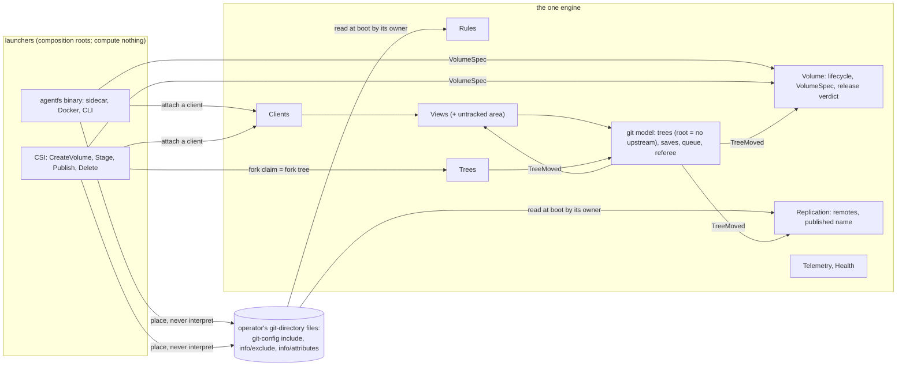

# One engine: the tree views run the sidecar, CSI and CLI (design, system layer)

Status: proposed, rev. 3 (reconciled with `plan.md`, critic F1-F9), for the owner's gate. Read on `main` at 22d55f9.
Nothing built, compiled or run.

Where am I: domain (agreed: [system](docs/target-architecture/system.md) and its domain pages) → **system (this page)** →
service → module → interfaces → implementation. Each milestone below starts at its own architect's gate, one layer down.

**What the owner is asked:** agree the shape (one volume lifecycle for every launcher; each launcher moves when the
goals its users rely on work on trees; then the recording engine is deleted) and answer three questions.

| # | Question | Kind | Section |
|---|---|---|---|
| Q1 | Must every goal a launcher's users rely on today (iac's patches, restore and revert included) work on trees before that launcher moves? | absolute requirement | §5 Order |
| Q2 | Must a sandbox's change always be approved before it lands in its source? | absolute requirement | §5 Order |
| Q3 | What should every tree-view commit say about where it was made? | general guidance | §3 The trailer |

**Changed since your last look:** the trailer question moved here from 5b; the root's published name leaves the
volume's spec for the publisher (M4), per your "i agree with that split"; the preview question is dropped (§7).

## 1. Today

Two engines ship. Every consumer runs the old one; the new one is a trial no consumer can reach.

```text
 sidecar (deploy/sidecar, chart)  ─┐  agentfs init + mount     ┌─ agentfs trees init | fork | mount   (trial CLI,
 Docker examples                  ─┤  (one launcher: the      │    hand-run, flat files, one host, no remote)
 CLI: push, patch, restore ...    ─┘   agentfs binary)        │            │
 CSI driver (agentfs-csi)  ──────────▶ RECORDING ENGINE        └─▶ TREE ENGINE  (git model, conformance, model)
 ✗ no consumer reaches the tree engine      ✗ every new rule is built only on the engine nobody runs
```

Owner, 2026-11-12: "the goal is to have one engine, ostensibly the new tree view. Until its ready, nobody is actually
going to use it." Asked whether to plan moving the sidecar and CSI onto tree views and retiring the recording engine:
"yes. ... this is another oversight in the original plan."

## 2. Requirements, guidance, proposed

**Requirements** (asked as absolute and answered yes, or called a rule):

- R1. A design doc lives until its slice is built; the commit that lands it deletes the page (owner, 2026-11-09: "Yes,
  this is a good idea to record: docs should be written towards future readers"). This page ends with M9.

**Guidance** (his words, dated; revisable):

- G1. One engine (2026-11-12, quoted above).
- G2. `trees init` is a trial: users "should never have to do this manually" (2026-11-12).
- G3. Old formats (2026-11-06): "drop support. we are pre-production and there is no need to worry about "supporting" old concepts".
- G4. Identity vs name (2026-11-12): "It seems more important for an _instance_ of agentfs to know that it is "the root"
  than to have a specially named branch"; on the split (identity in history, the root's branch name configuration at
  the edge, the ref agentfs publishes): "i agree with that split ... But the trailer should be addressed so that it
  records meaningful information". 2026-11-11: "Consumers will configure the name of the root branch." At the 5b gate
  he asked: "why must the branch named be fixed at creation time?"
- G5. Goal-oriented (2026-11-12): "'goal oriented' is a good rubric for any workflow process to consider" (§9 applies it).
- G6. Each phase starts with an architect (2026-11-09: "I want each phase of the work to start with an architect").
- G7. Background, not requirements: `AGENTS.md` "What agentfs is for" (Configuration, Audit) and principles 1-10;
  `rules:global` (no backwards compatibility, no dual paths).

**Proposed** (mine): everything else on this page, labelled as a choice where it appears.

| New term | Meaning | Why needed | Existing term it could be |
|---|---|---|---|
| launcher move | the PR after which one launcher (the `agentfs` binary, or the CSI driver) runs only the tree engine | names each switch point | strangler fig's "route moved" |
| extra | a capability no goal needs, marked "not built" from a launcher's move until its own slice | separates goals from configurations | principle 1's "extra" |
| published name | the branch name a remote shows the root under; the publisher's setting, changeable | G4's split | `agentfs.branch` (M4's gate picks the key) |

Existing terms used as defined elsewhere: volume, `VolumeSpec`, `VolumeState`, `ReleaseVerdict`, `LaunchCap`,
start point ([volume](docs/target-architecture/domains/volume.md)); tree, root, fork, untracked area
([git model](docs/target-architecture/git-model.md) §3); launcher, view host ([system](docs/target-architecture/system.md)).

## 3. Domain model: what the one engine owns

No new bounded context. The launchers compose the domains; the recording engine's own concepts leave.



| Concept | Owner domain | Change this slice imposes |
|---|---|---|
| volume, `VolumeSpec` | Volume | **`create` is idempotent (`ensure`).** Not a domain change: volume.md's states, events and VO1-VO7 stay; today's `agentfs init` is this contract (configuration.md: "safe to run at every start"; "Another volume or branch: exit 1"), and the CSI spec requires it of CreateVolume. `SpecMismatch` is VO5 enforced at a repeated create |
| root's published name | Replication (was `VolumeSpec.root`) | **Leaves `VolumeSpec`.** Your split (G4) makes it edge configuration, the ref agentfs publishes; only the publisher reads it. An agent added it to volume.md (2026-11-11), not an answer. Changeable at any boot. Reopen if you read your answer differently |
| operator settings (rules, remotes, published name) | Rules, Replication | none: each owner reads its files at boot (system §4, "Settings"); launchers only place them |
| CSI fork claim | Trees, Clients | none: a volume fork "becomes an in-volume fork with its own branch" (trees.md); deleting the claim ends the fork |
| untracked area | Rules, Views | none: already agreed (git-model §3, rules.md, views.md); built in M3 |

**Leaves the domain:** frozen copy and `pending/`, front, history service v2, forked volume, the overlay's tmp layer
(views.md: it "goes"), change line and checkpoint, fsync class, the start-branch alarm; each returns only as a slice.

Launcher contract, the only new surface at this layer (TypeScript for reading; the Rust is the code architects'):

```typescript
// volume.md's VolumeSpec less `root`. Built by a launcher from configuration; never typed in production.
interface VolumeSpec {
  name: VolumeName;        // the volume's identity: state area, CSI handle, telemetry label, trailer (Q3)
  start: StartPoint;       // "Empty" or a line on a remote; fixed at create (VO5); example 10's moving uses it
  onRelease: OnRelease;    // "Keep" | "Remove"; a setting, the latest spec's value wins
}

interface Volume {
  // Idempotent. No state: create. Same name and start: recover, take onRelease from this spec.
  // Another name or start: SpecMismatch, before any write.
  ensure(spec: VolumeSpec, by: LaunchCap): Result<VolumeState, EnsureError>;
  stage(by: LaunchCap): Result<VolumeState, VolumeError>;       // views may attach
  unstage(by: LaunchCap): Result<VolumeState, VolumeError>;     // Draining; release judged by Volume
  releaseVerdict(): ReleaseVerdict;                              // CSI DeleteVolume asks this, nothing else
}

type EnsureError =
  | VolumeError                          // volume.md's union, unchanged; FormatsOf refuses a recording state area (G3)
  | { kind: "SpecMismatch"; field: "name" | "start" };   // the only addition
```

Rules, remotes and the published name stay out of the spec: iac writes the include, the engine its own `config`, so
an iac edit is never a mismatch; its owner reads it at the next boot.

**The trailer** records which tree (its identity, 5b), the writer and the cause, as git-model §5 does; never the
published name. From M1 it also records where the commit was made, as Q3 answers. One step owns it: M1, through step
5's one message function.

**Q3 (general guidance): what should every tree-view commit say about where it was made?**

<details><summary>Background</summary>

```text
 older engine today    Agentfs-Namespace: agents  Agentfs-Pod: web-7c9d8  Agentfs-Pod-Uid: …  Agentfs-Node: n1
                       committer agentfs@<volume>…                       (the volume, in the email)
 tree views after 5b   Agentfs-Writer: c3  Agentfs-Cause: Direct  Agentfs-Tree: fork/7     ◀ which tree, who; no where
 from M1 (A)           + Agentfs-Volume: billing  + the four pod lines above, from the launcher's environment
```

Who is `Agentfs-Writer`; when is the commit date. Where matters when volumes share a repository (principle 6) and
for audit ("i want to know who changed what when", 2026-11-03).
</details>

| Option | Gives | Costs | You would see |
|---|---|---|---|
| **A. Volume plus the older engine's pod fields, as trailers, from M1 (recommended)** | nothing today's history records is lost at the move; volumes sharing a repository stay apart | five more lines per commit; pod and node names reach every remote, as today | the picture's last line |
| B. The volume only | shorter commits; no pod or node names on remotes | from M7, history no longer says which pod made a change, as today's does | `Agentfs-Volume: billing` |
| C. As A, with the volume in the committer email, as the older engine does | `git log --committer=…` finds a volume's commits with plain git | git-model §2's "one fixed service identity" changes; "where" read from two places | `agentfs@billing…` |

The answer sets M1's trailer list. 5b records the identity under every option.

## 4. What each launcher needs before it moves

| Capability | Tree views today | Plan home | Needed for | Goal it serves |
|---|---|---|---|---|
| Volume from configuration, idempotent; no hand-run `trees init`; the "where" trailer (Q3) | hand-run | volume.md (`create`); this page (M1) | both | one engine; audit |
| No `main`; history names trees by identity | `main` hardcoded | module-cut step 5b | both | history |
| Root's published name configured | none (no remote) | [root branch name](docs/target-architecture/future/root-branch-name.md), M4 | both | git idioms; any remote |
| Directories, symlinks, non-UTF-8 names, links | flat files only | [beyond flat files](docs/target-architecture/future/tree-views-beyond-flat-files.md) | both | recording is the baseline |
| File metadata: modes, presented owner, times | `0600`, daemon's uid, epoch | **no page** (M2's architect) | both | recording is the baseline |
| Rules and the untracked area | every file recorded | [rules](docs/target-architecture/domains/rules.md), git-model §3 | both | invisible; git idioms |
| Mirrors; history a mirror's reader can read | no remote; envelope tree | [replication](docs/target-architecture/domains/replication.md), step 6, [line map](docs/target-architecture/future/line-map-and-renames.md) | both | any remote; history |
| Telemetry, alarms, liveness, restart in place; recorder source B | partial | [telemetry](docs/target-architecture/future/tree-view-telemetry.md), [health](docs/target-architecture/domains/health.md), module-cut's engine-source row | both | keep operating; principle 10 |
| iac's patches at mount; restore, revert | none | [integrator patches](docs/target-architecture/future/integrator-patches.md) | both, under Q1 = yes | Configuration; recovery |
| Forks: create, end, drop; CSI composition | `--sandbox` | [trees](docs/target-architecture/domains/trees.md); **no page** (M8's architect) | CSI | one engine |
| Landing approvals | every landing accepted | [landing approvals](docs/target-architecture/future/landing-approvals.md) | CSI sandboxes, Q2 | (policy) |
| Several view hosts (example 4); moving (10); LFS (11); nested forks (6); fsync class; transactions; upgrade drain; space limits | none or model only | their future pages | extra | none: configurations |

**The untracked area's residual** (no question): whether its files get ordinary Linux open semantics, and what a fork
sees of its source's. M3's architect decides both under git-model §3.

## 5. Order

```mermaid
flowchart LR
  S6["6 model: transactions, mirror leaves World (in flight)"] --> P["plan PR (docs)"] --> S5b["5b tree identity"] --> S5["5 split tree_actor"] --> M1["M1 volume from configuration, where trailer; tracer starts"]
  S5 --> S7["7 checker reads git (model; beside M1)"]
  M1 --> M2["M2 directories, symlinks, metadata"]
  S7 --> M2
  M2 --> M3["M3 rules + untracked area"] --> M4["M4 mirrors, published name, readable history"] --> M5["M5 telemetry, health, recorder source B"]
  M5 --> M6["M6 patches, restore, revert (Q1)"] --> M7["M7 agentfs binary moves: sidecar, Docker, CLI"]
  M7 --> M8["M8 CSI moves (Q2)"] --> M9["M9 delete the recording engine"] --> X["extras, one slice each"]
```



- **Two launcher moves, not one cutover.** Docker, the sidecar and the CLI share one launcher, the `agentfs`
  binary's `init` and `mount` (`examples/docker/compose.yaml`, `deploy/sidecar/deployment.yaml`), so they move together.
- **Between M7 and M9 the binary ships both engines**, the CSI driver's path still on the old one. Each path runs
  exactly one engine; nothing selects. Both engines' CI runs on every PR until M9.

**Q1 (absolute requirement): must every goal a launcher's users rely on today work on trees before it moves?**

<details><summary>Background</summary>

```text
 goal (AGENTS.md)                 who relies on it today        on trees
 Configuration: iac and agent     sidecar (example 3), CSI      M6: iac's patches, applied at mount as today
   both edit config               volumes with a patch remote
 Recovery: restore, revert (p.8)  every operator               M6
 several pods, moving, LFS ...    some configurations           extras: "not built" for a while
```

Binding sentence: "A launcher moves to the tree engine only when every goal its users rely on today works there."
It rules out moving the sidecar without iac's patches.
</details>

| Option | Gives | Costs | The owner would see |
|---|---|---|---|
| **Yes (recommended)** | the origin problem (iac and the agent both editing configuration) stays solved; operators keep restore and revert | M6 is on the path to M7: the recording engine lives one slice longer | patches and restore work through the move |
| No: goals may lapse until their slice | M7 sooner by one slice | from M7 until M6 lands, iac cannot change a running agent's configuration; recovery is plain git by hand | example 3 marked "not built" for a while |

A yes becomes a requirement and fixes M6 before M7; a no moves M6 after M9.

**Q2 (absolute requirement): must a sandbox's change always be approved before it lands in its source?**

<details><summary>Background</summary>

```text
 today, example 5 (CSI sandbox claim)          on trees until landing approvals is built
 sandbox writes → claim deleted → fork's       sandbox writes → close → the source's queue takes it →
 change pushed → a receiver delivers it to     lands in the source and its remotes, no one asked
 the inbox → applied at the source's next start
 (the sidecar's overlay, example 12, is not gated: his 2026-10-30 "have it reflected back in the main container")
```

Binding sentence: "A sandbox fork made through the CSI driver never lands in its source without an approval." It
rules out moving CSI sandboxes before landing approvals is built.
</details>

| Option | Gives | Costs | The owner would see |
|---|---|---|---|
| **Yes; CSI moves at M8 with sandbox claims refused until approvals is built (recommended)** | no unreviewed landing ever; M9 not held by approvals | example 5 is "not built" from M8 until approvals lands | a sandbox claim fails with a clear event meanwhile |
| Yes; approvals built before M8 | example 5 keeps working throughout | landing approvals and timing, a large unbuilt slice, sits on the deletion path | nothing changes for sandboxes |
| No: ungated for a while | fastest | an agent's mistake in a sandbox reaches the source's history and remotes; undone by `revert` (M6) | sandbox output lands at once |

The answer picks M8's scope.

## 6. What happens to the recording engine

At M9, one PR series (each green alone), no flag and no fallback.

| Part | Fate |
|---|---|
| Recording domain logic (journal of frozen copies, pending, history service v2, volume forks, checkpoints, fsync class) and the passthrough FUSE layer | deleted |
| Adapters the tree engine reuses: SSH and HTTP transports, credentials, the fast-forward claim, repack, the `git` runner, locks, sockets, mountinfo, failpoints, OpenTelemetry plumbing | kept, re-homed under the domain that uses them (M4, M5); M4 records the transports' reuse in architecture.md's "Technology choices" |
| The patch queue, restore, revert | rebuilt on trees in M6 (Q1); the old code deleted at M9 |
| LFS, `serve-git` | deleted at M9; each extra's slice brings back what it needs from history |
| Library, human docs, runbooks, charts, examples, alert rules | rewritten in the milestone that changes the behaviour; recording-only pages deleted at M9 (`plan.md` lists each) |

**Existing recording volumes** (G3): refused at boot by the agreed format check (`FormatsOf`, system §4); no
converter, no new error. To move one, create a volume from configuration and copy the files in through its mount, as
deployment.md §10's migration Job does. The old history stays on its remotes under `refs/heads/agentfs/<volume>`. If
the new root is published under that same name on that remote, its first push is not a fast-forward: Replication
saves it as a divergence and alarms (principle 7), never overwrites. The upgrading runbook says to pick another name.

## 7. Tracer bullet (system layer)

From **M1**, a CI job on the shipped image, in the Docker example's shape (an agentfs container and an unprivileged
workload container), on the trial `trees` commands driven from configuration:

1. a configuration file → `ensure` → mount; a second `ensure` recovers; another `name` refuses;
2. the workload writes `a.txt`: saved in the root's history before `close` returns, with its where trailers (Q3);
3. agentfs is killed mid-write; restart in place: every answered write saved.

Each milestone adds its step: M2 a directory and an executable bit; M3 a database file in the untracked area, never
in history; M4 a refusing remote (filesystem keeps working), then the push under a configured
name; M5 the alarm at a collector; M6 a producer's patch at the next mount, and a `restore`; M7 the same steps through
the sidecar on kind with `agentfs init`/`mount`; M8 a CSI volume and a fork claim. Non-goals: several pods, LFS,
database groups, nested forks, transactions, upgrades.

**No preview** (recommended as shown; rev. 2's Q3 dropped): users move at M7. A preview before then would be a second
way to mount, a dual path the global rules forbid unless you ask for one.

**Design it twice.** Shape 1 (chosen): one volume lifecycle for every launcher, `ensure` from configuration. Shape
2: each launcher drives the engine its own way (the sidecar creates on first mount; CSI writes state areas itself,
as `agentfs-csi` does today). Shape 2 is less code at first; it keeps three lifecycles for one process, which "one
shared model" rejects, and judges release in two places. Shape 1 gives up create-on-first-mount: a launcher must
always say what volume it wants.

## 8. Gates

Every milestone: architect, implementer, one review, one fix round, ci and image green on the PR (G6). On top: one
`phase-1.yml` dispatch where the tree engine changes (73 min measured); the full model gate where a rule changes
(M2's directories and symlinks; ~41 min on the design machine); the tracer job from M1; and at M7 and M8 a
release-build run of the tracer against `ci/bench-budget.json` (a design choice). A miss holds that launcher's move
and pulls [save and take speed](docs/target-architecture/future/save-and-take-speed.md) in front of it. Today's
figures (debug, one runner): a 100 MiB save takes 339 s. `plan.md` totals the CI cost.

## 9. Goal coverage (G5)

| Goal | Delivered by |
|---|---|
| One engine (G1) | M1 (no hand-run init), M7 and M8 (launchers), M9 (delete) |
| Configuration: iac and the agent both edit it | M6, before M7 (Q1) |
| Audit; recording is the baseline (1) | built (a write is journaled before it returns); M1 (where, Q3); M2 (every kind of change recorded or refused loudly); M3 (only operator rules skip a path) |
| Invisible and untouchable (2) | built (state outside the mount); M3 (untracked area, profiles); M4 (credentials never in a view) |
| Git idioms (3) | M1 (operator files as a git-config include); M3 (`info/exclude`, `info/attributes`); M4 (the published name's key; plain files on the mirror) |
| Keep operating (5) | M4 (retry), M5 (alarms, liveness, restart in place) |
| Any remote, or none (6) | M1 (zero remotes is a valid volume), M4 |
| History is the product (7) | 5b (identity); M1 (where); M4 (never forced, divergence saved); §6 (a name clash diverges loudly) |
| Recovery, manual but supported (8) | M6 (restore, revert); runbooks rewritten in M4-M8 |
| Merging is an extra (9) | M6 (patches at mount only, as today) |
| Three layers; OpenTelemetry for everything observable (10) | each milestone writes its layer's library page; M5 (telemetry and recorder source B: "we probably need A+B eventually", 2026-11-11) |

## 10. Design rules (design choices)

1. **Each launcher path runs one engine.** A launcher's move replaces its path in one PR; no flag, setting or
   fallback selects an engine. Both engines ship only while a launcher waits (M7 to M9).
2. **One volume lifecycle for every launcher.** Sidecar, Docker, CLI and CSI build a `VolumeSpec` and call the same
   `ensure` and `stage`; release is judged only by Volume; operator files are read only by their owners.
3. **Goals decide when a launcher moves.** A capability holds a move only if a §9 goal its users rely on needs it
   (Q1) or the owner's policy does (Q2); everything else is an extra, marked "not built" until its slice.

## 11. Costs and deferrals

- **Scope moves materially:** nine milestones after 5b, 5 and 7, every crate, doc, chart and workflow.
- Extras go dark from a launcher's move until their slice: several pods on one CSI volume, moving, LFS, nested forks.
- Two pages to write (file metadata, CSI on trees); M2 needs new model rules, the costliest gate.
- History of existing volumes does not continue inside new ones; a reused ref name diverges (loud, never lost).
- Not planned: a converter; an engine flag; mirror-back (PRs from a forge into the root).

**Prior art.** Strangler fig (Fowler); parallel change (Sato); branch by abstraction rejected (a dual path); tracer
bullet (Hunt, Thomas); idempotent create (CSI `CreateVolume`, `git init`); `include.path`; composition root (Seemann).

## For the code architects (parked)

`ensure`'s storage of the spec (audited); where CSI calls `ensure`; the CLI's final verbs; the untracked area's open
semantics (M3); where the reused transports land; the view host process model; which CI scripts change, job by job;
what renaming the published name does to the old remote ref (M4).

## Reconcile with existing code

- `trees_cmd.rs` serves the tracer from M1 and folds into `init` and `mount` at M7; `agentfs trees` goes then.
- `agentfs-csi` stops writing state areas and supervising fronts; it calls `ensure`, `stage` and one view host per
  publish; its release scan goes (Volume drains). Cost: most of `agentfs-csi`.
- `tree_view.rs`'s `0600`, daemon uid and epoch times are fixed in M2: every tree test that reads modes changes.
- volume.md: the plan PR removes `root` from `VolumeSpec` (line 63); M1 writes `create`'s idempotence and
  `SpecMismatch` there. `agentfs init`'s "another branch" refusal goes with the recording engine (M9).
- The plan PR lands this page as `future/one-engine.md` (README, SUMMARY); M9 deletes it.

## Review disposition

Accepted: 1 untracked area in M3; 3 goal coverage; 4 speed bar a choice; 5 `VolumeSpec` (owners read their files,
`FormatsOf`); 6 the name is not identity; 7 ref collision (§6); 8 altitude. 2 in part; refuted: Docker cannot move
alone, it shares `agentfs init` and `mount` with the sidecar (`examples/docker/compose.yaml:44,53`).

**Reconcile (`plan.md`, critic F1-F9).** F1: the published name leaves `VolumeSpec` for M4, the publisher, which
owns its key and deletes root-branch-name.md. F2: the trailer's "where" has one owner, M1, and one
question, Q3 (moved from 5b); milestone numbers are this page's everywhere. F4: §5 is the one order. F6: `ensure` is
shown not to be a domain change (§3); the `root` move restates G4 and is shown, not hidden. F7: M5 homes recorder
source B; `plan.md` owns every page. F8: §8 uses measured figures. F9: rev. 2's preview question is dropped.
