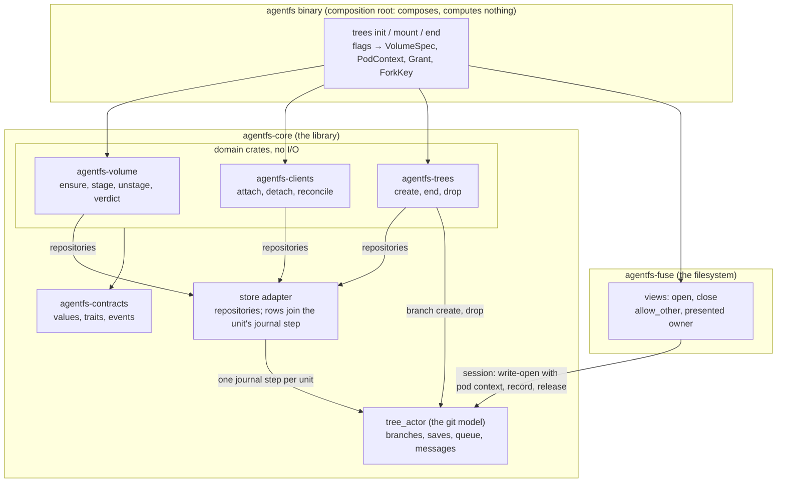

# One engine M1: volumes and their lifecycle (design, module layer)

Status: proposed, rev. 2, for the owner's gate. Read on `trees/module-cut-step-6` at b975dec (after module cut 5.3).
Nothing built, compiled or run.

**Where this sits.** Domain (agreed: `domains/volume.md`, `clients.md`, `views.md`, `trees.md`) → System (agreed:
`system.md`, `future/one-engine.md`) → Service (skipped: in M1 one process serves a volume) → **Module (this page)** →
Interfaces → Implementation.

**What you are asked.** One question, then approve the page as the plan for M1's six slices on the one PR. A second
question, on speed, comes after slice S2 with release-build figures.

| # | Question | Kind | Section |
|---|---|---|---|
| Q1 | May the volume's own records be git refs in its repository, rather than a database behind an ORM? | general guidance | [Where things are stored](#4-where-things-are-stored-and-audited) |

**What changed since rev. 1.** The name and id moved to a file read before any write; write-opens journal their pod
context; landings name their writer (an engine bug, fixed in S1); settings wait for their first owner; the speed
question waits for S2; rev. 1's Q2 is decided (no copy of iac's settings).

## 1. Today

The tree engine runs only from the trial CLI. It has no volume identity, no lifecycle and no idea where it runs.

```text
 agentfs trees init ──▶ Volume::open(state)   creates on ANY empty dir; no name, no id   ✗ no identity
 agentfs trees fork ──▶ volume.fork()          a branch; no key, no settings, no row    ✗ no fork lifecycle
 agentfs trees mount ─▶ serve(bindings)        writer = a free --writer label           ✗ no clients
                         mount ACL = Owner     files 0600, owner = the daemon's uid      ✗ other users refused
                         exit = unmount all    no drain, no release verdict              ✗ no lifecycle
 every commit:  Agentfs-Writer / Cause / Tree / Event / Format                          ✗ no pod context
 a landing merge: Agentfs-Writer: agentfs   (git-model §5: its second parent's writer)  ✗ engine ≠ spec
 phase-1.yml: runs on a dead branch and on dispatch only                                 ✗ core tests not on PRs
```

## 2. Requirements, guidance and new terms

**Requirements.** One: a design doc exists only until its slice is built (owner, 2026-11-09, asked as an absolute
requirement: "Yes, this is a good idea to record: docs should be written towards future readers"). Every other line
below is guidance.

| ID | The owner's words (dated, `OWNER-GUIDANCE.md`) | What M1 does with it |
|---|---|---|
| G1 | 2026-11-12: "the goal is to have one engine, ostensibly the new tree view" | M1 builds the four domains a launcher composes |
| G2 | 2026-11-12: "I want a baseline build to verify functionality when integrated with a target application" | M1 is on the baseline's path; nothing deferred blocks it |
| G3 | 2026-11-12, picked "A": each volume gets a UUID at create; the trailer carries its UUID and name | volume id, identity trailers |
| G4 | 2026-11-12, "ok" to: the volume and the pod fields (namespace, pod, pod UID, node) as trailers, from M1 | the pod trailers |
| G5 | 2026-11-11: "refs/heads/main should not be special or hardcoded" | M1 names no published branch; `--branch` waits for M4, which owns the published name (one-engine.md) |
| G6 | 2026-11-12: "The default should be automated landing" | `Landing::Automatic` is the only landing until approvals are built |
| G7 | 2026-11-12: "We should have CI on the core tests. But the extensive randomized tests should be an explicit manual test" | `phase-1.yml` tiers |
| G8 | 2026-11-12: "go ahead and break things. we are not at a 1.0.0 release yet" | trial format 3 is refused, not converted |
| G9 | 2026-11-12: "dont say sandbox" | new surfaces say fork; `--sandbox` goes in S5 |
| G10 | 2026-11-13: "i only want one PR at the end"; "Keep going" | M1 is six slices on PR #39, not PR series |

Background, not requirements: the global rules and AGENTS.md's principles, chiefly 1, 2, 3, 5 and 10. Terms
from the agreed pages keep their homes: `LaunchCap`, `Principal`, `Stamp` (`system.md`); `Grant`, `ClientLabel`,
`ClientSet`, `Binding`, `SessionId` (`clients.md`); `ForkKey`, `ForkFacts`, `TreeRef` (`trees.md`); `ViewId`,
`MountPoint` (`views.md`).

| New term | Means | Why needed | Existing term it could be |
|---|---|---|---|
| pod context | where a writer ran: namespace, pod, pod UID, node, each optional; its trailers are the "pod trailers" | G4 | the recording engine's `Context` and `Pod` flags: **same name and flags, reused** |
| volume identity file | the file `volume` in the state area, beside `format`: the volume's name and id | the one home of the name and id, readable before any write | `agentfs.volume` in the recording engine's git config |
| tracer job | the CI job that runs M1's thin end-to-end path on the shipped image | the plan's tracer | — |

## 3. The proposed shape

One library crate per domain, each pure over ports (`system.md` §6); agentfs-core keeps the adapters and the git
model; agentfs-fuse keeps Views; the binary composes.



| Module | Takes | Gives | Never |
|---|---|---|---|
| `agentfs-volume` | a `VolumeSpec`, the launcher's pod context, facts asked of Clients, the queues and settlement | `Ensured {id, state}`, `VolumeState`, the release verdict, `VolumeDraining/Staged/Released` | creates anywhere but at `ensure`; writes before the identity check |
| `agentfs-clients` | a `Grant`, a label, the client's pod context | `Binding`, `ClientId` (the writer), `AttachmentEnded`, `LastDetached` | judges liveness; ends a client on a timer |
| `agentfs-trees` | upstream, optional key, `ForkSettings` | `ForkId`, `ForkEnded`, `ForkDropped` | moves a branch itself (asks the git model) |
| views (agentfs-fuse) | a `Binding`, a mount point, mount options | a mounted view; `ViewCaughtUp` | names a client or tree in a call to the actor |
| store (agentfs-core) | each domain's rows | rows in the unit's journal step, audit stamps, outbox | lets a domain see another's rows |
| `tree_actor` | sessions' calls with a pod context per write-open; Trees' branch requests; a unit's row changes | commits with every trailer, `TreeMoved` | knows volumes, clients or pods beyond the pod context it is handed |

Smaller choices, recommended as shown: the service and view hosts share one process in M1 (in-process
`TreeSession` handles); `tree_actor::Volume` becomes `TreeActor`, freeing "Volume" for the domain.

## 4. Where things are stored, and audited

The name and id are read before any write; every other record joins the journal, the one commit point.

| State | Owner | Stored | Audited by |
|---|---|---|---|
| the volume's name and id | Volume | the volume identity file, written by `ensure` at create before `format`, read first at every start | the Root commit records the create; every commit, the identity it was written under |
| lifecycle (Staged, Draining, Released) | Volume | a row | the row's stamps |
| clients, fork writer claims, ordinals | Clients | rows | stamps |
| forks: key, settings, Open/Ended/Dropped | Trees | rows, in the same journal step as the branch's pointer change | stamps |
| a launcher's pod context | the launcher | given at every start and attach; journaled with each write-open | each commit's pod trailers |
| operator settings | their owners (Rules M3, Remotes M4, Patches M6) | built with the first owner: the operator's git-config files, named by `include.path` | iac's own repository |

Every row carries `created` and `changed` stamps (time, `Principal`), written by the store.
The trial CLI is the launcher `agentfs-cli`.

**Q1. May the volume's own records (clients, forks, lifecycle) be git refs in its repository, rather than a database
behind an ORM?** *General guidance: which way should this lean?*

<details><summary>Background</summary>

```text
 one journal step: the volume's one commit point, power-loss tested
 ┌────────────────────────────────────────────────────────────────────────────┐
 │ refs/heads/fork/3        → the fork's new branch                            │
 │ refs/agentfs/trees/3     → a row commit: {key, landing} + created, changed │
 └────────────────────────────────────────────────────────────────────────────┘
          both are in history after a crash, or neither is
```

Your rule (2026-10-24): "all db operations should be contained within data/repository/ORM/ODM layers backed by
soft-delete libraries". M1 keeps three small kinds of record, tens of rows per volume. Every option keeps the domain
crates behind repository interfaces.

| | A. Rows as git refs (recommended) | B. SQLite behind an ORM, beside the journal | C. New journal record kinds (rev. 1) |
|---|---|---|---|
| Gives | one commit point with no new store; each row's commits are its event log; Gerrit stores its review data this way (NoteDb) | your rule as worded; the ORM stamps audit fields | one commit point |
| Costs | no query layer: repositories list rows by ref prefix; agentfs's store adapter stamps the fields | two commit points: a crash between a fork's branch and its row leaves one without the other, so create and drop need a recovery protocol; a second store for the power-loss tests | a hand-written codec and compaction; three domains' records in the commit point's format |
| You would see | nothing; rows are never published (M4 publishes only the published name) | nothing, until that crash | nothing |

Your answer sets slice S3 only.
</details>

## 5. Canonical shape

**Domain changes this imposes** (on the agreed domain pages, for your review):

| Page | Change | Why |
|---|---|---|
| Volume | `StartPoint` has one variant, `Empty`, until the line start is built; the spec's home is the volume identity file | an unbuilt start cannot be asked for; the identity is checked before any write |
| Volume | `stage` takes the launcher's pod context; the upgrade drain, `accept_start` and `start_line` wait for their slices | the service's own commits need a pod context; the upgrade drain has no milestone (finding F3) |
| Clients | `attach` takes the client's pod context | pod trailers per commit; in CSI (M8) each publishing pod is its own |
| Clients | M1 builds `attach`, `detach`, `reconcile`, `attached`; `rebind`, `advance`, `end`, `actor` wait | in M1 a view host dies with the service |
| Trees | M1 builds `create`, `end`, `end_keyed`, `facts`, `live` and the drop; `Landing` has one variant; `pin` and quotas wait | no consumer needs them before the baseline |

| Pattern | Canonical source | Where |
|---|---|---|
| Idempotent create, guarded | CSI `CreateVolume` | `ensure` |
| Identity apart from attributes | Evans, *Domain-Driven Design*; Kubernetes `uid` | `VolumeId` beside `VolumeName` |
| Repository, Unit of Work | Fowler, *PoEAA* | the store adapter |
| Metadata as git refs | Gerrit NoteDb | rows (Q1, A) |
| Transactional outbox | Richardson, microservices.io | events in the row's step |
| Ports and adapters | Cockburn | domain crates over traits |
| Tracer bullet | Hunt and Thomas, *The Pragmatic Programmer* | slice S1 and the tracer job |

## 6. Design rules (design choices)

1. **One creator; identity read first.** Only `ensure` creates a volume, writing its name and id into the volume
   identity file before `format`. Every later start reads both files before it writes anything, so another name or
   format is refused with the state area unchanged. Trailers record the identity; nothing reads them back.
2. **The pod context travels with the writer.** A write-open's journal record carries its client's pod context, so
   every commit, a recovery's close included, carries its writer's. A landing merge names the writer and pod context
   of the commit it lands (git-model §5; `agentfs` for a sync). Root and Sync commits carry the service's.
3. **Every row commits with the change it belongs to.** Volume, Clients and Trees rows change only through their
   repositories, inside the same journal step as the branch changes of that unit. There is no second commit point.

## 7. Interfaces

Rust, as in the domain pages. Error variants not listed are the domain pages'.

```rust
// ── agentfs-contracts: values (no I/O) ──
pub struct VolumeName(/* private */);   // validated as `agentfs init --volume` validates today
pub struct VolumeId(Uuid);              // random (RFC 9562 v4); assigned once, by `ensure`, at create

pub struct VolumeSpec {
    name: VolumeName,
    start: StartPoint,
}

#[non_exhaustive]
pub enum StartPoint {
    Empty,                              // the only start M1 builds; `Line` arrives with its slice
}

pub struct PodContext {                 // where a writer ran; a field the launcher lacks is absent, never guessed
    namespace: Option<Label>,
    pod: Option<Label>,
    pod_uid: Option<Label>,
    node: Option<Label>,
}
```

```rust
// ── agentfs-volume ──
pub trait Volume {
    /// Idempotent, at every start. Reads `format` and the identity file before any write: another
    /// format → OtherFormat, another name → SpecMismatch(Name). No state area: create (new id).
    /// Same name: recover.
    fn ensure(&mut self, spec: VolumeSpec, at: &PodContext, by: &LaunchCap) -> Result<Ensured, VolumeError>;
    fn stage(&mut self, at: &PodContext, by: &LaunchCap) -> Result<VolumeState, VolumeError>;
    fn unstage(&mut self, by: &LaunchCap) -> Result<VolumeState, VolumeError>; // Staged → Draining(Stop)
    fn release_verdict(&self) -> ReleaseVerdict;                                // asks every judge now
}

pub struct Ensured {
    pub id: VolumeId,
    pub state: VolumeState,
}

pub enum VolumeError {
    NotPermitted,               // a fork launcher (VO6)
    NotCreated,                 // stage on a location `ensure` never created: mount never creates
    SpecMismatch(SpecField),    // Name (Start joins with the line start)
    OtherFormat,                // another format (the trial's format 3): refused, never converted
    NotDurable(IoKind),
}
```

```rust
// ── agentfs-clients (M1 surface) ──
pub trait Clients {
    fn attach(
        &mut self,
        g: Grant,                // live_read_write | live_read_only; acts_as = the presented owner
        label: ClientLabel,      // today's --writer label
        at: PodContext,          // where this client runs
        s: SessionId,
        by: &LaunchCap,
    ) -> Result<Binding, ClientError>;
    fn detach(&mut self, c: ClientId, by: &LaunchCap) -> Result<(), ClientError>; // idempotent
    fn reconcile(&mut self, live: ClientSet, by: &LaunchCap) -> Vec<ClientId>;    // ends this launcher's others
    fn attached(&self, t: TreeRef) -> ClientSet;
    fn attached_any(&self) -> ClientSet;
}
// ClientError as clients.md. Until Rules (M3) every view profile is `ViewProfileId::everything()`.

// ── agentfs-trees (M1 surface) ──
pub trait Trees {
    fn create(
        &mut self,
        upstream: TreeRef,       // Root only in M1
        key: Option<ForkKey>,    // a second create under a key returns its fork
        settings: ForkSettings,
        by: &LaunchCap,
    ) -> Result<ForkId, TreeError>;
    fn end(&mut self, f: ForkId, by: &LaunchCap) -> Result<(), TreeError>;
    fn end_keyed(&mut self, key: &ForkKey, by: &LaunchCap) -> Result<(), TreeError>;
    fn facts(&self, f: ForkId) -> Option<ForkFacts>;
    fn live(&self) -> Vec<ForkId>;
}

pub struct ForkSettings {
    landing: Landing,
}

#[non_exhaustive]
pub enum Landing {
    Automatic,                   // the only landing M1 builds (G6); approvals arrive with their slice
}

pub enum TreeError {
    UpstreamUnknown,
    NestedNotBuilt,              // a fork as upstream: deferred (nested forks)
    NotPermitted,
    Ended,
    KeyUnknown,
    Io(IoKind),
}

// ── views, agentfs-fuse ──
pub trait Views {
    fn open(&mut self, at: MountPoint, b: Binding, o: MountOptions) -> Result<ViewId, ViewError>;
    fn close(&mut self, v: ViewId);
}

pub struct MountOptions {
    allow_other: bool,           // default on, `--no-allow-other` off, as the recording mount
}
```

**The trailers.** Six keys join every tree-view commit through `Message::render`'s shared part. The four pod keys
are the recording engine's, spelled the same. `message.rs` gains readers of the writer and pod trailers beside
`tree_of`, for landings.

| Key | Value | On |
|---|---|---|
| `Agentfs-Volume` | the volume's name | every commit, the Root commit included |
| `Agentfs-Volume-Id` | the UUID | every commit |
| `Agentfs-Namespace`, `Agentfs-Pod`, `Agentfs-Pod-Uid`, `Agentfs-Node` | the writer's pod context (rule 2) | when the launcher gave the field; absent otherwise |

The model already names a landing's writer as rule 2 does, so the model and its digests do not move. The engine's landing writer does move: conformance gains the
invariant that a landing merge's writer and pod trailers equal its second parent's (`one_writer` checks only that
there is one). git-model §5 gains one sentence for the new keys.

**How a launcher passes its pod context.** By the recording engine's flags `--namespace`, `--pod`, `--pod-uid`,
`--node` and their `AGENTFS_*` variables, filled by Kubernetes' downward API, in one shared argument group; not
`--replica`. The CSI driver (M8) passes each publishing pod's context at `attach`.

**What the trial CLI takes.** `trees init`: `--volume` (`AGENTFS_VOLUME`) and the pod flags; `--branch` is refused
("the published name is M4's"). `trees mount`: the pod flags, `--owner UID:GID` (the owner every file is presented as
until M2; root reaches it too), `--no-allow-other`; mount never creates. From S5, `--fork-key K` replaces `--sandbox`,
`--fork N` and `trees fork`: it creates the keyed fork or returns it, and `trees end --fork-key K` ends it. After a
restart a fork's spent writer claim (C4) allows `--read-only` only, until `rebind` is built.

## 8. Speed: figures first

Slice S2 measures a release build of the tree views and reports, beside each figure, the guarantee behind it: the
tree engine commits before `close` returns; the recording engine journals before `close` and commits afterwards
(`create.drain_s`). The tree views take only flat files until M2, so the workloads are flat and scaled to finish in
the tracer job.

| Workload | Recording engine's budget | S2 reports |
|---|---|---|
| close of a 4 KiB file, 200 times | p50 3.5 ms (`record close 4k`) | p50, p99 |
| 1,000 files created in one directory | 600 s for 100,000 (`create`) | total, and the 100,000-file extrapolation |
| close of a 64 MiB file, to history | 7–12 s for 1 GiB (`bigclose`) | total, and the 1 GiB extrapolation |

Today's only figures are debug builds (~96 ms a save; 100 MiB converged in 339 s, `performance.md`), so the
extrapolations may run to hours. S2 ends with a question for you, with these figures: what bar holds a launcher's
move (M7's gate). Until then the step only warns.

## 9. Slices on the one PR

Each slice is green alone (fmt, clippy, tests, ci and image). "Full run" is `phase-1.yml` with its seed shards, by a
manual dispatch on the branch; "core" is its core tier, on every push from S1.

| # | Slice | Done when (the test that shows it) | Mutation probe (must turn a test red) | Run |
|---|---|---|---|---|
| S1 (tracer) | **Identity and pod context.** `ensure` with the identity file; format 4 (identity file, write-opens journaled with their pod context) refuses format 3; the six trailers; landing merges name their writer (closing the engine's divergence); pod flags; `trees mount` with allow_other and `--owner`; `--volume` in every `trees` caller (§10); `phase-1.yml` gains PR and `main` triggers; tracer steps 1–3 | tracer green; `ensure` three times gives one id; another name, or format 3, leaves the state area byte-identical (hashed before and after); a write-open killed and recovered under another pod context commits with its writer's; the landing invariant holds in the core tier | recover makes a new id; check the name after the journal opens; recovery writes the restarted launcher's pod context; a landing writes `agentfs`; mount without allow_other | full |
| S2 | **Release figures.** Tracer step 4: §8's workloads on the shipped image's release build, both filesystems, a JSON report with each guarantee | the report lists every workload with its figure and extrapolation | a planted 50 ms delay in the save path shows as a warning | core |
| S3 | **Store.** Repositories and rows as Q1's answer sets them; stamps by the store; rows join a unit's journal step | a failpoint inside a unit's step: after reopen both the branch and its row, or neither; `created` survives a change and compaction | write the row in its own step; restamp `created` on change | full |
| S4 | **Clients and views.** `attach`, `detach`, `reconcile`; `ClientId` as `Agentfs-Writer`; the writer claim; in-process sessions; `Views::open` with a `Binding` | a second read-write attach to a fork is `ForkTaken`, also after a restart; kill with three clients, reopen: all end, `LastDetached` once per tree | delete the claim at detach, not at `ForkDropped`; publish `LastDetached` per client | full |
| S5 | **Fork lifecycle.** `create` with key and settings, `end`, `end_keyed`, the drop; `LastDetached` ends an unkeyed fork; `--fork-key` and `trees end` in the trial CLI, the conformance harness and the `--sandbox` scripts (power-loss included) | a second `create` under a key returns the same fork; an ended fork with a queued save drops only after the take, its collision ref kept | ignore the key; drop before the queue empties | full |
| S6 | **Volume lifecycle.** `stage`, `unstage`, the Stop drain, the pure `decide`; settlement bound to "no remotes" until M4; SIGTERM unstages | `decide` over every combination of facts; SIGTERM with one 4 KiB file open: saved, `Released`, exit 0; `stage` during a Stop drain cancels it | `decide` skips `QueuesNotEmpty`; release with a client attached | core |

**The tracer job** (`image.yml`, `ci/e2e-trees-tracer.sh`), in the Docker example's shape: init and mount in a
privileged agentfs container; a workload container as `10000:10000` sharing the mount by propagation.

1. `trees init --volume t` from flags; again: same id; `--volume u` at the same state: refused, nothing written.
2. The workload writes `a.txt`: in the root's history before `close` returns, with the volume and pod trailers.
3. agentfs is killed mid-stream, lazily unmounted and mounted again at the same path; the workload restarts too (M5 owns
   a live one). Every write it saw answered is in history with its pod trailers.
4. (S2) the flat workloads on the release build, with their figures and extrapolations.

**Bead outline.** Epic M1 → S1 identity and pod context (tracer) → S2 release figures → S3 store → S4 clients and
views → S5 fork lifecycle → S6 volume lifecycle. S2 needs only S1; S4 to S6 need S3.

## 10. Costs, deferrals and findings

**Costs.**
- Call sites: 135 of `tree_actor::Volume::open` (106 in one test file); 53 `trees` calls in 11 `ci/` scripts and
  `trees-restart.py`; the conformance mounted harness. The trial `--sandbox`, `--fork N` and `trees fork` go, and a
  fork's writer cannot write again after a restart until `rebind` is built (C4).
- Format 4: six trailers on every commit, the pod context in each write-open record, landing merges name their
  writer (engine tests that expect `agentfs` change); trial state areas are refused.
- CI: four full runs (S1, S3, S4, S5), ~73 min and 300 runner-min each; the core tier, ~20 min and 41 runner-min, on
  every push from S1; the tracer job, unmeasured (placeholder: 10 min).
- One owner per mount until M2 (plan, one-engine.md M1 and M2): root and the `--owner` user reach a tree mount, other
  non-root users are refused, and every writer through one mount is one client, as in the recording engine.
- No rename in M1 (a rename, if M4 wants one, changes only the identity file); a fork has no space limit until its
  slice.

**Deferred** (each to the slice that owns it): settings, at their first owner (M3 or M4), with the home decided here;
that owner's table of the sections each owner reads, where a section of an unbuilt owner gets the plan's standing
alarm (one-engine.md M7) and the filesystem keeps working; agentfs's own copy of the settings' content (rev. 1's Q2,
option B); line starts and `accept_start`; the upgrade drain and family check; pinned snapshots; `rebind`, `advance`,
operator `end`; the socket between view hosts and the service; fork quotas; a settings digest event (M5).

**Findings for the plan (`future/one-engine.md`), reported, not changed here.**
- F1. "PR series" contradicts G10: read "slices on the one PR", and a full run per slice that changes the journal, a
  save or a landing.
- F2. M1's budgets name "a clone"; the tree views have no directories until M2, so the clone moves to M2.
- F3. The upgrade drain and the family check (system.md §4, Volume VO7) have no milestone. Recommended: a row in
  "Deferred extras" ("until then a release that changes a format refuses the old state area at boot").
- F4. `[phase1-seeds]` works only on a push event, not `pull_request`; the manual trigger is a dispatch on the branch.
- F5. The plan builds "operator files as a git-config include" in M1; with no owner built, M1 only decides the home.

## For the code architects (parked)

The row ref layout and how a unit's rows join the actor's step; the outbox's dedup key; the Clients index rebuilt at
boot; whether conformance's writer comparison maps model writers to `ClientId`s; the `uuid` crate and its entry in
architecture.md's "Technology choices"; the clap argument group shared by both engines' pod flags.

## Reconcile with existing code

| Code today | M1 | Cost |
|---|---|---|
| `tree_actor::Volume::open` creates on any empty directory | `TreeActor::create`, only from `ensure`; `open` answers `NotCreated` | the call sites above; a test helper keeps them one line |
| `prepare_state_area` writes `format` last; `FORMAT = agentfs-trees-3` | the identity file before `format`, under the same marker; format 4 | trial areas refused (G8) |
| `OpenRecord { handle, tree, writer, object, anonymous }` | plus the writer's pod context | journal format 4, in S1 |
| `Message::Landing` renders `Agentfs-Writer: agentfs` | the landed commit's writer and pod context | a reader in `message.rs`; a conformance invariant |
| `tree_view.rs`: `SessionACL::Owner`, uid = `geteuid()` | allow_other by default; uid and gid from the grant's `acts_as` | needs `user_allow_other` when not root, as the recording mount does |
| `trees_cmd.rs`: `--writer`, `--sandbox`, `--fork N`, exit on unmount | spec and pod flags, `ClientLabel`, `--fork-key`, SIGTERM unstages | configuration.md and trees.md rows (tests enforce them) |
| `docs/architecture.md`, AGENTS.md layout | four crates | the module-map test |

## Review disposition

Accepted and fixed: F-1 to F-3, F-4's costs, F-5 and F-8 (settings deferred; M7's alarm, never a refusal), F-6, F-7
(Q1), F-9, F-10's drift, F-11; rev. 1's Q2 decided as A.

Refuted:
- F-4, "`ForksItCreates` blocks the conformance harness": the trial CLI is a `Root` launcher; `ForksItCreates`
  limits only fork launchers (`clients.md` C2).
- F-10, "undefined nouns": each is defined on an agreed page; §2 now links them.
- Suspicion, "a sync-merged queue entry": a landing copies the landed commit's own writer, `agentfs` for a sync.
- Suspicion, "`refs/agentfs/volume` pushed": the ref is gone; rows are never published.

Footer: rev. 1, 2026-11-13, first draft; rev. 2, 2026-11-13, after the adversarial module review.

## Gate outcome (2026-11-13)

Q1 is withdrawn: the owner said the October repository rule belonged to another project's database design and does not apply. The real question asked instead (general guidance): should volume events (clients attached and detached, forks created and ended, lifecycle moves) be on record like file changes? The owner: "On record is ideal. And hopefully, attached close to the git data for which it relates."
Decision that follows (the design's, revisable): volume events are commits in the volume's own repository, on refs beside the trees they concern (option A's shape), so they travel to remotes with the history and an auditor reads them with git. No database, no ORM. S3 builds this; the journal stays the one commit point the engine decides from, and each event's commit is written from it before the call that caused it returns.
