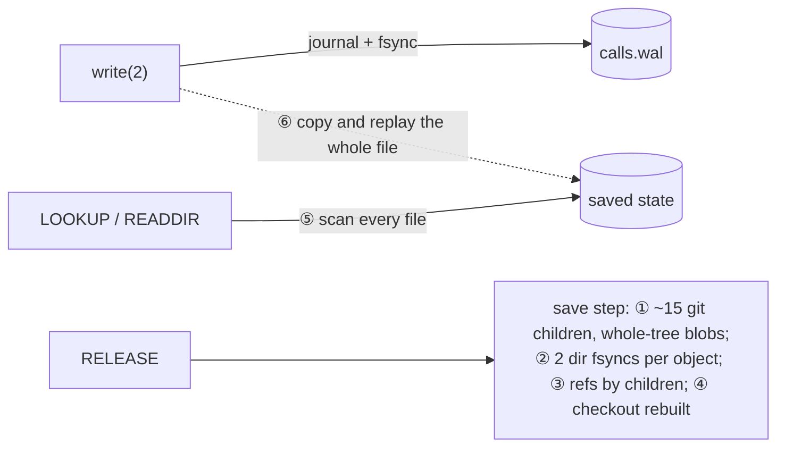
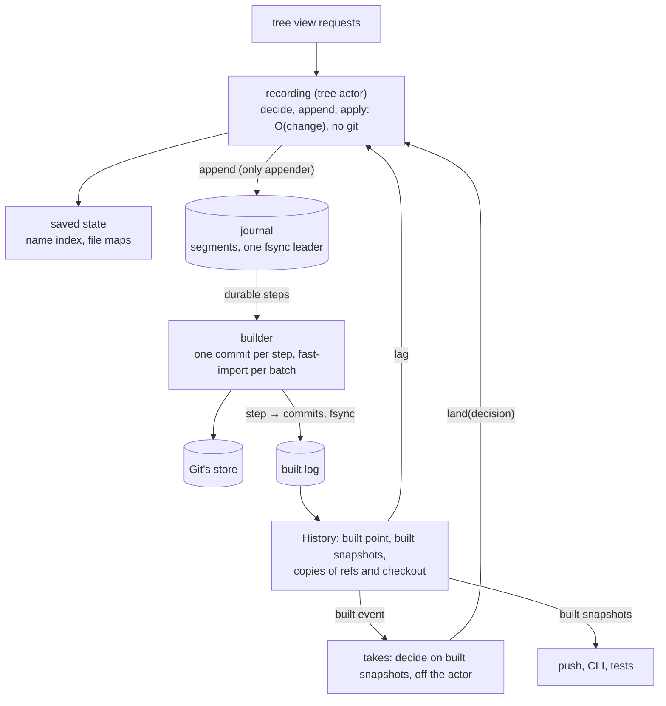
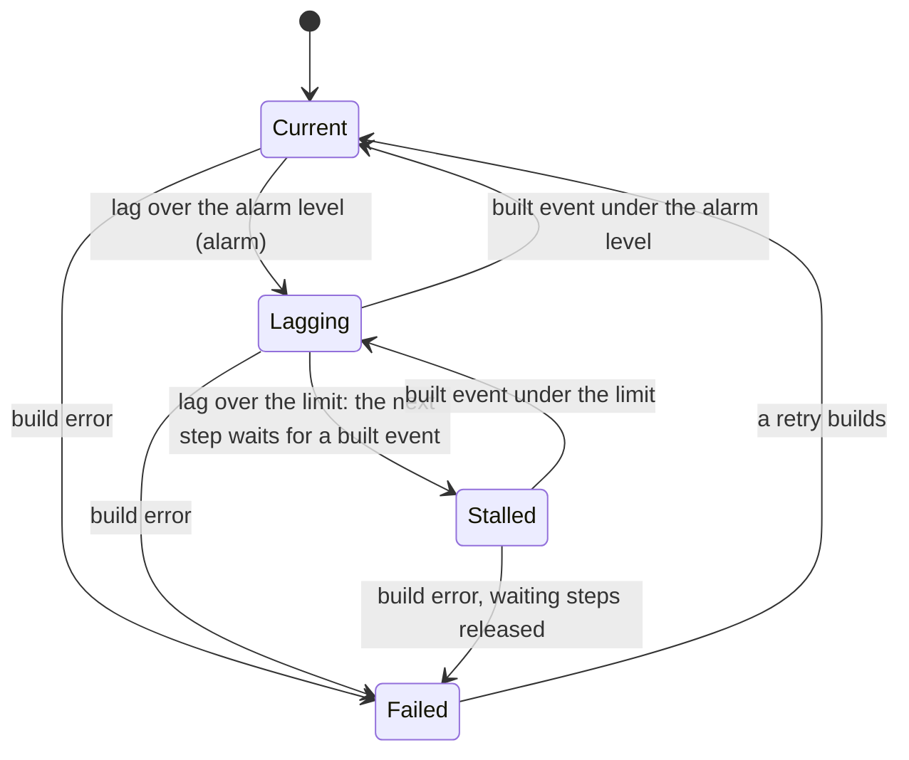

# Tree views: queue the change at the call, build history behind it

**Layer:** Domain → System → Service (skipped: one process) → **Module** → Interfaces → Implementation.
Agreed above: the [git model](../../docs/target-architecture/git-model.md) (baseline) and the M1 pages (`m1-pages.md`).
Record shapes, error unions and mutation probes are working state for the Interfaces gate (`speed-interfaces.md`).
**Status:** proposed v4, 2026-11-13. Nothing built or measured. *est.* figures are arithmetic on `docs/performance.md`,
inputs beside them.
**Asked of the owner:** one choice and one word to confirm.

| # | Question | Kind | Where |
|---|---|---|---|
| Q1 | 100,000 files in one directory: hashed sub-folders in history (recommended), or plain paths and hours of history lag? | general guidance | §7 |
| Q2 | Your "queue" is the tree's journal: confirm the word | general guidance | §2 |

**What changed since v3** (adversarial review: FAIL).
- Lag is the builder's estimated work for steps; an open's own calls are space, not lag (v3 could deadlock).
- A take never makes another step wait (v3 broke the owner's answer G7). It decides off the actor and lands only if
  its files are unchanged.
- One appender per file: the actor appends the journal, the builder its built log. One fsync leader raises the durable mark.
- One numbering (record numbers). Only History opens Git's store. File bytes live in the journal and Git, never in memory.
- No rebuild-equality promise. The pack's index is installed last.
- The builder packs with `git fast-import`. Q1 now recommends A: B cannot meet the creates bar with lag bounded.
- Transactions dropped: not built (git-model §9).

## 1. Today



close_4k p50 75-89 ms; create_1000 unfinished after 44 min (S2). ①④⑤ grow with the tree, ⑥ with the file.

## 2. Requirements and guidance

None of these is a requirement in the owner's sense (a rule, or an absolute-requirement question answered yes).

| # | Statement | Kind and source |
|---|---|---|
| G1 | "only the diff/patch needs to be syncrhonosly collected and queued, while the git history persistence could be an asynchronous trailing process"; "not power safe until the process closes and flushes (or the queue catches up)" | guidance, owner, 2026-11-13 (night) |
| G2 | "A change that reached the filesystem must be recorded before the call returns, or fail loudly"; never traded for speed | guidance, picked 2026-11-13; AGENTS.md principle 1 |
| G3 | "Match recording engine": its budgets (`ci/bench-budget.json`): 4 KiB close p50 3.5 ms in the engine, 6 ms through FUSE; 100,000 creates 600 s, history 12 min after; dirty 1 GiB close 8 s XFS, 12 s ext4 | guidance, picked 2026-11-13 |
| G4 | History says what the model says: commits, parents, trailers, bytes, line identities; model digests unchanged | baseline, git-model §3-§12 ("baseline proof and testbed", 2026-11-09) |
| G5 | Others see a save at close (close-to-open); the close is RELEASE, never FLUSH | guidance, "Go", 2026-11-03; git-model §3 |
| G6 | Format breaks are fine before 1.0 | guidance, "go ahead and break things", 2026-11-12 |
| G7 | No P3: a waiting take makes no write-open, unlink or rename wait. "it seems low risk for them to be indefinitely delayed while an application is keeping the fs busy with real work" | guidance, owner, 2026-11-04 (git-model §6) |

**New terms**

| Term | Meaning | Why needed | Existing term it could be |
|---|---|---|---|
| journal | the owner's "queue": every call and step, in order, the one source of truth; the actor's, in segments | — | `calls.wal`. **Q2:** "queue" already names a tree's landing and sync entries (git-model §5). Confirm "journal"? |
| record number | a record's place in the journal; a step is named by its record number | one numbering for steps, the durable mark and the built point | the journal's sequence |
| builder | makes the commits from durable steps, behind the call path | the commit leaves the call path | the engine's commit loop |
| built log | the builder's own file of "step → its commits" | the built point, with one appender | the engine's `Agentfs-Seq` resume point |
| built point | the last step whose commits are in Git and in a durable built-log entry | gates every reader of history | — |
| lag | the builder's estimated seconds of work for the steps past the built point | back-pressure and the alarm | push backlog age |
| durable mark | in every journal frame: the record number the last finished fsync covered | tells a torn tail from corruption | — |
| file map | per file: runs of its bytes, each in Git (built) or in journal frames (not yet) | serves files with no copy in memory | the view's open-file copy |

## 3. The proposed shape



The journal is the truth. The saved state (what views serve) and Git (history) are its two projections, the first
applied at the call, the second built behind it. Only History opens Git's store.

## 4. Canonical shape

**Domain changes** (each recorded in git-model through the model-verification skill, in the slice that builds it):

| Concept | Today | v4 |
|---|---|---|
| a write call (§3) | appended and fsynced | appended, no fsync; power-safe at its open's FLUSH, an fsync, an O_SYNC write, an fsyncdir, or once the builder makes it durable (G1). git-model §3 already says this; the code is stronger |
| `unlink`, `rename(2)`, path `truncate(2)` | journaled durably, then run | as a write |
| a step's record (§12) | pointers to objects already durable | the change itself; names earlier steps by record number |
| a commit (§3, §12) | built in the step, dated when built | built by the builder, dated by its record |
| refs, fork `config`, checkout | copies of the journal | copies as of the built point |
| a take (§5-§8) | planned and committed in one step | decided on built snapshots off the actor; lands if no later step touched its files, else waits (G7 unchanged) |
| compaction (§3) | the file rewritten | whole segments dropped behind the built point; a live open's calls copied forward only when they pin more dead bytes than their own |
| the object table (§12) | a blob per step | in the journal's checkpoint only (B4) |

**Patterns**

| Pattern | Source | Where |
|---|---|---|
| Write-ahead log, no-force, redo from a checkpoint; log segments | ARIES (Mohan et al., 1992); PostgreSQL WAL | the journal; the built point is the redo start |
| Group commit, one flush leader | DeWitt et al., 1984; PostgreSQL's WAL flush | the durable mark |
| Event sourcing, two projections | Fowler, "Event Sourcing"; CQRS read models | saved state and Git |
| The consumer keeps its own offset | Kafka consumer offsets | the built log |
| Write stall | RocksDB write stalls | the lag gate |
| Piece table | Crowley, 1998 (Bravo, Word) | file maps |
| Bulk import into one pack | `git fast-import` | the builder |
| Pack first, index last | git's `finish_tmp_packfile` | each batch's install |
| Fanout that grows with the tree | git notes (`notes.c`) | Q1-A |
| A value only its module can construct | private constructor | built snapshots |

**Design it twice: the builder's packer** (the commits, trees and line maps are the builder's either way).

| | **`git fast-import`, one child per batch (chosen)** | libgit2 in-process (v3; B1's writer) |
|---|---|---|
| A large listing rewritten per commit | deltified against its previous version (`--depth` covers trees) | written whole, or delta search over a batch held in memory |
| A 1 GiB file | streamed, bounded memory (`--big-file-threshold`) | the batch's memory holds it, or a second, loose path |
| Progress | a marks file per batch, read once and discarded; the built log is the one record | oids returned in process |
| Install | git's own, under `core.fsync`; we fsync the pack directory | ours, through the indexer |
| Costs | a child and a text protocol per batch; file bytes piped (+0.5 s per GiB *est.*); scratch branch refs; a `.keep` to clear at recovery; its fsync is not in its docs, so B2's crash test decides | B1's code kept; the memory bound and install order are ours to get right |

What flips it: B2's power-loss test finding fast-import's pack not durable at exit.

**Design it twice: telling a torn tail from corruption**, now that calls are not fsynced.

| | **Mark in every frame (chosen)** | Commit frame before each fsync (SQLite WAL) | Valid prefix only (PostgreSQL) |
|---|---|---|---|
| A hole before durable records | refused, loudly | ambiguous: writeback may keep a commit frame whose fsync never finished | not seen: replay stops, later durable records are dropped |
| Cost | a few bytes a frame | a frame per fsync | none |

## 5. Design rules (design choices)

1. **One queue, two projections.** The journal is the only truth. A call decides, appends, then applies, and never
   runs git or waits on the builder. Git is built from the journal and nothing reads it as truth.
2. **The builder decides nothing.** Outcomes, take decisions and dates are in records; every counter it uses is in the
   record or the parent's built state. A rebuild after a crash may differ byte for byte (another git); rule 3 makes
   that safe.
3. **Nothing past the durable built point is reachable.** Only History opens Git's store, and it hands out built
   snapshots only at or before the built point. A batch is installed pack, then index, then the directory fsynced,
   then its built-log entry fsynced; only then are refs copied, the push made due and readers woken.

## 6. Contracts

| Module | Takes | Gives | Never |
|---|---|---|---|
| tree view (`agentfs-fuse`) | FUSE requests | WRITE → `write`; FLUSH, FSYNC → `durable`; FSYNCDIR → `durableAll`; RELEASE → `close`; shared-mapping writeback → `pageWrite` | reads Git; saves at FLUSH |
| recording (the actor; the journal's one appender) | calls, steps, takes' decisions | the outcome once appended and applied | runs git; waits on the builder; copies a whole file; scans the tree |
| saved state | applied records | name index in O(log n); file maps; "unchanged" compares only an open's runs | holds file bytes or line maps |
| journal | records from the actor; `makeDurable` from either side | record numbers; one fsync leader; a mark that only rises; frames from a cursor | drops a segment holding a step past the built point, or a live open's call not copied forward |
| builder | durable steps past the built point | one commit per step, a fast-import run per batch; the built-log entry | decides; reads the clock; reads records past the durable mark |
| History (owns Git's store) | the built log | built point, built snapshots, built events, lag; refs and checkout copies | hands out anything past the built point; drops a built-log entry a retained record still names |
| lag gate | lag | a pass or a wait for the next step | holds a write call; holds when the builder has failed |
| takes | queue entries, built snapshots | a decision through `land` | runs on the actor; makes another step wait |

```ts
/** The call path. The view host is injected with this alone. */
interface Recording {
  openWrite(tree: TreeId, path: string | "anonymous",   // O_TMPFILE is anonymous
            truncate: boolean, by: WriterAt): OpenNo;
  write(open: OpenNo, call: Write | Append | Truncate,
        sync: boolean): void;                           // sync: an O_SYNC or O_DSYNC open
  pageWrite(tree: TreeId, object: ObjectNo, runs: Run[]): void;  // a shared mapping's pages
  durable(open: OpenNo): void;                          // FLUSH, fsync, msync(MS_SYNC)
  durableAll(): void;                                   // FSYNCDIR: the actor's one journal
  close(open: OpenNo): Saved;                           // RELEASE: the save step, O(change)
  create(tree: TreeId, path: string, by: WriterAt): ObjectNo;
  link(open: OpenNo, path: string): void;               // an anonymous open given its name
  rename(tree: TreeId, from: string, to: string, by: WriterAt): void;
  unlink(tree: TreeId, path: string, by: WriterAt): void;
  truncate(tree: TreeId, path: string, size: number, by: WriterAt): void;
  land(decision: Decision): Landed | "files-changed";   // a take; re-decided at the next built event
}

/** Takes, push, the CLI and tests are injected with this. Nothing else can open Git's store. */
interface History {
  builtThrough(): RecordNo;
  waitBuilt(through: RecordNo): Promise<RecordNo>;      // ends on a built or failed event, never a timer
  snapshot(at: RecordNo): BuiltSnapshot;                // at ≤ the built point; only History constructs one
  lag(): { seconds: number; oldestAge: number;
           health: "current" | "lagging" | "stalled" | "failed" };
}
```

A tree's first commit is a `root` step; forks, dropped forks and rows keep M1's methods (`fork_with`, `record_rows`).

## 7. Durability, recovery and lag

```mermaid
sequenceDiagram
  participant P as program
  participant A as call path
  participant J as journal
  participant B as builder
  participant H as History
  P->>A: open(O_TRUNC), write 4 KiB
  A->>J: open, truncate, write appended (no fsync)
  P->>A: close(2) = FLUSH
  A->>J: makeDurable: joins or leads one fsync
  A-->>P: close returns: power-safe
  A->>J: RELEASE: save step appended; file map updated
  B->>J: makeDurable(last step), read durable steps
  B->>B: fast-import: pack, then index; fsync pack directory
  B->>H: built-log entry + fsync; refs copied; built event
```

| What breaks | What happens |
|---|---|
| agentfs dies after a write returned | the write is in the journal; restart saves the open as its close would |
| power cut before the open's close returned | its calls since its last durable point can be lost (G1) |
| a hole in the journal | past the durable mark: a torn tail, saved aside; before it: refused (runbook). The leader raises the mark only after an fsync that began after those records were written, so a second caller cannot mislabel a tail |
| crash between a pack and its built-log entry | the pack is unreferenced; its steps are rebuilt, maybe into new objects, which nothing had seen |
| restart | name index from the built heads' listings; file maps from frame headers past the built point, no bytes read. *est.* seconds at the lag limit, measured in B2 |
| the builder fails (disk full, I/O) | `HistoryBuildFailed`; recording continues; waiters get `failed`; retried at the next step or wait. No segment can be dropped, so the state area fills and recording fails with ENOSPC: a history fault reaching the workload as a recording failure. *est.* 7 h for 10 GiB at the creates rate (0.4 MB/s); 100 s at a 100 MB/s writer |
| the builder disagrees with a record's outcome | building stops with the alarm, then as the row above |



**Lag** is a step's estimated builder work, set at append: the bytes it adds (the file, its sidecar, the listings on
its path; the saved state knows their sizes) over the builder's throughput in its last batch. Placeholders: alarm
30 s, limit 120 s. Only steps wait; write calls never do. A live open's calls are space, not lag: the tree's space
limit counts them (git-model §3). The oldest unbuilt step's age is a gauge with an alert rule.

**Takes.** A built event wakes a take whose files are free (git-model §6). It decides off the actor on built snapshots
and calls `land`. The actor appends it if no step since that built point touched a file it reads or writes, as P1's
commuting rule allows; otherwise it waits for the next built event. Nothing waits behind it (G7). Its latency is the
lag plus its decision.

**Estimates against the bar** (performance.md budget table; builder idle).

| Bar | Components | *Est.* |
|---|---|---|
| 4 KiB close p50: 3.5 ms engine, 6 ms through FUSE | one fsync ≤ today's engine step (1.3-2.3 ms, mostly that fsync); four unsynced appends and an apply ~0.1 ms; FUSE's round trips 0.5-1.7 ms (1.8-4.0 through FUSE less 1.3-2.3) | engine 1.4-2.4 ms; through FUSE 1.9-4.1 ms. Over 3.5 ms through FUSE on the Intel ext4 runner, as the engine is |
| 100,000 creates ≤ 600 s | per create as the engine (one fsync per file: 230-384 s); builder under Q1-A 1.5-4.4 ms per create | 230-470 s; past 120 s of lag the gate holds creates to the builder's pace |
| dirty 1 GiB close ≤ 8 s XFS, 12 s ext4 | FLUSH fsyncs 1 GiB of journal; XFS's dirty close today is that writeback (2.5-5.4 s); segments, so no copy | XFS 2.5-5.4 s; ext4 under its copy-and-fsync, 4.9-8.1 s |
| history after 100,000 creates ≤ 12 min | builder total, Q1-A | 3-8 min |

Not in these figures: the builder running beside the call, which costs CPU on a 4-CPU runner and, on ext4, blocks it
has allocated in the same fsync. close_4k's builder needs 3-6 ms a save (a `git diff` child 2.5-5 ms, about 5
objects), so 2,000 closes leave 6-12 s of lag, under the limit. B2 measures every bar with the builder running; a
miss goes to the owner with the figures.

**Q1, general guidance: when 100,000 files sit in one directory, how should history store them?**

<details><summary>Background</summary>

Git stores a directory as one listing, rewritten whole by every commit that changes a file in it. The model makes two
commits per create (the create and its save). Inputs: a listing entry ~38 bytes; the engine's history wrote ~2.4 GB of
listings in its 2.6-7.7 min catch-up, 5-15 MB/s; SHA-1 0.5-1 GB/s (*est.*, not measured here).

| | **A. Hashed sub-folders (recommended)** | B. Plain paths |
|---|---|---|
| Path of `report.txt` in a commit | `files/7f/…/report.txt` | `files/report.txt` |
| `git log -- <path>`, GitHub's folder view | need the hashed folders | work as usual |
| Listings written per create | ~22 KB (three levels of ~46 entries, files and sidecars) | 3.7 MB on average |
| History for 100,000 creates | 2.2 GB, 3-8 min *est.* | 370 GB to hash: 6-12 min of hashing alone, 7-20 h at the engine's rate |
| The 600 s creates bar | met, 230-470 s *est.* | missed: the lag limit holds creates to the builder's pace; without it, history trails by hours |
| What the model says | unchanged | unchanged |

Not offered: folding many creates into one commit, as the recording engine does. It changes what the model says.

How the answer is used: it fixes the `files/` layout of the new commit format in B4.
</details>

## 8. Costs and deferrals

- **History trails the files.** Takes and pushes wait for the built point; a take's latency includes the lag (120 s
  placeholder limit). A take whose files keep changing waits on, as G7 accepts.
- **A power cut loses calls since the last close, fsync or built point** (G1), renames and unlinks included.
- **A failed builder ends in ENOSPC** at the workload once the state area fills (§7).
- **The builder pays the changed file's size:** 4 KiB appended to a 1 GiB file hashes 1 GiB behind the call.
- **Every fsync, FSYNCDIR included, flushes the actor's one journal** (git-model §3), so it pays for every tree's
  unsynced records.
- Unchanged: takes read whole-tree snapshots (now off the actor); the gap between close(2) and RELEASE (G5).
- Deferred: alignment in-process; transactions (not built, git-model §9).

## 9. What happens next: slices on PR #39 (epic: tree views speed, before M1 S3)

Counters run in `ci.yml` and block. Release figures run in the image job on ext4 and XFS, with the builder running. A
miss holds the slice and goes to the owner with the figures.

| Slice | Done when |
|---|---|
| B0 referee | S2's workloads with deadlines, the count reached, cost per save against tree size; "before" figures |
| B1 stage 1 (synchronous) | ≤ 1 git child per save; new objects only, in-process; incremental checkout; name index; digests and conformance unchanged |
| B2 queue, then build (tracer) | the call path runs 0 git children and 1 fsync at close; close_4k and creates bars; the fast-import builder survives a kill at each failpoint and a power-loss replay, refs naming only built-log commits; takes land per §7; Git's store reachable only through History (compile) |
| B3 file maps | per-write cost on a 1 GiB file within 1.5× of a 1 MiB one; the 1 GiB close bar |
| B4 builder costs its change (Q1) | sidecars replace whole-tree blobs; objects per 1-file save equal at 100 and 10,000 files; history after 100,000 creates ≤ 12 min |

Order: B0 → B1 → B2 → B3 and B4 (disjoint files) → M1 S3. Scope: stage 1 was one unit; this is five, and B2 grew in v4
by the fast-import packer and moving every raw Git reader behind History. B1's in-process object writer lives only
until B2. M1 S3's row commits move into the builder, so S3's page is re-cut after B2.

## Where the brief or spec is wrong

1. The brief's "4 KB ≤ 3.5 ms" is the engine's step without FUSE; the engine through FUSE is budgeted 6 ms
   (measured 1.8-4.0). Both are measured here.
2. "1 GiB in 7-12 s" is the engine's close; its history follows 23-29 s later. Under G1 the close meets it.
3. git-model §12's step order and its "objects", "object table" and "journal" rows change, and §3's compaction.
4. The code is stronger than §3 (every call fsynced) and disagrees with it (the checkout rebuilt whole).
5. v3's due take made its tree's next step wait, against G7. Withdrawn.

## Reconcile with existing code

| Code | Change | Cost |
|---|---|---|
| `tree_actor/mod.rs` (`run_step`, `Draft`, `install`) | decide, append, apply; `land` checks a decision's files; owners from the built log | the largest change |
| `tree_actor/journal` | record numbers, segments, the durable mark (`AFJ3`), one fsync leader, no fsync per call | crash tests re-pointed |
| `history/`, `take.rs`, `tree_git.rs`, `fork/*` | Git's store opened only in History; raw readers take built snapshots; the builder on fast-import; takes off the actor | Technology-choices row for fast-import |
| `recording/mod.rs`, `tree.rs` | file maps; `call()` and `changed_bytes` O(change) | `the_stored_text_is_unchanged` re-pinned |
| `agentfs-fuse/tree_view.rs` | FSYNCDIR, O_SYNC, msync; handlers on the name index | `files()` and `path()` scans removed |
| M1 S3 (`fork_with`, `record_rows`) | rows in the step record; the builder writes row commits | S3 page re-cut |
| docs | git-model §3, §12; trees, guarantees, performance, architecture, configuration (lag keys) | in the slices that build them |

## For the code architects (parked)

- Segment size; batch size; a batch starts on a journal append event, never a timer.
- Lag placeholders (30 s, 120 s), the throughput estimate and their git-config keys.
- The durable mark's place in the frame; the copy-forward threshold.
- fast-import's scratch ref namespace, `.keep` cleanup and marks handling.
- The sidecar encoding and Q1-A's fanout thresholds.
- Whether ref copies need §12's old-value check.

*History: v1, v2, v3 2026-11-13 (adversarial reviews: FAIL each); v4 2026-11-13, revised on v3's review.*
