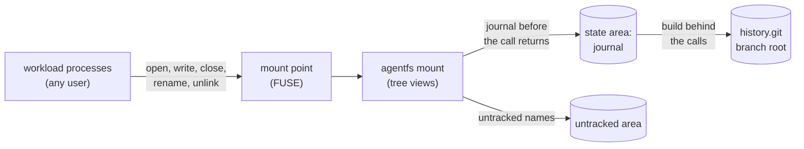

<p align="center">
  <picture>
    <source media="(prefers-color-scheme: dark)" srcset="docs/assets/logo-dark.svg">
    
  </picture>
</p>

<h1 align="center">agentfs</h1>

<p align="center">
  <strong>A filesystem that records every change to a directory in git history its users cannot see.</strong>
</p>

<p align="center">
  <a href="https://github.com/mcurcio/agentfs/actions/workflows/ci.yml"></a>
  <a href="https://github.com/mcurcio/agentfs/actions/workflows/image.yml"></a>
  <a href="https://github.com/mcurcio/agentfs/actions/workflows/helm.yml"></a>
  <a href="https://github.com/mcurcio/agentfs/actions/workflows/docs.yml"></a>
  <a href="#license"></a>
</p>

<p align="center">
  <a href="#quick-start">Quick start</a> ·
  <a href="https://mcurcio.github.io/agentfs/">Documentation</a> ·
  <a href="docs/guarantees.md">Guarantees</a> ·
  <a href="#status-and-roadmap">Status</a>
</p>

agentfs sits in front of an ordinary directory as a FUSE filesystem. Any
process, root or not, uses the directory with normal file calls and never
sees git. Every change is journaled before the call returns and becomes
a commit on a git branch. The history lives outside the mount, where the
workload cannot see or change it. The sidecar, the Docker examples and
the CLI run agentfs's tree views; the CSI driver runs its recording
engine, which also pushes the history to git remotes and applies patches
queued from outside.

## Why

Some programs change their own files at runtime: an AI agent editing its
prompts, skills and configuration is one example, a service that rewrites
its own settings is another. You want three things from such a directory:

- **A complete record.** Every change, from any process, on record, so a
  mistake can be found and undone.
- **Out of the workload's reach.** The record must not be visible through
  the directory, and nothing written there can turn recording off.
- **Changes from outside without clobbering.** Infrastructure as code
  should change a few files with versioned patches, not overwrite the
  whole directory and lose what the workload changed.

Snapshots miss what happens between them, a git repository in the
directory is visible to (and can be broken by) the workload, and
overwriting from outside destroys local changes. agentfs records at the
filesystem boundary instead, into history kept beside the directory, and
its recording engine applies queued patches when the volume starts. Its first consumer is an
AI agent's configuration on Kubernetes
([`deploy/examples/hermes`](deploy/examples/hermes)), but nothing in it
is specific to agents: any workload whose directory should carry an
audit trail can use it.

## Features

agentfs has two engines. The **tree views** are what the sidecar, the
Docker examples and the CLI's `agentfs init` and `agentfs mount` run
([tree views](docs/trees.md)). The **recording engine** is what the CSI
driver runs ([CSI driver](docs/csi.md)).

On every launcher:

- **Recorded before return.** Every change is journaled before the call
  returns; a recording failure fails the call loudly
  ([guarantees](docs/guarantees.md#recording-comes-first)).
- **Invisible and untouchable.** History, journal, state and credentials
  live in a state area outside the mount ([guarantees](docs/guarantees.md#threat-model)).
- **Any user.** Root and non-root processes share one volume, each entry
  with its recorded owner and mode, checked by the kernel.
- **Git idioms for rules.** The operator's `$GIT_DIR/info/exclude` and
  `info/attributes` decide what is recorded; nested repositories are
  excluded ([tree views](docs/trees.md#rules-and-the-untracked-area),
  [recording](docs/recording.md#which-paths-are-recorded)).
- **Kubernetes and Docker.** A privileged native sidecar, Docker and
  Compose examples, and a CSI driver that gives unprivileged pods agentfs
  volumes as claims; kustomize bases and Helm charts.
- **Observable.** OpenTelemetry, with example Prometheus alert rules
  that link their runbooks ([telemetry](docs/telemetry.md)).

On tree volumes (the sidecar, Docker, the CLI):

- **Untracked files that work.** Secrets, SQLite databases, sessions and
  logs the rules leave out are ordinary Linux files in the tree's
  untracked area, never in history.
- **Forks.** A fork mount whose saves land in the root as they save,
  with every collision decided by written rules
  ([tree views](docs/trees.md#forks-keys-end-and-the-drop)).
- **Restart in place.** A mount restarted after a crash stacks over the
  stale mount its predecessor left
  ([tree views](docs/trees.md#restarting-after-a-crash)).
- **Said, never silent.** A configured remote, patch source or other
  setting tree volumes do not build yet is logged at every boot and
  alarmed by the `agentfs.not_built` gauge
  ([operator settings](docs/trees.md#operator-settings)).

On the recording engine (the CSI driver):

- **Any remote, several, or none.** Local paths, `file://`, `http(s)://`
  with a token file, and SSH with verified host keys; fast-forward only,
  never forced, a divergence saved and alarmed ([remotes](docs/remotes.md)).
- **A patch queue** applied in order before anything sees the tree
  ([patches](docs/patches.md)).
- **Recovery.** `agentfs restore` and `agentfs revert`, each recorded as
  one commit ([operator guide](docs/operator-guide.md#12-recovery-and-undo)).
- **Git LFS, databases recorded whole, forked volumes, and several pods
  on one volume** ([operator guide](docs/operator-guide.md),
  [forks](docs/forks.md)).

## Quick start

### From source

On Linux 5.6+ with `/dev/fuse`, as root, in a clone of this repository
([building](docs/development.md#building) lists what the build needs):

```sh
cargo build --release -p agentfs
export PATH=$PWD/target/release:$PATH
agentfs --state /data/state init --volume demo
# Serve /workspace, run one command in it, then stop.
agentfs --state /data/state mount /workspace -- \
  sh -c 'echo hello > /workspace/notes.txt'     # recorded before close returns
git --git-dir /data/state/history.git log --stat root
```

`init` creates the volume (and prints `demo <id> created`); `mount` serves
it at `/workspace` until its command exits, SIGINT or SIGTERM, then drains
and exits. History is in the state area's `history.git`, on the `root`
branch. Leave out `-- COMMAND` to keep the mount up until a signal. Tree
volumes push to no remote yet ([trees](docs/trees.md#limits)). Next: the
[tree views](docs/trees.md).

### Docker

On a Linux host with Docker Engine 25+ and the fuse module, from a clone
of this repository. The volume appears on the host in
`examples/docker/mnt-run/workspace`, and its history stays in a Docker
volume only the agentfs container mounts:

```sh
examples/docker/docker-run.sh up
examples/docker/docker-run.sh workload --name app --user 10000:10000 --cap-drop ALL \
  debian:trixie-slim sleep infinity
docker exec app sh -c 'echo hello > hello.txt'   # recorded before close returns
examples/docker/docker-run.sh down               # stops app, then drains the volume
examples/docker/docker-run.sh history log --stat root
```

Docker Compose, remotes and why the containers are wired as they are:
[docs/docker.md](docs/docker.md). Docker Desktop cannot propagate the
mount to the host, so it is not supported.

### Kubernetes: the CSI driver with Helm

The driver gives pods agentfs volumes as ordinary claims, with no
privilege in the workload. Each claim is a worktree on the disk of the
node its first pod runs on, writing only its own branch, and pushed to
the profile's remotes; to continue on another node, a new claim starts
from that branch ([moving](docs/runbooks/moving.md)). Create the
namespace and the credentials, then install the chart (the full steps
and the values: [docs/helm.md](docs/helm.md)):

```sh
kubectl apply -f deploy/csi/namespace.yaml
kubectl -n agentfs-csi create secret generic agentfs-csi-credentials \
  --from-literal=example-origin=$'username=agentfs\npassword=<token>'
helm install agentfs-csi oci://ghcr.io/mcurcio/charts/agentfs-csi \
  --namespace agentfs-csi --version <version> \
  --set credentials.existingSecret=agentfs-csi-credentials \
  --set-file profiles.example.config=deploy/csi/profiles/example.config \
  -f storageclasses.yaml
```

where `storageclasses.yaml` names the StorageClasses and their
parameters ([docs/helm.md](docs/helm.md#2-install-the-csi-driver) has
one). Workloads then mount a claim of such a class. Without Helm,
`kubectl apply -k deploy/csi` installs the same driver. How it works,
parameters, recovery and security: [docs/csi.md](docs/csi.md).

### Kubernetes: the sidecar

agentfs runs as a privileged native sidecar in the workload's own pod and
mounts the volume into an `emptyDir` the workload's containers share; the
history stays in the volume's claim, at `/data/state/history.git`. Edit
the rules in `deploy/sidecar/config/`, put your container in place of
the example workload, then:

```sh
kubectl -n agents apply -k deploy/sidecar
kubectl -n agents logs deploy/agentfs-example -c agentfs | grep -E '^(mounted|not built) '
```

The example's settings name a remote: push is not built for the sidecar
yet, so it logs each remote key as `not built` at every boot.

The steps, the pod piece by piece and the security trade-offs:
[docs/deployment.md](docs/deployment.md). With Helm, the
`agentfs-sidecar` library chart adds the same pieces to your own chart
([docs/helm.md](docs/helm.md#4-the-sidecar-helpers)).

## How it works



1. `agentfs init` creates the volume in its state area; `agentfs mount`
   serves its root, and optionally a fork, on empty directories.
2. Every call that changes a recorded file is journaled before it
   returns; a close, `fsync` or directory `fsync` makes it power-cut
   safe ([tree views](docs/trees.md#recording-and-durability)).
3. A builder turns journaled saves into commits on the tree's branch in
   `history.git` (`root`, or `fork/<n>`), with trailers that name the
   writer, the tree, the volume and the pod.
4. Names the operator's rules leave out live in the tree's untracked
   area, merged into the view and never in history.
5. A fork's saves land in its upstream, and the upstream's flow back.

Tree volumes push to no remote and apply no patches yet. Under the CSI
driver the recording engine runs instead: a history service owns each
volume's state area, every pod's mount is a front that hands it the
changes, and it commits them to `agentfs/<volume>`, pushes that branch to
the profile's remotes and applies the patch queue at its start
([recording](docs/recording.md), [csi.md](docs/csi.md)). The full model:
[docs/architecture.md](docs/architecture.md) and
[docs/guarantees.md](docs/guarantees.md).

## Documentation

The documentation is published at <https://mcurcio.github.io/agentfs/>;
[docs/README.md](docs/README.md) is its index.

| Document | For |
|---|---|
| [Tree views](docs/trees.md) | What the sidecar, Docker and the CLI run: `init`, `mount`, operator settings, restarts, forks |
| [Operator guide](docs/operator-guide.md) | Running the recording engine under the CSI driver: requirements, layout, flags, lifecycle, recovery, troubleshooting |
| [Docker](docs/docker.md), [Kubernetes sidecar](docs/deployment.md), [CSI driver](docs/csi.md), [Helm](docs/helm.md) | Deploying it |
| [Configuration](docs/configuration.md) | Every setting, attribute, flag and environment variable |
| [Runbooks](docs/README.md#runbooks) | One procedure per failure mode |
| [Guarantees](docs/guarantees.md), [Recording](docs/recording.md), [Remotes](docs/remotes.md) | What agentfs promises, what the recording engine records and when, and how it pushes |
| [Library](docs/library/core.md) | Building on `agentfs-core`, `agentfs-fuse` and `agentfs-csi` |
| [Architecture](docs/architecture.md) | The crates and modules, and how a change flows through them |

## Status and roadmap

agentfs is young: version 0.1.0, with no tagged release yet. The image
`ghcr.io/mcurcio/agentfs` is published from every commit of `main` that
passes its tests, and the Helm charts as `<version>-main.<run>`.

| Area | State |
|---|---|
| Tree views behind the sidecar, the Docker examples and the CLI (`init`, `mount`, `fork end`): recording, directories, links, owners and modes, operator rules and the untracked area, forks, restart after a crash, the not-built alarm | Built, tested end to end in CI including a kind cluster and upstream Hermes |
| On tree volumes: push, the patch queue, `restore` and `revert`, telemetry beyond the not-built gauge, LFS, database groups, forked volumes and the sandbox overlay | Not built: each configured setting is logged at every boot and alarmed ([supported configurations](docs/supported-configurations.md#15-tree-volumes-the-sidecar-docker-the-cli-and-the-csi-driver)) |
| The CSI driver, on the recording engine: push to any remote, path rules, the patch queue, recovery, Git LFS, databases, forked volumes, several pods on one volume | Built: one node per volume, its worktree on that node's disk; moving is a new volume started from its branch |
| The CSI driver on tree views | Not built |
| Docker examples, Helm charts, example alert rules | Built and tested in CI |
| Several nodes writing one volume | Not supported: a volume has one node ([CSI driver](docs/csi.md)) |

The measured costs and performance budget are in [docs/performance.md](docs/performance.md).
Designs for work that is not built are in
[docs/target-architecture](docs/target-architecture/README.md).
Known limits of the recording engine: LFS over SSH needs a server with
`git-lfs-authenticate`; proxies are plain `http://` proxies without
authentication; restoring a database needs its workload stopped. The
tree views' limits are in [docs/trees.md](docs/trees.md#limits).

## Contributing

Contributions are welcome: see [CONTRIBUTING.md](CONTRIBUTING.md) for how
to build, test and propose a change, and
[docs/development.md](docs/development.md) for what CI runs. Everyone
taking part follows the [Code of Conduct](CODE_OF_CONDUCT.md).

## Security

Report a vulnerability privately, as [SECURITY.md](SECURITY.md)
describes, never in a public issue.

## License

Licensed under either of [Apache License, Version 2.0](LICENSE-APACHE) or
[MIT license](LICENSE-MIT), at your option. Unless you explicitly state
otherwise, any contribution intentionally submitted for inclusion in
agentfs by you, as defined in the Apache-2.0 license, shall be dual
licensed as above, without any additional terms or conditions.
