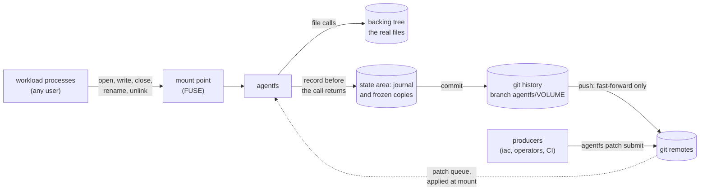

<p align="center">
  <picture>
    <source media="(prefers-color-scheme: dark)" srcset="docs/assets/logo-dark.svg">
    
  </picture>
</p>

<h1 align="center">agentfs</h1>

<p align="center">
  <strong>A filesystem that records every change to a directory in git history its users cannot see.</strong>
</p>

<p align="center">
  <a href="https://github.com/mcurcio/agentfs/actions/workflows/ci.yml"></a>
  <a href="https://github.com/mcurcio/agentfs/actions/workflows/image.yml"></a>
  <a href="https://github.com/mcurcio/agentfs/actions/workflows/helm.yml"></a>
  <a href="https://github.com/mcurcio/agentfs/actions/workflows/docs.yml"></a>
  <a href="#license"></a>
</p>

<p align="center">
  <a href="#quick-start">Quick start</a> ·
  <a href="https://mcurcio.github.io/agentfs/">Documentation</a> ·
  <a href="docs/design.md">Design</a> ·
  <a href="#status-and-roadmap">Status</a>
</p>

agentfs sits in front of an ordinary directory as a FUSE filesystem. Any
process, root or not, uses the directory with normal file calls and never
sees git. Each time a file is closed after a change, or renamed, deleted
or linked, agentfs durably records the new state before the call returns.
It commits those states to a git branch and pushes the branch to any git
remotes you name. The history lives outside the mount, where the
workload cannot see or change it.

## Why

Some programs change their own files at runtime: an AI agent editing its
prompts, skills and configuration is one example, a service that rewrites
its own settings is another. You want three things from such a directory:

- **A complete record.** Every change, from any process, on record, so a
  mistake can be found and undone.
- **Out of the workload's reach.** The record must not be visible through
  the directory, and nothing written there can turn recording off.
- **Changes from outside without clobbering.** Infrastructure as code
  should change a few files with versioned patches, not overwrite the
  whole directory and lose what the workload changed.

Snapshots miss what happens between them, a git repository in the
directory is visible to (and can be broken by) the workload, and
overwriting from outside destroys local changes. agentfs records at the
filesystem boundary instead, into history kept beside the directory, and
applies queued patches when the volume mounts. Its first consumer is an
AI agent's configuration on Kubernetes
([`deploy/examples/hermes`](deploy/examples/hermes)), but nothing in it
is specific to agents: any workload whose directory should carry an
audit trail can use it.

## Features

- **Recorded before return.** Each change boundary (a close after a
  change, a rename, delete, link or `chmod +x`) is journaled durably
  before the call returns; commits follow within `agentfs.commitWindow`.
  A recording failure fails the call loudly ([design §3](docs/design.md#3-recording)).
- **Invisible and untouchable.** History, journal, state and credentials
  live in a state area outside the mount ([design §1.1](docs/design.md#11-threat-model)).
- **Any user.** Root and non-root processes share one volume with normal
  permissions; with the daemon running as root, new files belong to the
  user who created them ([operator guide](docs/operator-guide.md#1-requirements)).
- **Git idioms for rules.** `.gitignore`, `.gitattributes`, `.lfsconfig`,
  `$GIT_DIR/info/*` and git-config syntax; nested repositories are
  excluded by default ([design §4](docs/design.md#4-path-rules)).
- **Any remote, several, or none.** Local paths, `file://`, `http(s)://` with a
  token file, and SSH with verified host keys. Pushes are fast-forward
  only and never forced; a divergence is saved and raises an alarm
  ([design §11](docs/design.md#11-remotes-and-pushing)). Remotes can come
  and go: a volume with none is local-only, not an error, and a remote
  added later gets all its history.
- **Git LFS** for large files, uploaded before the commits that use them
  ([configuration](docs/configuration.md#git-lfs)).
- **Databases.** SQLite and other files changed in place are captured
  whole, as a crash would leave them
  ([operator guide](docs/operator-guide.md#14-databases-the-fsync-class)).
- **A patch queue.** Producers queue single-commit patches on the remote;
  each mount applies them in order before anything sees the tree
  ([patches](docs/patches.md)).
- **Recovery.** `agentfs restore` and `agentfs revert`, each recorded as
  one commit, and a runbook for every failure mode
  ([operator guide](docs/operator-guide.md#12-recovery-and-undo)).
- **Forked volumes.** A sandbox works on a copy of a volume and publishes
  one reviewable change ([forks](docs/forks.md)).
- **Several pods, one volume.** A history service with one front per pod
  on one node, each pod committing as itself
  ([operator guide](docs/operator-guide.md#16-several-mounts-of-one-volume-history-service)).
- **Kubernetes.** A privileged native sidecar, or a CSI driver that gives
  unprivileged pods agentfs volumes as claims; both as kustomize bases and
  Helm charts.
- **Observable.** OpenTelemetry metrics, traces and logs, with example
  Prometheus alert rules that link their runbooks
  ([telemetry](docs/telemetry.md)).

## Quick start

### From source

On Linux 5.6+ with `/dev/fuse`, as root, in a clone of this repository
([building](docs/development.md#building) lists what the build needs):

```sh
cargo build --release -p agentfs
export PATH=$PWD/target/release:$PATH
mkdir -p /data/backing /workspace
git init --bare /data/remote.git
printf '[remote "origin"]\n\turl = /data/remote.git\n' > /data/agentfs.conf
agentfs --state /data/state init --volume demo --include /data/agentfs.conf
agentfs --state /data/state mount /data/backing /workspace &
until agentfs probe /workspace >/dev/null; do sleep 0.2; done   # mounted

echo hello > /workspace/notes.txt              # recorded before close returns
sleep 1                                         # commits follow within commitWindow (200ms)
agentfs --state /data/state status              # head, committed seq, backlog
git --git-dir /data/state/git log --stat refs/heads/agentfs/demo
kill %1; wait                                   # final commit and push, unmount
git --git-dir /data/remote.git log --oneline agentfs/demo
```

Stopping the mount prints `final commit:` and a `final push: origin: ...`
line: the last commit is pushed before the mount exits, within
`--push-grace` (5s). Otherwise remotes are pushed every
`agentfs.pushInterval` (60s), or at once with `agentfs push`. Next: the
[operator guide](docs/operator-guide.md).

### Docker

On a Linux host with Docker Engine 25+ and the fuse module, from a clone
of this repository. The volume appears on the host in
`examples/docker/mnt-run/workspace`, and its history stays in a Docker
volume only the agentfs container mounts:

```sh
examples/docker/docker-run.sh up
examples/docker/docker-run.sh workload --name app --user 10000:10000 --cap-drop ALL \
  debian:trixie-slim sh -c 'echo hello > /agentfs/workspace/hello.txt; sleep infinity'
sleep 1                     # the commit follows within commitWindow (200ms)
docker exec agentfs-example git --git-dir /data/state/git log --format='%h %an %s' agentfs/example
examples/docker/docker-run.sh down
```

Docker Compose, remotes and why the containers are wired as they are:
[docs/docker.md](docs/docker.md). Docker Desktop cannot propagate the
mount to the host, so it is not supported.

### Kubernetes: the CSI driver with Helm

The driver gives pods agentfs volumes as ordinary claims, with no
privilege in the workload. Each claim is a worktree on the disk of the
node its first pod runs on, writing only its own branch, and pushed to
the profile's remotes; to continue on another node, a new claim starts
from that branch ([moving](docs/runbooks/moving.md)). Create the
namespace and the credentials, then install the chart (the full steps
and the values: [docs/helm.md](docs/helm.md)):

```sh
kubectl apply -f deploy/csi/namespace.yaml
kubectl -n agentfs-csi create secret generic agentfs-csi-credentials \
  --from-literal=example-origin=$'username=agentfs\npassword=<token>'
helm install agentfs-csi oci://ghcr.io/mcurcio/charts/agentfs-csi \
  --namespace agentfs-csi --version <version> \
  --set credentials.existingSecret=agentfs-csi-credentials \
  --set-file profiles.example.config=deploy/csi/profiles/example.config \
  -f storageclasses.yaml
```

where `storageclasses.yaml` names the StorageClasses and their
parameters ([docs/helm.md](docs/helm.md#2-install-the-csi-driver) has
one). Workloads then mount a claim of such a class. Without Helm,
`kubectl apply -k deploy/csi` installs the same driver. How it works,
parameters, recovery and security: [docs/csi.md](docs/csi.md).

### Kubernetes: the sidecar

agentfs runs as a privileged native sidecar in the workload's own pod and
mounts the volume into an `emptyDir` the workload's containers share.
Edit the remote in `deploy/sidecar/config/config`, create the credentials
Secret, put your container in place of the example workload, then:

```sh
kubectl -n agents apply -k deploy/sidecar
kubectl -n agents logs deploy/agentfs-example -c agentfs | grep '^mounted '
```

The steps, the pod piece by piece and the security trade-offs:
[docs/deployment.md](docs/deployment.md). With Helm, the
`agentfs-sidecar` library chart adds the same pieces to your own chart
([docs/helm.md](docs/helm.md#4-the-sidecar-helpers)).

## How it works



1. A workload uses the mount like any directory. agentfs passes each call
   through to the backing tree, a real directory, with kernel passthrough
   for reads and writes where the kernel allows it.
2. At each change boundary agentfs freezes the file's content (a reflink,
   else a copy) and journals the change in the state area before the call
   returns.
3. A commit loop turns journaled changes into commits on the volume's
   branch, `agentfs/<volume>`: the writing user is the author, the pod
   the committer, and trailers name the trigger and the pod.
4. One push loop per remote pushes the branch, fast-forward only. A
   failing remote raises an alarm and retries; the filesystem keeps
   working.
5. At mount, before anything sees the tree, agentfs fetches the patch
   queue from the remote and applies each patch as one commit.

The workload never sees the state area. Under the CSI driver, a history
service owns each volume's state area and every pod's mount is a front
that hands it the changes. The full model: [docs/architecture.md](docs/architecture.md)
and [docs/design.md](docs/design.md).

## Documentation

The documentation is published at <https://mcurcio.github.io/agentfs/>;
[docs/README.md](docs/README.md) is its index.

| Document | For |
|---|---|
| [Operator guide](docs/operator-guide.md) | Running `agentfs mount`: requirements, layout, flags, lifecycle, recovery, troubleshooting |
| [Docker](docs/docker.md), [Kubernetes sidecar](docs/deployment.md), [CSI driver](docs/csi.md), [Helm](docs/helm.md) | Deploying it |
| [Configuration](docs/configuration.md) | Every setting, attribute, flag and environment variable |
| [Runbooks](docs/README.md#runbooks) | One procedure per failure mode |
| [Design](docs/design.md) | The specification: guarantees, decisions and open questions |
| [Architecture](docs/architecture.md) | The crates and modules, and how a change flows through them |

## Status and roadmap

agentfs is young: version 0.1.0, with no tagged release yet. The image
`ghcr.io/mcurcio/agentfs` is published from every commit of `main` that
passes its tests, and the Helm charts as `<version>-main.<run>`.

| Area | State |
|---|---|
| Recording, commits, push to any remote, path rules, recovery, OpenTelemetry, the Kubernetes sidecar | Built, tested end to end in CI including a kind cluster |
| Git LFS, databases (the `fsync` class) | Built |
| The patch queue | Built |
| Several pods on one volume, and the CSI driver | Built: one node per volume, its worktree on that node's disk; moving is a new volume started from its branch |
| Forked volumes, linked (delivering their change back to the source) or unlinked (independent) | Built ([forks](docs/forks.md)) |
| Docker examples, Helm charts, example alert rules | Built and tested in CI |
| Node-local worktrees, one branch each, with any remote as the backend | Built (CSI driver) |
| Local-only volumes (no remote section), whose forks publish into their own history | Built ([configuration](docs/configuration.md#remotes-modes)) |
| Several nodes writing one volume | Not supported, by decision ([design §19.1](docs/design.md#191-decisions-2026-10-12)) |

Each phase's scope is in [design §1.3](docs/design.md#13-baseline-extras-phases),
open questions in [§19.2](docs/design.md#192-open-questions), and the
measured costs and performance budget in [docs/performance.md](docs/performance.md).
Known limits: LFS over SSH needs a server with `git-lfs-authenticate`;
proxies are plain `http://` proxies without authentication; restoring a
database needs its workload stopped. The design was reviewed
adversarially before any code was written
([review record](docs/reviews/2026-10-12-adversarial.md)).

## Contributing

Contributions are welcome: see [CONTRIBUTING.md](CONTRIBUTING.md) for how
to build, test and propose a change, and
[docs/development.md](docs/development.md) for what CI runs. Everyone
taking part follows the [Code of Conduct](CODE_OF_CONDUCT.md).

## Security

Report a vulnerability privately, as [SECURITY.md](SECURITY.md)
describes, never in a public issue.

## License

Licensed under either of [Apache License, Version 2.0](LICENSE-APACHE) or
[MIT license](LICENSE-MIT), at your option. Unless you explicitly state
otherwise, any contribution intentionally submitted for inclusion in
agentfs by you, as defined in the Apache-2.0 license, shall be dual
licensed as above, without any additional terms or conditions.
