# Domain: Clients

**Layer:** System › **Domain (Clients)** › Feature.
**Status:** draft 7, proposed, under [system.md](../system.md) revision 10 and [git-model.md](../git-model.md). The
target, not today's code; Rust sketches show surfaces only.

## 1. What Clients owns, its language, and what it is not

Clients answers three questions: who is attached to which tree, through what grant, and with what authority. It is
the only place a `ClientCap`, an `ActorCap` or a `Writer::Client` is born. A client is the git model's writer: its
`ClientId` is the `Agentfs-Writer` trailer of every commit it saves (git-model §3).

**The owner's words this domain rests on.** Everything else here is a design choice.

| # | His words | Date | What it asks of Clients |
|---|---|---|---|
| R3 | "a virtual filesystem overlay for each client (including main) that is backed by a _real_ filesystem source-of-truth" | 2026-11-01 | one client per view, main included |
| R5 | "Agentfs history shouod distinguish between the various containers so we can track direct edits on main vs the forks that sandboxes edit" | 2026-11-01 | each client is its own writer |
| R7 | "Security boundary. Agentfs is the gatekeeper that exposes only what we want sandboxes to see" | 2026-10-30 | a grant never exceeds its launcher's authority |
| A1, A2 | main is a view like any sandbox; a sandbox's client is its own view mount, made by whoever starts the container | answers | one `attach` for every kind of client |
| A5, A6 | consistency: "It depends on the config!"; a pinned fork is an acceptable snapshot | 2026-11-02 | the grant holds the consistency setting and the snapshot choice |
| R16 | "The various agentfs components should be within the same version family" | 2026-11-02 | a launcher of another family never reaches `attach` |

| Term | Meaning here | Is not |
|---|---|---|
| **client** | one view's user: main or a sandbox container, attached to one tree | a process, a uid, a pod |
| **launcher** | whoever starts a container and attaches its client; holds a `LaunchCap` | a client |
| **grant** | what a client may do (`Access`), see (`ViewProfileId`), how it sees (`Sees`), and the owner its view presents | a role |
| **binding** | what `attach` returns; it holds no capability | a mount |
| **attachment** | a client's life from `attach` to its end; Clients is its one judge | liveness (Health's) |
| **session** | the view host's connection for one client; in the history service it holds the client's `ClientCap`; its close while the service runs ends the attachment | the attachment |
| **actor** (operator) | an authenticated operator, with roles as data | the git model's tree actor |
| **fork writer claim** | the record that fork F has had its one writer (`ForkTaken`) | the fork (Trees') |

**Not this domain:** saves, locks and transactions (git-model), whether a host is alive (Health), forks and pinned
snapshots (Trees), what a profile shows (Rules), serving file calls (Views), volume lifecycle (Volume).

## 2. The model

| Kind | Name | Holds | Why it is its own thing |
|---|---|---|---|
| aggregate | `Client` | id, launcher, grant, tree, attachment state | one consistency boundary per client |
| aggregate | `ForkWriterClaim` | `ForkId` → `ClientId` | "one writer per fork, for life" spans clients; unique per fork |
| value | `Grant`, `Sees`, `Consistency`, `Binding` | §3 shapes | immutable; `Grant` built only by its three constructors |
| read model | `TreeIndex` | per tree, its attached clients | answers `attached(t)` and `LastDetached`; rebuilt at boot |
| config | `ActorDirectory` | authenticated id → `ActorId`, roles | data, not code |

```mermaid
stateDiagram-v2
  [*] --> Bound: attach (durable, then Attached)
  Bound --> Bound: advance, then advanced (snapshot only, new pinned snapshot)
  Bound --> Resuming: the history service restarted (every restored attachment)
  Resuming --> Bound: rebind(new session) by its launcher
  Bound --> Ended: session closed while the service runs, detach, operator end, or absent from reconcile's live set
  Resuming --> Ended: detach, operator end, or absent from reconcile's live set
  Ended --> [*]: pruned at once; a fork's claim stays until ForkDropped
```



`Ended` publishes `AttachmentEnded{client, why}` and then, in the same unit, `LastDetached{tree}` for each tree whose
last client it was.

## 3. Public contract

```rust
pub struct Grant {                 // data, asked for by the launcher; built only by the constructors below
    access: Access,                // ReadWrite | ReadOnly (read-only: no ClientCap)
    view_profile: ViewProfileId,   // minted by Rules, so it exists
    sees: Sees,                    // the one home of the consistency setting
    acts_as: FileOwner,            // the owner the view presents to the program
}
pub enum Sees {
    Live { tree: TreeRef, consistency: Consistency }, // PerFile | WholeLanding (views §3)
    Snapshot { of: TreeRef },      // a pinned snapshot of `of`'s head, read-only, moved only by advance
}
impl Grant {
    pub fn live_read_write(tree: TreeRef, v: ViewProfileId, c: Consistency, acts_as: FileOwner) -> Grant;
    pub fn live_read_only(tree: TreeRef, v: ViewProfileId, c: Consistency, acts_as: FileOwner) -> Grant;
    pub fn snapshot(of: TreeRef, v: ViewProfileId, acts_as: FileOwner) -> Grant; // always ReadOnly
}
pub struct Binding {               // what the launcher hands to Views: no capability inside
    client: ClientId,
    session: SessionId,            // the authority: its caps stay in the history service
    serves: Served,                // Tree(TreeRef), or Snapshot(SnapshotId) for Sees::Snapshot
    txn: Option<TxnDir>,           // its open transaction, restored at rebind (git-model §9)
    grant: Attenuated,             // the Grant after both checks: never wider than the LaunchCap
    rules: RuleSetVersion,
}
pub trait Clients {
    fn attach(&mut self, g: Grant, label: ClientLabel, s: SessionId, by: &LaunchCap) -> Result<Binding, ClientError>;
    fn rebind(&mut self, c: ClientId, s: SessionId, by: &LaunchCap) -> Result<Binding, ClientError>; // Resuming only
    fn detach(&mut self, c: ClientId, by: &LaunchCap) -> Result<(), ClientError>;     // idempotent
    fn reconcile(&mut self, live: ClientSet, by: &LaunchCap) -> Vec<ClientId>;         // ends this launcher's others
    fn advance(&mut self, c: ClientId, by: &LaunchCap) -> Result<Binding, ClientError>; // Snapshot only: a fresh pin
    fn advanced(&mut self, c: ClientId, by: &LaunchCap) -> Result<(), ClientError>;     // the view rebound: old pin released
    fn end(&mut self, c: ClientId, by: &ActorCap) -> Result<(), ClientError>;           // Operator role
    fn actor(&self, id: AuthenticatedId) -> Result<ActorCap, ClientError>;
    fn attached(&self, t: TreeRef) -> ClientSet;
    fn attached_any(&self) -> ClientSet;
}
pub enum ClientError {
    NotPermitted,      // the grant exceeds the launcher, or rebind of a Bound client
    UnknownClient,     // also a rebind of an attachment that ended: the launcher closes the view
    NotItsLauncher,
    TreeUnknown,
    ForkTaken,         // one writer per fork, for life
    Draining,          // after VolumeDraining, attach only
    NotDurable(IoKind),// attach only; ends never fail for space
}
pub enum AttachmentEndReason { Detached, SessionClosed, Reconciled, Operator }
```

| Published | When | Consumers |
|---|---|---|
| `Attached` | the `Client` row is durable | Volume |
| `AttachmentEnded{client, why}` | the end is durable | the tree's actor (closes the client's open files, saving their write calls, drops its waiting opens, rolls back its open transaction: git-model §6, §9), Volume |
| `LastDetached{tree}` | the same unit left `attached(tree)` empty | Trees (ends a fork or a pinned snapshot), Volume |

Consumed: `VolumeDraining` / `VolumeStaged` (attach refused, then accepted again); `ForkDropped` (the claim is
deleted). Calls out: Trees' `facts(f)` for a `ForksItCreates` attach and `pin(of, PinCap)` for a snapshot; Rules'
`view_profile`, `version`; the tree's actor for an open transaction at `rebind`.

## 4. Invariants

| # | Invariant | Enforced by | Strength |
|---|---|---|---|
| C1 | Only Clients mints `ClientCap` and `ActorCap`, so only Clients makes `Writer::Client` | private fields; the one constructor takes the composition root's `&Minter`; clippy bans `Minter::new` elsewhere | construction + build time |
| C2 | A grant never exceeds its launcher: a `ForksItCreates` launcher reaches only forks it created, and no launcher grants a profile outside its bound (R7) | `attach` builds a private `Attenuated` only after both checks; `Binding` takes only an `Attenuated` | construction time |
| C3 | A snapshot or read-only client has no `ClientCap` | `Grant::snapshot` is the only way to build `Sees::Snapshot` and sets `ReadOnly` | construction time |
| C4 | A fork has at most one read-write client, for life | the `ForkWriterClaim` row is unique per fork, deleted only at `ForkDropped` | construction time (unique key) |
| C5 | A session binds exactly one client; a client acts only through its live session | the session owns the `ClientCap`; a call names no client | construction time |
| C6 | `LastDetached{t}` is published exactly once each time `attached(t)` becomes empty | end, index update and outbox rows commit in one unit | construction time + test |
| C7 | Every end has an event: session close, `detach`, `reconcile` or `end`. No lease or heartbeat ends an attachment | no clock port in this domain | compile time |
| C8 | Restored attachments are `Resuming` until rebound or ended; none is ended by guessing | boot restores every `Bound` row as `Resuming` before `ServiceReady` | construction time + test |

**Ports.** `ClientRepository`, `ForkWriterClaims`, `Ordinals`, `Outbox`, `UnitOfWork` (the `store` adapter, which stamps
`Audited` on every row: S6); `ActorDirectory` (deployment config, read-only); `SessionEvents::closed` (the `rpc`
adapter: a Unix-socket peer close ends the attachment). **Design choice: hard delete on end:** every commit already
names its writer through the self-describing `ClientId`; Telemetry keeps the attach and end events.

## 5. Flows and scenarios

**A sandbox client attaches.** `attach(live_read_write(Fork F, profile, PerFile), session, cap)`: Clients asks Trees'
`facts(F)` (created by this launcher, not ended), builds the `Attenuated` grant, and in one unit inserts the client,
claims F (`ForkTaken` rolls it back), updates the index and stages `Attached`; it mints the `ClientCap` into the
session and returns the `Binding`.

**The history service restarts.** Every `Bound` row becomes `Resuming`; on `ServiceReady` each launcher calls
`rebind` (same `ClientId`, same writer, a new session) and `Views::rebound`, then `reconcile` with its live set; the
rest end (`Reconciled`). Open files' write calls survive it: each is in the tree's journal before it returned
(git-model §3, §12); a rebound client's opens go on, and an ended client's are saved from the journal.

**A snapshot advances.** `advance(c)` asks Trees for a fresh pin and returns a new `Binding`; after
`Views::rebound`, `advanced(c)` drops the old pin, publishing its `LastDetached` if it was the last.

| Scenario | What Clients does | What it never does |
|---|---|---|
| A take waits on a client's open file | nothing: when the client ends, `AttachmentEnded` lets the actor close its files | end a client because a take waits |
| 1,000 sandboxes | one unit and one event per attach; `attached(t)` reads the index | put a `ClientId` in a metric label |
| A view host crashes | `Ended(SessionClosed)` while the service runs; across a service restart, `Resuming` until its launcher detaches or reconciles | end a client because a probe failed |
| Disk full | `attach` fails cleanly; an end always succeeds (room reserved at attach) | refuse an end for space |
| Upgrades | patch: rows restore as `Resuming`. Minor or major: the drain ends every client first | migrate a row |

| Policy | Current setting (design choice unless cited) |
|---|---|
| Consistency, per client | `PerFile` when the launcher names none (A5; R13's per-file default) |
| Actor directory | authenticated id → actor, roles (`Operator`; more are rows), from deployment config |
| Admission while draining | `attach` refused; `rebind`, `detach`, `advance` allowed |

## 6. Tests

| Test | Rules out |
|---|---|
| A sandbox launcher asks for main, another launcher's fork, and a profile above its bound: refused each time, no row | a hostile in-pod launcher seeing or writing main (R7) |
| A second read-write attach to a fork, before and after a service restart: `ForkTaken` | two writers on one fork's branch |
| A view host's save names another client id: the commit's `Agentfs-Writer` is the session's own client | forged attribution |
| Kill a sandbox's view host: `AttachmentEnded(SessionClosed)`, `LastDetached{F}`; main keeps writing | a dead client holding opens forever |
| Kill the service with three attachments; rebind two; reconcile: two `Bound`, one `Reconciled`, `LastDetached` once | ending clients by guess |
| Compile-fail: build `ClientCap`, `ActorCap`, `Writer::Client` or a writable snapshot `Grant` in another crate | forging authority in code |

## 7. Costs

1. **A session close ends the client:** a view host restarted in place comes back as a new client, a sandbox's on a
   new fork; the old fork ends, and what it saved still lands.
2. **A launcher that never returns** leaves its clients attached, so the volume never releases until an operator
   calls `end`.
3. **Labels are the launcher's word:** the launcher and fork in the `ClientId` keep a sandbox from passing as main.

## For the code architects (parked)

The `store` layout for the two aggregates and the outbox; reserving room for an end; the outbox dedup key; how a
`LaunchCap` reaches `rebind` over the socket; `Ordinal` allocation.

## Reconcile with existing code (agentfs origin/main b5c0dc8)

- **The attached mark** (`patch/attached.rs`) goes: attachment becomes `Client` rows with events.
- **Front slots and their leases** (`history_service/fronts.rs`) become sessions. **Peer authentication** (`SO_PEERCRED`) stays as the id `actor` and launchers start from.
- **Committer from pod flags** becomes the `ClientId` in each commit's `Agentfs-Writer` trailer.

**NOT RUN:** no code was built or tested.

*History: drafts 1–6 are in git; draft 7 (2026-11-03) conforms to the git model.*
