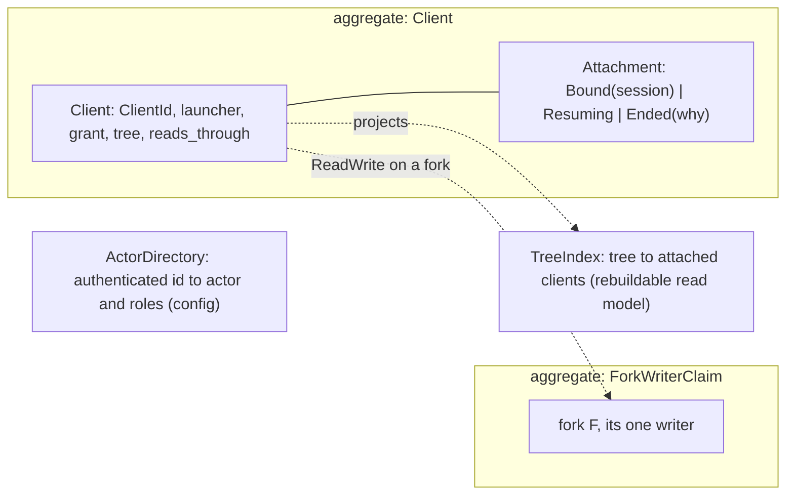

# Domain: Clients

**Layer:** System › **Domain (Clients)** › Feature.
**Status:** draft 2, proposed, against [system.md](../system.md) revision 4 (revision 3 approved 2026-11-02), which binds this page. It describes the target, not today's code. Sketches are Rust and show surfaces only.
**Binding from the system:** §3.2 (authority), §3.3 `Clients`, §3.4 events, I2, I9, I12, I13, I14. Its escalations (§10) are resolved in system revision 4.

## 1. What Clients owns, its language, and what it is not

Clients answers three questions: who is attached to which tree, through what grant, and with what authority. It is the only place a `ClientCap`, an `ActorCap` or a `Writer` other than `Agentfs` is born.

**Your words this domain rests on.** Everything else here is a design choice.

| # | Your words | Date | What it asks of Clients |
|---|---|---|---|
| R3 | "a virtual filesystem overlay for each client (including main) that is backed by a _real_ filesystem source-of-truth" | 2026-11-01 | one client per view, main included |
| R5 | "Agentfs history shouod distinguish between the various containers so we can track direct edits on main vs the forks that sandboxes edit" | 2026-11-01 | each client is its own writer |
| R7 | "Security boundary. Agentfs is the gatekeeper that exposes only what we want sandboxes to see" | 2026-10-30 | a grant never exceeds its launcher's authority |
| A1, A2 | main is a view like any sandbox; a sandbox's client is its own view mount, made by whoever starts the container | answers | one `attach` for every kind of client |
| A5, A6 | consistency: "It depends on the config!"; a pinned fork is an acceptable snapshot | 2026-11-02 | the grant holds the consistency setting and the snapshot choice |

| Term | Meaning here | Is not |
|---|---|---|
| **client** | one view's user: main or a sandbox container, attached to one tree | a process, a uid, a pod |
| **launcher** | whoever starts a container and attaches its client; holds a `LaunchCap` | a client |
| **grant** | what a client may do (`Access`), see (`ViewProfileId`), how it sees (`Sees`), and the owner its view presents (`acts_as`) | a role |
| **binding** | what `attach` returns: the client, its session, its tree, the trees it reads through, the attenuated grant and the rule-set version. It holds no capability | a mount |
| **attachment** | a client's life from `attach` to its end; Clients is its one judge (I9) | liveness (Health's) |
| **session** | the view host's connection for one client. In the history service it holds the client's `Recorder` and `ForkWriteCap`; its close while the service runs ends the attachment | the attachment itself |
| **writer** | the one party a record names; a read-write client is one | a uid |
| **actor** | an authenticated operator, integrator or approver, with roles as data | a client |
| **fork writer claim** | the record that fork F has had its one writer (`ForkTaken`) | the fork (Forks') |
| **snapshot client** | a read-only client of a pinned fork; `advance` moves it to a fresh pin | a time-travel reader of git |

**Not this domain:** when anything lands (Landing), whether a host is alive (Health), lineage and pinned trees (Forks), what a profile shows (Rules), serving file calls (Views), volume lifecycle (Volume).

## 2. The model



| Kind | Name | Holds | Why it is its own thing |
|---|---|---|---|
| aggregate | `Client` | id, launcher, grant, binding facts, attachment state | one consistency boundary per client: attach, rebind, advance, end |
| aggregate | `ForkWriterClaim` | `ForkId` → `ClientId` | "one writer per fork, for life" spans clients, so it needs its own boundary; unique per fork |
| value | `Grant`, `Sees`, `Consistency`, `Binding` | §3.3 shapes | immutable; `Grant` built only by its three constructors |
| value | `ClientId` | launcher, tree, label, ordinal | names its writer on its own, so a commit needs no lookup (§10 E4) |
| read model | `TreeIndex` | per tree, the clients that see it | answers `attached(t)` and `LastDetached`; rebuilt from `Client` rows at boot |
| config | `ActorDirectory` | authenticated id → `ActorId`, roles | data, not code: a new role is a config row |

**The attachment lifecycle.** One state machine, Clients' own; no other domain keeps a copy.

```mermaid
stateDiagram-v2
  [*] --> Bound: attach (durable, then Attached)
  Bound --> Bound: advance, then advanced (snapshot only, same client, new pinned tree)
  Bound --> Resuming: the history service restarted (every restored attachment)
  Resuming --> Bound: rebind(new session) by its launcher
  Bound --> Ended: session closed while the service runs, detach, operator end, or absent from reconcile's live set
  Resuming --> Ended: detach, operator end, or absent from reconcile's live set
  Ended --> [*]: pruned at once; a fork's claim stays until ForkDropped
```



`attached(t)` counts `Bound` and `Resuming` clients, so Landing's `Waiting{Resume}` (I12) sees the restored ones. Between `advance` and `advanced` a snapshot client counts toward both its old and new pin. `Ended` publishes `AttachmentEnded{client, why}` and then, in the same unit, `LastDetached{tree}` for each tree whose last client it was.

## 3. Public contract

The trait, `Grant`, `Sees`, `Binding` and `ClientError` are §3.3's (revision 4, which adopted this page's escalations); this section adds only what a domain document may: constructors, field meanings and the edge's driving port.

```rust
// ── values (fields private; built only as below) ────────────
impl Grant {
    pub fn live_read_write(tree: TreeRef, v: ViewProfileId, c: Consistency, acts_as: FileOwner) -> Grant;
    pub fn live_read_only(tree: TreeRef, v: ViewProfileId, c: Consistency, acts_as: FileOwner) -> Grant;
    pub fn snapshot(of: TreeRef, v: ViewProfileId, acts_as: FileOwner) -> Grant; // always ReadOnly: no other way to build one
}
pub struct ClientId {       // system §3.1, in `model`
    launcher: LauncherId,   // from the LaunchCap: a sandbox launcher cannot claim to be main's
    tree: TreeRef,          // R5: main or which fork, readable in every commit
    label: ClientLabel,     // the container's name, from the launcher
    n: Ordinal,             // unique per state area, never reused
}
pub enum AttachmentEndReason {
    Detached,               // the launcher's detach
    SessionClosed,          // the view host's connection closed while the service ran
    Reconciled,             // a launcher restart left it out of the live set
    Operator,               // Clients::end, for a launcher that never returns
}

// ── the trait: system.md §3.3 ─────────────────────────────
pub trait Clients {
    fn attach(&mut self, g: Grant, label: ClientLabel, s: SessionId, by: &LaunchCap) -> Result<Binding, ClientError>;
    fn rebind(&mut self, c: ClientId, s: SessionId, by: &LaunchCap) -> Result<Binding, ClientError>; // Resuming only
    fn detach(&mut self, c: ClientId, by: &LaunchCap) -> Result<(), ClientError>;     // idempotent
    fn reconcile(&mut self, live: ClientSet, by: &LaunchCap) -> Vec<ClientId>;         // ends this launcher's others
    fn advance(&mut self, c: ClientId, by: &LaunchCap) -> Result<Binding, ClientError>; // Snapshot only
    fn advanced(&mut self, c: ClientId, by: &LaunchCap) -> Result<(), ClientError>;     // the view rebound: old pin released
    fn end(&mut self, c: ClientId, by: &ActorCap) -> Result<(), ClientError>;           // Operator role
    fn actor(&self, id: AuthenticatedId) -> Result<ActorCap, ClientError>;
    fn attached(&self, t: TreeRef) -> ClientSet;
    fn attached_any(&self) -> ClientSet;
}

// ── the session edge's driving port (an adapter, not a domain crossing) ──
pub trait SessionEvents {
    fn closed(&mut self, s: SessionId); // peer close while the service runs: Ended(SessionClosed)
}
```

**Errors.** `ClientError` is §3.3's: `NotPermitted` (the grant exceeds the launcher, or `rebind` of a `Bound` client), `UnknownClient` (also the answer a launcher gets when rebinding an attachment that ended: it closes the view), `NotItsLauncher`, `TreeUnknown`, `ForkTaken` (one writer per fork, for life), `Draining` (after `VolumeDraining`, `attach` only; `rebind`, `detach`, `advance` still work), `NotDurable` (`attach` only; ends never fail for space).

**Events.**

| Published | Fields | When | Consumers (§3.4) |
|---|---|---|---|
| `Attached` | client, tree, reads_through | the `Client` row is durable | Landing, Volume |
| `AttachmentEnded` | client, why | the end is durable | Landing (write-opens, reconcile), Journal (abandons open transactions), Forks, Volume |
| `LastDetached` | tree | the same unit of work left `attached(tree)` empty; after the `AttachmentEnded` that caused it | Landing (`WhenDetached`, the intake's drain), Forks (a fork's or pin's end), Volume |

| Consumed | From | Effect |
|---|---|---|
| `VolumeDraining` / `VolumeStaged` | Volume | `attach` returns `Draining` from then on / accepted again |
| `ForkDropped` | Forks | the fork's writer claim is deleted |

**Who calls Clients, and whom it calls.**

| Direction | Party | Through |
|---|---|---|
| in | launchers | `attach`, `detach`, `reconcile`, `advance`, `advanced`; `rebind` after `ServiceReady` |
| in | operators | `end`, with an `ActorCap` holding the Operator role |
| in | the control-socket and git-server edges | `actor`, with an id they authenticated (socket peer credentials, HTTP auth) |
| in | Landing, Forks; Volume | `attached(t)`; `attached_any()` |
| out | Forks | `facts(f)` for a `ForksItCreates` attach; `lineage(f)` for `reads_through`; `pin(of, PinCap)` for a snapshot |
| out | Rules | `view_profile(name)`, `version()` for the binding |

**Capabilities.** Minted here, held elsewhere (§3.2).

| Capability | Minted in | Carries | Inside one process | Across a process edge |
|---|---|---|---|---|
| `ClientCap` | `attach`, `rebind` (read-write grants) | client, tree | the Journal consumes it into the session's `Recorder` | never crosses: the view host holds only the session |
| `ForkWriteCap` | `attach`, `rebind` (read-write on an editable fork) | fork | held by the session; `Forks::copy_up` takes it | never crosses |
| `ActorCap` | `actor` | actor, roles | passed by reference to the command | rebuilt per request by the edge that authenticated the peer |

## 4. Invariants and how they are enforced

| # | Invariant | Enforced by | Strength |
|---|---|---|---|
| C1 | Only Clients mints `ClientCap`, `ForkWriteCap` and `ActorCap`, so only Clients makes `Writer::Client` or `Writer::Actor` (I2) | the capability types' fields are private; their one constructor takes a `&Minter`, a value the composition root makes once and hands to Clients; clippy `disallowed_methods` bans `Minter::new` outside the composition root | construction time + build time |
| C2 | A grant never exceeds its launcher: a `ForksItCreates` launcher reaches only forks it created, and no launcher grants a view profile outside its bound (R7) | `attach` builds a private `Attenuated` value only after both checks (`Forks::facts`, `LaunchCap.view_profiles`); `Binding` is made only from an `Attenuated` | construction time |
| C3 | A snapshot or read-only client has no recorder and no `ForkWriteCap` | `Grant::snapshot` is the only way to build `Sees::Snapshot` and sets `ReadOnly`; Clients mints the two caps only for `ReadWrite` | construction time |
| C4 | A fork has at most one read-write client, for life (so a sandbox host restarted in place gets a new fork) | the `ForkWriterClaim` row is unique per `ForkId`, written in the attach's unit of work and deleted only at `ForkDropped` | construction time (store unique key) |
| C5 | A session binds exactly one client, and a client acts only through its live session | the session owns the `Recorder` and `ForkWriteCap`; ending the attachment closes the session; a call names no client, so it cannot name another (AC-1.4 in the catalogue) | construction time |
| C6 | `LastDetached{t}` is published exactly once each time `attached(t)` becomes empty | the end, the index update and the outbox rows commit in one unit of work | construction time + test |
| C7 | Every end has an event: session close, `detach`, `reconcile` or an operator's `end`. No lease, timeout or heartbeat ends an attachment (I10) | no clock port exists in this domain | compile time |
| C8 | Restored attachments are `Resuming` until rebound or ended; none is ended by guessing | boot restores every `Bound` row as `Resuming` before `ServiceReady` | construction time + test |

## 5. Ports and adapters

The domain crate holds no I/O. Each port is a trait it owns; the `store` adapter implements the repositories in the state area, behind its kernel lock (I15).

```rust
pub trait ClientRepository {                           // one per aggregate
    fn restore_all(&self) -> Result<Vec<Audited<Client>>, StoreError>;
    fn insert(&mut self, u: &mut Unit, c: Client) -> Result<(), StoreError>;    // reserves room for its own end
    fn update(&mut self, u: &mut Unit, c: Client) -> Result<(), StoreError>;    // never grows the store
    fn delete(&mut self, u: &mut Unit, id: &ClientId) -> Result<(), StoreError>;
}
pub trait ForkWriterClaims {
    fn claim(&mut self, u: &mut Unit, f: ForkId, c: &ClientId) -> Result<(), ClaimError>; // Taken if one exists
    fn release(&mut self, u: &mut Unit, f: ForkId) -> Result<(), StoreError>;
}
// Outbox<ClientEvent> and UnitOfWork: the one store port shape in `contracts` (system §6)
pub trait ActorDirectory { fn lookup(&self, id: &AuthenticatedId) -> Option<(ActorId, Roles)>; }
pub trait Ordinals { fn next(&mut self, u: &mut Unit) -> Ordinal; }
```

| Port | Adapter | Notes |
|---|---|---|
| `ClientRepository`, `ForkWriterClaims`, `Outbox`, `UnitOfWork`, `Ordinals` | `store` | one query-builder layer stamps `Audited` (created and changed, when and by which `Principal`) on every row (I13); no domain code writes a stamp |
| `ActorDirectory` | `store`, reading deployment config | read-only; a config change takes effect at the next `actor` call |
| `SessionEvents` (driving) | `rpc` | Unix-socket peer close is the session's end |
| outbox relay | composition root's event bus | delivers staged events after the unit commits, at least once; consumers are idempotent on (client, reason) |

**Design choice: hard delete on end.** An ended client's row is deleted in the unit that ends it; the commit already names the writer through `ClientId`, and Telemetry keeps the attach and end events. Soft delete was considered and rejected: it is growth with no reader (I14).

## 6. Internal flows

**A sandbox client attaches.**
```mermaid
sequenceDiagram
  participant La as launcher (ForksItCreates)
  participant C as Clients
  participant F as Forks
  participant S as store
  La->>C: attach(live_read_write(Fork F, profile, PerFile), session, cap)
  C->>F: facts(F): created by this launcher, editable, not ended
  C->>C: Attenuated: tree within cap, view profile within cap's bound
  C->>F: lineage(F): [F, Source]
  C->>S: one unit: insert Client (Bound), claim F, index, stage Attached
  alt claim exists
    S-->>C: Taken: unit rolls back
    C-->>La: ForkTaken
  else
    C->>C: mint ClientCap and ForkWriteCap into the session; the Journal makes its Recorder
    C-->>La: Binding { client, session, tree F, reads_through [F, Source], grant, rules }
  end
```

**An attachment ends** (any of the four causes): one unit marks it `Ended`, deletes the row, updates the index, stages `AttachmentEnded` and then every `LastDetached` it caused. Landing then drops the client's write-opens and reconciles what they left unrecorded; the Journal abandons its open transactions (system Q2, recommended); Forks ends a fork or pin whose `LastDetached` it is; the session edge drops the `Recorder` and `ForkWriteCap`.

**The history service restarts.**
```mermaid
sequenceDiagram
  participant S as store
  participant C as Clients
  participant V as view host
  participant La as launcher
  C->>S: restore_all: every Bound row becomes Resuming; rebuild TreeIndex; relay unsent outbox rows
  Note over C: Clients restored: one input to ServiceReady
  La->>C: rebind(client, new session) with its LaunchCap, on ServiceReady
  C-->>La: a fresh Binding: same ClientId, same writer; new caps held by the new session
  La->>V: Views::rebound(view, binding)
  La->>C: reconcile(live set) after its own restart, or detach for an exit it re-sends
  C->>C: ends the rest: AttachmentEnded(Reconciled), LastDetached where empty
```

**A snapshot advances.** `advance(c)` asks `Forks::pin(of, PinCap)` for a fresh pinned fork, adds it to the client in one unit and returns a new `Binding`. The launcher calls `Views::rebound`, then `advanced(c)`: Clients drops the old pin from the client and publishes `LastDetached` for it if it was the last, so Forks ends it. The client keeps its id; it never had a writer.

**Behaviour in the system's scenarios.**

| Scenario | What Clients does | What it never does |
|---|---|---|
| Live landing | answers `attached(t)`; publishes `AttachmentEnded` so a dead client's write-opens stop holding a landing; `LastDetached` meets `WhenDetached` | wait on a landing: `attach` never blocks on a gate |
| Transactions | nothing of its own: a transaction lives in the Journal; `AttachmentEnded` is the Journal's signal to abandon an open one | know a transaction exists |
| Scale: 1,000 sandboxes | an attach is one `lineage` call, one unit (two rows and an outbox row), one event; `attached(Source)` reads the index, `LastDetached` is a counter reaching zero | scan clients per call; put a `ClientId` in a metric label |
| Crashes: view host | its sessions close: `Ended(SessionClosed)` while the service runs; across a service restart its clients stay `Resuming` until its launcher detaches or reconciles. A host restarted in place attaches new clients; a sandbox's gets a new fork | end a client because a probe failed |
| Crashes: launcher | its clients keep running; on restart it calls `reconcile` with the ones still alive | end them on its absence (cost 3) |
| Crashes: mid-unit | the unit rolls back whole: no row without its event, no event without its row | publish before the row is durable |
| Disk full | `attach` fails (`NotDurable`) and nothing is half-made; an end always succeeds, because its row update and outbox room were reserved at attach | refuse an end for space |
| Upgrades | rows are restored by the new service and migrate per system Q3; launchers `rebind` their views | keep a second row format beyond what Q3 allows |

## 7. Policies and configuration it owns

| Policy | Values | Current setting | Source |
|---|---|---|---|
| Consistency, per client | `PerFile` · `WholeLanding` · snapshot | `PerFile` when the launcher names none | A5; R13 for per-file as the default |
| Actor directory | authenticated id → actor, roles (`Operator`, `Integrator`, `Approver`; more are rows) | deployment config | design choice |
| Admission while draining | `attach` refused; `rebind`, `detach`, `advance` allowed | fixed | design choice, from `VolumeDraining` |
| Retention | a client row ends with its attachment; a fork's claim ends at `ForkDropped` | fixed | I14 |

Launcher authority (`LaunchCap`) is deployment config read by the composition root, not a Clients policy. Clients has no timers.

## 8. Tests that prove it

Each runs the real binary or the real crate against the real `store` adapter, through the rpc edge where a process boundary is part of the claim.

| Test | Proves | Rules out |
|---|---|---|
| A sandbox launcher asks for the source tree, a fork another launcher made, and a profile above its bound | `NotPermitted` or `NotItsLauncher` each time; no row, no event | a hostile in-pod launcher seeing or writing main (R7) |
| A second read-write attach to a fork, before and after a service restart | `ForkTaken` both times | two writers on one fork line |
| A view host sends a record naming another client id over its session | the record names the session's own client | forged attribution (I2, AC-1.4) |
| Kill a sandbox's view host while the service runs | `AttachmentEnded(SessionClosed)`, `LastDetached{F}`; main keeps writing | a dead client holding write-opens forever |
| Kill the service with three attachments; rebind two; the launcher reconciles | two `Bound` with their old writers, one `Ended(Reconciled)`, `LastDetached` once per emptied tree | ending clients by guess; double or missing `LastDetached` |
| Kill the service between a unit's commit and its relay | the event arrives after restart, exactly once per consumer after dedup | lost or phantom attachment events |
| Fill the state area, then attach and detach | attach fails cleanly; detach succeeds | a client that can never end on a full disk |
| Attach a snapshot, then advance it | read-only, no recorder; a new pinned tree; the old pin ended | a writable snapshot; leaked pins |
| `VolumeDraining`, then attach, rebind, detach | only attach is refused | a volume that never releases, or a client stranded by draining |
| 1,000 attach and end cycles | client rows back to zero; claims only for undropped forks; attach time flat | unbounded growth (I14) |
| Compile-fail tests in another crate | building `ClientCap`, `ActorCap`, `Writer::Client` or a snapshot `Grant` with `ReadWrite` does not compile | forging authority in code |

## 9. Costs and open questions

**Costs.**
1. **A session close ends the client.** A view host restarted in place while the service runs comes back as a new client; under `ForkTaken` a sandbox's comes back on a new fork, and its old fork ends and lands what it saved.
2. **One unit of work per attach.** 1,000 attaches is 1,000 durable writes in the state area.
3. **A launcher that never returns** leaves its clients attached, so `WhenDetached` never fires and the volume never releases, until an operator calls `end`.
4. **Labels are the launcher's word.** A sandbox launcher can label its client anything; the launcher and fork in the `ClientId` keep it from passing as main.

**Q1. Does a snapshot client count as seeing the tree it pinned?**
- **Recommended: no.** It reads its pinned fork, not the live tree, so it holds back no `WhenDetached` landing. Cost: an integrator's patch lands while a snapshot reader is attached; the reader sees it only on `advance`.
- **Alternative: yes.** Cost: a long-lived snapshot reader blocks every `WhenDetached` landing.

**Q2. Should an ended client's record be kept?**
- **Recommended: delete it at the end** (§5). Cost: no on-volume record of a client that attached and wrote nothing; Telemetry holds that.
- **Alternative: soft-delete, kept until its tree's next commit.** Cost: rows and a pruning trigger with no reader today.

## 10. Escalations to the system document

| # | Where (revision 3) | Recommended change | Resolution in revision 4 |
|---|---|---|---|
| E1 | §3.2 `LaunchCap` bounded trees, not profiles | `LaunchCap { launcher, may, profiles }` | adopted, as `view_profiles` |
| E2 | §3.3 `Binding`: a read-only client still got a `ClientCap` | `cap: Option<ClientCap>` | adopted in a stronger form: no `Binding` carries a capability; Clients mints none for read-only grants |
| E3 | §3.3 `Forks`: no fork facts; no way to end a pin | `Forks::facts`; `Forks::unpin` | `facts` adopted (it also replaces Forks' `made_by`); `unpin` dropped: a pin ends on its own `LastDetached`, released by `advanced` |
| E4 | `attach` took no name; I14 pruned "once committed"; the claim must outlive the client | `attach(g, label, s, by)`; `ClientId` with launcher, tree, label; claim deleted at `ForkDropped` | adopted; `ClientId` is in `model` |
| E5 | `attach` could meet a full disk with no variant | `NotDurable(IoKind)` | adopted |
| E6 | "compile time" overclaimed; a Rust value cannot cross to a view host | construction plus build time (`Minter`); caps bound to the session in the history service | adopted, and extended to `Gated`, `Writer`, `PinCap`, `StartCap` |
| E7 | "one writer per fork, for life", "a session's end ends the attachment" and "a view host's in-place restart" cannot all hold | `ForkTaken` only while another writer is attached | rejected: the system keeps one writer for life, and an in-place restart is a new client on a new fork (system cost 8) |
| E8 | nothing ended an attachment whose launcher never returns | `Clients::end(c, by: &ActorCap)`, Operator role | adopted |

Also resolved: the launcher, not the view host, calls `rebind` (it holds the `LaunchCap`); `Binding` is consolidated in system §3.3.

## New terms

| Term | Definition | Why needed | Could be the existing term |
|---|---|---|---|
| attachment | a client's life from `attach` to its end | I9 names Clients its judge | today's attached mark |
| fork writer claim | fork F's one writer, kept until F drops | `ForkTaken` outlives the client | none |
| `Minter` | the one value that can build a capability, held by Clients (system §3.2 uses the same pattern for every minting domain) | C1 across crates | none |
| client label | the container's name, given by its launcher | R5 | origin, pod name |

## For the code architects (parked)
The `store` layout for the two aggregates and the outbox; how "reserve room for its own end" is done (a preallocated slot per client); the outbox relay's dedup key; how a launcher's `LaunchCap` reaches `rebind` over the socket; `TreeIndex` as counters per tree; `Ordinal` allocation.

## Reconcile with existing code (agentfs origin/main b5c0dc8)
- **The attached mark** (`patch/attached.rs`, a file rewritten at mount) goes: attachment becomes `Client` rows with events. Cost: every patch-landing path that read the mark reads `LastDetached` instead.
- **Front slots and their leases** (`history_service/fronts.rs`) become sessions; a slot's repair queue becomes the client's own stream. Cost: the CSI supervisor's slot takeover is rewritten.
- **Peer authentication** stays: the socket edge's `SO_PEERCRED` check (`local_socket.rs`) is the authenticated id `actor` and launchers start from.
- **Committer from pod flags** becomes the `ClientId` in each record. Cost: the trailer format changes (History's document).

**NOT RUN:** no code was built or tested; Rust visibility claims in E6 are from the language rules, not a compile; `feat/edit-provenance` was not read.
