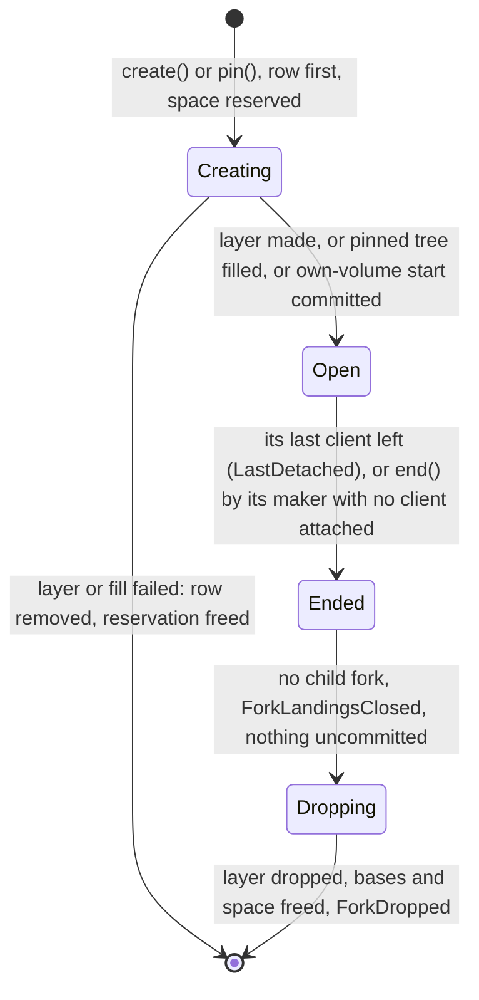
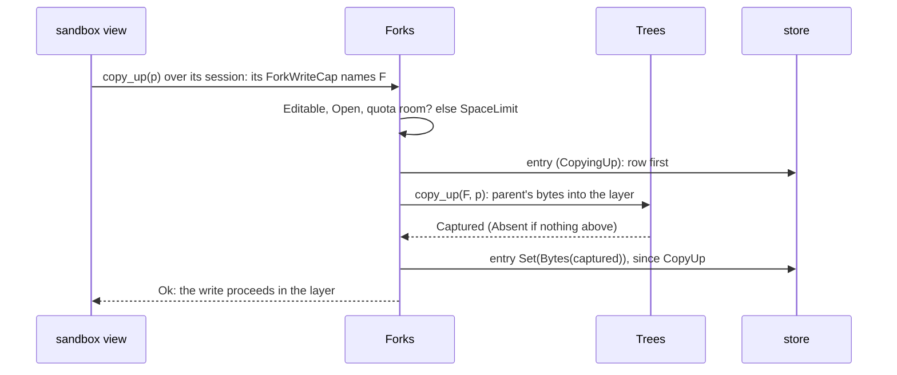

# Forks: domain architecture

**Layer:** System (approved 2026-11-02) › **Domain: Forks** › Feature.
**Status:** draft 5, proposed; the target, not today's code. [system.md](../system.md) revision 7 binds it. Rust surfaces only.
**In one line:** Forks tracks every fork: the tree it sits over, what each of its paths merges against at each point, which forks hold their own copy of a path, its space, and when it ends and drops.

**Since your 2026-11-02 answers:** a held commit keeps only its own fork's entries (A12); an abandoned transaction moves no base (A13); a synced base holds the parent's content captured; no open questions.
## 0. What binds this domain

| Source | Words (verbatim) | What it means here |
|---|---|---|
| R4, 2026-11-01 | "the sandbox fs edits need to land back in the main container, and then future sandboxes should start from the edited files" | a new editable fork is an empty layer over its parent's live tree, so it starts from everything landed so far |
| R5, 2026-11-01 | "track direct edits on main vs the forks that sandboxes edit" | each fork has an id that history names after the fork is gone |
| R13, 2026-11-02 | "A cooperating integration can define batches/transactions across files, and they must all land together" | all of a transaction's bases move in its one landing |
| R16, 2026-11-02 | "only break on a major version change … patch doesnt need to match" | Forks' rows and the layer layout are internal formats of one family; a minor or major upgrade drains every fork first |
| R17, 2026-11-02 | "dont go back on the fork design … syncing forks quickly and efficiently to minimize conflict drift" | forks stay; every sync moves a base forward, so drift stays small |
| R18, 2026-11-02 | "keeping the two trees relatively in-sync should minimize conflicts" | `copies` names every fork a parent's change syncs into |
| A4, 2026-11-01 | "A fork whose branches are rejected and never land in the main branch will inevitably be lost, and that's acceptable" | dropping an ended fork's unlanded work is allowed |
| A6–A9, 2026-11-02 | pinned snapshots; "one setting per volume"; "a *commit* is landed altogether"; "freezing only the files that a landing touches" | `pin`; no history setting here; bases per commit position; a base moves only for its gate's files |

System invariants that name Forks: I4 (bases per position), I5 (drop), I6 (fork space; capping it is the system's reading of R7, not his words), I14 (older bases pruned), I16 (formats). Everything else on this page is a design choice.

## 1. What Forks owns, its language, and what it is not

| Owns | Is not |
|---|---|
| **Lineage**: each fork's parent tree, kind, placement and creating launcher | the layer's bytes, copy and rename mechanics (Trees) |
| **Path bases**: what each path a fork holds merges against, at each fork position, and where each landing or sync moves it | merging, resolving, trimming, deciding when anything lands or syncs (Landing) |
| **Copies**: which open forks hold their own copy of a path (read from the bases) | which records a fork commit spans (Journal); a fork's line and the history setting (History) |
| **Fork space**: each fork's limit and the volume's fork budget (the values) | the quota mechanism (Trees) |
| **The fork lifecycle**: create, pin, end, drop; publishes `ForkEnded`, `ForkDropped` | who writes a fork, attachments, `ForkTaken` (Clients); records and `Seq` (Journal) |

| Term | Meaning | New? |
|---|---|---|
| fork, parent, lineage, copy-up, sync | system terms (copy-up is overlayfs's word) | system |
| path base | what a fork path merges against, per fork position: the copied bytes, then the fork's content at its last landing, or the parent's at its last sync | system term |
| base entry | one base and the fork position after which it holds | new; could be "path base at a position" |
| base move | entries added for every path of one landing or sync inside its gate, or one ended by the trim that removes its copy | system term (`move_bases`) |
| fork budget, reservation | the space all forks may use; a fork's share of it from create to drop | new; could be "fork space and its limit" |
| ended / landings closed / dropped | no new sources, syncs or copy-ups / no landing of it open / layer, bases and line gone | system terms |

## 2. The model

Two aggregates, each with its own repository. A fork's kind is a type, so a call that makes no sense for a kind does not compile.

```rust
// ── Aggregate 1: Fork ──────────────────────────────────
pub struct Fork {
    id: ForkId,
    parent: TreeRef,               // fixed at create; the source tree or an editable fork
    placement: Placement,          // InVolume | OwnVolume (system §3.3)
    maker: Maker,                  // who may end it
    reserved: Bytes,               // its share of the fork budget, held until drop
    state: ForkState,
    body: ForkBody,                // the kind, as a type
}
pub enum Maker {
    Launcher(LauncherId),          // create(): only this launcher ends it
    Snapshot,                      // pin(): ends at its LastDetached
}
pub enum ForkBody {
    Editable(EditableFork),        // has bases; a landing source and a sync target
    Pinned(PinnedFork),            // read-only; no bases, no records, never a source or target
}
pub struct EditableFork { commit_base: Option<CommitId> } // own-volume only: its start commit, then its last landed tip
pub struct PinnedFork { at: CommitId }                    // shared by every snapshot client pinned at `at`

pub enum ForkState {
    Creating,                      // row written first; layer or fill not yet done. Recovery rolls forward
    Open,                          // the only state `copies` answers for
    Ended { why: ForkEnd },        // no new sources, syncs or copy-ups
    Dropping,                      // every drop condition met; idempotent removal under way
}                                  // dropped: the row is soft-deleted, invisible to every read
pub enum ForkEnd {
    ByLauncher,                    // end() with no client attached
    LastClientLeft,                // LastDetached{this fork}
}

// ── Aggregate 2: PathBase, one per (fork, path) an editable in-volume fork holds or still needs ──
pub struct PathBase {
    fork: ForkId,
    path: RelPath,                 // a database group's members each get one, moved together
    entries: Vec<BaseEntry>,       // ordered by `after`; equal: the later move wins (Landing orders moves of one path)
}
pub struct BaseEntry {
    after: Seq,                    // holds for the fork's records of p after this fork position
    state: BaseState,
    since: BaseSince,
}
pub enum BaseState {
    CopyingUp,                     // row first; `base()` answers None until Set
    Set(BaseContent),
    Trimmed,                       // the copy is gone: p reads the parent live after `after`
}
pub enum BaseContent {             // published in `contracts` (system §3.3 names it)
    Bytes(Captured),               // what copy-up captured, or a sync's captured parent copy; Forks is their one holder
    Absent,                        // nothing was above the fork when it first wrote the path
    At(Position),                  // a run: the fork's own content at a fork commit's end, a commit on its line
    AtCommit(CommitId),            // own-volume: the path at the fork's commit base
}
pub enum BaseSince {
    CopyUp,                        // takes the place of a last Trimmed entry, at its position (zero at first)
    Landing(LandingId),            // the run, sync or trim that added it; a repeat with this id is a no-op
}
```

Choices: bases are their own aggregate, so a copy-up or a sync touches one small row. Entries are per position because a save made before a sync must merge against the old base, one made after against the parent's synced content. An entry is pruned once no waiting commit and no current copy needs it (I14).



A pinned fork passes the same states; landings closed and committed hold from its birth.
## 3. The public contract

The system's trait (§3.3, revision 7); callers and what each is given:

```rust
pub trait Forks {
    fn create(&mut self, parent: TreeRef, k: ForkKind, p: Placement, by: &LaunchCap) -> Result<ForkId, ForkError>;
    fn pin(&mut self, of: TreeRef, by: &PinCap) -> Result<ForkId, ForkError>;   // Clients holds the only PinCap
    fn copy_up(&mut self, p: &RelPath, by: &ForkWriteCap) -> Result<(), ForkError>; // the cap names the fork
    fn move_bases(&mut self, g: &Gated, id: LandingId, from: Seq, moves: Vec<BaseMove>) -> Result<(), ForkError>;
    fn base(&self, f: ForkId, p: &RelPath, at: Seq) -> Option<BaseContent>;      // at: the fork's record of p. None: not held then
    fn copies(&self, over: TreeRef, p: &RelPath) -> Vec<ForkId>;                // open editable children of `over` whose last entry for p is Set
    fn lineage(&self, f: ForkId) -> Vec<TreeRef>;                                // answers until the fork drops
    fn facts(&self, f: ForkId) -> Option<ForkFacts>;                             // created by, kind, ended; Clients' attach check
    fn end(&mut self, f: ForkId, by: &LaunchCap) -> Result<(), ForkError>;
    fn live(&self) -> Vec<ForkId>;                                               // forks not yet dropped
}
pub enum BaseMove {
    Kept { path: RelPath, at: Position },   // a run: the fork's content at `through`
    Synced { path: RelPath, content: Captured }, // a sync: the parent's content it merged, captured at prepare
    Trimmed { path: RelPath },              // only in the trim that removes the copy
    Tip { path: RelPath, at: CommitId },    // own-volume
}
pub enum ForkError {
    ParentUnknown,    // create: the parent is not an open tree, or is a pinned fork
    NotPermitted,     // create: a sandbox launcher forking a fork it did not create; end: not its maker
    SpaceLimit,       // create: the budget cannot hold the reservation; copy_up: the quota or the disk is full
    QuotaUnavailable, // create: an editable in-volume fork where Trees reports no per-layer quotas (I6)
    NotEditable,      // copy_up on a pinned fork
    Ended,            // copy_up or end on an ended fork (end is idempotent: Ok if ended by the same maker)
}
```

| Caller | Calls | Injected with | Why |
|---|---|---|---|
| launcher | `create`, `end` | `LaunchCap` | a sandbox's life is its launcher's; `end` covers a fork no client ever attached to |
| Clients | `pin`, `lineage` (every `Binding.reads_through`), `facts` (a `ForksItCreates` attach) | `Forks`, `PinCap` | attach and advance |
| Views, over its session | `copy_up`, at a fork path's first write, create or delete | the session's `ForkWriteCap`, held in the history service | the base must exist before the write returns |
| Landing | `copies` for each parent record; `base` for each commit's file and each sync; `move_bases` in `Writing` (runs, syncs) and at each trim | `Forks`, `&Gated` | I4: the only merge base; the sync targets |
| Volume | `live`, for an upgrade's drain | `Forks` | "no fork left" has one judge |

Forks calls Trees (`facts`, `create_layer(f, over, limit)`, `drop_layer`, `fill`, `copy_up`, `capture`, `discard`), History (`head`, `checkout`, `content_at`: pins and run bases) and `Journal::uncommitted`, `Clients::attached` (the drop check, `end`).

| Event | Direction | What Forks does or means by it |
|---|---|---|
| `ForkEnded{fork}` | out, to Landing | Landing drains the fork's intake; held ones stay held; `copies` stops naming it |
| `ForkDropped{fork}` | out, to History, Journal, Clients, Replication, Volume | its line, stream, writer claim and remote line go |
| `LastDetached{tree}` | in, from Clients | ends the fork (editable or pinned) whose tree it names |
| `ForkLandingsClosed{fork}`, `Committed{tree: Fork(f)}` | in, from Landing, History | re-judge f's drop |

## 4. Invariants and how they hold

| # | Invariant | Enforced by | Strength |
|---|---|---|---|
| F1 | At every fork position, a path an editable fork holds has exactly one base, never git's merge base (I4); the copy-up base is written before the write that caused it returns | only Forks calls `Trees::copy_up`, recording the entry in the same step; create and delete copy up too (`Absent`) | construction + test |
| F2 | Bases move only inside the landing or sync that lands them, only for the files its gate covers (A9), every path of one commit together (R13); a copy's entry ends only in the trim that removes it | `move_bases` takes `&Gated`, which refuses paths outside its gate; idempotent on `LandingId`; `Trimmed` comes only from the trim step | construction time + build time |
| F3 | A moved base never names a record that commit grouping or truncation removes (I11); every captured file has one holder | a run's base is `At` a fork commit's end, a commit on the fork's line; a sync's is the captured parent copy Landing hands over (`Synced`); Forks alone holds captured bases | construction |
| F4 | A fork drops only when ended, childless, its landings closed and fully committed, sync records included (I5, I14) | the `Fork` aggregate's drop check; facts asked (`Journal::uncommitted`) or consumed as events, never copied | event order + test |
| F5 | A parent never drops before its children; a pinned fork is never a parent | `children()` in the drop check; `create` refuses a pinned parent | construction + test |
| F6 | A pinned fork is read-only: no bases, no records, never a source or sync target | `copy_up` exists only on `EditableFork`; `PinnedFork` has no base table | compile time (inside the domain) |
| F7 | Every editable in-volume fork has a quota and a reservation before its layer exists; without quota support those creates are refused (`QuotaUnavailable`), snapshots still work (I6) | `Trees::facts()` at boot; the limit passed to `create_layer`; reservation in the row's transaction | boot + construction |
| F8 | Only its maker ends a fork; only Clients pins; only the fork's writer copies up | `LaunchCap`, `PinCap`, `ForkWriteCap`, each built only through its minter | construction time + build time |
| F9 | `copies` and `base` read the same entries, no second index; every row carries audit stamps; dropped forks are soft-deleted and kept | one `PathBaseRepository`; the `store` layer (I13) | construction |

## 5. Ports and adapters

```rust
pub trait ForkRepository {                  // aggregate Fork. Audit stamps and soft delete live in the store layer
    fn get(&self, f: ForkId) -> Result<Option<Audited<Fork>>, StoreError>;
    fn children(&self, f: ForkId) -> Result<Vec<ForkId>, StoreError>;      // live children only
    fn open_pin(&self, at: CommitId) -> Result<Option<ForkId>, StoreError>; // an open pin to share
    fn reserved_total(&self) -> Result<Bytes, StoreError>;
    fn live(&self) -> Result<Vec<ForkId>, StoreError>;                     // not yet dropped
    fn save(&self, f: &Fork, by: Principal) -> Result<(), StoreError>;     // + outbox event, one transaction
    fn soft_delete(&self, f: ForkId, by: Principal) -> Result<(), StoreError>;
}
pub trait PathBaseRepository {              // aggregate PathBase
    fn get(&self, f: ForkId, p: &RelPath) -> Result<Option<PathBase>, StoreError>;
    fn holders(&self, children_of: TreeRef, p: &RelPath) -> Result<Vec<ForkId>, StoreError>; // last entry Set
    fn put(&self, b: &PathBase, by: Principal) -> Result<(), StoreError>;
    fn move_bases(&self, l: LandingId, f: ForkId, from: Seq, moves: &[BaseMove], by: Principal) -> Result<(), StoreError>; // one transaction, prunes
    fn remove_all(&self, f: ForkId, by: Principal) -> Result<(), StoreError>;
}
```

Adapter: `store`, the state area's database through its query-builder layer, with audit stamps, the soft-delete filter and a transactional outbox applied once there (Repository pattern). Trees (XFS or ext4 project quotas, btrfs qgroups; prior art Docker overlay2's per-container size), History, Journal and Clients are reached through their §3 contracts.

## 6. Flows and scenarios

**A fork's first write of p: copy-up and its base.**


**One path's bases over time: a run lands, main's change syncs in, the copy is trimmed.** Each `move_bases` runs inside the gate of the landing that calls it, and that gate covers only these files.
```mermaid
sequenceDiagram
  participant L as Landing
  participant F as Forks
  participant S as store
  participant T as Trees
  Note over F: F copied p (Bytes b0); F saves p at F:7
  L->>F: base(F, p, at 7): b0. The run merges, gate on main's p
  L->>F: move_bases(run, from 7, [p: Kept at F:7])
  F->>S: one transaction: entry "after 7: At(F:7)"; b0's entry pruned
  F->>T: discard b0
  Note over F: F saves p at F:9; then main records p at main:50
  L->>F: copies(Source, p): [F]
  L->>F: base(F, p, at 9): At(F:7). The sync merges, gate on F's p only
  L->>F: move_bases(sync, from 9, [p: Synced(main's p at 50, captured)])
  F->>S: entry "after 9: Bytes(captured)"; F:9 still merges on At(F:7)
  Note over F: later F's copy equals main's and is closed
  L->>F: move_bases(trim, from 12, [p: Trimmed]) with Trees::trim
  F->>S: entry "after 12: Trimmed"; copies(Source, p) no longer names F
```
Why: after a run, F's later saves carry only what F changed since 7, on a main that holds 7; after a sync, F's copy holds main's 50 plus F's unlanded work, so 50 is what both share. F:7 is a commit on F's line; main's 50 is kept captured, since main may commit 50 with 51 and truncate both (I11). A sync leaving F's copy equal to main's, closed, is followed by the trim, and F reads main live again.

**A fork ends and drops**, on events alone:
```mermaid
sequenceDiagram
  participant La as launcher or Clients
  participant F as Forks
  participant L as Landing
  participant H as History
  participant T as Trees
  La->>F: LastDetached(F), or end(F) with no client attached
  F--)L: ForkEnded(F): Landing drains F's intake; no more syncs into F
  L--)F: ForkLandingsClosed(F): no landing of F open
  H--)F: Committed(Fork F, through n)
  F->>F: ended, no child, landings closed, F not in Journal::uncommitted(): Dropping
  F->>T: drop_layer(F), idempotent
  F->>F: bases removed, quota and reservation freed, row soft-deleted
  F--)H: ForkDropped(F): the line is deleted
```
Each event re-asks one check; the last fact moves the fork; a parent's reruns when its last child drops. **A snapshot** attaches through `pin`: Forks shares an open pin at `History::head(of)`, else reserves, checks out, fills and opens one; after `advance` and `Clients::advanced`, the old pin's `LastDetached` ends it.

| Scenario | What Forks does |
|---|---|
| Live run of whole commits (A8) | nothing on the save path; `base` answers per commit position; one `move_bases` for every path of the run, from its `through` |
| Held commit | no base move; its entry stays in force for it, and every later commit keeps its own entry while it waits |
| `withdraw` | no base move; rejected commits' entries pruned; an open fork keeps its copies and syncs |
| Sync, merged / `Deferred` or held | one entry holding the captured parent copy / nothing moves |
| Transaction | one base move for every file in scope; held, it keeps all its entries; abandoned, nothing moves; its files keep the bytes (A13) |
| Fork of a fork | landings go to the parent fork; main's change reaches a grandchild one sync at a time (`copies(Fork F, p)`) |
| 1,000 sandboxes | one row, an empty layer, a quota and a reservation each; forks reading p live cost no sync |
| Crash in copy-up, `Creating`, `Dropping` or `Writing` | rolled forward, every step idempotent; a `CopyingUp` entry (the view never got `Ok`) captures the layer copy as the base |
| Disk full or quota reached | that sandbox's write fails with `SpaceLimit`; main and other forks are unaffected (F3, F7) |
| Upgrade (R16) | patch: rows and layers stay. Minor or major: the drain ends every fork, and `live` must answer empty before release (E2); no fork row or layer crosses a family |

## 7. Policies and configuration Forks owns

| Policy | Values | Current choice | Set by |
|---|---|---|---|
| Per-fork space limit | bytes | one value per state area (placeholder: 1 GiB) | operator, deployment config |
| Fork budget | bytes, at most the free space the operator gives forks | placeholder: 25 % of the volume | operator |
| Reservation | thick: each fork reserves its full limit at create · thin: forks share the budget | thick (design choice, was QF1): no sandbox, nor main, runs out of promised space; thin lets one burst fail every other's writes | Forks |
| Ending | at its last client's leaving · only at `end` | at the last client (design choice, was QF2): with one writer for life it is never written again, and a deleted pod's launcher may never call `end`; session close ends its attachment | Forks |
| Sync targets | open forks only · every live fork | open only (design choice): nobody reads an ended fork, and its held commits merge against main anyway | Forks (`copies`) |

## 8. Tests that prove it

Through a real sidecar on a filesystem with project quotas, unless marked.

| Test | Rules out |
|---|---|
| Sandbox copies p, main edits p, sandbox saves p: the landed p holds both edits | a merge base taken from git (I4) |
| Sandbox saves q at 7 and 9; 7 lands while main edits q; 9 lands: main's edit kept, 7's not applied twice | a stale base after a run (F2) |
| Sandbox saves s at 9; main edits s at 50 and syncs in; the sandbox's view shows main's edit; 9 lands, then a save at 13 lands: no conflict, nothing applied twice | one base per path; a base not moved by syncs (F1) |
| Main edits s, which the sandbox holds unchanged and closed: the copy is trimmed, `copies` stops naming the fork, its view reads main live | a sync that leaves a stale copy |
| A trim, then a crash before its entry; the sandbox reopens p afterwards | a copy with no base, or a base and no copy (F2) |
| A 3-file transaction lands: all 3 bases move; one conflicts: none move | a split base move (R13) |
| A `move_bases` naming a path outside its gate | a freeze wider or narrower than its landing (A9) |
| Ended fork with a held commit: no drop until withdrawn and committed; then layer, bases and line gone; main still reaches the landed commits | early drop, lost landed work (I5, A4) |
| A parent with a live child never drops | reads through a deleted layer (F5) |
| A sandbox fills its quota while main saves: main's save succeeds; without quota support editable creates are refused, snapshots work | a sandbox denying service to main (I6, F7) |
| `trybuild` compile-fail: `copy_up` on a pinned fork, `move_bases` without `Gated`, `pin` without its cap; clippy on a stray minter | capability rules decaying into conventions (F2, F6, F8) |
| Pure domain tests over in-memory repositories: every state-machine edge, drop condition order, and entry lookup and pruning | a drop or a base that depends on event arrival order |

## 9. Costs

1. **Thick reservation** caps how many sandboxes fit: 1,000 forks at 1 GiB need a 1 TB budget, even when idle.
2. **Every copy-up costs a captured base** besides the layer copy (a reflink where the filesystem has one, else a second copy).
3. **Bases per position cost rows,** and a synced base its bytes (a reflink where the filesystem has one) under the fork's quota; a long-held commit keeps every later entry of its fork's paths.
4. **A hot file held by many forks** costs one sync, and one base move, per fork.
5. **Quotas narrow the filesystems** that can host sandbox forks (XFS, ext4 with project quotas, btrfs).
6. **Soft-deleted rows grow** one per fork; **lineage depth is unbounded** (a layer and a sync hop per level); **a launcher cannot keep a fork across clients.**

No open question remains here; A12 needed no change to bases.

## 10. Escalations to the system document

None open: E1 (`move_bases(.., from, ..)`), E2 (`live`) and E3 (`base`'s position) were adopted in revision 6; earlier ones in 4 and 5.

## 11. Reconcile with existing code

Today (agentfs origin/main b5c0dc8) a fork is a whole volume cloned from another's latest commit that publishes one change at finish, and the sandbox overlay's tmp layer holds only skipped names, with no bases, quotas or syncs. Target: the in-volume editable fork replaces the overlay's write path, the own-volume fork replaces today's volume fork, and fork publish and delivery become sources in Landing. Cost: bases per position, `copies`, quotas, pins and the drop judgement are all new code; today's `fork.json` gains audit stamps or goes; the base rows and layer layout carry the family version from the first R16 release.
