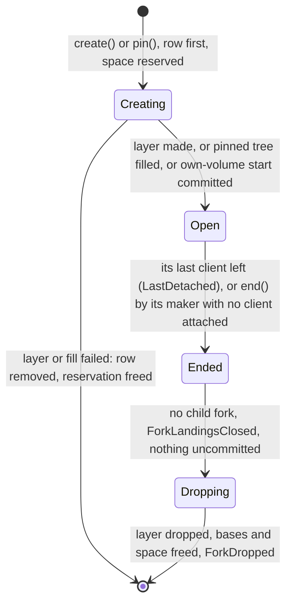
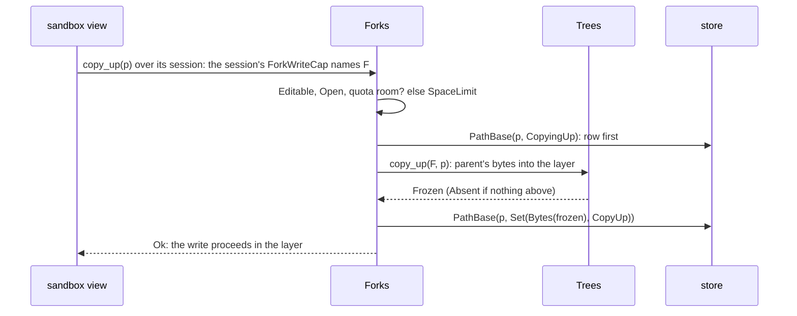
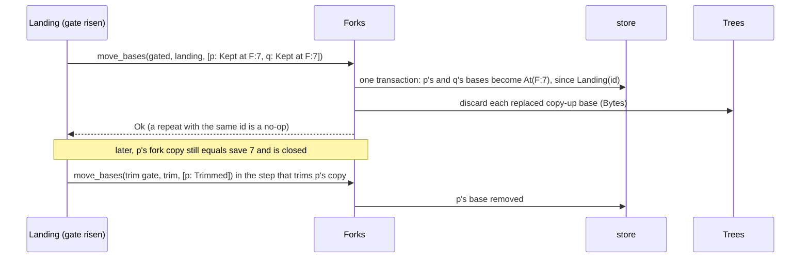
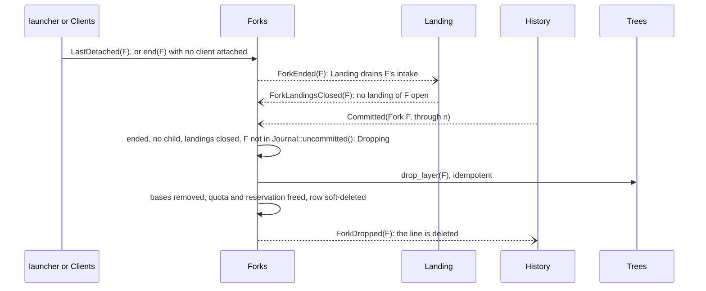

# Forks: domain architecture

**Layer:** System (approved 2026-11-02) › **Domain: Forks** › Feature.
**Status:** draft 2, proposed. It describes the target, not today's code. [system.md](../system.md) revision 4 (revision 3 approved 2026-11-02) binds it; this page's escalations (§10) are resolved there. Sketches are Rust surfaces only.
**In one line:** Forks keeps track of every fork: which tree it sits over, what each of its paths started from, how much space it may use, and when it ends and is dropped.

## 0. What binds this domain

| Source | Words (verbatim) | What it means here |
|---|---|---|
| R4, 2026-11-01 | "the sandbox fs edits need to land back in the main container, and then future sandboxes should start from the edited files" | a new editable fork is an empty layer over its parent's live tree, so it starts from everything landed so far |
| R5, 2026-11-01 | "track direct edits on main vs the forks that sandboxes edit" | each fork has an id that history names (`Cause::Landing{source}`) after the fork is gone |
| R12, 2026-11-02 | "The general history should be preserved, yes. But I think it could be configurable …" | History applies the setting; Forks only decides when a fork's line may be deleted (at drop) |
| R13, 2026-11-02 | "A cooperating integration can define batches/transactions across files, and they must all land together" | all of a transaction's bases move in its one landing |
| A4, 2026-11-01 | "A fork whose branches are rejected and never land in the main branch will inevitably be lost, and that's acceptable" | dropping an ended fork's unlanded work is allowed |
| A6, 2026-11-02 | a pinned fork is an acceptable snapshot | `pin` |

System invariants that name Forks: I4 (bases), I5 (drop), I6 (fork space; capping it is the system's reading of R7, not his words), I14 (nothing grows without an owner). Everything else on this page is a design choice.

## 1. What Forks owns, its language, and what it is not

| Owns | Is not |
|---|---|
| **Lineage**: each fork's parent tree, kind, placement and creating launcher | the layer's bytes, copy and rename mechanics (Trees) |
| **Path bases**: what each path a fork holds started from, and where that base moves after a landing | merging, trimming, deciding when anything lands (Landing) |
| **Fork space**: each fork's limit and the volume's fork budget (the values) | the quota mechanism (Trees); a fork's line, its commits, the history setting (History) |
| **The fork lifecycle**: create, pin, end, drop; publishes `ForkEnded`, `ForkDropped` | who writes a fork, attachments, `ForkTaken` (Clients); records and `Seq` (Journal) |

| Term | Meaning | New? |
|---|---|---|
| fork | a tree over a parent: an editable layer, or a pinned tree | system term |
| parent, lineage | the tree a fork sits over; the fork, then each ancestor up to the source tree | system term |
| editable fork / pinned fork | a sandbox's writable layer / a read-only real tree filled from one commit | system terms |
| copy-up | a fork's first write of a path: the parent's bytes are copied into the layer and frozen as the base | system term (overlayfs's word) |
| path base | the content a fork path started from: the copied bytes, then the fork's own content at its last landing | system term |
| base move | moving the bases of every path in one landing, inside that landing's gate; or removing one base in the trim that removes its copy | system term (`move_bases`) |
| fork budget, reservation | the space all forks of a volume may use; the share a fork holds of it from create to drop | new; could be "fork space and its limit" |
| ended / landings closed / dropped | no new sources or copy-ups / no landing of it still open (Landing's judgement, `ForkLandingsClosed`) / layer, bases and line gone | system terms |

## 2. The model

Two aggregates, each with its own repository. A fork's kind is a type, so a call that makes no sense for a kind does not compile.

```rust
// ── Aggregate 1: Fork ──────────────────────────────────
pub struct Fork {
    id: ForkId,
    parent: TreeRef,               // fixed at create; the source tree or an editable fork
    placement: Placement,          // InVolume | OwnVolume (system §3.3)
    maker: Maker,                  // who may end it
    reserved: Bytes,               // its share of the fork budget, held until drop
    state: ForkState,
    body: ForkBody,                // the kind, as a type
}
pub enum Maker {
    Launcher(LauncherId),          // create(): only this launcher ends it
    Snapshot,                      // pin(): ends at its LastDetached (after Clients::advanced, for an advance)
}
pub enum ForkBody {
    Editable(EditableFork),        // has bases; is a landing source
    Pinned(PinnedFork),            // read-only; no bases, no records, never a source
}
pub struct EditableFork { commit_base: Option<CommitId> } // own-volume only: its start commit, then its last landed tip
pub struct PinnedFork { at: CommitId }                    // shared by every snapshot client pinned at `at`

pub enum ForkState {
    Creating,                      // row written first; layer or fill not yet done. Recovery rolls forward
    Open,
    Ended { why: ForkEnd },        // no new sources, no new copy-ups
    Dropping,                      // every drop condition met; idempotent removal under way
}                                  // dropped: the row is soft-deleted, invisible to every read
pub enum ForkEnd {                 // not Clients' AttachmentEnded reason
    ByLauncher,                    // end() with no client attached
    LastClientLeft,                // LastDetached{this fork}
}

// ── Aggregate 2: PathBase, one per (fork, path) an editable in-volume fork holds ──
pub struct PathBase {
    fork: ForkId,
    path: RelPath,                 // a database group's members each get one, written together
    state: BaseState,
}
pub enum BaseState {
    CopyingUp,                     // row first; `base()` answers None until Set
    Set { base: BaseContent, since: BaseSince },
}
pub enum BaseContent {             // defined here, published in `contracts` (system §3.3 names it)
    Bytes(Frozen),                 // the bytes copy-up froze; Forks is their one holder
    Absent,                        // nothing was above the fork when it first wrote the path
    At(Position),                  // the fork's own content at its last landing, read through History::content_at
    AtCommit(CommitId),            // own-volume: the path at the fork's commit base
}
pub enum BaseSince {
    CopyUp,
    Landing(LandingId),            // the base move that set it; a repeat with this id is a no-op
}
```

Choice: bases are their own aggregate, not a list inside `Fork`, so a copy-up touches one small row and 1,000 forks with 10,000 paths each never load a fork's whole map.



A pinned fork passes the same states; landings closed and committed are true from its birth.

## 3. The public contract

The trait is the system's (system §3.3, revision 4). Its callers and what each is given:

```rust
pub trait Forks {
    fn create(&mut self, parent: TreeRef, k: ForkKind, p: Placement, by: &LaunchCap) -> Result<ForkId, ForkError>;
    fn pin(&mut self, of: TreeRef, by: &PinCap) -> Result<ForkId, ForkError>;   // Clients holds the only PinCap
    fn copy_up(&mut self, p: &RelPath, by: &ForkWriteCap) -> Result<(), ForkError>; // the cap names the fork
    fn move_bases(&mut self, g: &Gated, id: LandingId, moves: Vec<BaseMove>) -> Result<(), ForkError>; // inside Landing's gate
    fn base(&self, f: ForkId, p: &RelPath) -> Option<BaseContent>;               // None: f does not hold p
    fn lineage(&self, f: ForkId) -> Vec<TreeRef>;                                // answers until the fork drops
    fn facts(&self, f: ForkId) -> Option<ForkFacts>;                             // created by, kind, ended; Clients' attach check
    fn end(&mut self, f: ForkId, by: &LaunchCap) -> Result<(), ForkError>;
}
pub enum BaseMove { Kept { path: RelPath, at: Position }, Trimmed { path: RelPath }, Tip { path: RelPath, at: CommitId } }
pub enum ForkError {
    ParentUnknown,    // create: the parent is not an open tree, or is a pinned fork
    NotPermitted,     // create: a sandbox launcher forking a fork it did not create; end: not its maker
    SpaceLimit,       // create: the budget cannot hold the reservation; copy_up: the quota or the disk is full
    QuotaUnavailable, // create: an editable in-volume fork where Trees reports no per-layer quotas (I6)
    NotEditable,      // copy_up on a pinned fork
    Ended,            // copy_up or end on an ended fork (end is idempotent: Ok if ended by the same maker)
}
```

| Caller | Calls | Injected with | Why |
|---|---|---|---|
| launcher | `create`, `end` | `LaunchCap` | a sandbox's life is its launcher's; `end` covers a fork no client ever attached to |
| Clients | `pin` (Snapshot grant, `advance`), `lineage` (every `Binding.reads_through`), `facts` (a `ForksItCreates` attach) | `Forks`, `PinCap` | attach and advance |
| Views, over its session | `copy_up`, at a fork path's first write, create or delete | the session's `ForkWriteCap`, held in the history service | the base must exist before the write returns |
| Landing | `base`, for every fork unit it merges; `move_bases` inside `Writing` and at each trim | `Forks`, `&Gated` | I4: the only merge base |

| Forks calls | For |
|---|---|
| `Trees::facts`, `create_layer(f, over, limit)`, `drop_layer`, `fill`, `copy_up`, `freeze`, `discard` | quota support at boot; layers with their quota, pinned trees, copy-up bytes, recovery; releasing a replaced copy-up base |
| `History::head`, `checkout`, `content_at` | a pinned fork's commit and content; a moved base's bytes |
| `Journal::uncommitted`, `Clients::attached` | the drop check; whether `end` may end a fork now |

| Event | Direction | What Forks does or means by it |
|---|---|---|
| `ForkEnded{fork}` | out, to Landing | Landing drains the fork's intake to the stream's end; held ones stay held |
| `ForkDropped{fork}` | out, to History, Journal, Clients, Replication | the line, the stream, the writer claim and a carried remote line go; main keeps what landed |
| `LastDetached{tree}` | in, from Clients | ends the fork (editable or pinned) whose tree it names |
| `ForkLandingsClosed{fork}` | in, from Landing | one drop condition met |
| `Committed{tree: Fork(f)}` | in | re-judge f's drop |

## 4. Invariants and how they hold

| # | Invariant | Enforced by | Strength |
|---|---|---|---|
| F1 | A path an editable fork holds has one base, written before the write that caused copy-up returns; never git's merge base (I4) | only Forks calls `Trees::copy_up`, and it records the base in the same step; Views calls `copy_up` for create and delete too, so a new path gets `Absent` | construction + test |
| F2 | Bases move only inside the landing that landed them, every path of one unit together (R13); a base is removed only in the trim that removes its copy | `move_bases` takes `&Gated`; idempotent on `LandingId`; `Trimmed` comes only from the trim step | construction time + build time |
| F3 | A base move never allocates space, so a landing never fails on fork space; every frozen file has one holder | a moved base names a recorded position (`At`), read through History; only copy-up bases hold bytes, and Forks alone holds and discards them; record payloads are the Journal's alone | construction |
| F4 | A fork drops only when ended, childless, its landings closed and fully committed (I5, I14) | the `Fork` aggregate's drop check; facts asked (`Journal::uncommitted`) or consumed as events, never copied | event order + test |
| F5 | A parent never drops before its children; a pinned fork is never a parent | `children()` in the drop check; `create` refuses a pinned parent | construction + test |
| F6 | A pinned fork is read-only: no bases, no records, never a source | `copy_up` exists only on `EditableFork`; `PinnedFork` has no base table | compile time (inside the domain) |
| F7 | Every editable in-volume fork has a quota and a reservation before its layer exists. No quota support: editable in-volume creates are refused (`QuotaUnavailable`), snapshots still work (I6) | `Trees::facts()` read once at boot; the limit passed to `create_layer`; reservation in the same store transaction as the row | boot + construction |
| F8 | Only its maker ends a fork; only Clients pins; only the fork's writer copies up | `LaunchCap`, `PinCap`, `ForkWriteCap`, each built only through its minter | construction time + build time |
| F9 | Every Forks row carries created and changed stamps; dropped forks are soft-deleted | the `store` repository layer (I13) | construction |

## 5. Ports and adapters

```rust
pub trait ForkRepository {                  // aggregate Fork. Audit stamps and soft delete live in the store layer
    fn get(&self, f: ForkId) -> Result<Option<Audited<Fork>>, StoreError>;
    fn children(&self, f: ForkId) -> Result<Vec<ForkId>, StoreError>;      // live children only
    fn open_pin(&self, at: CommitId) -> Result<Option<ForkId>, StoreError>; // an open pin to share
    fn reserved_total(&self) -> Result<Bytes, StoreError>;
    fn save(&self, f: &Fork, by: Principal) -> Result<(), StoreError>;     // + outbox event, one transaction
    fn soft_delete(&self, f: ForkId, by: Principal) -> Result<(), StoreError>;
}
pub trait PathBaseRepository {              // aggregate PathBase
    fn get(&self, f: ForkId, p: &RelPath) -> Result<Option<PathBase>, StoreError>;
    fn put(&self, b: &PathBase, by: Principal) -> Result<(), StoreError>;
    fn move_bases(&self, l: LandingId, f: ForkId, moves: &[BaseMove], by: Principal) -> Result<(), StoreError>; // one transaction
    fn remove_all(&self, f: ForkId, by: Principal) -> Result<(), StoreError>;
}
```

| Port | Adapter | Prior art |
|---|---|---|
| `ForkRepository`, `PathBaseRepository` | `store`: the state area's database through its query-builder layer; audit stamps, the soft-delete filter and a transactional outbox applied once there | Repository pattern; transactional outbox |
| Trees (quota mechanics: XFS or ext4 project quotas, btrfs qgroups), History, Journal, Clients | through their §3 contracts, never adapters | DDD context map; Docker overlay2's per-container size on XFS project quota |

## 6. Flows and scenarios

**A fork's first write of p: copy-up and its base.**

A crash between the rows finds `CopyingUp` on restore: the view never got `Ok`, so the layer copy still equals the copied bytes; Forks freezes it (`Trees::freeze`) as the base, or removes the row if the layer does not hold p. Choice: whatever bytes were copied are the base, even while main is writing p (system, parked).

**A landing moves its bases.** Inside Landing's `Writing` step, after the renames and before its one record; and in the trim step:

Why the base is the fork's own content at 7 and not main's merged result: the next landing of q then carries only what the fork changed after 7, on top of main's tree that already holds 7. The base names that position and allocates nothing: History reads it from the fork's line, or the Journal tail before the line commits it (the one log, I11).

**A fork ends and drops**, on events alone:

Each arriving event re-asks the same check; whichever fact comes last moves the fork. A parent's check runs again when its last child drops.

**A snapshot client attaches or advances.** `Clients` calls `pin(of, PinCap)`. Forks asks `History::head(of)`. An open pin at that commit is shared, else a new pinned fork is reserved, `History::checkout` and `Trees::fill` make it, and it opens. On `advance` the client moves to the new pin; once the launcher has rebound the view and called `Clients::advanced`, Clients publishes `LastDetached` for the old pin if it was the last, and the old pin ends.

| Scenario | What Forks does |
|---|---|
| Live landing, per file | nothing on the save path; `base` answers Landing's merge; `move_bases` moves p's base in the landing's step, and removes it only in p's trim |
| Superseded or held | no base move, base unchanged; a held file's later saves merge against the same base |
| Transaction | one base move for every file in scope; a held transaction keeps all its bases; an abandoned one leaves its files and bases in the fork until drop (A4) |
| Fork of a fork | landings go to the parent fork; bases come from whichever layer held p at copy-up; the parent waits for its children to drop |
| 1,000 sandboxes | each costs one row, an empty layer, a quota and a reservation; bases exist only for touched paths |
| 1,000 snapshot clients at one commit | one pinned tree, shared |
| Crash in `Creating` or `Dropping` | rolled forward on restore: `create_layer`, `fill`, `drop_layer` and base moves are idempotent |
| Crash while a landing is `Writing` | Landing's roll-forward repeats `move_bases`; the `LandingId` makes it a no-op if done |
| Sandbox pod deleted, its launcher never calls `end` | its attachment ends (session close), `LastDetached` ends the fork, it drops once its landings close |
| Sandbox view host restarted in place | the old client ended, so the fork ended (one writer for life); the restarted host is a new client on a new fork |
| Disk full or quota reached | that sandbox's `copy_up` or write fails with `SpaceLimit` (no space to the program); main and other forks are unaffected because reservations sum to at most the budget, and a fork's staged and journaled bytes count against its own quota; base moves allocate nothing (F3) |
| Upgrade | rows migrate with the store's schema migrations (system Q3); layers and frozen bases are plain files and stay |

## 7. Policies and configuration Forks owns

| Policy | Values | Current choice | Set by |
|---|---|---|---|
| Per-fork space limit | bytes | one value per state area (placeholder: 1 GiB) | operator, deployment config |
| Fork budget | bytes, at most the free space the operator gives forks | placeholder: 25 % of the volume | operator |
| Reservation | thick: each fork reserves its full limit at create · thin: forks share the budget | thick (QF1) | Forks |
| Quota required | editable in-volume forks need per-layer quotas (`Trees::facts()`) | refused without it (`QuotaUnavailable`, I6); pins and own-volume forks still work | boot |
| Dropped rows | soft-deleted and kept, so who made which fork and when stays answerable | kept (cost in §9) | `store` |

## 8. Tests that prove it

Run through a real sidecar on a real filesystem with project quotas, unless marked.

| Test | Rules out |
|---|---|
| Sandbox copies p, main edits p, sandbox saves p: the landed p holds both edits, merged on the copied bytes | a merge base taken from git or looked up later (I4) |
| Sandbox saves q at 7 and 9; 7 lands while main edits q; 9 lands: main's edit kept, 7's change not applied twice | a stale base after a landing (F2) |
| A landed p is trimmed while the sandbox holds q open; a crash between trim and base removal | a path with a copy and no base, or a base and no copy (F2) |
| Kill the service between the two base rows; restart: the base equals the copied bytes | a held path with no base (F1) |
| A transaction of 3 files lands: all 3 bases move; one conflicts: none move | a split base move (R13) |
| Ended fork with a held landing: no drop until withdrawn and committed; then layer, bases and line gone; main still reaches the landed saves under both history settings | early drop, lost landed work (I5, A4) |
| A parent with a live child never drops | reads through a deleted layer (F5) |
| A sandbox fills its quota while main saves: the sandbox gets no-space, main's save succeeds | a sandbox denying service to main (I6) |
| No quota support: editable create refused, snapshot attach works | a sandbox fork with no cap (F7) |
| Two snapshot clients at one commit share a tree; both leave: it drops; advance shows the newer commit, never an uncommitted record | pin leaks, snapshots seeing live writes (A6) |
| Compile-fail tests (`trybuild`): `copy_up` on a pinned fork; `move_bases` without `Gated`; `pin` without its cap; clippy fails on a minter built outside the composition root | the capability rules decaying into conventions (F6, F2, F8) |
| Pure domain tests over in-memory repositories: every state-machine edge and drop condition order | a drop that depends on event arrival order |

## 9. Costs and open questions

1. **Thick reservation** caps how many sandboxes fit: 1,000 forks at 1 GiB need a 1 TB budget, even when idle.
2. **Every copy-up costs a frozen base** besides the layer copy (a reflink where the filesystem has one, else a second copy).
3. **Quotas narrow the filesystems** that can host sandbox forks (XFS, ext4 with project quotas, btrfs).
4. **Soft-deleted rows grow** by one small row per fork for the volume's life.
5. **Lineage depth is unbounded**; each level adds one layer to every lookup through a fork of a fork.
6. If system Q1 is answered "per fork", the history setting gains a field on `Fork`, set at `create`.

**QF1. Reserve each fork's full limit, or let forks share the budget?**
- **Recommended: reserve (thick).** A sandbox never runs out of space it was promised, and main never does. Cost: idle sandboxes hold space; fewer fit.
- **Alternative: share (thin).** More sandboxes fit. Cost: a burst from one sandbox can make every other sandbox's next write fail.

**QF2. Should a sandbox fork end on its own when its last client leaves?** System revision 4 adopts the recommendation as a design choice (one writer per fork, for life); you can still reverse it.
- **Recommended: yes.** One writer per fork for life (`ForkTaken`) means it can never be written again, and a deleted pod's launcher may never call `end`. Cost: a launcher cannot keep a fork open across clients.
- **Alternative: only `end` ends it.** Cost: forks of vanished launchers never drop (I14 broken) unless something else reaps them.

## 10. Escalations to the system document

| # | Gap in system §3–§4 (revision 3) | Proposed | Resolution in revision 4 |
|---|---|---|---|
| E1 | Bases moved by reacting to `LandingChanged`, after `Landed`, so a later save's landing could merge on the old base | a gated command in Landing's `Writing` step, before the record | adopted as `move_bases(&Gated, ...)`; a base is removed only in its trim (the review's P0-1); a kept base names a position, not bytes |
| E2 | `copy_up` took `&ClientCap`, but `Journal::recorder` consumes it | a `ForkWriteCap` | adopted: held by the session in the history service, beside its recorder |
| E3 | `pin` had no authority | a `PinCap` for Clients only | adopted |
| E4 | the drop judgement needed facts §3 did not give | consume `LastDetached`; Landing publishes when an ended fork has no open landing; Journal answers pending | adopted as `LastDetached`, `ForkLandingsClosed` and `Journal::uncommitted()`; Forks no longer consumes `LandingChanged`; a pin ends on its `LastDetached`, so Clients E3's `unpin` is dropped |
| E5 | missing queries | `History::head`, `Forks::made_by`, `Trees::discard` | adopted, with `facts` in place of `made_by` (one query, shared with Clients) |
| E6 | error and principal gaps | `QuotaUnavailable`; `Principal::Agentfs` | adopted |

Also resolved: the quota's value is Forks', its mechanism Trees' (`create_layer(f, over, limit)`), so the `ForkSpace` port is gone.

## 11. Reconcile with existing code

Today (agentfs origin/main b5c0dc8) a fork is a whole volume cloned from another's latest commit that publishes one change at finish, and the sandbox overlay's tmp layer holds only skipped names, with no bases and no quotas. Target: the in-volume editable fork replaces the overlay's write path, the own-volume fork replaces today's volume fork, and fork publish and delivery become commit sources in Landing. Cost: bases, quotas, pins and the drop judgement are all new code; today's `fork.json` gains audit stamps or goes.
