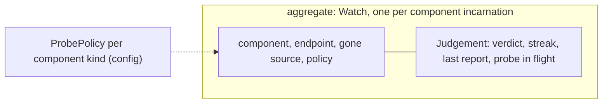
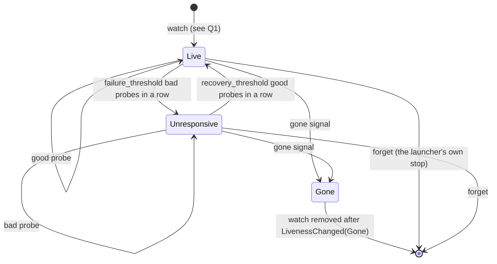
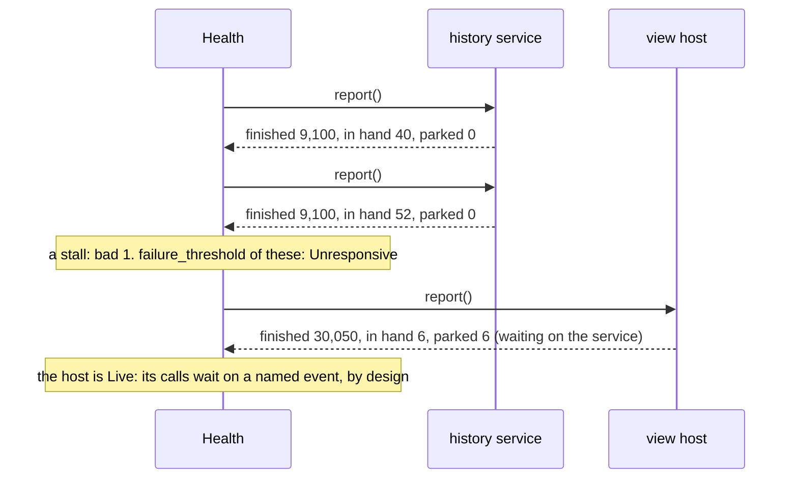

# Domain: Health

**Layer:** System › **Domain: Health** › Feature.
**Status:** draft 2, proposed, under [system.md](../system.md) revision 4 (revision 3 approved 2026-11-02), which binds it. It describes the target, not today's code. Sketches are Rust and show surfaces only.
**What you are asked:** three questions: Q1 in §2 (a component nobody has judged yet), Q2 in §6 (view hosts an in-pod launcher starts), Q3 in §7 (what a stuck history service should trigger). §10 lists the six gaps this page found; revision 4 adopted five and leaves one to Q2.
**Binding from the system:** §2 (Health runs outside what it judges), §3.3 `Health`, §3.4 `LivenessChanged`, §6 compositions, I9, I10.

## 1. What Health owns, its language, and what it is not

Health answers one question: is this history service, or this view host, alive? It judges from outside, by probing, and it decides nothing else.

**What this domain rests on.** None of these are new owner requirements; each is a rule this page must obey.

| Source | Words | What it asks of Health |
|---|---|---|
| global rules, owner 2026-10-24 | "It's all event driven"; health is its own process, never judged from another domain's missed events | probes are Health's own process; everything it can learn from an event, it learns from the event |
| global rules, owner 2026-10-08 | verification "checks a capability, not a status that can stay green while the capability is dead" | a probe proves work is being finished, not that a socket answers |
| system I9, I10 | Health is the judge of liveness; its probes are one of the only timers | no other domain judges liveness; Health uses its clock for nothing else |
| system §2 | "Health decides nothing": not "any landing or serving decision" | no landing, attachment or file call waits on, or branches on, a verdict |
| catalogue O6 | "Is there a health judge of its own (not inferred from missing events) that tells clients and operators? Wrong if: clients hang with no alarm." | a stuck history service becomes a published verdict that Telemetry can alarm on |

| Term | Meaning here | Is not |
|---|---|---|
| **component** | one running history service or one view host, in one incarnation | a client, a view, a pod |
| **incarnation** | one run of a component; a restart is a new incarnation, judged from scratch | a version |
| **watch** | Health's record that it judges one component, and how | a subscription to its events |
| **probe** | one question to a component, asked from outside, with a deadline: "how much work have you finished, and what are you holding?" | a ping that only proves the socket is open |
| **probe report** | the answer: work finished so far, calls in hand, and which of those are parked | a metric |
| **parked** | a call waiting on another component's named event (`ServiceReady`, a landing's gate) | stuck |
| **stall** | calls in hand that are not parked, and no work finished since the last answer | a slow call |
| **gone signal** | the process exited (its own exit event), or the kernel says its endpoint is closed | a missed probe |
| **liveness** | `Live`, `Unresponsive` (a suspicion), or `Gone` (a fact) | readiness: `ServiceReady` is the service's own event |

**Not this domain:** restarting anything (the launcher that started it), alarms (Telemetry, the one home of alarms), whether a client is attached (Clients), whether the service has finished restoring (`ServiceReady`), the judging of Health's own host process (the platform's probe, system §6).

## 2. The model



| Kind | Name | Holds | Why it is its own thing |
|---|---|---|---|
| aggregate | `Watch` | one component incarnation: where to probe, its gone source, its judgement | each component is judged alone; one never moves another's verdict |
| value | `Component`, `Incarnation`, `HostId` | identity (§3) | a restart is a new component, so an old verdict never sticks to the new run |
| value | `ProbeReport`, `ProbeOutcome`, `GoneSignal` | what a probe or the kernel said | inputs to a pure judge |
| value | `Streak` | consecutive bad, or good, probes | the only memory the judgement needs |
| config | `ProbePolicy` | interval, deadline, thresholds | data per component kind (§7) |

**The liveness lifecycle,** Health's own. A probe can only move between `Live` and `Unresponsive`; only a gone signal reaches `Gone`.



| Probe outcome | Good or bad |
|---|---|
| answered by the deadline, and work finished since the last answer | good |
| answered by the deadline; nothing finished, but every call in hand is parked, or none is in hand | good (idle, or waiting by design) |
| answered by the deadline; nothing finished, and some call in hand is not parked | bad (a stall) |
| no answer by the deadline, or an I/O error that is not "closed" | bad |
| the endpoint is closed (connection refused, `ENOTCONN` on the mount) | not a probe result: a gone signal |

So a history service replaying a long journal stays `Live` (replayed records are finished work), and a view host whose calls wait for `ServiceReady` stays `Live` (they are parked): one component's outage never becomes another's verdict.

**Q1. What is a component's liveness before its first answer?**
- **Recommended: `Live`, read as "not judged otherwise"** (Kubernetes' liveness probes work this way). Cost: after Health's own host restarts, a frozen component reads `Live` for one judgement window.
- **Alternative: a fourth value, `Unjudged`.** Cost: a change to the system's `Liveness`, and every consumer must handle a value that means nothing yet.

## 3. Public contract

`Health`, `Probed`, `Component` and `LivenessChanged` are system §3.1, §3.3 and §3.4 (revision 4, which adopted this page's E1 to E4 and E6).

```rust
// ── identity (system §3.1) ──
pub enum Component {
    HistoryService { area: StateAreaId, run: Incarnation }, // one per state area (I15)
    ViewHost { host: HostId, run: Incarnation },            // serves one or more views
}
pub struct HostId(/* private */);   // minted by the launcher that starts the host
pub struct Incarnation(u64);        // a restart is a new one

pub enum Liveness {
    Live,          // answered and progressing, or not yet judged otherwise (Q1)
    Unresponsive,  // a suspicion: the probes say it stalled or went silent
    Gone,          // a fact: it exited, or its endpoint closed
}

// ── the trait ───────────────────────────────────────────────
pub trait Health {
    fn liveness(&self, c: Component) -> Option<Liveness>;             // None: not watched
    fn watch(&mut self, c: Component, at: ProbeTarget, by: &LaunchCap) -> Result<(), HealthError>;
    fn forget(&mut self, c: Component, by: &LaunchCap) -> Result<(), HealthError>; // before an asked-for stop
}
pub struct ProbeTarget {
    endpoint: Endpoint,     // where the component answers probes; never inside a view (I8)
    gone: GoneSource,
}
pub enum GoneSource {
    OwnChild(ProcessRef),   // the caller started it: its exit is the event
    EndpointOnly,           // started elsewhere: only "endpoint closed" says Gone
}
pub enum HealthError {
    NotPermitted,   // the launcher did not start this component
    SelfWatch,      // the component is Health's own process (H3)
    AlreadyWatched, // watch is idempotent on the same target; a different target is refused
    Unknown,        // forget of a component not watched
}

// ── what each judged component serves (system §3.3) ─────────────────
pub trait Probed {
    fn report(&self) -> ProbeReport; // answered by the component's own dispatcher, not a side thread
}
pub struct ProbeReport {
    finished: Counter, // units of work done this incarnation: calls answered, records replayed, landings written
    in_hand: u32,      // calls received and not finished
    parked: u32,       // of those, waiting on another component's named event
}
```

**Events.**

| Published | Fields | When | Consumers |
|---|---|---|---|
| `LivenessChanged` | component, liveness | each change of verdict, once, in order per component | launchers (restart in place: their policy), Telemetry (alarms) |

Health consumes no domain event. Its inputs are probe outcomes, gone signals, and `watch` and `forget`.

**Who calls Health, and whom it calls.**

| Direction | Party | Through |
|---|---|---|
| in | launchers (sidecar supervisor, view hosts' launcher, CSI node plugin) | `watch`, `forget`, with the `LaunchCap` that started the component |
| in | the status edge, launchers | `liveness` |
| out | the history service, each view host | `Probed::report`, over the edge's own link (§5) |
| out | launchers, Telemetry | `LivenessChanged` |

No domain of the history service calls Health or receives a Health handle (H1).

## 4. Invariants and how they are enforced

| # | Invariant | Enforced by | Strength |
|---|---|---|---|
| H1 | No domain decision waits on or branches on liveness: only launchers and Telemetry react to it (system §2, I9) | clippy `disallowed_types` bans `Liveness`, `LivenessChanged` and `dyn Health` in every domain crate but `health`; the composition root injects the Health reader only into launchers and the status edge | build time + construction time |
| H2 | `Gone` comes only from a gone signal, never from a timeout | the pure judge's probe path returns `Responsiveness { Live, Unresponsive }`, a type with no `Gone`; only `on_gone(GoneSignal)` yields `Gone` | compile time |
| H3 | Health never judges its own process (system §2: "outside what it judges") | `watch` refuses a component whose process is Health's (`SelfWatch`); the composition root refuses to start a composition where it would have to | boot time |
| H4 | At most one probe per component is in flight, so a frozen component costs one waiting probe, not one per interval | `Watch` starts a probe only by taking its single `ProbeSlot`; only the probe's completion or its deadline gives it back, and a probe still stuck in the kernel keeps it | construction time + test |
| H5 | Parked calls never count against a component | the bad-probe rule reads `in_hand - parked` (table in §2); a component reports what it waits on, Health never infers it | test |
| H6 | A verdict never outlives its incarnation: a restarted component starts fresh | `Incarnation` is part of `Component`; `watch` of a new incarnation is a new `Watch` | compile time |
| H7 | Health keeps no persisted state, so no stale verdict survives a restart and nothing is a cache of a component | the `health` crate has no repository port; `cargo deny` bans `store` from it | build time |
| H8 | Health's clock serves probes and deadlines only (I10) | the `Clock` port is used by the probe scheduler alone; the judge is pure and takes no clock | construction time + review |

## 5. Ports and adapters

The domain crate holds the pure judge and the probe scheduler; every effect is a port.

```rust
pub trait Prober {                                   // one probe, bounded by a deadline
    fn probe(&self, at: &Endpoint, by: Deadline) -> PendingProbe; // completes as ProbeOutcome or a GoneSignal
}
pub trait GoneSignals {                              // the event source for Gone
    fn watch(&self, s: &GoneSource) -> GoneFeed;     // a child's exit; an endpoint closing
}
pub trait Clock {                                    // probes and deadlines only (H8)
    fn now(&self) -> Instant;
    fn wake_at(&self, t: Instant) -> Wake;
}
pub trait Publish {                                  // the composition's event bus; never blocks
    fn publish(&self, e: LivenessChanged);
}
pub enum ProbeOutcome { Answered(ProbeReport), NoAnswerBy(Deadline), Failed(IoKind) }
pub enum GoneSignal { Exited(ExitStatus), EndpointClosed }
```

| Port | Adapter | Notes |
|---|---|---|
| `Prober`, history service | `rpc`: the service's Unix socket, one `report` call answered by the dispatcher that serves every other call | peer credentials as today; a sandbox cannot reach it |
| `Prober`, view host | the launcher's existing link to the host it started (for the code architects); never a path in a view (I8) | a mount's `ENOTCONN` maps to `EndpointClosed` |
| `GoneSignals` | `OwnChild`: the process's exit notification (Linux pidfd); `EndpointOnly`: the probe's connection refusal | an event, never a deadline |
| `Clock` | monotonic clock | |
| `Publish` | the composition's in-process event bus; Telemetry is one subscriber | Health and its launcher run in one process (§6 table) |

**Persistence: none, by design.** Health stores no record, so no repository, audit stamp or migration exists here (H7). A verdict is rebuilt in one judgement window; storing it would make a cache that could disagree with the component itself.

## 6. Internal flows and scenarios

**A frozen view host is judged and restarted in place.**
```mermaid
sequenceDiagram
  participant La as launcher
  participant H as Health
  participant VH as view host (run 1)
  participant T as Telemetry
  La->>H: watch(ViewHost h run 1, endpoint, OwnChild)
  loop every interval, one probe in flight
    H->>VH: report(), deadline
    VH-->>H: finished 812, in hand 3, parked 0
  end
  Note over VH: frozen: its calls stop finishing
  H->>VH: report(), deadline
  Note over H: no answer: bad 1 ... bad failure_threshold
  H--)La: LivenessChanged(h run 1, Unresponsive)
  H--)T: the same event: Telemetry raises the alarm
  La->>H: forget(h run 1)
  La->>VH: kill; start run 2 over the same mount point (its policy)
  La->>H: watch(ViewHost h run 2, ...)
```
Killing run 1 closes its sessions, so Clients ends its attachments, Landing drops its write-opens and reconciles them (system §5). The restarted host attaches new clients; a sandbox's gets a new fork, because a fork has one writer for life (system cost 8).

**A stuck history service, against a busy one.**

A service replaying a long journal answers with `finished` rising, so it stays `Live` however long the replay takes.

**Behaviour in the system's scenarios.**

| Scenario | What Health does | What it never does |
|---|---|---|
| Live landing | nothing: a write-open waiting under a gate is parked, so a long wait never looks like a frozen host | slow a landing, or let a verdict cancel one |
| Transactions | nothing; a transaction's renames are finished work of the service | know a transaction exists |
| Scale: 1,000 sandbox view hosts | one `Watch` and one probe per host per interval (100 probes a second at a 10 s interval, placeholder); probes are spread across the interval | probe through a view, or put a host id in a metric label |
| Crash: a view host | its exit is the gone signal: `Gone` at once, no probe window | wait for probes to fail first |
| Crash: the history service | `Gone` from its exit (or its socket closing); the new run is a new watch. While it restores, view hosts stay `Live` (parked) | judge view hosts by the service's outage |
| Crash: Health's own host | every watch is lost; nothing else changes, since nothing waits on Health. On restart the launcher reconciles and re-watches; verdicts start fresh (Q1). The platform's probe judges this process | persist or replay verdicts |
| Disk full | nothing of its own: a service that answers calls with `NoSpace` still finishes them, so it stays `Live`; space alarms are Telemetry's | call a full disk a liveness fault |
| Upgrades | a new binary is a new incarnation; `report` is part of the rpc, whose cross-version rule is system Q3 | migrate state: there is none |

**Q2. Who watches the view hosts an in-pod launcher starts (CSI)?** The system names the node plugin as CSI's Health, but those hosts are not its children.
- **Recommended: the node plugin, told by the in-pod launcher's `watch` with its `ForksItCreates` authority, using `EndpointOnly`.** Cost: such a host is `Gone` only when its endpoint closes, not the instant it exits; the probe link to a pod's host is new edge work.
- **Alternative: the in-pod launcher runs its own Health.** Cost: that Health shares a pod with what it judges, and the operator has a second place to look.

## 7. Policies and configuration Health owns

| Policy | Values | Current choice | Source |
|---|---|---|---|
| `ProbePolicy`, per component kind | interval, deadline, `failure_threshold`, `recovery_threshold` | placeholders after Kubernetes' defaults: 10 s, 1 s, 3, 1; set at the code-architect gate | design choice |
| The bad-probe rule | §2 table | fixed | design choice: a capability check, not a socket check |
| Who may watch | the launcher whose `LaunchCap` started the component | fixed | design choice, from system §3.2 |

Restart and backoff after a verdict are each launcher's policy, not Health's. Health raises no alarm itself.

**Q3. When the history service is judged `Unresponsive`, should its launcher restart it?**
- **Recommended: yes, once `Unresponsive` has lasted a longer, separate window** (a launcher setting). A stuck service never heals alone, and the journal makes the restart safe. Cost: one operation that finishes nothing for that long (a huge merge with no progress steps) is killed and retried, and could loop.
- **Alternative: alarm only; an operator restarts it.** Cost: clients wait, alarmed but blocked, until someone acts.

## 8. Tests that prove it

Each runs the real binaries: a launcher with Health, the real history service and real view hosts on a FUSE mount. Faults come from signals and from failpoints compiled into a test build of the same binary.

| Test | Proves | Rules out |
|---|---|---|
| `SIGSTOP` a sandbox's view host | `Unresponsive` within threshold × interval + deadline; one `LivenessChanged`; main's host stays `Live` and keeps serving | a frozen host nobody notices; one host's verdict touching another |
| `SIGKILL` a view host | `Gone` before one probe interval passes | `Gone` judged from missed probes (H2) |
| A failpoint holds the service's dispatcher while its socket still accepts | `Unresponsive` (a stall), and Telemetry's alarm fires | a status that stays green while the capability is dead (O6) |
| Restart the service with a large journal to replay | `Live` throughout; view hosts with calls waiting stay `Live` | restart loops during recovery; cascading verdicts |
| A view host's probe stuck in the kernel for 100 intervals | one probe in flight, thread count flat, verdict `Unresponsive` | probe pile-up (H4) |
| `forget`, then stop the component | no `LivenessChanged(Gone)`, no restart | a launcher restarting what it stopped on purpose |
| Kill Health's host during a landing in `Writing` | the landing lands; attachments unchanged; on restart every component is re-watched | any domain depending on Health (H1) |
| Fill the state area while clients write | the service stays `Live`; only space alarms fire | a full disk read as a dead service |
| `watch` the composition's own process; `watch` with another launcher's authority | `SelfWatch`; `NotPermitted` | a judge inside what it judges (H3); a sandbox launcher watching main's host |
| Build checks: a domain crate naming `Liveness`; a probe path returning `Gone` | clippy fails; the code does not compile | H1 and H2 eroding by convention |

## 9. Costs and open questions

**Costs.**
1. **Probes are a timer.** `Unresponsive` is a suspicion that arrives late (up to threshold × interval + deadline) and can be wrong: one long step that finishes nothing looks like a stall.
2. **Components must report.** Each judged component counts finished, in-hand and parked work honestly; a component that hides a wait as parked hides its own stall.
3. **No memory.** After Health's host restarts, a frozen component reads `Live` for one window (Q1).
4. **Probe load grows with hosts:** one probe per host per interval.
5. **Restart in place ends a frozen host's clients;** a sandbox's restarted host starts on a new fork.

Questions: Q1 (§2), Q2 (§6), Q3 (§7).

## 10. Escalations to the system document

| # | Where (revision 3) | Recommended change | Resolution in revision 4 |
|---|---|---|---|
| E1 | §3.3 `Health`: no way to learn which components exist, or that a stop was asked for | `watch`, `forget`; `liveness` returns `Option` | adopted |
| E2 | §3.1, §3.3: `Component` undefined | define `Component` and `HostId` | adopted, in `model` |
| E3 | §2, §3.3: the probes had no contract | `Probed::report() -> ProbeReport` | adopted |
| E4 | §6 Sidecar could put Health in the process it judges | the sidecar's history service is a child process of the supervisor | adopted |
| E5 | §6 CSI: in-pod launchers' view hosts are not the node plugin's children | Q2's answer, written into §6 | open: follows your answer to Q2; system §6 points here |
| E6 | §3.4 `LivenessChanged`: a launcher must `forget` before an asked-for stop | add it to the row | adopted |

## New terms

| Term | Definition | Why needed | Could be the existing term |
|---|---|---|---|
| component, incarnation | a history service or view host; one run of it | the thing Health judges; a restart starts fresh | today's front, service child |
| probe report | finished, in-hand and parked work, answered by the component | a capability check, not a socket check | `grpc.health.v1` serving status |
| parked, stall | a call waiting on another's named event; unparked calls with no work finished | keeps one outage from becoming another's verdict | none |
| gone signal | a process exit or a closed endpoint | `Gone` as an event, not a guess | today's stale mount, child exit |
| `HostId` | a view host's identity | `Component` needs one (E2) | none |

## For the code architects (parked)
The probe link to a view host (the launcher's existing child link, never a mount path); how probes spread across an interval; how a probe stuck in the kernel is abandoned without leaking a thread per interval; the units of `finished` for long steps (bytes of a merge or upload), so they show progress; the `Prober`'s mapping of errors to `EndpointClosed`; how `liveness` reaches the read-only `status` command.

**Prior art.** Kubernetes liveness and startup probes (period, timeout, failure and success thresholds); the gRPC health checking protocol and the CSI livenessprobe sidecar (today's); unreliable failure detectors (Chandra and Toueg: a probe yields a suspicion, never a fact); Linux pidfd exit notification; the Linux hung-task detector and systemd's watchdog (judge progress, not presence); Erlang/OTP supervisors (the detector and the restart policy are separate). Rejected: phi-accrual detectors (Cassandra, Akka), more than a fixed threshold needs here.

## Reconcile with existing code (agentfs origin/main b5c0dc8)
- **`HistoryClient::ping`** is one `grpc.health.v1` Check, `Serving` or not: it stays green while the dispatcher is stuck. It becomes `report()`. Cost: a protocol addition on both ends.
- **The CSI supervisor** restarts a child that exits unasked, with backoff, and recovers stale mounts at reconcile. Exit-based restart is kept, now as `LivenessChanged(Gone)` from Health; the supervisor gains `Unresponsive` handling. Cost: the supervisor's restart path moves behind one event.
- **`MountState { Live, Stale, Foreign, NotMounted }`** (fuse `mount.rs`) stays as the `Prober` adapter's view of a mount; `Stale` is a gone signal.
- **The `AgentfsHistoryServiceUnreachable` alert** fires on a front's failed request: health judged from another component's signal. It moves to Telemetry, driven by `LivenessChanged`.
- **`restore::Liveness`** (write-opens and "stopping") is not liveness in this sense; it becomes Landing's write-opens. Only the name clashes.

**NOT RUN:** no code was built or tested. pidfd exit notification across the CSI node plugin's process tree, kernel behaviour of a probe stuck on a frozen FUSE mount, and the cost of 100 probes a second were not measured.
