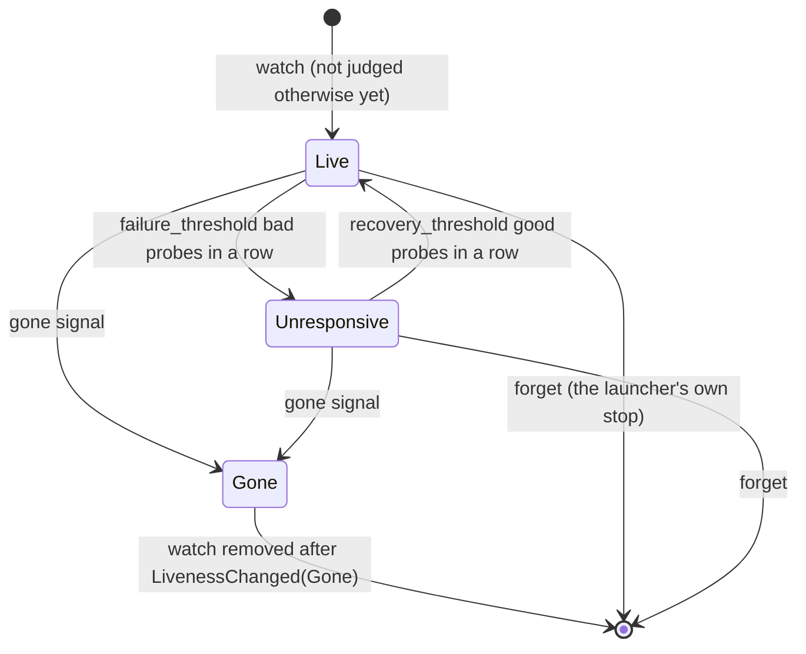

# Domain: Health

**Layer:** System › **Domain: Health** › Feature.
**Status:** draft 5, proposed, under [system.md](../system.md) revision 10. The target, not today's code; sketches
are Rust surfaces. The git model (git-model.md) does not reach this domain: Health judges processes, never trees.

## 1. What Health owns, and what it is not

Health answers one question: is this history service, or this view host, alive? It judges from outside, by probing,
and decides nothing else.

| Source | Words | What it asks of Health |
|---|---|---|
| global rules, owner 2026-10-24 | "It's all event driven"; health is its own process, never judged from another domain's missed events | probes are Health's own process |
| global rules, owner 2026-10-08 | verification "checks a capability, not a status that can stay green while the capability is dead" | a probe proves work is being finished, not that a socket answers |
| system S4, S5 | Health is the one judge of liveness; its probes are one of the only timers | no other domain judges liveness |

| Term | Meaning here | Is not |
|---|---|---|
| **component** | one running history service or one view host, in one incarnation | a client, a view, a pod |
| **incarnation** | one run of a component; a restart is judged from scratch | a version |
| **probe** | one question asked from outside, with a deadline: "how much work have you finished, and what are you holding?" | a ping |
| **parked** | a call waiting on a named event (`ServiceReady`, a take's release of a file) | stuck |
| **stall** | calls in hand that are not parked, and no work finished since the last answer | a slow call |
| **gone signal** | the process exited, or the kernel says its endpoint is closed | a missed probe |
| **liveness** | `Live`, `Unresponsive` (a suspicion), or `Gone` (a fact) | readiness (`ServiceReady`) |

**Not this domain:** restarting anything (the launcher's policy), alarms (Telemetry), attachment (Clients), judging
Health's own host (the platform's probe).

## 2. The model



| Probe outcome | Good or bad |
|---|---|
| answered by the deadline, and work finished since the last answer | good |
| answered; nothing finished, but every call in hand is parked, or none is in hand | good (idle, or waiting by design) |
| answered; nothing finished, and some call in hand is not parked | bad (a stall) |
| no answer by the deadline, or an I/O error that is not "closed" | bad |
| the endpoint is closed | a gone signal, not a probe result |
| the peer refuses the probe link as another family | `watch` fails, no verdict |

So a view host whose write-opens wait for a take, or whose calls wait for `ServiceReady`, stays `Live`: one
component's wait never becomes another's verdict. **Before its first answer a component is `Live`** (design choice,
as Kubernetes' liveness probes). Cost: after Health's host restarts, a hung component reads `Live` for one window.

## 3. Public contract

```rust
pub enum Liveness {
    Live,          // answered and progressing, or not yet judged otherwise
    Unresponsive,  // a suspicion
    Gone,          // a fact: it exited, or its endpoint closed
}
pub trait Health {
    fn liveness(&self, c: Component) -> Option<Liveness>;             // None: not watched
    fn watch(&mut self, c: Component, at: ProbeTarget, by: &LaunchCap) -> Result<(), HealthError>;
    fn forget(&mut self, c: Component, by: &LaunchCap) -> Result<(), HealthError>; // before an asked-for stop
}
pub struct ProbeTarget { endpoint: Endpoint, gone: GoneSource } // never inside a view
pub enum GoneSource {
    OwnChild(ProcessRef),   // the caller started it: its exit is the event
    EndpointOnly,           // started elsewhere: only "endpoint closed" says Gone
}
pub enum HealthError { NotPermitted, SelfWatch, AlreadyWatched, OtherFamily(Version), Unknown }

pub trait Probed {          // served by the history service and each view host, by the dispatcher itself
    fn report(&self) -> ProbeReport;
}
pub struct ProbeReport {
    finished: Counter,      // calls answered, saves committed, takes written, this incarnation
    in_hand: u32,           // calls received and not finished
    parked: u32,            // of those, waiting on a named event
}
```

Published: `LivenessChanged{component, liveness}` (launchers, Telemetry). Consumed: nothing; inputs are probe
outcomes, gone signals, `watch` and `forget`.

## 4. Invariants

| # | Invariant | Enforced by | Strength |
|---|---|---|---|
| H1 | No domain decision waits on or branches on liveness: only launchers and Telemetry react | clippy bans `Liveness` and `dyn Health` in every other domain crate | build + construction time |
| H2 | `Gone` comes only from a gone signal, never from a timeout | the probe path returns a type with no `Gone` | compile time |
| H3 | Health never judges its own process | `watch` refuses it (`SelfWatch`) | boot time |
| H4 | At most one probe per component is in flight | a single probe slot per watch | construction time + test |
| H5 | Parked calls never count against a component | the bad-probe rule reads `in_hand - parked` | test |
| H6 | A verdict never outlives its incarnation | `Incarnation` is part of `Component` | compile time |
| H7 | Health persists nothing | no repository port; `cargo deny` bans `store` | build time |

Ports: `Prober` (the service's Unix socket; a view host over its launcher's link), `GoneSignals` (pidfd exit, endpoint
refusal), `Clock` (probes and deadlines only), `Publish`.

## 5. Scenarios

| Scenario | What Health does | What it never does |
|---|---|---|
| A take waits on a file a client holds open | nothing: the waiting write-opens are parked; the take is the service's work in hand only if the service reports it unparked | judge a long lock wait as a hang |
| A view host hangs (`SIGSTOP`) | `Unresponsive` after threshold × interval + deadline; its launcher restarts it in place (a fork's on a new fork) | judge main's host by it |
| A view host or the service exits | `Gone` at once from its exit | wait for probes to fail first |
| Health's own host crashes | every watch is lost; nothing else changes; the launcher re-watches | persist or replay verdicts |
| Disk full | nothing: a service answering with `NoSpace` still finishes calls | call a full disk a liveness fault |

| Policy | Current choice (design choice) |
|---|---|
| `ProbePolicy`, per component kind | interval 10 s, deadline 1 s, failure 3, recovery 1 (placeholders, Kubernetes' defaults) |
| Who may watch | the launcher whose `LaunchCap` started the component |
| An `Unresponsive` history service | restarted by its launcher after a longer, separate window (a launcher setting). Answered write calls survive in the journal (git-model §3) |
| CSI in-pod view hosts | watched by the node plugin, told by the in-pod launcher's `watch`, `EndpointOnly` |

## 6. Tests

| Test | Rules out |
|---|---|
| `SIGSTOP` a fork's view host: `Unresponsive`; main's host stays `Live` | a hung host nobody notices |
| `SIGKILL` a view host: `Gone` before one probe interval | `Gone` judged from missed probes (H2) |
| A failpoint holds the service's dispatcher while its socket accepts: `Unresponsive` | a status green while the capability is dead |
| A take waits an hour on an open file: every component stays `Live` | a lock wait read as a hang |
| A probe stuck in the kernel for 100 intervals: one probe in flight | probe pile-up (H4) |

## 7. Costs

1. **Probes are a timer:** `Unresponsive` arrives late and can be wrong.
2. **Components must report honestly:** one that hides a wait as parked hides its own stall.
3. **Restart in place ends a hung host's clients**; their open files are saved from the journal as closes, even
   mid-sequence (git-model §3).

**Prior art.** Kubernetes liveness probes; the gRPC health protocol; unreliable failure detectors (Chandra and Toueg);
Linux pidfd; systemd's watchdog; Erlang/OTP supervisors (detector and restart policy apart).

## Reconcile with existing code (agentfs origin/main b5c0dc8)

- **`HistoryClient::ping`** (one `grpc.health.v1` Check) becomes `report()`.
- **The CSI supervisor's** exit-based restart is kept as `LivenessChanged(Gone)`; it gains `Unresponsive` handling.
- **The `AgentfsHistoryServiceUnreachable` alert** moves to Telemetry, driven by `LivenessChanged`.

**NOT RUN:** pidfd across the CSI node plugin's process tree and a probe stuck on a hung FUSE mount were not tested.

*History: drafts 1–4 are in git; draft 5 (2026-11-03) conforms to the git model.*
