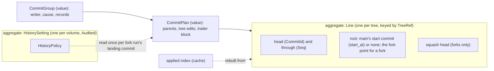
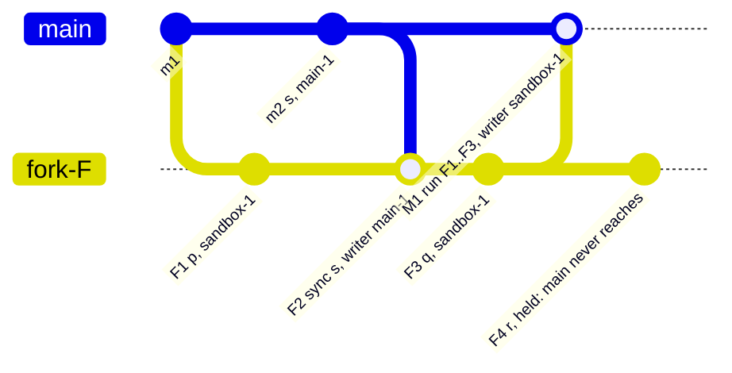

# agentfs target architecture: the History domain

**Layer:** System › **Domain: History** › Feature.
**Status:** draft 7, proposed, under [system.md](../system.md) revision 9, which binds this page. It describes the target, not today's code. Sketches are Rust and show surfaces only. **What you are asked:** nothing. System Q2, raised here, is answered as built (A13). Former QH1 is moot and QH2 answered by R16.

## 1. What History owns, its language, and what it is not

History turns each tree's durable records into git commits on that tree's line, one writer per commit. It alone writes git objects or moves a line (packs arrive through `receive`). It answers "what was p here" and "did this source land" from one log: the lines plus the Journal's uncommitted tail.

**Your requirements this domain serves** (verbatim, from system §1; nothing else here is yours).

| # | Your words | Date | What it asks of History |
|---|---|---|---|
| R5 | "Agentfs history shouod distinguish between the various containers so we can track direct edits on main vs the forks that sandboxes edit" | 2026-11-01 | each commit names its writer and its fork |
| R6 | "THE EDITS CAN LAND IN ONE COMMIT?!?" (system's reading: no commit holds two writers) | 2026-11-01 | one writer per commit |
| R9 | "Whole seems best, right? A partial application has unknown side effects" | 2026-10-16 | one landing is one commit |
| R12 | "The general history should be preserved, yes. But I think it could be configurable if it needs to be every single commit, or whether a fork can be squashed so that mainline is just a merge tree of squashed fork lineage." | 2026-11-02 | the history setting |
| R16 | "i would like for the git history to remain compatible across minor versions, and only break on a major version change." | 2026-11-02 | lines read and continued by every release of their major |
| R18 | "Ideally, the two conflicting changes would be interleaved in commits, and both clients would see the others changes" | 2026-11-02 | sync commits on fork lines, with main as second parent |
| A4 | "A fork whose branches are rejected and never land in the main branch will inevitably be lost, and that's acceptable" (an answer, a current choice) | 2026-11-01 | a dropped fork's line goes |
| A7 | "one setting per volume" (an answer) | 2026-11-02 | one history setting per volume |
| A13 | "Agreed. It’s a transaction, so a failure is an implicit rollback." (an answer) | 2026-11-02 | an abandoned transaction makes no commit: its fork has no line |
| A8 | "Should the per-fork landing stop at whatever commit cant merge? … This does assume that a *commit* is landed altogether, not just a file." (his question, accepted) | 2026-11-02 | one fork commit, one commit on the fork's line |

| Owns, exclusively | Is not |
|---|---|
| **lines**: main's branch and each fork's line, and each fork's squash chain | ordering or durability of records, or where a fork commit starts and ends (Journal) |
| **the history setting** and its one point of application, a fork run's landing commit | whether, when or what lands, or which resolver merged it (Landing) |
| **the commit builder**: commit groups, trailers, author and committer | which writer a record has (Clients mints, Journal seals) |
| **git objects** (every write, received packs included) and repack; **LFS** pointers, the local LFS object cache, the managed attributes block | remotes, credentials, pushing, fetching, LFS upload and download (Replication) |
| **the one log's read side**: `tracked`, `content`, `content_at`, `checkout`, `applied`, `head`, `reaches`; **the history major** each line was written by | which layer holds a path now (Trees); merge bases (Forks); the start point (Volume); internal formats (`store`) |

**Glossary.** System terms (line, writer, cause, landing, position, fork commit, run, sync, history setting, family) keep their meaning.

| Term | Meaning here | Why needed | Could be the existing term |
|---|---|---|---|
| commit group | on main, consecutive records of one writer and one cause; elsewhere, one fork commit or one landing record: one commit | I2; "run" is the system's fork run | run |
| landing commit | the commit of one landing record, in main or a fork; it may carry a second parent | I3, R12, R18 | patch commit |
| fork point | the main commit a fork's line starts from: main's head when the line's first commit is built | a line needs a root | `Agentfs-Base` |
| squash chain | per fork, one commit per landing holding only the landed paths, each on the previous (`Squashed`) | R12 | none |
| trailer block | the facts in a commit's last message paragraph; only History writes it | `applied`, R5, R16 | trailers |
| applied index | source to position, read from trailers; a cache | scale (G8) | the duplicate scan |

## 2. Model



**Both directions (`FullLineage`).** F saves p (F1). Main saves s, which F holds; the sync lands in F as F2, named for main-1. F saves q (F3); the run lands in main as M1. F's r conflicts (F4, held): main never reaches it.



Under `Squashed`, M1's second parent is instead S1: one commit holding only p and q, on F's squash chain, which starts at F's fork point. F's own line, syncs included, is the same in both settings and stays until the fork drops (A4).

```mermaid
stateDiagram-v2
  [*] --> Active: main at boot; a fork at its first commit, on its fork point
  Active --> Active: a commit group commits (head moves, Committed)
  Active --> Deleted: ForkDropped (forks only): line and squash refs removed
  Deleted --> [*]
```

```mermaid
stateDiagram-v2
  [*] --> Open: Recorded, a new (writer, cause), or a fork record
  Open --> Closed: main - the next record differs in writer or cause, or the commit window ticks. A fork - the end of a fork commit (fork_commits). Anywhere - a landing record (a group of one); while draining (VolumeDraining until VolumeStaged), every record; shutdown
  Closed --> Durable: the other side first (§6), then objects, LFS cache, refs, synced
  Closed --> Closed: a write fails: retried at the next Recorded of that tree or the commit window
  Durable --> [*]: Committed{tree, through, commit} published
```





## 3. Public contract

The trait is system §3.3's. This page defines the types it names but leaves open.

```rust
// ── Commands and queries (system §3.3, binding) ─────────────────
pub trait History {
    fn set_policy(&mut self, p: HistoryPolicy, by: &ActorCap) -> Result<(), HistoryError>; // Operator; one per volume
    fn tracked(&self, t: TreeRef, p: &RelPath) -> Tracked;        // t's own records only; callers resolve lineage
    fn content(&self, c: CommitId, p: &RelPath) -> Result<ContentRef, HistoryError>;
    fn content_at(&self, at: Position, p: &RelPath) -> Result<ContentRef, HistoryError>; // a fork commit's end: a run's moved base
    fn checkout(&self, c: CommitId) -> Result<CommitContent, HistoryError>;
    fn applied(&self, s: &SourceId) -> Option<Position>;
    fn head(&self, t: TreeRef) -> Option<CommitId>;               // the one tip query (Forks' pins, Replication)
    fn reaches(&self, t: TreeRef, c: CommitId) -> bool;          // Volume's start line
    fn receive(&mut self, pack: Pack, by: &ActorCap) -> Result<CommitId, HistoryError>; // quarantined, checked, then written
    fn start_at(&mut self, pack: Pack, c: CommitId, by: &StartCap) -> Result<(), HistoryError>; // fetch_start's pack; main's line empty
}
pub trait HistoryObjects {        // read-only, for Replication; History stays the only writer
    fn is_ancestor(&self, a: CommitId, of: CommitId) -> bool;
    fn pack(&self, from: Option<CommitId>, to: CommitId) -> PackPlan; // first-parent chain, size, LFS objects
}
pub enum HistoryPolicy {          // shapes only a fork run's landing commit in main
    FullLineage,                  // second parent: F's line commit at the run's last fork commit
    Squashed,                     // second parent: this landing's squash commit, on the fork's previous one
}

// ── Types this page defines ──────────────────────────────────────
pub struct Tracked {              // at one position: line head, then the Journal tail
    at: Position,                 // the position the answer holds at
    state: TrackedState,
}
pub enum TrackedState {
    Present { content: ContentRef, mode: Mode },
    Removed,                      // t recorded its removal
    NotRecordedHere,              // t never recorded p; a caller wanting what t shows resolves its lineage
}
pub enum ContentRef {             // never bytes: Trees or Landing open it
    Blob(BlobId),
    Lfs(LfsPointer),              // the object is in the local cache, else NotLocal
    Payload(PayloadId),           // still in the Journal tail
}
pub struct CommitContent { commit: CommitId, entries: Vec<(RelPath, ContentRef, Mode)> } // whole tree, for Trees::fill

// ── Events ───────────────────────────────────────────────────────
pub struct Committed {            // system §3.4; published only after the ref is durable
    tree: TreeRef,
    through: Seq,                 // every record of t at or below it is in the line or consumed
    commit: CommitId,             // the new head; the old head when nothing changed
}

// ── Errors (system §3.3) ─────────────────────────────────────────
pub enum HistoryError {
    NotPermitted,                 // set_policy without the Operator role
    NotInHistory,                 // no such commit, or p absent in it
    NotLocal(LfsOid),             // the LFS object is not in the local cache; Replication::fetch_lfs brings it
    LineNotEmpty,                 // start_at after main's first commit
    OtherMajor(Version),          // a line, or a start commit, written by another major (R16)
    Unreadable(IoKind),
}
```

**What a commit's trailer block states.** Key names are parked for the code architects.

| Fact | Every commit | Landing commit (main or fork) | Squash commit |
|---|---|---|---|
| tree, `through` (`Seq`) and the release that wrote it (`Version`) | yes | yes | yes, with the fork's `through` |
| writer (client id with launcher, tree and label; actor; agentfs) | yes | the source's writer; the agent's or a resolving actor's id when it merged | the source's writer |
| cause | yes | landing (run, sync, commit, restore, revert, reconcile) | landing |
| source and landing id; fork; for a run, the setting that built it; a restore's or revert's target | | yes | landing id, fork |

Author is the writer; committer is the state area's history service. The message is built by History alone; an integrator's own message lives in its tip.

**Who calls it, and whom it calls** (only through system contracts).

| Direction | Party | Through |
|---|---|---|
| called by | Landing; operators | `tracked`, `content`, `applied` (merges, sources, recovery); `set_policy` (Operator role) |
| called by | Forks | `head` and `checkout`, for a pinned fork's `Trees::fill`; `content_at` for a run's moved base |
| called by | Volume; Replication | `reaches` (the start line); `start_at` (`fetch_start`'s pack, with Volume's `StartCap`, at create) |
| called by | Replication; the git server edge | `head`, `HistoryObjects`, `receive` (a fetched pack); `receive` (a pushed pack) |
| calls | Journal | `feed` of every stream; `tail` for `tracked` and `applied`; `fork_commits`, the one judge of where a fork commit starts and ends |
| calls | Rules; Replication | `skip(p, kind, facts)` at commit, the one judge of skips; `record(p).store` for LFS; `Replication::limits()` as data for the size backstop |
| consumes | `Recorded`, `ForkDropped`, `VolumeDraining`, `VolumeStaged` | commits; deleting a fork's line and squash chain; draining from one to the other, each record closes its group |
| publishes | `Committed` | Journal, Replication, Forks, Volume; every event also to Telemetry |

## 4. Invariants and how each is enforced

| # | Invariant | Enforced by | Strength |
|---|---|---|---|
| H1 | A commit holds one commit group: one tree, one writer, one cause (I2, R6) | `CommitGroup` holds writer and cause once; its records carry neither; only `CommitGroup::split` builds one; the commit builder is private | compile time + construction |
| H2 | One landing record, in main or a fork, is exactly one commit, never grouped (I3, R9) | `split` closes a landing record as a group of one; an unchanged tree still commits, as a marker, so `applied` can answer | construction |
| H3 | A fork's line has one commit per fork commit (A8) and per landing record (syncs, reconcile). A run's second parent is F's line at its last fork commit (`FullLineage`) or its squash commit (`Squashed`); a sync's is the newest main commit at or below `from` | `split` closes at each `fork_commits` bound; runs land in order, so main reaches only landed fork commits (I4); a transaction fork has no line, so an abandoned one makes no commit (A13) | construction + test |
| H4 | Before a landing commit, the other side is durable through what it reaches (F's line and squash commit for a run; main's line through `from` for a sync). No cycle: a landing record follows every record it reaches | one builder moves the other side, squash chain, then the target in one durable step; a squash head carrying the landing id is reused | construction + crash test |
| H5 | Each line's first parent is straight; `through` strictly increases along it; every record is committed exactly once | resume from the head's `through`; replay the tail above it | crash test |
| H6 | Nothing is published before it is durable: objects and LFS cache, then refs, then `Committed`; the Journal truncates only after | the commit group machine (§2) | construction + crash test |
| H7 | Only a trailer block History wrote counts; a tip's message never does | `applied` reads only commits on a line's first parent; the block is parsed by grammar, each fact once | construction + test |
| H8 | `tracked` and `applied` read line and tail at one position; correct with the applied index empty (I11) | the index is a cache rebuilt from first-parent trailers; a `Truncated` tail re-reads the head | test |
| H9 | The setting is read once per run's landing commit, and the commit says which setting built it | `CommitPlan` takes the setting by value | construction |
| H10 | Main's line is never deleted; a fork's is deleted only on `ForkDropped` (I5 is Forks' gate) | the only delete is the `ForkDropped` handler; `TreeRef::Source` has no delete path | construction |
| H11 | The setting row is `Audited`; commits carry writer and time, so the lines meet I13 as an append-only log | the `store` adapter stamps rows | construction |
| H12 | A line is read and continued only by a release of the major that wrote it (R16, I16); every commit names its release | at boot History reads each head's trailer and refuses another major with `OtherMajor`; `start_at` checks the start commit the same way | boot time |

## 5. Ports and adapters

The History crate has no I/O. Planning a commit (`CommitGroup` to `CommitPlan`) is pure; the adapters write it.

```rust
pub trait ObjectStore {                       // git objects; nothing else writes them
    fn write(&self, plan: &CommitPlan) -> Result<CommitId, StoreError>;     // blobs, trees, commit; durable on Ok
    fn read_commit(&self, c: CommitId) -> Result<CommitFacts, StoreError>;  // parents, trailer block (release included)
    fn entry(&self, c: CommitId, p: &RelPath) -> Result<Option<(ContentRef, Mode)>, StoreError>;
    fn repack(&self) -> Result<(), StoreError>;                             // between commits only
}
pub trait LineRepository {                    // the one repository for the Line aggregate
    fn load_all(&self) -> Result<Vec<LineState>, StoreError>;               // heads, roots, squash heads
    fn advance(&self, moves: &[RefMove]) -> Result<(), StoreError>;         // compare-and-swap, all or none, durable
    fn delete(&self, f: ForkId) -> Result<(), StoreError>;                  // idempotent
}
pub trait SettingRepository {                 // one row per volume
    fn load(&self) -> Result<Option<Audited<HistoryPolicy>>, StoreError>;
    fn save(&self, p: HistoryPolicy, by: Principal) -> Result<Audited<HistoryPolicy>, StoreError>;
}
pub trait LfsCache {                          // local objects only; transfer is Replication's
    fn adopt(&self, c: &ContentRef) -> Result<LfsPointer, StoreError>;      // hash and store; durable on Ok
    fn has(&self, oid: &LfsOid) -> bool;
}
pub trait AppliedIndex {                      // a cache: never wins over the trailers
    fn get(&self, s: &SourceId) -> Option<Position>;
    fn put(&self, s: &SourceId, at: Position);
    fn rebuild(&self, from: &mut dyn Iterator<Item = CommitFacts>);
}
pub trait Schedule { fn ticks(&self) -> Ticks; } // operator schedules only: commit window, repack (I10)
```

| Port | Adapter | Notes |
|---|---|---|
| `ObjectStore`, `LineRepository` | `gitx` on the state area's bare repository | ref moves as one ref transaction; objects synced before any ref names them |
| `SettingRepository`, `AppliedIndex` | `store` | audit stamps by the adapter; rows in the family's format (system §8) |
| `LfsCache` | `store`, the state area's LFS directory | pointer format git-lfs spec v1 |
| `Schedule` | `store` config, per state area | the only clock-driven input |

## 6. Internal flows and scenarios

**A commit group becomes a commit.** Main's records, or a fork's, take the same path.

```mermaid
sequenceDiagram
  participant J as Journal (stream t)
  participant H as History
  participant R as Rules
  participant G as gitx and LFS cache
  J--)H: Recorded(t, n)
  H->>J: tail(t, after head's through); for a fork, fork_commits(F, after)
  H->>H: CommitGroup::split: main by (writer, cause) or window tick; a fork at each fork commit's end; any landing record alone
  H->>R: skip(p, facts) per path: a skipped change is dropped; store hint
  H->>G: adopt LFS content, write objects, sync, advance(t)
  H--)J: Committed(t, through n, commit)
```

**A landing commit, either way.** A run lands in main (system §5's second flow); a sync lands in F (its third flow). The target is the tree the record is in; the other side is where its content came from.

```mermaid
sequenceDiagram
  participant J as Journal
  participant H as History
  participant G as gitx
  J--)H: Recorded(target, n): one landing record, writer, cause Landing(id, source)
  alt run into main
    H->>H: F's line committed through the run's last fork commit? Else commit F's tail first
    H->>H: FullLineage: second parent = that commit. Squashed: the squash head carrying id, else a new one on F's previous squash commit
  else sync into F
    H->>H: main's tail not committed through from? Commit it, closing the commit group at from
    H->>H: second parent = the newest main commit at or below from
  end
  H->>H: plan: parents (target head, second parent); tree = target + record n; trailer block
  H->>G: write objects, sync; advance the other side, squash chain, then the target, in one ref transaction
  H--)J: Committed for each line moved
```

Commit, restore, revert and reconcile records follow the same path: a commit source's tip is its second parent; restore, revert and reconcile have none.

| Scenario | History's behaviour |
|---|---|
| Live landing and sync | a group of one, the other side committed first; Landing's verdict never waits on History |
| Transactions; held, withdrawn | a transaction fork has no line: its landing record in F is one commit on F's line, and F's run of it one commit in main; an abandoned one makes none (A13). A held commit and every later one are on F's line, never reached by main; withdrawn ones stay there until the fork drops (A4) |
| Agent- or actor-resolved commit | landed alone, authored by that id, second parent as set; a `Revert` undoes it |
| 1,000 sandboxes | 1,000 lines (two refs each under `Squashed`); refs move in batches; `applied` is an index lookup (G8) |
| Crash at any step | objects without refs: gc'd; only the other side's ref moved: the replay builds only the target's commit; `Committed` unpublished: republished from the heads before `ServiceReady` |
| Disk full | no ref moves, records stay journaled, `CommitFailed` to Telemetry; retried at the next `Recorded` or commit window, never by a backoff timer |
| Setting changed | later runs use the new shape; each commit says which built it (H9) |
| Fork dropped | `ForkDropped` deletes F's line and squash chain. Main keeps F's landed commits and the syncs below them (`FullLineage`) or the squash commits (`Squashed`); everything after F's last landing becomes unreachable (A4) |
| Upgrade (R16) | a patch resumes each line in place from its head's `through`; a minor or major runs after the drain (system §8) and continues lines of its own major; a line of another major is refused (`OtherMajor`) |
| A pushed or fetched pack | `receive` checks it in quarantine (fsck, limits), then writes its objects; no ref moves; Landing's commit source then names the tip |

## 7. Policies and configuration

| Setting | Values | Current setting | Set by |
|---|---|---|---|
| History setting | `FullLineage` · `Squashed` | `FullLineage` (R12's "yes"); one per volume (A7); a change reaches only later landings | operator, `set_policy` |
| Which landings it shapes | a fork run into main, and a commit source whose origin is a fork | syncs always take main's commit, and integrator commits their tip, as second parent (design choice) | the release |
| Commit window | duration; closes an open main commit group | 1 s (placeholder) | operator schedule |
| Repack | interval, between commits | 1 h (placeholder) | operator schedule |
| LFS size threshold | bytes, or unset; Rules' per-path store hint wins | unset (no LFS by size) | operator, per state area |
| Identity | author rendered from the writer; committer for the state area | templates, checked against git's rules at boot | operator |

## 8. Tests that prove it

All run through the `History` contract against real `gitx` on a real repository, with the real Journal; history is checked with the `git` binary.

| Test | Proves | Failure class ruled out |
|---|---|---|
| compile-fail: build a `CommitGroup` or `CommitPlan` outside the crate; `set_policy` without an `ActorCap` | H1 | a commit with two writers; an unauthorised setting change |
| main and a sandbox interleave saves in one window | H1 | two writers in one commit (R6) |
| a landing between two main records of the same writer | H2 | a landing merged into a direct commit |
| F saves p, q, then r, which is held; then one transaction lands in F and another is abandoned; under each setting | H3 | main reaching a held, withdrawn or abandoned fork commit |
| main saves s, which F holds; `git log` of F shows the sync named for main-1 with main's commit as second parent; then F's run lands | H3, H4, R18 | a sync without main's history; a commit cycle |
| crash harness: kill at every write, sync and ref step during a run and a sync; restart; `git fsck` | H4, H5, H6 | a duplicate squash or landing commit; a record committed twice or never |
| delete the applied index; query every landed source; a landing record still in the tail | H8 | an index that wins; "applied?" missing an uncommitted landing |
| an integrator tip whose message forges a trailer block | H7 | a forged "applied" |
| change the setting between two landings of one fork | H9 | a guessed or mixed shape inside one commit |
| an agent-resolved commit lands, then a `Revert` of it | trailers | a merge nobody can attribute or undo |
| drop a rejected fork; `git gc`; read main, under each setting | H10, A4 | losing landed commits; keeping unlanded ones |
| start on lines written by another minor, then by another major | H12, R16 | refusing a compatible history; continuing an incompatible one |
| no space on an object write; LFS content cloned with `git lfs pull` | disk full, LFS | a ref naming a missing object; history ordinary git cannot read |
| a pack with a corrupt object or over a remote limit through `receive` | `receive` | a hostile pack's objects in the store |

## 9. Costs

1. **A commit per fork commit and per sync.** A busy sandbox, or a busy main editing files many forks hold, makes many fork-line commits, all reachable from main under `FullLineage` once landed (R12 allows "every single commit").
2. **The graph is busier.** Under `FullLineage` main's `git log` interleaves each fork's commits with the syncs that carried main into it (R18 asks for that); the landing commit's trailer, not the graph, says which writer did what.
3. **`git diff` against a fork-line second parent can show main's later changes reversed**, and a sync's second parent can under-claim: if main grouped records past `from` before the sync committed, git shows F lacking a change it has. agentfs never uses git's merge base (I4); people may.
4. **Committed trails landing.** "Landed" is Landing's verdict; push and truncation wait for History. Under `Squashed` each fork has two refs until it drops.
5. **An abandoned transaction leaves no history** (A13); a major that breaks history leaves the old lines to their remotes.

## 10. Escalations to the system document

None open. HE1 to HE6 were adopted in revision 4. In revision 6, HE8 was adopted ("commit group" for main's group of one writer's records) and HE7 became system Q2, answered in revision 7 (A13).

## For the code architects (parked)

Ref names for fork lines and squash chains; trailer key names and grammar; how a resolved run names the actor's `resolve` commit (parent or trailer only); commit window placement across 1,000 streams; batching ref moves; author time per group; how an open `tracked` read holds Journal truncation; repack scheduling; the attributes block's fallbacks; fork-point choice when main's tail is uncommitted.

## Reconcile with existing code (agentfs origin/main b5c0dc8)

- **One branch per volume, straight** (design.md §2.3) becomes main's line, first parent straight, plus fork lines (with sync merges) and squash chains in this repository. Cost: forks were separate volumes with a change commit; in-volume fork lines are new.
- **Committer per pod, author per uid** (§9) becomes author per writer, committer per state area, and every commit names its release.
- **Existing branches.** Today's trailers carry no release, so the first release under R16 starts a major. Design choice: that release starts main's line with one commit on top of today's head, marking where its major begins; History reads nothing older; `git log` still reaches the past. Queued patches are drained before the upgrade (system §8).
- **Patch, restore and finish commits** become landing commits; the duplicate scan becomes the applied index (a cache). **The commit loop's backoff** becomes retry on the next tick or `Recorded`. **LFS, repack and the durability order** carry over.

*History: drafts 1–6 (2026-11-02) are in git; draft 7 conforms to system revision 9 (transaction forks).*
