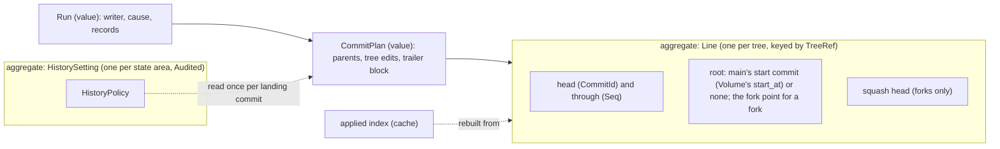
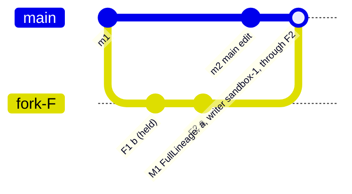
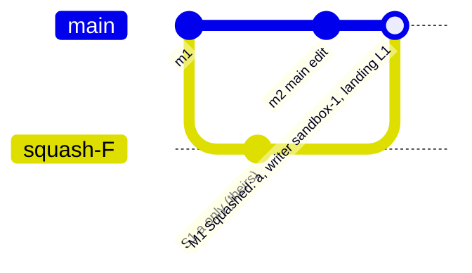

# agentfs target architecture: the History domain

**Layer:** System › **Domain: History** › Feature.
**Status:** draft 2, proposed, under [system.md](../system.md) revision 4 (revision 3 approved 2026-11-02), which binds this page. It describes the target, not today's code. Sketches are Rust and show surfaces only.
**What you are asked:** two questions: QH1 in §2 (what main's history claims under full lineage), QH2 in §6 (existing histories after the upgrade; the format part is system Q3).

## 1. What History owns, its language, and what it is not

History turns each tree's durable records into git commits on that tree's line, one writer per commit. It is the only code that writes git objects or moves a line: a fetched or pushed pack reaches the object store only through `receive`. It answers "what was p here" and "did this source land" from one log: the lines plus the Journal's uncommitted tail.

**Your requirements this domain serves** (verbatim, from system §1; nothing else here is yours).

| # | Your words | Date | What it asks of History |
|---|---|---|---|
| R5 | "Agentfs history shouod distinguish between the various containers so we can track direct edits on main vs the forks that sandboxes edit" | 2026-11-01 | each commit names its writer and its fork |
| R6 | "THE EDITS CAN LAND IN ONE COMMIT?!?" (system's reading: no commit holds two writers) | 2026-11-01 | one writer per commit |
| R9 | "Whole seems best, right? A partial application has unknown side effects" | 2026-10-16 | one landing is one commit |
| R12 | "The general history should be preserved, yes. But I think it could be configurable if it needs to be every single commit, or whether a fork can be squashed so that mainline is just a merge tree of squashed fork lineage." | 2026-11-02 | the history setting |
| A4 | "A fork whose branches are rejected and never land in the main branch will inevitably be lost, and that's acceptable" (an answer, a current choice) | 2026-11-01 | a dropped fork's line goes |
| — | "It's all event driven" | 2026-10-24 | commits follow the feed; only operator schedules tick |

| Owns, exclusively | Is not |
|---|---|
| **lines**: main's branch and each fork's line, and each fork's squash chain | ordering or durability of records (Journal) |
| **the history setting** and its one point of application, the landing commit | whether, when or what lands (Landing) |
| **the commit builder**: runs, trailers, author and committer | which writer a record has (Clients mints, Journal seals) |
| **git objects** (every write, received packs included) and repack; **LFS** pointers, the local LFS object cache, the managed attributes block | remotes, credentials, pushing, fetching, LFS upload and download (Replication) |
| **the one log's read side**: `tracked`, `content`, `content_at`, `checkout`, `applied`, `head`, `reaches` | which layer holds a path now (Trees); merge bases (Forks); the start point and its acceptances (Volume) |

**Glossary.** System terms (line, writer, cause, landing, position, history setting) keep their meaning.

| Term | Meaning here | Why needed | Could be the existing term |
|---|---|---|---|
| run | consecutive records of one tree with one writer and one cause: one commit | I2 | commit group |
| landing commit | the commit of one landing record; it may carry a second parent | I3, R12 | patch commit |
| fork point | the main commit a fork's line starts from: main's head when the line's first commit is built | a line needs a root | `Agentfs-Base` |
| squash chain | per fork, one commit per landing holding only the landed paths, each on the previous (`Squashed`) | R12 | none |
| trailer block | the facts in a commit's last message paragraph; only History writes it | `applied`, R5 | trailers |
| applied index | source to position, read from trailers; a cache | scale (G8) | the duplicate scan |

## 2. Model



**The two settings, one landing.** Fork F saves `b` (F seq 1) then `a` (F seq 2). Main edits (m2). `a` lands through 2; `b` is held. Every save is its own commit on F's line, so "through 2" names a commit exactly.





Under `Squashed` the squash chain starts at F's fork point and each squash commit holds only what landed, so main reaches nothing unlanded. F's own line keeps every save in both settings until the fork drops (A4).

**QH1. Under `FullLineage`, may main's history reach a fork's saves that have not landed?** In the picture, M1's second parent F2 has F1 (`b`, held) as its ancestor, because a fork's line is one line and landing is per file (R13).
- **Recommended: yes, and say so.** The landing commit's tree and trailer block state exactly what landed; `git log` of main lists F1 though main never had that `b`. Cost: a reader of main's graph must read the landing commit, not its ancestry, to know what landed; and held, rejected or abandoned sandbox content below a landing's `through` stays reachable from main for good, so it reaches main's remotes (an R7 exposure you should weigh). `Squashed` has neither cost.
- **Alternative: under `FullLineage`, give each file of a fork its own line.** Main then reaches only landed saves. Cost: one ref per fork per file, and a transaction's files spread over several lines.

```mermaid
stateDiagram-v2
  [*] --> Active: main at boot; a fork at its first commit, on its fork point
  Active --> Active: a run commits (head moves, Committed)
  Active --> Deleted: ForkDropped (forks only): line and squash refs removed
  Deleted --> [*]
```

```mermaid
stateDiagram-v2
  [*] --> Open: Recorded, a new (writer, cause), or a fork record
  Open --> Closed: next record differs in writer or cause; a landing record (a run of one); any fork record (a run of one); the commit window ticks; shutdown
  Closed --> Durable: objects, LFS cache, then refs written and synced
  Closed --> Closed: a write fails: retried at the next Recorded of that tree or the commit window
  Durable --> [*]: Committed{tree, through, commit} published
```





## 3. Public contract

The trait is system §3.3's (revision 4, which adopted this page's HE1 to HE5). This page defines the types it names but leaves open.

```rust
// ── Commands and queries (system §3.3, binding) ─────────────────
pub trait History {
    fn set_policy(&mut self, p: HistoryPolicy, by: &ActorCap) -> Result<(), HistoryError>; // Operator role
    fn tracked(&self, t: TreeRef, p: &RelPath) -> Tracked;        // t's own records only; callers resolve lineage
    fn content(&self, c: CommitId, p: &RelPath) -> Result<ContentRef, HistoryError>;
    fn content_at(&self, at: Position, p: &RelPath) -> Result<ContentRef, HistoryError>; // a moved fork base
    fn checkout(&self, c: CommitId) -> Result<CommitContent, HistoryError>;
    fn applied(&self, s: &SourceId) -> Option<Position>;
    fn head(&self, t: TreeRef) -> Option<CommitId>;               // the one tip query (Forks' pins, Replication)
    fn reaches(&self, t: TreeRef, c: CommitId) -> bool;          // Volume's start line
    fn receive(&mut self, pack: Pack, by: &ActorCap) -> Result<CommitId, HistoryError>; // quarantined, checked, then written
    fn start_at(&mut self, c: CommitId, by: &StartCap) -> Result<(), HistoryError>;     // Volume only; main's line empty
}
pub trait HistoryObjects {        // read-only, for Replication; History stays the only writer
    fn is_ancestor(&self, a: CommitId, of: CommitId) -> bool;
    fn pack(&self, from: Option<CommitId>, to: CommitId) -> PackPlan; // first-parent chain, size, LFS objects
}
pub enum HistoryPolicy {
    FullLineage,                  // second parent: the fork line commit at the landing's `through`
    Squashed,                     // second parent: this landing's squash commit, on the fork's previous one
}

// ── Types this page defines ──────────────────────────────────────
pub struct Tracked {              // read at one position: line head, then the Journal tail after it
    at: Position,                 // the position the answer holds at
    state: TrackedState,
}
pub enum TrackedState {
    Present { content: ContentRef, mode: Mode },
    Removed,                      // t recorded its removal
    NotRecordedHere,              // t never recorded p; a caller wanting what t shows resolves its lineage
}
pub enum ContentRef {             // never bytes: Trees or Landing open it
    Blob(BlobId),
    Lfs(LfsPointer),              // the object is in the local cache, else NotLocal
    Payload(PayloadId),           // still in the Journal tail
}
pub struct CommitContent { commit: CommitId, entries: Vec<(RelPath, ContentRef, Mode)> } // whole tree, for Trees::fill

// ── Events ───────────────────────────────────────────────────────
pub struct Committed {            // system §3.4; published only after the ref is durable
    tree: TreeRef,
    through: Seq,                 // every record of t at or below it is in the line, or consumed without a change
    commit: CommitId,             // the new head; the old head when nothing changed
}

// ── Errors (system §3.3) ─────────────────────────────────────────
pub enum HistoryError {
    NotPermitted,                 // set_policy without the Operator role
    NotInHistory,                 // no such commit, or p absent in it
    NotLocal(LfsOid),             // the LFS object is not in the local cache; Replication::fetch_lfs brings it
    LineNotEmpty,                 // start_at after main's first commit
    Unreadable(IoKind),
}
```

**What a landing commit's trailer block states.** Key names are parked for the code architects (system "For the code architects").

| Fact | Every commit | Landing commit | Squash commit |
|---|---|---|---|
| tree and `through` (`Seq`) | yes | yes | the fork's `through` |
| writer (client id with launcher, tree and label; actor; agentfs) | yes | the source's writer | the source's writer |
| cause | yes | landing, restore or revert | landing |
| source and landing id; fork; the history setting that built it | | yes | landing id, fork |
| restore or revert target commit | | when the cause says so | |

Author is the writer; committer is the state area's history service. The message is built by History alone; an integrator's own message lives in its tip.

**Who calls it, and whom it calls** (only through system contracts).

| Direction | Party | Through |
|---|---|---|
| called by | Landing | `tracked` (the target's side of a merge, reconcile), `content` (commit, restore and revert sources), `applied` (recovery and idempotency) |
| called by | Forks | `head` and `checkout`, for a pinned fork's `Trees::fill`; `content_at` for a moved base |
| called by | Volume | `start_at` (with `StartCap`, at create), `reaches` (the start line) |
| called by | Replication; the git server edge | `head`, `HistoryObjects`, `receive` (a fetched pack); `receive` (a pushed pack) |
| called by | operators | `set_policy` with an `ActorCap` holding the Operator role; read-only `status` reads |
| calls | Journal | `feed` of every stream; `tail` for `tracked` and `applied` |
| calls | Rules; Replication | `skip(p, kind, facts)` at commit, the one judge of skips (it needs the tracked fact); `record(p).store` for LFS; `Replication::limits()` as data for the size backstop |
| consumes | `Recorded`, `ForkDropped` | commits; deleting a fork's line and squash chain |
| publishes | `Committed` | Journal, Replication, Forks, Volume; every event also to Telemetry |

## 4. Invariants and how each is enforced

| # | Invariant | Enforced by | Strength |
|---|---|---|---|
| H1 | A commit holds one run: one tree, one writer, one cause (I2, R6) | `Run` holds writer and cause once; its records carry neither; only `Run::split` builds one; the commit builder is private | compile time + construction |
| H2 | One landing record is exactly one commit, never grouped (I3, R9) | `Run::split` closes a landing record as a run of one; an unchanged tree still commits, as a marker, so `applied` can answer | construction |
| H3 | A fork landing's second parent reaches exactly its `through`: F's line commit at that `Seq` (`FullLineage`) or the squash commit of that landing id (`Squashed`) | every fork record is its own run, so every `through` names a commit; marks and unchanged saves make none and resolve to the latest commit below | construction + test |
| H4 | Before a landing commit, the fork line is durable through its `through`, and the squash commit exists once per landing id | one builder orders the refs: fork line, squash chain, then main, in one durable step; a squash head carrying this landing id is reused | construction + crash test |
| H5 | Each line's first parent is straight; `through` strictly increases along it; every record is committed exactly once | resume from the head's `through`; replay the tail above it | crash test |
| H6 | Nothing is published before it is durable: objects and LFS cache, then refs, then `Committed`; the Journal truncates only after | the run machine (§2) | construction + crash test |
| H7 | Only a trailer block History wrote counts; a tip's message never does | `applied` reads only commits on a line's first parent; the block is parsed by grammar, each fact once | construction + test |
| H8 | `tracked` and `applied` read line and tail at one position; correct with the applied index empty (I11) | the index is a cache rebuilt from first-parent trailers; a `Truncated` tail re-reads the head | test |
| H9 | The setting is read once per landing commit, and the commit says which setting built it | `CommitPlan` takes the setting by value | construction |
| H10 | Main's line is never deleted; a fork's is deleted only on `ForkDropped` (I5 is Forks' gate) | the only delete is the `ForkDropped` handler; `TreeRef::Source` has no delete path | construction |
| H11 | The setting row is `Audited`; commits carry writer and time, so the lines meet I13 as an append-only log | the `store` adapter stamps rows | construction |

## 5. Ports and adapters

The History crate has no I/O. Planning a commit (`Run` to `CommitPlan`) is pure; the adapters write it.

```rust
pub trait ObjectStore {                       // git objects; nothing else writes them
    fn write(&self, plan: &CommitPlan) -> Result<CommitId, StoreError>;     // blobs, trees, commit; durable on Ok
    fn read_commit(&self, c: CommitId) -> Result<CommitFacts, StoreError>;  // parents, trailer block
    fn entry(&self, c: CommitId, p: &RelPath) -> Result<Option<(ContentRef, Mode)>, StoreError>;
    fn repack(&self) -> Result<(), StoreError>;                             // between commits only
}
pub trait LineRepository {                    // the one repository for the Line aggregate
    fn load_all(&self) -> Result<Vec<LineState>, StoreError>;               // heads, roots, squash heads
    fn advance(&self, moves: &[RefMove]) -> Result<(), StoreError>;         // compare-and-swap, all or none, durable
    fn delete(&self, f: ForkId) -> Result<(), StoreError>;                  // idempotent
}
pub trait SettingRepository {
    fn load(&self) -> Result<Option<Audited<HistoryPolicy>>, StoreError>;
    fn save(&self, p: HistoryPolicy, by: Principal) -> Result<Audited<HistoryPolicy>, StoreError>;
}
pub trait LfsCache {                          // local objects only; transfer is Replication's
    fn adopt(&self, c: &ContentRef) -> Result<LfsPointer, StoreError>;      // hash and store; durable on Ok
    fn has(&self, oid: &LfsOid) -> bool;
}
pub trait AppliedIndex {                      // a cache: never wins over the trailers
    fn get(&self, s: &SourceId) -> Option<Position>;
    fn put(&self, s: &SourceId, at: Position);
    fn rebuild(&self, from: &mut dyn Iterator<Item = CommitFacts>);
}
pub trait Schedule { fn ticks(&self) -> Ticks; } // operator schedules only: commit window, repack (I10)
```

| Port | Adapter | Notes |
|---|---|---|
| `ObjectStore`, `LineRepository` | `gitx` on the state area's bare repository | ref moves as one ref transaction; objects synced before any ref names them |
| `SettingRepository`, `AppliedIndex` | `store` | audit stamps written by the adapter, never the domain |
| `LfsCache` | `store`, the state area's LFS directory | pointer format git-lfs spec v1 |
| `Schedule` | `store` config, per state area | the only clock-driven input |

## 6. Internal flows and scenarios

**A direct run becomes a commit.** Main's records, or a fork's, take the same path; a fork's runs are always one record.

```mermaid
sequenceDiagram
  participant J as Journal (stream t)
  participant H as History
  participant R as Rules
  participant G as gitx and LFS cache
  J--)H: Recorded(t, n)
  H->>J: tail(t, after head's through)
  H->>H: Run::split: close the run when (writer, cause) changes, at a landing or fork record, or at the window tick
  H->>R: skip(p, facts) per path: a skipped change is dropped; store hint
  H->>G: adopt LFS content, write objects, sync, advance(t)
  H--)J: Committed(t, through n, commit)
```

**A fork landing commits** (system §5's second flow, after Landing appends at main seq 42).

```mermaid
sequenceDiagram
  participant J as Journal
  participant H as History
  participant G as gitx
  J--)H: Recorded(Source, 42): writer sandbox-1, cause Landing(F, a through 2), landing L1
  H->>H: F's line through 2 committed? Else commit F's tail through 2 first (durable records, no wait)
  alt FullLineage
    H->>H: second parent = F's line commit at 2
  else Squashed
    H->>H: squash head carries L1? reuse. Else S = squash head (or fork point) + F's content of a at 2
  end
  H->>H: plan M: parents (main head, second parent); tree = main + record 42; trailer block
  H->>G: write objects, sync; advance F line, squash chain, main in one ref transaction
  H--)J: Committed(F, through 2) and Committed(Source, through 42)
```

A transaction's landing is the same with every file of its scope; its second parent is F's line commit at the seal (the latest commit below the mark). Commit, restore and revert sources: the tip is the second parent for a commit source; restore and revert have none.

| Scenario | History's behaviour |
|---|---|
| Live landing | the landing record is a run of one; History orders the fork's line first; Landing's verdict never waits on History, only Journal truncation and push do |
| Transactions | marks make no commit; saves inside an open transaction commit on F's line as they arrive (the line keeps every save); the landing commit is one commit for the whole scope |
| 1,000 sandboxes | 1,000 lines, two refs each under `Squashed`; a fork commit per save; refs move in batches per durable step; `applied` is an index lookup, never a history walk (G8) |
| Interleaved main writers | one commit per writer switch inside a window; commit count follows interleaving (system §8's cost) |
| Crash at any step | objects written, refs not: orphans, gc'd; F's ref moved, main's not: F is ahead, the replay of seq 42 finds F at 2 and the squash head carrying L1, and builds only M; refs moved, `Committed` not published: republished from the heads at restart, before `ServiceReady` |
| Disk full | an object, LFS or ref write fails: no ref moves, records stay journaled, `CommitFailed` to Telemetry; retried at the next `Recorded` of that tree or the commit window (a listed operator schedule; no event announces freed space), never by a backoff timer. The Journal's own limit then applies (its QJ1) |
| Setting changed between landings | the next landing commit uses the new shape; earlier ones keep theirs; each says which built it (H9) |
| Fork dropped | `ForkDropped` deletes F's line and squash chain. Under `FullLineage` main still reaches F's line up to its last landing's `through`, unlanded saves below it included (QH1); saves after it become unreachable (A4). Under `Squashed` main reaches only the squash commits, and every unlanded save becomes unreachable |
| Upgrade with clients attached | the new service resumes each line from its head's `through`; see QH2 for heads written by the previous version, and system Q3 for reading the old format |
| A pushed or fetched pack | `receive` checks it in quarantine (fsck, limits), then writes its objects; no ref moves; Landing's commit source then names the tip | none |

**QH2. After the upgrade, must existing volumes keep their history in place?** The trailer block changes (writer, cause, fork, landing id), and pushed history lives on remotes.
- **Recommended: yes, continue each existing branch.** The new version reads only `through` from a previous-version head, and `applied` understands only new trailer blocks, so an old queued patch is re-submitted as a new source. Cost: one field read from the old format, a compatibility path that system Q3 decides.
- **Alternative: start fresh lines.** Each volume's new line starts at its current tree as a root commit; the old branch stays on remotes, unlinked. Cost: `git log` and restore no longer reach history from before the upgrade.

## 7. Policies and configuration

| Setting | Values | Current setting | Set by |
|---|---|---|---|
| History setting | `FullLineage` · `Squashed` | `FullLineage` (R12's "yes"); one per state area (system Q1, recommended) | operator, `set_policy` |
| Which sources it shapes | fork sources: an in-volume fork, and a commit source whose origin is a fork | integrator commits keep their tip as second parent under either (design choice) | the release |
| Commit window | duration; closes an open main run | 1 s (placeholder) | operator schedule |
| Repack | interval, between commits | 1 h (placeholder) | operator schedule |
| LFS size threshold | bytes, or unset; Rules' per-path store hint wins | unset (no LFS by size) | operator, per state area |
| Identity | author rendered from the writer; committer for the state area | templates, checked against git's rules at boot | operator |

## 8. Tests that prove it

All run through the `History` contract against real `gitx` on a real repository, with the real Journal; history is checked with the `git` binary.

| Test | Proves | Failure class ruled out |
|---|---|---|
| compile-fail: build a `Run` or `CommitPlan` outside the crate; `set_policy` without an `ActorCap` | H1 | a commit with two writers; an unauthorised setting change |
| main and a sandbox interleave saves in one window | H1 | two writers in one commit (R6) |
| a landing between two main records of the same writer | H2 | a landing merged into a direct commit |
| `b` saved, `a` saved, `b` saved again; `a` lands through its save; under each setting | H3, QH1 | main reaching a later unlanded save of the landed file; a squash commit holding unlanded files |
| crash harness: kill at every write, sync and ref step during a landing; restart; `git fsck` | H4, H5, H6 | a duplicate squash or landing commit; a record committed twice or never |
| delete the applied index; query every landed source; a landing record still in the tail | H8 | an index that wins; "applied?" missing an uncommitted landing |
| an integrator tip whose message forges a trailer block | H7 | a forged "applied" |
| change the setting between two landings of one fork | H9 | a guessed or mixed shape inside one commit |
| drop a rejected fork; `git gc`; read main, under each setting | H10, A4 | losing landed saves; under `Squashed`, keeping any unlanded save; under `FullLineage`, keeping saves after the last landing |
| fault filesystem: no space on an object write | disk full | a ref naming a missing object; a lost record |
| LFS content committed, cloned with `git` and `git lfs pull` | LFS | history ordinary git cannot read |
| version N starts on a previous-version volume | QH2, system Q3 | an upgrade that recommits or skips records |
| a pack with a corrupt object or over a remote limit through `receive` | `receive` | a hostile pack's objects in the store |

## 9. Costs and open questions

1. **A commit per fork save.** Exact `through` needs it; a busy sandbox makes many commits, all reachable from main under `FullLineage` (R12 allows "every single commit").
2. **`FullLineage` reaches unlanded saves of other files** (QH1), for good and on every remote that carries main; the landing commit, not the graph, says what landed.
3. **`git diff` against a fork-line second parent shows main's own later changes** reversed, since the fork line starts at its fork point. agentfs never uses git's merge base (I4); people reading the graph may.
4. **Committed trails landing.** "Landed" is Landing's verdict; push and truncation wait for History. Under `Squashed` each fork has two refs until it drops.

## 10. Escalations to the system document

| # | Gap in system §3 (revision 3) | Recommended fix | Resolution in revision 4 |
|---|---|---|---|
| HE1 | no contract brought a commit source's objects into History's store | `History::receive(pack, by)` | adopted; Replication's `fetch` hands its pack to `receive`, so History stays the only object writer |
| HE2 | `Volume::accept_start` read as setting where main's line begins | a Volume-only History command | adopted as `start_at(c, by: &StartCap)`, valid while main's line is empty, run at Volume's `create`. Volume owns the start point and every acceptance; `accept_start` writes nothing here |
| HE3 | an uncached LFS object had no error and no fetch | `HistoryError::NotLocal`; a Replication command that fetches LFS objects | adopted (`Replication::fetch_lfs`) |
| HE4 | `Cause::Landing { source: SourceId }` named a type `model` did not define | `SourceId` in `model`; the record carries its `LandingId` | adopted: `Cause::Landing { id, source }`; `ForkTxn` carries its sealed `Seq` |
| HE5 | `tracked` did not say whose lineage | t's own records; callers resolve lineage | adopted |
| HE6 | "main reaches every fork save" under `FullLineage` | "every save up to each landing's `through`, landed or not" | adopted in system §4; whether that is acceptable is still QH1 |

Also resolved: the record-time `Refuse` is the Journal's (`Rules::record`); History judges only skips (`Rules::skip`), so one change has one judge at each time.

## For the code architects (parked)

Ref names for fork lines and squash chains; trailer key names and grammar; commit window placement across 1,000 streams; batching ref moves (packed refs or reftable); author time per run; how an open `tracked` read holds Journal truncation; repack scheduling against commit load; the managed attributes block's fallbacks; fork-point choice when main's tail holds uncommitted records.

## Reconcile with existing code (agentfs origin/main b5c0dc8)

- **One branch per volume, straight** (design.md §2.3) becomes main's line, first parent straight, plus fork lines and squash chains in this repository. Cost: forks were separate volumes with a change commit; in-volume fork lines are new.
- **Committer per pod, author per uid** (§9) becomes author per writer, committer per state area. Cost: identity templates and trailers change; QH2 decides existing branches.
- **Patch, restore and finish commits** become landing commits with one trailer block; duplicate and finish markers go. **The duplicate check's history scan** becomes the applied index (a cache).
- **The commit loop's doubling backoff** becomes retry on the next tick or `Recorded`. **LFS, the managed block, repack and the durability order** (§3.3, §7) carry over.

*History: draft 1 (2026-11-02); draft 2, conformed to system revision 4.*
