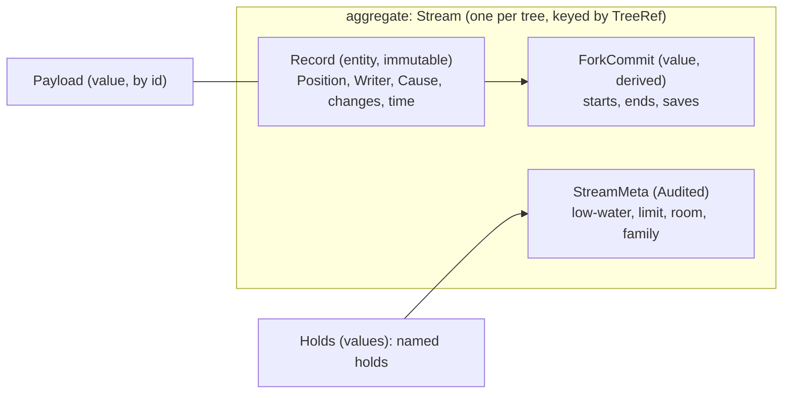
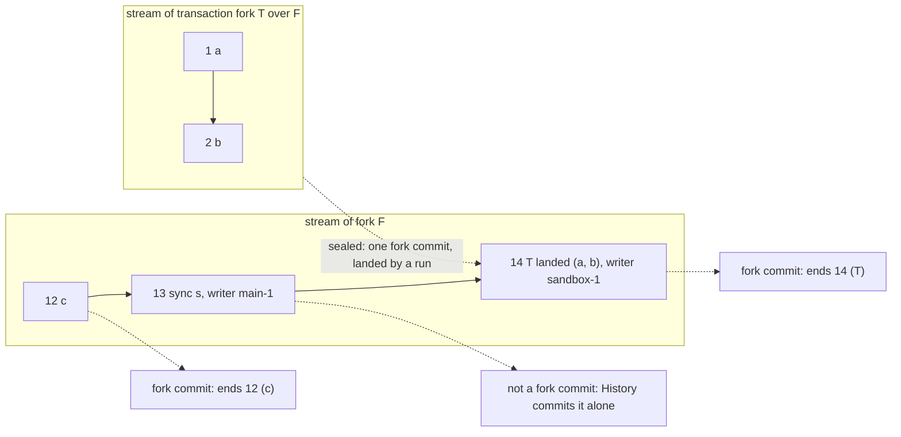
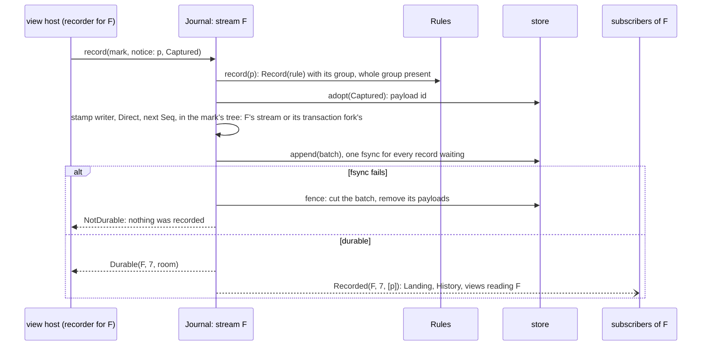

# agentfs target architecture: the Journal domain

**Layer:** System › **Domain: Journal** › Feature.
**Status:** draft 7, proposed, under [system.md](../system.md) revision 9, which binds this page. It describes the target, not today's code; sketches are Rust surfaces. **What you are asked:** nothing (QJ1 adopted, §7). **Since your answers (2026-11-02):** a transaction is a child fork (A15), so the Journal keeps no transaction state: no marks, no locks; a sealed transaction fork's stream is one fork commit, an abandoned one's is deleted uncommitted (A13).

## 1. What the Journal owns, its language, and what it is not

One durable, ordered stream of records per tree. A record is promised when its call returns, names one writer, is published on the tree's feed, and is forgotten only once History commits it.

**Your requirements this domain serves** (verbatim, from system §1; nothing else here is yours).

| # | Your words | Date | What it asks of the Journal |
|---|---|---|---|
| R5 | "Agentfs history shouod distinguish between the various containers so we can track direct edits on main vs the forks that sandboxes edit" | 2026-11-01 | every record names its writer |
| R9 | "Whole seems best, right? A partial application has unknown side effects" | 2026-10-16 | one landing is one record |
| R13 | "A cooperating integration can define batches/transactions across files, and they must all land together. But a default usage, like the CNI provides, can operate per-file." | 2026-11-02 | a sealed transaction fork's stream is one fork commit |
| A13 | "Agreed. It’s a transaction, so a failure is an implicit rollback." | 2026-11-02 | an abandoned transaction fork's stream is deleted, never committed |
| A8 | "This does assume that a *commit* is landed altogether, not just a file." (your question, accepted) | 2026-11-02 | one judge of where each fork commit starts and ends |
| R16 | "The various agentfs components should be within the same version family" | 2026-11-02 | the stream format belongs to one family |
| R18 | "the two conflicting changes would be interleaved in commits" | 2026-11-02 | a sync is a record in the fork's stream, named for the parent's writer |
| — | "It's all event driven" | 2026-10-24 | the feed; no timer anywhere in this domain |

**Owns, exclusively:** the streams, `Seq`, records and their captured copies until truncation, **fork commit bounds**, each stream's limit and room, holds, the feed, truncation. **Is not:** commits, lines, the history setting (History); whether, when or how anything lands or syncs (Landing); merge bases, transaction forks and their scope (Forks); what is recorded or grouped (Rules); attachment (Clients); tree content (Trees); alarms (Telemetry).

**New terms.** System terms (stream, position, feed, hold, writer, cause, transaction, gate, fork commit, sync, family) keep their system meaning.

| Term | Meaning here | Why needed | Could be the existing term |
|---|---|---|---|
| record | one durable entry in a stream: a change | the unit of promise | journal entry |
| notice | what a view hands its recorder: paths and captured copies, no writer | an unforgeable writer | `Draft` |
| payload | a captured copy the Journal adopted, kept until truncation | content outlives the call | `pending/` copy |
| low-water | the stream's first kept `Seq`; everything below is in History | the one-log read (I11) | `Agentfs-Seq` of the head |
| room | `Plenty`; `Low` (no new write-opens, §7); `Full` (saves refused) | backpressure without a timer | `journal.backlog` |
| fence | cutting a failed batch so it never exists | an error means "not recorded" | today's `set_len` |
| lag | a subscriber that lost buffered notices | nobody waits on a slow view | inotify's overflow |

## 2. Model



A fork's stream holds its one writer's saves and landing records (a child fork's run named for the child's writer, a sealed transaction's for the client, syncs for the parent record's, reconciles for `Agentfs`); saves and child runs make fork commits. A transaction fork T has its own stream, of its client's saves only.



**A fork commit's place is its last record** (design choice), so `c` lands before `T`, as git orders a commit by when it is made. `ForkRun { through }` names a commit's end. A landing record is no fork commit, except a child fork's run (design choice, so a grandchild's and a transaction's work reach main). **A transaction fork's stream** (design choice) is one fork commit ending at its last record once Forks reports T sealed, and none while it is open; a save through a mark made before the seal still extends it, and Landing's run fixes its end at `Writing`, after T's last write-open; it is never committed alone (T has no line) and is deleted at `ForkDropped`, so an abandoned one leaves nothing (A13). The Journal keeps no transaction state: whether T is open, sealed or abandoned is Forks' fact, asked (`Forks::facts`).

```mermaid
stateDiagram-v2
  [*] --> Accepting: first record or landing (fork streams); boot (source)
  Accepting --> Low: size reaches the low threshold: StreamRoom(Low)
  Low --> Full: size reaches the limit: saves refused with Backpressure
  Full --> Low: Committed truncates
  Low --> Accepting: Committed truncates
  Accepting --> Fenced: a batch write fails
  Low --> Fenced: a batch write fails
  Fenced --> Accepting: failed batch cut, payloads removed
  Accepting --> [*]: ForkDropped: StreamDeleted
```



## 3. Public contract

The trait is system §3.3's. This page defines the types §3.3 names but leaves open.

```rust
// ── Commands and queries (system §3.3, binding) ─────────────────
pub trait Journal {
    fn recorder(&self, cap: ClientCap) -> Result<Recorder, RecordError>; // consumes the cap
    fn feed(&self, t: TreeRef, after: Option<Seq>) -> Feed;
    fn append_landing(&self, g: &Gated, r: LandingRecord) -> Result<Seq, RecordError>;
    fn tail(&self, t: TreeRef, after: Seq) -> Result<Vec<Record>, RecordError>;
    fn fork_commits(&self, f: ForkId, after: Seq) -> Result<Vec<ForkCommit>, RecordError>; // complete ones, by `ends`
    fn hold(&self, t: TreeRef, holder: HoldName, at: Seq) -> Result<(), RecordError>; // durable; moves forward only
    fn release(&self, t: TreeRef, holder: HoldName);
    fn uncommitted(&self) -> TreeSet;      // transaction forks never appear: they have no line
}
pub trait Recorder {                       // writer and own tree sealed from the consumed ClientCap
    fn record(&self, m: &WriteMark, n: ChangeNotice) -> Result<Durable, RecordError>; // into the mark's tree
}

// ── Types this page defines ──────────────────────────────────────
pub struct ChangeNotice {                  // no writer, no Seq: they cannot be supplied
    changes: Vec<PathChange>,              // one file, or one database group whole
}
pub enum PathChange {
    Content { path: RelPath, captured: Captured, mode: Mode }, // from Trees::capture or copy_up
    Removed { path: RelPath },
    Moved { from: RelPath, to: RelPath },  // a directory move: replay skips it at or below a consumer's position
}
pub struct Record {
    at: Position,
    writer: Writer,
    cause: Cause,                          // Direct for every recorder record; Landing{id, source} for a landing
    state: Vec<PathState>,                 // absolute: payload ids, not Captured handles
    time: Time,
}
pub struct ForkCommit {                    // judged only here; Landing lands it whole, History commits it once
    fork: ForkId,
    starts: Seq,                           // Landing's intake hold stays at or below it
    ends: Seq,                             // its place in the order, a run's `through`
    saves: Vec<Seq>,                       // one save, a child run's one landing record, or a sealed transaction fork's every save
}
pub struct LandingRecord {                 // built by Landing; the tree comes from the Gated, never from here
    id: LandingId,                         // the idempotency key
    writer: Writer,                        // the run's or sync's source writer, an ActorCap's, or Agentfs for reconcile
    cause: Cause,                          // Landing { id, source }: every landing source
    changes: Vec<PathChange>,              // every path inside the gate's scope; a sync: its one file
}
pub struct Durable { at: Position, room: Room } // returned only after the record's fsync
pub enum Room { Plenty, Low, Full }        // carried on every reply, so a view host knows without asking

pub struct Feed;                           // an ordered stream of FeedItem; never blocks the appender
pub enum FeedItem {
    Recorded { at: Position, names: Vec<RelPath> }, // system §3.4, published only after fsync
    Lagged { resume_after: Seq },          // this subscriber's buffer overflowed: drop caches, re-read
    StreamRoom { tree: TreeRef, room: Room }, // room changed; ends a backpressure wait
    StreamDeleted { tree: TreeRef },       // a dropped fork's empty stream is gone: its room alarms clear
}

// ── Errors (system §3.3 variants; Refusal defined here) ─────────
pub enum RecordError {
    Refused(Refusal),
    NotDurable(IoKind),                    // includes no space; the batch was fenced: nothing recorded
    Backpressure,                          // a save into this tree's Full stream; no other tree is affected
    Truncated,                             // `tail`, `fork_commits` or `feed` below low-water: read History's line
}
pub enum Refusal {
    RulesRefuse(RelPath),                  // Rules::record says Refuse
    SplitGroup(RelPath),                   // a database group member without the rest of its group
    OutsideGate(RelPath),                  // a landing path outside the gate's scope
}
```

**Who calls it, and whom it calls** (only through system contracts).

| Direction | Party | Through |
|---|---|---|
| called by | the session edge, for each writable client | `recorder` (with the client's `ClientCap`, at attach); `Recorder::*` on the view host's behalf; `feed` per tree a view host reads |
| called by | Landing | `fork_commits`, `feed`, `tail`, `hold` of fork streams (runs), of **parent streams** (syncs); `append_landing` (with `Gated`) |
| called by | History; Forks, Volume | `fork_commits`, `feed`, `tail`; `uncommitted` (drop check; release and drain verdict) |
| calls | Rules; Forks | `record(p, kind)` per client path: `Refuse` refused; a group must be whole (skips are History's, at commit); `facts(t)`: whether a transaction fork is sealed (its bounds) |
| consumes | `Committed{tree, through}`; `ForkDropped{fork}` | truncation; deletes the stream, publishes `StreamDeleted` |
| publishes | `Recorded`, `Lagged`, `StreamRoom`, `StreamDeleted` | the feed; Telemetry receives every event |

## 4. Invariants and how each is enforced

| # | Invariant | Enforced by | Strength |
|---|---|---|---|
| J1 | A client record names its consumed `ClientCap`'s writer, in its write-open mark's tree; a notice cannot carry a writer. A landing record names its source's writer, in its gate's tree | private constructors; `ChangeNotice` has no such fields; the tree comes from `Gated` | compile time |
| J2 | Only a risen gate appends to a tree from elsewhere, and only inside its scope | `append_landing` takes `&Gated`; paths outside its scope are `OutsideGate` | compile time + construction |
| J3 | A record exists if and only if its call returned `Durable`. A failed write is fenced; a torn tail dropped at replay | the stream aggregate commits a batch only on the store's success | construction + crash test |
| J4 | Per stream, `Seq` is strictly increasing and gapless; feed order is `Seq` order; nothing is published before durable | one appender per stream; `Seq` assigned at durable append, so a fenced batch frees its numbers | construction + test |
| J5 | One notice is one record. A database group is never split across records | `SplitGroup` refusal from Rules' group | construction |
| J6 | A record goes in its mark's tree, which Landing set (the own tree, or its open transaction fork); the Journal never picks one. A sealed transaction fork's stream is one fork commit, none before; never committed alone | `record` takes the session's `WriteMark`; sealed asked of Forks | construction |
| J7 | Truncation stops at `min(Committed.through, every hold)`: a named hold (Landing's intake, an open read) (I11) | low-water computed from holds; named holds are durable rows in `StreamMeta` | construction + test |
| J8 | A stream's limit and room are its own: one tree's backlog never refuses another's records (I6) | the limit is a field of each `Stream`; no shared counter | construction + test |
| J9 | Appending never waits for a subscriber; a slow one gets `Lagged` | a bounded buffer per subscriber | construction + test |
| J10 | `append_landing` is idempotent on `LandingId` while that record is in the stream | lookup by `LandingId` before append | test |
| J11 | Records are audited as events (writer, `Clock` time); `StreamMeta` is `Audited` (I13) | the repository layer stamps | construction |
| J12 | A fork commit is one save, a child fork's run landing record, or a sealed transaction fork's whole stream; never another landing record or an open transaction fork's saves. One judge: Landing and History see the same commits in one order (I9) | `ForkCommit` built only by the aggregate | construction + test |
| J13 | A landing record is never refused for room: refusing it splits a landing (I3); its bytes count toward room | `append_landing` skips the room check; payloads under the fork quota | construction + test |
| J14 | A stream is read and written only by its own family; another family's stream is refused, nothing discarded (I16) | `StreamMeta.family`, checked at load; `store` reports `FormatsOf(family)` | boot time |

## 5. Ports and adapters

The Journal crate has no I/O; the `store` adapter implements its port traits in the state area, under its lock (I15).

```rust
pub trait StreamRepository {               // one repository for the one aggregate
    fn load(&self, t: TreeRef) -> Result<Option<StreamState>, StoreError>; // meta, records, replayed; another family refused
    fn append(&self, t: TreeRef, batch: &[Record]) -> Result<(), StoreError>; // durable on Ok
    fn fence(&self, t: TreeRef, last_durable: Option<Seq>) -> Result<(), StoreError>; // cut a failed batch
    fn read(&self, t: TreeRef, after: Seq) -> Result<Vec<Record>, StoreError>;
    fn truncate_through(&self, t: TreeRef, s: Seq) -> Result<(), StoreError>; // idempotent
    fn save_meta(&self, m: StreamMeta, by: Principal) -> Result<Audited<StreamMeta>, StoreError>;
    fn delete(&self, t: TreeRef) -> Result<(), StoreError>; // an empty stream, or a dropped transaction fork's
}
pub trait PayloadStore {
    fn adopt(&self, f: Captured, into: TreeRef) -> Result<PayloadId, StoreError>; // now the capture's one holder (T10): a rename
    fn remove(&self, ids: &[PayloadId]) -> Result<(), StoreError>;            // idempotent
    fn sweep(&self, live: &PayloadSet) -> Result<usize, StoreError>;          // replay: drop unreferenced
}
pub trait Clock { fn now(&self) -> Time; }
pub trait FeedSink { fn publish(&self, t: TreeRef, item: FeedItem); } // in-process, or the rpc adapter to view hosts
```

| Port | Adapter | Notes |
|---|---|---|
| `StreamRepository` | `store`: framed, checksummed segments per tree, stamped with the family; group commit driven by fsync completion | each record is a row with its writer and time; `StreamMeta` audited by the adapter |
| `PayloadStore` | `store`: payload files per tree in the state area | a fork's payloads sit under its layer's quota (Trees) |
| `Clock`, `FeedSink` | `std` time; an in-process channel, or `rpc` to view hosts (same family) | the clock never schedules; the feed is bounded per subscriber |

## 6. Internal flows and scenarios

**A save becomes durable and is published** (fork F; main's take the same path).



**A sync** (R18): at `Recorded(main, 50)` Landing's sync intake captures s and its hold passes 50; inside F's gate, `append_landing` (id 77, writer main-1, cause `Landing(Sync)`), idempotent on its id (J10), appends at F 13. History commits it alone on F's line; F 13 is no fork commit, so it never flows back.

**A run** (§2's streams): at `Recorded(F, 14)` Landing asks `fork_commits(F, after 9)`, gets `c` (ends 12) and `T` (ends 14), keeps its hold at the first one's start, and appends one record in main, cause `ForkRun{F, through 14}`. Truncation then runs to `min(Committed.through, holds)`.

**Restart.** Load every stream, drop a torn tail, refuse another family's (nothing discarded), rebuild fork commit bounds and room; sweep stray payloads, re-truncate; then `ServiceReady`.

| Scenario | Journal behaviour |
|---|---|
| Live landing or sync | appended in the gate after the renames, so `Seq` matches tree order; views learn of it from the feed alone |
| A held commit (A8) | Landing's intake hold stays at its start, keeping it and every later commit until `resolve`, the next commit or `withdraw` |
| 1,000 sandboxes | 1,001 streams, each with its own limit, room, fsync batch |
| Crash at any step | before fsync: torn or fenced, never `Durable`; after fsync, before the reply: the view's re-send records the same absolute state (no commit for an unchanged tree); after `Committed`: replay truncates again |
| Commits stall | that stream alone reaches `Low` (alarm; new write-opens refused, §7), then `Full`; nothing lost |
| Disk full | `NotDurable(NoSpace)`, batch fenced, nothing recorded; fork payloads sit under fork quotas |
| Upgrade | a patch reads the stream as it is. A minor or major drains first: every stream commits and empties and each fork stream is deleted, so no journal crosses a family (system §8) |

## 7. Policies and configuration

| Setting | Values | Current setting | Set by |
|---|---|---|---|
| Source stream limit | bytes, records plus payloads | 1 GiB (placeholder) | operator, per state area |
| Fork stream limit | bytes, per fork | 256 MiB (placeholder) | operator, per state area |
| Low threshold | fraction of the limit; the gap is headroom for open files | 80% (placeholder) | operator |
| Subscriber buffer | notices per subscriber | 4,096 (placeholder) | composition root |
| Stream format | the release's family (major.minor) | written and read by one family; a change is a minor or major release | the release (semantic-release) |

No timer exists here. Group commit fsyncs when the previous fsync completes; truncation runs on `Committed`; room changes on append and truncation.

**A full stream refuses at open** (former QJ1, adopted; a design choice). Once room is `Low`, the view host refuses new write-opens with `EDQUOT`; open files keep recording until `Full`, so no program hangs on a stalled commit. Cost: write errors until commits resume; a close can still hit `Full`. Rejected: waiting for `StreamRoom`, which hangs every writer of the tree, main included.

## 8. Tests that prove it

All run on the real `store` adapter and filesystem, through the `Journal` contract.

| Test | Proves | Failure class ruled out |
|---|---|---|
| compile-fail: a `Record`, `Writer` or `ForkCommit` built outside its crate; `append_landing` without `Gated` | J1, J2, J12 | forged writer or bounds; a landing outside a gate |
| crash harness at every failpoint under concurrent recorders, then replay; a fault filesystem (fsync error, no space) | J3, J4, J7 | a returned record lost; a failed one committed; a published `Seq` reused |
| F stalled at `Full`; main records on; a landing into F still appends | J8, J13 | a sandbox stopping main; a split landing |
| a subscriber never reads: appends go on; it gets `Lagged` | J9 | a hung view host stalling recording |
| the §2 streams (a transaction fork, a save, a sync); `fork_commits(T)` before and after its seal, and after a restart; a save through a mark made before the seal, arriving after it; an abandoned T dropped | J6, J12, A13 | a sync landing back; half a transaction landed; a save in the wrong stream; an abandoned save committed |
| a notice with one member of a database group | J5 | a group split across records |
| `append_landing` twice on one `LandingId`, a restart between | J10 | a landing or sync applied twice |
| a sync stuck on F's write-open while main records | I11 (the sync hold moves on) | a sandbox filling main's stream |
| boot a family-1.2 stream under 1.3 (refused, intact) and 1.2.x (read) | J14 | an upgrade misreading or discarding records |

## 9. Costs

1. **Every save is an fsync** (group commit per stream); payloads double storage until truncation without reflink; lag is coarse; landing idempotency lasts only within a stream.
2. **A held commit keeps its fork's stream from truncating** past its start (A8); it can drive that fork to `Full`, never main.
3. **Syncs grow fork streams:** each main change to a file a fork holds is one record in that fork's stream, with its payload under the fork's quota.
4. **No journal survives a minor or major upgrade:** the drain needs every fork landed or withdrawn first (system §8).

## 10. Escalations to the system document

None open: E1–E8 adopted.

## For the code architects (parked)

Segments, fsync sharing, frames; hold names; the rpc feed buffer and resume; the `Moved` replay guard; payload placement; the re-send after `ServiceReady`; a fork-commit-bounds cache.

## Reconcile with existing code (agentfs origin/main b5c0dc8)

- One journal per volume becomes one stream per tree, with its own `Seq`, limit, truncation, family; a failed batch is fenced, its numbers reused (J4).
- `atomic` becomes Rules' group check (J5); `origin` and `operation` become `Writer` and `Cause`; fork commit bounds, transaction fork streams, syncs, `Room` and a size limit are new.
- The format change ships as the first release under R16: drained, not migrated.

*History: drafts 1–6 are in git; draft 7 conforms to system revision 9 (transactions as child forks).*
