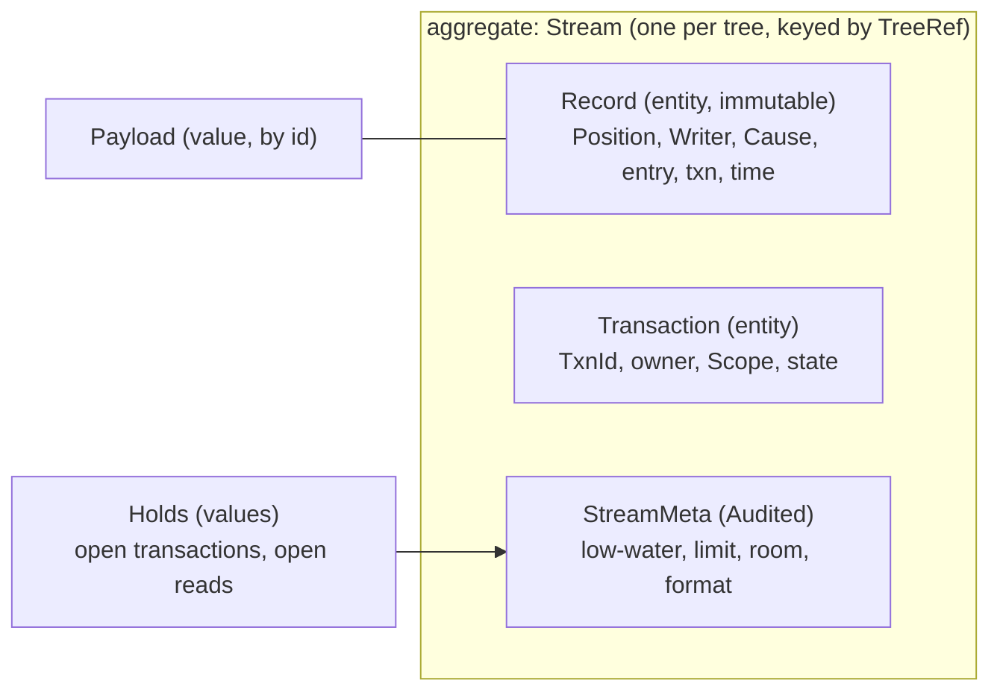
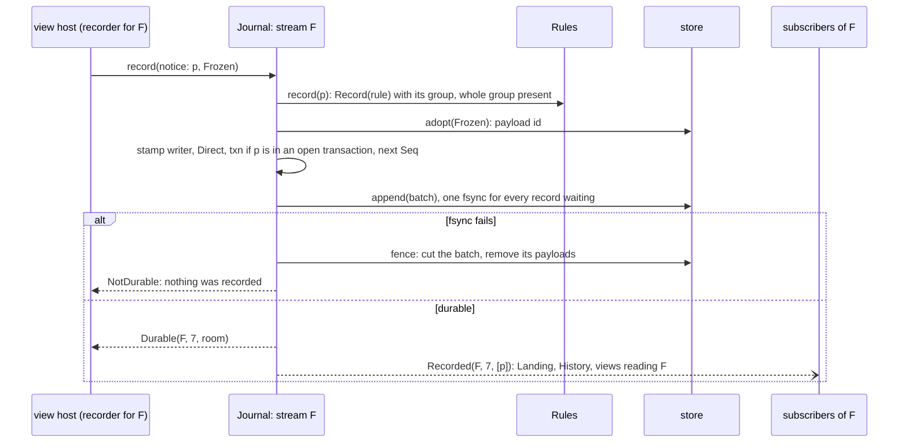
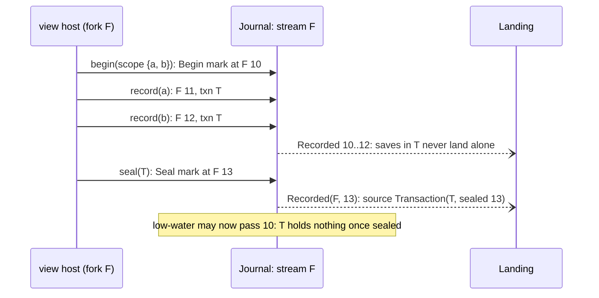
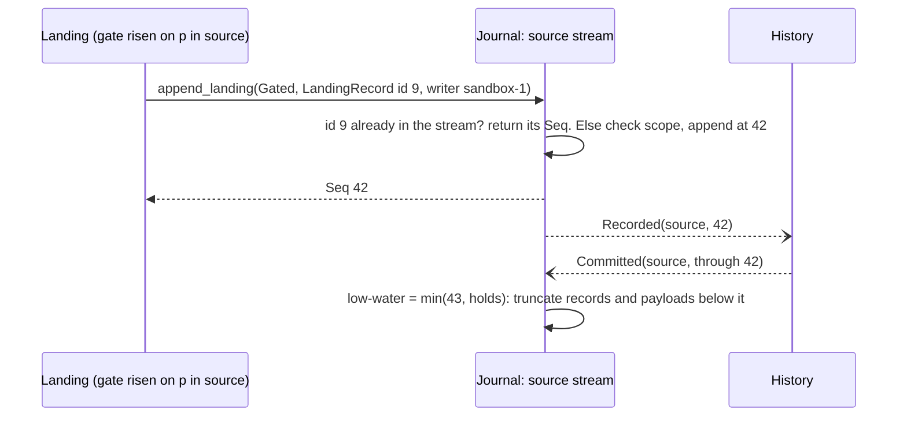

# agentfs target architecture: the Journal domain

**Layer:** System › **Domain: Journal** › Feature.
**Status:** draft 2, proposed, under [system.md](../system.md) revision 4 (revision 3 approved 2026-11-02), which binds this page. It describes the target, not today's code. Sketches are Rust and show surfaces only.
**What you are asked:** one question: QJ1 in §7 (what a program sees when a stream is full). Reading the previous journal format after an upgrade is now the system's Q3 (one answer for every format).

## 1. What the Journal owns, its language, and what it is not

The Journal keeps one durable, ordered stream of records per tree. A record is promised the moment its call returns, names exactly one writer, and is published on that tree's feed. It forgets a record only once History has committed it.

**Your requirements this domain serves** (verbatim, from system §1; nothing else here is yours).

| # | Your words | Date | What it asks of the Journal |
|---|---|---|---|
| R5 | "Agentfs history shouod distinguish between the various containers so we can track direct edits on main vs the forks that sandboxes edit" | 2026-11-01 | every record names its writer |
| R6 | "THE EDITS CAN LAND IN ONE COMMIT?!?" (system's reading: no commit holds two writers) | 2026-11-01 | one writer per record, sealed |
| R9 | "Whole seems best, right? A partial application has unknown side effects" | 2026-10-16 | one landing is one record |
| R13 | "A cooperating integration can define batches/transactions across files, and they must all land together. But a default usage, like the CNI provides, can operate per-file." | 2026-11-02 | transaction marks in the stream |
| — | "It's all event driven" | 2026-10-24 | the feed; no timer anywhere in this domain |

**Owns, exclusively:** the streams (one per writable tree), `Seq`, records and the frozen copies they name (until truncation; the Journal is their one holder), transaction state, its marks and which transaction each save belongs to, each stream's size limit and its room, holds, the feed, truncation.

**Is not:** commits, lines or the history setting (History); whether, when or how anything lands (Landing); what is recorded or grouped (Rules decides, the Journal enforces); attachment (Clients); file content in trees (Trees); alarms (Telemetry). The history setting (R12) does not reach this domain: a fork's stream is the same under `FullLineage` and `Squashed`.

**Glossary and new terms.** System terms (stream, position, feed, writer, cause, transaction, gate) keep their system meaning.

| Term | Meaning here | Why needed | Could be the existing term |
|---|---|---|---|
| record | one durable entry in a stream: a change or a mark | the unit of promise | journal entry |
| notice | what a view hands its recorder: the paths and their frozen copies, no writer | the writer cannot be forged | `Draft`, a front's `Record` request |
| payload | a frozen copy the Journal adopted; it lives until its record is truncated | content must outlive the file call | `pending/` copy |
| mark | a record that opens, seals or abandons a transaction | R13 in stream order | atomic flag |
| low-water | the stream's first kept `Seq`; everything below is in History | the one-log read (I11) | `Agentfs-Seq` of the head |
| hold | something that keeps truncation below a `Seq`: an open transaction, or a named durable hold (Landing's intake, an open read) | I11 | none |
| room | `Plenty`; `Low` (past the low threshold: no new write-opens, per QJ1); `Full` (at the limit: records refused) | backpressure without a timer | `journal.backlog` |
| fence | cutting a batch whose write failed, so it never exists | "returned error" must mean "not recorded" | today's `set_len` on failure |
| lag | a subscriber that fell behind and lost buffered notices | nobody waits on a slow view | inotify's queue overflow |

## 2. Model



Two lifecycles, two machines. A stream's room and fence state is one; each transaction's marks are another.

```mermaid
stateDiagram-v2
  [*] --> Accepting: first record or landing (fork streams); boot (source)
  Accepting --> Low: size reaches the low threshold: StreamRoom(Low)
  Low --> Full: size reaches the limit: record refused with Backpressure
  Full --> Low: Committed truncates
  Low --> Accepting: Committed truncates
  Accepting --> Fenced: a batch write fails
  Low --> Fenced: a batch write fails
  Fenced --> Accepting: failed batch cut, payloads removed
  Accepting --> [*]: ForkDropped, stream empty: StreamDeleted
```

```mermaid
stateDiagram-v2
  [*] --> Open: Begin mark (forks only; no file already in this client's open transaction)
  Open --> Sealed: Seal mark by the same recorder
  Open --> Abandoned: Abandon mark by the same recorder, or by agentfs at AttachmentEnded (Q2)
  Sealed --> [*]: truncated after Committed
  Abandoned --> [*]: truncated after Committed
```





The Journal is the one judge of a transaction's state. When an attachment ends with a transaction open, the Journal consumes `AttachmentEnded` and appends the `Abandon` mark itself, writer `Agentfs` (system §3.6, Q2's recommendation; the alternative would append `Seal`). So no open transaction outlives its attachment, and none holds truncation forever.

## 3. Public contract

The trait is system §3.3's (revision 4, which adopted this page's E1 to E4). This page defines the types §3.3 names but leaves open.

```rust
// ── Commands and queries (system §3.3, binding) ─────────────────
pub trait Journal {
    fn recorder(&self, cap: ClientCap) -> Result<Recorder, RecordError>; // consumes the cap
    fn feed(&self, t: TreeRef, after: Option<Seq>) -> Feed;
    fn append_landing(&self, g: &Gated, r: LandingRecord) -> Result<Seq, RecordError>;
    fn tail(&self, t: TreeRef, after: Seq) -> Result<Vec<Record>, RecordError>;
    fn hold(&self, t: TreeRef, holder: HoldName, at: Seq) -> Result<(), RecordError>; // durable; moves forward only
    fn release(&self, t: TreeRef, holder: HoldName);
    fn uncommitted(&self) -> TreeSet;
}
pub trait Recorder {                       // writer and tree sealed from the consumed ClientCap; held by the session
    fn record(&self, n: ChangeNotice) -> Result<Durable, RecordError>;
    fn begin(&self, files: Scope) -> Result<TxnId, RecordError>;
    fn seal(&self, t: TxnId) -> Result<Durable, RecordError>;
    fn abandon(&self, t: TxnId) -> Result<Durable, RecordError>;
}

// ── Types this page defines ──────────────────────────────────────
pub struct ChangeNotice {                  // no writer, no tree, no Seq: they cannot be supplied
    changes: Vec<PathChange>,              // one file, or one database group whole
}
pub enum PathChange {
    Content { path: RelPath, frozen: Frozen, mode: Mode }, // Frozen from Trees::freeze or copy_up
    Removed { path: RelPath },
    Moved { from: RelPath, to: RelPath },  // a directory move: replay skips it at or below a consumer's position
}
pub enum AbsoluteState {                   // the `state` of a Record
    Change(Vec<PathState>),                // payload ids, not Frozen handles
    Mark(Mark),
}
pub enum Mark {
    Begin { txn: TxnId, scope: Scope },
    Seal { txn: TxnId },
    Abandon { txn: TxnId },
}
pub struct Record {
    at: Position,
    writer: Writer,
    cause: Cause,                          // Direct for every recorder record; Landing{id, source} for a landing
    state: AbsoluteState,
    txn: Option<TxnId>,                    // the open transaction this save belongs to, stamped at append
    time: Time,
}
pub struct LandingRecord {                 // built by Landing; the tree comes from the Gated, never from here
    id: LandingId,                         // the idempotency key
    writer: Writer,                        // copied from the source's records or its ActorCap; Agentfs for reconcile
    cause: Cause,                          // Landing { id, source }: restore, revert and reconcile are sources
    changes: Vec<PathChange>,              // every path inside the gate's scope
}
pub struct Durable { at: Position, room: Room } // returned only after the record's fsync
pub enum Room { Plenty, Low, Full }        // carried on every reply, so a view host knows without asking

pub struct Feed;                           // an ordered stream of FeedItem; never blocks the appender
pub enum FeedItem {
    Recorded { at: Position, names: Vec<RelPath> }, // system §3.4, published only after fsync
    Lagged { resume_after: Seq },          // this subscriber's buffer overflowed: drop caches, re-read
    StreamRoom { tree: TreeRef, room: Room }, // room changed; ends a backpressure wait
    StreamDeleted { tree: TreeRef },       // a dropped fork's empty stream is gone: its room alarms clear
}

// ── Errors (system §3.3 variants; Refusal defined here) ─────────
pub enum RecordError {
    Refused(Refusal),
    NotDurable(IoKind),                    // includes no space; the batch was fenced: nothing recorded
    Backpressure,                          // this tree's stream is Full; no other tree is affected
    Truncated,                             // `tail` or `feed` asked below low-water: read History's line
    NotAFork,                              // begin on the source tree
    InOpenTransaction,                     // a file in scope is already in this client's open transaction
}
pub enum Refusal {
    RulesRefuse(RelPath),                  // Rules::record says Refuse
    SplitGroup(RelPath),                   // a database group member without the rest of its group
    OutsideGate(RelPath),                  // a landing path outside the gate's scope
    UnknownTransaction(TxnId),             // not open, or opened by another recorder
}
```

**Who calls it, and whom it calls** (only through system contracts).

| Direction | Party | Through |
|---|---|---|
| called by | the session edge, for each writable client | `recorder` (with the client's `ClientCap`, at attach); `Recorder::*` on the view host's behalf; `feed` per tree a view host reads |
| called by | Landing | `append_landing` (with `Gated`), `feed`, `tail` and `hold` of fork streams |
| called by | History; Forks; Volume | `feed`, `tail`; `uncommitted` (drop check); `uncommitted` (release verdict) |
| calls | Rules | `record(p, kind)` per path: `Refuse` is refused, `Record(rule)` with a group checks the notice holds the whole group. Skips need the tracked fact, so History judges them at commit |
| consumes | History's `Committed{tree, through}` | truncation |
| consumes | Forks' `ForkDropped{fork}` | deletes the empty stream, publishes `StreamDeleted` |
| consumes | Clients' `AttachmentEnded{client}` | appends `Abandon` for that client's open transactions |
| publishes | `Recorded`, `Lagged`, `StreamRoom`, `StreamDeleted` | the feed; Telemetry receives every event |

## 4. Invariants and how each is enforced

| # | Invariant | Enforced by | Strength |
|---|---|---|---|
| J1 | A client record names the writer and tree of the `ClientCap` its recorder consumed; a notice cannot carry either | `ClientCap` and `Writer` have private constructors; `ChangeNotice` has no such fields | compile time |
| J2 | Only a risen gate appends to a tree from elsewhere, and only inside its scope | `append_landing` takes `&Gated`; paths outside its scope are `OutsideGate` | compile time + construction |
| J3 | A record exists if and only if its call returned `Durable`. A failed write is fenced; a torn tail is dropped at replay | the stream aggregate commits a batch only on the store's success | construction + crash test |
| J4 | Per stream, `Seq` is strictly increasing and gapless; feed order is `Seq` order; nothing is published before it is durable | one appender per stream; `Seq` assigned at durable append, so a fenced batch frees its numbers | construction + test |
| J5 | One notice is one record. A database group is never split across records | `SplitGroup` refusal from Rules' group | construction |
| J6 | A transaction exists only in a fork; a file is in at most one open transaction per client; only the recorder that began it seals or abandons it, except that the Journal abandons it when its attachment ends; marks move only `Open → Sealed` or `Open → Abandoned` | `NotAFork`, `InOpenTransaction`, `UnknownTransaction`; the transaction machine in the aggregate; the `AttachmentEnded` handler | construction |
| J7 | Truncation goes through `min(Committed.through, every hold)`: never past an open transaction's `Begin`, nor below a named hold (Landing's intake, an open read) (I11) | the aggregate computes low-water from its holds; named holds are rows in `StreamMeta`, so they survive a restart | construction + test |
| J8 | A stream's limit and room are its own: one tree's backlog never refuses another tree's records (I6) | the limit is a field of each `Stream`; there is no shared counter | construction + test |
| J9 | Appending never waits for a subscriber; a slow one gets `Lagged` | a bounded buffer per subscriber, dropped on overflow | construction + test |
| J10 | `append_landing` is idempotent on `LandingId` while that record is in the stream | lookup by the `LandingId` in the record's `Cause` before append | test |
| J11 | Records are audited as events (writer, time from the `Clock` port); `StreamMeta` is `Audited` by the store adapter (I13) | the repository layer stamps, never the domain | construction |

## 5. Ports and adapters

The Journal crate has no I/O. Its ports are traits; the `store` adapter implements them in the state area, under the state-area lock (I15).

```rust
pub trait StreamRepository {               // one repository for the one aggregate
    fn load(&self, t: TreeRef) -> Result<Option<StreamState>, StoreError>; // meta, records, replayed
    fn append(&self, t: TreeRef, batch: &[Record]) -> Result<(), StoreError>; // durable on Ok
    fn fence(&self, t: TreeRef, last_durable: Option<Seq>) -> Result<(), StoreError>; // cut a failed batch
    fn read(&self, t: TreeRef, after: Seq) -> Result<Vec<Record>, StoreError>;
    fn truncate_through(&self, t: TreeRef, s: Seq) -> Result<(), StoreError>; // idempotent
    fn save_meta(&self, m: StreamMeta, by: Principal) -> Result<Audited<StreamMeta>, StoreError>;
    fn delete(&self, t: TreeRef) -> Result<(), StoreError>; // only an empty stream
}
pub trait PayloadStore {
    fn adopt(&self, f: Frozen, into: TreeRef) -> Result<PayloadId, StoreError>; // a rename on one filesystem
    fn remove(&self, ids: &[PayloadId]) -> Result<(), StoreError>;            // idempotent
    fn sweep(&self, live: &PayloadSet) -> Result<usize, StoreError>;          // replay: drop unreferenced
}
pub trait Clock { fn now(&self) -> Time; }
pub trait FeedSink { fn publish(&self, t: TreeRef, item: FeedItem); } // in-process, or the rpc adapter to view hosts
```

| Port | Adapter | Notes |
|---|---|---|
| `StreamRepository` | `store`: framed, checksummed, versioned segments per tree; group commit driven by fsync completion | each record is a row with its writer and time; `StreamMeta` audited by the adapter |
| `PayloadStore` | `store`: payload files per tree in the state area | a fork's payloads sit under its layer's quota (Trees), so they count against the fork's space |
| `Clock` | `store` or `std` time | the only time source; it never schedules anything |
| `FeedSink` | in-process channel; `rpc` to view hosts (versioned, system §8) | bounded per subscriber |

## 6. Internal flows and scenarios

**A save becomes durable and is published.** A view host's recorder in fork F; main's records take the same path in the source stream.



**A transaction.** Marks and saves share one stream, so their order is exact.



**A landing is appended, then truncated.**



**Restart.** On boot the Journal loads every stream, drops a torn tail (checksum fails), refuses to open a stream holding an intact record of a newer format (nothing discarded), rebuilds each stream's open transactions and room from its records, sweeps unreferenced payloads, and re-applies the last `Committed` truncation. Only then does the history service send `ServiceReady`.

| Scenario | Journal behaviour |
|---|---|
| Live landing | the landing record is appended inside the gate after the renames, so its `Seq` matches tree order; views reading the tree learn of it from the feed alone |
| Transactions | marks are records; `txn` is stamped once, at append; an open transaction is a hold, so its marks survive truncation and restarts |
| 1,000 sandboxes | 1,001 independent streams, each with its own limit, room and fsync batch; a notice goes to every subscriber of that tree, and a slow subscriber lags without slowing anyone |
| Crash at any step | before fsync: torn or fenced, the call never returned `Durable`; after fsync, before the reply: the record stands and the view's re-send after `ServiceReady` records the same absolute state again (History makes no commit for an unchanged tree); between `Committed` and truncation: replay truncates again |
| Commits stall | a stream reaches `Low` (Telemetry alarms; the view host refuses new write-opens, QJ1), then `Full` if open files keep closing; only that tree is affected; the backlog is never lost |
| A client's attachment ends with a transaction open | the Journal appends `Abandon` (writer `Agentfs`), the transaction's hold clears |
| Disk full | `adopt` or `append` fails: `NotDurable(NoSpace)`, batch fenced, nothing recorded; later records succeed once space returns. Fork payloads cannot fill the disk for main: each fork's quota covers them |
| Upgrade with clients attached | per system Q3; records carry their format version, so a downgrade refuses a newer stream rather than misread it |

## 7. Policies and configuration

| Setting | Values | Current setting | Set by |
|---|---|---|---|
| Source stream limit | bytes, records plus payloads | 1 GiB (placeholder) | operator, per state area |
| Fork stream limit | bytes, per fork | 256 MiB (placeholder) | operator, per state area |
| Low threshold | fraction of the limit; the gap to the limit is headroom for files already open | 80% (placeholder) | operator |
| Subscriber buffer | notices per subscriber | 4,096 (placeholder) | composition root |
| Record format | version | writes N; reads per system Q3 | the release |

No timer exists in this domain. Group commit fsyncs when the previous fsync completes; truncation runs on `Committed`; room changes on append and truncation.

**QJ1. What does a program see when its tree's stream is full?** Commits have stalled (a refused path, a broken ref) and the stream reached its limit. The Journal judges room; the view host applies it at a write-open, before Landing's gate (system §5).
- **Recommended: once room is `Low`, the view host refuses new write-opens with `EDQUOT`; files already open keep recording until `Full`.** No program hangs on a stalled commit, and refusal happens at open, before any bytes enter the tree. Cost: programs see write errors until commits resume, and a close can still hit `Full` when many large files were open.
- **Alternative: new write-opens wait until `StreamRoom` says there is room.** Cost: a stalled commit hangs every writer of that tree, main included, until an operator acts.

## 8. Tests that prove it

All run against the real `store` adapter on a real filesystem, through the `Journal` contract.

| Test | Proves | Failure class ruled out |
|---|---|---|
| compile-fail: build a `Record` or `Writer` outside its crate; call `append_landing` without `Gated` | J1, J2 | forged writer; landing outside a gate |
| crash harness: kill the process at every failpoint (adopt, write, fsync, reply, truncate) under concurrent recorders; then replay | J3, J4, J7 | a returned record lost; a failed record committed; a `Seq` reused after being published |
| fault filesystem (fsync error, no space) on one batch | J3, disk full | "error" returned yet the record later commits |
| a stalled `Committed` on fork F until `Full`; main keeps recording at full speed | J8, I6 | a sandbox's backlog stopping main |
| one subscriber never reads; appends continue at full rate; it receives `Lagged` | J9 | a hung view host stalling recording |
| begin, saves, restart, seal; begin twice over one file; begin on main; seal by another client | J6, J7 | a transaction lost on restart or truncated past; split ownership |
| a notice holding one member of a database group | J5 | a group split across records |
| `append_landing` twice with one `LandingId`, with a restart between | J10 | a landing applied twice |
| the upgrade path system Q3 picks; N-1 refuses an N stream and discards nothing | Q3 | an upgrade that loses or misreads records |
| a client ends with a transaction open; then truncation | J6, J7 | an open transaction holding its stream forever |

## 9. Costs and open questions

1. **Every save is an fsync.** Group commit amortises it per stream; 1,001 streams cannot share one fsync unless the adapter shares segments, which couples their truncation (parked).
2. **A forgotten open transaction holds its fork's stream** below its `Begin` until sealed, abandoned, or its attachment ends, so a long-lived client can drive that fork to `Full`.
3. **Payloads double storage until truncation** where the filesystem has no reflink.
4. **Lag is coarse:** a subscriber that overflows drops its whole cache rather than catching up record by record.
5. **Idempotency of `append_landing` is only as long as the stream**; after truncation History answers.

## 10. Escalations to the system document

| # | Gap in system §3 (revision 3) | Recommended fix | Resolution in revision 4 |
|---|---|---|---|
| E1 | `Record` had no place for a mark, nor for which transaction a save belongs to | `AbsoluteState` holds `Change` or `Mark`; `Record` gains `txn`, stamped by the Journal | adopted |
| E2 | a lagging view and a backpressure wait had no named event | `FeedItem::Lagged` and `FeedItem::StreamRoom` | adopted, plus `StreamDeleted` so Telemetry's room alarms clear on the Journal's own event |
| E3 | idempotency on `LandingId` cannot hold after truncation without reading History | the Journal promises it within the stream; Landing's recovery asks `History::applied` first | adopted |
| E4 | `ForkDropped` did not reach the Journal | add the Journal as a consumer | adopted |
| E5 | per-fork limits did not bound their sum | fork payloads count against the fork's quota | adopted: Trees sets the quota when it makes the layer, and a fork's staged and payload bytes sit under it |
| E6 | no contract appended a `Writer::Agentfs` reconcile record | name who reconciles | resolved: Landing owns reconcile as a source, through `append_landing` |

Also resolved: the Journal owns transaction state, so it abandons an ended client's open transaction itself (the review's P0-9); Landing's intake hold is a named durable `hold`; the record-time rules check is `Rules::record`, with no tracked fact.

## For the code architects (parked)

Segment layout, shared or per-tree fsync, and frame format; hold names; the per-subscriber buffer over rpc and its resume protocol; `Moved` replay guard; payload placement under the fork quota; the view host's re-send after `ServiceReady`.

## Reconcile with existing code (agentfs origin/main b5c0dc8)

- One journal per volume becomes one stream per tree, with per-tree `Seq`, limit and truncation.
- Today a failed batch consumes its sequence numbers and the caller's record id is gone; the target fences and reuses them (J4).
- The `atomic` flag becomes Rules' group check (J5); `origin` and `operation` fields become `Writer` and `Cause`; transaction marks and `Room` are new.
- There is no journal size limit today; `journal.backlog` only reports. Cost: the store format changes, which system Q3 governs.

*History: draft 1 (2026-11-02); draft 2, conformed to system revision 4.*
