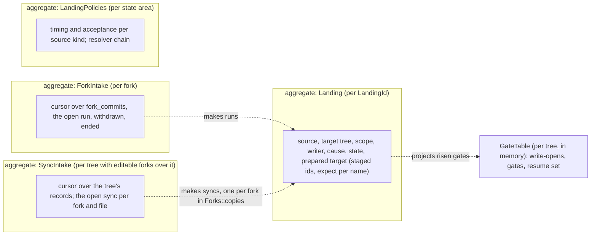

# Domain: Landing

**Layer:** System › **Domain (Landing)** › Feature.
**Status:** draft 4, proposed, against [system.md](../system.md) revision 6, which binds this page. It describes the target, not today's code. Sketches are Rust, surfaces only.
**Binding from the system:** §3.2 (`Gated`), §3.3 `Landing` and `Resolver`, §3.4 events, §3.5 (the landing process), §3.6 (whole commits in order), §3.7 (the resolver chain), I1, I3, I4, I6, I9, I10, I12, I16.
**What you are asked:** nothing new here. System Q1 (does a held commit hold back other forks' landings of the same file) and Q2 (an abandoned transaction's history) touch Landing; this page builds their recommendations until you answer.

## 1. What Landing owns, its language, and what it is not

Landing is the one home of the landing process, both ways: a fork's commits into main, main's changes into a fork's copies, and every other source. Content from elsewhere enters a tree only here, whole, under a gate over only its files, as one record.

**Your words this domain rests on.** Everything else here is a design choice.

| # | Your words | Date | What it asks of Landing |
|---|---|---|---|
| R4 | "the sandbox fs edits need to land back in the main container, and then future sandboxes should start from the edited files" | 2026-11-01 | fork commits land in main's live tree |
| R9 | "Whole seems best, right? A partial application has unknown side effects" | 2026-10-16 | one landing is whole or absent, never split |
| R10 | "agentfs should support merging live" | 2026-10-28 | landings run while clients are attached |
| R13 | "A cooperating integration can define batches/transactions across files, and they must all land together. But a default usage, like the CNI provides, can operate per-file." | 2026-11-02 | a fork commit is one save or one sealed transaction |
| R14, R15 | "Not A, because that assumes that a clean merge is an acceptable merge" (2026-10-16); "Configurable with a sensible default" (2026-10-29); both quoted in agentfs `docs/design.md` §12 | 2026-10-16/29 | acceptance (§7) |
| R17, R18 | "making the fork design so rock-solid that it is almost as effective, by syncing forks quickly and efficiently to minimize conflict drift"; "both clients would see the others changes" | 2026-11-02 | syncs: main's changes merged into a fork's own copies promptly |
| A8 | "Should the per-fork landing stop at whatever commit cant merge? and so every commit in the fork downstream of a conflict is just left for future resolution? This does assume that a *commit* is landed altogether, not just a file." (your question, accepted) | 2026-11-02 | runs of whole commits, in order, stopping at the first that cannot merge |
| A9 | "freezing only the files that a landing touches sounds reasonable. and hopefully our new per-client + view system makes locking/freezing files easier" | 2026-11-02 | a gate covers only its landing's files, in its one tree; views enforce it |
| A10 | "i wish conflict resolution was magically solved and perfect" | 2026-11-02 | the resolver chain before anything is held (a wish) |
| A3 | sandbox saves land live; integrator patches stay "whenDetached" until you open them | answer | timing, per source kind |
| — | "It's all event driven" | 2026-10-24 | every wait names its event; no timer here |

| Term | Meaning here | Is not | Could be the existing term |
|---|---|---|---|
| **target tree** | the tree a landing writes: main's for a run or a commit, a fork's for a sync | the source | backing tree |
| **run** | a fork's unlanded commits, oldest first; it lands the longest prefix that merges and is admitted | a batch of files | system term |
| **sync** | a landing of a parent tree's change to p into a fork's own copy of p; one open per fork and file, a newer record joins it | a run backwards: it never flows back | system term |
| **prepare** | merge outside any gate and stage the result durably, with what each merge read (`expect`) | writing the tree | settle |
| **resolver chain** | the ordered resolvers a merge tries before it is held (§5) | one merge program | system term |
| **admission** | whether writers or the landing go first: `ClientsFirst` (runs, syncs, commits, reconcile) or `LandingFirst` (restore, revert) | timing | settle |
| **write-open**, **gate** | one client's open-for-writing of one path; the freeze on exactly the files one landing writes, in its one tree (`Closing`, then `Risen`) | a lock held across calls | write-open mark; settle |
| **verify** | under the risen gate, check tracked is still what the merge read; if not, the one re-merge | a retry loop | per-path expect check |
| **trim** | removing a fork copy and its base once it equals its parent's and is closed; no record | a landing state | none |
| **Deferred** | a sync whose merge conflicts while the fork has an unlanded commit of p, which meets the conflict when it lands; with none, the sync is `Held` | `Held` | system term |
| **intake** | Landing's cursor, and hold, over one stream: a fork's commits (runs) or a parent's records (syncs) | a copy of the stream | none |

**Not this domain:** durability, order, transactions and fork commit bounds (Journal); bytes, staging and renames (Trees); path bases, copies, fork space (Forks); commits, lines, the history setting and "applied?" (History); attachment and actors (Clients); what a view shows under a gate (Views); a path's group and merge rule (Rules); alarms (Telemetry).

## 2. Model



The four aggregates are persisted, each its own consistency boundary. Each intake holds its stream at its cursor: a fork intake's stays at its oldest unlanded commit; a sync intake's passes a record as soon as the syncs it makes are saved with their frozen parent copy, never waiting for them to land, so main's stream never waits on a sandbox (I6, I11). `GateTable` is not persisted: write-opens are the view hosts' facts, re-collected by `resume`; risen gates project the `Writing` landings. A fork has at most one open run (`Waiting` or `Held`); its newer commits join that run.

**The state machine is system §3.5's.** This page draws the phases inside `Writing` and the trim after `Landed`, which nobody outside sees.

```mermaid
stateDiagram-v2
  [*] --> Waiting: made or submitted, then prepared outside any gate
  Waiting --> Waiting: a run takes the fork's newer commits, a sync the parent's newer record; re-prepared
  Waiting --> Writing: policy met, no write-opens on its files, nothing overlapping ahead: gate rises in the same step
  Waiting --> Held: the chain leaves a conflict (any other source, or a sync with no such commit), or no space
  Waiting --> Deferred: a sync's conflict, while the fork has an unlanded commit of p
  Deferred --> Waiting: the parent's newer record of p, or the fork's commit of p lands
  Deferred --> Withdrawn: the fork ends
  Held --> Waiting: the fork's next commit, resolve, or retry after no space
  Waiting --> Refused: not permitted, content not in history, too large
  Waiting --> Withdrawn
  Held --> Withdrawn
  state Writing {
    [*] --> Verifying
    Verifying --> Renaming: tracked unchanged, or the one re-merge is clean and staged
    Renaming --> MovingBases: Trees::replace returned (a space failure stalls here until retry)
    MovingBases --> Recording: Forks::move_bases returned (runs and syncs; others pass through)
    Recording --> [*]: Journal::append_landing returned its Seq
  }
  Writing --> Held: from Verifying only, the re-merge conflicts (nothing renamed)
  Writing --> Deferred: a sync, from Verifying only
  Writing --> Landed
  state Landed {
    [*] --> TrimPending: runs and syncs
    TrimPending --> [*]: trimmed, or the copy no longer equals its parent's
  }
  Landed --> [*]
```

`TrimPending` waits for the fork's last `released` of that path; then one gate over it in the fork covers `Trees::trim` and `move_bases(Trimmed)`, so a base goes only with its copy. After a run, the fork's copy equals main's when the merge kept the fork's content; after a sync, when the fork had not changed its copy since its base.

**A run** prepares each commit in order: each file merges the fork's base at that commit's position (`Forks::base(f, p, at)`), the target's tracked content, and the fork's content there. The first commit the chain cannot merge is `Held{Conflict{at}}`; the commits before it land now as the run, the rest wait behind it (A8). A commit only the agent resolver merged lands as its own run, named for the agent; its cause still names the fork run, so the sandbox's writer stays in the trailer (R5). At the fork's next commit, the held commit and the new one are merged as one change (base: the held commit's; content: the newest), so the sandbox can fix a conflict by saving again.

**A sync** is made by a `SyncIntake` for each record of its tree, for each fork in `Forks::copies(tree, p)`, unless the fork's copy already equals the parent's. If that fork already has an open sync of p (`Waiting` or `Deferred`), the record joins it: `from` moves on and it is re-prepared, so a stale sync never lands. The intake freezes the record's content of p; the merge uses that frozen copy as theirs, and `move_bases(Synced)` hands it to Forks, so the base never names a record that commit grouping or truncation removes (I11). It waits only for the fork's write-opens of p, gates only p in the fork, and appends one record in the fork's stream named for the parent record's writer. The Journal never counts it as a fork commit, so it never flows back.

**What "ahead" means.** A landing waits behind every earlier landing into the same tree whose scope overlaps and which is `Waiting` or `Writing`; a run behind its fork's earlier run; and a run, sync or trim behind an earlier one that moves the same fork's base of the same path, whichever tree each lands in, then prepares on the base it left. Another fork's `Held` run is not ahead (system Q1's recommendation, built until you answer; "yes" would add `Held` runs of other forks to this rule and nothing else).

## 3. Public contract

The trait is system §3.3's (revision 6); this page defines the types it names. `SourceId` and `Writer` live in `model`; `Resolver` and `Resolution` are system §3.3's.

```rust
// ── Commands and queries (system §3.3, binding) ─────────────────
pub trait Landing {
    fn set_policy(&mut self, k: SourceKind, t: Timing, a: Acceptance, by: &ActorCap) -> Result<(), LandingError>; // Operator; Sync, Reconcile fixed
    fn submit(&mut self, s: Source, by: &ActorCap) -> Result<LandingId, LandingError>; // Commit: Integrator; Restore, Revert: Operator
    fn approve(&mut self, id: LandingId, by: &ActorCap) -> Result<(), LandingError>;   // Approver, under Approval
    fn apply(&mut self, id: LandingId, by: &ActorCap) -> Result<LandingState, LandingError>; // OnApply's trigger
    fn retry(&mut self, id: LandingId, by: &ActorCap) -> Result<LandingState, LandingError>; // Held{NoSpace}, or a stalled Writing
    fn resolve(&mut self, id: LandingId, with: CommitId, by: &ActorCap) -> Result<LandingState, LandingError>; // a Held run's held commit
    fn withdraw(&mut self, id: LandingId, by: &ActorCap) -> Result<(), LandingError>; // a run: rejects it and every later commit
    fn state(&self, id: LandingId) -> LandingState;
    fn in_motion(&self) -> Vec<LandingId>;   // finishes with nobody acting: Waiting on writers, ahead or Resume; Writing
    // the view host's side, over its session: the session supplies the client and its own tree
    fn open_for_writing(&self, p: &RelPath) -> Result<WriteOpen, LandingError>; // never blocks
    fn released(&self, m: WriteMark);
    fn resume(&self, open: Vec<RelPath>);
    fn gates(&self) -> GateReader;
}
// ── Types this page defines ──────────────────────────────────────
pub enum SourceKind { Fork, Sync, Commit, Restore, Revert, Reconcile } // Source::kind(), one exhaustive match
pub enum LandingState {
    Waiting { on: WaitingOn },
    Held { why: HeldWhy },
    Deferred { report: ConflictReport },    // syncs only; re-tried at the parent's newer record
    Writing { stalled: Option<IoKind> },    // its gate is risen; recovery rolls it forward
    Landed { at: Position },                // the one record's position in the target tree
    Withdrawn { by: ActorId },
    Refused { why: RefusedWhy },
}
pub enum WaitingOn {                        // every variant is an event; there is no time variant
    Policy(PolicyWait),                     // LastDetached | Apply | Approval
    Writers { paths: PathSet, clients: ClientSet }, // ends at the last `released` in scope
    Landing { id: LandingId },              // an overlapping landing ahead, or the fork's earlier run
    Resume { clients: ClientSet },          // ends when each has resumed or ended (I12)
}
pub enum HeldWhy {
    Conflict { at: Seq, report: ConflictReport }, // the fork commit (or the source) no resolver merged
    NoSpace,                                // staging failed; ends at retry
}
pub enum RefusedWhy {
    NotPermitted,                           // the actor lacks the role; Rules refuses a path
    ContentNotInHistory { paths: PathSet }, // restore or revert over an unrecorded change
    TooLarge { paths: usize },              // over the largest scope (§7)
}
pub enum LandingError { NotPermitted, Unknown, ContentUnknown, NotHeld, Draining } // Draining: submit only
pub enum WriteOpen {
    Marked(WriteMark),                      // write; call released at the kernel's last reference
    Frozen(GateView),                       // a gate covers p in t: the view waits on GateReader::fell, then asks again
}
pub struct WriteMark { client: ClientId, tree: TreeRef, path: RelPath, n: u64 } // move-only
pub struct GateView { landing: LandingId, mode: GateMode, group: bool }
pub enum GateMode { Closing, Risen }
pub struct LandingChanged { id: LandingId, source: SourceId, state: LandingState } // a run's `through` is final at Writing
pub struct ForkLandingsClosed { fork: ForkId }
/// System §3.2. Private fields; only Landing's `GateMinter` builds one, borrowing the gate's token,
/// so it cannot outlive its gate or name another tree or file.
pub struct Gated<'g> { tree: TreeRef, scope: Scope, landing: LandingId, token: &'g GateToken }
```

| Direction | Party | Through |
|---|---|---|
| calls | Trees | `resolve`, `freeze`, `stage`, `replace(&Gated, Targets)`, `trim(&Gated, ...)`, `discard` |
| calls | Journal | `fork_commits` (runs); `tail` of fork and parent streams; `hold` per intake (§2); `append_landing(&Gated, ...)` |
| calls | Forks | `base(f, p, at)`; `copies(tree, p)`; `lineage`; `move_bases(&Gated, id, from, moves)` |
| calls | History | `tracked`, `content_at` (a run's base), `content`/`checkout` (commit, restore, revert, `resolve`'s commit), `applied` |
| calls | Clients, Rules | `attached(t)` at boot and at `ForkEnded`; `group(p)`; `merge(p)`, the merge rule that picks resolvers |
| calls | Resolver port | each resolver of the chain, in order (§5) |
| consumes | `Recorded` (fork streams: runs; parent streams: syncs), `Attached`, `AttachmentEnded`, `LastDetached`, `ForkEnded`, `VolumeDraining`, `VolumeStaged` | intakes; a dead client's write-opens and its reconcile; `WhenDetached`; the drain; `submit` refused while draining |
| publishes | `LandingChanged`, `ForkLandingsClosed` | Volume, Telemetry, the integrator notice edge; Forks |

## 4. Invariants and how each is enforced

| # | Invariant | Enforced by | Strength |
|---|---|---|---|
| L1 | Only a risen gate renames, trims, moves a base or appends a landing record, only over its own files in its one tree (I1, A9) | `Gated` built only by Landing's `GateMinter`, borrowing its token | construction + build time |
| L2 | No write-open slips in between "no write-opens on its files" and the rise | one `GateTable` owner per tree answers `open_for_writing` and rises in one method | construction |
| L3 | `Writing` starts only with every target staged durably; one landing is one `replace` and one record (I3) | `Prepared` is built only from `Staged` values Trees mints after sync | construction |
| L4 | The record takes its `Seq` after the renames and base moves, inside the gate | typestate `Renaming → MovingBases → Recording` | compile time |
| L5 | Nothing leaves `Writing` for `Held` or `Deferred` once a name is renamed | only `Verifying` has those transitions | compile time |
| L6 | A fork path's merge base is `Forks::base` at that position, never git's (I4) | the fork merge input's base is `BaseContent`, a Forks type | compile time |
| L7 | Admission comes from the source kind, never a caller | `Source::kind()` → `Admission`, one total match | compile time |
| L8 | A run lands whole fork commits, oldest first, and nothing past the first one that cannot merge (A8); a sync never becomes a fork commit | the run is built from `fork_commits` as a prefix; the Journal judges commit bounds | construction + test |
| L9 | At most one open run per fork and one open sync per fork and file; each lands at most once | the intakes hold the open run and syncs; submits idempotent on `SourceId`; recovery asks `History::applied` | construction + test |
| L10 | After a restart no gate rises on a tree until each of its attachments resumed or ended (I12); a `Writing` gate is restored | admission needs the tree's `ResumeComplete` token, built from `Clients::attached` | construction + test |
| L11 | Every wait names its event (I10) | `WaitingOn` has no time variant; no clock-driven call in the crate | compile + build time |
| L12 | A record's writer is the source's: the fork's writer for a run, the parent record's for a sync, the actor for a commit, restore, revert or `resolve`, the agent for what only it merged | `LandingRecord` is built only from the source, its records and the resolution | construction |
| L13 | Every row is audited (I13); a state change and its `LandingChanged` commit together | `store` stamps; `Outbox<E>` in one unit of work | construction |
| L14 | A base is removed only in the step that removes its copy | `BaseMove::Trimmed` is built only by the trim step | construction |
| L15 | After `withdraw` of a run, nothing more of that fork lands in its parent (main never reaches a rejected commit) | `ForkIntake.withdrawn` stops making runs; it never reopens | construction + test |

## 5. Ports and adapters

The Landing crate does no I/O. It owns these ports; the domains it commands are reached through their system contracts.

```rust
pub trait LandingRepository {               // aggregate: Landing
    fn get(&self, id: LandingId) -> Result<Option<Audited<LandingAgg>>, StoreError>;
    fn by_source(&self, s: &SourceId) -> Result<Option<LandingId>, StoreError>;
    fn open(&self) -> Result<Vec<LandingAgg>, StoreError>;          // non-terminal, for boot
    fn save(&self, uow: &mut UnitOfWork, l: &LandingAgg, by: Principal) -> Result<(), StoreError>;
}
pub trait IntakeRepository {                // aggregates: ForkIntake, SyncIntake
    fn fork(&self, f: ForkId) -> Result<Option<Audited<ForkIntake>>, StoreError>;
    fn tree(&self, t: TreeRef) -> Result<Option<Audited<SyncIntake>>, StoreError>;
    fn save(&self, uow: &mut UnitOfWork, i: &Intake, by: Principal) -> Result<(), StoreError>;
}
pub trait PolicyRepository {                // aggregate: LandingPolicies
    fn load(&self) -> Result<Audited<LandingPolicies>, StoreError>;
    fn save(&self, uow: &mut UnitOfWork, p: &LandingPolicies, by: Principal) -> Result<(), StoreError>;
}
// Resolver (system §3.3) is the fourth port: one adapter per resolver, tried in the policy's order
```

| Port | Adapter | Notes |
|---|---|---|
| repositories, `Outbox`, `UnitOfWork` | `store` | stamps created and changed, when and by which `Principal` (I13); prunes a terminal landing once `Committed` covers it (I14); its rows are a format of the family (I16) |
| `Resolver`: `Exact`, `Lines` | `gitx` | `Lines` is git's file merge, with the operator's merge drivers |
| `Resolver`: `Structure`, `Agent` | `merge` | mergiraf for `Structured` paths; the agent resolver sees only one file's three versions; its `Writer` comes from its own `ActorCap` (`MergedBy`) |
| the integrator notice | an edge adapter on `LandingChanged` | inbox numbers and webhooks stay at that edge |

**The merge decision is pure** and runs before the chain:

| ours (target) vs base | theirs vs base | Result |
|---|---|---|
| equal | any | theirs |
| any | equal | nothing to change |
| ours equals theirs | | nothing to change |
| differs | differs | the chain: `Exact`, `Lines`, `Structure`, `Agent` (if on), each only where `Rules::merge(p)` suits it: whitespace-only edits only for `Text{Insignificant}`, `Structure` only for `Structured`. None merged: `Held`, or `Deferred` for a sync |

A run whose every path is "nothing to change" still appends its one record (I3), so main's line reaches those commits. A sync with nothing to change is never made.

## 6. Internal flows and scenarios

**A fork's run lands in main** (system §5's flow, Landing's part).

```mermaid
sequenceDiagram
  participant J as Journal
  participant L as Landing
  participant F as Forks
  participant H as History
  participant T as Trees
  participant M as main's view host
  J--)L: Recorded(F, 8): fork_commits(F) after the cursor: F7 (p), F8 (q)
  L->>L: one unit of work: ForkIntake(F) to 8, the open run takes F7..F8, hold moves to 8
  L->>F: base(F, p, 7), base(F, q, 8)
  L->>H: tracked(main, p and q) at main position 40
  L->>T: resolve each in order and stage. Clean: Waiting(Writers: p by main)
  M->>L: released(p): the GateTable rises a gate over p and q in main, nothing else: Writing
  L->>H: verify: tracked still at 40? else one re-merge under the gate
  L->>T: replace(&gated, targets with expect)
  L->>F: move_bases(&gated, id, [p: Kept at F:7, q: Kept at F:8])
  L->>J: append_landing: ONE record, writer sandbox-1, cause Landing(ForkRun F through 8): main seq 42
  L--)L: LandingChanged(Landed at 42), the gate falls
  Note over L: main's record 42 makes no sync into F where F's copy equals it; those copies go to TrimPending
```

**A sync lands in a fork** (system §5's sync flow). `SyncIntake(main)` reads record 50 (s, writer main-1), freezes its s and passes 50; `copies(main, s)` names F; the chain merges F's base, F's s and the frozen s; clean: `Waiting(Writers: s in F)`, then a gate over s in F only, `replace`, `move_bases([s: Synced(frozen)])`, one record in F's stream (writer main-1, cause `Landing(Sync)`). If main records s again at 51 first, 51 joins the sync. On conflict: `Deferred` while F has an unlanded commit of s, which is held when it lands; otherwise `Held`.

**A transaction** is one fork commit: the run takes it whole, its gate covers its scope, a conflict holds it whole.

**Out of `Held`.** The fork's next commit re-judges the run (§2). `resolve(id, c)`: the held commit lands with commit c's content for its files, named for the actor; the commits after it are re-judged. `retry`: after no space. `withdraw`: the run ends `Withdrawn`, `ForkIntake` is marked withdrawn and makes no more runs (a design choice, system §3.6); the commits stay on F's line (A4). Syncs into F continue while F lives.

**A fork ends.** On `ForkEnded`, Landing asks `Clients::attached(Fork F)`; once empty, it turns every commit up to the stream's end into the run, makes no new sync into F (a waiting one lands, a deferred one is withdrawn), releases its holds, and publishes `ForkLandingsClosed{F}` once no landing of F is open (a held run stays open until withdrawn or resolved).

**Reconcile.** On `AttachmentEnded{c}`, Landing drops c's write-opens and, if any, makes `Reconcile{tree, c, scope}`: the frozen paths that differ from `tracked`, as one record, writer `Agentfs`. In a fork it is not a fork commit, so it stays on the fork's line.

**A restore or revert** (`LandingFirst`): the gate goes `Closing` once the policy is met, so new write-opens get `Frozen`; at the last release it is `Risen`.

**Recovery.** Load open landings, intakes and policies; relay unsent outbox rows. Each `Writing` landing restores its gate and rolls forward (re-verify, idempotent `replace`, `move_bases` idempotent on id, `applied?` then `append_landing` idempotent on `LandingId`). Every other tree gets `Waiting(Resume)` from `Clients::attached`; each intake re-reads its stream after its cursor. After `ServiceReady`, `resume` or `AttachmentEnded` per client clears a tree for admission.

| Scenario | Landing's behaviour | Cost or gap |
|---|---|---|
| Main holds p open; F's run has p then q | the run waits: the longest admitted prefix is empty; main's readers never wait under `PerFile` | a file never closed starves its run and every later commit of F (system cost 5) |
| Main writes p between prepare and rise | verify, one re-merge under the gate; a conflict holds the commit | main's write-opens of p wait one merge |
| F7 conflicts; F8 touches another file | F7 `Held`; F8 waits (A8); F9, a resave of p, re-judges F7 with it | an unrelated file waits behind the conflict |
| Main changes s twice while F edits s | one sync, the second record joined; it merges into F's s, or ends `Deferred`; F's later commit merges against the moved base | each main change of a held file costs every fork with a copy one merge |
| F's run of p lands while a sync of p into F waits | the later one waits for the earlier, then prepares on the base it left: F's own save never vanishes from its view | one more wait |
| An abandoned transaction left p in F; main changes p, conflicting | no unlanded commit carries it, so the sync is `Held`; `LandingChanged` reaches the integrator edge and the alarm | the sandbox is not told (system cost 9) |
| G lands p while F's p is held | G lands (Q1's recommendation); its record syncs into F, `Deferred` | F's conflict changes shape |
| Only the agent resolver merges F8 | F7 lands; F8 lands alone, named for the agent, revertible; F9 on continue | one more commit |
| 1,000 sandboxes | one `ForkIntake`, at most one open run each; syncs only into forks holding a copy | hot files land one run at once |
| Disk full | staging: `Held{NoSpace}`; a rename: `Writing` stalled, gate up; each until `retry` | the stalled gate freezes its files |
| Crash; upgrade | before `Writing`: still `Waiting`; in `Writing`: rolled forward; after the record: the outbox relays. A minor or major drains first (system §8) | every fork lands or is withdrawn first |

## 7. Policies and configuration

| Setting | Values | Current setting | Set by |
|---|---|---|---|
| Timing, per source kind | `Continuous` · `WhenDetached` · `OnApply` | runs `Continuous`; commit `WhenDetached` (A3); restore and revert `Continuous` (design choice: the submit is the operator's act); syncs, reconcile fixed `Continuous` | operator, `set_policy` |
| Acceptance, per source kind | `CleanMerge` · `Approval` (R14, R15) | `CleanMerge` for every kind (design choice); syncs fixed `CleanMerge`; under `Approval` a resolved merge still waits | operator, `set_policy` |
| Resolver chain | `Exact` · `Lines` · `Structure` · `Agent`, in order, each where `Rules::merge(p)` suits it | the first three on, `Agent` off (design choice; A10 is a wish) | operator, per state area |
| Admission | `ClientsFirst` · `LandingFirst` | runs, syncs, commits, reconcile `ClientsFirst`; restore, revert `LandingFirst` | fixed in code |
| Unit | a fork commit: one save (or database group), or one sealed transaction | per-file unless the program declares a transaction (R13) | the program, through its recorder |
| Largest scope | paths per landing | 4,096 (today's limit; placeholder); a run stops its prefix there | operator, per state area |

No timer exists here: admission runs on `Recorded`, `released`, `LastDetached`, `apply`, `approve`, `retry`, `resolve`, `resume`, `AttachmentEnded` and a landing ahead's `LandingChanged`.

## 8. Tests that prove it

All run through the `Landing` contract on real adapters and a real filesystem.

| Test | Proves | Failure class ruled out |
|---|---|---|
| compile-fail: build `Gated` outside the crate; keep it past its gate; go `Renaming → Held`; append before `replace` | L1, L4, L5 | a rename or record outside a gate; a half-renamed landing held |
| race harness: many threads `open_for_writing` p while a gate on p rises; none blocks | L2, A9 | a write into a file being replaced; a blocked open |
| crash harness: kill at each failpoint (staged, rename k of n, base move, append, relay, trim); restart | L3, L5, L13, I3 | a landing split, doubled or lost; an event never sent |
| F saves p, q, r; p conflicts; then F resaves p; then `resolve`; then `withdraw` on a new conflict | L8, L15, A8 | a commit landed past a conflict; main reaching a rejected commit |
| main saves s that F holds twice in one commit window, then truncates; F then commits s; F's run of p races a sync of p | syncs, I11 | a base naming a removed record; a stale sync; a lost save |
| a gate on p in main while main writes r, and a sync gate on s in F while F writes t | A9 | a freeze wider than its files |
| a chain where only `Structure`, then only `Agent`, merges; a YAML re-indent | §5, L12 | an agent merge under the sandbox's name; indentation merged as whitespace |
| end to end: the system tracer bullet (1), (2) | R4, R18 | lost or doubled saves; main's readers blocked |
| a three-file transaction, one conflicting; one file held open; restart mid-way | R13 | a partial transaction in main |
| restart with a landing `Waiting` and a client holding p | L10, I12 | a landing over a lost write |
| `submit(Commit)` twice, across a restart and truncation | L9 | a patch landed twice |
| `WhenDetached` with one sandbox attached, then `LastDetached` | policy | a patch landing under an attached client |
| merge decision table, property tests | §5 | a merge ignoring the base |
| no space in staging, then in a rename; `retry` | disk full | a stalled gate with no exit |
| kill a sandbox's view host with p open and written | reconcile, drain | unclosed content lost from the fork's line, or landed in main |
| a trim while the sandbox reopens p; a crash between trim and base removal | L14 | a fork path with no base, or a base with no copy |

## 9. Costs

1. **The write-open table is memory only.** It comes back through `resume`; until every attachment of a tree resumes or ends, nothing lands in that tree.
2. **Staged targets take space while `Waiting`:** a sync's merge and frozen parent copy count against the fork's quota, at most one open sync per file; a held run keeps its fork's hold.
3. **One conflict stops its fork** (A8): the fork's later commits of any file wait; `withdraw` ends its landings for good.
4. **Syncs cost per fork copy:** one merge, rename and record per main change of a file a fork holds; a `Deferred` sync repeats at each main change until the fork's commit is resolved.
5. **Today's rebase mode and barrier patches go** (below). Several files land together as one commit (an integrator) or one transaction (a sandbox program).

## 10. Escalations to the system document

None open: E1–E8 were adopted in revision 4, E9 (`Writing --> Deferred`) and E10 (`MergedBy(_, Writer)`) in revision 6.

## For the code architects (parked)
How a run finds its clean, admitted prefix cheaply; how the intake takes a frozen copy from a record's payload; whether a sync whose result equals the fork's copy moves only the base; the `GateTable` owner and `GateReader` layout; a write-open's mark racing a rising gate; content equality; outbox dedup key; batching `resume`; the agent resolver's limits (R7).

## Reconcile with existing code (agentfs origin/main b5c0dc8)
- **The patch queue** (`docs/design.md` §12) becomes commit sources; inbox numbers, held refs and hooks move to the integration edge; the accept hook becomes acceptance; rebase mode and barriers go.
- **"Only with nothing attached"** becomes `WhenDetached`, judged from `LastDetached`. **The restore engine's in-place write** (§15) becomes prepare plus `replace`; the `in_flight` put-back goes (cost: new inodes).
- **The `unrecorded` stop** becomes write-opens plus verify; **the duplicate scan** `History::applied`; git's merge the `Lines` resolver, the image's mergiraf driver `Structure`. Syncs and runs are new.

**NOT RUN:** no code built or tested; mergiraf and git's merge drivers not run; typestate claims reasoned, not compiled.

*History: draft 1, from system revision 3; draft 2, revision 4; draft 3, revision 5 (runs, syncs, resolvers, local freezes); draft 4, revision 6 (one open sync per file, frozen sync bases, path-base order, `Rules::merge`).*
