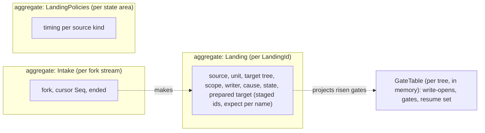
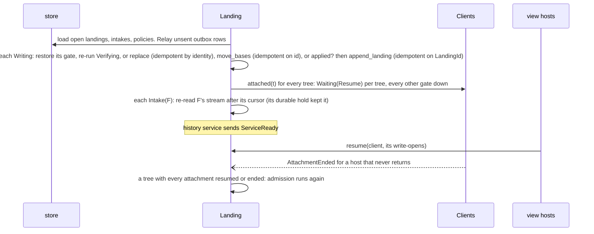

# Domain: Landing

**Layer:** System › **Domain (Landing)** › Feature.
**Status:** draft 2, proposed, against [system.md](../system.md) revision 4 (revision 3 approved 2026-11-02), which binds this page. It describes the target, not today's code. Sketches are Rust and show surfaces only.
**Binding from the system:** §3.2 (`Gated`), §3.3 `Landing`, §3.4 events, §3.5 (the landing process), §3.6 (what lands together), I1, I3, I4, I6, I9, I10, I12. Its escalations (§10) are resolved in system revision 4.
**What you are asked:** two questions: QL1 in §2 (does a held file hold back other sandboxes' landings of it), QL2 in §7 (when a restore lands).

## 1. What Landing owns, its language, and what it is not

Landing is the one home of the landing process: content from elsewhere enters a tree only here, whole or not at all, under a gate, as one record. Every source runs one state machine; other domains see it only through `LandingChanged`.

**Your words this domain rests on.** Everything else here is a design choice.

| # | Your words | Date | What it asks of Landing |
|---|---|---|---|
| R4 | "the sandbox fs edits need to land back in the main container, and then future sandboxes should start from the edited files" | 2026-11-01 | fork saves become landings into main's live tree |
| R9 | "Whole seems best, right? A partial application has unknown side effects" | 2026-10-16 | one landing is whole or absent, never split |
| R10 | "agentfs should support merging live" | 2026-10-28 | landings run while clients are attached |
| R13 | "A cooperating integration can define batches/transactions across files, and they must all land together. But a default usage, like the CNI provides, can operate per-file." | 2026-11-02 | two units: a file, a sealed transaction |
| A3 | sandbox saves land live; integrator patches stay "whenDetached" until you open them | answer | the timing policy, per source kind |
| R14, R15 | "Not A, because that assumes that a clean merge is an acceptable merge" (2026-10-16); "Configurable with a sensible default" (2026-10-29); both quoted in agentfs `docs/design.md` §12 | 2026-10-16/29 | acceptance, a policy separate from timing (§7) |
| — | "It's all event driven" | 2026-10-24 | every wait names its event; no timer in this domain |

| Term | Meaning here | Is not | Could be the existing term |
|---|---|---|---|
| **target tree** | the tree a landing writes: main's, or a fork's (restore into a fork, a sibling later) | the source | backing tree |
| **prepare**, **prepared target** | merge outside any gate and stage the result durably in Trees' staging area, each file with what the merge read at its name (`expect`) | writing the tree | settle, plan |
| **admission** | whether writers or the landing go first: `ClientsFirst` (fork, commit, reconcile) or `LandingFirst` (restore, revert) | the timing policy | settle |
| **write-open** | one client's open-for-writing of one path, from `open_for_writing` to `released` | a lock | write-open mark |
| **gate** | a scope in one tree that admits no new write-open: `Closing` (writers still finishing, `LandingFirst` only) or `Risen` | a lock held across calls | settle |
| **verify** | under the risen gate, check main's tracked content is still what the merge read; if not, the one re-merge | a retry loop | today's per-path expect check |
| **trim** | removing a landed path's fork copy, and its base, when the copy still equals the save and is closed, under a gate on the fork, so the fork shows main again | a record | none |
| **reconcile** | a landing source made on `AttachmentEnded` from the ended client's write-opens: what it left unrecorded, recorded once by agentfs | a merge | today's reconcile |
| **intake** | Landing's cursor over one fork's stream: the last `Seq` it turned into sources | a copy of the stream | none |
| **verdict** | the landing's state, as `LandingChanged` reports it: waiting (on what), held (why), landed, refused | an alarm (Telemetry's) | patch verdict |

**Not this domain:** durability and order of records, and transaction state (Journal); file bytes and renames (Trees, which Landing commands); path bases and fork space (Forks); commits, lines, the history setting and "applied?" (History; R12 never reaches Landing: a landing is the same record under `FullLineage` and `Squashed`); attachment (Clients); what a view shows during a landing (Views, reading the gate table); merge rules per path (Rules); alarms (Telemetry).

## 2. Model



`Landing`, `Intake` and `LandingPolicies` are persisted, each its own consistency boundary. `GateTable` is not: write-opens are the view hosts' facts (their kernel handles), re-collected by `resume`, and risen gates project the `Writing` landings.

**The state machine is system §3.5's.** This page draws the phases inside `Writing` and the trim after `Landed`; neither is visible outside.

```mermaid
stateDiagram-v2
  [*] --> Waiting: source made or submitted, then prepared outside any gate
  Waiting --> Writing: policy met, no write-opens in scope, nothing overlapping ahead: gate rises in the same step
  Waiting --> Held: the merge conflicts, or staging found no space
  Waiting --> Superseded: a later save of the same file (file units only)
  Waiting --> Refused: not permitted, content not in history, too large
  Waiting --> Withdrawn
  Held --> Waiting: the source's next save joins it, or retry after no space
  Held --> Withdrawn
  state Writing {
    [*] --> Verifying
    Verifying --> Renaming: tracked unchanged, or the one re-merge is clean and staged
    Renaming --> MovingBases: Trees::replace returned (a space failure stalls here until retry)
    MovingBases --> Recording: Forks::move_bases returned (fork sources; others pass through)
    Recording --> [*]: Journal::append_landing returned its Seq
  }
  Writing --> Held: from Verifying only, tracked moved and the re-merge conflicts (nothing renamed)
  Writing --> Landed
  state Landed {
    [*] --> TrimPending: fork sources only
    TrimPending --> [*]: trimmed, or the fork copy changed (then nothing to trim)
  }
  Landed --> [*]
```

`TrimPending` waits on one event: the fork's last `released` of that path. The trim then raises a gate on the fork over that path and, in one step, calls `Trees::trim` and `Forks::move_bases(Trimmed)`: a base is removed only with its copy. A transaction is never `Superseded` (a sealed `TxnId` has no later version): a later save of one of its files joins it while it is `Held`, and waits behind it as a file unit while it is `Waiting` or `Writing` (system §3.5, after E8).

**What "ahead" means.** A landing waits behind every earlier landing into the same tree whose scope overlaps and which is `Waiting` or `Writing`. Per system §3.6, a `Held` transaction also counts as ahead; a `Held` file does not (QL1, §10 E3).

**QL1. Does a held file hold back other sandboxes' landings of that file?** Fork F's save of p conflicts and is held; fork G then saves p.
- **Recommended: no.** G's landing goes ahead; F's held landing is re-prepared against the new main at F's next save. Cost: F's conflict may change shape after G lands, so an integrator reviewing it sees a moving target.
- **Alternative: yes, as system §3.6 says for transactions.** Cost: one abandoned sandbox with a held conflict stops every later landing of that file until someone withdraws it (stress L16).

## 3. Public contract

The trait is system §3.3's (revision 4); this page defines the types it names. `SourceId` lives in `model` (system §3.1).

```rust
// ── Commands and queries (system §3.3, binding) ─────────────────
pub trait Landing {
    fn set_policy(&mut self, k: SourceKind, t: Timing, a: Acceptance, by: &ActorCap) -> Result<(), LandingError>; // Operator
    fn submit(&mut self, s: Source, by: &ActorCap) -> Result<LandingId, LandingError>; // Commit: Integrator; Restore, Revert: Operator
    fn approve(&mut self, id: LandingId, by: &ActorCap) -> Result<(), LandingError>; // Approver, under Acceptance::Approval
    fn apply(&mut self, id: LandingId, by: &ActorCap) -> Result<LandingState, LandingError>; // OnApply's trigger
    fn retry(&mut self, id: LandingId, by: &ActorCap) -> Result<LandingState, LandingError>; // Held{NoSpace}, or a stalled Writing
    fn withdraw(&mut self, id: LandingId, by: &ActorCap) -> Result<(), LandingError>; // a held fork landing's rejection
    fn state(&self, id: LandingId) -> LandingState;
    fn in_motion(&self) -> Vec<LandingId>;   // Waiting on writers, a landing ahead or Resume; Writing (Volume's release)
    fn open_for_writing(&self, t: TreeRef, p: &RelPath) -> Result<WriteMark, LandingError>; // over a session
    fn released(&self, m: WriteMark);
    fn resume(&self, open: Vec<(TreeRef, RelPath)>);
    fn gates(&self) -> GateReader;
}
// ── Types this page defines ──────────────────────────────────────
pub enum SourceKind { Fork, Commit, Restore, Revert, Reconcile } // Source::kind(), one exhaustive match
pub enum Timing { Continuous, WhenDetached, OnApply }
pub enum Acceptance { CleanMerge, Approval }
pub enum LandingState {
    Waiting { on: WaitingOn },
    Held { why: HeldWhy },
    Writing { stalled: Option<IoKind> },    // its gate is risen; recovery rolls it forward; stalled: a rename met no space
    Landed { at: Position },                // the one record's position in the target tree
    Superseded { by: LandingId },           // file units only
    Withdrawn { by: ActorId },
    Refused { why: RefusedWhy },
}
pub enum WaitingOn {                        // every variant is an event; there is no time variant
    Policy(PolicyWait),                     // LastDetached | Apply | Approval
    Writers { paths: PathSet, clients: ClientSet }, // ends at the last `released` in scope
    Landing { id: LandingId },              // ends at that landing's next LandingChanged
    Resume { clients: ClientSet },          // ends when each has resumed or ended (I12)
}
pub enum PolicyWait { LastDetached, Apply, Approval }
pub enum HeldWhy { Conflict { paths: PathSet }, NoSpace }   // NoSpace: staging failed; ends at retry
pub enum RefusedWhy {
    NotPermitted,                           // the actor lacks the role; Rules refuses a path
    ContentNotInHistory { paths: PathSet }, // restore or revert over an unrecorded change
    TooLarge { paths: usize },              // over the largest scope (§7)
}
pub enum LandingError { NotPermitted, Unknown, ContentUnknown, Draining } // Draining: after VolumeDraining, submit only
pub struct LandingChanged { id: LandingId, source: SourceId, state: LandingState } // system §3.4
pub struct ForkLandingsClosed { fork: ForkId }   // an ended fork has no landing open (system §3.4)
pub struct WriteMark { client: ClientId, tree: TreeRef, path: RelPath, n: u64 } // move-only; the client comes from the session
pub struct GateReader;                      // node-local, read-only view of the GateTable
impl GateReader {
    pub fn covers(&self, t: TreeRef, p: &RelPath) -> Option<GateView>;
    pub fn fell(&self, g: &GateView) -> GateFell; // completes when the gate falls: the wait's event
}
pub struct GateView { landing: LandingId, mode: GateMode, group: bool }
pub enum GateMode { Closing, Risen }        // Views: WholeLanding and group reads wait while Some
/// System §3.2. Defined in `contracts` with private fields; only `GateMinter::gated(&'g self, ...)`
/// builds one, and Landing holds the only GateMinter. It borrows the minter's per-gate token,
/// so it cannot outlive its gate or name another tree or scope.
pub struct Gated<'g> { tree: TreeRef, scope: Scope, landing: LandingId, token: &'g GateToken }
```

Roles are `ActorCap` data (system §3.2); the view host's calls carry no `ActorCap` and name no client: the session edge supplies the client.

| Direction | Party | Through |
|---|---|---|
| calls | Trees | `resolve`, `freeze`, `stage`, `replace(&Gated, Targets)`, `trim(&Gated, ...)`, `discard` |
| calls | Journal | `append_landing(&Gated, LandingRecord)`; `tail` of fork streams, and `hold(fork stream, intake, cursor)` moved forward with the cursor |
| calls | Forks | `base(f, p)` for every fork path; `lineage`; `move_bases(&Gated, id, moves)` inside `Writing` and at a trim |
| calls | History | `tracked(t, p)` (ours), `checkout`/`content` (commit, restore, revert), `applied(source)` |
| calls | Volume | nothing; Volume asks `in_motion` |
| calls | Clients, Rules | `attached(t)` at boot and at `ForkEnded`; `group(p)` and `record(p).merge` for the merge rule |
| consumes | `Recorded` (fork streams), `Attached`, `AttachmentEnded`, `LastDetached`, `ForkEnded`, `VolumeDraining`, `VolumeStaged` | intake; a dead client's write-opens and its reconcile; `WhenDetached`; the intake's drain; `submit` refused while draining |
| publishes | `LandingChanged`, `ForkLandingsClosed` | Volume (release), Telemetry, the integrator notice edge; Forks (an ended fork's drop) |

## 4. Invariants and how each is enforced

| # | Invariant | Enforced by | Strength |
|---|---|---|---|
| L1 | Only a risen gate renames into a tree, trims a fork, moves a base or appends a landing record, and only inside its scope (I1) | `Gated` has private fields, is built only through Landing's `GateMinter` and borrows its gate's token; Trees, Forks and Journal take `&Gated` | construction time + build time |
| L2 | No write-open slips in between "no write-opens in scope" and the rise | one `GateTable` owner per tree serializes `open_for_writing`, `released` and the rise; the check and the rise are one method | construction |
| L3 | `Writing` starts only with every target staged durably; one landing is one `replace` and one record (I3) | `Prepared` is built only from `Staged` values, which Trees mints after sync; the `Writing` typestate holds exactly one | construction |
| L4 | The record takes its `Seq` after the renames and the base moves, inside the gate | typestate `Renaming → MovingBases → Recording`: each step needs the proof the previous one returns (inside the Landing crate) | compile time |
| L5 | Nothing returns to `Held` once a name is renamed; recovery only rolls `Writing` forward | `Held` is reachable only from `Verifying`; `Renaming` has no such transition | compile time |
| L6 | A fork path's merge base is `Forks::base`, never git's merge base (I4) | the fork merge input's base field is `BaseContent`, a Forks type; commit sources take a `CommitId` base | compile time |
| L7 | Admission comes from the source kind, never a caller (system §3.5) | `Source::kind()` → `Admission` is one total match; no method takes an admission | compile time |
| L8 | A transaction lands all its files or none; a save inside an open transaction never becomes a file source | intake reads the save's `txn` stamp (Journal E1); the transaction unit is one `Prepared`, one gate | construction + test |
| L9 | At most one `Waiting` file landing per (fork, file); a commit tip lands at most once | `Intake` supersedes by `SourceId`; `submit(Commit)` asks `History::applied` first | construction + test |
| L10 | After a restart no gate rises on a tree until each of its attachments resumed or ended (I12). A `Writing` landing's gate is restored, not risen | boot builds `Waiting{Resume}` from `Clients::attached`; admission needs the tree's `ResumeComplete` token | construction + test |
| L11 | Every wait names its event (I10) | `WaitingOn` has no time variant; the domain crate has no clock-driven call | compile time + build time |
| L12 | The landing record's writer is the source's: the fork save's writer, or the submitting actor | `LandingRecord` is built from the `Source` and its records only | construction |
| L13 | Every persisted row is audited (I13); every state change and its `LandingChanged` commit together | the `store` repositories stamp `Audited`; the `contracts` `Outbox<E>` in the same unit of work | construction |
| L14 | A base is removed only in the step that removes its fork copy | `BaseMove::Trimmed` is built only by the trim step, which also holds the `trim` call | construction |

## 5. Ports and adapters

The Landing crate does no I/O. It owns these ports; the domains it commands are reached through their system contracts.

```rust
pub trait LandingRepository {               // aggregate: Landing
    fn get(&self, id: LandingId) -> Result<Option<Audited<LandingAgg>>, StoreError>;
    fn by_source(&self, s: &SourceId) -> Result<Option<LandingId>, StoreError>;
    fn open(&self) -> Result<Vec<LandingAgg>, StoreError>;          // non-terminal, for boot
    fn save(&self, uow: &mut UnitOfWork, l: &LandingAgg, by: Principal) -> Result<(), StoreError>;
}
pub trait IntakeRepository {                // aggregate: Intake
    fn get(&self, f: ForkId) -> Result<Option<Audited<Intake>>, StoreError>;
    fn save(&self, uow: &mut UnitOfWork, i: &Intake, by: Principal) -> Result<(), StoreError>;
}
pub trait PolicyRepository {                // aggregate: LandingPolicies
    fn load(&self) -> Result<Audited<LandingPolicies>, StoreError>;
    fn save(&self, uow: &mut UnitOfWork, p: &LandingPolicies, by: Principal) -> Result<(), StoreError>;
}
// Outbox<E> and UnitOfWork are the one store port shape in `contracts` (system §6); events relayed after commit
pub trait MergeEngine {                     // three-way merge of one file or group, with Rules' merge rule
    fn merge(&self, m: MergeInput) -> Result<MergeOutcome, MergeError>;
}
pub enum MergeOutcome { Clean(Staged), Conflict }   // Staged: durable, from Trees' staging area
pub enum MergeError { RuleCannotRun(RelPath), NoSpace, Io(IoKind) }
```

| Port | Adapter | Notes |
|---|---|---|
| `LandingRepository`, `IntakeRepository`, `PolicyRepository`, `Outbox`, `UnitOfWork` | `store` | one query-builder layer stamps created and changed, when and by which `Principal` (I13); a terminal landing is pruned once `Committed` covers its record (I14) |
| `MergeEngine` | `gitx`: the git program | libgit2 cannot run merge drivers (agentfs `docs/design.md` §17.3), so the adapter runs git's file merge with the operator's drivers; a driver that cannot start is `RuleCannotRun`, never a conflict |
| the integrator notice | an edge adapter consuming `LandingChanged` | integration concepts (inbox numbers, webhooks) stay at that edge |

**The merge decision is pure** and lives in the domain; only the last row calls the engine.

| ours vs base | theirs vs base | Result |
|---|---|---|
| equal | any | theirs (main never changed it since the fork's base) |
| any | equal | nothing to change for this path |
| ours equals theirs | | nothing to change |
| differs | differs | `MergeEngine` with Rules' merge rule: `Clean` or `Conflict` |

A landing whose every path is "nothing to change" still appends its one record; History decides whether that makes a commit (system I3: one landing, one record).

## 6. Internal flows and scenarios

**A fork save lands into main** (system §5's flow, Landing's part).

```mermaid
sequenceDiagram
  participant J as Journal (stream F)
  participant L as Landing
  participant F as Forks
  participant H as History
  participant T as Trees
  participant M as main's view host
  J--)L: Recorded(F, 7, [p]): read record F:7 by tail, not in an open transaction
  L->>L: in one unit of work: Intake(F) to 7, source File(p through 7) supersedes a Waiting p of F; hold moves to 7
  L->>F: base(F, p)
  L->>H: tracked(Source, p): ours at main position 40
  L->>T: stage the merge result (decision table). Durable: Waiting(Writers: p by main)
  M->>L: released(p), the last write-open. The GateTable rises the gate in the same step: Writing
  L->>H: verify: tracked(Source, p) still at 40? if not, re-merge once and re-stage under the gate
  L->>T: replace(&gated, targets with expect)
  L->>F: move_bases(&gated, id, [p: Kept at F:7])
  L->>J: append_landing(&gated, record: writer sandbox-1, cause Landing(F through 7)): Seq 42
  L--)L: LandingChanged(Landed at 42), the gate falls
  L->>T: if F's copy still equals save 7 and is closed: gate on F over p, trim(&g, F, p), move_bases(&g, [p: Trimmed]); else TrimPending
```

**A transaction** takes the same path: intake makes no file source while its `Begin` is open; the `Seal` record makes one `Transaction` source; one prepare stages every file; one gate covers the whole scope, rising only when no file in it is open for writing and nothing overlapping is ahead; one `replace`, one record. Any conflict holds the whole transaction.

**A fork ends.** On `ForkEnded`, Landing asks `Clients::attached(Fork F)`; once it is empty (now, or at `LastDetached{F}`), nothing but Landing can append to F's stream. Landing turns every record up to the stream's end into sources, releases its hold, and publishes `ForkLandingsClosed{F}` once none of F's landings is open (held ones stay open until withdrawn).

**Reconcile.** On `AttachmentEnded{c}`, Landing drops c's write-opens and, if there were any, makes `Reconcile{tree, c, scope}` from them. It freezes each path, keeps those whose content differs from `History::tracked`, and lands them as one record (`ClientsFirst`, nothing to merge, writer `Agentfs`). Clients publishes `AttachmentEnded` before the `LastDetached` it causes, so a fork's reconcile record is in its stream before the drain. In a fork, intake never turns a `Writer::Agentfs` record into a source.

**A restore or revert** (`LandingFirst`): the gate goes to `Closing` as soon as the policy is met, so new write-opens wait; when the last existing one is released it becomes `Risen` and `Writing` follows. A writer that never closes leaves it `Waiting(Writers)`, withdrawable.

**Recovery** (system §5's flow, Landing's part).



| Scenario | Landing's behaviour | Cost or gap |
|---|---|---|
| Live landing, main holds p open for writing | `Waiting(Writers: p by main)`; main's readers never wait under `PerFile` | a file never closed starves its landings (system §7) |
| Main writes p between prepare and rise | verify sees tracked moved; one re-merge under the gate, where p cannot move again; conflict is `Held`, nothing renamed (stress L7) | the re-merge holds main's new write-opens of p for one merge, as slow as the merge driver (system I6) |
| Transaction, 400 files | one prepare, one gate, one replace, one record; readers under `PerFile` can see a subset mid-rename (system cost 3) | one open file anywhere in scope holds the whole transaction |
| 1,000 sandboxes | one `Intake` per fork; at most one waiting landing per (fork, file); the decision table's first row needs no engine when main has not touched p | 1,000 forks saving one hot file land one at a time, each re-merging |
| Integrator patch under `WhenDetached` | prepared at submit, outside any gate; waits for `LastDetached`, sandboxes included (A3) | with sandboxes always running it waits until you set `OnApply` |
| Crash at any step | before `Writing`: still `Waiting`, staged files kept; in `Writing`: rolled forward before `ServiceReady`; after the record, before the event: the outbox relays it | none known |
| Disk full | staging fails before any gate: `Held{NoSpace}`, and `retry` re-prepares it; a rename failing for space stalls `Writing` with its gate up until an operator's `retry` rolls it forward | the stalled gate blocks writers of that scope until someone acts (system I6) |
| Upgrade with clients attached | the restart path is the handover: `Writing` rolls forward on the new version; write-opens come back through `resume` | the persisted landing format follows system Q3, the one rule for every format |
| A sandbox's view host dies | `AttachmentEnded`: its write-opens drop, its unclosed writes are reconciled onto its fork's line, then the fork ends and its intake drains | content the sandbox never closed never lands in main |

## 7. Policies and configuration

| Setting | Values | Current setting | Set by |
|---|---|---|---|
| Timing, per source kind | `Continuous` · `WhenDetached` · `OnApply` | fork `Continuous`; commit `WhenDetached` (A3); restore and revert `Continuous` (QL2); reconcile `Continuous`, fixed | operator, `set_policy` |
| Acceptance, per source kind | `CleanMerge` · `Approval` (R14, R15) | `CleanMerge` for every kind (design choice) | operator, `set_policy` |
| Admission, per source kind | `ClientsFirst` · `LandingFirst` | fork, commit and reconcile `ClientsFirst`; restore and revert `LandingFirst` | fixed in code (system §7), not configurable |
| Unit | file (or database group) · sealed transaction | per-file unless the program declares a transaction (R13) | the program, through its recorder |
| Largest scope | paths per landing | 4,096 (today's limit; placeholder) | operator, per state area |

No timer exists in this domain: admission runs on `released`, `LastDetached`, `apply`, `approve`, `retry`, `resume`, `AttachmentEnded` and `LandingChanged` of the landing ahead.

**QL2. When does an operator's restore or revert land?**
- **Recommended: as soon as it is submitted (`Continuous`), going first (`LandingFirst`).** The submit is already the operator's act. Cost: a mistaken restore lands before anyone looks; undo is a revert.
- **Alternative: `OnApply`, so submit only shows the merge verdict and a second call lands it.** Cost: two steps for every restore, and a waiting restore can go stale.

## 8. Tests that prove it

All run through the `Landing` contract against the real `store`, `fs` and `gitx` adapters on a real filesystem; the end-to-end rows run real views.

| Test | Proves | Failure class ruled out |
|---|---|---|
| compile-fail: build `Gated` outside the crate; keep it past its gate; go `Renaming → Held`; append before `replace` | L1, L4, L5 | a rename or record outside a gate; a half-renamed landing marked held |
| race harness: many threads `open_for_writing` p while a landing on p rises | L2 | a write into a file being replaced |
| crash harness: kill at each failpoint (staged, each rename k of n, after replace, after append, before the outbox relay, before trim); restart | L3, L5, L13, I3 | a landing split across records, applied twice, or lost; an event never sent |
| end to end: main holds p; the sandbox saves p twice; main closes p | system tracer bullet | lost or doubled saves; main's readers blocked |
| main writes p between prepare and rise, clean and conflicting | verify | an overwritten main edit; endless re-merging |
| a transaction of three files, one conflicting; then one with a file held open; then a restart mid-transaction | L8, R13 | a partial transaction in main |
| restart with a `Waiting` landing and a client holding p: no rise before its `resume` | L10, I12 | a landing over a write the service forgot |
| `submit(Commit)` twice, and again after a restart and after truncation | L9 | a patch landed twice |
| `WhenDetached` with one sandbox attached; then `LastDetached` | policy | a patch landing under an attached client |
| merge decision table, property-tested over contents | §5 | a merge that ignores the fork's base |
| fault filesystem: no space during staging, and during a rename; then `retry` | disk full | a half-written landing with no verdict; a stalled gate with no exit |
| kill a sandbox's view host with p open and written; restart nothing | reconcile, drain | unclosed content lost from the fork's line, or landed in main |
| a trim while the sandbox reopens p; a crash between trim and base removal | L14 | a fork path with no base; a base with no copy |

## 9. Costs and open questions

1. **The write-open table is memory only.** It is the view hosts' fact and comes back through `resume`; until every attachment of a tree resumes or ends, nothing lands in that tree.
2. **Staged targets take space while `Waiting`,** as large as the files they will replace, plus the fork-stream hold the intake keeps.
3. **Today's rebase mode and barrier patches go** (§Reconcile). An integrator wanting several files to land together submits one commit, which is a transaction by construction; a sandbox program declares a transaction (R13). Both are the same unit here.

## 10. Escalations to the system document

| # | Gap in system.md (revision 3) | Recommended fix | Resolution in revision 4 |
|---|---|---|---|
| E1 | Landing needs a fork save's content, writer and transaction stamp, and its stream must not truncate before the intake has read them; §3.3 gave Landing only the feed, and listed `tail` as History's | Landing calls `Journal::tail` on fork streams and holds truncation at its intake cursor; supports Journal E1's `txn` stamp | adopted: `tail` for Landing, a durable `hold` per intake (I11) |
| E2 | Landing must stage merged bytes before `Writing`, trim fork copies, and learn that a gated name moved | adopt Trees E1 (`Moved`) and E2 (`stage`, `trim`) | adopted, with Trees E1 and E2 |
| E3 | §3.6 lets a held transaction hold back other sources; per-file is silent | one rule for both units: only `Waiting` and `Writing` landings are ahead (QL1) | open: your call (QL1); the system's rule stands meanwhile |
| E4 | a sandbox save that met a full disk never lands unless saved again; a mid-rename space failure has no exit | `Held{NoSpace}` and a stalled `Writing`, both moved by an operator | adopted with a change: a separate `retry` command, so `apply` stays a timing trigger |
| E5 | `LandingPolicy` mixes timing with acceptance; your acceptance words have no home | timing and acceptance, each per source kind | adopted; your words are R14 and R15 in system §1 |
| E6 | `LandingError::Draining` exists but Landing consumes no `VolumeDraining` | add Landing as a consumer | adopted, with `VolumeStaged` to reopen |
| E7 | I12 reads as "no gate rises" after a restart, yet a `Writing` landing must roll forward first | a `Writing` landing's gate is restored, not risen | adopted as I12's wording |
| E8 | draft 1 of this page changed system §3.5 and §3.6 without saying so: it made a transaction never `Superseded`, and a save after seal a file unit waiting behind it, where §3.5 said `Superseded` applies to "the same file or transaction" and §3.6 said a later save "joins" a held transaction | a sealed transaction has no later version, so it is never `Superseded`; a later save joins it while `Held` (as §3.6 says) and waits behind it as a file unit while it is `Waiting` or `Writing` | adopted in §3.5; listed in the system's change log |

Also resolved in revision 4: the base move and trim (Forks' E1) happen inside `Writing` and in the trim step, never on `LandingChanged`; reconcile is a Landing source; an ended fork's intake drains before `ForkLandingsClosed`; `SourceId` lives in `model`.

## For the code architects (parked)
How content equality is decided cheaply before commit (object ids, or staged node identity); the `GateTable`'s per-tree owner (one task or one lock) and its shared-memory layout for `GateReader`; the fixed order of re-merge versus restage; outbox relay dedup key; how a view host's `resume` batches thousands of handles; `ScopeDigest`.

## Reconcile with existing code (agentfs origin/main b5c0dc8)
- **The patch queue** (`docs/design.md` §12) becomes commit sources. Inbox numbers, gaps, stale entries, held refs, the status ref and the notify hook move to the integration edge; the accept hook becomes acceptance (§7). Rebase mode and barriers go. Cost: the queue's run order becomes per-scope order.
- **"Only with nothing attached"** (the attached mark, `--workload-attached`) becomes `WhenDetached`, judged from `LastDetached`. Cost: every path that read the mark moves.
- **The restore engine's in-place write** (§15) becomes prepare plus `replace`; the `in_flight` put-back goes, because only `Writing` exists after a crash and it rolls forward. Cost: restored files get new inodes.
- **The `unrecorded` stop** becomes `ClientsFirst` write-opens plus verify; **the duplicate scan** becomes `History::applied`; **the merge by the git program** stays, behind `MergeEngine`.

**NOT RUN:** no code was built or tested. Git's file merge with drivers was taken from `docs/design.md`, not exercised; the typestate claims are from Rust's rules, not a compile.

*History: draft 1, from system.md revision 3; draft 2, conformed to revision 4.*
