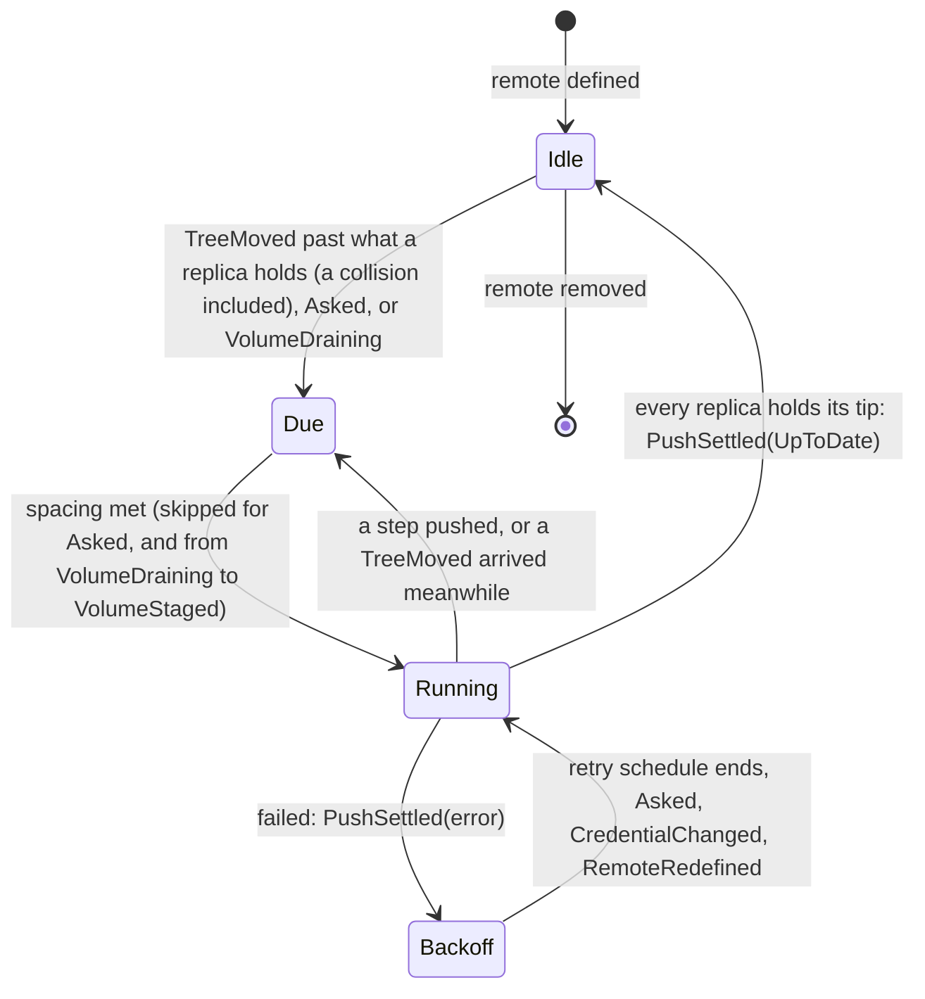

# Domain: Replication

**Layer:** System › **Domain (Replication)** › Feature.
**Status:** draft 5, proposed, under [system.md](../system.md) revision 10 and [git-model.md](../git-model.md). The
target, not today's code; Rust sketches show surfaces only.
**What the git model already fixes** (git-model §4): Replication is the shared remote's only pusher; its refspec
carries main's branch and every collision ref; a recorded collision makes a
push due; no queue step waits on the network. This page covers the rest: remotes, credentials, attempts, divergence
and settlement.

## 1. What Replication owns, and what it is not

Replication copies refs the git model has already written to zero or more git remotes, and fetches from them. It is
the only domain that talks to a remote and the only one that holds a credential. It never moves a local branch.

**The owner's words this domain rests on.** Everything else here is a design choice.

| # | His words | Date | What it asks of Replication |
|---|---|---|---|
| — | "Remotes can come and go. It's not a error to have zero remotes" | 2026-10-17 | an empty remote set is normal |
| — | "B. And if no remote is configured, the volume is lost, and that's a choice the user is allowed to make." | 2026-10-17 | no remote, no alarm; release does not wait for one |
| R7 | "Security boundary. Agentfs is the gatekeeper that exposes only what we want sandboxes to see" | 2026-10-30 | no credential reachable through a view |
| R16 | "i would like for the git history to remain compatible across minor versions, and only break on a major version change" | 2026-11-02 | a new major never overwrites an older one's refs |
| — | "yes, \"losing\" patches should still be part of the history. i want to know who changed what when" | 2026-11-03 | every collision ref is pushed and kept (git-model §4) |
| A4 | "A fork whose branches are rejected and never land in the main branch will inevitably be lost, and that's acceptable" (replaced above for losing changes) | answer | pushing a fork's whole branch stays optional (§4) |
| — | "an admin should have more expansive abilities to fix issues and overwrite history. it should be documented and auditable (where possible), but "admin" users are a specific class" | 2026-10-18 | an operator-only, audited replace of a diverged remote ref |
| — | "It's all event driven" | 2026-10-24 | pushes follow `TreeMoved`; the only timers are operator schedules |

| Term | Meaning here |
|---|---|
| **remote** | a git repository agentfs pushes to, with its endpoints, credentials and limits |
| **replica** | one carried ref on one remote, and what that remote holds of it |
| **attempt** | one connection that lists, uploads and updates a remote's refs |
| **endpoint** | a URL with its origin and the credential bound to that origin |
| **credential reference** | where a secret lives, never its bytes |
| **divergence save** | the local tip pushed under a new name in this volume's namespace when someone else moved its ref |
| **settlement** | the answer to "does every remote carrying main hold it through this commit?" |
| **spacing** | the operator's minimum time between two attempts on one remote |

**Not this domain:** commits, branches and collision refs (git-model); release and an upgrade's drain
(Volume decides, asking `settlement`); alarms (Telemetry, from `PushSettled`).

## 2. The model



Divergence is per replica: one ref's divergence never stops another ref or remote. A collision ref is create-only
(git-model §4), so it never diverges; only main's branch, and a carried fork's, can.

## 3. Public contract

```rust
pub trait Replication {
    fn push(&mut self, r: &RemoteName, by: &ActorCap) -> Result<PushOutcome, PushError>; // "push now": skips spacing
    fn replace_diverged(&mut self, r: &RemoteName, at: TreeRef, lease: Lease, by: &ActorCap)
        -> Result<PushOutcome, PushError>;                                   // Operator role, audited
    fn fetch_start(&mut self, at: &StartPoint, by: &StartCap) -> Result<CommitId, FetchError>; // Volume's create
    fn settlement(&self, through: CommitId) -> Settlement;                  // main's branch through this commit
    fn line_tip(&self, r: &RemoteName, line: &LineName) -> Result<Option<CommitId>, PushError>; // Volume's start line
    fn status(&self) -> Vec<RemoteStatus>;                                  // no secret, no credential path
}
pub enum PushOutcome {
    UpToDate { holds: Vec<(RefName, CommitId)> },
    Stepped { holds: Vec<(RefName, CommitId)>, left: u32 }, // the size limit cut it; the next attempt follows at once
    Removed,                                                // the remote left the configuration
}
pub enum PushError {
    Unreachable(IoKind),       // includes a proxy that refuses, and an I/O deadline passed
    Rejected(String),          // the remote refused (hook, protection)
    CredentialRefused,         // one attempt per connection, never a loop
    Diverged { at: TreeRef, saved_as: OwnedRef },
    UntrustedHost,             // host key or certificate failed; nothing was offered
    TooLarge { commit: CommitId },
    UnknownRemote,
    NotPermitted,              // the actor lacks the Operator role
    LocalIo(IoKind),           // a pending divergence name could not be saved, so nothing was pushed
}
pub enum FetchError { Unreachable(IoKind), CredentialRefused, UntrustedHost, UnknownRemote, NoSuchRef, OtherMajor(Version) }
pub enum Settlement {
    NoRemotes,                                  // nothing will be pushed (his 2026-10-17 "B")
    Held,                                       // every remote carrying main holds `through`
    Pending { remotes: Vec<RemoteName> },
    Failing { remotes: Vec<(RemoteName, PushError)> },
}
pub struct Lease { expected: CommitId }         // replace only if the remote still holds exactly this
pub struct OwnedRef(/* private */);             // under this volume and this major; built only by Namespace

pub struct RemoteDef {
    name: RemoteName,
    git: Endpoint,
    lfs: Option<Endpoint>,
    carries: Carries,
    limits: Limits,                             // blob, LFS object, push size
    spacing: Duration,                          // operator schedule
    retry: RetrySchedule,                       // operator schedule: doubling, capped
}
pub struct Endpoint { url: Url, origin: Origin, auth: Auth, proxy: Option<Proxy> } // only Endpoint::bind builds one
pub enum Auth {
    None,
    Token(CredentialRef),
    SshKey { key: CredentialRef, passphrase: Option<CredentialRef>, known_hosts: CredentialRef },
    SshAgent { socket: CredentialRef, known_hosts: CredentialRef },
}
pub enum Carries {
    Main,                // main's branch, collision refs (git-model §4)
    MainAndForks,        // also each fork's branch, kept on the remote after the fork drops
}
```

Published: `PushSettled{remote, outcome}`. Consumed: `TreeMoved`, `VolumeDraining`, `VolumeStaged`, `ForkDropped`.
Called by operators (`push`, `replace_diverged`, `status`) and Volume (`settlement`, `line_tip`, `fetch_start`).

## 4. Invariants

| # | Invariant | Enforced by | Strength |
|---|---|---|---|
| RP1 | Zero remotes is normal: no alarm, nothing waits, `settlement` says `NoRemotes` | `Settlement::NoRemotes` is a value, not an error | compile time |
| RP2 | A credential is presented only to the origin it is bound to; redirects are never followed | `Endpoint::bind` is the only constructor; the transport takes `&Endpoint` | compile + construction + test |
| RP3 | No secret byte enters state, logs or events; no credential lies under a tree, mount or view (R7) | `CredentialRef` has no byte accessor; `bind` refuses a location under a tree root | compile + construction |
| RP4 | A remote ref is only created or fast-forwarded, judged from the value the remote reports in the same connection; never forced, except `replace_diverged` | the claim runs inside the attempt; the only replace takes an Operator `ActorCap` and a `Lease` | compile + test |
| RP5 | Replication touches only this volume's refs of this release's major; another major's refs are never listed, moved or deleted (R16) | refspecs are built only from `OwnedRef` | compile + construction |
| RP6 | A failing, slow or diverged remote never delays a save, a take or another remote | no port to the git model's actors; one attempt per remote | compile + test |
| RP7 | What a remote holds is the remote's fact: push state records the last claim, never the truth; only a pending divergence name is authority, persisted before its push | the claim reads only the attempt's listing | construction + crash test |
| RP8 | Every losing commit reaches every remote, eventually, and stays (git-model §15, `losers_pushed`) | collision refs are create-only and in every remote's refspec | test |

**Ports.** `RemoteTransport` (smart HTTP(S), SSH with the host key checked before any key is offered, local path),
`LfsTransport`, `SecretSource` (the only reader of secret bytes; publishes `CredentialChanged`), `RemoteConfigSource`
(deployment config, watched), `PushStateRepository` (`store`, audited), `Schedule` (spacing and retry only).

## 5. Flows and scenarios

**A move reaches each remote.** On `TreeMoved(main)`, each remote's attempt becomes due; once spacing is met it lists
this volume's refs, checks each carried ref is an ancestor of the local tip, uploads LFS objects, then updates every
ref with its expected old value (collision refs: create only). It saves the claim (audited) and publishes
`PushSettled`. **Someone else moved a ref:** the tip is saved under a divergence name in this volume's namespace
(persisted Pending first, `LocalIo` if not), later moves follow it there, and only an operator's `replace_diverged`
with a lease touches the remote ref.

| Scenario | Replication's behaviour |
|---|---|
| A collision | the take's `TreeMoved` names it; its ref goes in the next attempt, create-only |
| 1,000 forks | `Main`: one replica set per remote, whatever the fork count; `MainAndForks`: one more per live fork |
| A slow, dead or refusing remote | `Unreachable` at an I/O deadline, then `Backoff`; other remotes settle on their own |
| Crash mid-attempt | each remote is `Due` at restart; the next listing shows what it holds, so a push that landed is `UpToDate`, never a false divergence |
| Upgrade (R16) | a minor continues the same refs; **a major pushes under its own refs** (design choice), so another major's history is never diverged, forced or deleted |

| Setting | Current choice (design choice unless cited) |
|---|---|
| Remote set | empty (local-only); the deployment config is the one source of truth, watched, none stored |
| Spacing; retry cap | 1 minute; 15 minutes (placeholders) |
| Refs carried | `Main` (main's branch, collision refs); `MainAndForks` opt-in, a fork's branch kept on the remote after its drop. A fork's losing commits go either way |
| I/O deadlines | connect 30 s, stalled transfer 5 min (as today) |

## 6. Tests

| Test | Rules out |
|---|---|
| Zero remotes: saves, takes and release all work; status says local-only; no alarm | a missing remote treated as an error |
| The server redirects to another host; an LFS endpoint on another origin | a secret sent to the wrong host |
| A credential file under a tree or mount; a view lists everything it can | a fork reading a credential |
| Another writer moves main's ref; kill the service between Pending and Confirmed | a forced push; one divergence under many names |
| One remote blackholed, one live: save and take rates unchanged | a dead remote stalling the volume |
| A run with collisions, then drain: every collision is re-read on the remote alone, writer and line | a losing change lost (RP8) |
| A remote holding a previous major's refs receives a new major's pushes | old history overwritten (R16) |

## 7. Costs

1. **Retry is a schedule:** a remote's recovery has no event agentfs can receive.
2. **Divergence needs a person:** agentfs saves and alarms; only an operator replaces.
3. **Losing commits and their refs grow every remote forever:** no trim rule unless it keeps who changed what when
   (git-model §16).
4. **The shared remote lags:** a collision ref reaches it at the next attempt, not with the take.
5. **A local or `file://` remote updates refs without compare-and-swap.**

## For the code architects (parked)

Ref names on the remote (git-model §4 gives the collision prefix); batching many fork refs in one
attempt; SSH host-certificate rules (keep today's); the push-state row layout.

## Reconcile with existing code (agentfs origin/main b5c0dc8)

- **The interval push loop** becomes attempts started by `TreeMoved`, with `pushInterval` as spacing.
- **`meta/push/<remote>.json`** becomes an audited row; only the Pending divergence name gains authority.
- **Remote sections in the repository config** move to the deployment config; origin binding, SSH, proxies and limits stay. **The final push within `--push-grace`** goes: release is Volume's verdict on `settlement`.
- **Ref names gain the major** and the collision refs.

**NOT RUN:** no code was built or tested.

*History: drafts 1–4 are in git; draft 5 (2026-11-03) conforms to the git model.*
