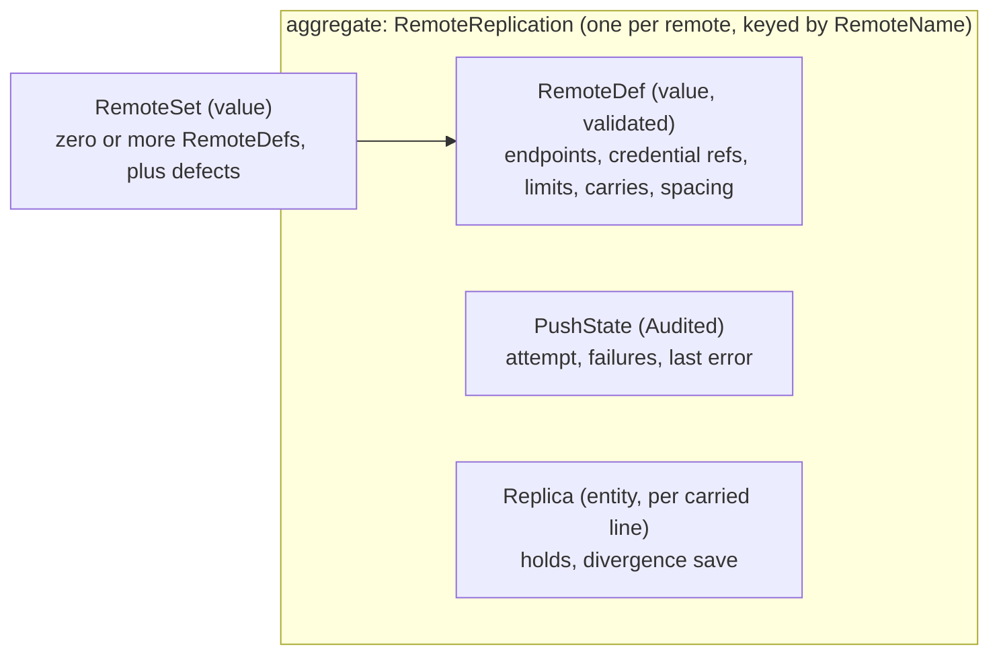
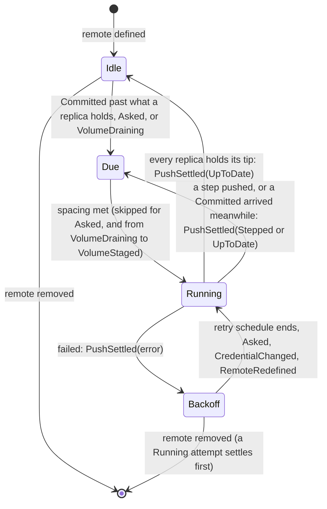

# Domain: Replication

**Layer:** System › **Domain (Replication)** › Feature.
**Status:** draft 4, proposed, against [system.md](../system.md) revision 7, which binds it. It describes the target; Rust sketches show surfaces only.
**Binding from the system:** §3.3 `Replication`, `PushError`, `HistoryObjects`; §3.4 `Committed`, `ForkDropped`, `PushSettled`; I3, I4, I8, I10, I13, I14, I16; §6 (zero remotes is normal); §8 (history kept within a major; drain, then upgrade).
**What you are asked:** nothing in this domain. Former QR1 and QR2 are adopted as design choices (§7).

## 1. What Replication owns, its language, and what it is not

Replication copies the history agentfs has already committed to zero or more git remotes, and fetches from them. It is the only domain that talks to a remote, and the only one that holds a credential. It never changes a tree, a record or a commit, and never writes a git object: a fetched pack goes to `History::receive`.

**Your words this domain rests on.** Everything else here is a design choice.

| # | Your words | Date | What it asks of Replication |
|---|---|---|---|
| — | "Remotes can come and go. It's not a error to have zero remotes" | 2026-10-17 | an empty remote set is normal; remotes change at run time |
| — | "B. And if no remote is configured, the volume is lost, and that's a choice the user is allowed to make." | 2026-10-17 | no remote, no alarm; release does not wait for one |
| — | "A fork can be created with or without a remote link back to its parent. Configurable." | 2026-10-17 | an own-state-area fork has its own remote set |
| R7 | "Security boundary. Agentfs is the gatekeeper that exposes only what we want sandboxes to see" | 2026-10-30 | no credential reachable through a view (I8) |
| R12 | "The general history should be preserved, yes. But I think it could be configurable if it needs to be every single commit, or whether a fork can be squashed …" | 2026-11-02 | push main's line as History shapes it; never reshape it |
| R16 | "i would like for the git history to remain compatible across minor versions, and only break on a major version change" | 2026-11-02 | a remote's lines continue across minors; a new major never overwrites an older one's |
| A4 | "A fork whose branches are rejected and never land in the main branch will inevitably be lost, and that's acceptable" | answer | pushing fork lines is optional (§7) |
| — | "an admin should have more expansive abilities to fix issues and overwrite history. it should be documented and auditable (where possible), but "admin" users are a specific class" | 2026-10-18 | an operator-only, audited replace of a diverged remote line |
| — | "It's all event driven" | 2026-10-24 | pushes follow `Committed`; the only timers are operator schedules (I10) |

| Term | Meaning here | Is not |
|---|---|---|
| **remote** | a git repository agentfs pushes to, with its endpoints, credentials and limits | a mirror agentfs reads its truth from |
| **replica** | one line on one remote, and what that remote holds of it | the line itself (History's) |
| **attempt** | one connection that lists, uploads and updates a remote's refs | a retry loop |
| **endpoint** | a URL with its origin and the credential bound to that origin | a remote (a remote has one git and at most one LFS endpoint) |
| **credential reference** | where a secret lives, never its bytes | the secret |
| **claim** | the judgement made inside an attempt from the value the remote reports: create, fast-forward, up to date, or someone else's | today's push record |
| **divergence save** | the local tip pushed under a new name in this volume's namespace when someone else moved its line | a force push |
| **step** | a size-limited attempt that pushes the longest first-parent prefix that fits | a partial commit |
| **settlement** | Replication's answer to "does every remote holding this line hold it through this commit?" | the release verdict (Volume's) |
| **spacing** | the operator's minimum time between two attempts on one remote | a poll |

**Not this domain:** making commits, writing objects, the history setting, line shapes and which major wrote a line (History); what a path's size limit refuses at record time (Rules and History, given `limits`); release and an upgrade's drain (Volume decides, asking `settlement`); landing fetched commits (Landing); alarms (Telemetry derives them from `PushSettled`).

## 2. The model



Two lifecycles, two machines. The attempt is per remote; divergence is per replica, so one line's divergence never stops another line or remote.

```mermaid
stateDiagram-v2
  [*] --> Behind: line carried; a new remote gets the whole line
  Behind --> InSync: the claim says the remote holds the tip
  InSync --> Behind: Committed
  Behind --> Diverged: the remote's ref is not an ancestor of the tip: save Pending, pushed, Confirmed
  Diverged --> Diverged: Committed: the save follows the tip
  Diverged --> InSync: the remote's ref is an ancestor again, or an operator's lease replace
  InSync --> [*]: ForkDropped: the remote keeps the fork's line (§7)
```





## 3. Public contract

The trait and both error enums are system §3.3's (`FetchError` since revision 7, from E6).

```rust
// ── Commands and queries ────────────────────────────────────────
pub trait Replication {
    fn push(&mut self, r: &RemoteName, by: &ActorCap) -> Result<PushOutcome, PushError>; // "push now": skips spacing and any retry wait
    fn replace_diverged(&mut self, r: &RemoteName, line: TreeRef, lease: Lease, by: &ActorCap)
        -> Result<PushOutcome, PushError>;                                   // your 2026-10-18 words, Operator role
    fn fetch(&mut self, r: &RemoteName, at: &RemoteRefName, by: &ActorCap) -> Result<CommitId, FetchError>; // pack → History::receive
    fn fetch_start(&mut self, at: &StartPoint, by: &StartCap) -> Result<CommitId, FetchError>; // Volume's create: pack → History::start_at
    fn fetch_lfs(&mut self, oids: &[LfsOid]) -> Result<(), FetchError>;    // into History's LFS cache (its NotLocal)
    fn settlement(&self, line: TreeRef, through: CommitId) -> Settlement;  // the one judge of "every remote holds line through commit"
    fn line_tip(&self, r: &RemoteName, line: &LineName) -> Result<Option<CommitId>, PushError>; // Volume's start line, this major's refs
    fn limits(&self) -> HistoryLimits;                                     // the smallest of each limit, read by History at commit
    fn status(&self) -> Vec<RemoteStatus>;                                 // read-only; no secret, no credential path
}

// ── Values this page defines ────────────────────────────────────
pub enum PushOutcome {
    UpToDate { holds: Vec<(TreeRef, CommitId)> },     // every carried line
    Stepped { holds: Vec<(TreeRef, CommitId)>, left: u32 }, // the size limit cut it; the next attempt follows at once
    Removed,                                          // the remote left the configuration: a last PushSettled
}
pub enum PushError {                     // system §3.3
    Unreachable(IoKind),                 // includes a proxy that refuses, and an I/O deadline passed
    Rejected(String),                    // the remote refused (hook, protection, a path it will not take)
    CredentialRefused,                   // the server said no; one attempt per connection, never a loop
    Diverged { line: TreeRef, saved_as: OwnedRef },
    UntrustedHost,                       // host key or certificate failed; nothing was offered
    TooLarge { commit: CommitId },       // one commit over the push limit cannot be stepped
    UnknownRemote,
    NotPermitted,                        // the actor lacks the Operator role
    LocalIo(IoKind),                     // a pending divergence name could not be saved, so nothing was pushed
}
pub enum FetchError {                    // system §3.3
    Unreachable(IoKind), CredentialRefused,
    UntrustedHost,
    UnknownRemote,
    NoSuchRef,
    NotPermitted,
    Received(HistoryError),              // History refused the pack, e.g. OtherMajor: another major's history (R16)
}
pub enum Settlement {
    NoRemotes,                           // no remote carries this line: nothing will be pushed (your 2026-10-17 "B")
    Held,                                // every remote carrying the line holds `through`
    Pending { remotes: Vec<RemoteName> },// an attempt is running or due
    Failing { remotes: Vec<(RemoteName, PushError)> },
}
pub struct Lease { expected: CommitId }  // replace only if the remote still holds exactly this
pub struct OwnedRef(/* private */);      // a ref under this volume and this major; built only by Namespace

// ── Remote definitions (values; a defect is never a RemoteDef) ──
pub struct RemoteSet { remotes: Vec<RemoteDef>, defects: Vec<RemoteDefect> } // may be empty
pub struct RemoteDef {
    name: RemoteName,                    // a valid ref component: [A-Za-z0-9][A-Za-z0-9._-]*
    git: Endpoint,                       // the push URL
    lfs: Option<Endpoint>,               // large-file store, on its own origin if it has one
    carries: Carries,
    limits: Limits,
    spacing: Duration,                   // operator schedule (I10)
    retry: RetrySchedule,                // operator schedule: doubling, capped
}
pub struct Endpoint {                    // built only by Endpoint::bind, which binds `auth` to `origin`
    url: Url,
    origin: Origin,                      // scheme, host, port
    auth: Auth,
    proxy: Option<Proxy>,                // from config only, never the environment
}
pub enum Auth {
    None,
    Token(CredentialRef),                // git-credential lines or a bare token
    SshKey { key: CredentialRef, passphrase: Option<CredentialRef>, known_hosts: CredentialRef },
    SshAgent { socket: CredentialRef, known_hosts: CredentialRef }, // never the environment's agent
}
pub struct CredentialRef(/* private */); // a location outside every tree, mount and view; no accessor for bytes
pub struct Limits {
    max_blob: Option<Bytes>,             // the smallest across remotes is what history may hold (`limits`)
    max_lfs_object: Option<Bytes>,
    max_push: Option<Bytes>,             // a backlog over it goes out in steps
}
pub enum Carries { Main, MainAndForks }  // MainAndForks: opt-in; fork lines kept after the drop (§7)
pub enum RemoteDefect {                  // reported, alarmed, never pushed; other remotes carry on
    BadName, BadUrl, CredentialInsideATree, SshWithoutKnownHosts, BadLimit, BadProxy,
}
```

**Events.** Published: `PushSettled{remote, outcome}` after every attempt, and with `Removed` when a remote leaves. Consumed: `Committed`, `VolumeDraining`, `VolumeStaged`, `ForkDropped`. From its own adapters: `CredentialChanged{remote}`, `RemotesConfigured(RemoteSet)`.

| Direction | Party | Through |
|---|---|---|
| called by | an operator, at the control socket or the CLI | `push`, `replace_diverged`, `status` |
| called by | Volume | `settlement`, on each `PushSettled`; `line_tip` for the start line; `fetch_start` at create, lending its `StartCap` |
| called by | Landing's commit-source edge | `fetch`, before `submit(Commit)` |
| called by | History | `limits` at commit; `fetch_lfs` for an uncached LFS object |
| calls | History | `receive(pack)` after a fetch, `start_at(pack)` after `fetch_start`; `head(line)` at boot; read-only `HistoryObjects` (`is_ancestor`, the pack plan). No port to Trees, Journal, Landing or Views |
| consumes | History, Volume, Forks | `Committed`; `VolumeDraining`, `VolumeStaged`, `ForkDropped` |

## 4. Invariants and how each is enforced

| # | Invariant | Enforced by | Strength |
|---|---|---|---|
| RP1 | Zero remotes is a normal state: no alarm, nothing waits, `settlement` says `NoRemotes` | `RemoteSet` may be empty; `Settlement::NoRemotes` is a value, not an error | compile time |
| RP2 | A credential is presented only to the origin it is bound to. Redirects are never followed | `Endpoint::bind` is the only constructor; the transport port takes `&Endpoint`, never a URL and a secret apart; the adapter refuses redirects | compile + construction + test |
| RP3 | No secret byte enters domain state, push state, logs or events. No credential lies under a tree, mount or view (I8, R7) | `CredentialRef` has no byte accessor; only the `SecretSource` adapter reads it; `bind` refuses a location under a tree root (`CredentialInsideATree`) | compile + construction |
| RP4 | A remote ref is only created or fast-forwarded, judged from the value the remote reports in the same connection; never forced, except `replace_diverged` | the claim is pure and runs inside the attempt; the only replace takes `&ActorCap` (Operator role) and a `Lease` | compile + test |
| RP5 | Replication touches only this volume's refs of this release's major on a remote. Another major's refs are never listed, moved or deleted (R16) | refspecs are built only from `OwnedRef`, which only `Namespace` builds; the composition root gives `Namespace` the release's major | compile + construction |
| RP6 | A remote holds only whole commits History made; a step ends on a first-parent commit, so a landing, a fork commit or a sync (I3) is never split | the stepper cuts on commit boundaries of the line | construction |
| RP7 | A failing, slow or diverged remote never affects recording, committing, landing, syncing or another remote (I6) | no port to those domains; one attempt per remote; divergence per replica | compile + test |
| RP8 | What a remote holds is the remote's fact. Push state is a record of the last claim and never an input to the next one; only a pending divergence name is authority | the claim reads only the attempt's listing; `PushState` holds `last_claim`, not `holds` as truth | construction + test |
| RP9 | Every wait ends on a named event or an operator schedule: `Committed`, `Asked`, `VolumeDraining`, `VolumeStaged`, `CredentialChanged`, `RemotesConfigured`; spacing and retry are the schedules (I10). I/O deadlines bound a single call; they coordinate nothing | the attempt machine's transitions | review + test |
| RP10 | Push state is audited (I13); a divergence save and a lease replace record who and when | `Audited<PushState>` stamped by the `store` repository | construction |
| RP11 | A divergence is saved under one name, however many crashes: the name is persisted Pending before its push and Confirmed after | `LocalIo` refuses the push when the name cannot be saved | construction + crash test |

## 5. Ports and adapters (the crate has no I/O; the composition root binds them)

```rust
pub trait RemoteTransport {              // git's smart protocol, one connection per call
    fn list(&self, e: &Endpoint, refs: &[OwnedRef]) -> Result<Listing, TransportError>;
    fn update(&self, e: &Endpoint, u: &[RefUpdate]) -> Result<UpdateResult, TransportError>; // each with its expected old value
    fn fetch(&self, e: &Endpoint, at: &RemoteRefName) -> Result<Pack, TransportError>;  // bytes into quarantine; nothing written
}
pub trait LfsTransport {                 // uploads before the ref update that needs them
    fn upload(&self, e: &Endpoint, objects: &[LfsOid]) -> Result<(), TransportError>; // resumable per object
}
pub trait SecretSource {                 // the only reader of secret bytes; publishes CredentialChanged
    fn watch(&self, refs: &[CredentialRef]) -> CredentialFeed;
}
pub trait RemoteConfigSource { fn watch(&self) -> RemoteSetFeed; } // RemotesConfigured on every change (§7)
pub trait PushStateRepository {          // one repository for the one aggregate
    fn load_all(&self) -> Result<Vec<Audited<PushState>>, StoreError>;
    fn save(&self, s: PushState, by: Principal) -> Result<Audited<PushState>, StoreError>;
    fn delete(&self, r: &RemoteName, by: Principal) -> Result<(), StoreError>;
}
pub trait Schedule { fn after(&self, d: Duration) -> Wake; } // spacing and retry only (I10)
```

| Port | Adapter | Notes |
|---|---|---|
| `RemoteTransport` | `net` + `gitx`: smart HTTP(S), SSH (host key checked before any key is offered), local path, `file://` | connect and stall deadlines; a local remote's ref update is waited out, never cut |
| `LfsTransport` | `net`: LFS batch API, its own HTTP client | same origin binding and proxy rules |
| `SecretSource` | platform-mounted files, re-read on a change event (rename, atomic symlink swap) | the system's secret store if one is configured |
| `RemoteConfigSource` | the deployment config, watched | §7 |
| `PushStateRepository` | `store`, audit stamps by the adapter; a family format (I16) | losing rows costs only a pending divergence name |
| `Schedule` | `store`'s clock | the domain's only timer |

## 6. Internal flows and scenarios

**A commit reaches each remote.** Every remote runs this alone; nothing here can block History.

```mermaid
sequenceDiagram
  participant H as History
  participant R as Replication: remote A
  participant O as History (HistoryObjects)
  participant T as transports (git, LFS)
  participant V as Volume
  H--)R: Committed(Source, through 42, commit c)
  R->>R: replica main: Behind. Attempt Due; spacing met: Running
  R->>T: list(main's ref, this major): the remote holds b
  R->>O: is_ancestor(b, c)? yes: a fast-forward
  R->>O: pack(b, c): size under max_push? yes, else take the longest first-parent prefix that fits
  R->>T: upload(LFS objects of b..c), then update(main: b to c, leased on b)
  T-->>R: updated
  R->>R: save PushState (audited): last claim c, failures 0
  R--)V: PushSettled(A, UpToDate main c)
  V->>R: settlement(Source, c): Held, or Pending on another remote
```

**Someone else moved a line.** The tip is saved under this volume's name; nothing is forced.

```mermaid
sequenceDiagram
  participant R as Replication: remote A
  participant S as push state
  participant T as git transport
  participant Op as operator
  R->>T: list(main's ref): x, not an ancestor of c
  R->>S: save divergence name d, Pending (fails: LocalIo, nothing pushed)
  R->>T: update(d: create at c)
  R->>S: d Confirmed. PushSettled(A, Diverged main as d)
  Note over R: each later Committed moves d by fast-forward; main's ref on A is never touched
  Op->>R: replace_diverged(A, main, Lease(x), Operator)
  R->>T: update(main: x to c, leased on x): audited, InSync
```

| Scenario | Replication's behaviour |
|---|---|
| Live landing, syncs, transactions, the history setting | off the landing path: a run, a sync or a transaction is one commit (I3) that reaches remotes after `Committed`; steps cut only between commits (RP6). Either history setting, or a change of it, pushes as fast-forwards |
| Fork lines; 1,000 sandboxes | `Main`: one replica per remote, whatever the fork count. `MainAndForks`: one per live fork line too (refs per attempt grow with forks, a cost); a sync commit's second parent is main's commit, the pack plan sends only what the remote lacks, and main's replica pushes first (design choice) |
| Commit bursts; 100 volumes per node | attempts follow commits, coalesced: at most one running per remote and one per spacing; nothing starts on a clock |
| A slow, dead or refusing remote | its attempt ends on an I/O deadline as `Unreachable`, then `Backoff`; other remotes settle on their own (RP7) |
| Release, and an upgrade's drain | from `VolumeDraining` to `VolumeStaged` attempts skip spacing, later `Committed`s included; Volume asks `settlement` on each `PushSettled`. Whether a `Failing` remote holds release or an upgrade is Volume's verdict |
| Crash mid-attempt | a ref update is atomic on the remote. After restart each remote is `Due`; the next listing shows what it holds, so a push that landed before the crash is `UpToDate`, never a false divergence (RP8) |
| Disk full | a failed push-state save leaves the last claim stale, which the next listing corrects; only a Pending divergence name must be durable, so that push waits (`LocalIo`) |
| Upgrade (R16, system §8); remotes added or removed | a patch resumes in place; a minor or major runs after the drain settles pushes, and rebuilds push state from the remotes (no older reader). A new remote's replicas start `Behind`; a removed one's row is deleted, audited. A minor continues the same refs. **A major pushes under its own refs** (design choice), so another major's history on a remote is never diverged, forced or deleted, and fetching it is `Received(OtherMajor)`. Alternative: one set of refs, where each breaking major is a divergence needing an operator per remote. Cost: every major starts new refs, even one that broke nothing |

## 7. Policies and configuration it owns

| Setting | Values | Current setting | Set by |
|---|---|---|---|
| Remote set | zero or more `RemoteDef` | empty (local-only) | the deployment config (below) |
| Spacing, per remote | a duration | 1 minute (placeholder) | operator |
| Retry schedule, per remote | doubling from spacing, capped | cap 15 minutes (placeholder, as today) | operator |
| Limits, per remote | blob, LFS object, push size | none | operator |
| Lines carried, per remote | `Main` · `MainAndForks` | `Main` | operator (below) |
| I/O deadlines | connect, stalled transfer | 30 s, 5 min (as today) | the release |

**Lines carried (design choice, former QR1).** Main's line holds every landed fork commit (`FullLineage`, and nothing unlanded, I4) or one squashed commit per landing; a fork line adds held, waiting and withdrawn commits and its syncs, which A4 lets go. **Current choice: `Main` by default; an opted-in `MainAndForks` remote keeps a fork's line after the drop,** archiving rejected work and keeping held work across a drain (system §8). Cost: that remote grows with every fork; an operator trims it. Alternative: delete it at `ForkDropped`; cost: rejected work goes too.

**Where remotes are defined (design choice, former QR2).** **Current choice: the deployment config is the one source of truth; agentfs watches it and stores none,** and who added a remote is in its history. Cost: a remote changes by config, not a command. Alternative: an audited operator command; cost: a second home for configuration, holding credential locations.

## 8. Tests that prove it

All run the real binary against real servers: a bare repository by path and `file://`, smart HTTP behind a web server, an SSH server with a git-only shell, an LFS test server, and a fault proxy that stalls, refuses or redirects.

| Test | Proves | Failure class ruled out |
|---|---|---|
| zero remotes: records, commits, releases; status says local-only; no alarm | RP1 | a missing remote treated as an error |
| the server redirects to another host; an LFS endpoint on another origin without its own credential | RP2 | a secret sent to the wrong host (the other server's log shows no credential) |
| a credential file under the tree or a mount; a view lists and reads everything it can | RP3, I8 | a sandbox reading a credential |
| compile-fail: build an `OwnedRef` or `Endpoint` outside its constructor; read bytes from a `CredentialRef` in the domain crate | RP2, RP3, RP5 | a refspec or a secret built by hand |
| another writer moves main's ref; kill the service between Pending and Confirmed, twice; then more commits | RP4, RP11 | a forced push; one divergence saved under many names; a lost save |
| `replace_diverged` without the Operator role; with a stale lease | RP4, RP10 | a non-operator overwriting history; an unaudited overwrite |
| one remote blackholed, one live: write latency, commit, landing and sync rates unchanged; the live remote settles | RP7 | one dead remote stalling the volume or another remote |
| a backlog over `max_push` including a transaction's landing and a fork line's sync | RP6 | a remote holding half a commit's parents; a backlog that never goes out |
| kill after the remote's ref update, before the state save; delete the push state | RP8 | a false divergence; a duplicate push; push state treated as truth |
| refuse a credential, then rewrite its file; `VolumeDraining` with a remote mid-spacing | RP9 | a rotation or a release waiting out a schedule instead of an event |
| a remote holding a previous major's lines receives a new major's pushes; fetch one of the old refs | RP5, R16 | an expected major break raised as divergence; old history overwritten; another major's pack written |
| `MainAndForks`: a fork with syncs and a withdrawn commit drops; the remote keeps its line | §7 | archived sandbox work lost at drop |

## 9. Costs

1. **Pushes follow commits,** so a busy volume pushes once per spacing per remote, not per commit window; a shorter spacing costs remote load.
2. **Retry is a schedule, not an event:** a remote's recovery has no event agentfs can receive, so `Backoff` waits for the schedule unless an operator asks, a credential changes or the remote is redefined.
3. **Divergence needs a person.** Agentfs saves and alarms; only an operator replaces a diverged line.
4. **A local or `file://` remote updates refs without compare-and-swap,** so a racing writer there can be overwritten. No node-wide owner caps concurrent attempts across volumes.
5. **A fork's drop does not wait for its push:** an opted-in remote may miss saves made within one spacing of the drop (A4 accepts it); `push` before `withdraw` closes the gap.

## 10. Escalations to the system document

None open: E1–E6 adopted (E6, `FetchError`, in revision 7).

## New terms

replica, claim, divergence save, settlement, spacing and carried lines, defined in §1 and §7. Existing names they could be: push state, `push::claim`, `diverged/<timestamp>`, the release scan's push check, `pushInterval`; carried lines is new.

## For the code architects (parked)
Ref names for lines, divergence saves, fetched tips and the major's place in them (and what keeps fetched objects from collection); jitter on retry schedules; batching many fork lines in one attempt and splitting it when one ref is refused; the SSH transport's host-certificate rules (keep today's); waiting out a local remote's ref update at shutdown; the push-state row layout; where the integrator status refs agentfs pushes today now live (Landing's edge).

## Reconcile with existing code (agentfs origin/main b5c0dc8)
- **The interval push loop** becomes attempts started by `Committed`, with `pushInterval` as spacing. Cost: the push thread per remote is driven by events.
- **`meta/push/<remote>.json`** becomes an audited repository row; it was already bookkeeping, so only the Pending divergence name gains authority.
- **Remote sections in the history repository's config** move to the deployment config; defect checks, origin binding, SSH transport, proxies and limits stay. **The final push within `--push-grace`** goes: release is Volume's verdict on `settlement`. **The start-branch alarm** moves to Volume over `line_tip`. **The patch queue's status and inbox pushes** leave Replication with the patch queue.
- **Ref names gain the major:** the first release under R16 starts its major's refs; today's refs on remotes are left untouched (no migration).

**NOT RUN:** no code was built or tested. Behaviour facts, ref-update atomicity and compare-and-swap per transport are from origin/main `docs/design.md` §11 and the behaviour catalogue, not re-tested.

*History: drafts 1–4 are in git.*
