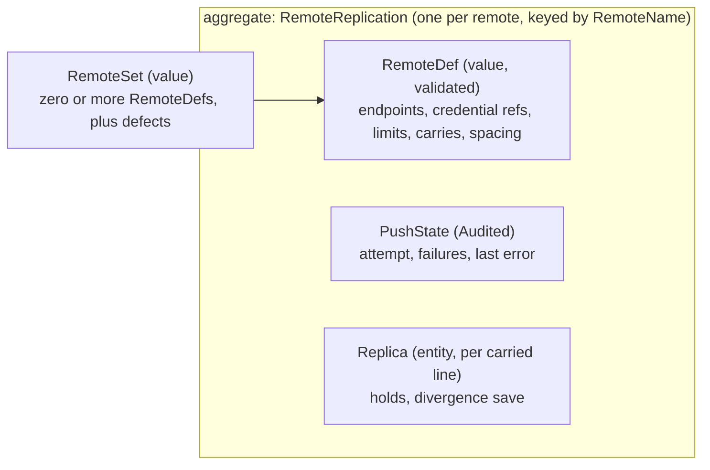
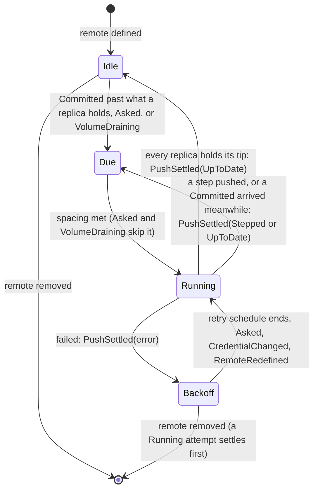

# Domain: Replication

**Layer:** System › **Domain (Replication)** › Feature.
**Status:** draft 2, proposed, against [system.md](../system.md) revision 4 (revision 3 approved 2026-11-02), which binds this page. It describes the target, not today's code. Sketches are Rust and show surfaces only.
**Binding from the system:** §3.3 `Replication` and `PushError`, §3.4 `Committed` and `PushSettled`, I8, I10, I13, I14, §6 (zero remotes is a normal state). Its escalations (§10) are resolved in system revision 4.
**What you are asked:** two questions: QR1 in §7 (fork lines on a remote), QR2 in §7 (where remotes are defined).

## 1. What Replication owns, its language, and what it is not

Replication copies the history agentfs has already committed to zero or more git remotes, and fetches from them. It is the only domain that talks to a remote, and the only one that holds a credential. It never changes a tree, a record or a commit, and never writes a git object: a fetched pack goes to `History::receive`.

**Your words this domain rests on.** Everything else here is a design choice.

| # | Your words | Date | What it asks of Replication |
|---|---|---|---|
| — | "Remotes can come and go. It's not a error to have zero remotes" | 2026-10-17 | an empty remote set is normal; remotes change at run time |
| — | "B. And if no remote is configured, the volume is lost, and that's a choice the user is allowed to make." | 2026-10-17 | no remote, no alarm; release does not wait for one |
| — | "A fork can be created with or without a remote link back to its parent. Configurable." | 2026-10-17 | an own-state-area fork has its own remote set |
| R7 | "Security boundary. Agentfs is the gatekeeper that exposes only what we want sandboxes to see" | 2026-10-30 | no credential reachable through a view (I8) |
| R12 | "The general history should be preserved, yes. But I think it could be configurable if it needs to be every single commit, or whether a fork can be squashed so that mainline is just a merge tree of squashed fork lineage." | 2026-11-02 | push main's line as History shapes it; never reshape it |
| A4 | "A fork whose branches are rejected and never land in the main branch will inevitably be lost, and that's acceptable" | answer | pushing fork lines is optional (QR1) |
| — | "an admin should have more expansive abilities to fix issues and overwrite history. it should be documented and auditable (where possible), but "admin" users are a specific class" | 2026-10-18 | an operator-only, audited replace of a diverged remote line |
| — | "It's all event driven" | 2026-10-24 | pushes follow `Committed`; the only timers are operator schedules (I10) |

| Term | Meaning here | Is not |
|---|---|---|
| **remote** | a git repository agentfs pushes to, with its endpoints, credentials and limits | a mirror agentfs reads its truth from |
| **line** | system term: the history of one tree (main's branch, a fork's own ref) | a remote ref |
| **replica** | one line on one remote, and what that remote holds of it | the line itself (History's) |
| **attempt** | one connection that lists, uploads and updates a remote's refs | a retry loop |
| **endpoint** | a URL with its origin and the credential bound to that origin | a remote (a remote has one git and at most one LFS endpoint) |
| **credential reference** | where a secret lives, never its bytes | the secret |
| **claim** | the judgement made inside an attempt from the value the remote reports: create, fast-forward, up to date, or someone else's | today's push record |
| **divergence save** | the local tip pushed under a new name in this volume's namespace when someone else moved its line | a force push |
| **step** | a size-limited attempt that pushes the longest first-parent prefix that fits | a partial commit |
| **settlement** | Replication's answer to "does every remote hold this line through this commit?" | the release verdict (Volume's) |
| **spacing** | the operator's minimum time between two attempts on one remote | a poll |

**Not this domain:** making commits, writing objects, the history setting and line shapes (History); what a path's size limit refuses at record time (Rules and History, given the limits here, E5); release (Volume decides, asking `settlement`); landing fetched commits (Landing); alarms (Telemetry derives them from `PushSettled`).

## 2. The model



Two lifecycles, two machines. The attempt is per remote; divergence is per replica, so one line's divergence never stops another line or remote.

```mermaid
stateDiagram-v2
  [*] --> Behind: line carried; a new remote gets the whole line
  Behind --> InSync: the claim says the remote holds the tip
  InSync --> Behind: Committed
  Behind --> Diverged: the remote's ref is not an ancestor of the tip: save Pending, pushed, Confirmed
  Diverged --> Diverged: Committed: the save follows the tip
  Diverged --> InSync: the remote's ref is an ancestor again, or an operator's lease replace
  InSync --> [*]: ForkDropped (a fork line; QR1 says what the remote keeps)
```





## 3. Public contract

The trait is system §3.3's (revision 4, which adopted this page's E1 to E5, with `fetch` handing its pack to History).

```rust
// ── Commands and queries ────────────────────────────────────────
pub trait Replication {
    fn push(&mut self, r: &RemoteName, by: &ActorCap) -> Result<PushOutcome, PushError>; // "push now": skips spacing and any retry wait
    fn replace_diverged(&mut self, r: &RemoteName, line: TreeRef, lease: Lease, by: &ActorCap)
        -> Result<PushOutcome, PushError>;                                   // your 2026-10-18 words, Operator role
    fn fetch(&mut self, r: &RemoteName, at: &RemoteRefName, by: &ActorCap) -> Result<CommitId, FetchError>; // pack → History::receive
    fn fetch_lfs(&mut self, oids: &[LfsOid]) -> Result<(), FetchError>;    // into History's LFS cache (its NotLocal)
    fn settlement(&self, line: TreeRef, through: CommitId) -> Settlement;  // the one judge of "every remote holds line through commit"
    fn line_tip(&self, r: &RemoteName, line: &LineName) -> Result<Option<CommitId>, PushError>; // Volume's start line
    fn limits(&self) -> HistoryLimits;                                     // the smallest of each limit, read by History at commit
    fn status(&self) -> Vec<RemoteStatus>;                                 // read-only; no secret, no credential path
}

// ── Values this page defines ────────────────────────────────────
pub enum PushOutcome {
    UpToDate { holds: Vec<(TreeRef, CommitId)> },     // every carried line
    Stepped { holds: Vec<(TreeRef, CommitId)>, left: u32 }, // the size limit cut it; the next attempt follows at once
    Removed,                                          // the remote left the configuration: a last PushSettled
}
pub enum PushError {                     // system §3.3
    Unreachable(IoKind),                 // includes a proxy that refuses, and an I/O deadline passed
    Rejected(String),                    // the remote refused (hook, protection, a path it will not take)
    CredentialRefused,                   // the server said no; one attempt per connection, never a loop
    Diverged { line: TreeRef, saved_as: OwnedRef },
    UntrustedHost,                       // host key or certificate failed; nothing was offered
    TooLarge { commit: CommitId },       // one commit over the push limit cannot be stepped
    UnknownRemote,
    NotPermitted,                        // the actor lacks the Operator role
    LocalIo(IoKind),                     // a pending divergence name could not be saved, so nothing was pushed
}
pub enum Settlement {
    NoRemotes,                           // local-only: nothing will ever be pushed (your 2026-10-17 "B")
    Held,                                // every remote carrying the line holds `through`
    Pending { remotes: Vec<RemoteName> },// an attempt is running or due
    Failing { remotes: Vec<(RemoteName, PushError)> },
}
pub struct Lease { expected: CommitId }  // replace only if the remote still holds exactly this
pub struct OwnedRef(/* private */);      // a ref in this volume's namespace; built only by Namespace

// ── Remote definitions (values; a defect is never a RemoteDef) ──
pub struct RemoteSet { remotes: Vec<RemoteDef>, defects: Vec<RemoteDefect> } // may be empty
pub struct RemoteDef {
    name: RemoteName,                    // a valid ref component: [A-Za-z0-9][A-Za-z0-9._-]*
    git: Endpoint,                       // the push URL
    lfs: Option<Endpoint>,               // large-file store, on its own origin if it has one
    carries: Carries,                    // QR1
    limits: Limits,
    spacing: Duration,                   // operator schedule (I10)
    retry: RetrySchedule,                // operator schedule: doubling, capped
}
pub struct Endpoint {                    // built only by Endpoint::bind, which binds `auth` to `origin`
    url: Url,
    origin: Origin,                      // scheme, host, port
    auth: Auth,
    proxy: Option<Proxy>,                // from config only, never the environment
}
pub enum Auth {
    None,
    Token(CredentialRef),                // git-credential lines or a bare token
    SshKey { key: CredentialRef, passphrase: Option<CredentialRef>, known_hosts: CredentialRef },
    SshAgent { socket: CredentialRef, known_hosts: CredentialRef }, // never the environment's agent
}
pub struct CredentialRef(/* private */); // a location outside every tree, mount and view; no accessor for bytes
pub struct Limits {
    max_blob: Option<Bytes>,             // the smallest across remotes is what history may hold (`limits`)
    max_lfs_object: Option<Bytes>,
    max_push: Option<Bytes>,             // a backlog over it goes out in steps
}
pub enum Carries { Main, MainAndForks }  // QR1
pub enum RemoteDefect {                  // reported, alarmed, never pushed; other remotes carry on
    BadName, BadUrl, CredentialInsideATree, SshWithoutKnownHosts, BadLimit, BadProxy,
}
```

**Events.** Published: `PushSettled{remote, outcome}` (system §3.4) after every attempt, its outcome the attempt's `Result`, and once more with `Removed` when a remote leaves the configuration. Consumed: `Committed{tree, through, commit}`, `VolumeDraining`, `ForkDropped`. Internal, from its own adapters: `CredentialChanged{remote}`, `RemotesConfigured(RemoteSet)`.

| Direction | Party | Through |
|---|---|---|
| called by | an operator, at the control socket or the CLI | `push`, `replace_diverged`, `status` |
| called by | Volume | `settlement`, on each `PushSettled`; `line_tip` for the start line; `fetch` for start-from |
| called by | Landing's commit-source edge | `fetch`, before `submit(Commit)` |
| called by | History | `limits` at commit; `fetch_lfs` for an uncached LFS object |
| calls | History | `receive(pack)` after a fetch; `head(line)` at boot; the read-only `HistoryObjects` contract to pack and measure. No port to Trees, Journal, Landing or Views |
| consumes | History, Volume, Forks | `Committed`; `VolumeDraining`, `ForkDropped` |

## 4. Invariants and how each is enforced

| # | Invariant | Enforced by | Strength |
|---|---|---|---|
| RP1 | Zero remotes is a normal state: no alarm, nothing waits, `settlement` says `NoRemotes` | `RemoteSet` may be empty; `Settlement::NoRemotes` is a value, not an error | compile time |
| RP2 | A credential is presented only to the origin it is bound to. Redirects are never followed | `Endpoint::bind` is the only constructor; the transport port takes `&Endpoint`, never a URL and a secret apart; the adapter refuses redirects | compile + construction + test |
| RP3 | No secret byte enters domain state, push state, logs or events. No credential lies under a tree, mount or view (I8, R7) | `CredentialRef` has no byte accessor; only the `SecretSource` adapter reads it; `bind` refuses a location under a tree root (`CredentialInsideATree`) | compile + construction |
| RP4 | A remote ref is only created or fast-forwarded, judged from the value the remote reports in the same connection; never forced, except `replace_diverged` | the claim is pure and runs inside the attempt; the only replace takes `&ActorCap` (Operator role) and a `Lease` | compile + test |
| RP5 | Replication touches only this volume's refs on a remote | refspecs are built only from `OwnedRef`, which only `Namespace` builds | compile time |
| RP6 | A remote holds only whole commits History made; a step ends on a first-parent commit, so a landing or transaction commit (I3) is never split | the stepper cuts on commit boundaries of the line | construction |
| RP7 | A failing, slow or diverged remote never affects recording, committing, landing or another remote (I6) | no port to those domains; one attempt per remote; divergence per replica | compile + test |
| RP8 | What a remote holds is the remote's fact. Push state is a record of the last claim and never an input to the next one; only a pending divergence name is authority | the claim reads only the attempt's listing; `PushState` holds `last_claim`, not `holds` as truth | construction + test |
| RP9 | Every wait ends on a named event or an operator schedule: `Committed`, `Asked`, `VolumeDraining`, `CredentialChanged`, `RemotesConfigured`; spacing and retry are the schedules (I10). I/O deadlines bound a single call; they coordinate nothing | the attempt machine's transitions | review + test |
| RP10 | Push state is audited (I13); a divergence save and a lease replace record who and when | `Audited<PushState>` stamped by the `store` repository | construction |
| RP11 | A divergence is saved under one name, however many crashes: the name is persisted Pending before its push and Confirmed after | `LocalIo` refuses the push when the name cannot be saved | construction + crash test |

## 5. Ports and adapters

The Replication crate has no I/O. Its ports are traits, bound by the composition root.

```rust
pub trait RemoteTransport {              // git's smart protocol, one connection per call
    fn list(&self, e: &Endpoint, refs: &[OwnedRef]) -> Result<Listing, TransportError>;
    fn update(&self, e: &Endpoint, u: &[RefUpdate]) -> Result<UpdateResult, TransportError>; // each with its expected old value
    fn fetch(&self, e: &Endpoint, at: &RemoteRefName) -> Result<Pack, TransportError>;  // bytes into quarantine; nothing written
}
pub trait LfsTransport {                 // uploads before the ref update that needs them
    fn upload(&self, e: &Endpoint, objects: &[LfsOid]) -> Result<(), TransportError>; // resumable per object
}
// Objects are read through History's read-only `HistoryObjects` contract (system §3.3), not an adapter of their own:
// is_ancestor, and a pack plan (first-parent chain, size up to a cap, LFS objects).
pub trait SecretSource {                 // the only reader of secret bytes; publishes CredentialChanged
    fn watch(&self, refs: &[CredentialRef]) -> CredentialFeed;
}
pub trait RemoteConfigSource { fn watch(&self) -> RemoteSetFeed; } // RemotesConfigured on every change (QR2)
pub trait PushStateRepository {          // one repository for the one aggregate
    fn load_all(&self) -> Result<Vec<Audited<PushState>>, StoreError>;
    fn save(&self, s: PushState, by: Principal) -> Result<Audited<PushState>, StoreError>;
    fn delete(&self, r: &RemoteName, by: Principal) -> Result<(), StoreError>;
}
pub trait Schedule { fn after(&self, d: Duration) -> Wake; } // spacing and retry only (I10)
```

| Port | Adapter | Notes |
|---|---|---|
| `RemoteTransport` | `net` + `gitx`: smart HTTP(S), SSH (own transport, host key checked before any key is offered), local path and `file://` | connect and stall deadlines live here; a local remote's ref update is waited out, never cut |
| `LfsTransport` | `net`: LFS batch API over its own HTTP client | same origin binding and proxy rules |
| `SecretSource` | files mounted by the platform, re-read on a change event (rename, atomic symlink swap) | the system's secret store if one is configured |
| `RemoteConfigSource` | the deployment config, watched | QR2 |
| `PushStateRepository` | `store`, audit stamps written by the adapter | small rows; losing them costs only a pending divergence name |
| `Schedule` | `store`'s clock | the domain's only timer |

## 6. Internal flows and scenarios

**A commit reaches each remote.** Every remote runs this alone; nothing here can block History.

```mermaid
sequenceDiagram
  participant H as History
  participant R as Replication: remote A
  participant O as History (HistoryObjects)
  participant T as transports (git, LFS)
  participant V as Volume
  H--)R: Committed(Source, through 42, commit c)
  R->>R: replica main: Behind. Attempt Due; spacing met: Running
  R->>T: list(main's ref): the remote holds b
  R->>O: is_ancestor(b, c)? yes: a fast-forward
  R->>O: pack(b, c): size under max_push? yes, else take the longest first-parent prefix that fits
  R->>T: upload(LFS objects of b..c), then update(main: b to c, leased on b)
  T-->>R: updated
  R->>R: save PushState (audited): last claim c, failures 0
  R--)V: PushSettled(A, UpToDate main c)
  V->>R: settlement(Source, c): Held, or Pending on another remote
```

**Someone else moved a line.** The tip is saved under this volume's name; nothing is forced.

```mermaid
sequenceDiagram
  participant R as Replication: remote A
  participant S as push state
  participant T as git transport
  participant Op as operator
  R->>T: list(main's ref): x, not an ancestor of c
  R->>S: save divergence name d, Pending (fails: LocalIo, nothing pushed)
  R->>T: update(d: create at c)
  R->>S: d Confirmed. PushSettled(A, Diverged main as d)
  Note over R: each later Committed moves d by fast-forward; main's ref on A is never touched
  Op->>R: replace_diverged(A, main, Lease(x), Operator)
  R->>T: update(main: x to c, leased on x): audited, InSync
```

| Scenario | Replication's behaviour |
|---|---|
| Live landing, transactions | off the landing path: a landing, a transaction's included, is one commit (I3) that reaches remotes after `Committed`; steps cut only between commits (RP6). No gate, record or wait involves Replication |
| History setting | `FullLineage` and `Squashed` change main's line, not Replication: it pushes what History made, as fast-forwards. A setting change mid-life is still a fast-forward |
| 1,000 sandboxes | under `Carries::Main` one replica per remote, whatever the fork count. Under `MainAndForks`, one replica per live fork line in each attempt: refs per attempt grow with forks (a cost) |
| Commit bursts; 100 volumes per node | attempts follow commits, coalesced: at most one attempt running per remote, and at most one per spacing. Volumes do not align on a clock, because nothing here starts on one |
| A slow, dead or refusing remote | its attempt ends on an I/O deadline as `Unreachable`, then `Backoff`; other remotes settle on their own (RP7) |
| Release | `VolumeDraining` makes each remote's attempt `Due` without spacing; Volume asks `settlement` on each `PushSettled`. Whether a `Failing` remote holds release is Volume's verdict |
| Crash mid-attempt | a ref update is atomic on the remote. After restart each remote is `Due`; the next listing shows what it holds, so a push that landed before the crash is `UpToDate`, never a false divergence (RP8) |
| Disk full | Replication writes only push-state rows. A failed save leaves the last claim stale, which the next listing corrects; only the Pending divergence name must be durable, so that push waits (`LocalIo`) |
| Upgrade; remotes added or removed | push state can be rebuilt from the remotes (only a Pending divergence name is lost: at worst one duplicate save), so no previous-format reader is kept. A new remote's replicas start `Behind` and receive the whole line; a removed remote's row is deleted, audited |

## 7. Policies and configuration it owns

| Setting | Values | Current setting | Set by |
|---|---|---|---|
| Remote set | zero or more `RemoteDef` | empty (local-only) | QR2 |
| Spacing, per remote | a duration | 1 minute (placeholder) | operator |
| Retry schedule, per remote | doubling from spacing, capped | cap 15 minutes (placeholder, as today) | operator |
| Limits, per remote | blob, LFS object, push size | none | operator |
| Lines carried, per remote | `Main` · `MainAndForks` | `Main` | operator (QR1) |
| I/O deadlines | connect, stalled transfer | 30 s, 5 min (as today) | the release |

**QR1. Should a remote carry fork lines, and keep them after the fork drops?** Pushing main's line already keeps each fork's squashed chain (`Squashed`), or, under `FullLineage`, every save of a fork's line up to its last landing, landed or not (History's QH1). A fork line adds the saves after its last landing (all its unlanded saves, under `Squashed`), which A4 says may be lost.
- **Recommended: main only by default; a remote may opt in to `MainAndForks`, and keeps a fork's line after the fork drops.** That remote is then the archive of held and rejected sandbox work, and `Squashed` plus such a remote keeps every save. Cost: that remote grows with every fork, and trimming it is the operator's job.
- **Alternative: an opted-in remote deletes a fork's line at `ForkDropped`.** Cost: rejected work vanishes from the remote too; carrying only protects a fork's saves while it lives.

**QR2. Where are remotes defined?** You said remotes "can come and go".
- **Recommended: the deployment config is their one source of truth; agentfs watches it and stores none.** Who added a remote is in that config's own history. Cost: changing a remote means changing deployment config, not a command.
- **Alternative: an operator command defines and removes remotes, stored with audit stamps.** Cost: a second home for configuration beside deployment, and a store that must hold credential locations.

## 8. Tests that prove it

All run the real binary against real servers: a bare repository by path and `file://`, smart HTTP behind a web server, an SSH server with a git-only shell, an LFS test server, and a fault proxy that stalls, refuses or redirects.

| Test | Proves | Failure class ruled out |
|---|---|---|
| a volume with zero remotes records, commits and releases; status says local-only; no alarm | RP1 | a missing remote treated as an error |
| the server redirects to another host; an LFS endpoint on another origin without its own credential | RP2 | a secret sent to the wrong host (the other server's log shows no credential) |
| a credential file under the tree or a mount; a view lists and reads everything it can | RP3, I8 | a sandbox reading a credential |
| compile-fail: build an `OwnedRef` or `Endpoint` outside its constructor; read bytes from a `CredentialRef` in the domain crate | RP2, RP3, RP5 | a refspec or a secret built by hand |
| another writer moves main's ref; kill the service between Pending and Confirmed, twice; then more commits | RP4, RP11 | a forced push; one divergence saved under many names; a lost save |
| `replace_diverged` without the Operator role; with a stale lease | RP4, RP10 | a non-operator overwriting history; an unaudited overwrite |
| one remote blackholed, one live: write latency, commit rate and landings unchanged; the live remote settles | RP7 | one dead remote stalling the volume or another remote |
| a backlog over `max_push` including a transaction's landing commit | RP6 | a remote holding half a transaction; a backlog that never goes out |
| kill after the remote's ref update, before the state save; delete the push state | RP8 | a false divergence; a duplicate push; push state treated as truth |
| refuse a credential, then rewrite its file; `VolumeDraining` with a remote mid-spacing | RP9 | a rotation or a release waiting out a schedule instead of an event |

## 9. Costs and open questions

1. **Pushes follow commits,** so a busy volume pushes once per spacing per remote, not per commit window; a shorter spacing costs remote load.
2. **Retry is a schedule, not an event:** a remote's recovery has no event agentfs can receive, so `Backoff` waits for the schedule unless an operator asks, a credential changes or the remote is redefined.
3. **Divergence needs a person.** Agentfs saves and alarms; only an operator replaces a diverged line.
4. **A local or `file://` remote updates refs without compare-and-swap,** so a racing writer there can be overwritten. No node-wide owner caps concurrent attempts across volumes.

## 10. Escalations to the system document

| # | Where (revision 3) | Recommended change | Resolution in revision 4 |
|---|---|---|---|
| E1 | `push` took no authority; outcome and error types were undefined; no operator overwrite; Volume could judge release only by copying the remote set | `push(r, by)`, `replace_diverged`, `settlement`, `status`, the `PushError` above | adopted; `settlement` is the one judge Volume asks (its `Pending` and `Failing` are Volume's `Blocker::Remote`) |
| E2 | no contract fetched | `fetch(r, ref, by)`, objects only | adopted with a change: the transport fetches into quarantine and `History::receive` writes the objects, so History stays the only object writer |
| E3 | `VolumeDraining` and `ForkDropped` did not reach Replication | add it as a consumer of both | adopted |
| E4 | no tip query and no object read access | `History::tip`; an `ObjectReader` port bound to History's store | adopted as `History::head` (the one tip query) and History's read-only `HistoryObjects` contract, not an adapter binding |
| E5 | the smallest remote limit had no way to reach History | `Replication::limits()` | adopted; History reads it at commit as data |

Also adopted from Volume's page: `line_tip` (the one start-line query) and `PushSettled{Removed}`.

## New terms

replica, claim, divergence save, settlement, spacing and carried lines, defined in §1. Existing names they could be: push state, `push::claim`, `diverged/<timestamp>`, the release scan's push check, `pushInterval`; carried lines is new (QR1).

## For the code architects (parked)
Ref names for lines, divergence saves and fetched tips (and what keeps fetched objects from collection); jitter on retry schedules; batching many fork lines in one attempt and splitting it when one ref is refused; the SSH transport's host-certificate rules (keep today's); waiting out a local remote's ref update at shutdown; the push-state row layout; where the integrator status refs agentfs pushes today now live (Landing's edge).

## Reconcile with existing code (agentfs origin/main b5c0dc8)
- **The interval push loop** becomes attempts started by `Committed`, with `pushInterval` as spacing. Cost: the push thread per remote is driven by events.
- **`meta/push/<remote>.json`** becomes an audited repository row; it was already bookkeeping, so only the Pending divergence name gains authority.
- **Remote sections in the history repository's config** move to the deployment config (QR2); defect checks, origin binding, SSH transport, proxies and limits stay. **The final push within `--push-grace`** goes: release is Volume's verdict on `settlement`. **The start-branch alarm** moves to Volume over `line_tip`. **The patch queue's status and inbox pushes** leave Replication with the patch queue.

**NOT RUN:** no code was built or tested. Behaviour facts are from origin/main `docs/design.md` §11 and the behaviour catalogue; the ref-update atomicity and compare-and-swap claims per transport are from that document, not re-tested.

*History: draft 1 (2026-11-02); draft 2, conformed to system revision 4.*
