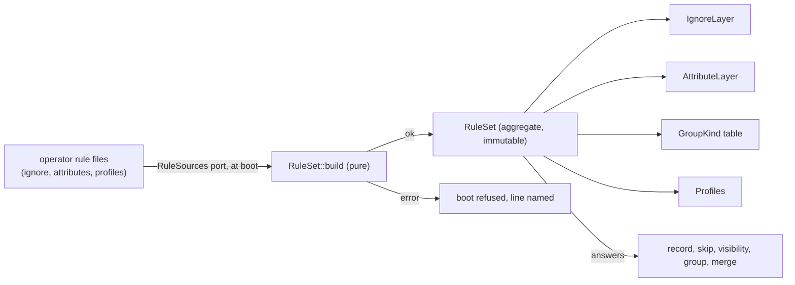
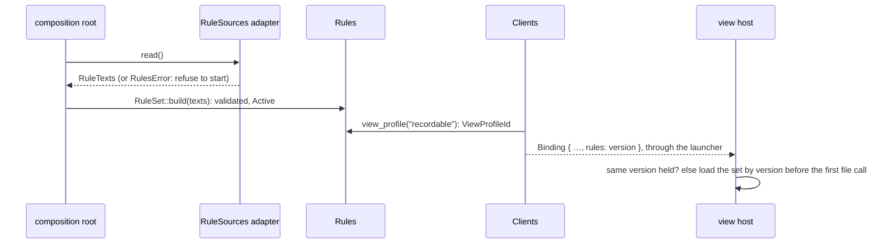
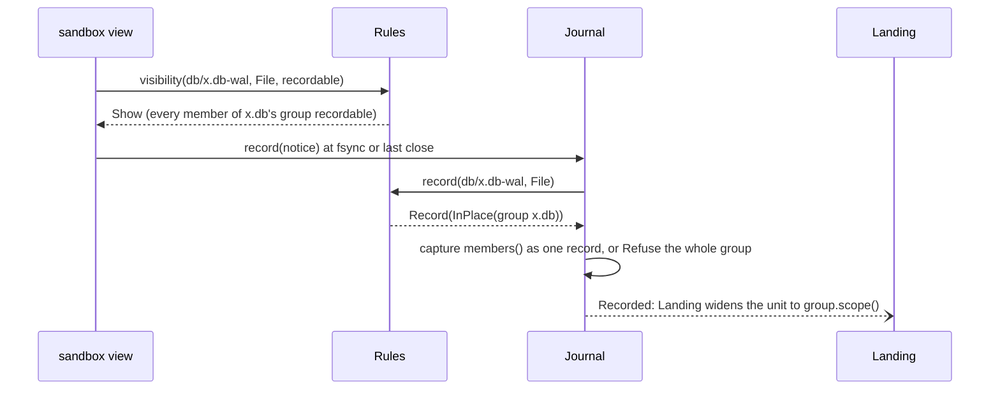
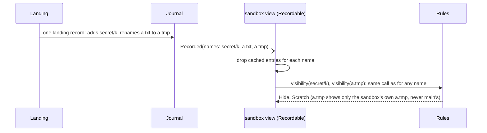

# Domain: Rules

**Layer:** System › **Domain (this page)** › Feature. Binding parent: [../system.md](../system.md) revision 7 (revision 3 approved 2026-11-02).
**Status:** draft 4, proposed. Describes the target, not today's code. Sketches are Rust and show surfaces only.
**What you are asked:** nothing; the two earlier questions are now design choices (§1, §2). "Profile" on this page always means a **view profile**; the CSI settings bundle keeps the bare word.

## 0. Your words this domain rests on

| # | Your words | Date | What it sets here |
|---|---|---|---|
| R7 | "Security boundary. Agentfs is the gatekeeper that exposes only what we want sandboxes to see" | 2026-10-30 | profiles decide what a view shows |
| — | "the sandbox agent should only get write access to the agentfs overlay files"; "potentially should only be able to see the agentfs overlay files at all" | 2026-10-30 | the `Recordable` base (our reading: "overlay files" = the names agentfs would record) |
| R8 | a consumer's personal information never enters the agentfs repo | 2026-10-30 | this page names no consumer |
| R9 | "Whole seems best, right? A partial application has unknown side effects" | 2026-10-16 | a database group is one unit |
| R13 | "A cooperating integration can define batches/transactions across files, and they must all land together." | 2026-11-02 | a group widens any scope it touches |
| R16 | "The various agentfs components should be within the same version family (major for sure, maybe minor too, patch doesnt need to match)" | 2026-11-02 | a change to how rules are judged is a minor release (RU8) |

Everything else is a design choice. Today's behaviour (agentfs origin/main b5c0dc8, design §2.4, §4, §5, §8) is evidence, not a requirement.

## 1. What Rules owns, and what it is not

Rules is a **policy decision point**: other domains enforce, Rules only answers. Every answer is a pure function of one immutable rule set.

| Rules owns | Rules is not |
|---|---|
| whether a change to a path is recorded or refused at record time (`record`), and skipped at commit time (`skip`) | whether a path is tracked (History judges; History passes the answer to `skip`) |
| the per-path recording rule (class, database group, size limit, store hint) and merge rule (`merge`) | storing content, LFS, merging (History, Landing apply the rules) |
| database group kinds and each group's members | capturing a group, or when (Journal and Views) |
| profiles: what each view shows (`visibility`) | mapping an answer to an error number, caching, mounts (Views) |
| the built-in never-recorded names | path syntax and confinement (`RelPath::parse` in `model`, Trees) |
| validating the operator's rule files at boot | remote size and path limits (Replication judges at push) |

**Glossary.**

| Term | Meaning |
|---|---|
| rule set | one immutable value built at boot from the operator's rule files: ignore patterns, attributes, group kinds, profiles |
| verdict | Rules' answers for one change at one path: at record time `Record(rule)`, `BuiltIn(why)` or `Refuse(why)`, with no tracked fact; at commit time `skip`, with it |
| record rule; merge rule | how a recorded path is recorded: class, size limit, store hint; how it may be merged: its format and whether whitespace counts |
| class | `OnClose` (recorded when a write closes) or `InPlace` (changed while open, recorded as its whole group) |
| database group | the files of one database (for SQLite: `x.db`, `x.db-wal`, `x.db-journal`), recorded, shown and landed as one |
| group kind | data naming a group's member suffixes and never-recorded suffixes; agentfs ships `sqlite` |
| recordable | a name the rules would record if it were new |
| view profile, base | what one view shows: a base (`Everything` or `Recordable`) narrowed by optional hide patterns |
| scratch | a name a profile lets a client keep privately: never recorded, never landed |
| containment | whether a path lies inside a nested git repository, as Trees observed it |

**Design choice (was Q1): only the operator's rule files count; rule files inside the tree (`.gitignore`, `.gitattributes`) are ordinary content.** One rule set per state area, fixed for the history service's life; `respectTreeRules` and its code go. Cost: a program cannot steer its own recording. Not chosen: tree rules, which make the rule set per tree and position and let a rule-file edit change another tree's recording once it lands or syncs.

## 2. The model



| Concept | Kind | Notes |
|---|---|---|
| `RuleSet` | aggregate root, value | built once, shared by `Arc`; carries its `RuleSetVersion` (a digest of its sources) |
| `RecordRule`, `MergeRule`, `Group`, `Profile` | value objects | private fields; only `RuleSet` builds them |
| `ViewProfileId` | value, minted by Rules | holding one proves the view profile exists |
| `GroupKind` | value | `sqlite`: members `""`, `-wal`, `-journal`; never `-shm` |

The rule set has one lifecycle: read at boot, built (every value valid) or refused (the service does not start), then active until the history service stops. A path's recording status is History's (tracked) and is not modelled here.

**Design choice (was Q2): a view profile is a base plus operator hide patterns, narrowing only.** `Everything` (main) or `Recordable` (sandboxes), and optional patterns that hide more; a profile can never show what its base hides (RU4). Cost: a second pattern list per profile. Not chosen: two fixed profiles, where hiding a recorded file from sandboxes (R7) needs a code change.

## 3. The public contract

The trait is system §3.3's (revision 6 adds `merge`). The value types are this domain's part of `contracts`.

```rust
pub trait Rules {
    /// Record time (Journal, Views): recorded, built-in skip, or refused. No tracked fact. Pure and total.
    fn record(&self, p: &RelPath, k: EntryKind) -> RecordVerdict;
    /// Commit time (History only): is this recorded change skipped? Needs the tracked fact and containment.
    fn skip(&self, p: &RelPath, k: EntryKind, f: PathFacts) -> Option<SkipReason>;
    /// The database group p belongs to, whole (Trees, Landing, Views, Journal).
    fn group(&self, p: &RelPath) -> Option<Group>;
    /// Which resolvers suit p (Landing, either direction). Whitespace is significant unless an operator says not.
    fn merge(&self, p: &RelPath) -> MergeRule;
    /// What may this client's view see and change at n? Existence-blind:
    /// the answer never depends on whether, or how, something is there.
    fn visibility(&self, n: &TreeName, k: EntryKind, v: ViewProfileId) -> Visibility;
    fn view_profile(&self, name: &ProfileName) -> Option<ViewProfileId>; // the only way to get a ViewProfileId
    fn version(&self) -> RuleSetVersion;                                  // carried in a Binding
}
pub struct PathFacts { tracked: bool, containment: Containment } // containment: as Trees observed it, carried in the record
pub enum Containment { Outside, InRepository, Unknown }

pub enum EntryKind {
    File,          // a regular file
    Dir,
    Symlink,
    Special,       // device, FIFO, socket: never recorded
    Removal,       // verdict only: the change removes p
}

pub enum RecordVerdict {    // record time
    Record(RecordRule),
    BuiltIn(BuiltIn),       // never recorded, whatever is tracked: SharedMemory (-shm), NfsSillyRename, Special, EmptyDir
    Refuse(RuleRefusal),    // must not be recorded; the caller raises PathRefused
}

pub struct RecordRule {     // private fields; read through accessors
    class: Class,
    max_size: Option<ByteSize>,  // RecordRule::admits(size) is the one comparison
    store: StoreHint,            // Default | Blob | Lfs: History applies it
}
pub enum MergeRule {             // from `merge=` and `agentfs.whitespace`; Landing picks resolvers by it
    Text { whitespace: Whitespace },    // Significant (default) | Insignificant: only then may Exact merge whitespace-only edits
    Structured(Format),          // Yaml | Json | Markdown, by `merge=` or extension: the Structure resolver
    Binary,                      // no line or structure merge
    Driver(DriverName),          // an operator's git merge driver
}

pub enum Class {
    OnClose,                     // recorded at the close of a write
    InPlace(Group),              // changed while open; a group of one when no kind applies
}

pub struct Group { /* kind, dir, stem: private */ }
impl Group {
    pub fn members(&self) -> impl Iterator<Item = RelPath>; // every member name, whether it exists or not
    pub fn scope(&self) -> Scope;                           // the same, as model's Scope
}

pub enum SkipReason {                  // commit time
    NeverRecord,                       // operator attribute -agentfs (a removal of a tracked path still records)
    Ignored { pattern: PatternRef },   // operator ignore rule; only for untracked paths
    InRepository,                      // inside a nested repository; untracked paths only
    UntrackedRemoval,                  // removing something never recorded
}

pub enum RuleRefusal {
    GroupMemberSkipped { member: RelPath }, // a group is recorded whole or not at all
}

pub enum Visibility {
    Show,      // seen; a change here goes to the client's own tree and is judged by record
    Scratch,   // only the client's own private entry exists here: never recorded, never landed
    Hide,      // nothing here, whatever exists: absent from lookups and listings, no creation
    Refuse,    // seen read-only: no change, creation or move of this kind here
}

pub enum RulesError {                  // boot only: building the rule set, never answering
    Unreadable { source: SourceName, io: IoKind },
    BadValue { source: SourceName, line: u32, attribute: String },
    UnknownGroupKind { line: u32, kind: String },
    UnknownBase { profile: ProfileName },
}
```

**How a profile answers** (design choice; `Recordable` reproduces today's sandbox view):

| Kind at p | `Everything` | `Recordable` |
|---|---|---|
| File, recordable if new | Show | Show |
| File the rules skip if new | Show | Scratch |
| File in a group with a member skipped | Show | Hide (the whole group) |
| Dir with something recordable possible beneath | Show | Show |
| Dir with nothing recordable possible beneath | Show | Hide |
| Symlink at a recordable path | Show | Refuse |
| Special, or inside a nested repository | Show | Hide |
| matched by the profile's hide patterns (§2) | Hide | Hide |

**Who calls Rules, and whom it calls.** Rules calls nobody. It publishes no events and consumes none.

| Caller | Asks | When |
|---|---|---|
| Views | `visibility`, `group`, `record` | each lookup, listing, create, rename end, and when a feed notice names a path (a client's, a landing's or a sync's); group members at fsync; a refusal before recording |
| Journal; Forks | `record`, `group` | at each record, to widen a save's fork commit to whole groups; to widen a transaction's `begin(files)` |
| Landing | `merge`, `group` | the merge rule that picks its resolvers, either direction; to widen a run's or a sync's files to whole groups |
| Trees | `group`; the repository-mark predicate | copy-up takes a group whole; a gate covers a group its landing writes; when it reports a path's containment |
| History | `skip`, `record(p).store` | at commit: the one judge of skips; LFS |
| Clients | `view_profile`, `version` | when it narrows a launcher's grant and builds a `Binding` |

## 4. Invariants and how they are enforced

| # | Invariant (design rule unless it cites you) | Enforced by | Strength |
|---|---|---|---|
| RU1 | Rules is pure and total: no I/O, no clock, no error after boot | the crate depends on `model` and `contracts` only; clippy bans `std::fs`, `std::net`; methods return no `Result` | compile time |
| RU2 | A rule-set error stops the service; it never degrades to "show" or "record everything" | `RuleSet::build` is the only constructor and returns `Result`; the composition root has no fallback | boot time |
| RU3 | Visibility never depends on existence or on who wrote a name (a client or a landing) | `visibility` takes no existence, writer or source argument | compile time |
| RU4 | A profile shows nothing its base hides | `Profile` holds a base and hide patterns only; no "show" list exists to fill | construction time |
| RU5 | A database group is recorded, shown, hidden, widened and landed whole (R9, R13) | `Class::InPlace` carries the `Group`, whose `members()` is computed, never supplied | construction time + test |
| RU6 | Ignore rules decide only for new paths; a tracked path stays recorded until removed; `-agentfs` stops content, never a tracked removal | `skip` order: never-record, then `tracked` short-circuits ignore and containment; built-ins are `record`'s, before any of them | test |
| RU7 | A path whose containment is unknown is judged as inside a repository (fail closed) | `Containment::Unknown` maps like `InRepository` in one `match` | compile time (exhaustive match) |
| RU8 | Every view host judges with the same rule set as the history service | a `Binding` carries `RuleSetVersion` (a digest of the sources and the release family, R16); a view host with another version reloads before serving | boot time per binding |
| RU10 | Each question has one judge at one time: refusals at record time (Journal asks `record`), skips at commit time (History asks `skip`) | two methods with disjoint answers; `skip` takes the tracked fact only History has | construction time |
| RU9 | Tree content never changes the rule set (§1) | the `RuleSources` port has no tree access; only operator sources exist | compile time |

## 5. Ports and adapters

```rust
/// Owned by Rules. The only way rule text reaches the domain, read once at boot.
pub trait RuleSources {
    fn read(&self) -> Result<RuleTexts, RulesError>;
}
pub struct RuleTexts {
    ignore: Vec<Text>,          // the operator's exclude file
    attributes: Vec<Text>,      // the operator's attributes file
    profiles: Vec<ProfileText>, // name, base, hide patterns
}
```

| Port | Adapter | Notes |
|---|---|---|
| `RuleSources` | `store`: the state area's operator files | the sidecar and CLI compositions |
| `RuleSources` | `csi`: the files a StorageClass's settings bundle installs at stage | same texts, same parse |
| matching | `gix-ignore`, `gix-attributes`, fed only with these buffers | git's own pattern semantics; system and user git config never read |

**Persistence.** Rules persists nothing, so it has no repository and no audited record (I13 does not apply); rule files are audited where they are authored. `RuleSetVersion` and its build time go to Telemetry.

## 6. Internal flows

**Boot and binding.** The rule set is built before `ServiceReady`; a view host judges with the same version.


**A sandbox saves a database member.** Rules is asked twice: once by the view, once by the recorder.


**A landing brings in a name a profile hides** (stress scenario L9).


**Behaviour in the system's scenarios.**

| Scenario | Rules' part |
|---|---|
| Live landing and syncs | a landed or synced name is judged like a client's write (RU3); groups widen a landing's gate (RU5) |
| Transactions | Forks widens `begin(files)` by `Group::scope()`; a skipped file's saves are never records |
| Scale (1,000 sandboxes) | one `Arc<RuleSet>` per process; answers are compiled pattern matches; no tree reads |
| Crashes | rebuilt from sources at restart; a changed version reaches view hosts through `rebound` |
| Disk full | Rules writes nothing; an unreadable source refuses boot (RU2) |
| Upgrades | a change to how rules are judged is at least a minor release, arriving by drain-then-upgrade (system §8); mixed judges reload, never mix (RU8) |
| Rules edited while running | no effect until the service restarts; paths recorded under old rules stay tracked (RU6) |

## 7. Policies and configuration owned here

| Setting | Values | Default (design choice) | Source |
|---|---|---|---|
| ignore patterns | git ignore syntax, case-sensitive | none | operator exclude file |
| `-agentfs` | never record content at a path | unset | operator attributes |
| `agentfs.commit` | `close`, `inplace` | `close` | operator attributes |
| `agentfs.group` | a group kind name | none (a group of one) | operator attributes |
| `agentfs.maxSize` | a size | unset | operator attributes |
| `agentfs.store`, `filter=lfs`, `merge=` | store and merge hints | git's; `.yaml`, `.yml`, `.json`, `.md` structured | operator attributes |
| `agentfs.whitespace` | `significant`, `insignificant` | `significant` everywhere: in YAML or Python indentation is structure | operator attributes |
| nested repositories | `exclude` (working files and git data) or `working-tree` (git data only) | `exclude` | operator settings |
| profiles | name, base, hide patterns (§2) | `everything`, `recordable` | operator profile file |

Built in, not settable: `-shm` files, NFS silly-rename names (`.nfs` and 24 hex digits), special files and empty directories are never recorded. Names that are not `RelPath`s (a `.git` component, git's refused spellings) reach Rules only through `visibility`, as a `TreeName`; `Everything` shows them, `Recordable` hides them. In-place files are captured at Views' change boundaries (fsync, close, the last release); there is no capture interval (`agentfs.coalesce` today goes).

## 8. Tests that prove it

| Test (through the real artifact unless marked) | Failure class ruled out |
|---|---|
| Differential: a corpus of paths and rule files gives the same ignore and attribute answers as `git check-ignore` and `git check-attr` on a real repository | silent drift from git's semantics |
| Through a mounted sandbox view: a hidden name present and absent gives the same lookup, listing and create answers | existence leaks through a profile (RU3) |
| Through both mounted views: a landing that adds a hidden name and renames a shown file to a scratch name; the sandbox never sees main's entry | a landed name judged differently from a written one (L9) |
| A database with its `-wal` excluded: a save is refused whole, the sandbox sees neither file, a transaction naming `x.db` covers all members | half a database recorded, shown or landed (RU5) |
| A tracked file later matched by an ignore pattern keeps recording; a `-agentfs` file's removal still records | rules rewriting what history tracks (RU6) |
| A bad attribute value, an unknown group kind, an unreadable source: the service refuses to start, naming the line | a typo turning recording or a profile off (RU2) |
| A view host bound with an older `RuleSetVersion` reloads before its first answer | two judges with two rule sets (RU8) |
| Unit (pure): `Containment::Unknown` answers like `InRepository`; hide patterns never turn `Hide` into `Show`; a `.yaml` path is `Structured` with whitespace significant | fail-open on missing facts (RU7, RU4); a re-indent merged as whitespace |

## 9. Costs and open questions

1. **Rules are fixed per history-service life.** Editing a rule takes a restart (today: a remount).
2. **Tree rule files are ordinary content** (§1): a program cannot steer its own recording.
3. **A move is two judgements:** a removal at the source and a placement at the target. A sandbox moving a recorded file to a scratch name lands as a removal in main; today the overlay refuses that move.
4. **Group kinds list their member suffixes.** A database whose sidecar files a kind does not list is captured without them.
5. **Sandboxes see symlinks read-only** and cannot create them, as today.
6. **Skips are judged at commit.** A main write the rules would skip is journaled first and dropped by History, because only History knows whether a path is tracked.

Open at this layer: none.

## 10. Escalations to the system document

None open. Draft 1's E1 to E5 and E7 were adopted in revision 4, E6 resolved there; revision 6 added `merge(p)` from the design review.

## New terms

| Term | Definition | Why needed | Could be the existing term |
|---|---|---|---|
| rule set, rule-set version | the immutable value of every operator rule, and its digest | RU2, RU8 | `Rules` (today's type) |
| record rule, class `InPlace` | how a recorded path is recorded; files changed while open | §3 | the `fsync` class |
| group kind | a database group's member and never-recorded suffixes | RU5 | `agentfs.group` |
| base, hide patterns, scratch | a view profile's parts; a private name never recorded | R7, §2 | recordable names; the tmp layer |
| view profile | what one view shows; "profile" alone is the CSI settings bundle | header | profile |
| containment | inside a nested repository or not, as observed | RU7 | nested detection |

*History: draft 1, from system.md revision 3; draft 2, revision 4; draft 3, revision 5: Q1 and Q2 adopted; draft 4, revision 6: `merge(p)`.*
