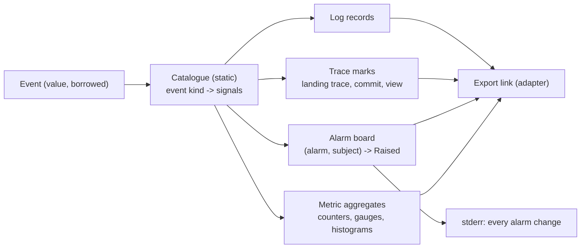
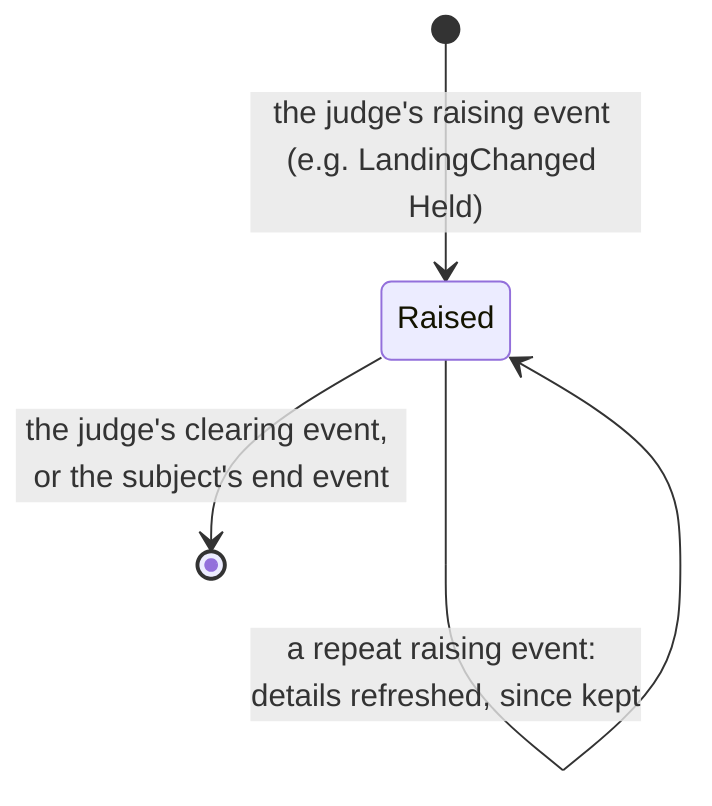
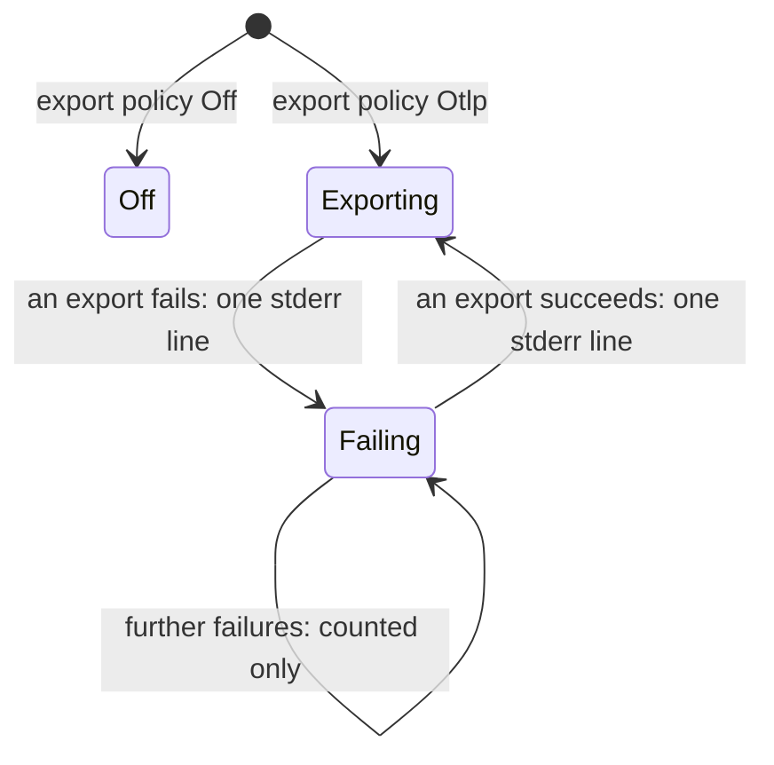
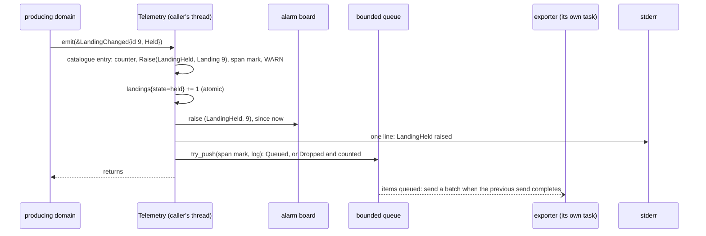
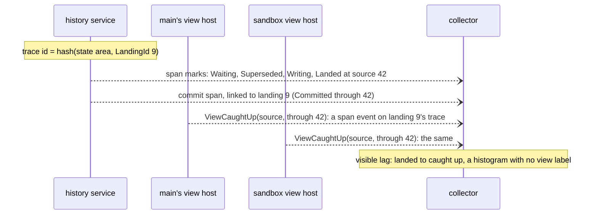

# agentfs target architecture: the Telemetry domain

**Layer:** System › **Domain: Telemetry** › Feature.
**Status:** draft 2, proposed, under [system.md](../system.md) revision 4 (revision 3 approved 2026-11-02), which binds this page. It describes the target, not today's code. Sketches are Rust and show surfaces only.
**What you are asked:** two questions: QT1 in §4 (file paths in logs and traces), QT2 in §7 (who decides a wait is "too long").

## 1. What Telemetry owns, its language, and what it is not

Telemetry turns the events every domain publishes into metrics, traces, log records and alarms, and sends them to the operator's monitoring. It is the one home of alarms. It never blocks a caller, never fails one, and nothing in agentfs reads anything back from it.

**Your requirements this domain serves.** None of your requirements names telemetry. Two bind how it works; everything else here is a design choice, from system §2 ("never blocks; nothing depends on it"), I9 and I10.

| # | Your words | Date | What it asks of Telemetry |
|---|---|---|---|
| R7 | "Security boundary. Agentfs is the gatekeeper that exposes only what we want sandboxes to see" | 2026-10-30 | no file content and no credential leaves through a signal |
| — | "It's all event driven" | 2026-10-24 | alarms raise and clear on events; no timer judges anything here |

**Owns, exclusively:** the catalogue (every metric, span, log and alarm name, with its labels and severity), the alarm board, trace identity for a landing, export, and its own drop and export-failure counts.

**Is not:** any judge of a fact (Landing judges a landing, Journal a stream's room, Health liveness, Replication a push); a source of events or answers for any domain; the notices sent to integrators (Landing's edge); dashboards or alert thresholds (the operator's monitoring, §7); persistence of any kind.

**Glossary and new terms.** System terms (event, landing, stream, position, writer) keep their system meaning.

| Term | Meaning here | Why needed | Could be the existing term |
|---|---|---|---|
| signal | one metric update, span, log record or alarm change | what an event becomes | OpenTelemetry signal |
| catalogue | the table from each event kind to its signals | one home for every signal name | design §13's tables |
| condition alarm | an alarm with a subject that one event raises and another clears | a state an operator must see until it ends | alarm event |
| incident alarm | an alarm that is one occurrence, counted and logged | a failure that is over once reported | alarm event |
| subject | what a condition alarm is about: a landing, a stream, a remote, a component | one alarm per thing, not per event | event fields |
| alarm board | the raised condition alarms in one process, in memory | the "active" gauges and their ages | none |
| landing trace | one trace per landing, with an id computed from its `LandingId` | follow a landing across processes | none |
| export link | the connection to the collector: `Off`, `Exporting` or `Failing` | telemetry's own failure, visible without it | `warning: telemetry:` lines |

## 2. Model

Telemetry has no aggregate that persists. Its model is a static catalogue plus three in-memory parts, one per process.



Two lifecycles, two machines. A condition alarm per subject:



The export link, per process:



A clear with no raised entry is a no-op, so a clearing event that arrives first, or twice, is harmless.

## 3. Public contract

The contract is system §3.3's one method. `Event` and `Diagnostic` are in `contracts` (revision 4 adopted E1).

```rust
// ── The contract (system §3.3, binding) ──────────────────────────
pub trait Telemetry {
    fn emit(&self, e: &Event); // returns nothing: no caller can branch on telemetry
}

// ── the event type emit takes (contracts crate) ──────────────
pub enum Event {                    // closed: a new event cannot skip the catalogue (T3)
    Clients(ClientsEvent),          // Attached, AttachmentEnded, LastDetached
    Journal(JournalEvent),          // Recorded, Lagged, StreamRoom, StreamDeleted
    Landing(LandingEvent),          // LandingChanged (Landed carries its Position), ForkLandingsClosed
    Views(ViewsEvent),              // ViewCaughtUp
    History(HistoryEvent),          // Committed
    Forks(ForksEvent),              // ForkEnded, ForkDropped
    Volume(VolumeEvent),            // VolumeDraining, VolumeStaged, VolumeReleased, StartLineChanged
    Replication(ReplicationEvent),  // PushSettled
    Service(ServiceEvent),          // ServiceReady
    Health(HealthEvent),            // LivenessChanged
    Diagnostic(Diagnostic),         // failures that are replies, not published events
}
pub enum Diagnostic {               // each inner type is defined by its own domain
    Journal(JournalDiagnostic),     // NotDurable{kind}, Backpressure, Refused{reason}
    Trees(TreesDiagnostic),         // NoSpace, Io{kind}, EscapesRoot
    Forks(ForksDiagnostic),         // SpaceLimit{fork}
    History(HistoryDiagnostic),     // CommitFailed{tree, reason}, PathRefused{reason}
    Views(ViewsDiagnostic),         // MountFailed{kind}, ChangeRefused{reason}
    Rules(RulesDiagnostic),         // RuleSetLoaded{version}, VerdictError
    Landing(LandingDiagnostic),     // MergeFailed{reason}, RecoveryRolledForward{id}
}
```

**Who calls it, and whom it calls.**

| Direction | Party | Through |
|---|---|---|
| called by | every domain, in every process | `emit`, for its own diagnostics |
| called by | the event delivery of each process | `emit`, for every §3.4 event it delivers, in the same step as to its consumers (system §3.4) |
| calls | nobody in agentfs | — (it publishes no event and answers no query: T2) |
| sends to | the operator's collector; stderr | the `otel` and `stderr` adapters (§5) |

| Capability | Telemetry holds | Never holds |
|---|---|---|
| all of system §3.2 | none | every one: Telemetry cannot attach, record, land or act |

**The catalogue's shape** (internal, shown because it is where every guarantee below lives).

```rust
pub struct Entry {                          // one per event kind; built by an exhaustive match
    metrics: &'static [MetricSpec],         // updated in place, never queued
    alarm: AlarmEffect,
    trace: Option<TraceMark>,
    log: Option<Level>,
}
pub enum AlarmEffect {
    None,
    Raise { alarm: AlarmId, subject: Subject },
    Clear { alarm: AlarmId, subject: Subject },
    Incident { alarm: AlarmId },            // counted and logged, never on the board
}
pub enum Subject {                          // identities live here and in attributes, never in labels
    Landing(LandingId),
    Stream(TreeRef),
    Remote(RemoteName),
    Component(Component),
    Fork(ForkId),
}
pub struct MetricSpec { id: MetricId, labels: &'static [LabelKey] }
pub trait LabelValue: sealed::Bounded {}    // only closed enums: SourceKind, Room, StateKind, reason codes
pub trait AttrValue: sealed::Shown {}       // ids, positions, commit ids; never Frozen, content or credentials
pub enum TraceKey {                         // the trace id is a hash of this key and the state area
    Landing(LandingId),
    Commit { tree: TreeRef, commit: CommitId },
}
```

**The alarms** (target set; each pair comes from one judge).

| Alarm | Kind | Raised by | Cleared by | Judge |
|---|---|---|---|---|
| `LandingHeld` | condition, per landing | `LandingChanged{Held}` | `LandingChanged{Waiting, Landed, Withdrawn}` | Landing |
| `LandingRefused` | incident | `LandingChanged{Refused}` | — | Landing |
| `StreamLow` / `StreamFull` | condition, per stream | `StreamRoom{Low}` / `{Full}` | `StreamRoom{Plenty}` (or `Low` clears `Full`); `StreamDeleted` | Journal |
| `StartLineMoved` | condition, per volume | `StartLineChanged{Moved}` | `StartLineChanged{InStep}` | Volume |
| `CommitsFailing` | condition, per tree | `CommitFailed{tree}` | `Committed{tree}` | History |
| `PushFailing` / `PushDiverged` | condition, per remote | `PushSettled{failed}` / `{diverged}` | `PushSettled{ok}` | Replication |
| `ComponentUnresponsive` | condition, per component | `LivenessChanged{Unresponsive, Gone}` | `LivenessChanged{Live}` | Health |
| `RecordFailed`, `NoSpace`, `ForkSpaceLimit`, `ViewLagged`, `RulesError`, `MountFailed` | incident | the matching diagnostic or `Lagged` | — | the emitting domain |

## 4. Invariants and how each is enforced

"Never blocks" means: `emit` never waits on the network, the disk, the exporter, a full queue or another caller's slow work. It does a bounded, constant amount of memory work.

| # | Invariant | Enforced by | Strength |
|---|---|---|---|
| T1 | `emit` never fails a caller and never blocks | it returns `()`; metrics are atomic in-place updates; spans and logs go to a bounded queue whose only push is `try_push`; a full queue drops the newest item and counts it in `telemetry.dropped{signal}` | compile time + construction + test |
| T2 | Nothing depends on Telemetry | the telemetry crate has no publisher port and no query; `cargo deny` bans every domain crate from depending on it; the port is always bound, with export `Off` a value, so no caller can tell (system §1 failure rule) | build time + boot time |
| T3 | Every event kind has exactly one catalogue entry | `Event` is closed; the catalogue is one exhaustive `match` with `clippy::wildcard_enum_match_arm` denied in this crate | compile time |
| T4 | No identity or path is ever a metric label (1,000 sandboxes cannot multiply series) | labels take only `LabelValue`, a sealed trait implemented by closed enums; `ClientId`, `ForkId`, `LandingId`, `RelPath`, `CommitId` do not implement it | compile time |
| T5 | No file content and no credential reaches any signal (R7) | attributes take only `AttrValue`, sealed; `Frozen`, `ContentRef`, `CommitContent` and Replication's credential type do not implement it | compile time |
| T6 | Telemetry infers nothing. Each condition alarm is raised and cleared only by events of the domain that judges its fact, never by silence or elapsed time | `AlarmDef` names one producing domain for both events, checked by a test over the catalogue; the crate bans every timer and sleep API (clippy `disallowed_methods`) | construction + test + build time |
| T7 | The alarm board holds only subjects that still exist | every condition alarm's clearing set includes its subject's end event from the same judge (`Landed`, `Withdrawn`, `StreamDeleted`, `PushSettled{Removed}`); components end with `LivenessChanged{Gone}` | test |
| T8 | One landing is one trace in every process, sampled alike | `TraceKey::Landing` hashes to the trace id; the sampler decides from the trace id alone (ratio on the id), so every process agrees without talking | construction |
| T9 | Telemetry persists nothing; its board is rebuilt from the judges after a restart | no repository port exists in the crate; judges re-publish their current state before `ServiceReady` (system §3.4) | construction + test |

**QT1. Should file paths appear in exported logs and traces?** Paths can say what a client works on; the collector is yours, outside agentfs's boundary.
- **Recommended: paths as log and span attributes, never in metrics (T4).** An operator can see which file a held landing is about. Cost: anyone who can read the collector reads path names, hidden ones included.
- **Alternative: no paths; subjects only (landing id, tree), resolved through `agentfs status`.** Cost: every investigation needs access to the volume, and a path is lost once its landing ends.

## 5. Ports and adapters

The telemetry crate holds the catalogue and the board, with no I/O. Its ports are traits; adapters implement them.

```rust
pub trait SignalOut {                         // the otel adapter
    fn metric(&self, id: MetricId, labels: LabelSet, v: Value); // in-place aggregate
    fn record(&self, r: TraceOrLog) -> Pushed; // Queued | Dropped: never waits
}
pub trait AlarmOut {                          // the stderr adapter; always bound
    fn changed(&self, a: &AlarmChange);       // raised, refreshed, cleared, incident
}
pub trait Clock { fn now(&self) -> Time; }    // stamps; never schedules
```

| Port | Adapter | Notes |
|---|---|---|
| `SignalOut` | `otel`: the OpenTelemetry SDK with an OTLP exporter from the standard `OTEL_*` variables; a batch processor that sends when items are queued and the previous send has completed | export `Off` drops at the adapter after counting; aggregates still update |
| `AlarmOut` | `stderr`: one line per alarm change, whatever the export policy | a write error is ignored |
| `Clock` | `std` time | used for `since` on the board and span times |

**Persistence.** None. No repository, no audited record: I13 does not apply, as for Rules. Everything here is a view of facts whose judges persist them; on restart it is rebuilt from their events (T9).

## 6. Internal flows and scenarios

**One event becomes signals.** The caller's thread does the work in the box; export happens elsewhere.



**A live landing, followed end to end** (scenario O4). Three processes, one trace id, joined at the collector.



Linking `Committed` and `ViewCaughtUp` to landing 9 needs the landing's position. Each process keeps a small bounded table of recent landed positions per tree, filled from `LandingChanged{Landed}` and `Recorded`; an entry it lacks costs a missing link, never a decision.

**Restart.** The board starts empty. Before `ServiceReady`, each judge publishes its current state (system §3.4): every non-final landing, every stream's room, each remote's last outcome, the start line. The board is rebuilt from those events alone.

| Scenario | Telemetry behaviour |
|---|---|
| Live landing | `LandingChanged` per step; one landing trace across every process; `LandingHeld` raised on conflict, cleared when re-judged clean, landed or withdrawn |
| Transactions | a transaction lands as one landing, so one trace and at most one `LandingHeld`; its files are attributes of that trace, not separate subjects |
| 1,000 sandboxes | metric series do not grow with sandboxes (T4); `Recorded` updates counters only; per-view `ViewCaughtUp` feeds one histogram; span volume is cut by sampling, which agrees across processes (T8) |
| Crash of any process | its queue and board are lost; the restarted process rebuilds the board from re-published state; a lost process's alarms are Health's to raise (`ComponentUnresponsive`), never inferred here from silence |
| History service stuck | Health judges it and publishes `LivenessChanged`; Telemetry in Health's process raises the alarm (scenario O6) |
| Disk full | Telemetry writes nothing to disk; `NoSpace`, `NotDurable` and `StreamFull` arrive as diagnostics and alarms; stderr may fail and is ignored |
| Collector down or slow | the queue fills and drops, counted; metrics keep aggregating; one stderr line at `Failing`, one at recovery; no caller waits |
| Upgrade with clients attached (system Q3) | old and new processes export side by side, told apart by `service.version`; trace-id derivation is part of the catalogue, so a release that changes it breaks the join across versions |

## 7. Policies and configuration

| Setting | Values | Current setting | Set by |
|---|---|---|---|
| Export | `Off` · `Otlp { endpoint, protocol, certificates, headers }` | `Off` unless an `OTEL_*` endpoint is set | operator, standard `OTEL_*` variables |
| Trace sampling | ratio on the trace id | 1.0; lower on busy volumes | operator, `OTEL_TRACES_SAMPLER` |
| Metric export interval | seconds | 60 (the SDK's default) | operator; a listed I10 operator schedule |
| Queue capacity | items per process | 2,048 (the SDK's default; placeholder) | composition root |
| Recent-landing table | entries per tree | 1,024 (placeholder) | composition root |
| Alarm severities | warn · error, per alarm | the §3 table | the catalogue, per release |
| Resource attributes | volume, state area, process role, `service.version`, pod and node from the platform | always | composition root |

**The catalogue is the one home of every signal name** (DRY). The metric and alarm reference, the example alert rules and their runbook links are generated from it, and CI checks that the generated files match.

**QT2. Who decides that a wait has lasted too long?** A held landing, a `Waiting{Writers}` landing, or a failing remote can last minutes or days.
- **Recommended: agentfs exports each condition alarm's age (`alarm.oldest_age{alarm}`, read from `since` when metrics are collected), and the operator's alert rules hold the thresholds.** agentfs keeps no timer (I10). Cost: an operator with no alert rules sees ages but is never paged.
- **Alternative: agentfs raises its own "stuck" alarms after configured durations.** Cost: a timer inside agentfs judges a fact another domain owns, against I10 and T6.

## 8. Tests that prove it

All run the real binary with the real `otel` adapter against a local OTLP receiver in the test.

| Test | Proves | Failure class ruled out |
|---|---|---|
| compile-fail: a `ClientId` or `RelPath` as a label; a `Frozen` or credential as an attribute; a catalogue match with a wildcard | T3, T4, T5 | series explosion; content or secret leaks; a new event silently untracked |
| the receiver accepts the connection and never answers; 1,000 sandboxes save; record latency compared with export `Off` | T1 | a slow collector slowing file calls |
| receiver down at boot, up later, down again: commands succeed; exactly one stderr line per transition; `telemetry.dropped` and `telemetry.export_failures` exported after recovery | T1, export link | a telemetry failure stopping a command; a stderr flood; silent loss |
| series count with 1 and with 1,000 sandboxes | T4 | metrics backend filled with labels |
| the tracer bullet (system §9) with the receiver: one trace per landing across the history service and both view hosts, holding Waiting, Superseded, Landed, the commit link and two `ViewCaughtUp` | T8 | a landing that cannot be followed end to end |
| stall commits until `StreamLow`, then let them run: the alarm raises and clears; leave the history service idle, events-free, for hours of fake time: no alarm | T6 | alarms from silence or elapsed time |
| hold a landing, restart the history service: `LandingHeld` is active again before `ServiceReady`; after the tracer bullet ends, the board is empty | T7, T9 | alarms lost on restart; a board that grows forever |
| a test over the catalogue: both events of every condition alarm come from one domain | T6 | one domain's alarm judged from another's signals |
| the generated reference and alert rules match the catalogue (`--check` in CI) | DRY | docs and alert rules drifting from the code |

## 9. Costs and open questions

1. **Lossy by design.** Under overload, spans and logs are dropped (counted); a crash loses what was queued. Metric aggregates and the board are never dropped, but they are per process and reset on restart until re-published.
2. **The caller pays the translation.** Every `emit` costs a catalogue lookup, a few atomic updates and, for board alarms, a short in-memory update on the caller's thread.
3. **The board is a view of other domains' state.** It is never read for a decision, and is rebuilt from their events, but a judge that forgets to re-publish at restore leaves an alarm clear while its fact still holds (the restart test in §8 is the guard).
4. **Paths in logs** (QT1's recommendation) put path names in the operator's collector.
5. **Trace joins depend on one hash.** Changing how trace ids are derived splits traces across versions during an upgrade.

## 10. Escalations to the system document

| # | Gap (revision 3) | Recommended fix | Resolution in revision 4 |
|---|---|---|---|
| E1 | `emit(&Event)` named no `Event` type; failures that are replies reached no event | a closed `contracts::Event` with a `Diagnostic` per domain | adopted |
| E2 | nothing required a judge to re-publish its state at restore | each judge publishes its current state before `ServiceReady` | adopted (system §3.4, `ServiceReady` row) |
| E3 | I10's timer list omitted the export interval and send timeout | add them as operator schedules | adopted; I10 also lists Replication's retry and the kernel cache backstop |
| E4 | nobody delivered events to Telemetry | each process's event delivery hands every event to `emit` in the same step | adopted |

Also resolved: T6 and T7 no longer conflict. `StreamLow` and `StreamFull` clear on the Journal's own `StreamDeleted`, not on Forks' `ForkDropped`, so each condition alarm is raised and cleared by one judge.

## For the code architects (parked)

How the board is updated without contention (sharded or lock-free); the queue's structure; the recent-landing table's eviction; span marks versus short spans for each landing step; the exact metric and attribute names; how event delivery crosses the rpc boundary to reach `emit` in view hosts; the hash for trace ids.

## Reconcile with existing code (agentfs origin/main b5c0dc8)

- `EventSink` and `Telemetry::sink` become the `Telemetry` port with a closed `Event`; the open `Event` set and the sink's free-form fields become per-domain diagnostics.
- Telemetry stops being optional: today no endpoint means no sink; the target always binds the port and makes `Off` an export value.
- The "at most once a minute" stderr warning (a timer) becomes one line per export-link transition; the 5 s shutdown flush wait is the exporter's send timeout, a listed I10 schedule.
- Alarm state today lives in gauges set by each subsystem (`patch.blocked`, `push.diverged`); the target moves every alarm onto the board, raised and cleared by the judge's events. Record and commit spans, today correlated by sequence numbers only, join a landing trace.
- Cost: every alarm and metric name is regenerated from the catalogue, so dashboards and alert rules change in one release, with no aliases.

*History: draft 1 (2026-11-02); draft 2, conformed to system revision 4.*
