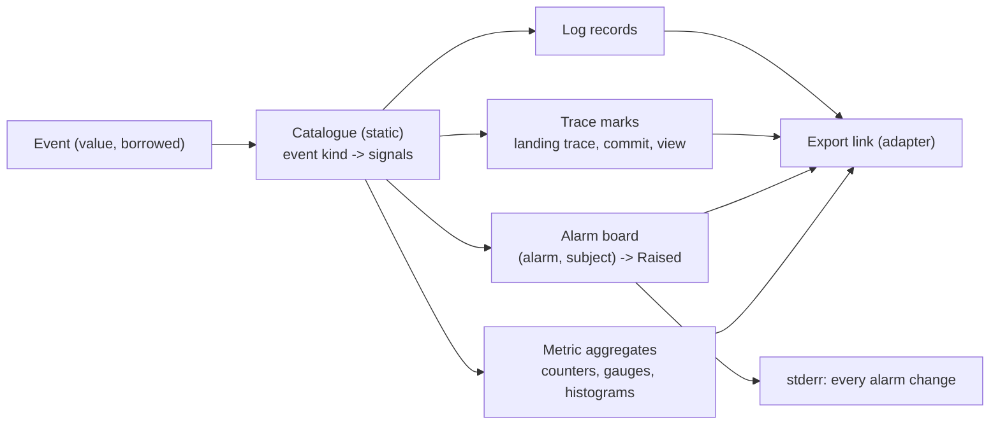
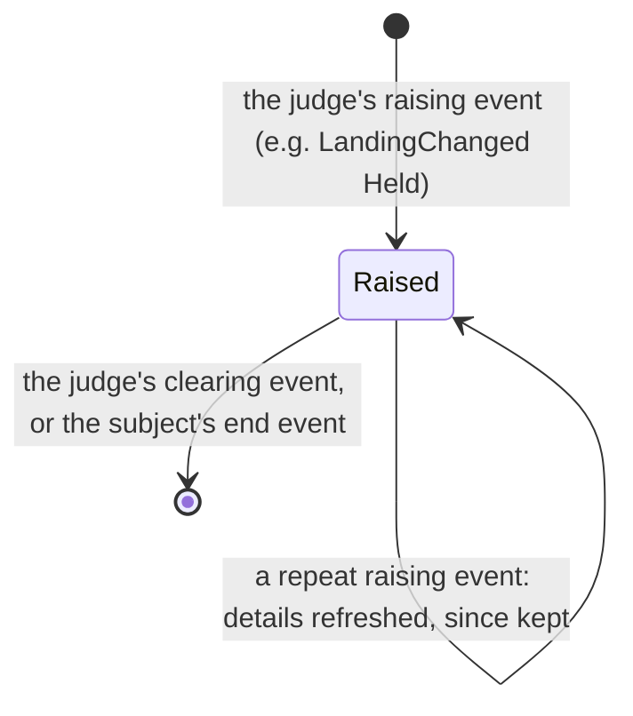
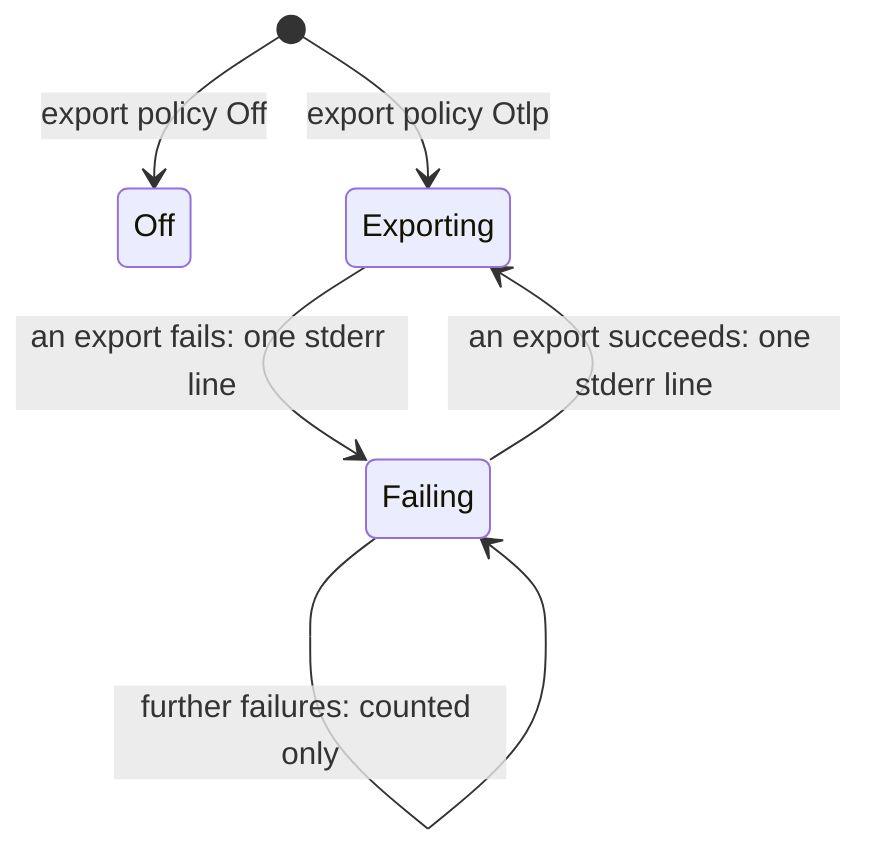
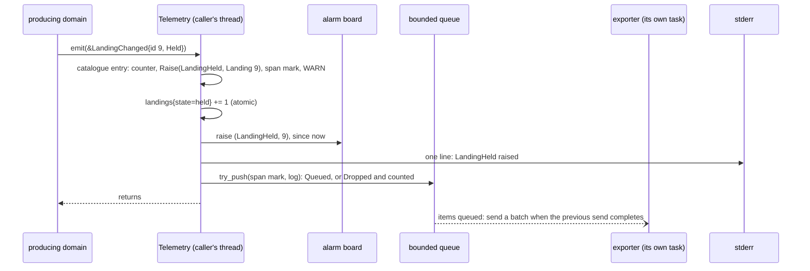

# agentfs target architecture: the Telemetry domain

**Layer:** System › **Domain: Telemetry** › Feature.
**Status:** draft 6, proposed, under [system.md](../system.md) revision 9, which binds this page. It describes the target, not today's code. Sketches are Rust and show surfaces only.
**What you are asked:** nothing; former QT1 (§4) and QT2 (§7) are adopted as design choices.

## 1. What Telemetry owns, its language, and what it is not

Telemetry turns the events every domain publishes into metrics, traces, log records and alarms, and sends them to the operator's monitoring. It is the one home of alarms. It never blocks a caller, never fails one, and nothing in agentfs reads anything back from it.

**Your requirements this domain serves.** None names telemetry; three shape it. The rest are design choices, from system §2 ("never blocks; nothing depends on it"), I9 and I10.

| # | Your words | Date | What it asks of Telemetry |
|---|---|---|---|
| R7 | "Security boundary. Agentfs is the gatekeeper that exposes only what we want sandboxes to see" | 2026-10-30 | no file content and no credential leaves through a signal |
| R16 | "The various agentfs components should be within the same version family (major for sure, maybe minor too, patch doesnt need to match)" | 2026-11-02 | each signal names its version; a version refusal is visible |
| — | "It's all event driven" | 2026-10-24 | alarms raise and clear on events; no timer judges anything here |

**Owns, exclusively:** the catalogue (every metric, span, log and alarm name, with its labels and severity), the alarm board, trace identity for a landing, export, and its own drop and export-failure counts.

**Is not:** a judge of any fact (Landing's landings, the Journal's room, Health's liveness, Replication's pushes); a source of events or answers; the integrator notices (Landing's edge); dashboards or alert thresholds (§7); persistence.

**Glossary and new terms.** System terms (event, landing, stream, position, writer) keep their system meaning.

| Term | Meaning here | Why needed | Could be the existing term |
|---|---|---|---|
| signal | one metric update, span, log record or alarm change | what an event becomes | OpenTelemetry signal |
| catalogue | the table from each event kind to its signals | one home for every signal name | design §13's tables |
| condition alarm | an alarm with a subject that one event raises and another clears | a state an operator must see until it ends | alarm event |
| incident alarm | an alarm that is one occurrence, counted and logged | a failure that is over once reported | alarm event |
| subject | what a condition alarm is about: a landing, a stream, a remote, a component | one alarm per thing, not per event | event fields |
| alarm board | the raised condition alarms in one process, in memory | the "active" gauges and their ages | none |
| landing trace | one trace per landing, with an id computed from its `LandingId` | follow a landing across processes | none |
| export link | the connection to the collector: `Off`, `Exporting` or `Failing` | telemetry's own failure, visible without it | `warning: telemetry:` lines |

## 2. Model

No aggregate persists: a static catalogue plus three in-memory parts per process.



Two lifecycles, two machines. A condition alarm per subject:



The export link, per process:



A clear with no raised entry is a no-op, so a clearing event that arrives first, or twice, is harmless.

## 3. Public contract

The contract is system §3.3's one method. `Event` and `Diagnostic` are in `contracts`.

```rust
// ── The contract (system §3.3, binding) ──────────────────────────
pub trait Telemetry {
    fn emit(&self, e: &Event); // returns nothing: no caller can branch on telemetry
}

// ── the event type emit takes (contracts crate) ──────────────
pub enum Event {                    // closed: a new event cannot skip the catalogue (T3)
    Clients(ClientsEvent),          // Attached, AttachmentEnded, LastDetached
    Journal(JournalEvent),          // Recorded, Lagged, StreamRoom, StreamDeleted
    Landing(LandingEvent),          // LandingChanged (any SourceKind: fork runs and syncs included), ForkLandingsClosed
    Views(ViewsEvent),              // ViewCaughtUp
    History(HistoryEvent),          // Committed
    Forks(ForksEvent),              // ForkEnded, ForkDropped
    Volume(VolumeEvent),            // VolumeDraining, VolumeStaged, VolumeReleased, StartLineChanged
    Replication(ReplicationEvent),  // PushSettled
    Service(ServiceEvent),          // ServiceReady
    Health(HealthEvent),            // LivenessChanged
    Diagnostic(Diagnostic),         // failures that are replies, not published events
}
pub enum Diagnostic {               // each inner type is defined by its own domain
    Journal(JournalDiagnostic),     // NotDurable{kind}, Backpressure, Refused{reason}
    Trees(TreesDiagnostic),         // NoSpace, Io{kind}, EscapesRoot
    Forks(ForksDiagnostic),         // SpaceLimit{fork}
    History(HistoryDiagnostic),     // CommitFailed{tree, reason}, PathRefused{reason}, OtherMajor{theirs}
    Views(ViewsDiagnostic),         // MountFailed{kind}, ChangeRefused{reason}, OtherFamily{theirs}
    Clients(ClientsDiagnostic),     // Refused{reason}. A launcher of another family never reaches Clients: the rpc edge refuses it
    Volume(VolumeDiagnostic),       // FormatsOf{family}: a state area of another family
    Rules(RulesDiagnostic),         // RuleSetLoaded{version}, VerdictError
    Landing(LandingDiagnostic),     // MergeFailed{reason}, ResolverFailed{resolver}, RecoveryRolledForward{id}
}
```

**Who calls it, and whom it calls.**

| Direction | Party | Through |
|---|---|---|
| called by | every domain, in every process | `emit`, for its own diagnostics |
| called by | each process's event delivery | `emit`, for every §3.4 event, in the same step as its consumers |
| calls | nobody in agentfs | — (no event, no query: T2) |
| sends to | the operator's collector; stderr | the `otel` and `stderr` adapters (§5) |

**Capabilities:** none of system §3.2; Telemetry cannot attach, record, land or act.

**The catalogue's shape** (internal; every guarantee below lives here).

```rust
pub struct Entry {                          // one per event kind; built by an exhaustive match
    metrics: &'static [MetricSpec],         // updated in place, never queued
    alarm: AlarmEffect,
    trace: Option<TraceMark>,
    log: Option<Level>,
}
pub enum AlarmEffect {
    None,
    Raise { alarm: AlarmId, subject: Subject },
    Clear { alarm: AlarmId, subject: Subject },
    Incident { alarm: AlarmId },            // counted and logged, never on the board
}
pub enum Subject {                          // identities live here and in attributes, never in labels
    Landing(LandingId),
    Stream(TreeRef),
    Remote(RemoteName),
    Component(Component),
    Fork(ForkId),
}
pub struct MetricSpec { id: MetricId, labels: &'static [LabelKey] }
pub trait LabelValue: sealed::Bounded {}    // only closed enums: SourceKind, Room, StateKind, ResolverKind, reason codes
pub trait AttrValue: sealed::Shown {}       // ids, positions, commit ids; never Captured, content or credentials
pub enum TraceKey {                         // the trace id is a hash of this key and the state area
    Landing(LandingId),
    Commit { tree: TreeRef, commit: CommitId },
}
```

**The alarms** (target set; each pair comes from one judge).

| Alarm | Kind | Raised by | Cleared by | Judge |
|---|---|---|---|---|
| `LandingHeld` | condition, per held run (commits waiting behind it raise none) | `LandingChanged{Held}` | `LandingChanged{Waiting, Landed, Withdrawn}` | Landing |
| `SyncDeferred` | incident: the conflict raises `LandingHeld` once, when the fork's own commit is held | `LandingChanged{Deferred}` | — | Landing |
| `LandingRefused` | incident | `LandingChanged{Refused}` | — | Landing |
| `VersionMismatch` | incident, both versions shown | `OtherFamily`, `OtherMajor`, `FormatsOf` | — | Views (`OtherFamily`); History; Volume |
| `StreamLow` / `StreamFull` | condition, per stream | `StreamRoom{Low}` / `{Full}` | `StreamRoom{Plenty}` (or `Low` clears `Full`); `StreamDeleted` | Journal |
| `StartLineMoved` | condition, per volume | `StartLineChanged{Moved}` | `StartLineChanged{InStep}` | Volume |
| `CommitsFailing` | condition, per tree | `CommitFailed{tree}` | `Committed{tree}` | History |
| `PushFailing` / `PushDiverged` | condition, per remote | `PushSettled{failed}` / `{diverged}` | `PushSettled{ok}` | Replication |
| `ComponentUnresponsive` | condition, per component | `LivenessChanged{Unresponsive, Gone}` | `LivenessChanged{Live}` | Health |
| `RecordFailed`, `NoSpace`, `ForkSpaceLimit`, `ViewLagged`, `RulesError`, `MountFailed`, `ResolverFailed` | incident | its diagnostic, or `Lagged` | — | the emitting domain |

**Landing metrics** carry `source` (`fork_run`, `sync`, …) and `state` (`deferred` included); `landing.merged{resolver}` counts which resolver merged, read from `Landed{merged_by}` (E5), measuring the chain's reach. An agent-merged landing is also logged at warn with its commit, for review.

## 4. Invariants and how each is enforced

"Never blocks": `emit` never waits on the network, the disk, the exporter, a full queue or another caller; it does bounded memory work.

| # | Invariant | Enforced by | Strength |
|---|---|---|---|
| T1 | `emit` never fails a caller and never blocks | it returns `()`; metrics are atomic in-place updates; spans and logs go to a bounded queue whose only push is `try_push`; a full queue drops the newest item and counts it in `telemetry.dropped{signal}` | compile time + construction + test |
| T2 | Nothing depends on Telemetry | no publisher port, no query; `cargo deny` bans domain crates from depending on it; the port is always bound, export `Off` a value, so no caller can tell | build time + boot time |
| T3 | Every event kind has exactly one catalogue entry | `Event` is closed; the catalogue is one exhaustive `match` with `clippy::wildcard_enum_match_arm` denied in this crate | compile time |
| T4 | No identity or path is ever a metric label (1,000 sandboxes cannot multiply series) | labels take only `LabelValue`, a sealed trait implemented by closed enums; `ClientId`, `ForkId`, `LandingId`, `RelPath`, `CommitId` do not implement it | compile time |
| T5 | No file content and no credential reaches any signal (R7) | attributes take only `AttrValue`, sealed; `Captured`, `ContentRef`, `CommitContent` and Replication's credential type do not implement it | compile time |
| T6 | Telemetry infers nothing. Each condition alarm is raised and cleared only by events of its fact's judge, never by silence or elapsed time | `AlarmDef` names one producing domain for both events, tested over the catalogue; clippy `disallowed_methods` bans every timer and sleep API | construction + test + build time |
| T7 | The alarm board holds only subjects that still exist | each condition alarm also clears on its subject's end event from the same judge (`Landed`, `Withdrawn`, `StreamDeleted`, `PushSettled{Removed}`, `LivenessChanged{Gone}`); a held run ends only by Landing's event (E6) | test |
| T8 | One landing is one trace in every process, sampled alike; a sync's trace links to the trace of the landing whose record it carries | `TraceKey::Landing` hashes to the trace id; the sampler decides from the trace id alone (ratio on the id), so every process agrees without talking | construction |
| T9 | Telemetry persists nothing; its board is rebuilt from the judges after a restart | no repository port exists in the crate; judges re-publish their current state before `ServiceReady` (system §3.4) | construction + test |

**Paths (design choice; was QT1).** Paths are log and span attributes, never metric labels (T4), so an operator sees which file a held landing is about. Cost: whoever reads the collector reads paths, hidden ones too. Rejected: subjects only, via `agentfs status`: every investigation needs the volume, and a path is lost once its landing ends.

## 5. Ports and adapters

The telemetry crate holds the catalogue and the board, with no I/O. Its ports are traits; adapters implement them.

```rust
pub trait SignalOut {                         // the otel adapter
    fn metric(&self, id: MetricId, labels: LabelSet, v: Value); // in-place aggregate
    fn record(&self, r: TraceOrLog) -> Pushed; // Queued | Dropped: never waits
}
pub trait AlarmOut {                          // the stderr adapter; always bound
    fn changed(&self, a: &AlarmChange);       // raised, refreshed, cleared, incident
}
pub trait Clock { fn now(&self) -> Time; }    // stamps; never schedules
```

| Port | Adapter | Notes |
|---|---|---|
| `SignalOut` | `otel`: the OpenTelemetry SDK with an OTLP exporter from the standard `OTEL_*` variables; a batch processor that sends when items are queued and the previous send has completed | export `Off` drops at the adapter after counting; aggregates still update |
| `AlarmOut` | `stderr`: one line per alarm change, whatever the export policy | a write error is ignored |
| `Clock` | `std` time | used for `since` on the board and span times |

**Persistence.** None, so I13 does not apply (as for Rules): everything here is a view of facts their judges persist (T9).

## 6. Internal flows and scenarios

**One event becomes signals.** The caller's thread does the work in the box; export happens elsewhere.



**A live landing, followed end to end** (scenario O4). Three processes, one trace id, joined at the collector.

```mermaid
sequenceDiagram
  participant HS as history service
  participant MV as main's view host
  participant SV as sandbox view host
  participant C as collector
  Note over HS: trace id = hash(state area, LandingId 9)
  HS--)C: span marks: Waiting, Writing, Landed at source 42; merged by Lines
  HS--)C: commit span, linked to landing 9 (Committed through 42)
  MV--)C: ViewCaughtUp(source, through 42): a span event on landing 9's trace
  SV--)C: ViewCaughtUp(source, through 42): the same
  HS--)C: sync 10 into another fork's own copy, from source 42: its own trace, linked to 9
  Note over C: visible lag: landed to caught up, a histogram with no view label
```

Linking `Committed`, `ViewCaughtUp` and a sync's `from` to landing 9 needs the landing's position. Each process keeps a small bounded table of recent landed positions per tree, filled from `LandingChanged{Landed}` and `Recorded`; an entry it lacks costs a missing link, never a decision.

**Restart.** The board starts empty and is rebuilt from the states each judge re-publishes before `ServiceReady` (system §3.4): open landings, stream rooms, remotes' last outcomes, the start line.

| Scenario | Telemetry behaviour |
|---|---|
| A fork's run | one trace across every process; a conflict raises one `LandingHeld` (attributes: the held commit, the run's `through`), cleared by a clean re-judging, `resolve` or `Withdrawn` |
| A sync | its own trace, linked to the landing it carries; `Deferred` is only `SyncDeferred` (the conflict is held once, at the fork's commit) |
| Transactions | a transaction is a fork: its seal is one run, at most one `LandingHeld`; its files are attributes, not subjects. An abandoned one (A13) is counted from `ForkEnded{why}`; a landing `Waiting{Transaction}` (`Lock`, until the seal or drop) is a gauge, never alarmed |
| 1,000 sandboxes | metric series do not grow with sandboxes (T4); `Recorded` updates counters only; per-view `ViewCaughtUp` feeds one histogram; span volume is cut by sampling, which agrees across processes (T8) |
| A process crashes or hangs | its queue and board are lost and rebuilt from re-published state; a lost or stuck process is Health's to judge (`ComponentUnresponsive`, raised in Health's process), never inferred here from silence |
| Disk full | Telemetry writes nothing to disk; `NoSpace`, `NotDurable` and `StreamFull` arrive as diagnostics and alarms; stderr may fail and is ignored |
| Collector down or slow | the queue fills and drops, counted; metrics keep aggregating; one stderr line at `Failing`, one at recovery; no caller waits |
| Upgrade (system §8) | a patch: old and new export side by side, told apart by `service.version`; a minor or major drains first, so families never mix; a refusal is `VersionMismatch` |

## 7. Policies and configuration

| Setting | Values | Current setting | Set by |
|---|---|---|---|
| Export | `Off` · `Otlp { endpoint, protocol, certificates, headers }` | `Off` unless an `OTEL_*` endpoint is set | operator, standard `OTEL_*` variables |
| Trace sampling | ratio on the trace id | 1.0; lower on busy volumes | operator, `OTEL_TRACES_SAMPLER` |
| Metric export interval | seconds | 60 (the SDK's default) | operator; a listed I10 operator schedule |
| Queue capacity | items per process | 2,048 (the SDK's default; placeholder) | composition root |
| Recent-landing table | entries per tree | 1,024 (placeholder) | composition root |
| Alarm severities | warn · error, per alarm | the §3 table | the catalogue, per release |
| Resource attributes | volume, state area, process role, `service.version` (the full semantic version, R16), pod and node from the platform | always | composition root |

**The catalogue is the one home of every signal name** (DRY). The metric and alarm reference, the example alert rules and their runbook links are generated from it, and CI checks that the generated files match.

**Who judges "too long" (design choice; was QT2).** A held run, a `Waiting{Writers}` landing or a failing remote can last days. agentfs exports each condition alarm's age (`alarm.oldest_age{alarm}`, from `since` at collection); the operator's alert rules hold the thresholds, so agentfs keeps no timer (I10). Cost: without alert rules, nobody is paged. Rejected: "stuck" alarms after set durations, a timer judging another domain's fact (T6).

## 8. Tests that prove it

All run the real binary with the real `otel` adapter against a local OTLP receiver in the test.

| Test | Proves | Failure class ruled out |
|---|---|---|
| compile-fail: a `ClientId` or `RelPath` as a label; a `Captured` or credential as an attribute; a catalogue match with a wildcard | T3, T4, T5 | series explosion; content or secret leaks; a new event silently untracked |
| the receiver accepts and never answers; 1,000 sandboxes save: record latency as with export `Off`; series count as with 1 sandbox | T1, T4 | a slow collector slowing file calls; labels filling the backend |
| receiver down at boot, up, down again: commands succeed; one stderr line per transition; `telemetry.dropped` and `telemetry.export_failures` exported after recovery | T1, export link | a telemetry failure stopping a command; a stderr flood; silent loss |
| the tracer bullet (system §9): one trace per landing across all three processes (Waiting, Writing, Landed, the resolver, the commit link, two `ViewCaughtUp`); step 2's sync as its own trace, caught up in the sandbox's view | T8 | a landing or a sync that cannot be followed end to end |
| F7 conflicts, F8 waits, F's next commit merges: one `LandingHeld`, raised and cleared. A main save conflicts with F's copy, then F commits it: `SyncDeferred`, then one `LandingHeld` | T6, T7 | a conflict alarmed twice, or per waiting commit |
| a view host of another minor connects; a state area of another family opens: one `VersionMismatch` each, both versions shown | R16 | a version refusal the operator cannot see |
| stall commits until `StreamLow`, then resume: the alarm raises and clears; hours of fake idle time raise nothing | T6 | alarms from silence or elapsed time |
| hold a landing, restart the history service: `LandingHeld` is active again before `ServiceReady`; after the tracer bullet ends, the board is empty | T7, T9 | alarms lost on restart; a board that grows forever |
| a test over the catalogue: both events of every condition alarm come from one domain | T6 | one domain's alarm judged from another's signals |
| the generated reference and alert rules match the catalogue (`--check` in CI) | DRY | docs and alert rules drifting from the code |

## 9. Costs and open questions

1. **Lossy by design.** Overload drops spans and logs (counted); a crash loses the queue. Aggregates and the board are never dropped, but reset per process on restart until re-published.
2. **The caller pays the translation:** a catalogue lookup and a few atomic and in-memory updates on its thread.
3. **The board is a view of other domains' state,** never read for a decision; a judge that forgets to re-publish at restore leaves an alarm clear while its fact holds (§8's restart test guards it).
4. **Paths in logs** put path names in the operator's collector.
5. **Trace joins depend on one hash,** part of the family: a patch never changes it; a minor may, and is drained across anyway.

## 10. Escalations to the system document

None open. Revision 7 adopted E5 (`Landed{merged_by}` in Landing) and resolved E6 in the system's favour: a fork never drops with a held run (I5), so `resolve` or `withdraw` always clears `LandingHeld` first.

## For the code architects (parked)

The board without contention (sharded or lock-free); the queue; the recent-landing table's eviction; span marks or short spans per landing step; exact metric and attribute names; how events reach `emit` in view hosts across rpc; the trace-id hash.

## Reconcile with existing code (agentfs origin/main b5c0dc8)

- `EventSink` and `Telemetry::sink` become the port with a closed `Event`; the sink's free-form fields become per-domain diagnostics.
- Telemetry stops being optional (today no endpoint means no sink): the port is always bound, `Off` an export value. The once-a-minute stderr warning (a timer) becomes one line per export-link transition; the 5 s shutdown flush is the exporter's send timeout (I10).
- Alarm gauges set by each subsystem (`patch.blocked`, `push.diverged`) move onto the board, raised and cleared by the judge's events. Record and commit spans, today joined by sequence numbers, join a landing trace; mergiraf's merges, uncounted today, count as `Structure`.
- Cost: every alarm and metric name is regenerated from the catalogue, so dashboards and alert rules change in one release, with no aliases.

*History: draft 1 (2026-11-02); draft 2, conformed to system revision 4, which adopted E1–E4; draft 3, to revision 5; draft 4, to revision 7: E5, E6, A13; draft 5, to revision 8: locks, rollbacks; draft 6, to revision 9: transaction forks.*
