# Trees: storage and lifecycle

**Proposed, not built.** This page proposes the Trees domain (where working trees live and the fork lifecycle), one part of the system around the git model ([the system](../system.md)). The git model ([git-model.md](../git-model.md)) wins wherever the two disagree. Rust sketches show surfaces only. The commit that lands the slice that builds this domain deletes this page and moves the behaviour into the library or operator docs.

**What this page covers.** In git terms a tree is a branch with its own index and working tree (git-model §2, §3);
its branch, saves, queue, syncs and transactions are the git model's. Trees owns the rest: where the working tree's
files live, their confinement and space, and each fork's lifecycle.

## 0. Guidance this domain serves

The owner's guidance that applies here is in `OWNER-GUIDANCE.md` at the repository root. Everything else on this page is a design choice.

## 1. What Trees owns, and what it is not

| Owns | Is not |
|---|---|
| **storage**: where each tree's working tree and each transaction's directory live, and serving them from less space than full copies, if it can | the branch, index or what a checkout writes (git-model §3) |
| **confinement**: every path is reached beneath its tree's root, no symlink followed | which names a view shows (Rules, Views) |
| **space**: each fork's limit and the volume's fork budget | the volume's lifecycle (Volume) |
| **the fork lifecycle**: create, end, drop; publishes `ForkEnded`, `ForkDropped` | who writes a fork (Clients' claim) |
| **pinned snapshots**: a read-only tree of one commit, for `Sees::Snapshot` | history reads (git) |

## 2. The fork lifecycle

A fork's upstream is main or another fork (git-model §10). Creating it creates its branch at the upstream's head with
its upstream set, and its working tree (git-model §12, "fork create"); so a new fork starts from everything landed
so far.

```mermaid
stateDiagram-v2
  [*] --> Open: create(upstream) by a launcher: branch at the upstream's head, working tree, space reserved
  Open --> Ended: LastDetached of its tree, or its launcher's end
  Ended --> Dropped: no live child, and none of its entries waits in its upstream's queue
  Dropped --> [*]: ForkDropped: branch and working tree deleted (git-model §12); space released
```



| Rule (design choices) | Why |
|---|---|
| A fork ends at its last client's leaving | one writer for life ([clients](clients.md) C4): it is never written again, and a deleted pod's launcher may never call `end` |
| An ended fork drops only once its upstream's queue has taken every entry it put there | every save reaches the referee, so a losing one is kept as a collision ref (git-model §4) before the branch goes |
| A fork with a live child does not drop | the child's upstream is its branch |
| After the drop | main still reaches the fork's landed commits (full lineage); every losing commit stays under its collision ref (git-model §4, §11) |

## 3. Pinned snapshots

A pinned snapshot is a read-only checkout of one commit of a tree's branch, made complete before it is visible and
never written; a snapshot client's `advance` makes a fresh one, and each is deleted at its `LastDetached` (design
choice). It has no branch and no queue: nothing lands in it.

## 4. Storage, confinement and space

| Rule (design choices) | Enforced by | Strength |
|---|---|---|
| T1. Every path is reached beneath its tree's root; no symlink, `..` or magic link is followed | the only path type is `RelPath`; the only resolver is a beneath-only open; no method takes a `Path` | compile time + test |
| T2. A view's write handle reaches only its own tree's working tree (or its transaction's directory) | other trees are typed read-only handles | compile time |
| T3. A file is replaced whole: a reader sees whole old or whole new (S3) | the working tree and the repository share one device, so each file a checkout writes can be renamed into place | boot time (checked at open) + test |
| T4. A fork cannot fill the disk main writes to | a per-fork quota set at create, reserved in full from the fork budget (thick); without quota support, editable forks are refused | boot time |
| T5. Storage is an optimisation, never a second truth: whatever serves a working tree serves exactly the files the git model's checkout would write | one test suite runs against full checkouts and the optimised storage | test |

**Storage** (design choice). Each working tree is, in git-model §3, a full checkout. Trees may serve it from a reflink
clone of its upstream's working tree, or an overlay over it (a "fork layer"), only if T5 holds.

| Setting | Values | Current choice |
|---|---|---|
| Per-fork space limit | bytes | one value per volume (placeholder: 1 GiB) |
| Fork budget | bytes, at most the free space the operator gives forks | placeholder: 25 % of the volume |
| Reservation | thick · thin | thick: no fork, nor main, runs out of promised space; thin lets one burst fail everyone's writes |
| Directory renames in a fork | refused with `EXDEV` (as today) | tools copy and delete |

## 5. Public contract

```rust
pub trait Trees {
    fn create(&mut self, upstream: TreeRef, by: &LaunchCap) -> Result<ForkId, TreeError>; // branch, working tree, quota
    fn pin(&mut self, of: TreeRef, by: &PinCap) -> Result<SnapshotId, TreeError>;      // ends at its LastDetached
    fn end(&mut self, f: ForkId, by: &LaunchCap) -> Result<(), TreeError>;             // only its creating launcher
    fn facts(&self, f: ForkId) -> Option<ForkFacts>;                                   // upstream, created by, ended
    fn live(&self) -> Vec<ForkId>;                                                     // not yet dropped: an upgrade's drain
    fn handle(&self, s: Served) -> TreeHandle;                                         // confined root for a view
}
pub enum TreeError {
    UpstreamUnknown,
    NotPermitted,       // a fork launcher ending another's fork
    SpaceLimit,         // the fork budget cannot reserve the limit
    QuotaUnavailable,   // no per-tree quota support: editable forks refused (T4)
    Ended,
    EscapesRoot,
    Io(IoKind),
}
```

Consumes `LastDetached` (Clients). Publishes `ForkEnded{fork}` and `ForkDropped{fork}` (Clients, Replication,
Volume). Persists each fork's row (`Audited`, S6) in `store`; the filesystem holds the files.

## 6. Tests

| Test | Rules out |
|---|---|
| A symlink planted as any ancestor, or as the last component, is never followed | escaping the tree (T1) |
| A reader opened before a landing rewrites p reads the old bytes whole; a reopen reads the new | torn reads (T3) |
| A fork fills its quota while main saves: main's save succeeds | a fork denying main (T4) |
| The same scenarios on full checkouts and on optimised storage give identical files | storage as a second truth (T5) |
| An ended fork with a save still in its upstream's queue: no drop until it is taken; then branch gone, its collision ref kept | a save lost at drop |
| An upstream with a live child never drops; a crash while filling a snapshot leaves none visible | reads through a deleted branch; a partial snapshot |

## 7. Costs

1. **Full checkouts cost a copy per fork** until optimised storage passes T5.
2. **Thick reservation** caps how many forks fit: 1,000 forks at 1 GiB need a 1 TB budget, idle or not.
3. **Quotas narrow the filesystems** that can host forks (XFS, ext4 with project quotas, btrfs).
4. **Directory renames inside a fork stay refused** (`EXDEV`).

## For the code architects (parked)

Quota mechanics per filesystem and project-id limits at 1,000 forks; reflink or overlay layout for optimised storage;
whether `git worktree add` or a plain checkout makes each working tree; snapshot naming.

## Where it meets the existing code

- **Confinement** (`agentfs-core` `confined.rs` and `agentfs-fuse` `backing.rs`, a duplicate by the module's own words) becomes one confined `fs` adapter.
- **The tmp layer** (`overlay/tmp.rs`) becomes a fork's working tree; recordable names stop going to the shared tree.
- **The existing volume fork** (a whole volume cloned from another's latest commit) becomes an in-volume fork with its own branch. Cost: quotas, snapshots and the drop rule are new code.

**Not verified:** reflink, project quotas, beneath-only resolution and rename atomicity were not tested.

