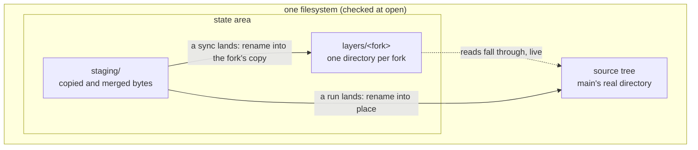

# Trees: the real filesystem

**Layer:** System › **Domain (Trees)** › Feature.
**Status:** draft 6, proposed, under [system.md](../system.md) revision 9. It describes the target, not today's code. Sketches are Rust and show surfaces only.
**Binding:** system.md §3 (contracts), §3.5 (the landing process, syncs and trims), §4 (I1 to I16), §8 (versions).

**Your requirements this domain serves (verbatim, dated).** Everything else here is a design choice.

| # | Your words | Date |
|---|---|---|
| R3 | "a virtual filesystem overlay for each client (including main) that is backed by a _real_ filesystem source-of-truth" | 2026-11-01 |
| R4 | "the sandbox fs edits need to land back in the main container, and then future sandboxes should start from the edited files" | 2026-11-01 |
| R7 | "Security boundary. Agentfs is the gatekeeper that exposes only what we want sandboxes to see" | 2026-10-30 |
| R9 | "Whole seems best, right? A partial application has unknown side effects" | 2026-10-16 |
| R13 | "A cooperating integration can define batches/transactions across files, and they must all land together. But a default usage, like the CNI provides, can operate per-file." | 2026-11-02 |
| R16 | "i would like for the git history to remain compatible across minor versions, and only break on a major version change. The various agentfs components should be within the same version family (major for sure, maybe minor too, patch doesnt need to match)" | 2026-11-02 |
| R18 | "If the changes are passing bi-directionally, then keeping the two trees relatively in-sync should minimize conflicts, right?" (excerpt; R17 keeps forks) | 2026-11-02 |
| A6 | A pinned fork is an acceptable snapshot (your answer, a current choice) | 2026-11-02 |
| A9 | "freezing only the files that a landing touches sounds reasonable. and hopefully our new per-client + view system makes locking/freezing files easier" (your answer, a current choice) | 2026-11-02 |

R12 (the history setting, one per volume) does not reach this domain: either setting lands the same bytes in the same tree.

## 1. What Trees owns, its language, and what it is not

Trees is the content truth (R3). It holds every byte a client can see, and it is the only code that touches a tree's bytes; a captured copy belongs to its holder.

| Owns | Is not |
|---|---|
| the **source tree** (main's real directory) and every **layer** (a fork's directory over its parent) | lineage, which fork exists, its kind or its space limit (Forks) |
| **confinement**: every path is reached beneath its root, no symlink followed | which names a view shows (Rules, Views) |
| **copy-up**: a fork's first write of a path copies it into the fork's layer | the path base's meaning or lifetime as a merge base (Forks) |
| **byte copies** (`capture`): an immutable, durable copy of a file's current bytes | records, `Seq`, writers (Journal) |
| **rename into place** under a gate, in main (a run) or a fork (a sync, a restore, a transaction's run), idempotent; **trim** of a fork copy | the gate itself: which files it covers, when it rises, who waits on it (Landing, Views) |
| **fill**: a pinned fork's checkout into a real tree | commit objects (History hands Trees a `CommitContent`) |
| the **staging area**: where copied and merged bytes wait, on the tree's filesystem; a fork's staging, syncs included, sits under that fork's quota | any event, timer or policy of its own |
| the **quota mechanism**: each layer's per-directory quota, set at `create_layer` | the limit's value (Forks) |
| the **layer layout** (whiteouts, state names), one internal format of the release family (§7) | the family check (`store`, at boot) |

**New terms** (system.md's terms keep their meaning; "tree" is a real directory a view serves).

| Term | Meaning here | Why needed | Could be the existing term |
|---|---|---|---|
| layer | a fork's own directory: only what the fork changed (copied-up files, new files, whiteouts) | the fork's tree | tmp layer, upper layer |
| lower | the trees a layer reads through, nearest first | resolution order | `reads_through` |
| whiteout | a mark in a layer: "this name is gone here" | a fork's deletes | overlayfs whiteout |
| node | one real inode by device, inode and generation, never its path | idempotent replace; `expect` | node id |
| staged file | a file in the staging area: written, synced, never changed again | atomic rename; durability before `Writing` | `pending/` |
| `Captured` | one staged copy per path, or per database-group member; never A9's "freeze", which is Landing's gate (E5) | copies have one holder | none |

## 2. The model

Trees has two aggregates. A **layer** has a physical lifecycle. A **replace** is one gated rename batch, into exactly one tree. Neither keeps a database: the filesystem is the record (design choice: one source of truth).



| Concept | Kind | Identity | Invariant (design rule unless marked) |
|---|---|---|---|
| `Roots` | value, built once at open | the state area | source, layers and staging share one device: every move is one atomic rename |
| `Layer` | aggregate | `ForkId` | its state is its directory's name; an editable layer's files are never partial |
| `Staged` | entity, move-only | `StagedId` plus its node | durable and immutable from construction on |
| `Captured` | value | its members | one member, or every member of a database group, never part of a group |
| `Targets` | value | the gate it was built from | one tree, the gate's; every path is one of the gate's files |
| `Resolved` | value | none | the topmost layer that answers for a path |

**A layer's lifecycle.** This is the physical life of the directory only; whether the fork is ended is Forks' fact (one concept, one domain). Each state is the directory's name, so a crash leaves a name that says what to finish.

```mermaid
stateDiagram-v2
  [*] --> Creating: create_layer (editable)
  [*] --> Filling: fill (pinned)
  Creating --> Editable: empty directory synced, renamed to its final name
  Filling --> Pinned: checkout complete and synced, renamed to its final name
  Creating --> [*]: crash: discarded at open (never acknowledged)
  Filling --> [*]: crash: discarded at open; fill again gives the same tree
  Editable --> Dropping: drop_layer, one rename into trash
  Pinned --> Dropping: drop_layer
  Dropping --> [*]: removed; a crash finishes the removal at open
```



## 3. Public contract

The trait is system.md §3.3's. Trees defines the types the trait names.

```rust
pub trait Trees {
    fn facts(&self) -> TreeFacts;                                                // reflink, per-layer quotas: detected at open
    fn create_layer(&self, f: ForkId, over: TreeRef, limit: Bytes) -> Result<(), TreeError>; // idempotent; the quota is set here
    fn drop_layer(&self, f: ForkId) -> Result<(), TreeError>;                  // idempotent: gone → Ok
    fn fill(&self, f: ForkId, from: CommitContent) -> Result<(), TreeError>;   // pinned fork: a checkout, whole or absent
    fn resolve(&self, t: TreeRef, p: &RelPath) -> Result<Resolved, TreeError>;
    fn handle(&self, b: &Binding) -> TreeHandle;                               // own tree to write, ancestors to read (Views)
    fn copy_up(&self, f: ForkId, p: &RelPath) -> Result<Captured, TreeError>; // the copied bytes, captured: the base
    fn capture(&self, t: TreeRef, p: &RelPath) -> Result<Captured, TreeError>; // reflink, else copy
    fn stage(&self, t: TreeRef, bytes: MergedBytes) -> Result<Staged, TreeError>; // a merge result, synced; a fork's under its quota
    fn replace(&self, g: &Gated, targets: Targets) -> Result<(), TreeError>;  // rename into place, main or a fork; idempotent
    fn trim(&self, g: &Gated, f: ForkId, p: &RelPath, expect: NodeId) -> Result<(), TreeError>; // only if p still holds expect
    fn discard(&self, s: Captured);                                            // its one holder releases it
}
pub enum TreeError { EscapesRoot, Symlink, NoSpace, Moved { path: RelPath }, Io(IoKind) }
pub struct TreeFacts { reflink: bool, layer_quotas: bool }
```

```rust
/// Which layer answers for p in tree t: t's own layer first, then each lower, nearest first.
pub enum Resolved {
    Entry {
        layer: TreeRef,      // the topmost tree holding p
        kind: EntryKind,     // file, directory, symlink, other
        node: NodeId,        // the real inode, for identity checks
    },
    WhitedOut { layer: TreeRef }, // a fork removed p: absent in that fork and every fork over it
    Absent,
}

/// A real inode. Two equal NodeIds are the same file, whatever its name now.
pub struct NodeId { dev: u64, ino: u64, generation: u32 }

/// A staged file: durable (synced) and immutable once built. Move-only: no Clone.
/// Only the fs adapter constructs one, and only after its sync returned.
pub struct Staged { id: StagedId, node: NodeId, len: u64, executable: bool }

/// What capture and copy_up return: never hashed (hashing happens at commit).
pub struct Captured {
    members: NonEmpty<(RelPath, Staged)>, // one file, or every member of its database group
}

/// What one replace writes. Built only from the gate it runs under (A9).
pub struct Targets {
    tree: TreeRef,             // the gate's one tree: Source for a run; a fork for a sync, restore or sibling
    items: NonEmpty<Target>,   // exactly the gate's files; applied in one fixed order (§6)
}
pub struct Target {
    path: RelPath,
    change: Change,
    expect: Expect,            // what the merge read at this name; anything else is never overwritten
    creates: Vec<RelPath>,     // parent directories the merge saw absent; no other parent is ever made
}
pub enum Change {
    Put(Staged),               // rename this staged file onto path
    Remove,                    // unlink path; in a fork whose lower holds it, leave a whiteout
}
pub enum Expect { Node(NodeId), Absent }
```

**Who calls Trees, and whom Trees calls.** Trees publishes no events and consumes none: it is commanded, and each reply is the fact.

| Caller | Calls | Why |
|---|---|---|
| Forks | `facts`, `create_layer`, `drop_layer`, `fill`, `copy_up`, `discard` | a fork's layer and quota, its pinned checkout, its first write of a path; releasing a replaced base |
| Landing | `resolve`, `capture`, `stage`, `replace`, `trim`, `discard` | read what a merge reads; land a run into main or a sync into a fork; trim; reconcile |
| Views | `resolve`, `handle`, `capture` | serve the client; copy bytes at a change boundary before `record` |
| Trees asks Rules | `group(p)` → the database group | copy-up and capture take a group whole |

| Capability Trees requires | From | It makes impossible |
|---|---|---|
| `&Gated` on `replace` and `trim` | Landing, only inside a risen gate (system.md §3.2) | a rename into, or a trim of, any tree or file outside a landing's gate |
| `Roots` (private constructor) | `fs` adapter at open | a layer or staging area on another device |
| a read-only lower handle (no write methods) | Trees, internally | a view of a fork writing its parent (I1) |

## 4. Invariants and how they are enforced

| # | Invariant | Traces to | Enforced by | Strength |
|---|---|---|---|---|
| T1 | Every path is reached beneath its tree's root; no symlink, `..` or magic link is ever followed | R7; system I8 | the only path type is `RelPath` (`parse` only); the only resolver is the adapter's beneath-only open; no Trees method takes a `Path` | compile time + test |
| T2 | A client's file calls change only its own tree: a fork's view writes its layer, never a lower | system I1 | lowers are typed read-only handles with no write methods | compile time |
| T3 | A name is changed by one atomic rename of a staged, synced file. A reader sees whole old or whole new, and an open handle keeps the old | R9; system I7 | `Change::Put` takes a `Staged`, which exists only after its sync; `Roots` puts staging on the tree's device | construction time + test |
| T4 | `replace` and `trim` write only the gate's files, in its one tree, over what the merge read: a sync never touches main, a run no fork | A9; system I3, I4, I6 | `Targets` and `trim` take `&Gated`, checked at construction; `expect` before each rename, else `Moved` | construction time + test |
| T5 | A replace re-run after a crash gives the state of one run | system I3 (roll forward) | each target is judged done by identity: the name holds the staged node | test |
| T6 | A layer never holds a partial file: copy-up writes to staging, syncs, then renames into the layer | R3 | copy-up's only write into a layer is a `Put(Staged)` | construction time + test |
| T7 | A database group is copied up and captured whole, or not at all | R13 | `Captured.members` comes from Rules' group; copy-up renames members only after all are staged | construction time + test |
| T8 | A pinned tree is visible only complete, and nothing writes it | A6 | `Filling` is a temporary name; a pinned layer has no writable handle | construction time |
| T9 | A sandbox fork cannot fill the disk main writes to | system I6 | a per-layer quota set at `create_layer`; the fork's staging (syncs included) and journal payloads sit under it | boot time (`facts`, else sandbox forks refused) |
| T10 | Every captured or staged file has one holder, and only it discards it | system I14 | `Captured` and `Staged` are move-only; `discard` consumes one | construction time |
| T11 | The layer layout is read only by its own release family | R16; system I16 | no mark of its own: the state area's family stamp covers it, checked by `store` at boot before Trees opens | boot time |

## 5. Ports and adapters

The Trees crate holds the logic: resolution order, whiteout meaning, target ordering, identity judgements. It does no I/O; one port carries every effect.

```rust
/// The confined filesystem. Implemented by the `fs` adapter (Linux); nothing else touches the disk.
pub trait FsPort {
    fn open_roots(&self, area: &StateArea) -> Result<Roots, OpenRefusal>;         // checks device, kernel, quota support
    fn stat(&self, d: &DirHandle, p: &RelPath) -> Result<Option<Entry>, TreeError>; // beneath-only, no symlinks
    fn stage_copy(&self, from: &DirHandle, p: &RelPath) -> Result<Staged, TreeError>; // reflink, else copy; then sync
    fn rename_into(&self, s: Staged, to: &DirHandle, p: &RelPath) -> Result<(), TreeError>; // one atomic rename, synced
    fn unlink(&self, d: &DirHandle, p: &RelPath) -> Result<(), TreeError>;
    fn whiteout(&self, layer: &DirHandle, p: &RelPath) -> Result<(), TreeError>;
    fn rename_dir(&self, from: &DirName, to: &DirName) -> Result<(), TreeError>;  // layer state changes
    fn set_quota(&self, layer: &DirHandle, limit: Bytes) -> Result<(), TreeError>;
}
pub enum OpenRefusal { AnotherDevice, KernelTooOld, NoQuotaSupport /* sandbox forks refused, I6 */ }
```

| Adapter | Behind | Notes |
|---|---|---|
| `fs` | `FsPort` | `openat2` beneath with no symlinks or magic links; `renameat2`; reflink (`FICLONE`) detected at open, else copy; project quota per layer; every rename followed by a sync of its directory |
| test double | none | tested through the real `fs` adapter (§8); a fake would test the fake |

**Persistence.** Trees keeps no repository or record, so I13's audit stamps have nothing to stamp; who wrote a byte is the Journal's and History's fact.

## 6. Internal flows and scenarios

**A fork's first write of p (copy-up).** Forks owns the base; Trees makes the bytes.

```mermaid
sequenceDiagram
  participant V as sandbox view (fork F)
  participant F as Forks
  participant T as Trees
  participant R as Rules
  V->>F: copy_up(F, p, cap)
  F->>T: copy_up(F, p)
  T->>R: group(p): its database group, if any
  T->>T: resolve p in F's lowers; stage a copy of each member (reflink, else copy), sync
  T->>T: stage a second copy of each member: the base, never written again
  T->>T: rename each member's first copy into F's layer (parents made as needed)
  T-->>F: Captured (the base copies)
  F-->>V: Ok: the write goes to F's layer
```

**A landing replaces names, in either direction.** Landing has already staged the merged target and moved to `Writing`; the gate covers only these files, in this one tree (A9).

```mermaid
sequenceDiagram
  participant L as Landing
  participant T as Trees
  participant K as the kernel
  L->>T: replace(gated, targets): main for a run, F's layer for a sync
  loop each target: puts shallowest first, removals deepest first, then by path
    T->>T: done already? the name holds the staged node: skip
    T->>K: stat the name: it must match expect, else stop with Moved
    T->>K: make the parents in creates, then one rename (or unlink, or whiteout); sync the directory
  end
  T-->>L: Ok. Landing moves bases, then appends its one record
  opt F's copy now equals its parent's, closed in F
    L->>T: trim(gated, F, p, node): F reads its parent live again
  end
```

Trees holds no lock across a system call: its names ordering is the kernel's per-directory lock, in the fixed order above, so a landing cannot deadlock with a client's rename.

**Scenarios that touch Trees.**

| Scenario | Trees' behaviour | Cost or gap |
|---|---|---|
| Live landing or sync, a reader holds p open | the rename gives p a new node; the reader keeps old bytes until it reopens (I7) | hard links across it break |
| Main changes p while F holds its own p | a sync stages the merge under F's quota and renames it onto F's copy; main is untouched | a staged copy and a rename in F |
| F's quota is full when a sync stages | `NoSpace`; F unchanged; Landing judges | F drifts on p |
| A client renames p's directory meanwhile | `expect`, or a parent missing from `creates`, stops the replace with `Moved` (tracked moved) | rare: such a rename counts as a write-open (Views) |
| Transaction, 400 files, landed or rolled back | landed: one `replace` into the parent fork, every target staged before the first rename; rolled back: `drop_layer` of its fork, no rename | `PerFile` readers can see a subset mid-replace |
| 1,000 sandboxes | 1,000 empty directories; a read costs one lookup per tree in the lineage | filesystems cap quota project ids (NOT VERIFIED) |
| Crash in `copy_up` | unrenamed staged copies are left; the layer holds no partial file | open discards them (§7) |
| Crash in `replace` after k of n | Landing rolls `Writing` forward; the re-run skips the k by identity | none |
| Crash in `fill` or `drop_layer` | open discards `Filling`, finishes `Dropping` | a refill: a full checkout |
| Disk full | staging runs before `Writing`, so the landing stops there; a growing directory can still fail a rename mid-replace | that stalls `Writing` until `Landing::retry` |
| Upgrade | patch: same layout, swapped in place. Minor or major: the drain drops every fork, so the new release opens with no layers or staged files; nothing migrates | a layout change waits for a drain |

## 7. Policies and configuration Trees owns

Trees owns no policy a caller can choose: facts detected at open, and two adopted design choices.

| Setting | Values | Where it is decided | When unmet |
|---|---|---|---|
| One device for source, layers and staging | yes | `open_roots` | refused at boot |
| Beneath-only path resolution | the kernel supports it | `open_roots` | refused at boot |
| Capture method | reflink, else copy | detected at open, never configured | copy: costs time and space per file (named degradation) |
| Per-layer quota support | yes or no | detected at open, reported by `facts` | sandbox forks refused (system I6) |
| A layer's space limit | bytes | Forks owns the value and passes it to `create_layer`; Trees enforces it | not applicable |
| Layer layout family | the state area's major and minor | `store` at boot (I16) | `FormatsOf(family)`: refused until that family's release drains it |
| **Directory renames in a fork** (design choice, was TQ1) | refused with `EXDEV` | Trees | tools copy and delete. Rejected: redirect marks (a second format, lineage-aware lookups) |
| **Leftover staged files** (design choice, was TQ2) | a holder names its `Staged` durably; open discards the rest | Trees at open | each holder keeps a durable name. Rejected: a ledger in Trees (a second truth) |

## 8. Tests that prove it

All run the real `fs` adapter on a temporary directory; reflink and quota tests use an XFS loop image in one CI leg (a slow tier, argued for by T3 and T9).

| Test | Proves | Failure class ruled out |
|---|---|---|
| a symlink planted as any ancestor, or as the last component, is never followed | T1 | escaping the tree |
| a compile-fail test: a fork view's lower handle has no write method | T2 | a sandbox writing main |
| failpoints at every step of `copy_up`: the layer holds nothing or the whole file; the base equals the first bytes | T6, T7 | a partial file shadowing main; a half-copied group |
| a reader opened before `replace` reads the old bytes whole; a reopen reads the new; in main and in a fork | T3 | torn reads |
| crash after each of k renames, re-run: same tree as one run | T5 | doubled or lost landings |
| `Targets` outside its gate or tree cannot be built; a sync into F leaves main byte-identical; a parent renamed before `replace` gets nothing written | T4 | a write wider than the landing; a sync reaching main; overwriting an unseen change |
| crash in `fill`: no pinned tree visible; refill equals the checkout | T8 | a snapshot missing files |
| a sandbox fills its quota: its write and its syncs fail; main's save still succeeds | T9 | a sandbox denying main |
| staging on another device, no quota support, or a state area of another family: boot refusal names it | §7, T11 | a non-atomic "rename"; unbounded forks; reading a foreign layout |

## 9. Costs

1. **Copy-up writes twice** (the layer's copy and the base). Free with reflink; without it, two full copies per first write.
2. **Every sync is a staged copy and a rename in the fork**, charged to its quota, and gives the fork's file a new node.
3. **Whiteouts are a versioned format.** A change to the layer layout is a minor or major release and waits for a drain.
4. **Directory renames inside a fork stay refused** (`EXDEV`).
5. **A copy-up of a file main is writing** takes the bytes there at that moment as the base (parked in system.md).
6. **Trees relies on the gate**: where it does not reach, `expect` stops the replace but cannot make it succeed.

No open questions here.

## 10. Escalations to the system document

None open. Revision 4 adopted E1 to E4; revision 7 adopted E5: Trees' `freeze`/`Frozen` became `capture`/`Captured`, so your word "freeze" (A9) means only Landing's gate.


## For the code architects (parked)
- Whiteout and opaque-directory representation; staged-file naming.
- Quota mechanics per filesystem (XFS project quotas; ext4's project feature); project-id limits at 1,000 layers.
- Hard links in a layer; `copy_file_range` across layers; the fixed order's tie-break.

## Reconcile with existing code (agentfs origin/main b5c0dc8)
- **Confinement** (`agentfs-core` `confined.rs` and `agentfs-fuse` `backing.rs`, which the module itself calls a duplicate): one confined `fs` adapter. Cost: the two callers move at once.
- **The tmp layer** (`overlay/tmp.rs`) becomes the fork layer: it holds every file a sandbox writes, persists until the fork drops, and now receives main's changes by sync renames. Recordable names stop going to the shared tree.
- **The names ordering** (an in-process lock in `agentfs-fuse`) leaves Trees, which relies on single kernel calls; a view host's inode-table ordering stays in Views.
- **Freeze into `pending/`** (design §3.2) becomes `capture` into the staging area; restore's in-place rewrite (design §15) becomes a staged rename. Cost: restored files get new inodes, as landed ones do.

**NOT RUN:** no code was run; reflink, project quotas, beneath-only resolution and rename atomicity come from design.md and kernel documentation.

*History: draft 1; draft 2, system revision 4; draft 3, revision 5 (syncs, local freezes, versioned layout); draft 4, revision 7 (E5 adopted); draft 5, revision 8 (rollbacks); draft 6, revision 9 (a rollback is a dropped layer).*
