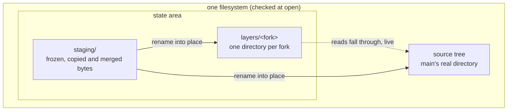

# Trees: the real filesystem

**Layer:** System › **Domain (Trees)** › Feature.
**Status:** draft 2, proposed, under [system.md](../system.md) revision 4 (revision 3 approved 2026-11-02). It describes the target, not today's code. Sketches are Rust and show surfaces only.
**Binding:** system.md §3 (contracts), §3.5 (the landing process), §4 (I1 to I15). The gaps this page found (§10) are resolved in revision 4.

**Your requirements this domain serves (verbatim, dated).** Everything else here is a design choice.

| # | Your words | Date |
|---|---|---|
| R3 | "a virtual filesystem overlay for each client (including main) that is backed by a _real_ filesystem source-of-truth" | 2026-11-01 |
| R4 | "the sandbox fs edits need to land back in the main container, and then future sandboxes should start from the edited files" | 2026-11-01 |
| R7 | "Security boundary. Agentfs is the gatekeeper that exposes only what we want sandboxes to see" | 2026-10-30 |
| R9 | "Whole seems best, right? A partial application has unknown side effects" | 2026-10-16 |
| R13 | "A cooperating integration can define batches/transactions across files, and they must all land together. But a default usage, like the CNI provides, can operate per-file." | 2026-11-02 |
| A6 | A pinned fork is an acceptable snapshot (your answer, a current choice) | 2026-11-02 |

R12 (the history setting) does not reach this domain: either setting lands the same bytes in the same tree.

## 1. What Trees owns, its language, and what it is not

Trees is the content truth (R3). It holds every byte a client can see, and it is the only code that touches those bytes.

| Owns | Is not |
|---|---|
| the **source tree** (main's real directory) and every **layer** (a fork's directory over its parent) | lineage, which fork exists, its kind or its space limit (Forks) |
| **confinement**: every path is reached beneath its root, no symlink followed | which names a view shows (Rules, Views) |
| **copy-up**: a fork's first write of a path copies it into the fork's layer | the path base's meaning or lifetime as a merge base (Forks) |
| **freeze**: an immutable, durable copy of a file's current bytes | records, `Seq`, writers (Journal) |
| **rename into place** under a gate, idempotent | when a landing may write, or what it writes (Landing) |
| **fill**: a pinned fork's checkout into a real tree | commit objects (History hands Trees a `CommitContent`) |
| the **staging area**: where frozen, copied and merged bytes wait, on the tree's filesystem; a fork's staging sits under that fork's quota | any event, timer or policy of its own |
| the **quota mechanism**: each layer's per-directory quota, set at `create_layer` | the limit's value (Forks) |

**Glossary.** Terms from system.md keep their meaning; new ones are also in the New terms table at the end.

| Term | Meaning here |
|---|---|
| tree | a real directory a view serves: the source tree, or a fork's layer over its parent (system.md) |
| layer | a fork's own directory. It holds only what the fork changed: copied-up files, new files, whiteouts |
| lower | the trees a layer reads through, nearest first: its parent, then the parent's ancestors (`Binding.reads_through`) |
| whiteout | a mark in a layer that says "this name is gone here", hiding the lower entry |
| node | one real inode, identified by device, inode number and generation, never by its path |
| staged file | a file in the staging area: written, synced, never changed again |
| frozen | one staged file per path, or one per member of a database group |

## 2. The model

Trees has two aggregates. A **layer** has a physical lifecycle. A **replace** is one gated rename batch. Neither keeps a database: the filesystem is the record (design choice: one source of truth).



| Concept | Kind | Identity | Invariant (design rule unless marked) |
|---|---|---|---|
| `Roots` | value, built once at open | the state area | source tree, layers and staging share one device, so every move is one atomic rename |
| `Layer` | aggregate | `ForkId` | its state is its directory's name; an editable layer's files are never partial |
| `Staged` | entity, move-only | `StagedId` plus its node | durable and immutable from construction on |
| `Frozen` | value | its members | one member, or every member of a database group, never part of a group |
| `Targets` | value | the gate it was built from | every path lies inside that gate's scope |
| `Resolved` | value | none | the topmost layer that answers for a path |

**A layer's lifecycle.** This is the physical life of the directory only; whether the fork is ended is Forks' fact (one concept, one domain). Each state is the directory's name, so a crash leaves a name that says what to finish.

```mermaid
stateDiagram-v2
  [*] --> Creating: create_layer (editable)
  [*] --> Filling: fill (pinned)
  Creating --> Editable: empty directory synced, renamed to its final name
  Filling --> Pinned: checkout complete and synced, renamed to its final name
  Creating --> [*]: crash: discarded at open (never acknowledged)
  Filling --> [*]: crash: discarded at open; fill again gives the same tree
  Editable --> Dropping: drop_layer, one rename into trash
  Pinned --> Dropping: drop_layer
  Dropping --> [*]: removed; a crash finishes the removal at open
```



## 3. Public contract

The trait is system.md §3.3's (revision 4, which adopted this page's E1 to E3). Trees defines the types the trait names.

```rust
pub trait Trees {
    fn facts(&self) -> TreeFacts;                                                // reflink, per-layer quotas: detected at open
    fn create_layer(&self, f: ForkId, over: TreeRef, limit: Bytes) -> Result<(), TreeError>; // idempotent; the quota is set here
    fn drop_layer(&self, f: ForkId) -> Result<(), TreeError>;                  // idempotent: gone → Ok
    fn fill(&self, f: ForkId, from: CommitContent) -> Result<(), TreeError>;   // pinned fork: a checkout, whole or absent
    fn resolve(&self, t: TreeRef, p: &RelPath) -> Result<Resolved, TreeError>;
    fn handle(&self, b: &Binding) -> TreeHandle;                               // own tree to write, ancestors to read (Views)
    fn copy_up(&self, f: ForkId, p: &RelPath) -> Result<Frozen, TreeError>;   // the copied bytes, frozen: the base
    fn freeze(&self, t: TreeRef, p: &RelPath) -> Result<Frozen, TreeError>;   // reflink, else copy
    fn stage(&self, t: TreeRef, bytes: MergedBytes) -> Result<Staged, TreeError>; // a merge result, synced
    fn replace(&self, g: &Gated, targets: Targets) -> Result<(), TreeError>;  // rename into place, idempotent
    fn trim(&self, g: &Gated, f: ForkId, p: &RelPath, expect: NodeId) -> Result<(), TreeError>; // only if p still holds expect
    fn discard(&self, s: Frozen);                                              // its one holder releases it
}
pub enum TreeError { EscapesRoot, Symlink, NoSpace, Moved { path: RelPath }, Io(IoKind) }
pub struct TreeFacts { reflink: bool, layer_quotas: bool }
```

```rust
/// Which layer answers for p in tree t: t's own layer first, then each lower, nearest first.
pub enum Resolved {
    Entry {
        layer: TreeRef,      // the topmost tree holding p
        kind: EntryKind,     // file, directory, symlink, other
        node: NodeId,        // the real inode, for identity checks
    },
    WhitedOut { layer: TreeRef }, // a fork removed p: absent in that fork and every fork over it
    Absent,
}

/// A real inode. Two equal NodeIds are the same file, whatever its name now.
pub struct NodeId { dev: u64, ino: u64, generation: u32 }

/// A staged file: durable (synced) and immutable once built. Move-only: no Clone.
/// Only the fs adapter constructs one, and only after its sync returned.
pub struct Staged { id: StagedId, node: NodeId, len: u64, executable: bool }

/// What freeze and copy_up return: never hashed (hashing happens at commit).
pub struct Frozen {
    members: NonEmpty<(RelPath, Staged)>, // one file, or every member of its database group
}

/// What one replace writes. Built only from the gate it runs under.
pub struct Targets {
    tree: TreeRef,             // the tree being landed into: Source, or a fork (restore, sibling)
    items: NonEmpty<Target>,   // applied in one fixed order: §6
}
pub struct Target {
    path: RelPath,
    change: Change,
    expect: Expect,            // what the merge read at this name; anything else is never overwritten
    creates: Vec<RelPath>,     // parent directories the merge saw absent; no other parent is ever made
}
pub enum Change {
    Put(Staged),               // rename this staged file onto path
    Remove,                    // unlink path; in a fork whose lower holds it, leave a whiteout
}
pub enum Expect { Node(NodeId), Absent }
```

**Who calls Trees, and whom Trees calls.** Trees publishes no events and consumes none: it is commanded, and each reply is the fact (design rule 3).

| Caller | Calls | Why |
|---|---|---|
| Forks | `facts`, `create_layer`, `drop_layer`, `fill`, `copy_up`, `discard` | a fork's layer and quota, its pinned checkout, its first write of a path; releasing a replaced base |
| Landing | `resolve`, `freeze`, `stage`, `replace`, `trim`, `discard` | read what a merge reads; stage and land the merged target under its gate; trim a landed fork copy; reconcile |
| Views | `resolve`, `handle`, `freeze` | serve the client through its tree handle; freeze at a change boundary before `record` |
| Journal | `discard` | releasing a payload at truncation |
| Trees asks Rules | `group(p)` → the database group | copy-up and freeze take a group whole |

| Capability Trees requires | From | It makes impossible |
|---|---|---|
| `&Gated` on `replace` and `trim` | Landing, only inside a risen gate (system.md §3.2) | a rename into, or a trim of, any tree outside a landing |
| `Roots` (private constructor) | `fs` adapter at open | a layer or staging area on another device |
| a read-only lower handle (no write methods) | Trees, internally | a view of a fork writing its parent (I1) |

## 4. Invariants and how they are enforced

| # | Invariant | Traces to | Enforced by | Strength |
|---|---|---|---|---|
| T1 | Every path is reached beneath its tree's root; no symlink, `..` or magic link is ever followed | R7; system I8 | the only path type is `RelPath` (`parse` only); the only resolver is the adapter's beneath-only open; no Trees method takes a `Path` | compile time + test |
| T2 | A client's file calls change only its own tree: a fork's view writes its layer, never a lower | system I1 | lowers are typed read-only handles with no write methods | compile time |
| T3 | A name is changed by one atomic rename of a staged, synced file. A reader sees whole old or whole new, and an open handle keeps the old | R9; system I7 | `Change::Put` takes a `Staged`, which exists only after its sync; `Roots` puts staging on the tree's device | construction time + test |
| T4 | `replace` writes only inside its gate's scope and only over what the merge read | system I3, I4 | `Targets` built from `&Gated`; `expect` checked before each rename, else `Moved` | construction time + test |
| T5 | A replace re-run after a crash gives the state of one run | system I3 (roll forward) | each target is judged done by identity: the name holds the staged node | test |
| T6 | A layer never holds a partial file: copy-up writes to staging, syncs, then renames into the layer | R3 (the real tree is the truth) | copy-up's only write into a layer is a `Put(Staged)` | construction time + test |
| T7 | A database group is copied up and frozen whole, or not at all | R13 (groups land together) | `Frozen.members` comes from Rules' group; copy-up renames members only after all are staged | construction time + test |
| T8 | A pinned tree is visible only complete, and nothing writes it | A6 | `Filling` is a temporary name; a pinned layer has no writable handle | construction time |
| T9 | A sandbox fork cannot fill the disk main writes to | system I6 | per-layer filesystem quota set at `create_layer` from Forks' limit; that fork's staging and journal payloads sit under it | boot time (quota support reported by `facts`, else sandbox forks refused) |
| T10 | Every frozen or staged file has one holder, and only it discards it | system I14 | `Frozen` and `Staged` are move-only; `discard` consumes one | construction time |

## 5. Ports and adapters

The Trees crate holds the logic: resolution order, whiteout meaning, target ordering, identity judgements. It does no I/O; one port carries every effect.

```rust
/// The confined filesystem. Implemented by the `fs` adapter (Linux); nothing else touches the disk.
pub trait FsPort {
    fn open_roots(&self, area: &StateArea) -> Result<Roots, OpenRefusal>;         // checks device, kernel, quota support
    fn stat(&self, d: &DirHandle, p: &RelPath) -> Result<Option<Entry>, TreeError>; // beneath-only, no symlinks
    fn stage_copy(&self, from: &DirHandle, p: &RelPath) -> Result<Staged, TreeError>; // reflink, else copy; then sync
    fn rename_into(&self, s: Staged, to: &DirHandle, p: &RelPath) -> Result<(), TreeError>; // one atomic rename, synced
    fn unlink(&self, d: &DirHandle, p: &RelPath) -> Result<(), TreeError>;
    fn whiteout(&self, layer: &DirHandle, p: &RelPath) -> Result<(), TreeError>;
    fn rename_dir(&self, from: &DirName, to: &DirName) -> Result<(), TreeError>;  // layer state changes
    fn set_quota(&self, layer: &DirHandle, limit: Bytes) -> Result<(), TreeError>;
}
pub enum OpenRefusal { AnotherDevice, KernelTooOld, NoQuotaSupport /* sandbox forks refused, I6 */ }
```

| Adapter | Behind | Notes |
|---|---|---|
| `fs` | `FsPort` | `openat2` beneath with no symlinks or magic links; `renameat2`; reflink (`FICLONE`) detected at open, else copy; project quota per layer; every rename followed by a sync of its directory |
| test double | none | Trees' logic is tested through the real `fs` adapter on a temporary directory (§8); a fake would test the fake |

**Persistence.** Trees keeps no repository and writes no record, so I13's audit stamps have nothing to stamp here. Who wrote a byte is the Journal's record and History's commit; Trees never derives it.

## 6. Internal flows and scenarios

**A fork's first write of p (copy-up).** Forks owns the base; Trees makes the bytes.

```mermaid
sequenceDiagram
  participant V as sandbox view (fork F)
  participant F as Forks
  participant T as Trees
  participant R as Rules
  V->>F: copy_up(F, p, cap)
  F->>T: copy_up(F, p)
  T->>R: group(p): its database group, if any
  T->>T: resolve p in F's lowers; stage a copy of each member (reflink, else copy), sync
  T->>T: stage a second copy of each member: the base, never written again
  T->>T: rename each member's first copy into F's layer (parents made as needed)
  T-->>F: Frozen (the base copies)
  F-->>V: Ok: the write goes to F's layer
```

**A landing replaces names.** Landing has already staged the merged target and moved to `Writing`.

```mermaid
sequenceDiagram
  participant L as Landing
  participant T as Trees
  participant K as the kernel
  L->>T: replace(gated, targets)
  loop each target: puts shallowest first, removals deepest first, then by path
    T->>T: done already? the name holds the staged node: skip
    T->>K: stat the name: it must match expect, else stop with Moved
    T->>K: make the parents in creates, then one rename (or unlink, or whiteout); sync the directory
  end
  T-->>L: Ok. Landing appends its one record
```

Trees holds no lock of its own across a system call. Its names ordering is the kernel's per-directory lock on each single-call change, applied in the fixed order above, so a landing cannot deadlock with a client's rename (stress L5).

**Scenarios that touch Trees.**

| Scenario | Trees' behaviour | Cost or gap |
|---|---|---|
| Live landing, a reader holds p open | the rename gives p a new node; the reader keeps the old bytes until it reopens (I7) | hard links across the landing break (system cost 2) |
| Live landing, a client renames p's directory meanwhile | `expect` or a missing parent not in `creates` stops the replace before it writes there with `Moved`; Landing treats it as tracked moved | a rename in a gated scope counts as a write-open (Views), so this is rare |
| Transaction, 400 files in 30 directories | one `replace`, one fixed order; every target staged before the first rename | readers under `PerFile` can see a subset mid-replace (system cost 3); `WholeLanding` waits are Views' |
| 1,000 sandboxes | 1,000 empty directories; a read through a layer costs one lookup per tree in the lineage | each layer is a quota project; filesystems cap project ids (NOT VERIFIED per filesystem) |
| Hot directory | no agentfs lock; the kernel orders single calls | none known |
| Crash in `copy_up` | staged copies without a rename are left over; the layer never holds a partial file | open discards staged files no holder named durably (TQ2) |
| Crash in `replace` after k of n | Landing rolls `Writing` forward; the re-run skips the k by identity | none |
| Crash in `fill` or `drop_layer` | open discards `Filling` and finishes `Dropping` | a refill costs a full checkout |
| Disk full | staging runs before `Writing`, so a full disk holds the landing there (`Held{NoSpace}`). A sandbox's quota stops only that sandbox. A directory that must grow can still fail a rename mid-replace | the mid-replace case stalls `Writing` until an operator's `Landing::retry` |
| Upgrade | Trees' durable format is the layer layout (whiteouts, state names). A change to it migrates per system Q3, at open, before `ServiceReady` | it cannot run under view hosts of the old version still attached |

## 7. Policies and configuration Trees owns

Trees owns no policy a caller can choose. Its settings are facts it detects at open.

| Setting | Values | Where it is decided | When unmet |
|---|---|---|---|
| One device for source, layers and staging | yes | `open_roots` | refused at boot |
| Beneath-only path resolution | the kernel supports it | `open_roots` | refused at boot |
| Freeze method | reflink, else copy | detected at open, never configured | copy: costs time and space per file (named degradation) |
| Per-layer quota support | yes or no | detected at open, reported by `facts` | sandbox forks refused (system I6) |
| A layer's space limit | bytes | Forks owns the value and passes it to `create_layer`; Trees enforces it | not applicable |

## 8. Tests that prove it

All run the real `fs` adapter on a temporary directory; the reflink and quota tests run on an XFS loop image in one CI leg (a slow tier: argued for by T3 and T9).

| Test | Proves | Failure class ruled out |
|---|---|---|
| a symlink planted as any ancestor, or as the last component, is never followed | T1 | escaping the tree |
| a compile-fail test: a fork view's lower handle has no write method | T2 | a sandbox writing main |
| failpoints at every step of `copy_up`: the layer holds nothing or the whole file; the base equals the first bytes | T6, T7 | a partial file shadowing main; a half-copied group |
| a reader opened before `replace` reads the old bytes whole; a reopen reads the new | T3 | torn reads |
| crash after each of k renames, re-run: same tree as one run | T5 | doubled or lost landings |
| a client renames the parent between the merge and `replace`: nothing written there | T4 | overwriting an unseen change; both old and new directory existing |
| crash in `fill`: no pinned tree visible; refill equals the checkout | T8 | a snapshot missing files |
| a sandbox fills its quota: its write fails; main's save still succeeds | T9 | a sandbox denying main |
| staging on another device, or no quota support: boot refusal names it | §7 | a non-atomic "rename"; unbounded forks |

## 9. Costs and open questions

**Costs, stated rather than sold.**
1. **Copy-up writes twice** (the layer's copy and the base). Free with reflink; without it, two full copies per first write.
2. **Whiteouts become a durable format.** Every change to the layer layout is a migration.
3. **Directory renames inside a fork stay refused** (`EXDEV`, as today's overlay); tools fall back to copy and delete.
4. **A copy-up of a file main is writing** takes whatever bytes are there at that moment as the base (system.md parks this).
5. **Trees relies on the gate** for every name it replaces. Where the gate does not reach, `expect` stops the replace; it cannot make the landing succeed.

**Questions (domain level).**
- **TQ1. Directory renames in a fork.** Recommended: keep `EXDEV`. Cost: `mv` of a directory is a copy. Alternative: overlayfs-style redirect marks. Cost: a second durable format and lineage-aware lookups.
- **TQ2. Leftover staged files after a crash.** Recommended: whoever adopts a `Staged` names it durably, and open discards the rest; a holder releases through `discard`. Cost: each holder keeps a durable name. Alternative: Trees keeps a ledger of staged files. Cost: a second truth beside the directory itself.

## 10. Escalations to the system document

| # | Gap (revision 3) | Proposal | Resolution in revision 4 |
|---|---|---|---|
| E1 | the gate stopped write-opens only; `TreeError` had no "the name no longer holds what the merge read" | name changes in a gated scope count as write-opens (Views); `TreeError::Moved`; `Targets` built from `&Gated` | adopted |
| E2 | `stage`, `trim`, the view file-call surface and release of a `Staged` were missing | add them, with release named by the holder | adopted: `stage`, `trim(&Gated, ...)`, `handle`, `discard`. Each frozen file has one holder: the Journal for record payloads, Forks for copy-up bases, Landing for staged targets; a moved base names a recorded position, so no bytes change hands |
| E3 | `create_layer` took no space limit | `create_layer(f, over, limit)` | adopted; Forks' own quota port is gone, and quota support is a fact `facts()` reports |
| E4 | `Writing` had no exit when a rename failed for space | an operator's command, or freed space reported by Volume | resolved with Landing E4: an operator's `Landing::retry`; no domain reports freed space |

## New terms

| Term | Definition | Why needed | Could be the existing term |
|---|---|---|---|
| layer | a fork's own directory over its parent | the fork's tree (system "in-volume fork") | tmp layer, upper layer |
| lower | the trees a layer reads through | resolution order | `reads_through` |
| whiteout | a mark that a name is gone in a fork | a fork's deletes | overlayfs whiteout |
| staging area, staged file | the state area's place for synced, immutable bytes | atomic rename; durability before `Writing` | `pending/` |
| node | one real inode by identity | idempotent replace; `expect` | node id |

## For the code architects (parked)
- Whiteout and opaque-directory representation; the layer layout's version mark; staged-file naming.
- Quota mechanics per filesystem (XFS project quotas; ext4's project feature); project-id limits at 1,000 layers.
- Hard links inside a layer; `copy_file_range` across layers (`EXDEV` today); the fixed order's tie-break.

## Reconcile with existing code (agentfs origin/main b5c0dc8)
- **Confinement** (`agentfs-core` `confined.rs` and `agentfs-fuse` `backing.rs`, which the module itself calls a duplicate): one confined `fs` adapter. Cost: the two callers move at once.
- **The tmp layer** (`overlay/tmp.rs`) becomes the fork layer: it holds every file a sandbox writes, not only skipped names; it persists until the fork drops instead of being wiped at stop. Recordable names stop going to the shared tree.
- **The names ordering** (an in-process lock in `agentfs-fuse`) leaves Trees: Trees relies on single kernel calls; any ordering a view host needs for its own inode table stays in Views.
- **Freeze into `pending/`** (design §3.2) becomes `freeze` into the staging area; restore's in-place rewrite (design §15) becomes a staged rename. Cost: restored files get new inodes, as landed ones do.

**NOT RUN:** no code was run. Reflink, project quotas, beneath-only resolution and rename atomicity were taken from design.md and kernel documentation, not tested here.

*History: draft 1; draft 2, conformed to system revision 4.*
