# Domain: Views

**Layer:** System › **Domain: Views** › Feature.
**Status:** draft 8, proposed, under [system.md](../system.md) revision 10 and [git-model.md](../git-model.md), which
win where this page disagrees. The target, not today's code; sketches are Rust surfaces.
**What this page covers:** how each client's view serves file calls, what a client sees and when, and what Views asks
of its tree's actor. Saves, locks, syncs and transactions themselves are git-model §6–§9.

## 1. What Views owns, and what it is not

A view is one client's filesystem: the mount point a program uses, served by a view host outside that program.

**The owner's words this page serves** (system §0): R3 "a virtual filesystem overlay for each client (including
main) that is backed by a _real_ filesystem source-of-truth"; R7 "Agentfs is the gatekeeper that exposes only what
we want sandboxes to see"; R13 "a default usage … can operate per-file"; A1 main is a view like any sandbox; A5 "It
depends on the config!"; A6 a pinned fork is an acceptable snapshot; A11 file watchers: "we can take the "no
guarantee" path for now" (2026-11-02); close-to-open visibility, accepted: "Go" (2026-11-03, in reply to the
recommendation). Everything else here is a design choice.

| Views owns | Views is not |
|---|---|
| serving every file call of one client through its grant | who the client is, or what it may do (Clients) |
| **open files**: a program's write calls since its write-open, until the close (git-model §3) | turning them into a commit (the tree's actor, git-model §6) |
| what a client sees and when (§2), and enforcing its consistency setting (§3) | choosing the setting (the grant, in Clients) |
| the kernel's caches of that client's names, kept true by following `TreeMoved` | moving a tree (the git model) |
| waiting, for the program, on a take's lock over a file it opens or changes | deciding locks (git-model §6) |
| the program's transaction edge: how it calls begin, commit and rollback (shape parked) | transactions themselves (git-model §9) |
| forwarding file locks to the real files; publishing `ViewCaughtUp` | merging, history, liveness |

## 2. What a client sees, and when

**Close-to-open** (the owner accepted it, 2026-11-03): a change becomes visible to anyone else only once its file is
closed and saved, as in AFS. The close is FUSE `RELEASE` (the last reference, a shared mapping included), never
`FLUSH` (git-model §3).

| Reader | Sees a change | Source |
|---|---|---|
| the writing program, through the open file itself | its own write calls at once (design choice, as Linux and AFS) | the view's open file |
| any other open in the same tree: another client, or the writer's own new open | once the close's save has committed; the close returns after that | the tree's working tree (git-model §6) |
| a client of the parent or a child tree | once that tree's queue has taken the landing or the sync, and its view has applied the `TreeMoved` | git-model §5–§8 |
| other clients of a fork with an open transaction | nothing of the transaction until its commit lands in the fork | git-model §9 |
| the transaction's own program | its transaction's files, opened after begin; files opened before begin keep their fork target | git-model §9 |

## 3. Consistency settings

The setting is the grant's (Clients); Views enforces it. Every check is for p's own tree, so a take in one tree never
stops another tree's opens.

| Setting | Read open | Write open | Name cache kept |
|---|---|---|---|
| `PerFile` (default, A5; R13's "per-file") | never waits; each file whole old or whole new | waits while a take holds p (git-model §6) | found names, missing names, listings, dropped by `TreeMoved` |
| `WholeLanding` | also waits while a take holds p, so a take's files are not read half-applied | as `PerFile` | found names only |
| `Snapshot` (A6) | never waits; the pinned snapshot never changes ([trees](trees.md) §3) | `EROFS` | everything, until `rebound` after `advance` |

Attributes are never cached and file pages never outlive their handle, so content is always the real file's
(design choice, today's rule).

## 4. The model

One aggregate, the **View**, held in memory by its host. Its mode is fixed at open from the grant.

```rust
pub struct View {
    id: ViewId,
    at: MountPoint,
    client: ClientId,
    session: SessionId,           // the authority: its ClientCap stays in the history service
    tree: TreeRef,                // the one tree it serves and writes
    txn: Option<TxnDir>,          // the open transaction's directory, served for opens after begin
    mode: Mode,                   // built once from the grant; replaced only by `rebound`
    view_profile: ViewProfileId,  // what Rules shows this client
    acts_as: FileOwner,           // the owner it presents to the program
    rules: RuleSetVersion,        // judged with this rule set
    applied: Option<CommitId>,    // the last TreeMoved applied to the kernel
    state: ViewState,
}
pub enum Mode {
    Writable { consistency: Consistency }, // PerFile | WholeLanding
    ReadOnly,                              // read-only grant or Snapshot: its session has no ClientCap
}
pub struct OpenFile {
    backing: BackingFile,         // the working-tree file opened at open; keeps old content (S3)
    target: Target,               // the tree or the transaction, fixed at open (git-model §9)
    calls: Option<WriteCalls>,    // a write-open's write calls, in order; handed over at RELEASE
}
```



```mermaid
stateDiagram-v2
  [*] --> Mounting: open(at, binding)
  Mounting --> Serving: mounted, TreeMoved followed
  Mounting --> [*]: MountFailed, ServiceUnavailable or OtherFamily
  Serving --> Serving: rebound after advance (Snapshot): whole cache dropped
  Serving --> Suspended: the history service went away (a restart)
  Suspended --> Serving: rebound(binding) after ServiceReady; caches dropped
  Serving --> Closing: close(v), or the attachment ended
  Suspended --> Closing: close(v), e.g. rebind answered UnknownClient
  Closing --> [*]: handles released, unmounted
```

When a program dies, the kernel releases its files and the view saves their write calls, as a close would
(git-model §6). When the view host itself dies, the write calls it held are lost (cost 2): its mount goes stale and
Clients ends its attachments, which drops their waiting opens.

## 5. Public contract

```rust
// ── Offered to launchers (system §2) ──
pub trait Views {
    fn open(&mut self, at: MountPoint, b: Binding) -> Result<ViewId, ViewError>;
    fn rebound(&mut self, v: ViewId, b: Binding) -> Result<(), ViewError>; // after advance or a service restart
    fn close(&mut self, v: ViewId);
}
pub enum ViewError {
    MountFailed(IoKind),          // mount point missing, not empty, stale under `refuse`
    ServiceUnavailable,           // no ServiceReady yet
    OtherFamily(Version),         // the service's major.minor differs (system §4)
}

// ── What a view asks of its tree's actor, over its session ──
// The session supplies the client and the tree. Every rule behind these calls is git-model's;
// this is only the crossing. Each call completes on an event, never a timer.
pub trait TreeSession {
    fn open_for_writing(&self, p: &RelPath) -> Pending<WriteOpen>; // completes once no take holds p (§6)
    fn path_call(&self, c: PathCall) -> Pending<Result<(), SaveError>>; // unlink, rename, truncate by path: waits like a write-open
    fn save(&self, w: WriteOpen, calls: WriteCalls) -> Result<CommitId, SaveError>; // at RELEASE: git-model §6–§7; WriteOpen names the commit the open read (the base)
    fn begin(&self) -> Result<TxnDir, TxnError>;                   // git-model §9
    fn commit(&self) -> Result<Overwritten, TxnError>;            // the lines its fork's own lines overwrote
    fn rollback(&self) -> Result<(), TxnError>;
}
pub enum WriteCall {              // the POSIX calls, all a save gets; git-model §6–§7 maps them to lines
    Append(Bytes),                // O_APPEND: new lines after the file's end as the head has it; no alignment
    WriteAt { offset: u64, bytes: Bytes }, // bytes only: the save aligns the base's lines with the bytes at close, once
    Truncate { len: u64 },        // to 0 (or O_TRUNC at open) then writes: a rewrite, aligned with the head's lines
}
pub enum TxnError { InTransaction, NoTransaction, Ended, OpenFiles, Empty } // git-model §9

// ── Published ──
pub struct ViewCaughtUp { view: ViewId, tree: TreeRef, to: CommitId }
```

**What a program sees.** One table, one home.

| Cause inside agentfs | The call returns | What stays |
|---|---|---|
| `Visibility::Hide`, or a rules error | `ENOENT` | nothing revealed, whether or not the name exists |
| `Visibility::Refuse` at create or rename | `EACCES` | nothing changed |
| a write in a `ReadOnly` view | `EROFS` | nothing changed |
| a take holds p (a landing or a sync writing it) | nothing: the write-open or path call waits until the take releases p | every other file goes on (git-model §6) |
| the program holds open a file its own commit would write | `TxnError::OpenFiles` | close it and commit again (git-model §9) |
| the tree's space limit ([trees](trees.md) §4) | `EDQUOT` at the write call | the open file keeps what it had |
| Rules refuse the save (`Refuse(GroupMemberSkipped)`, [rules](rules.md)) | nothing: `close` has returned and the kernel ignores `RELEASE`'s answer | nothing saved; `SaveFailed` raised ([telemetry](telemetry.md)). The model's "a close is never refused" covers collisions and queues only (design choice) |
| the history service restarting | nothing: the call waits for `rebound` | write calls on open handles keep flowing |

## 6. Flows

**A write and its save** (main and sandboxes alike).

```mermaid
sequenceDiagram
  participant P as program
  participant V as view
  participant R as Rules
  participant A as the tree's actor
  P->>V: open p for writing
  V->>R: visibility(p): Show
  V->>A: open_for_writing(p) over its session
  Note over A: waits while a take holds p (git-model §6)
  A-->>V: WriteOpen
  P->>V: write calls, close (FLUSH: nothing yet)
  P->>V: last reference gone (RELEASE)
  V->>A: save(open, write calls): one commit on the head then
  A-->>V: commit id; branch and working tree moved
  A--)V: TreeMoved(tree, paths): every view of the tree drops p
```

**Following moves.** One follower per tree per host receives `TreeMoved`, drops each named entry the kernel holds,
then publishes `ViewCaughtUp`. A follower that lost notices (its buffer overflowed) drops its whole name cache and
resumes from the tree's head. A view never waits for another view.

## 7. Invariants

| # | Invariant | Enforced by | Strength |
|---|---|---|---|
| V1 | A view changes only its own tree, or its open transaction's directory (S1) | write methods exist only on the own tree's handle | compile time |
| V2 | A view saves only as its client, only if writable | the `ClientCap` lives in the session; a read-only session has none; a request names no client | construction time |
| V3 | The kernel is told only shown names (S2) | kernel replies take a `Shown`, built only from a Rules verdict | construction time |
| V4 | No history, credential or state area is reachable (S2) | a view host has no port to them; Trees confines every path | construction + test |
| V5 | Name caches are dropped only by the follower, never from a file-call thread | only the follower holds the kernel-cache port | compile time |
| V6 | A write-open's calls are handed over exactly once, at `RELEASE` | `OpenFile.calls` moves into `save` when the handle goes | construction time |
| V7 | Every wait ends on an event (S5): a take's release, `rebound`, the session closing | clippy bans sleeps and timers in the crate | build time + review |

## 8. Policies

| Policy | Current choice | Why |
|---|---|---|
| Backstop lifetime for cached names | placeholder, set at the code-architect gate | bounds only a hung host's stale names; a listed timer (S5) |
| Kernel passthrough | read-only opens | reads skip the host; writes stay visible to the view |
| Stale mount point | `recover` (stack over it) | a host restart reuses its mount point |
| File watchers | no guarantee (A11) | a guarantee needs a per-view mechanism FUSE may lack |

## 9. Tests

All against a real mount, a real history service and real git.

| Test | Rules out |
|---|---|
| A writer keeps p open and writes; a second client reads p: old content until `RELEASE`, new after; the writer reads its own calls through its handle | visibility before close; a writer blind to its own writes |
| A process duplicates a descriptor and closes one: no save; the last close saves once | saving on `FLUSH` |
| A take holds p: the sandbox's write-open, `unlink` and `rename` onto p wait; opens of q go on | a write under a take; a lock wider than its files |
| Hidden names, existing or not, and a landing that adds one | anything shown that the profile hides (S2) |
| Paths, links and descriptors aimed at the state area from inside a view | history or credentials reachable |
| One host hung (`SIGSTOP`) while others save and land | one view stalling the rest (S4) |
| A host of another minor opens a view | sessions across families (S8) |

## 10. Costs

1. **Nothing is visible before close**, and a file never closed is never saved (git-model §16): a log written for
   hours is unseen until its last close, and its open file stalls takes of it.
2. **A view host's death loses the write calls only it held**; its mounts go stale and a sandbox's restarted host
   starts on a new fork. `fsync` makes nothing durable in history.
3. **A save cannot report failure through `close`**: the kernel ignores `RELEASE`'s answer. Space is refused at the
   write call; a save that still fails is alarmed (Telemetry) and its calls lost.
4. **Locks are approximated:** forwarded to the working-tree file, they do not survive a take rewriting it, and do
   not hold a take back. NOT VERIFIED through FUSE.
5. **Watchers may miss changes** (A11): a program must reload on agentfs's notice instead.

## New terms

| Term | Definition | Why needed | Could be the existing term |
|---|---|---|---|
| open file | a write-open's write calls, held by the view until `RELEASE` | close-to-open | dirty handle |
| follower | the per-host, per-tree reader of `TreeMoved` that drops names | V5, scale | today's invalidator |
| shown name | a name Rules showed for the view's profile | V3 | the visibility gate |
| backstop lifetime | how long a kernel may keep a name agentfs failed to drop | a hung host | entry timeout (1 s today) |

## For the code architects (parked)

The transaction edge's shape (a control path in the view, or a small library); node table and hard links; lock
mapping from FUSE lock owners; sharing one follower across views of one tree; where an open file's write calls live
(memory or a spill file); the race between a take's release and a new write-open.

## Reconcile with existing code (agentfs origin/main b5c0dc8, `docs/design.md`)

- **The two-session daemon** (§2.4) becomes one view per client; the overlay's visibility gate carries over as V3.
- **The tmp layer** goes: scratch names live in the tree's untracked area, never committed (git-model §3).
- **Coherence by events** (`invalidate.rs`, never from a request thread) carries over as the follower, fed by `TreeMoved`.
- **Recording at fsync and the sweep** go: a save happens at `RELEASE`. Cost: the FUSE request path and node table are rewritten together.

**NOT RUN:** FUSE lock forwarding, watchers across mounts and `RELEASE` after unmap were not tested.

*History: drafts 1–7 are in git; draft 8 (2026-11-03) conforms to the git model and close-to-open.*
