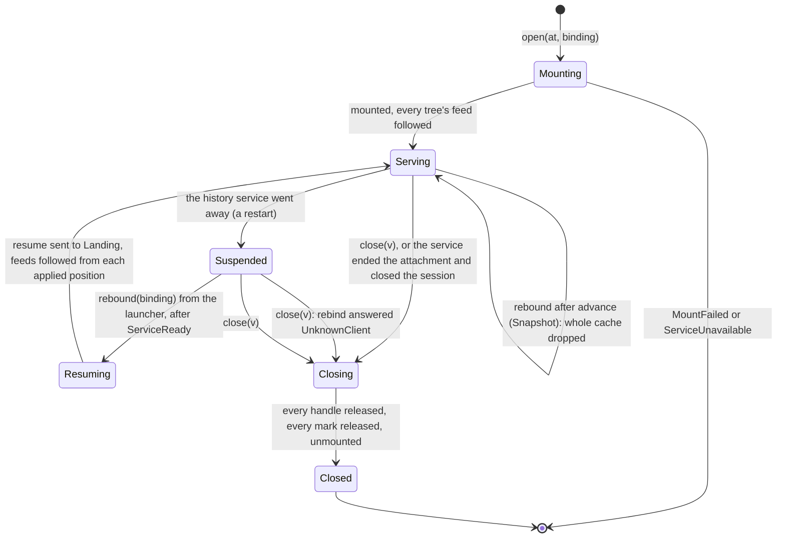
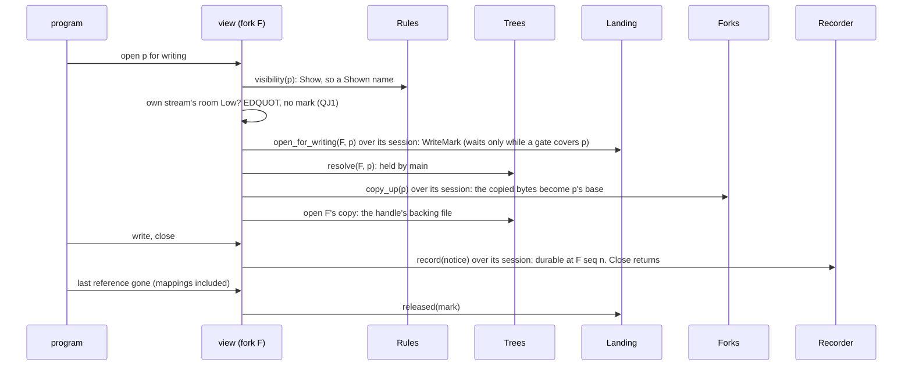

# Domain: Views

**Layer:** System › **Domain: Views** › Feature.
**Status:** draft 2, proposed, under [system.md](../system.md) revision 4 (revision 3 approved 2026-11-02), which binds it. It describes the target, not today's code. Sketches are Rust and show surfaces only.
**What you are asked:** two questions, Q1 in §6 (file watchers) and Q2 in §6 (upgrading a view host). §10 lists the eight gaps this domain found and how system revision 4 resolved them.

**Your words this domain serves** (system §1): R3 "a virtual filesystem overlay for each client (including main) that is backed by a _real_ filesystem source-of-truth"; R7 "Agentfs is the gatekeeper that exposes only what we want sandboxes to see"; R13 "a default usage … can operate per-file"; A1 main is a view like any sandbox; A5 "It depends on the config!"; A6 a pinned fork is an acceptable snapshot. Everything else here is a design choice.

## 1. What Views owns, its language, and what it is not

A view is one client's filesystem: the mount point a program uses, served by a view host outside that program.

| Views owns | Views is not |
|---|---|
| serving every file call of one client through its grant | who the client is, or what it may do (Clients) |
| the kernel's caches of that client's names, and keeping them true | the content (Trees), the records (Journal) |
| following the feed of every tree the view reads | ordering, landing, gates (Journal, Landing) |
| enforcing the client's consistency setting | choosing it (the grant, in Clients) |
| forwarding file locks to the real files | merging, history, liveness (Landing, History, Health) |
| publishing `ViewCaughtUp` | waiting for any other view |
| the program's transaction edge: how a program in a sandbox declares `begin`, `seal` and `abandon` (R13) | transaction state (Journal) |

| Term | Meaning here |
|---|---|
| view, view host | one client's mount; the process serving one or more views (system terms) |
| own tree, read-through trees | the one tree a view writes (`Binding.tree`); its ancestors, which it only reads |
| node | a name the kernel holds, with its lookup count. A node is a name, never a layer or a file |
| name cache | what the kernel remembers: found names, missing names, directory listings |
| applied position | per tree read, the last `Seq` whose feed notice this view has applied to its kernel |
| caught up | every name in every notice through that `Seq` has been dropped from the kernel |
| shown name | a name Rules showed for this view's profile; the only kind the kernel is told about |
| forwarded lock | a client's file lock taken on the real file's kernel lock |
| stale mount | a mount point whose view host died |

## 2. Model

One aggregate, the **View**, held in memory by its host. Its mode is fixed at open from the grant, so no file call asks "which setting is on".

```rust
pub struct View {
    id: ViewId,
    at: MountPoint,
    client: ClientId,
    session: SessionId,           // the authority: its recorder and fork-write cap stay in the history service
    own: OwnTree,                 // from Trees::handle: write handle for Binding.tree, the only tree it changes
    through: Vec<ReadTree>,       // ancestors, nearest first; a ReadTree has no write methods
    mode: Mode,                   // built once from the attenuated grant; replaced only by `rebound`
    view_profile: ViewProfileId,  // what Rules shows this client
    acts_as: FileOwner,           // the owner it presents
    rules: RuleSetVersion,        // judged with this rule set
    cursors: Vec<Cursor>,         // one per tree read: own, then each ancestor
    state: ViewState,
}
pub enum Mode {
    Writable {
        consistency: Consistency,     // PerFile | WholeLanding; records go over the session to its sealed recorder
        room: Room,                   // the own tree's stream room, as last reported (Durable replies, StreamRoom)
    },
    ReadOnly,                         // Access::ReadOnly or Sees::Snapshot: its session has no recorder
}
pub struct Cursor { tree: TreeRef, applied: Option<Seq> }
pub struct Node { name: RelPath, lookups: u64 }   // no layer, no inode: resolved on every call
pub struct Handle {
    node: NodeId,
    backing: BackingFile,          // the real file opened at open; keeps old content (I7)
    mark: Option<WriteMark>,       // Landing's, for a handle open for writing
    dirty: bool,                   // written since its last durable record
}
pub struct Shown { name: RelPath, reach: Reach }  // only `judge` builds one, from Rules
pub enum Reach {
    Through,   // Visibility::Show: own tree, then ancestors
    OwnOnly,   // Visibility::Scratch: own tree only, never read through, never recorded
}
```



`Suspended` applies only across a service restart: Clients keeps the attachment `Resuming`, and the launcher rebinds it. A session that closes while the service runs means the attachment ended. Each cursor runs its own small loop: **Following**, or **Behind** when the feed sends `Lagged`. Behind drops the whole name cache, moves the cursor to the feed's tail and returns to Following. A view host that dies has no state: its mount is stale and its client's attachment ends (Clients).

## 3. Public contract

Views adds no crossing to system §3 (revision 4). This is the full surface it offers, uses and publishes.

```rust
// ── Offered: to launchers only (system §3.3, unchanged) ──
pub trait Views {
    fn open(&mut self, at: MountPoint, b: Binding) -> Result<ViewId, ViewError>; // follows every tree in b
    fn rebound(&mut self, v: ViewId, b: Binding) -> Result<(), ViewError>;       // after advance or a service restart
    fn close(&mut self, v: ViewId);
}
pub enum ViewError {
    MountFailed(IoKind),     // mount point missing, not empty, stale under `refuse`, not ours
    ServiceUnavailable,      // the history service has not published ServiceReady
}
// ── Offered: to the program in the client — ordinary file calls (POSIX), and the transaction edge ──
//    begin(files), seal, abandon, forwarded over the session to Recorder (R13; the edge's shape is parked)
// ── Published ──
pub struct ViewCaughtUp { view: ViewId, tree: TreeRef, through: Seq } // once per applied batch
```

| Views calls | Through | For |
|---|---|---|
| Trees | `resolve`, `handle(binding)`, `freeze` | every file call, in its own tree or read-through; freezing at a change boundary |
| Forks | `copy_up(p)`, over its session (the session's `ForkWriteCap`) | the first write of a path an ancestor holds |
| Journal | `Recorder::record`, `begin`, `seal`, `abandon`, over its session; `feed(t, after)` | records at change boundaries; transactions; the feed of each tree read |
| Landing | `open_for_writing`, `released`, `resume` (over its session), `gates()` with `covers` and `fell` | write-opens, the last release, after a restart, gated opens |
| Rules | `visibility(name, kind, view_profile)`, `group(p)`, `record(p, kind)` | every name shown; database group membership; refusals before recording |
| Telemetry | `emit` | failures and counts; never waits |

| Capability | Views holds | Views never holds |
|---|---|---|
| a session | from the `Binding`; its `Recorder` and `ForkWriteCap` stay in the history service | any capability, its own included |
| `LaunchCap`, `ActorCap`, `Gated` | — | all three: a view cannot attach, act or land |

**What a program sees** (the file-call contract). One table, one home.

| Cause inside agentfs | The call returns | What stays |
|---|---|---|
| `Visibility::Hide`, or a rules error | `ENOENT` | nothing is revealed, whether or not the name exists |
| `Visibility::Refuse` at create or rename | `EACCES` | nothing changed |
| a write in a `ReadOnly` view | `EROFS` | nothing changed |
| `RecordError::Refused` (name, size) | the refusal's errno (`EINVAL`, `EFBIG`) | content in the tree, never recorded, never lands |
| `RecordError::NotDurable` (state area full or failing) | `ENOSPC` or `EIO` | handle stays dirty; recorded at its next change boundary |
| `ForkError::SpaceLimit` | `EDQUOT` | the fork path is not copied up |
| the own stream's room is `Low` at a write-open (Journal's QJ1) | `EDQUOT` | no write-open taken; files already open keep recording |
| `RecordError::Backpressure` at close (room `Full`) | `EDQUOT` | handle stays dirty; recorded at its next change boundary |
| `TreeError::NoSpace` | `ENOSPC` | as on any filesystem |
| history service restarting | nothing: the call waits for the launcher's `rebound` | data on open handles keeps flowing |

## 4. Invariants and how they are enforced

| # | Invariant | Enforced by | Strength |
|---|---|---|---|
| V1 | A view changes only its own tree (I1) | write methods exist only on `OwnTree`; ancestors are `ReadTree` | compile time |
| V2 | A view records only as its client, only if writable | the sealed `Recorder` lives in the view's session in the history service; a read-only grant's session has none; a request names no client | construction time |
| V3 | The kernel is told only shown names (I8) | kernel replies take a `Shown`, built only from a Rules verdict; an error builds none | construction time |
| V4 | No history, journal or credential is reachable (I8) | a view host is composed with no state-area port and no path to it; Trees confines | construction + test |
| V5 | The layer holding a path is decided on each call | `Node` has no layer or inode field; a trim or landing cannot leave a write aimed at a removed file | construction time |
| V6 | Name caches are dropped only from the follower, never from a file-call thread (the kernel may wait on the very call that would drop them) | only the follower is handed the `KernelCache` port | compile time |
| V7 | A view waits for no other view, and one slow view slows nobody (I9) | Views consumes no `ViewCaughtUp`; each cursor is its own; Behind drops its own cache | construction + test |
| V8 | Every wait ends on a named event (I10) | waits are on `GateFell`, `rebound`, a Landing call returning or the session closing; clippy bans sleeps and timers in the crate; the kernel's cache backstop is a listed I10 timer nothing waits on | build time + review |
| V9 | A write mark is released exactly once, at the kernel's last reference | the mark lives in its `Handle`; releasing the handle consumes it | construction time |

## 5. Ports and adapters

```rust
pub trait KernelMount {                 // adapter `fuse`: the mount and its request loop
    fn mount(&self, at: &MountPoint, stale: StaleMount) -> Result<Session, IoKind>;
    fn unmount(&self, s: Session);
}
pub trait KernelCache {                 // adapter `fuse`: given to the follower only (V6)
    fn drop_name(&self, s: &Session, parent: NodeId, name: &OsStr) -> Result<(), IoKind>;
    fn drop_node(&self, s: &Session, n: NodeId) -> Result<(), IoKind>; // its attributes and pages
}
pub trait Announce {                    // adapter `rpc`: publishes; never blocks a caller
    fn caught_up(&self, e: ViewCaughtUp);
}
```

**Persistence: none.** Every fact a view holds is the kernel's (it dies with the mount) or another domain's (asked again after a restart). So Views has no repository and nothing to stamp (I13). Design choice; a view needing a durable fact would ask its owning domain.

## 6. Internal flows and scenarios

**A write in a sandbox view.** The same path serves main, minus the copy-up.

An fsync of a database group member records the whole group as one notice. A write is never given kernel passthrough; a read-only open of a file outside any group is (today's rule, kept).

**Following a feed, and a gated open.**
```mermaid
sequenceDiagram
  participant J as Journal feed (tree t)
  participant Fo as follower (host, per tree)
  participant K as kernel caches
  participant A as Announce
  participant V as a file call
  participant G as gate table
  J--)Fo: Recorded(t, 42, names)
  Fo->>K: drop each name the kernel holds, in every view reading t
  Fo--)A: ViewCaughtUp(view, t, 42), once per drained batch
  alt Lagged: this view fell behind
    Fo->>K: drop the whole name cache; cursor to the tail
  end
  V->>G: WholeLanding open of p, or any open of a group member: covers(p)
  G--)V: GateFell: the open proceeds on the renamed file
```
One follower per tree per host serves every view on it. Own records come back too; dropping them again is harmless.

**What each consistency setting does.** The setting is the grant's; Views only enforces it (system §4).

| Grant | Read open | Write open | Name cache kept |
|---|---|---|---|
| `Live`, `PerFile` (default, A5) | never waits; a database group member waits while its group's gate is up | `open_for_writing` | found names, missing names, listings, all dropped by the feed |
| `Live`, `WholeLanding` | waits while a gate covers p, until it falls | `open_for_writing` | found names only, which resolve fresh on every call, so a landing's set is never seen half |
| `Snapshot` (A6) | never waits; the pinned fork never changes | `EROFS` | everything, until `rebound` after `advance` drops it all |

Attributes are never cached and file pages never outlive their handle, so content is always the real file's (design choice, today's rule).

**Scenarios.**

| Scenario | Views' behaviour |
|---|---|
| Live landing into main | Trees renames; readers see whole old or whole new (I7). Each view applies the record's notice and publishes `ViewCaughtUp`; under `PerFile` a new name may look absent until then |
| Trim after a fork landing | no notice is needed: the sandbox's next call resolves p again and finds main's copy (V5) |
| A transaction lands | one gate over its scope; `WholeLanding` opens in the scope wait for it; `PerFile` readers may see one file new before the next (system cost 3) |
| 1,000 sandbox views | every host follows main's feed once; a host drops only names its kernel holds; a slow host goes Behind alone |
| History service crash | data on open handles flows; every other call waits. After the launcher's `rebound`: `resume(write handles)`, feeds from each applied position, Behind if truncated |
| View host crash | its mounts go stale; Clients ends the attachments, Landing ends their write-opens and reconciles what they left unrecorded, so no landing waits on it. A new open at the same point stacks over a stale mount under `recover`; a sandbox's restarted host gets a new fork |
| A host frozen, not dead | its kernel serves found names it holds; opens and lookups wait on it; nobody else waits; Health judges it |
| State area full | close returns `ENOSPC`, the handle stays dirty, the record is retried at its next change boundary |
| Tree full; fork space full | `ENOSPC`; `EDQUOT` at copy-up |
| Journal limit reached | at `Low`, new write-opens get `EDQUOT` (QJ1's recommendation; under its alternative they wait for `StreamRoom`); a close at `Full` gets `EDQUOT` and stays dirty |
| History service upgrade | a service restart for Views; whether old hosts may reconnect is system Q3 |
| View host upgrade | today a restart: clients' open files die and the mount is stacked over (Q2) |

**Q1. Must a change made through another view, or a landing, fire a client's file watcher?** A program that reloads its config on a watcher event would miss a sandbox's edit landing in main. NOT VERIFIED: the kernel probably fires no watcher when a view drops its cache.
- **Recommended: no guarantee.** The landing notice and `ViewCaughtUp` are the signals. Cost: such a program must reload on agentfs's notice, not on its watcher.
- **Alternative: guarantee it.** Cost: each view must touch a watched file's state in its own kernel on every remote change, a new mechanism that may not exist for FUSE.

**Q2. Must upgrading a view host keep its clients' open files working?**
- **Recommended: not now.** An upgrade restarts the host; main's mount is stacked over and its open files fail; a sandbox restarts on a new fork. Cost: upgrades disturb running clients.
- **Alternative: hand the live mount to the new host.** Nodes being names (V5) makes the hand-over small. Cost: new, untested machinery (NOT VERIFIED).

## 7. Policies and configuration Views owns

| Policy | Values | Current choice | Why |
|---|---|---|---|
| What the kernel may cache | per consistency setting (§6 table) | as tabled | the setting's promise holds with the cache emptied at any moment |
| Backstop lifetime for cached names | a duration handed to the kernel | placeholder; set at the code-architect gate | only bounds a frozen host's stale names; nothing waits on it (a listed I10 timer) |
| Kernel passthrough | read-only opens outside database groups | on where the kernel supports it | reads skip the host; writes stay visible to recording |
| Stale mount point | `refuse` · `recover` (stack over it) | `recover` | a host restart reuses its mount point |

Views owns no landing, history or consistency setting; the owner a view presents (`acts_as`) is the grant's.

## 8. Tests that prove it

All run against a real mount over real directories, with a real history service.

| Test | Failure class it rules out |
|---|---|
| Two main views, backstop lifetime set to an hour: a save, a rename and a create in one are seen in the other at once | coherence resting on a timer |
| A reader loops over p in main while a sandbox's save of p lands | torn reads; a new name absent forever |
| A `WholeLanding` reader opens a transaction's two files in a loop while it lands | half a landing seen under `WholeLanding` |
| Sandbox saves p, it lands and is trimmed, the sandbox writes p again | writes into a removed layer copy |
| Hidden names, existing or not, a landing adding a hidden name, a broken rules file | anything shown that the profile hides (I8) |
| Paths, links and descriptors aimed at the state area from inside a view | history or credentials reachable (I8) |
| Renames through two views of one tree at once | deadlock from dropping caches inside a file call |
| One host frozen (`SIGSTOP`) while others save and land | one view stalling the rest (I9) |
| Kill the history service mid-write and mid-landing | errors on open handles; double records; a gate rising before resume (I12) |
| Locks: main views conflict; a sandbox's lock leaves main free; a dead host's locks drop | locks invisible across views; a sandbox blocking main |
| Snapshot: `EROFS`; content fixed while main changes; `advance` moves it | a snapshot drifting or writable |
| A sandbox floods its journal while main saves | a sandbox making main wait (I6) |
| Fill the state area, then free it | lost records; a dirty handle never recorded |

## 9. Costs and open points (this domain)

1. **A resolve per call.** Deciding the layer on every call costs a lookup per layer, more in forks of forks.
2. **`WholeLanding` keeps no missing names or listings**, so its lookups reach the host more often.
3. **`ViewCaughtUp` volume** grows with hosts × batches; consumers filter.
4. **Locks are approximated.** A client's per-process lock becomes a lock on its own handle's open file (open-file-description locks), so two descriptors in one process can now conflict. A shared lock held through a read-only handle does not hold a landing back. NOT VERIFIED through FUSE.
5. **A host's death ends its clients' mounts.** Under one writer per fork for life, a sandbox's restarted host starts on a new fork; what its old fork saved still lands.
6. **No sweep.** A file held open for writing is recorded only at its change boundaries (fsync, close, the last release), never on a timer, so a log written for hours without closing is unrecorded until then.

## 10. Escalations to the system document

| # | Gap in system.md (revision 3) | Proposed fix | Resolution in revision 4 |
|---|---|---|---|
| E1 | `Binding` lacked the grant's `access`, `profile` and `sees`, and the identity a sandbox acts as | `Binding` carries the attenuated grant, with `acts_as` | adopted, in the one consolidated `Binding` |
| E2 | `Journal::recorder` consumes the `ClientCap`, but `Forks::copy_up` needs it afterwards | `recorder` borrows the cap, or `copy_up` takes the `Recorder` | withdrawn: the session holds both the `Recorder` and a `ForkWriteCap` in the history service |
| E3 | the crash flow had the view call `Clients::rebind`, which needs a `LaunchCap` | the launcher rebinds and calls `Views::rebound` | adopted; `Suspended` applies only across a service restart |
| E4 | `Trees` showed no file-call surface | a write handle for the own tree, read handles for ancestors | adopted as `Trees::handle(binding)` |
| E5 | `GateReader` and `Feed` were unshaped | the gate's fall as an event; a "fell behind" feed item | adopted: `GateReader::fell`, `FeedItem::Lagged` |
| E6 | `Backpressure` had no event that ends the wait | `record` waits inside the Journal | withdrawn: the Journal's room is the one rule, applied at write-open (QJ1); `StreamRoom` ends a wait under QJ1's alternative |
| E7 | no owner for content a dead host left unrecorded | name the owner, triggered by `AttachmentEnded` | resolved: Landing's reconcile source |
| E8 | §7's lock cost was too broad; I10 omitted the cache backstop | correct §7; list the backstop | adopted |

Also resolved: Views owns the program's transaction edge (R13).

## New terms

| Term | Definition | Why needed | Could be the existing term |
|---|---|---|---|
| node | a name the kernel holds, resolved on each call | trims and landings stay safe without notices | FUSE inode |
| applied position | the last `Seq` per tree a view has applied | resume and `ViewCaughtUp` | `Agentfs-Seq` |
| follower | the per-host, per-tree reader of a feed that drops names | V6, scale | today's invalidator |
| shown name | a name Rules showed for the view's profile | V3 | the visibility gate |
| backstop lifetime | how long a kernel may keep a name agentfs failed to drop | a frozen host | entry timeout (1 s today) |

## For the code architects (parked)
Node table and hard links (two names, one file); own-rename bookkeeping; lookup counts across `rebound`; which errno each `Refusal` maps to; the transaction edge's shape (a control path in the view, or a small library); open-file-description lock mapping from FUSE lock owners; the hand-over mechanics if Q2 changes; how a host shares one follower across views of one tree.

## Reconcile with existing code (agentfs origin/main b5c0dc8, `docs/design.md`)
- **The two-session daemon** (§2.4: main mount plus sandbox overlay over one `Ops`) becomes one view per client, each its own host-served mount. The overlay's visibility gate and name check under the names ordering carry over as V3.
- **The tmp layer** goes: `Scratch` names live in the fork's own layer and never read through (`Reach::OwnOnly`).
- **The view owner** (`--sandbox-owner`) moves into the grant (`acts_as`).
- **Coherence by events** (`invalidate.rs`, one worker, never from a request thread) carries over as the follower. It is now fed by each tree's feed instead of every session's changes.
- **Inode-handle nodes and the 1 s entry cache** become name nodes and feed-dropped caches. **The sweep** (a timer) goes: a dirty handle is retried at its next change boundary (cost 6).
- Cost: the FUSE layer's node table, invalidation source and overlay decorator are rewritten together.

**NOT RUN:** FUSE lock forwarding, watchers across mounts, passthrough with name nodes, and mount hand-over were not tested. Only `docs/design.md` on origin/main was read; no code.

*History: draft 1 (2026-11-02); draft 2, conformed to system revision 4.*
