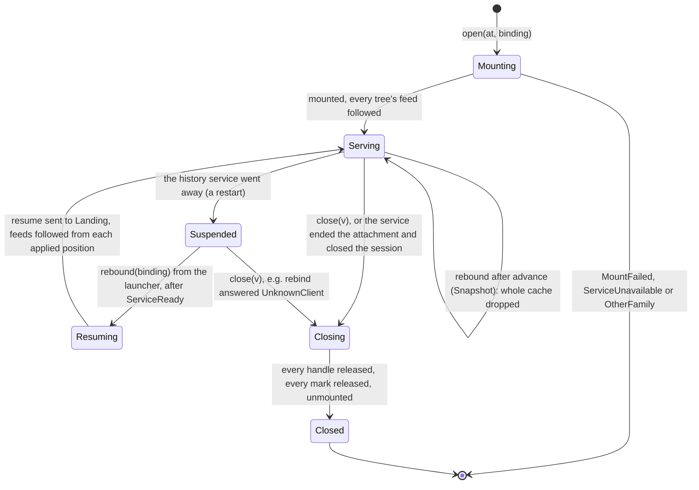
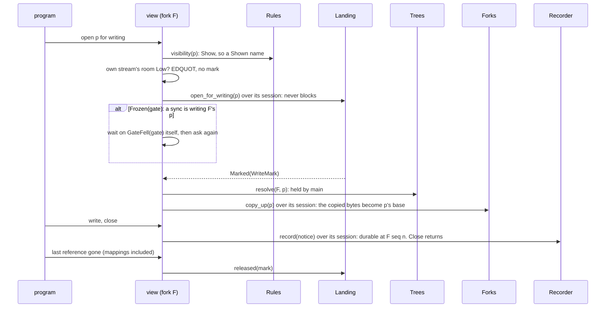

# Domain: Views

**Layer:** System › **Domain: Views** › Feature.
**Status:** draft 5, proposed, under [system.md](../system.md) revision 7, which binds it. It describes the target, not today's code. Sketches are Rust and show surfaces only.
**What you are asked:** nothing: this domain has no open question.

**Your words this domain serves** (system §1): R3 "a virtual filesystem overlay for each client (including main) that is backed by a _real_ filesystem source-of-truth"; R7 "Agentfs is the gatekeeper that exposes only what we want sandboxes to see"; R13 "a default usage … can operate per-file"; R18 "both clients would see the others changes"; A1 main is a view like any sandbox; A5 "It depends on the config!"; A6 a pinned fork is an acceptable snapshot; A9 "freezing only the files that a landing touches sounds reasonable. and hopefully our new per-client + view system makes locking/freezing files easier"; A11 file watchers: "we can take the "no guarantee" path for now" (2026-11-02). Everything else here is a design choice.

## 1. What Views owns, its language, and what it is not

A view is one client's filesystem: the mount point a program uses, served by a view host outside that program.

| Views owns | Views is not |
|---|---|
| serving every file call of one client through its grant | who the client is, or what it may do (Clients) |
| the kernel's caches of that client's names, and keeping them true | the content (Trees), the records (Journal) |
| following the feed of every tree the view reads, syncs into its own tree included | ordering, landing, gates, syncs (Journal, Landing) |
| **enforcing the freeze locally**: waiting on a gate over a file it opens (A9) | raising or lowering a gate (Landing) |
| enforcing the client's consistency setting | choosing it (the grant, in Clients) |
| forwarding file locks to the real files | merging, history, liveness (Landing, History, Health) |
| publishing `ViewCaughtUp` | waiting for any other view |
| the program's transaction edge: how a program in a sandbox declares `begin`, `seal` and `abandon` (R13); its closing unsealed (the program died) abandons (A13) | transaction state (Journal) |

| Term | Meaning here |
|---|---|
| view, view host | one client's mount; the process serving one or more views (system terms) |
| own tree, read-through trees | the one tree a view writes (`Binding.tree`); its ancestors, which it only reads |
| holding tree | the tree that holds p on this call (`Trees::resolve`): the own tree, or an ancestor |
| node | a name the kernel holds, with its lookup count. A node is a name, never a layer or a file |
| name cache | what the kernel remembers: found names, missing names, directory listings |
| applied position | per tree read, the last `Seq` whose feed notice this view has applied to its kernel |
| shown name | a name Rules showed for this view's profile; the only kind the kernel is told about |
| forwarded lock | a client's file lock taken on the real file's kernel lock |
| stale mount | a mount point whose view host died |

## 2. Model

One aggregate, the **View**, held in memory by its host. Its mode is fixed at open from the grant, so no file call asks "which setting is on".

```rust
pub struct View {
    id: ViewId,
    at: MountPoint,
    client: ClientId,
    session: SessionId,           // the authority: its recorder and fork-write cap stay in the history service
    own: OwnTree,                 // from Trees::handle: write handle for Binding.tree, the only tree it changes
    through: Vec<ReadTree>,       // ancestors, nearest first; a ReadTree has no write methods
    mode: Mode,                   // built once from the attenuated grant; replaced only by `rebound`
    view_profile: ViewProfileId,  // what Rules shows this client
    acts_as: FileOwner,           // the owner it presents
    rules: RuleSetVersion,        // judged with this rule set
    cursors: Vec<Cursor>,         // one per tree read: own, then each ancestor
    state: ViewState,
}
pub enum Mode {
    Writable {
        consistency: Consistency,     // PerFile | WholeLanding; records go over the session to its sealed recorder
        room: Room,                   // the own tree's stream room, as last reported (Durable replies, StreamRoom)
    },
    ReadOnly,                         // Access::ReadOnly or Sees::Snapshot: its session has no recorder
}
pub struct Cursor { tree: TreeRef, applied: Option<Seq> }
pub struct Node { name: RelPath, lookups: u64 }   // no layer, no inode: resolved on every call
pub struct Handle {
    node: NodeId,
    backing: BackingFile,          // the real file opened at open; keeps old content (I7)
    mark: Option<WriteMark>,       // Landing's, for a handle open for writing
    dirty: bool,                   // written since its last durable record
}
pub struct Shown { name: RelPath, reach: Reach }  // only `judge` builds one, from Rules
pub enum Reach {
    Through,   // Visibility::Show: own tree, then ancestors
    OwnOnly,   // Visibility::Scratch: own tree only, never read through, never recorded
}
```



`Suspended` applies only across a service restart. Each cursor is **Following**, or **Behind** after `Lagged`: Behind drops the whole name cache, moves to the feed's tail and follows again. A dead view host has no state: its mount is stale and its client's attachment ends (Clients).

## 3. Public contract

Views adds no crossing to system §3 (revision 7); its write-opens and `resume` name no tree (§10).

```rust
// ── Offered: to launchers only (system §3.3) ──
pub trait Views {
    fn open(&mut self, at: MountPoint, b: Binding) -> Result<ViewId, ViewError>; // follows every tree in b
    fn rebound(&mut self, v: ViewId, b: Binding) -> Result<(), ViewError>;       // after advance or a service restart
    fn close(&mut self, v: ViewId);
}
pub enum ViewError {
    MountFailed(IoKind),     // mount point missing, not empty, stale under `refuse`, not ours
    ServiceUnavailable,      // the history service has not published ServiceReady
    OtherFamily(Version),    // the service's major.minor differs from this host's (system §8, I16)
}
// ── Offered: to the program in the client — ordinary file calls (POSIX), and the transaction edge ──
//    begin(files), seal, abandon, forwarded over the session to Recorder (R13; the edge's shape is parked)
// ── Published ──
pub struct ViewCaughtUp { view: ViewId, tree: TreeRef, through: Seq } // once per applied batch
```

| Views calls | Through | For |
|---|---|---|
| Trees | `resolve`, `handle(binding)`, `capture` | every file call, in its own tree or read-through; capturing at a change boundary |
| Forks | `copy_up(p)`, over its session (the session's `ForkWriteCap`) | the first write of a path an ancestor holds |
| Journal | `Recorder::record`, `begin`, `seal`, `abandon`, over its session; `feed(t, after)` | records at change boundaries; transactions; the feed of each tree read |
| Landing | `open_for_writing` (never blocks), `released`, `resume`, over its session; `gates()` with `covers` and `fell` | write-opens; the last release; after a restart; the view's own wait on a gate |
| Rules | `visibility(name, kind, view_profile)`, `group(p)`, `record(p, kind)` | every name shown; database group membership; refusals before recording |
| Telemetry | `emit` | failures and counts; never waits |

| Capability | Views holds | Views never holds |
|---|---|---|
| a session | from the `Binding`; its `Recorder` and `ForkWriteCap` stay in the history service | any capability, its own included |
| `LaunchCap`, `ActorCap`, `Gated` | — | all three: a view cannot attach, act or land |

**What a program sees** (the file-call contract). One table, one home.

| Cause inside agentfs | The call returns | What stays |
|---|---|---|
| `Visibility::Hide`, or a rules error | `ENOENT` | nothing is revealed, whether or not the name exists |
| `Visibility::Refuse` at create or rename | `EACCES` | nothing changed |
| a write in a `ReadOnly` view | `EROFS` | nothing changed |
| a gate over p in its holding tree (a landing or a sync writing p) | nothing: a write-open, a `WholeLanding` open or a group member's open waits until the gate falls, then opens the new file | opens of every other file, and of p in other trees, go on (A9) |
| `RecordError::Refused` (name, size) | the refusal's errno (`EINVAL`, `EFBIG`) | content in the tree, never recorded, never lands |
| `RecordError::NotDurable` (state area full or failing) | `ENOSPC` or `EIO` | handle stays dirty; recorded at its next change boundary |
| `ForkError::SpaceLimit` | `EDQUOT` | the fork path is not copied up |
| the own stream's room is `Low` at a write-open (the Journal's choice) | `EDQUOT` | no write-open taken; files already open keep recording |
| `RecordError::Backpressure` at close (room `Full`) | `EDQUOT` | handle stays dirty; recorded at its next change boundary |
| `TreeError::NoSpace` | `ENOSPC` | as on any filesystem |
| history service restarting | nothing: the call waits for the launcher's `rebound` | data on open handles keeps flowing |

## 4. Invariants and how they are enforced

| # | Invariant | Enforced by | Strength |
|---|---|---|---|
| V1 | A view changes only its own tree (I1) | write methods exist only on `OwnTree`; ancestors are `ReadTree` | compile time |
| V2 | A view records only as its client, only if writable | the sealed `Recorder` lives in the view's session in the history service; a read-only grant's session has none; a request names no client | construction time |
| V3 | The kernel is told only shown names (I8) | kernel replies take a `Shown`, built only from a Rules verdict; an error builds none | construction time |
| V4 | No history, journal or credential is reachable (I8) | a view host is composed with no state-area port and no path to it; Trees confines | construction + test |
| V5 | The layer holding a path is decided on each call | `Node` has no layer or inode field; a trim, landing or sync cannot leave a write aimed at a removed file | construction time |
| V6 | Name caches are dropped only from the follower, never from a file-call thread (the kernel may wait on the very call that would drop them) | only the follower is handed the `KernelCache` port | compile time |
| V7 | A view waits for no other view, and one slow view slows nobody (I9) | Views consumes no `ViewCaughtUp`; each cursor is its own; Behind drops its own cache | construction + test |
| V8 | Every wait ends on a named event (I10). A view waits on a gate only for the file it opens, in that file's holding tree (A9, I6) | waits are on `GateFell`, `rebound`, a Landing call returning or the session closing; the gate check takes the tree `resolve` returned; clippy bans sleeps and timers in the crate | build time + review |
| V9 | A write mark is released exactly once, at the kernel's last reference | the mark lives in its `Handle`; releasing the handle consumes it | construction time |

## 5. Ports and adapters

```rust
pub trait KernelMount {                 // adapter `fuse`: the mount and its request loop
    fn mount(&self, at: &MountPoint, stale: StaleMount) -> Result<Session, IoKind>;
    fn unmount(&self, s: Session);
}
pub trait KernelCache {                 // adapter `fuse`: given to the follower only (V6)
    fn drop_name(&self, s: &Session, parent: NodeId, name: &OsStr) -> Result<(), IoKind>;
    fn drop_node(&self, s: &Session, n: NodeId) -> Result<(), IoKind>; // its attributes and pages
}
pub trait Announce {                    // adapter `rpc`: publishes; never blocks a caller
    fn caught_up(&self, e: ViewCaughtUp);
}
```

**Persistence: none.** Every fact a view holds is the kernel's or another domain's (asked again after a restart), so Views has no repository and nothing to stamp (I13). Design choice.

## 6. Internal flows and scenarios

**A write in a sandbox view.** The same path serves main, minus the copy-up.

A gate on main's p does not stop this open (the freeze is main's); copy-up reads p whole old or new (I7), and if old, the landing's record syncs the new p into F's copy. An fsync of a database group member records the whole group as one notice. Writes never get kernel passthrough; read-only opens outside any group do (today's rule, kept).

**Following feeds: main's landings, and main's changes synced into the sandbox** (R18).
```mermaid
sequenceDiagram
  participant Jm as main's feed
  participant Jf as F's feed
  participant Fo as follower (host, per tree)
  participant K as kernel caches
  participant A as Announce
  Jm--)Fo: Recorded(main, 42, names): a landing or a save in main
  Fo->>K: drop each name the kernel holds, in every view reading main
  Fo--)A: ViewCaughtUp(view, main, 42), once per drained batch
  Jf--)Fo: Recorded(F, 9, [s]): a sync, writer main-1
  Fo->>K: drop s in F's views: the next read opens the merged s
  Fo--)A: ViewCaughtUp(view, F, 9)
  alt Lagged: this view fell behind
    Fo->>K: drop the whole name cache; cursor to the tail
  end
```
One follower per tree per host serves every view on it. A sync reaches the sandbox only as an ordinary record on its own tree's feed. Own records come back too; dropping them again is harmless.

**What each consistency setting does.** The setting is the grant's; Views only enforces it (system §4). Every gate check asks `covers(t, p)` for p's holding tree, so a gate in one tree never stops another tree's opens.

| Grant | Read open | Write open | Name cache kept |
|---|---|---|---|
| `Live`, `PerFile` (default, A5) | never waits; a database group member waits while its group's gate is up | `open_for_writing`; on `Frozen`, waits on `GateFell` | found names, missing names, listings, all dropped by the feed |
| `Live`, `WholeLanding` | waits while a gate covers p, until it falls | as `PerFile` | found names only, which resolve fresh on every call, so a landing's set is never seen half |
| `Snapshot` (A6) | never waits; the pinned fork never changes | `EROFS` | everything, until `rebound` after `advance` drops it all |

Attributes are never cached and file pages never outlive their handle, so content is always the real file's (design choice, today's rule).

**Scenarios.**

| Scenario | Views' behaviour |
|---|---|
| Live landing into main | Trees renames; readers see whole old or whole new (I7). Each view applies the record and publishes `ViewCaughtUp`; under `PerFile` a new name may look absent until then |
| Main's change syncs into the sandbox's copy | the sync waits for the sandbox's write-opens of that file and gates it in F only; a write-open of it then waits on `GateFell`; F's feed drops the name. A `Deferred` sync changes nothing in F |
| Trim after a landing or a sync | no notice is needed: the sandbox's next call resolves p again and finds its parent's copy (V5) |
| A transaction lands | one gate over its files; `WholeLanding` opens of them wait for it; `PerFile` readers may see one file new before the next (system cost 3) |
| 1,000 sandbox views | each host follows main's feed once and drops only names its kernel holds; a slow host goes Behind alone |
| History service crash or patch upgrade | data on open handles flows; every other call waits. After the launcher's `rebound`: `resume(write handles)`, feeds from each applied position, Behind if truncated |
| View host crash | its mounts go stale; Clients ends the attachments, Landing ends their write-opens and reconciles what they left unrecorded. A new open at the same point stacks over a stale mount under `recover`; a sandbox's restarted host gets a new fork |
| A host hung, not dead | its kernel serves found names it holds; opens and lookups wait on it; nobody else waits; Health judges it |
| Patch upgrade of a view host | a restart: its clients' open files fail and the mount is stacked over; a sandbox restarts on a new fork. No live mount hand-over (design choice, system §8) |
| Minor or major upgrade | drained first: every client detaches. A host of another family gets `OtherFamily` at open or rebind |

## 7. Policies and configuration Views owns

| Policy | Values | Current choice | Why |
|---|---|---|---|
| What the kernel may cache | per consistency setting (§6 table) | as tabled | the setting's promise holds with the cache emptied at any moment |
| Backstop lifetime for cached names | a duration handed to the kernel | placeholder; set at the code-architect gate | only bounds a hung host's stale names; nothing waits on it (a listed I10 timer) |
| Kernel passthrough | read-only opens outside database groups | on where the kernel supports it | reads skip the host; writes stay visible to recording |
| Stale mount point | `refuse` · `recover` (stack over it) | `recover` | a host restart reuses its mount point |
| File watchers | no guarantee · guaranteed | no guarantee (A11) | a guarantee needs a per-view mechanism FUSE may lack |

Views owns no landing, history or consistency setting; the owner a view presents (`acts_as`) is the grant's.

## 8. Tests that prove it

All run against a real mount over real directories, with a real history service.

| Test | Failure class it rules out |
|---|---|
| Two main views, backstop lifetime set to an hour: a save, a rename and a create in one are seen in the other at once | coherence resting on a timer |
| A reader loops over p in main while a sandbox's save of p lands | torn reads; a new name absent forever |
| Main saves s; the sandbox holding s reads the merged s at once; its write-open of s during the sync's gate waits, then writes the merged file | a sync invisible to the sandbox; a write lost under a sync |
| A gate over p: opens of q in that tree, and of p in another tree, go on | a freeze wider than its files (A9) |
| A `WholeLanding` reader opens a transaction's two files in a loop while it lands | half a landing seen under `WholeLanding` |
| Sandbox saves p, it lands and is trimmed, the sandbox writes p again | writes into a removed layer copy |
| Hidden names, existing or not, a landing adding a hidden name, a broken rules file | anything shown that the profile hides (I8) |
| Paths, links and descriptors aimed at the state area from inside a view | history or credentials reachable (I8) |
| Renames through two views of one tree at once | deadlock from dropping caches inside a file call |
| One host hung (`SIGSTOP`) while others save and land | one view stalling the rest (I9) |
| Kill the history service mid-write and mid-landing | errors on open handles; double records; a gate rising before resume (I12) |
| Locks: main views conflict; a sandbox's lock leaves main free; a dead host's locks drop | locks invisible across views; a sandbox blocking main |
| Snapshot: `EROFS`; content fixed while main changes; `advance` moves it | a snapshot drifting or writable |
| A sandbox floods its journal while main saves; fill the state area, then free it | a sandbox making main wait (I6); lost records |
| A host of another minor opens a view | sessions across families (I16) |

## 9. Costs (this domain)

1. **A resolve per call.** Deciding the layer on every call costs a lookup per layer, more in forks of forks.
2. **`WholeLanding` keeps no missing names or listings**, so its lookups reach the host more often.
3. **`ViewCaughtUp` volume** grows with hosts × batches, and syncs add batches on fork feeds; consumers filter.
4. **Locks are approximated.** A per-process lock becomes a lock on its handle's open file, so two descriptors in one process can now conflict; a lock through a read-only handle does not hold a landing back; a lock does not survive a landing or a sync of its file (new inode). NOT VERIFIED through FUSE.
5. **A host's death or patch upgrade ends its clients' mounts.** A sandbox's restarted host starts on a new fork; what its old fork saved still lands.
6. **No sweep.** A file held open for writing is recorded only at its change boundaries (fsync, close, the last release), never on a timer, so a log written for hours without closing is unrecorded until then.
7. **Watchers may miss changes** (A11): a program that reloads on a watcher event must reload on agentfs's notice instead.

## 10. Escalations to the system document

None open. E1 was adopted in revision 6: `open_for_writing(p)` and `resume(paths)` name no tree; the session supplies the own tree and refuses write-opens from a session with no recorder, so a sandbox never marks main (I6). The gate check `covers(t, p)` keeps its tree, since it reads.

## New terms

| Term | Definition | Why needed | Could be the existing term |
|---|---|---|---|
| node | a name the kernel holds, resolved on each call | trims, landings and syncs stay safe without notices | FUSE inode |
| holding tree | the tree that holds p on this call | the freeze is per tree (A9) | the layer `resolve` returns |
| applied position | the last `Seq` per tree a view has applied | resume and `ViewCaughtUp` | `Agentfs-Seq` |
| follower | the per-host, per-tree reader of a feed that drops names | V6, scale | today's invalidator |
| shown name | a name Rules showed for the view's profile | V3 | the visibility gate |
| backstop lifetime | how long a kernel may keep a name agentfs failed to drop | a hung host | entry timeout (1 s today) |

## For the code architects (parked)
Node table and hard links; own renames; lookup counts across `rebound`; which errno each `Refusal` maps to; the transaction edge's shape (a control path in the view, or a small library); open-file-description lock mapping from FUSE lock owners; how a host shares one follower across views of one tree; the race between a `Frozen` answer and the gate's fall (ask again after `GateFell`, never assume the mark); whether a dropped name fires a watcher on some kernels (free if it does, never promised).

## Reconcile with existing code (agentfs origin/main b5c0dc8, `docs/design.md`)
- **The two-session daemon** (§2.4: main mount plus sandbox overlay over one `Ops`) becomes one view per client, each its own host-served mount. The overlay's visibility gate and name check under the names ordering carry over as V3.
- **The tmp layer** goes: `Scratch` names live in the fork's own layer and never read through (`Reach::OwnOnly`).
- **The view owner** (`--sandbox-owner`) moves into the grant (`acts_as`).
- **Coherence by events** (`invalidate.rs`, one worker, never from a request thread) carries over as the follower, fed by each tree's feed instead of every session's changes. Syncs into a sandbox are new; they arrive on its own tree's feed.
- **Inode-handle nodes and the 1 s entry cache** become name nodes and feed-dropped caches. **The sweep** (a timer) goes (cost 6). **Blocking write-opens** become a non-blocking call plus the view's own wait.
- Cost: the FUSE node table, invalidation source and overlay decorator are rewritten together.

**NOT RUN:** FUSE lock forwarding, watchers across mounts, passthrough with name nodes, and copy-up during a parent's rename were not tested. Only `docs/design.md` on origin/main was read; no code.

*History: draft 1 (2026-11-02); draft 2, system revision 4; draft 3, revision 5; draft 4, revision 6; draft 5, revision 7 (A13).*
