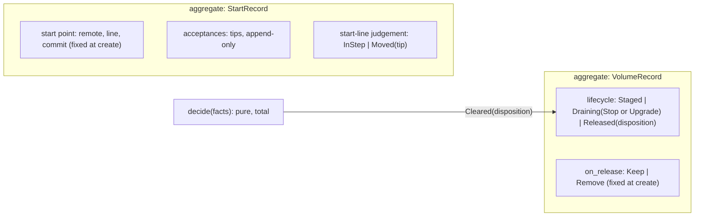
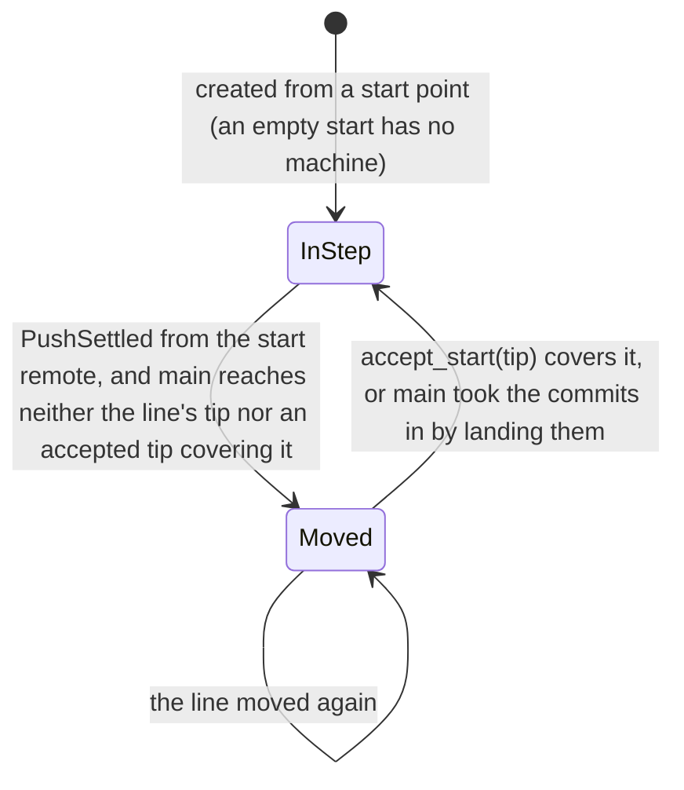

# Domain: Volume

**Layer:** System › **Domain (Volume)** › Feature.
**Status:** draft 5, proposed, against [system.md](../system.md) revision 7, which binds this page. It describes the target, not today's code. Sketches are Rust and show surfaces only.
**Binding from the system:** §3.3 `Volume`, `VolumeError`; §3.4 (its events, in and out); I9, I10, I13, I15, I16; §7 (held work does not hold release); §8 (drain, then upgrade).
**What you are asked:** nothing. Former VQ1 and VQ2 are adopted as design choices (§7).
**Since your answers (2026-11-02):** an **upgrade drain** (R16) also waits until no fork is left; another family's release gets `FormatsOf` until that family drains the area.

## 1. What Volume owns, its language, and what it is not

Volume answers three questions about one state area: is it in use (its lifecycle), where did its history begin (its start point), and may its history service stop and its directory go (the release verdict). It asks each fact's owner at that moment and keeps no copy.

**Your words this domain rests on.** Everything else here is a design choice.

| # | Your words | Date | What it asks of Volume |
|---|---|---|---|
| — | "It's all event driven" | 2026-10-24 | release is re-judged on events, never on a scan interval |
| — | "Remotes can come and go. It's not a error to have zero remotes" | 2026-10-17 | zero remotes is a normal input to the verdict, not a fault |
| — | "B. And if no remote is configured, the volume is lost, and that's a choice the user is allowed to make." (said of a fork with no remote of its own) | 2026-10-17 | read for every volume: the design choice in §7 |
| A4 | "A fork whose branches are rejected and never land in the main branch will inevitably be lost, and that's acceptable" | answer, system §1 | held fork work does not hold an ordinary release |
| R7 | "Security boundary. Agentfs is the gatekeeper that exposes only what we want sandboxes to see" | 2026-10-30 | a sandbox launcher never creates, drains or stages the volume |
| R16 | "i would like for the git history to remain compatible across minor versions, and only break on a major version change. The various agentfs components should be within the same version family (major for sure, maybe minor too, patch doesnt need to match)" | 2026-11-02 | an upgrade's drain; another family's release refused (`FormatsOf`) |

A7 ("one setting per volume") is History's setting, not Volume's. A8 and R13 reach Volume only through `in_motion` and `uncommitted`.

| Term | Meaning here | Is not |
|---|---|---|
| **volume** | one state area and its source tree: one recorded directory with its own history, on one node (I15) | a Kubernetes claim; a fork's layer |
| **staged** | in use on this node: the history service runs and admits attachments | "mounted" (a view's fact) |
| **draining** | told to stop: no new attachments or submissions; existing work finishes. `Stop` (a launcher's) or `Upgrade` (an operator's) | stopped |
| **upgrade drain** | a drain that also waits until every fork is dropped, so the next family finds only main's tree and history | a patch upgrade (in place) |
| **released** | nothing promised would be lost if the service stopped now; it may exit | deleted |
| **release verdict** | `Wait(blockers)` or `Release(disposition)`, from a pure judgement of asked facts | a stored flag |
| **blocker** | one named reason to wait, and the event that clears it | a timeout |
| **disposition** | `Keep` the state area, or `Removable` when its owner deletes it | the act of deleting (the edge's) |
| **start point** | where a volume's history begins: empty, or a commit on another volume's line on a remote; fixed at create, made main's first commit by History's `start_at` | a fork's parent (Forks'); History's line |
| **start line** | the remote line the start point was taken from, which can keep moving (a late push from the old node) | this volume's own line |
| **accept** | an operator's statement that main need not take in the start line's commits up to a tip | a landing |
| **in motion** | a landing (run, sync, …) that will finish without anyone acting (Landing's judgement) | `Held`, waiting behind a held commit, `Deferred`, awaiting approval |

**Not this domain:** attachment (Clients), landing (Landing), commits, lines and the history setting (History), remotes and pushing (Replication), fork space and which forks are left (Forks), liveness (Health), the kernel lock and the family check on open (`store`), alarms (Telemetry), config loading (the composition root).

## 2. The model



| Kind | Name | Holds | Why it is its own thing |
|---|---|---|---|
| aggregate | `VolumeRecord` | lifecycle, drain kind, `on_release` | one row per state area; every transition is one unit of work with its event |
| aggregate | `StartRecord` | start point, acceptances, the last start-line judgement | its own lifecycle (below); `accept_start` never contends with a drain |
| value | `ReleaseFacts` | the asked facts, one per judge | the decider's whole input; built fresh each judgement |
| value | `Cleared` | a disposition, private constructor | only `decide` builds one, and only `Released` takes one |
| pure function | `decide(&ReleaseFacts) -> ReleaseVerdict` | no state | the one home of the release rule (today's pure decider, kept) |

**Two lifecycles, two machines.** The volume's use and its start line move independently, so each has its own machine.

```mermaid
stateDiagram-v2
  [*] --> Staged: create, then stage (service boots holding the lock)
  Staged --> Draining: unstage (Stop) or drain_for_upgrade (Upgrade); VolumeDraining
  Draining --> Draining: a consumed event, verdict Wait; a Stop drain made an Upgrade drain
  Draining --> Staged: stage, during a Stop drain only
  Draining --> Released: a consumed event, verdict Release (VolumeReleased)
  Released --> Staged: stage by the same family (Keep, or Removable not yet removed)
  Released --> Staged: stage by the next family, after an Upgrade drain
  Released --> [*]: Removable, and the owner deleted it: the edge removes the directory
```





## 3. Public contract

The trait and `VolumeError` are §3.3's (`drain_for_upgrade` since revision 7, from E1). This page gives the values their shape.

```rust
// ── the trait: system §3.3 ────────────────────────────
pub trait Volume {
    fn create(&mut self, spec: VolumeSpec, by: &LaunchCap) -> Result<(), VolumeError>;   // may: Main; a new state area
    fn stage(&mut self, by: &LaunchCap) -> Result<VolumeState, VolumeError>;             // may: Main; boot, Released → Staged, or cancels a Stop drain
    fn unstage(&mut self, by: &LaunchCap) -> Result<VolumeState, VolumeError>;           // may: Main; Staged → Draining(Stop); idempotent
    fn drain_for_upgrade(&mut self, by: &ActorCap) -> Result<VolumeState, VolumeError>;  // Operator; → Draining(Upgrade); idempotent
    fn accept_start(&mut self, tip: CommitId, by: &ActorCap) -> Result<(), VolumeError>; // Operator role; writes nothing in History
    fn start_line(&self) -> StartLine;
    fn release_verdict(&self) -> ReleaseVerdict;   // asks every judge now; never a stored copy
}
pub enum VolumeError {
    NotPermitted,      // the actor lacks the Operator role, or the launcher is not `may: Main`
    NotStaged,         // accept_start while Draining or Released: the start-line watch runs only while Staged
    StartDiverged,     // the tip is not on the start line, or does not descend from the start point
    NoStartPoint,      // accept_start on a volume that started empty
    StartUnreachable,  // the start remote cannot be asked for its line's tip
    FormatsOf(Family), // stage by another major.minor, on an area that family has not upgrade-drained
    NotDurable(IoKind),
}

// ── values given their shape here ─────────────────────
pub struct VolumeSpec { name: VolumeName, start: StartPoint, on_release: OnRelease }
pub enum StartPoint { Empty, Line { remote: RemoteName, line: LineName, at: CommitId } }
pub enum OnRelease { Keep, Remove }
pub enum VolumeState {
    Staged,
    Draining(DrainKind),
    Released(Disposition),
}
pub enum DrainKind {
    Stop,      // a launcher's unstage: release does not wait for held fork work (A4)
    Upgrade,   // an operator's: also waits until no fork is left (system §8)
}
pub enum ReleaseVerdict {
    Wait(NonEmpty<Blocker>),   // the service keeps running
    Release(Disposition),
}
pub enum Blocker {                                  // each names the event that clears it
    Staged,                                         // unstage or drain_for_upgrade
    Attached(ClientSet),                            // AttachmentEnded (Clients::attached_any)
    LandingsInMotion(NonEmpty<LandingId>),          // LandingChanged (Landing::in_motion)
    Uncommitted(NonEmpty<TreeRef>),                 // Committed (Journal::uncommitted)
    Remote(Settlement),                             // PushSettled: Replication's answer, Pending or Failing
    ForksLeft(NonEmpty<ForkId>),                    // ForkDropped (Forks::live); Upgrade drains only
}
pub enum Disposition {
    Keep,       // stays on its node and may be staged again; always, after an Upgrade drain
    Removable,  // on_release is Remove, nothing would be lost: the edge deletes it when its owner does
}
pub enum StartLine {
    Empty,                                      // started with no history
    InStep { pinned: CommitId },
    Moved { pinned: CommitId, tip: CommitId },  // commits main has neither landed nor accepted
}
```

**Events.**

| Published | Fields | When | Consumers |
|---|---|---|---|
| `VolumeDraining` | — | the `Draining` row is durable; again at boot while Draining | Clients, Landing, History, Replication |
| `VolumeStaged` | — | `Draining(Stop)` or `Released` → `Staged` is durable | Clients, Landing, History, Replication |
| `VolumeReleased` | disposition | the `Released` row is durable | the composition root (the service exits); the CSI edge |
| `StartLineChanged` | `StartLine` | the judgement changes | Telemetry (the alarm's one home) |

| Consumed | From | Effect while Staged | Effect while Draining |
|---|---|---|---|
| `Attached`, `AttachmentEnded`, `LastDetached` | Clients | none | re-judge |
| `LandingChanged` | Landing | none | re-judge |
| `Committed` | History | none | re-judge |
| `ForkDropped` | Forks | none | re-judge (`Upgrade` only) |
| `PushSettled{remote}` (including `Removed`) | Replication | from the start remote: re-judge the start line | re-judge |

**Who calls Volume, and whom it calls.** Every call out is a query; Volume never commands another domain.

| Direction | Party | Through |
|---|---|---|
| in | launchers (CSI stage and unstage, the sidecar's start and stop), with `may: Main` | `create`, `stage`, `unstage` |
| in | operators, through the control socket | `drain_for_upgrade`, `accept_start`, each with an `ActorCap` |
| in | the CSI edge's delete call, the CLI's `status` | `release_verdict`, `start_line` |
| out | Clients | `attached_any()` |
| out | Landing | `in_motion()` |
| out | Journal | `uncommitted()` |
| out | Forks | `live()`, during an upgrade drain |
| out | Replication | `settlement(Source, head)`; `line_tip(remote, line)`; `fetch_start(start, StartCap)` once, at create |
| out | History | `head(Source)`, `reaches(Source, c)` |

## 4. Invariants and how they are enforced

| # | Invariant | Enforced by | Strength |
|---|---|---|---|
| V1 | `Released` only when every judge is clear: no client, no landing in motion, nothing uncommitted, `settlement` of main's head `Held` or `NoRemotes`, and for an upgrade drain no fork left | `VolumeRecord::release` takes a `Cleared`; only `decide` builds one, from facts with no blocker | construction time |
| V2 | `Removable` only when `on_release` is `Remove`, the drain is `Stop`, and `settlement` is `Held` or `NoRemotes` (§7) | the same `decide`, total over `ReleaseFacts`; exhaustively tested | construction time + test |
| V3 | A transition and its event are one unit: no `Draining` row without `VolumeDraining`, no event without its row | the repository write and the outbox row commit together | construction time + test |
| V4 | The verdict reads only facts asked at judgement time; Volume persists its own lifecycle, never another domain's state (I9) | `ReleaseFacts` has no constructor from storage; the repository has no field for them | construction time |
| V5 | Every re-judgement follows a consumed event or a call; nothing is polled (I10) | the crate has no clock port; clippy `disallowed_types` bans `Instant`, `SystemTime` and timers here | compile time + build time |
| V6 | The start point never changes after create; acceptances only move forward along the start line | no setter for the start point; `accept_start` checks the tip is on the line after the last acceptance (`StartDiverged`); `fetch_start` and `start_at` need Volume's `StartCap`; `start_at` fails once main has a commit | construction time |
| V7 | A sandbox launcher cannot create, drain or stage the volume (R7); only an Operator starts an upgrade drain | `LaunchCap` with `may: Main`; `drain_for_upgrade` needs the Operator role | construction time |
| V8 | One `VolumeRecord` per state area, loaded only after the state-area lock is held (I15) | the composition root builds the Volume service from the locked `store`; a second process fails the lock at boot | boot time |
| V9 | A release stages another family's area only after that family's upgrade drain released it, and never reads its formats (I16) | `store` reports the area's family at open; `stage` answers `FormatsOf` without that family's upgrade-drained mark (system §8) | boot time |

## 5. Ports and adapters

No I/O in the domain crate: its own ports are persistence; every other input is another domain's contract, injected.

```rust
pub trait VolumeRepository {                              // one per aggregate
    fn load(&self) -> Result<Option<Audited<VolumeRecord>>, StoreError>;
    fn save(&mut self, u: &mut Unit, v: VolumeRecord) -> Result<(), StoreError>;   // room reserved at create
}
pub trait StartRepository {
    fn load(&self) -> Result<Option<Audited<StartRecord>>, StoreError>;
    fn insert(&mut self, u: &mut Unit, s: StartRecord) -> Result<(), StoreError>;   // once, at create
    fn accept(&mut self, u: &mut Unit, tip: CommitId) -> Result<(), StoreError>;    // append-only row
    fn judged(&mut self, u: &mut Unit, j: StartLine) -> Result<(), StoreError>;     // Volume's own last judgement
}
// Outbox<VolumeEvent> and UnitOfWork: the one store port shape in `contracts` (system §6)
```

| Port | Adapter | Notes |
|---|---|---|
| `VolumeRepository`, `StartRepository`, `Outbox`, `UnitOfWork` | `store` | the query-builder layer stamps `Audited` on both rows (I13); each acceptance is an append-only row with its actor and time. Settings and the upgrade-drained mark are kept across every minor and major (system §8) |
| injected: `Clients`, `Landing`, `Journal`, `Forks`, `Replication`, `History` | the domains themselves, in-process | read-only queries; a judge that cannot answer is a blocker, never a default |

**Design choice: no soft delete.** The two rows live exactly as long as the state area; removing the directory removes them.

## 6. Internal flows and scenarios

**Draining to release** (CSI: the last pod leaves the node; sidecar: the container is told to stop).
```mermaid
sequenceDiagram
  participant La as launcher (Main)
  participant VO as Volume
  participant C as Clients
  participant Ld as Landing
  participant H as History
  participant R as Replication
  La->>VO: unstage
  VO->>VO: one unit: Draining(Stop) row, VolumeDraining staged
  VO--)C: VolumeDraining: attach refused
  VO--)H: VolumeDraining: commit now, not at the window
  C--)VO: AttachmentEnded, LastDetached(Source)
  Note over Ld: WhenDetached sources now land: in motion
  Ld--)VO: LandingChanged(Landed)
  H--)VO: Committed(through n)
  R--)VO: PushSettled(origin)
  VO->>VO: ask each judge, decide: Release(Removable); one unit: Released row, VolumeReleased
  VO--)La: VolumeReleased: the service exits
```

**A minor or major upgrade** (system §8). The same events, one more judge.
```mermaid
sequenceDiagram
  participant Op as operator
  participant VO as Volume (family 1.4)
  participant F as Forks
  participant Ld as Landing
  participant N as new release (1.5)
  Op->>VO: drain_for_upgrade: Draining(Upgrade), VolumeDraining
  Note over VO: clients detach, forks end, runs land: Wait(ForksLeft(F))
  Op->>Ld: withdraw F's held commit (or resolve it)
  F--)VO: ForkDropped(F)
  VO->>F: live(): empty. Every other judge clear
  VO->>VO: Released(Keep), with the 1.4 upgrade-drained mark
  N->>VO: stage (1.5): area is 1.4 and drained: new formats on main's tree and history
  Note over N: no mark: FormatsOf(1.4); run 1.4 to drain it first
```

**Behaviour in the system's scenarios.**

| Scenario | What Volume does | What it never does |
|---|---|---|
| Live landing and syncs | while Draining, a run or sync in motion blocks; a `Held` run, the commits behind it (A8), a `Deferred` sync, an approval wait do not (A4) | wait for an approver or integrator in a `Stop` drain |
| Transactions | nothing: a transaction is a fork, counted by `Forks::live` in an upgrade drain; an ended attachment drops an open one (system §3.6) | know a transaction exists |
| Scale: 1,000 sandboxes | Staged: an event costs a state check; Draining: a judgement is five queries (six in an upgrade drain) | judge on every `Recorded` |
| Crash: history service while Draining | boot restores `Draining` and its kind, re-publishes `VolumeDraining` before `ServiceReady`, re-judges | forget a drain or its kind |
| Crash: between the `Released` row and the exit | boot finds `Released`; the edge re-reads `VolumeReleased` from the outbox and stops it again | re-open attachments without `stage` |
| Disk full | drains and release write into room reserved at create; commits failing for space keep `Uncommitted` until `Committed` | refuse a drain for space |
| A remote down for good | `Wait(Remote(Failing))`, alarmed; removing the remote ends it (`PushSettled{Removed}`) | release on a timeout |
| Upgrades (R16) | patch: restart in place. Minor or major: `drain_for_upgrade`, then the next family stages | migrate a row |

## 7. Policies and configuration it owns

| Policy | Values | Current setting | Source |
|---|---|---|---|
| On release, per volume | `Keep` · `Remove` (today's `onDelete`) | `Keep` | design choice, from today's default |
| Start point, per volume | `Empty` · `Line(remote, line, commit)`; fixed at create | `Empty` | deployment config (a start class); design choice |
| What blocks release | attached clients, landings in motion, uncommitted records, remote gaps; forks left, for an upgrade drain | as listed | design choice; held work excluded (system §7, A4), except for upgrades (§8) |
| Zero remotes with `Remove` | `Removable` · `Keep` | `Removable` | design choice (former VQ1), from your 2026-10-17 fork answer. Cost: a profile that forgot its remotes loses the volume on delete |
| A `stage` during a `Stop` drain | cancels the drain · waits for `Released` | cancels it | design choice (former VQ2). Cost: a volume whose pods come and go may rarely reach `Released`, so pushes only on schedule |
| A `stage` during an `Upgrade` drain | answers `Draining(Upgrade)`: the launcher waits for the new family | fixed | design choice: an upgrade is an operator's act; to abort, let it finish and stage the old release |

Volume has no timers. The commit window and push interval are History's and Replication's operator schedules; History and Replication drain from `VolumeDraining` to `VolumeStaged`, so a drain waits out neither schedule.

## 8. Tests that prove it

Each runs the real binary against real state areas and `file://` remotes; the decider's table test is the one pure-logic test.

| Test | Proves | Rules out |
|---|---|---|
| Unstage with a sandbox attached; kill its view host | `Wait(Attached)`, then `Wait(Uncommitted)` or `Wait(Remote)`, then `Released`; the process exits | releasing over a live client or an unpushed record |
| Unstage with a `WhenDetached` patch waiting and a fork with a held commit and two after it | the patch lands, then `Released(Keep)`; all three commits are still in the fork after a re-stage | waiting on held work; releasing before an admitted patch lands |
| `drain_for_upgrade` with the same held fork; `stage` meanwhile; withdraw it | `stage` answers `Draining(Upgrade)`; `Wait(ForksLeft(F))` until `ForkDropped`, then `Released(Keep)` under `Remove` | an upgrade stranding fork layers or aborted by a pod; `Removable` after it |
| Stage a 1.5 build on a 1.4 area, before and after 1.4's upgrade drain | `FormatsOf(1.4)`, then `Staged` on main's tree and history, start record and acceptances intact | a release reading another family's formats; settings lost across a minor |
| A remote that refuses connections; a diverged remote under `Remove` | `Wait(Remote(Failing))` until removed from config; never `Removable` | release by timeout; deleting a volume whose remote another writer moved |
| Kill the service while Draining(Upgrade); restart | still Draining(Upgrade); attach refused; released on the next event | a drain or its kind forgotten |
| Fill the disk, then unstage | `Draining` written; `Wait(Uncommitted)` until `Committed` | a drain refused for space |
| A sandbox launcher calls `create`, `unstage`, `stage`; a non-Operator calls `drain_for_upgrade` | `NotPermitted` | a sandbox draining main (R7) |
| Start from a line at X; push later commits to it; accept T, or a commit off the line, or land T | `Moved(X..T)`, then `InStep`; `StartDiverged`; `InStep` with no acceptance row | silent loss of the old node's late commits |
| `decide` over every combination of facts, drain kind and `on_release` | `Removable` only with every remote holding and a `Stop` drain; `Release` only with no blocker | a drifting release rule |
| Compile-fail tests in another crate | building `Cleared` or `Released` outside `decide` does not compile | a release that skipped the judgement |

## 9. Costs

1. **A draining service keeps running** until every remote holds the volume; behind an unreachable remote, until an operator acts.
2. **Kubernetes retries the delete call on its own backoff:** a timer outside agentfs; inside, release is event-driven.
3. **Held work does not hold an ordinary release.** Under `Remove`, a fork's held commits, those waiting behind them, and approval-waiting patches go with the directory unless Replication pushed them (A4).
4. **An upgrade drain waits on people.** A held commit keeps the volume draining, clients out, until an integrator resolves or withdraws it; to keep held work, push its fork's line first (system §8).
5. **Acceptances stay on the volume:** a row, not today's pushed ref, so another node cannot see it.
6. **The surface grows Volume** by three commands, three events and seven queries on other domains.

## 10. Escalations to the system document

None open. E1 was adopted in revision 7: `drain_for_upgrade` (Operator; a method, not a flag on `unstage`), Volume consumes `ForkDropped` (§3.4), §8's upgrade row names it, and `on_release` is in §8's kept settings. Earlier E1–E5 were adopted in revision 4; E2 in revision 6.

**New terms** are defined in §1's table. Each could be an existing one: blocker (today's "wait" reasons), disposition (`onDelete`'s outcome), start line and accept (start branch, `start accept`), upgrade drain (system §8's "drain"); in motion has none.

## For the code architects (parked)
The outbox relay's dedup key; how "room reserved at create" is held; whether `settlement` lists remotes fresh or answers from the last settled push; how the CSI edge reaches `release_verdict` of a running versus a short-lived service; listing before fetching on the start line; the on-disk shape of the settings kept across upgrades.

## Reconcile with existing code (agentfs origin/main b5c0dc8)
- **The pure release decider** keeps its shape and moves here; its facts are asked of their owners, not gathered by the delete call; fork publish state leaves it.
- **The release scan** (30 s) and **NodeUnstage's push grace** (5 s) go: the service runs through Draining. Cost: one process per draining volume, not a node-wide scan.
- **`startFrom`, `agentfs.start.*`** become the `StartRecord`; **`accepted/<tip>` refs** acceptance rows (cost 5); **`StartBranchMoved`** becomes `StartLineChanged`.
- **`onDelete`** becomes `on_release`. **"Patches land only at NodeStage"** is Landing's `WhenDetached`, no longer a stage step.
- **Upgrades:** today has no family check or upgrade drain; both are new (a release flow today is NOT VERIFIED, per system.md).

**NOT RUN:** no code built or tested; CSI behaviour is from `docs/csi.md` and `docs/design.md` §14.2 on origin/main.

*History: drafts 1–5 are in git.*
