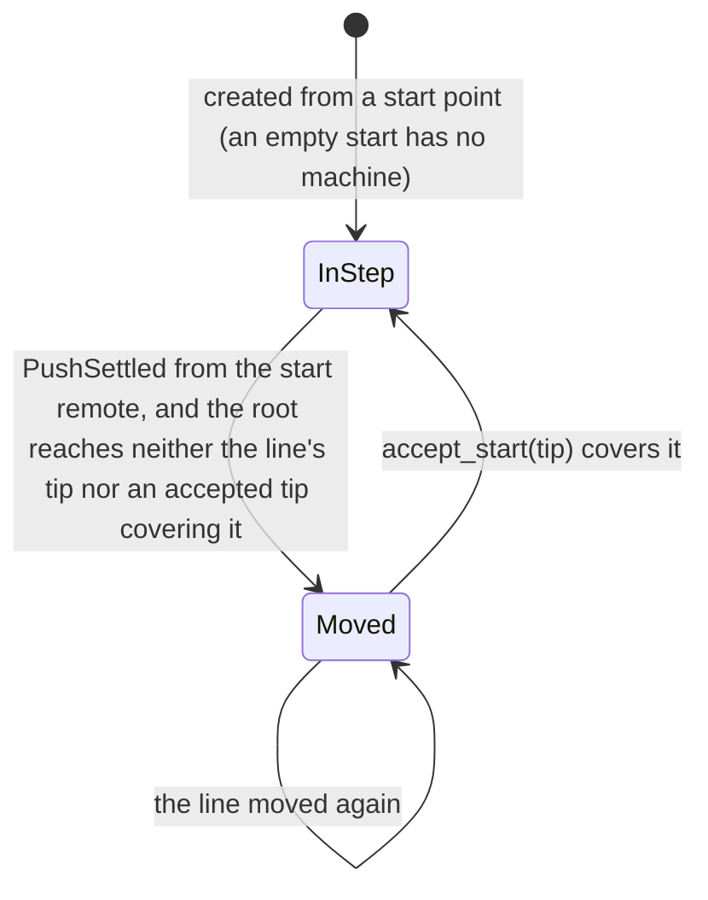

# Domain: Volume

**Proposed, not built.** This page proposes the Volume domain (lifecycle, start point and the release verdict), one part of the system around the git model ([the system](../system.md)). The git model ([git-model.md](../git-model.md)) wins wherever the two disagree. Rust sketches show surfaces only. The commit that lands the slice that builds this domain deletes this page and moves the behaviour into the library or operator docs.

## 1. What Volume owns, and what it is not

Volume answers three questions about one volume: is it in use (its lifecycle), where did its history begin (its
start point), and may its history service stop and its directory go (the release verdict). It asks each fact's owner
at that moment and keeps no copy.

The owner's guidance that applies here is in `OWNER-GUIDANCE.md` at the repository root. Everything else on this page is a design choice.


| Term | Meaning here |
|---|---|
| **volume** | one repository and its trees, on one node (S7) |
| **staged** | in use on this node: the history service runs and admits attachments |
| **draining** | told to stop: no new attachments; existing work finishes. `Stop` (a launcher's) or `Upgrade` (an operator's) |
| **upgrade drain** | a drain that also waits until every fork has dropped, so the next family finds only the root's branch |
| **released** | nothing promised would be lost if the service stopped now |
| **release verdict** | `Wait(blockers)` or `Release(disposition)`, from a pure judgement of asked facts |
| **start point** | where the root's history begins: empty, or a commit on another volume's line on a remote; fixed at create |
| **start line** | the remote line the start point was taken from, which can keep moving (a late push from an old node) |
| **accept** | an operator's statement that the root need not take in the start line's commits up to a tip |

**Not this domain:** attachment (Clients), branches, queues and history (git-model), remotes (Replication), which
forks are left (Trees), liveness (Health), the kernel lock and the family check (`store`), alarms (Telemetry).

## 2. The model

```mermaid
stateDiagram-v2
  [*] --> Staged: create, then stage (service boots holding the lock)
  Staged --> Draining: unstage (Stop) or drain_for_upgrade (Upgrade); VolumeDraining
  Draining --> Draining: a consumed event, verdict Wait
  Draining --> Staged: stage, during a Stop drain only
  Draining --> Released: a consumed event, verdict Release (VolumeReleased)
  Released --> Staged: stage by the same family, or by the next after an Upgrade drain
  Released --> [*]: Removable, and the owner deleted it
```





## 3. Public contract

```rust
pub trait Volume {
    fn create(&mut self, spec: VolumeSpec, by: &LaunchCap) -> Result<(), VolumeError>;   // may: Root
    fn stage(&mut self, by: &LaunchCap) -> Result<VolumeState, VolumeError>;             // may: Root
    fn unstage(&mut self, by: &LaunchCap) -> Result<VolumeState, VolumeError>;           // Staged → Draining(Stop)
    fn drain_for_upgrade(&mut self, by: &ActorCap) -> Result<VolumeState, VolumeError>;  // Operator
    fn accept_start(&mut self, tip: CommitId, by: &ActorCap) -> Result<(), VolumeError>; // Operator
    fn start_line(&self) -> StartLine;
    fn release_verdict(&self) -> ReleaseVerdict;   // asks every judge now; never stored
}
pub enum VolumeError { NotPermitted, NotStaged, StartDiverged, NoStartPoint, StartUnreachable, FormatsOf(Family), NotDurable(IoKind) }
pub struct VolumeSpec { name: VolumeName, root: BranchName, start: StartPoint, on_release: OnRelease }  // root: the root branch's name (future/root-branch-name.md)
pub enum StartPoint { Empty, Line { remote: RemoteName, line: LineName, at: CommitId } }
pub enum OnRelease { Keep, Remove }
pub enum ReleaseVerdict {
    Wait(NonEmpty<Blocker>),
    Release(Disposition),         // Keep | Removable
}
pub enum Blocker {                // each names the event that clears it
    Staged,                       // unstage or drain_for_upgrade
    Attached(ClientSet),          // AttachmentEnded (Clients::attached_any)
    QueuesNotEmpty(TreeSet),      // TreeMoved: a tree's queue still holds entries (git-model §5)
    Remote(Settlement),           // PushSettled: Pending or Failing
    ForksLeft(NonEmpty<ForkId>),  // ForkDropped (Trees::live); Upgrade drains only
}
pub enum StartLine { Empty, InStep { pinned: CommitId }, Moved { pinned: CommitId, tip: CommitId } }
```

| Published | When | Consumers |
|---|---|---|
| `VolumeDraining` | the `Draining` row is durable; again at boot while Draining | Clients, Replication |
| `VolumeStaged` | `Draining(Stop)` or `Released` → `Staged` is durable | Clients, Replication |
| `VolumeReleased{disposition}` | the `Released` row is durable | the composition root (the service exits); CSI |
| `StartLineChanged` | the judgement changes | Telemetry |

Consumed (re-judged while Draining): `AttachmentEnded`, `LastDetached`, `TreeMoved`, `ForkDropped`, `PushSettled`.
Asked: Clients `attached_any`, the git model's queue depths, Trees `live`, Replication `settlement(the root's head)`,
`line_tip`, `fetch_start` (once, at create, lending its `StartCap`).

## 4. Invariants

| # | Invariant | Enforced by | Strength |
|---|---|---|---|
| VO1 | `Released` only when no client is attached, every queue is empty, `settlement` of the root's head is `Held` or `NoRemotes`, and for an upgrade drain no fork is left | `release` takes a `Cleared`; only the pure `decide` builds one | construction time |
| VO2 | `Removable` only when `on_release` is `Remove`, the drain is `Stop`, and `settlement` is `Held` or `NoRemotes` | the same `decide`, exhaustively tested | construction time + test |
| VO3 | A transition and its event are one unit | repository write and outbox row commit together | construction time |
| VO4 | The verdict reads only facts asked at judgement time; nothing is polled | no clock port; clippy bans timers in the crate | compile + build time |
| VO5 | The start point never changes after create; acceptances only move forward along the start line | no setter; `accept_start` checks the tip (`StartDiverged`) | construction time |
| VO6 | A fork launcher cannot create, drain or stage the volume | `LaunchCap` with `may: Root`; `drain_for_upgrade` needs the Operator role | construction time |
| VO7 | A release stages another family's volume only after that family's upgrade drain released it (S8) | `store` reports the family at open; `stage` answers `FormatsOf` | boot time |

Ports: `VolumeRepository`, `StartRepository` (append-only acceptance rows), `Outbox`, `UnitOfWork` (`store`, audited).

## 5. Policies

| Policy | Current setting (design choice unless cited) |
|---|---|
| On release, per volume | `Keep` (today's `onDelete` default) |
| Start point, per volume | `Empty`; fixed at create |
| Zero remotes with `Remove` | `Removable`, from the owner's guidance on a volume with no remote. Cost: a deployment that forgot its remotes loses the volume on delete |
| A `stage` during a `Stop` drain | cancels the drain. Cost: a volume whose pods come and go may rarely reach `Released` |
| A `stage` during an `Upgrade` drain | answers `Draining(Upgrade)`: the launcher waits for the new family |

## 6. Flows

**Draining to release.** `unstage` writes `Draining(Stop)` and `VolumeDraining`: Clients refuses attaches and
Replication skips spacing. Each client's detach closes its open files as saves (git-model §6); each queue drains its
entries; each `TreeMoved` and `PushSettled` re-judges; with no blocker, `Released` and `VolumeReleased`, and the
service exits. **An upgrade** adds one blocker: every fork must drop (Trees), so the new family stages on the root's
branch, its history, the start record and the settings alone.

## 7. Tests

| Test | Rules out |
|---|---|
| Unstage with a fork attached; kill its view host: `Wait(Attached)`, then `Wait(QueuesNotEmpty)` or `Wait(Remote)`, then `Released` | releasing over a live client or an untaken save |
| `drain_for_upgrade` with a live fork; `stage` meanwhile: `Draining(Upgrade)`; `Wait(ForksLeft)` until `ForkDropped` | an upgrade stranding fork branches |
| Stage a 1.5 build on a 1.4 volume, before and after 1.4's upgrade drain | a release reading another family's formats |
| A remote that refuses connections under `Remove`: `Wait(Remote(Failing))`, never `Removable` | release by timeout |
| Start from a line at X; push later commits to it; accept T | silent loss of an old node's late commits |
| `decide` over every combination of facts, drain kind and `on_release` | a drifting release rule |

## 8. Costs

1. **A draining service keeps running** until every remote holds the root; behind an unreachable remote, until an
   operator acts.
2. **A file held open blocks release:** its take waits, so its queue never empties until its client ends.
3. **Acceptances stay on the volume:** a row, not today's pushed ref, so another node cannot see it.

## For the code architects (parked)

The outbox dedup key; how room for a drain is reserved at create; how the CSI edge reaches `release_verdict`; the
on-disk shape of settings kept across upgrades.

## Where it meets the existing code

- **The pure release decider** keeps its shape; its facts are asked of their owners.
- **The release scan** (30 s) and **NodeUnstage's push grace** (5 s) go: the service runs through Draining.
- **`startFrom`, `agentfs.start.*`** become the `StartRecord`; **`accepted/<tip>` refs** become acceptance rows; **`onDelete`** becomes `on_release`.
- **Upgrades:** the family check and upgrade drain are new.

**Not verified:** no code built or tested.

