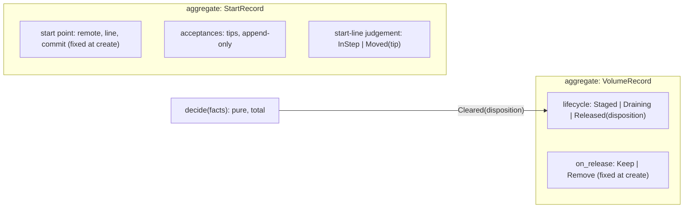
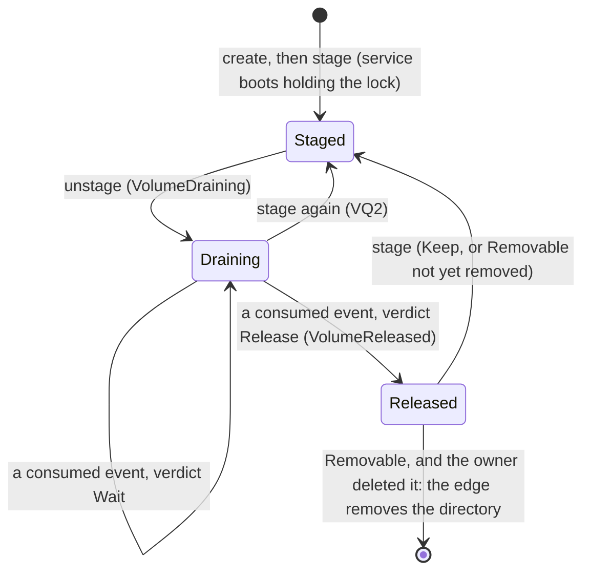
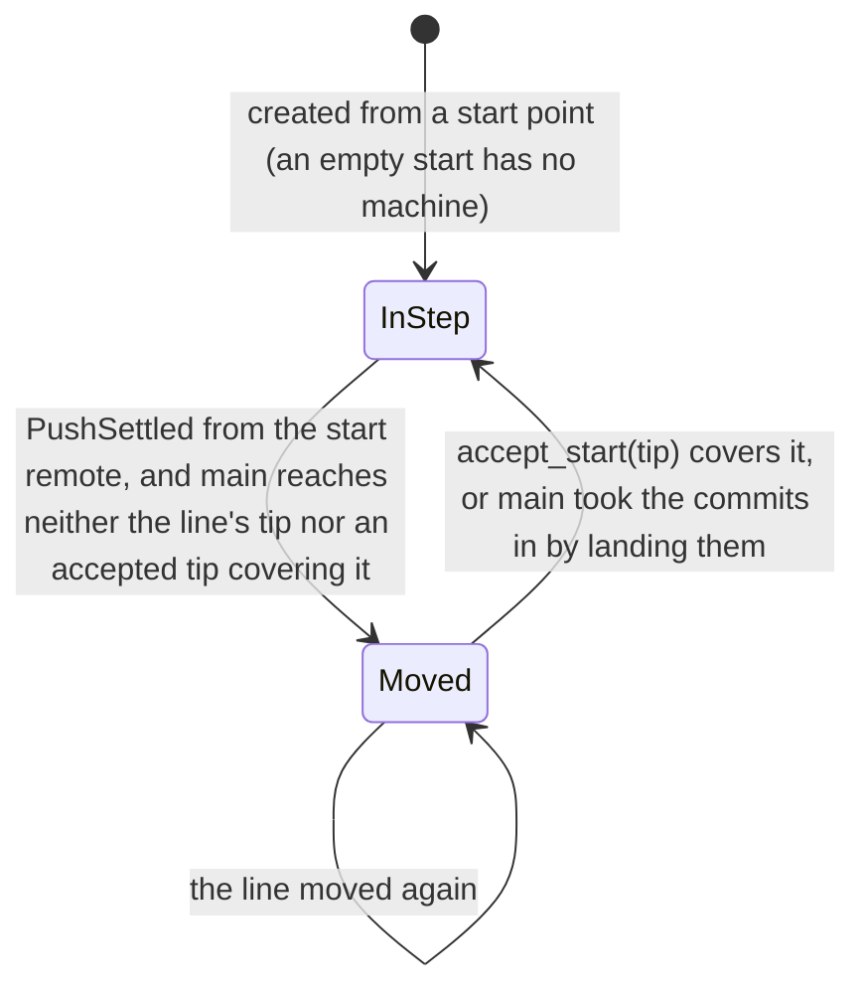
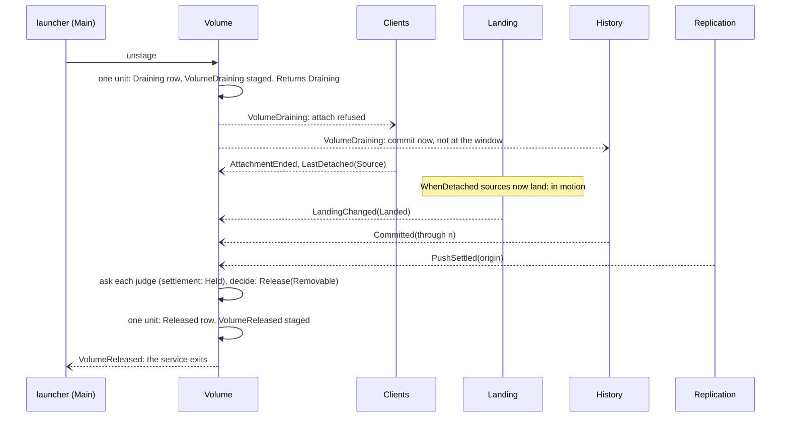
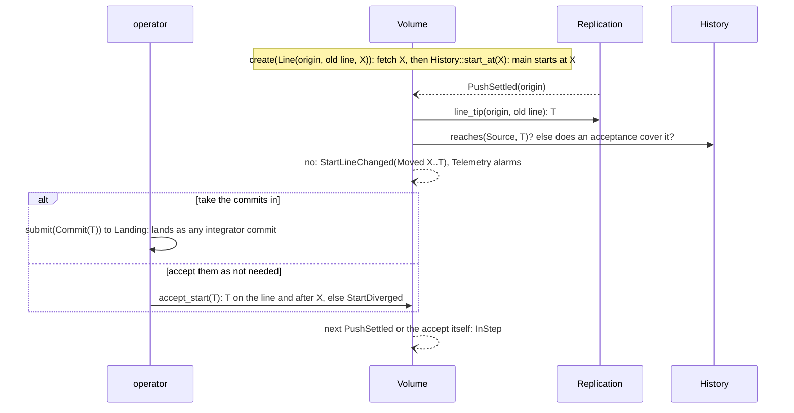

# Domain: Volume

**Layer:** System › **Domain (Volume)** › Feature.
**Status:** draft 2, proposed, against [system.md](../system.md) revision 4 (revision 3 approved 2026-11-02), which binds this page. It describes the target, not today's code. Sketches are Rust and show surfaces only.
**Binding from the system:** §3.3 `Volume` and `VolumeError`, §3.4 (Volume's four events; the events it consumes), I9, I10, I13, I15, §7 (held work does not hold release). Its escalations (§10) are resolved in system revision 4.
**What you are asked:** two questions, VQ1 and VQ2 in §9.

## 1. What Volume owns, its language, and what it is not

Volume answers three questions about one state area: is it in use (its lifecycle), where did its history begin (its start point), and may its history service stop and its directory go (the release verdict). It judges release by asking each domain that owns a fact, at that moment, and never keeps a copy of their state.

**Your words this domain rests on.** Everything else here is a design choice.

| # | Your words | Date | What it asks of Volume |
|---|---|---|---|
| — | "It's all event driven" | 2026-10-24 | release is re-judged on events, never on a scan interval |
| — | "Remotes can come and go. It's not a error to have zero remotes" | 2026-10-17 | zero remotes is a normal input to the verdict, not a fault |
| — | "B. And if no remote is configured, the volume is lost, and that's a choice the user is allowed to make." (said of a fork with no remote of its own) | 2026-10-17 | VQ1 |
| A4 | "A fork whose branches are rejected and never land in the main branch will inevitably be lost, and that's acceptable" | answer, system §1 | held fork work does not hold release |
| R7 | "Security boundary. Agentfs is the gatekeeper that exposes only what we want sandboxes to see" | 2026-10-30 | a sandbox launcher can never drain or stage the volume |

R12 (the history setting) and R13 (transactions) do not reach this domain: Replication judges what each remote holds (`settlement`), and the Journal abandons an open transaction when its attachment ends, before release can be judged.

| Term | Meaning here | Is not |
|---|---|---|
| **volume** | one state area and its source tree: one recorded directory with its own history, on one node (I15) | a Kubernetes claim; a fork's layer |
| **staged** | in use on this node: the history service runs and admits attachments | "mounted" (a view's fact) |
| **draining** | told to stop: no new attachments or submissions; existing work finishes | stopped |
| **released** | nothing promised would be lost if the service stopped now; it may exit | deleted |
| **release verdict** | `Wait(blockers)` or `Release(disposition)`, from a pure judgement of asked facts | a stored flag |
| **blocker** | one named reason to wait, and the event that clears it | a timeout |
| **disposition** | what may happen to a released state area: `Keep` it, or it is `Removable` when its owner deletes it | the act of deleting (the edge's) |
| **start point** | where a volume's history begins: empty, or a commit on another volume's line on a remote; fixed at create. Volume owns it; at create it asks History's `start_at` to make that commit main's first | a fork's parent (Forks'); History's line |
| **start line** | the remote line the start point was taken from, which can keep moving (a late push from the old node) | this volume's own line |
| **accept** | an operator's statement that main need not take in the start line's commits up to a tip | a landing |
| **in motion** | a landing that will finish without anyone acting (Landing's judgement) | a held or approval-waiting landing |

**Not this domain:** attachment (Clients), landing and its states (Landing), commits and lines (History), what each remote must hold and pushing (Replication), fork space and lineage (Forks), liveness (Health), the kernel lock itself (`store`, I15), alarms (Telemetry), config loading (the composition root).

## 2. The model



| Kind | Name | Holds | Why it is its own thing |
|---|---|---|---|
| aggregate | `VolumeRecord` | lifecycle, `on_release` | one row per state area; every transition is one unit of work with its event |
| aggregate | `StartRecord` | start point, acceptances, the last start-line judgement | its own lifecycle (below); `accept_start` never contends with a drain |
| value | `ReleaseFacts` | the asked facts, one per judge | the decider's whole input; built fresh each judgement |
| value | `Cleared` | a disposition, private constructor | only `decide` builds one, and only `Released` takes one |
| pure function | `decide(&ReleaseFacts) -> ReleaseVerdict` | no state | the one home of the release rule (prior art: today's pure release decider, kept) |

**Two lifecycles, two machines.** The volume's use and its start line move independently, so each has its own machine.





## 3. Public contract

The trait and `VolumeError` are §3.3's (revision 4, which adopted this page's E1, E2, E4 and E5, and E3 with one name per question). This page gives the values their shape.

```rust
// ── the trait: system §3.3 ─────────────────────────────
pub trait Volume {
    fn create(&mut self, spec: VolumeSpec, by: &LaunchCap) -> Result<(), VolumeError>;   // may: Main; a short-lived service on a new state area
    fn stage(&mut self, by: &LaunchCap) -> Result<VolumeState, VolumeError>;             // may: Main; boot, or Draining/Released → Staged
    fn unstage(&mut self, by: &LaunchCap) -> Result<VolumeState, VolumeError>;           // may: Main; Staged → Draining; idempotent
    fn accept_start(&mut self, tip: CommitId, by: &ActorCap) -> Result<(), VolumeError>; // Operator role; writes nothing in History
    fn start_line(&self) -> StartLine;
    fn release_verdict(&self) -> ReleaseVerdict;   // asks every judge now; never a stored copy
}
pub enum VolumeError {
    NotPermitted,      // the actor lacks the Operator role, or the launcher is not `may: Main`
    NotStaged,         // accept_start while Draining or Released: the start-line watch runs only while Staged
    StartDiverged,     // the tip is not on the start line, or does not descend from the start point
    NoStartPoint,      // accept_start on a volume that started empty
    StartUnreachable,  // the start remote cannot be asked for its line's tip
    NotDurable(IoKind),
}

// ── values given their shape here ─────────────────────
pub struct VolumeSpec { name: VolumeName, start: StartPoint, on_release: OnRelease }
pub enum StartPoint { Empty, Line { remote: RemoteName, line: LineName, at: CommitId } }
pub enum OnRelease { Keep, Remove }
pub enum VolumeState {
    Staged,
    Draining,
    Released(Disposition),
}
pub enum ReleaseVerdict {
    Wait(NonEmpty<Blocker>),   // the service keeps running
    Release(Disposition),
}
pub enum Blocker {                                  // each names the event that clears it
    Staged,                                         // unstage
    Attached(ClientSet),                            // AttachmentEnded (Clients::attached_any)
    LandingsInMotion(NonEmpty<LandingId>),          // LandingChanged (Landing::in_motion)
    Uncommitted(NonEmpty<TreeRef>),                 // Committed (Journal::uncommitted)
    Remote(Settlement),                             // PushSettled: Replication's own answer, Pending or Failing
}
pub enum Disposition {
    Keep,       // stays on its node and may be staged again; never removed automatically
    Removable,  // on_release is Remove and nothing would be lost: the edge may delete it when its owner does
}
pub enum StartLine {
    Empty,                                      // started with no history
    InStep { pinned: CommitId },
    Moved { pinned: CommitId, tip: CommitId },  // commits main has neither landed nor accepted
}
```

**Events.**

| Published | Fields | When | Consumers |
|---|---|---|---|
| `VolumeDraining` | — | the `Draining` row is durable; again at boot while Draining | Clients, Landing, History, Replication |
| `VolumeStaged` | — | `Draining` or `Released` → `Staged` is durable | Clients, Landing |
| `VolumeReleased` | disposition | the `Released` row is durable | the composition root (the service exits); the CSI edge |
| `StartLineChanged` | `StartLine` | the judgement changes | Telemetry (the alarm's one home) |

| Consumed | From | Effect while Staged | Effect while Draining |
|---|---|---|---|
| `Attached`, `AttachmentEnded`, `LastDetached` | Clients | none | re-judge |
| `LandingChanged` | Landing | none | re-judge |
| `Committed` | History | none | re-judge |
| `PushSettled{remote}` (including `Removed`) | Replication | from the start remote: re-judge the start line | re-judge |

**Who calls Volume, and whom it calls.** Every call out is a query on another domain's contract; Volume never commands another domain.

| Direction | Party | Through |
|---|---|---|
| in | launchers (CSI stage and unstage, the sidecar's start and stop), with `may: Main` | `create`, `stage`, `unstage` |
| in | operators, through the control socket | `accept_start` with an `ActorCap` |
| in | the CSI edge's delete call, the CLI's `status` | `release_verdict`, `start_line` |
| out | Clients | `attached_any()` |
| out | Landing | `in_motion()` |
| out | Journal | `uncommitted()` |
| out | Replication | `settlement(Source, head)`; `line_tip(remote, line)` for the start line |
| out | History | `head(Source)`, `reaches(Source, c)`; `start_at(c, StartCap)` once, at create |

## 4. Invariants and how they are enforced

| # | Invariant | Enforced by | Strength |
|---|---|---|---|
| V1 | `Released` only when every judge reports clear: no client attached, no landing in motion, no uncommitted record, and Replication's `settlement` of main's head is `Held` or `NoRemotes` | `VolumeRecord::release` takes a `Cleared`; only `decide` builds one, and only from facts with no blocker | construction time |
| V2 | `Removable` only when `on_release` is `Remove`, `settlement` is `Held` (or `NoRemotes`, per VQ1) | the same `decide`, total over `ReleaseFacts`; exhaustively tested | construction time + test |
| V3 | A transition and its event are one unit: no `Draining` row without `VolumeDraining`, no event without its row | the repository write and the outbox row commit together | construction time + test |
| V4 | The verdict reads only facts asked at judgement time; Volume persists its own lifecycle, never another domain's state (I9) | `ReleaseFacts` has no constructor from storage; the repository has no field for them | construction time |
| V5 | Every re-judgement follows a consumed event or a call; nothing is polled (I10) | the crate has no clock port; clippy `disallowed_types` bans `Instant`, `SystemTime` and timers here | compile time + build time |
| V6 | The start point never changes after create; acceptances only move forward along the start line; History holds only main's first commit | `StartRecord` has no setter for the start point; `accept_start` checks the tip descends from the last acceptance and lies on the line (`StartDiverged`); `start_at` needs the `StartCap` only Volume holds, and fails once main's line has a commit | construction time |
| V7 | A sandbox launcher cannot create, drain or stage the volume (R7) | `create`, `stage` and `unstage` take a `LaunchCap` and refuse anything but `may: Main` | construction time |
| V8 | One `VolumeRecord` per state area, loaded only after the state-area lock is held (I15) | the composition root builds the Volume service from the locked `store`; a second process fails the lock at boot | boot time |

## 5. Ports and adapters

The domain crate holds no I/O. Its own ports are persistence; every other input is another domain's contract, injected.

```rust
pub trait VolumeRepository {                              // one per aggregate
    fn load(&self) -> Result<Option<Audited<VolumeRecord>>, StoreError>;
    fn save(&mut self, u: &mut Unit, v: VolumeRecord) -> Result<(), StoreError>;   // room reserved at create
}
pub trait StartRepository {
    fn load(&self) -> Result<Option<Audited<StartRecord>>, StoreError>;
    fn insert(&mut self, u: &mut Unit, s: StartRecord) -> Result<(), StoreError>;   // once, at create
    fn accept(&mut self, u: &mut Unit, tip: CommitId) -> Result<(), StoreError>;    // append-only row
    fn judged(&mut self, u: &mut Unit, j: StartLine) -> Result<(), StoreError>;     // Volume's own last judgement
}
// Outbox<VolumeEvent> and UnitOfWork: the one store port shape in `contracts` (system §6)
```

| Port | Adapter | Notes |
|---|---|---|
| `VolumeRepository`, `StartRepository`, `Outbox`, `UnitOfWork` | `store` | the query-builder layer stamps `Audited` (created and changed, when and by which `Principal`) on both rows (I13); each acceptance is an append-only row carrying its actor and time |
| injected: `Clients`, `Landing`, `Journal`, `Replication`, `History` | the domains themselves, in-process | read-only queries; a judge that cannot answer (a remote unreachable) is a blocker, never a default |

**Design choice: no soft delete.** The two rows live exactly as long as the state area; removing the directory removes them. There is nothing to filter.

## 6. Internal flows and scenarios

**Draining to release** (CSI: the last pod leaves the node; sidecar: the container is told to stop).


**Starting from another volume's line, and the line moving.**


**Behaviour in the system's scenarios.**

| Scenario | What Volume does | What it never does |
|---|---|---|
| Live landing | nothing while Staged. While Draining, a landing in motion blocks; a `Held` or approval-waiting landing does not (system §7, A4) | wait for an approver to act |
| Transactions | nothing of its own: an attachment that ends abandons its open transaction (system Q2), and a sealed one is a landing like any other | know a transaction exists |
| Scale: 1,000 sandboxes | while Staged, consumed events cost a state check and nothing more. While Draining, a judgement is five queries; the remote holdings are Replication's to answer cheaply | judge on every `Recorded` |
| Scale: many volumes per node | each volume drains on its own events; no shared scan, so no volumes released in lockstep | run a node-wide release loop |
| Crash: history service while Draining | boot restores `Draining`, re-publishes `VolumeDraining` before `ServiceReady`, re-judges on the first consumed event and at boot | forget a drain, or release on restart by guess |
| Crash: between the `Released` row and the exit | boot finds `Released`; the edge re-reads `VolumeReleased` from the outbox and stops it again | re-open attachments without `stage` |
| Crash: a launcher during unstage | `unstage` is idempotent; a re-sent call returns the current state | drain twice |
| Disk full | `unstage` and `release` write into room reserved at create. Commits that fail for space keep `Uncommitted` as the blocker until `Committed` | refuse a drain for space; release over uncommitted records |
| A remote down for good | `Wait(Remote(Failing))`, alarmed from `PushSettled`. An operator removing the remote ends it: Replication publishes `PushSettled{Removed}` | release on a timeout; Delete over an unreachable remote |
| Upgrades | the new service restores both rows; their format migrates per system Q3 | keep a second row format beyond what Q3 allows |
| Several nodes | out (I15). A move is a new volume started from this one's line | let two nodes hold one volume |

## 7. Policies and configuration it owns

| Policy | Values | Current setting | Source |
|---|---|---|---|
| On release, per volume | `Keep` · `Remove` (today's `onDelete`) | `Keep` | design choice, from today's default |
| Start point, per volume | `Empty` · `Line(remote, line, commit)`; fixed at create | `Empty` | deployment config (a start class); design choice |
| What blocks release | attached clients, landings in motion, uncommitted records, remote gaps | as listed | design choice; held work excluded by system §7 and A4 |
| Zero remotes with `Remove` | `Removable` (recommended) · `Keep` | VQ1 | your answer to VQ1 |
| A re-stage while Draining | cancels the drain · waits for `Released` | VQ2 | your answer to VQ2 |

Volume has no timers. The commit window and push interval are History's and Replication's operator schedules; E2 lets a drain skip waiting for them.

## 8. Tests that prove it

Each runs the real binary against real state areas and `file://` remotes; the decider's table test is the one pure-logic test.

| Test | Proves | Rules out |
|---|---|---|
| Unstage with a sandbox attached; kill its view host; the service commits and pushes | `Wait(Attached)`, then `Wait(Uncommitted)` or `Wait(Remote)`, then `Released`; the process exits on `VolumeReleased` | releasing over a live client or an unpushed record |
| Unstage with a `WhenDetached` patch waiting and a held fork landing | the patch lands after `LastDetached`, then `Released(Keep)`; the held work is still in the fork after a re-stage | waiting forever on held work; releasing before an admitted patch lands |
| A remote that refuses connections | `Wait(Remote(Failing))` for as long as it refuses; removing it from config releases | release by timeout; one dead remote never clearing |
| A diverged remote under `Remove` | never `Removable` | deleting a volume whose remote another writer moved |
| Kill the service while Draining; restart | still Draining; attach refused before `ServiceReady`; released on the next event | a drain forgotten across a crash |
| Fill the disk, then unstage | `Draining` is written; `Wait(Uncommitted)` until space frees and `Committed` arrives | a drain refused for space; a release over uncommitted records |
| A sandbox launcher calls `create`, `unstage` and `stage` | `NotPermitted` | a sandbox draining main (R7) |
| Create from a line at X; push later commits to the old line; accept T; accept a commit off the line | `Moved(X..T)` alarmed, then `InStep`; `StartDiverged` | silent loss of the old node's late commits; acceptance off the line |
| Take the late commits in by an integrator commit instead | `InStep` once it lands, with no acceptance row | two ways to clear the alarm disagreeing |
| `decide` over every combination of facts and `on_release` | `Removable` only with every remote holding; `Release` only with no blocker | a release rule that drifts from its one home |
| 100 volumes unstaged at once | each released on its own events; no shared loop runs | lockstep pushes; a node-wide scan |
| Compile-fail tests in another crate | building `Cleared` or `Released` outside `decide` does not compile | a release that skipped the judgement |

## 9. Costs and open questions

**Costs.**
1. **A draining service keeps running** until every remote holds the volume. An unreachable remote keeps its process, memory and lock until an operator acts.
2. **Kubernetes retries the delete call on its own backoff.** That retry is a timer outside agentfs; inside it, release is event-driven.
3. **Held work does not hold release.** Under `Remove`, a fork's held work and approval-waiting patches go with the directory unless Replication pushed them (A4 accepts this for fork work).
4. **Acceptances stay on the volume.** Today an acceptance is a pushed ref; here it is a row, so another node cannot see it.
5. **The surface grows Volume** by two commands, three events and six queries on other domains.

**VQ1. A volume with no remotes, set to `Remove`, whose owner deletes it: delete it or keep it?** Your fork answer ("the volume is lost, and that's a choice the user is allowed to make") was about forks; this asks whether it holds for every volume.
- **Recommended: delete it.** The operator chose both no remotes and `Remove`. Cost: a profile that forgot its remotes loses the volume on delete.
- **Alternative: keep it, whatever `on_release` says** (today). Cost: such volumes pile up on node disks until removed by hand, and the setting says `Remove`.

**VQ2. A pod arrives on the node while its volume is draining: cancel the drain, or make the pod wait for `Released`?**
- **Recommended: cancel it** (`Draining → Staged`). Cost: a volume whose pods come and go often may rarely reach `Released`, so it is pushed only on the push schedule.
- **Alternative: wait.** Cost: behind an unreachable remote, the new pod waits until an operator acts.

## 10. Escalations to the system document

| # | Where (revision 3) | Recommended change | Resolution in revision 4 |
|---|---|---|---|
| E1 | §3.3 `Volume`: no create or stage; `unstage` unguarded | `create`, `stage`, `unstage`, each with `LaunchCap{may: Main}` | adopted |
| E2 | §3.4: `VolumeDraining` reached only Clients; no restage, release or start-line event | `VolumeDraining` to Landing, History, Replication; `VolumeStaged`, `VolumeReleased`, `StartLineChanged` | adopted |
| E3 | §3.3: the verdict's facts had no query | `attached_anywhere`, `in_motion`, `uncommitted`, `holdings`, `line_tip`, `PushSettled{Removed}`, `reaches`, `start_line` | adopted with one name per question: `Clients::attached_any`, `Landing::in_motion`, `Journal::uncommitted` (shared with Forks), Replication's `settlement` as the one judge of remotes (no `holdings`, no `RemoteGap`), `line_tip`, `History::reaches`. History's `start_at` (its HE2) makes the start commit main's first; the start point and acceptances stay here |
| E4 | `VolumeError` | `NotDurable`, `NoStartPoint`, `StartUnreachable` | adopted |
| E5 | I15 named Volume a guarantor of the kernel lock | the lock is `store`'s | adopted |

## New terms

| Term | Definition | Why needed | Could be the existing term |
|---|---|---|---|
| blocker | one named reason a release waits, with its clearing event | a verdict an operator can act on | today's "wait" reasons |
| disposition | `Keep` or `Removable` | release and deletion are different facts | `onDelete`'s outcome |
| start line, accept | the remote line a volume started from; an operator's "not needed" for its later commits | the old node's late commits | start branch, `start accept` |
| in motion | a landing that finishes without anyone acting | which landings hold release | none |

## For the code architects (parked)
The outbox relay's dedup key; how "room reserved at create" is held; whether `settlement` lists remotes fresh or answers from Replication's last settled push (Replication's choice, but its cost lands on each re-judgement); how the CSI edge reaches `release_verdict` of a running service versus a short-lived one; listing before fetching on the start line.

## Reconcile with existing code (agentfs origin/main b5c0dc8)
- **The pure release decider** keeps its shape and moves here. Its facts are asked of their owners, not gathered by the delete call. Fork publish state leaves it: forks are layers now.
- **The release scan** (a 30 s interval) and **NodeUnstage's push grace** (5 s) go: the service runs through Draining and stops on `VolumeReleased`. Cost: one process per draining volume instead of a node-wide scan.
- **`startFrom` and `agentfs.start.*`** become the `StartRecord`; **`accepted/<tip>` refs** become acceptance rows; **`StartBranchMoved`** becomes `StartLineChanged`, alarmed by Telemetry. Cost: acceptances are no longer on the remote (cost 4).
- **`onDelete`** becomes `on_release`. **"Patches land only at NodeStage"** is Landing's `WhenDetached`, no longer a stage step.

**NOT RUN:** no code was built or tested; the CSI behaviour above comes from `docs/csi.md` and `docs/design.md` §14.2 on origin/main, not from running it.

*History: draft 1 (2026-11-02); draft 2, conformed to system revision 4.*
