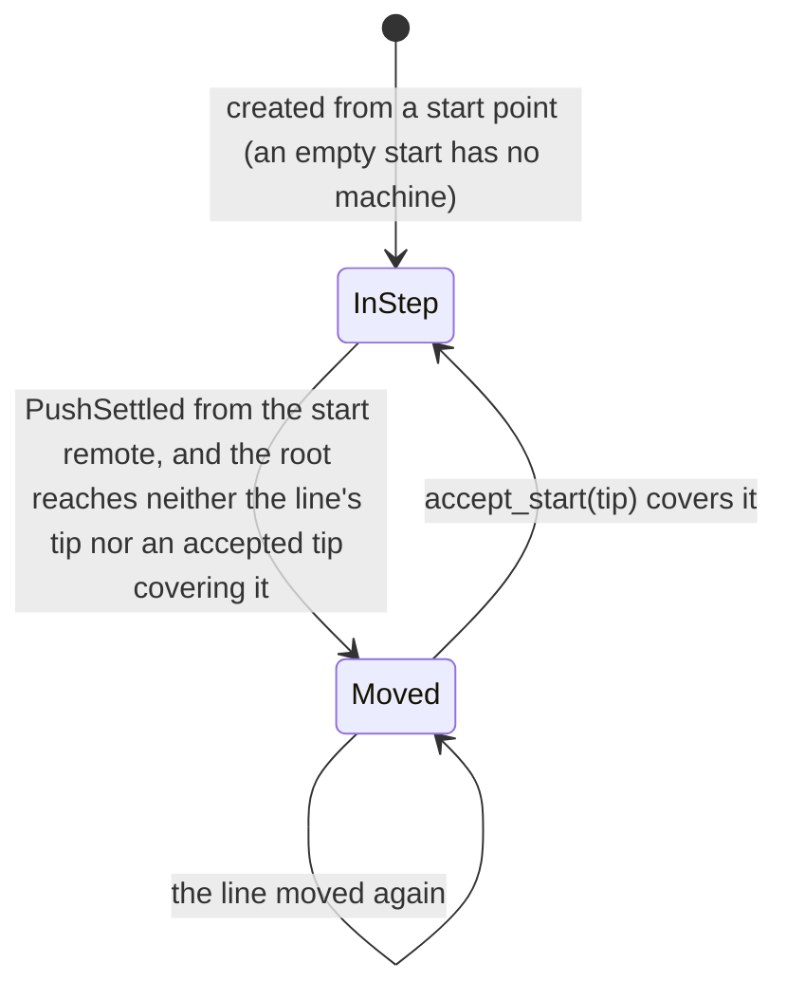

# Domain: Volume (the unbuilt parts)

**Partly built; this page proposes the rest.** The Volume domain's `ensure`, its lifecycle (`stage`, `unstage`, the Stop drain) and the
release verdict over attached clients and queues are built and described in
[docs/trees.md](../../trees.md#volume-lifecycle) and the [library](../../library/domains.md#rows-and-domain-events),
with the built parts of VO1 to VO6 in its [domain invariants](../../library/domains.md#domain-invariants). This
page proposes the rest: the start point and its line, the upgrade drain, settlement by the remotes, and what happens to a
released volume's directory. It is one part of the system around the git model ([the system](../system.md)); the git
model ([git-model.md](../git-model.md)) wins wherever the two disagree. Rust sketches show surfaces only. The commit
that lands the slice that builds these parts deletes this page and moves the behaviour into the library or operator
docs.

The owner's guidance that applies here is in `OWNER-GUIDANCE.md` at the repository root. Everything else on this page
is a design choice.

| Term | Meaning here |
|---|---|
| **start point** | where the root's history begins: empty (built), or a commit on another volume's line on a remote; fixed at create |
| **start line** | the remote line the start point was taken from, which can keep moving (a late push from an old node) |
| **accept** | an operator's statement that the root need not take in the start line's commits up to a tip |
| **upgrade drain** | a drain that also waits until every fork has dropped, so the next family finds only the root's branch |
| **settlement** | whether the remotes hold the root's head (Replication's judgement); `NoRemotes` is the only one built |
| **on release** | an operator setting: `Keep` (built, the only disposition) or `Remove` |

## 1. The start line



## 2. Contract additions

```rust
pub trait Volume {
    // built: ensure, stage, unstage, release_verdict
    fn drain_for_upgrade(&mut self, by: &ActorCap) -> Result<VolumeState, VolumeError>;  // Operator
    fn accept_start(&mut self, tip: CommitId, by: &ActorCap) -> Result<(), VolumeError>; // Operator
    fn start_line(&self) -> StartLine;
}
pub enum StartPoint { Empty, Line { remote: RemoteName, line: LineName, at: CommitId } }
pub enum Drain { Stop, Upgrade }
pub enum Disposition { Keep, Removable }
pub enum OnRelease { Keep, Remove }   // an operator setting, read at boot; not in the spec
pub enum Blocker {
    // built: Staged, Attached(ClientSet), QueuesNotEmpty(trees)
    Remote(Settlement),           // PushSettled: Pending or Failing
    ForksLeft(NonEmpty<ForkId>),  // ForkDropped (Trees::live); Upgrade drains only
}
pub enum StartLine { Empty, InStep { pinned: CommitId }, Moved { pinned: CommitId, tip: CommitId } }
pub enum VolumeError { /* built ones, plus */ NotStaged, StartDiverged, NoStartPoint, StartUnreachable, FormatsOf(Family) }
```

| Published | When | Consumers |
|---|---|---|
| `StartLineChanged` | the judgement changes | Telemetry |

Consumed while draining, besides the built ones: `ForkDropped` (upgrade drains), `PushSettled`. Asked: Trees `live`,
Replication `settlement(the root's head)`, `line_tip`, `fetch_start` (once, at create, lending its `StartCap`).

## 3. Invariants

| # | Invariant | Enforced by | Strength |
|---|---|---|---|
| VO1 (rest) | `Released` also needs `settlement` of the root's head `Held` or `NoRemotes`, and for an upgrade drain no fork left | the pure `decide`, which alone builds a `Cleared` | construction time |
| VO2 | `Removable` only when `on_release` is `Remove`, the drain is `Stop`, and `settlement` is `Held` or `NoRemotes` | the same `decide`, exhaustively tested | construction time + test |
| VO5 (rest) | The start point never changes after create; acceptances only move forward along the start line | no setter; `accept_start` checks the tip (`StartDiverged`) | construction time |
| VO6 (rest) | `drain_for_upgrade` needs the Operator role | `ActorCap` | construction time |
| VO7 | A release stages another family's volume only after that family's upgrade drain released it (S8) | `store` reports the family at open; `stage` answers `FormatsOf` | boot time |

## 4. Policies

| Policy | Current setting (design choice unless cited) |
|---|---|
| On release, per volume | `Keep` (today's `onDelete` default); an operator setting in the git-config include with the others (CSI writes it from the class's `onDelete`), read by Volume at boot, never in the spec |
| Zero remotes with `Remove` | `Removable`, from the owner's guidance on a volume with no remote. Cost: a deployment that forgot its remotes loses the volume on delete |
| A `stage` during an `Upgrade` drain | answers `Draining(Upgrade)`: the launcher waits for the new family |

## 5. Flows

**An upgrade drain** adds one blocker to the Stop drain: every fork must drop (Trees), so the new family stages on the
root's branch, its history, the start record and the settings alone. **Settlement:** with remotes, each `PushSettled`
re-judges, and the release waits until every remote holds the root's head.

## 6. Tests

| Test | Rules out |
|---|---|
| `drain_for_upgrade` with a live fork; `stage` meanwhile: `Draining(Upgrade)`; `Wait(ForksLeft)` until `ForkDropped` | an upgrade stranding fork branches |
| Stage a 1.5 build on a 1.4 volume, before and after 1.4's upgrade drain | a release reading another family's formats |
| A remote that refuses connections under `Remove`: `Wait(Remote(Failing))`, never `Removable` | release by timeout |
| Start from a line at X; push later commits to it; accept T | silent loss of an old node's late commits |

## 7. Costs

1. **A draining service keeps running** until every remote holds the root; behind an unreachable remote, until an
   operator acts.
2. **Acceptances stay on the volume:** a row, not today's pushed ref, so another node cannot see it.

## Where it meets the existing code

- **The release scan** (30 s) and **NodeUnstage's push grace** (5 s) go: the service runs through Draining.
- **`startFrom`, `agentfs.start.*`** become the `StartRecord`; **`accepted/<tip>` refs** become acceptance rows; **`onDelete`** becomes `on_release`.
- **Upgrades:** the family check and upgrade drain are new.
