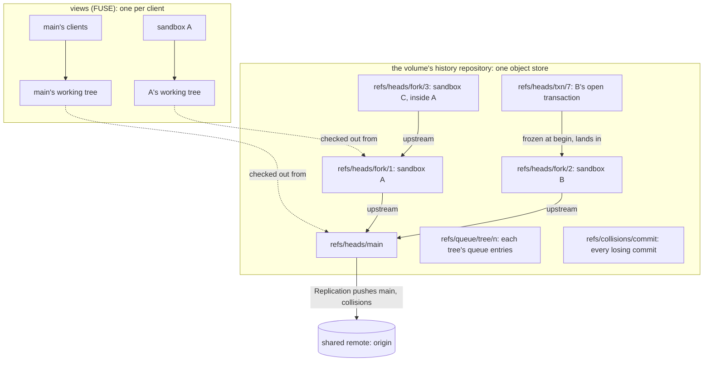
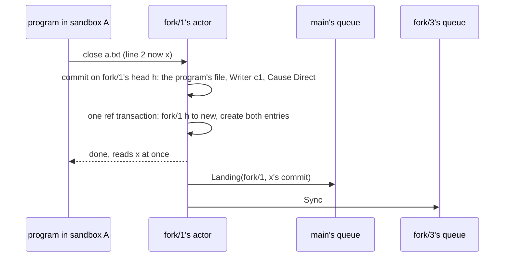
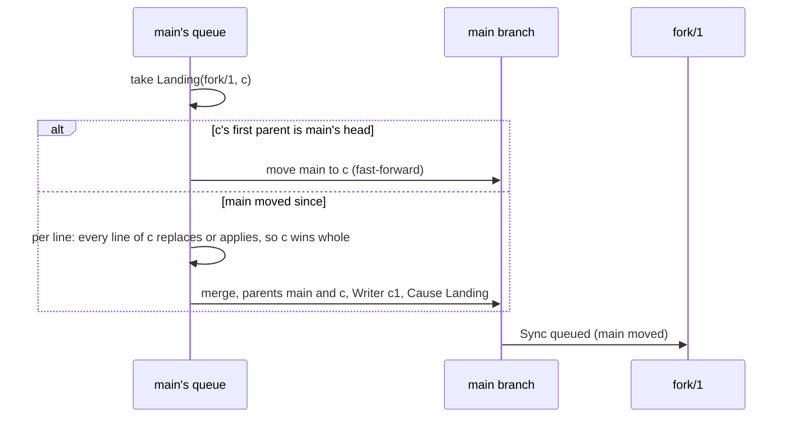
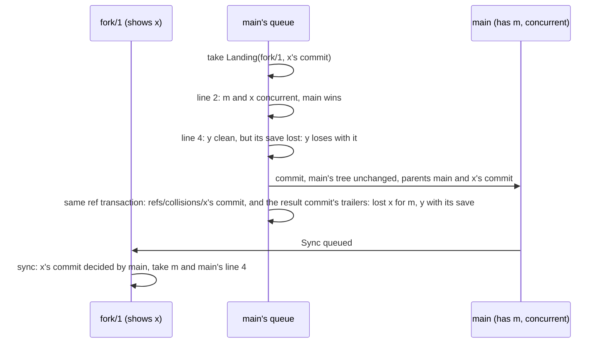
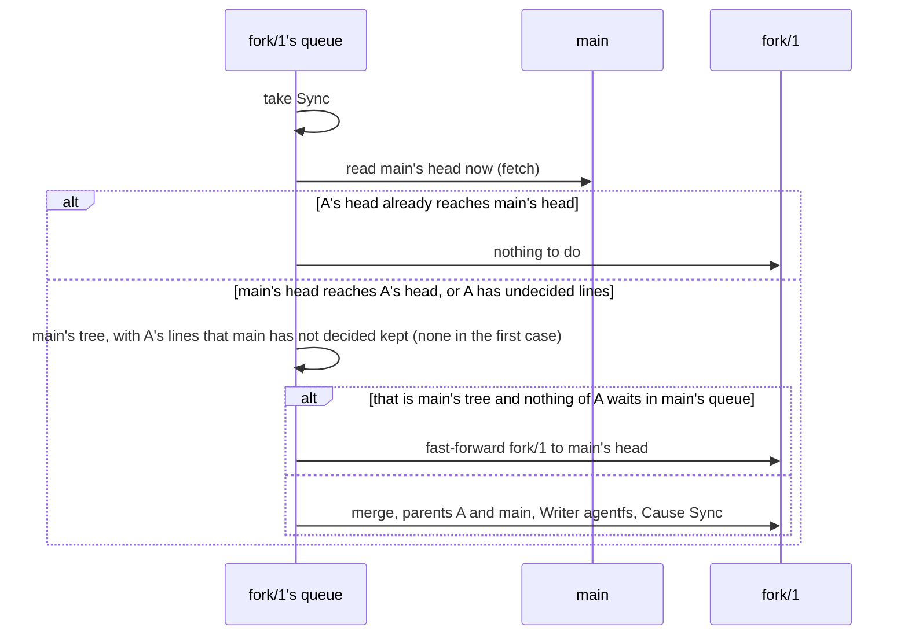
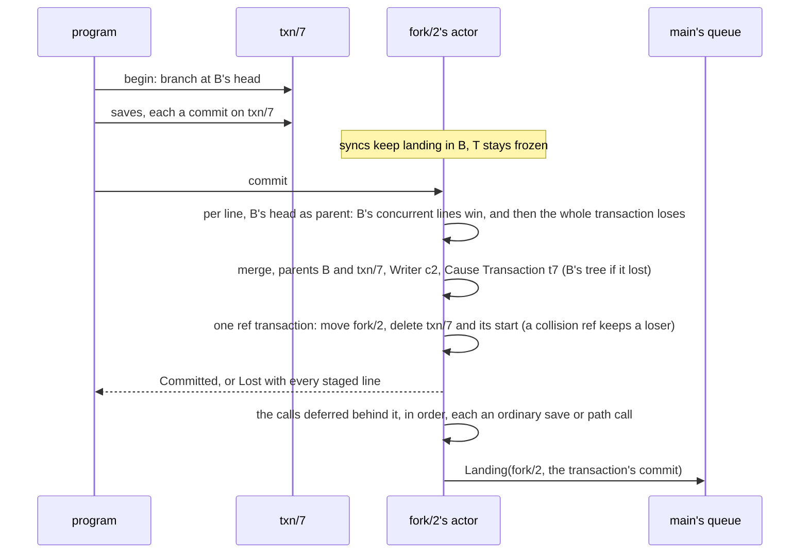
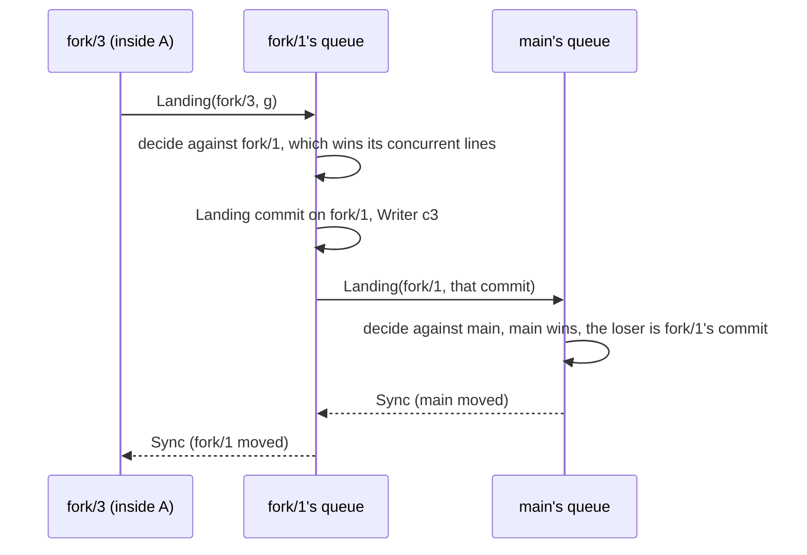

# agentfs in git terms

**Layer:** the foundation under the [system](system.md) and its domains: how every tree, save, landing and sync maps onto git.
**Status:** proposed: the target, not today's code, resting on the executable model in
[`crates/agentfs-model`](../../crates/agentfs-model/MODEL.md) as of the commit that adds this revision on this
page's branch (the one adding rule 3e's whole changes and the `r3_a_save_loses_whole_*` tests; the per-line rules
before it are at 8185755), which runs the rules on the real `git` program.
**Rules and their status:** [the rules ledger](rules-ledger.md) lists every rule in plain words and whether the
owner approved it; it wins on status, this page on what each rule means in git.
**Read it first:** code for the domains starts from this page. Where another page disagrees, this page wins and the
other page has a bug.
**Revision of 2026-11-04** (answering the pull-request review's points 1, 3, 4 and 5): the journal that records every
write call before it returns (§3), objects apart from file identities (§7), progress past a long-held file (§6),
why a custom protocol on git primitives (§14), and the phase 1 validation plan (§18). All four are design choices. Since
the commit that adds MODEL.md rule 12, the journal's crash replay (§3), creates, objects and the atomic save (§7)
and progress rule P1 (§6) are **modelled** (MODEL.md rules 9, 11 and 12, findings 19 to 22). After the owner's
decisions of 2026-11-04 (§6), P3 is deleted and P2 is the prefix sync, both modelled.

## 0. What the owner asked for

| Date | The owner's words |
|---|---|
| 2026-11-03 | "if its coherent then i want a technical doc describing the system in git parlance, from the perspective of working trees, indexes, remotes, branches, etc. That will serve as the foundation of the code to follow" |
| 2026-11-02 | "Since the model is effectively “just git” with some overlaid lock/merging rules, I propose a set of functional tests (recorded, runnable in the repo test suite) that mimic the agentfs model via native git operations."; "I generally like the metaphor of a typical Linux filesystem. I want to try that out." |
| 2026-11-02 | Agreeing that every collision between a sandbox and its parent is decided in one place, the parent's landing queue: "ok, that tracks" |
| 2026-11-03 | "i think i would assume main wins. because if sandbox forked from main and then main moved forward, the sandbox is working from an out-of-date copy. so even though its history can be preserved for posterity, i think the updated main should win in a conflict." (replaces "the incoming change wins", 2026-11-02) |
| 2026-11-02 | On transactions: "Frozen snapshot was my intention, yes. That's why I said “new branch” earlier."; "If “landing” is essentially a continuous “checkout” into the working directory, then a transaction starting effectively creates a new index —maybe even an implicit branch in the local history — and adding files to the transactions only adds them to the staging index." |
| 2026-11-03 | "the sandbox commits could be squashed to one changeset (if they are the naive simple commits) and merged into upstream as one unit. if its a smarter integration that is creating transactions, it might be best to leave the transaction commits as they are"; "every sandbox commit stays stored ... that makes sense, because thats basically the design we want" |
| 2026-11-03 | "yes, \"losing\" patches should still be part of the history. i want to know who changed what when" (replaces, for losing changes, A4: "A fork whose branches are rejected and never land in the main branch will inevitably be lost, and that's acceptable") |
| 2026-11-03 | "if the program saves after the sync has landed, then arguably the sandbox was the last writer and its change should take effect. wouldnt the upstream then detect the shared lineage and allow the sandbox to \"win\"?" |
| 2026-11-03 | On saves: "if we're trying to emulate a traditional linux filesystem, then wouldnt this depend on how the write occurred? Like an append vs a write? I dont think that agentfs should try to do anything beyond record the actions through the filesystem" |
| 2026-11-03 | "Go", in reply to the recommended next steps: accept close-to-open visibility for open files (§3); trim the superseded older pages; settle what a "line" is in a real file (§7); a rule for deletes and renames (§7) |
| 2026-11-03 | Asked "If the sandbox has edited line 5 (the file is open) then doesnt that imply that the sandbox has a lock on the file and the upstream commit landing would be queued waiting for that lock?", then: "A sync should acquire a lock on every file that it aims to overwrite, yes"; and 2026-11-02: "freezing only the files that a landing touches sounds reasonable" |
| 2026-11-03 | On a collision's cost, after reading that "one line loses": "“One line loses” sounds like a collision, and I thought we had already decided that each commit was a transaction"; "some commits represent a transaction, and some commits represent a collection of changes. Those two could have different operational models"; on a plain save: "The whole file, right? That was the “traditional Linux fs” model we had discussed". Then he asked "Wouldn’t a squashed changes still be merged file-by-file? Or does the squashing happen after the merge decisions are made — so only the winning changes get squashed? What happens to the losing files?", was told §11's answer, and did not object (that answer is a design choice he did not object to: not his decision, not his words) |
| 2026-11-02 | Still binding (system §0): A13 "It’s a transaction, so a failure is an implicit rollback."; R17 "making the fork design so rock-solid that it is almost as effective, by syncing forks quickly and efficiently to minimize conflict drift"; A12 "The sandboxes are generally peers and parallelism is assumed." |

Everything else here is a **design choice** and says so, or is what the model does (MODEL.md marks its choices).

## 1. The picture

One git repository per volume holds every tree. Main and each sandbox are branches; a sandbox's parent is its
upstream. Replication, the remote's one pusher, carries main's line and every collision ref to the
shared remote.



## 2. Every agentfs term in git terms

| agentfs term | git term | In the model |
|---|---|---|
| volume | one repository (one object store, many branches) | `World` |
| tree (main, a sandbox's fork) | a branch, with its own working tree and index | `refs/heads/main`, `refs/heads/fork/<id>` |
| fork's parent | the branch's upstream, in the same repository (`branch.fork/3.remote = .`) | `Fork::parent` |
| nested fork | a branch whose upstream is another fork's branch | `create_fork(Tree::Fork(f))` |
| client, writer | the `Agentfs-Writer` trailer; git's author and committer are one fixed service identity | `Client`, `fork.writer` |
| save | one commit on the tree's branch at close: the program's write calls applied to the head then (its first parent), naming one writer | `World::close` |
| lock | a take holding the files it overwrites in a tree, or a write-open blocking one; in memory, not a ref | `World::holds`, `World::waits` |
| landing | a push of a fork's commit into its parent's queue | `Entry::Landing` |
| the parent's queue | the one referee for that tree: a first-in, first-out list of incoming commits and syncs | `World::queue` |
| queue take | the referee builds one commit on the parent's branch and moves the ref | `World::step`, `land` |
| sync | fetch of the upstream's head as it is now, then a fast-forward or, when the fork has commits the upstream has not taken, a **sync commit**: a `Sync` merge with no edits of its own, keeping the fork's undecided lines | `World::sync`, `adopt` |
| line identity | what makes two versions "the same line": fixed when a save first records the line (a new line its alignment finds, an append, the root), kept by every later change to it (§7) | `Line::line` |
| version | one state of a line: new bytes or deleted, each with its own id, written over the version its writer saw | `Line::id`, `Line::over` |
| deleted version | a delete, kept hidden in the line map so the rule can compare it | `State::Gone` |
| file identity; name line | a file's merge identity (its line history, which the referee compares) and the line holding its path; kept by a rename and by the atomic-save rewrite (§7); a rename writes a new version of the name line, an unlink a deleted one | `Content::name` |
| object | what an open handle holds, as the inode does on Linux: fixed at open, follows renames, named by no path once unlinked or replaced; per tree and in the actor's memory, never in git (§7) | `Handle::object`, `World::named` |
| journal | each tree's write-ahead log of write calls and path calls, in the state area: a call is in it before the call returns (§3) | an open's calls (`Handle`), replayed by `World::crash` |
| collision | two versions of one line, each written without seeing the other | `Collision` |
| decided | the parent's lineage reaches the commit that wrote the version | `is_ancestor` |
| "saw" a line | the version on the writer's first parent, and every version that one was written over | `written_over` |
| losing version | a commit kept under its own ref | `refs/collisions/<n>` |
| transaction | a short-lived branch frozen at begin, with its own index | `refs/heads/txn/<n>` |
| transaction commit | a landing of that branch into its fork | `World::commit_txn` |
| rollback | branch delete | `World::rollback` |
| full lineage | every landing is a fast-forward or a merge, so a tree's history reaches every change it took | `World::is_ancestor` |
| view | a FUSE mount serving one tree's working tree, filtered by the rules | not modelled |

## 3. A tree: branch, index, working tree

The model builds commits with plumbing (`mktree`, `commit-tree`, `update-ref`) and keeps no index or working
tree. This section is a design choice.

| Piece | What it is | Rule |
|---|---|---|
| branch | the tree's head: the only source of truth for the tree | moved by a save, a queue take (a landing into it or a sync), a transaction commit; created when the fork is made, deleted when it drops |
| upstream | the parent's branch | fixed when the fork is made |
| index | one per tree: a cache of the branch's tree, never a source | reset to the new head in the same step that moves the branch |
| working tree | the saved tracked files the view serves: a full checkout of the branch (`git worktree add`) | follows every move in the same step: `git read-tree -m -u <old> <new>` rewrites only files that differ (the owner's "continuous checkout") |
| untracked area | the tree's files the rules skip and its scratch names (rules.md): a directory beside the working tree, never inside it, which the view overlays on it | never committed, so no save, sync or landing carries it, and `read-tree -u` never meets it (it refuses to overwrite an untracked path). A tracked file that arrives at a path the untracked area holds wins the path in the view; the untracked file stays, hidden, and shows again if the tracked one goes (a choice) |
| open file | a program's write calls since its write-open: each in the tree's journal before the call returns (below), with a copy in the view for the writer's own reads | becomes a save at close; no sync or landing writes it while open (§6). Private until close (close-to-open, as AFS), the owner's decision ("Go", 2026-11-03, accepting that recommendation): other readers see only saved content. The model has no reads through an open file; in the target the writer reads its own unsaved writes back through its open file, as on Linux (a choice, views.md §2). A shared mapping behaves as on Linux (R1.4): the kernel keeps one size and one set of pages per file, so all of a file's mappings share pages, a page fill reads the saved bytes plus every open's calls and page writes in arrival order, `stat` reports the writers' size to everyone while the file has a write-open, a writable descriptor also reads the file's page writes, and `sendfile` reads what a mapping reads. `read` and `pread` on a read-only descriptor keep saved bytes (R1.1). A take drops the kernel's pages of each file it changed (`FUSE_NOTIFY_INVAL_INODE`, with the actor unlocked). The close is FUSE `RELEASE` (the last reference to the open file, a shared mapping included), never `FLUSH`, which comes on every close of a duplicated descriptor. An `O_TRUNC` open is a truncate at open: one that writes nothing saves an empty file |
| transaction | branch `txn/<n>`, its own index (`GIT_INDEX_FILE`) and its own directory checked out from it | no `git worktree`, so no HEAD and no HEAD reflog points at it |

The working tree holds only saved tracked content, so moving it never loses a program's unsaved bytes or an
untracked file. The older "fork's layer over its parent" (trees.md) becomes a storage optimisation that must serve
the same files.

**One writer per branch.** The model's steps never overlap; real saves and queue takes would. So every move of a
tree's branch (its saves, transaction commits and queue takes) runs on that tree's one actor, one at a time. Each
move is one ref transaction whose updates name the old value (`update <ref> <new> <old>`), so a move from anywhere
else fails loudly instead of being overwritten. The index and working tree catch up before the actor's next step.

### Recording before return: the tree's journal (design choice, review point 1)

Close-to-open (the owner's "Go", 2026-11-03) says when others **see** a change. AGENTS.md principle 1 says when it
must be **recorded**: "A change that reached the filesystem must be recorded before the call returns, or fail
loudly" (the repository's statement of the owner's priority; no dated quote of his backs it on these pages). They
are two clocks, kept apart as NFS keeps `WRITE` and `COMMIT` apart from close, and as a database keeps its
write-ahead log apart from its commit. We read his "Go" as accepting late visibility; this design no longer asks
him to accept losing a call that returned, which the previous draft did (views.md cost 2).

| Call | Before it returns | If that fails | Survives |
|---|---|---|---|
| `write`, `pwrite`, an `O_APPEND` write, `ftruncate` | appended to the tree's journal; the open file's copy changes only after (record first) | `ENOSPC` (the state area is full) or `EIO`; the open file is unchanged | the death of any agentfs process at once; power loss once the next row has returned |
| a page a shared mapping writes back (`FUSE_WRITE_CACHE`) | only the bytes differing from what that page was last filled with or written back as, in one record naming the file, never the handle the kernel used; nothing if no byte changed. Then every write-open's copy follows. The next close of any write-open saves it: whole above the last step that closed a write-open of the file, and below that, for an open with an earlier call, only over bytes that open's own earlier calls touched, so a later mapped write stands against a later close (R9.16) and a third save is not reverted | `ENOSPC` or `EIO`, which the kernel keeps as the mapping's error; nothing changes | as the row above. A store not written back is in the kernel's page only: the death of the view host loses it, which Linux would keep (a cost of R1.4) |
| `fsync`, `fdatasync`, `msync(MS_SYNC)`, each write on an `O_SYNC` or `O_DSYNC` open, and every `close` (FUSE `FLUSH`) of a handle whose records are not yet durable | the open's records made durable; one flush covers every record queued meanwhile (group commit, as today's journal) | `EIO` from that call; the records stay and the next one tries again | power loss |
| `unlink`, `rename(2)`, path `truncate(2)` | journaled durably, then run (as today's namespace records) | the call's own error; nothing changed | power loss |
| `RELEASE` (the last reference) | nothing to wait for: the actor saves from the journal (§6) | nothing can fail on recording, since every call is already recorded; the kernel ignores `RELEASE`'s answer anyway | — |

Publication is the save, at `RELEASE`, as before: the actor builds the commit from the open's journaled calls and
its base (the open's first record names its file, its object and its tree), then appends one record with every pointer
that step moves: the commit point (§12). The open's records leave the journal at a compaction after that. Then:

- **A save that fails** (the repository's disk full, an object write failing): the calls stay journaled, readers
  keep the old content, `SaveFailed` is raised, and the actor saves it again at its next step in that tree and at
  restart. Nothing is lost.
- **A refusal that depends only on the path** (Rules' group refusal, rules.md) is answered at the write-open
  (`EACCES`), and a size rule at the write call (`EFBIG`), never at `RELEASE`, which cannot carry an error.
- **A crash** of a view host, the history service or the node: at restart, before any view serves the tree, each
  open with no record closing it is saved as its close would have been, the rule a client's death already follows
  (§6). The step's record names the open it closes, so a replay never saves an open twice. A save still names its
  open in one more trailer, `Agentfs-Open: <n>` (a choice; the model's format has three), for the audit; it decides
  nothing.
- `fsync` makes calls durable, never visible.
- **Objects across a restart** (a choice; the review of 2026-11-04, P1-d). The object table, which says for each
  object (§7) its tree and the file identity whose path names it, or none, is journaled too: an open's first record
  names its object, and every call that moves an object (a create, `rename(2)`, `unlink`, a rename-over, the atomic
  save) records the move in the same durable record as the call itself (the `unlink`/`rename(2)` row above). At
  restart the table is rebuilt from the journal on top of the last committed trees, never from file identities or
  paths. An open whose object the rebuilt table names by no path is an orphan: its replay saves nothing and raises
  `OrphanDropped`, as its close would have. Rebuilt by identity instead, a dead handle's calls would be saved into
  the file that replaced it, the failure §7 exists to prevent (the review planted exactly that bug; the model's
  byte oracle and object table catch it). The model's crash keeps its object table, which this rule rebuilds
  exactly. What a view host can rely on across its own restart (kernel inode numbers, handles after the mount
  reconnects) is for phase 1 (§18).
- **Open numbers never repeat** (a choice; P2-e of that review). The `n` of `Agentfs-Open: <n>` comes from the
  journal's record number, which a checkpoint carries across compaction and a restart never resets: a reused number
  would make a replay skip a new open as "already saved". The model's numbers never repeat within a run.

| Shape | Gains | Costs |
|---|---|---|
| **Journal each call; durable at `fsync` and close (chosen)** | the Linux promise: a returned write survives any process death, and power loss once `fsync` or close has returned; every recording failure reaches the call that caused it | a journal append per write call (no flush), and a close that wrote waits for one flush, as today's close does; the state area holds each open file's calls until close, so a file written for hours keeps hours of calls there (the tree's space limit counts them) |
| Flush the journal at every write call | survives power loss at every write | a disk flush per write: today's step costs 1.3 to 1.9 ms for one (`docs/design.md` §3.2), so a program writing small pieces runs hundreds of times slower than on Linux |
| Calls held in the view's memory until close (the previous draft) | no journal | a view host's death loses every call it held, and a failed save loses its calls silently: breaks principle 1 |
| Save at every `FLUSH`, as today's recorder does | close returns the save's error | `FLUSH` comes at every close of a duplicated descriptor, so it saves too often, and it would publish before the `RELEASE` that close-to-open waits for |

The journal is in the state area beside the repository, never under a tree or a mount (V4). In phase 1 there is one
per actor, holding every tree's records, because a step can move two trees' queues at once. Frames are checksummed
and salted; a bad frame with no good one after it is a torn tail, saved aside, and one with a good one after it refuses
to serve (`docs/runbooks/recording-failures.md`). How a view host appends without a path into the state area is
parked (views.md).

Compaction replaces the file with one checkpoint (every pointer, the fork upstreams, the live opens, the next number)
and then, unchanged, the calls and page writes of files with a live write-open: a file held open pins only its own
calls, never other files' saves. It is due at a step once the file reaches `max(64 MiB, twice its length after the last
compaction)`, and always runs at the end of a recovery.

Every commit carries three trailers. The model's exact format (the `#` comments are not part of it):

```text
Direct by c3

Agentfs-Writer: c3            # exactly one writer: a client, or `agentfs` for a sync and the Root commit
Agentfs-Cause: Direct         # Direct (a save) | Landing | Sync | Transaction t7 | Root
Agentfs-Tree: fork/3          # main | fork/<id> | txn/<id>: the branch it was made on
```

A take that decides a collision (R5.1, R9.9) records it in its own result commit, a landing or transaction commit, with
one more trailer per record: its tree, file, cause, losing change, collision ref, lines, lost and won versions. So a
commit says which tree it belongs to and what it decided there, and a decision reaches a sandbox only with its commit:
a held-back commit's decisions are held back with it. A commit with no such trailer decided nothing against anyone. The
losing commit cannot be edited after it is made: it holds no decision, and stays reachable as the result's second
parent and by its collision ref.

```text
Landing by c3

Agentfs-Writer: c3
Agentfs-Cause: Landing
Agentfs-Tree: main
Agentfs-Collision: main a Line <losing commit> refs/collisions/1 a1 c3.2 m1.1
```

A merge originates nothing: each line it adds comes from a non-first parent, and it names its second parent's
writer, or `agentfs` for a sync. So every line traces to the one plain commit that wrote it (`one_writer`).
The "when" of who changed what when is the commit's committer date, kept as its audit field; no rule reads it
(rule 2), and the order of decisions is read from ancestry.

## 4. Refs: what lives where

Ref names are a design choice; the model uses the first six (with `refs/collisions/<n>`, from a counter).

| Ref | Holds | Kept locally | Pushed to the shared remote (design choice) |
|---|---|---|---|
| `refs/heads/main` | main's decided line | always | yes, as today's `refs/heads/agentfs/<volume>` |
| `refs/heads/fork/<id>` | a fork's line, syncs included | until the fork drops | only where Replication pushes fork lines (A4); its losing commits go regardless, as collision refs |
| `refs/heads/txn/<id>` | an open transaction | until commit or rollback | never |
| `refs/collisions/<loser>` | one per losing change, named by its losing commit (the model numbers them, one per losing change, with a record for each file and cause it lost by) | past the fork's drop | yes, by Replication, under `refs/agentfs/<volume>/collisions/` ("i want to know who changed what when", 2026-11-03) |
| `refs/queue/<tree>/<n>` | one queue entry (§5) | until taken | never |
| `refs/txn-start/<id>` | the commit a transaction began at (the model holds it in memory, `Txn::start`) | until commit or rollback | never |

Replication adds the release major to pushed names (replication.md). It is the only pusher: the collision refs
join its refspec, and a move of main or a recorded collision makes a push due (design
choice; the model's `Step::Replicate`, taken in any order with the queue steps). The model first made only a
collision an event, so a run without one never pushed main (MODEL.md finding 16). No queue step waits on
the network.

## 5. The queue: one referee per tree

Each tree has one queue (rule 2). Two kinds of entry go in, in the order they happen:

| Entry | Queued when | Taken as |
|---|---|---|
| `Landing{fork, commit}` | a child fork's branch moves by a save, a landing or a transaction commit | §7's referee: per line, each change whole |
| `Sync` | the tree's upstream moves | §8's sync; it reads the upstream's head when taken, not when queued |

The queue fixes the order; git fixes which line is newer. No clock is read (`r2_no_clock_commit_dates_decide_nothing`).
git's range walks (`rev-list A --not B`) stop early by commit date, so the referee reads ancestry only: `merge-base
--is-ancestor`, a commit's parents (`rev-list --parents -n1`), whole-history `rev-list` (finding 5). No collision holds a take (rules 1 and 4); a take
waits only for its files' locks (§6). In the model the entries behind it wait in order; in the target an entry that
shares no file and no source with it goes ahead (§6, "Progress"; modelled as P1).

**Where the order lives** (design choice). No git fact orders two sibling forks' landings, so each entry is a
create-only ref `refs/queue/<tree>/<n>`, pointing at the landing's commit or, for a sync, at a fixed blob reading
`sync`. The move that causes it creates it (expected old value: none); a clash on `<n>` retries with `n+1`; the
take deletes it in its own ref transaction. The Journal cannot join a git ref transaction (§12), so it does not
hold the order.

## 6. Save and locks

The tree's actor makes a save at close and returns at once. Its first parent is the branch's head `h` then.
A program has seen a version only if it could read it through normal file I/O (ledger R3c.2; the owner, 2026-11-05:
"only if the client can read the updated content through normal file I/O procedures"): the file was closed when that
version arrived. The locks below make `h` agree with that: no sync or landing writes a file open for writing, so what
a parent brought arrived while the file was closed, and another program's save in the tree while it was open leaves
this save the later close, final inside the tree (R9.16). So a save after a sync is written over the synced line and
wins upstream by lineage; one before the sync arrived is concurrent, and the parent wins (`r3_a_save_*`); one over the
sandbox's own undecided line still loses, since the program could never read the parent's line (finding 8, §16).

**What a save records** (owner, 2026-11-03): what the program's write calls did, applied to `h`. POSIX gives a
filesystem byte calls only: `write` on an `O_APPEND` open, `pwrite` or `write` at an offset, `ftruncate` (and
`O_TRUNC` at open). None says it inserted, deleted or moved a line, and the model's calls are these byte calls
too. A file is a byte buffer; a line is its bytes up to and including a newline, or the bytes after the last
newline (a partial last line). Line identity is derived from the bytes at close (a choice, §7):

| The open's calls | The save |
|---|---|
| appends only (`O_APPEND`) | the bytes go after the file's last byte as `h` has it (the kernel seeks to the end and writes in one step), so each line they start is a new line after the file's last line and writes over none: two programs appending to one file at once both keep their lines, in close order (`r8_concurrent_appends_never_overwrite_each_other`). If `h` ends in a partial last line, the appended bytes up to and including their first newline finish that line: a new version of it, written over it, not a new line ("foo" and an append of "bar" is one line, "foobar"; `r8_an_append_onto_a_partial_last_line_finishes_it`). So two trees appending to a file with no final newline both write over its last line and collide, the parent winning (`r8_concurrent_appends_onto_a_partial_last_line_collide`). No alignment |
| a truncate to 0 (or `O_TRUNC`), then writes, by any call (R8.3; the owner, 2026-11-07, "1. A 2. B 3. B", finding 37) | a rewrite: `h`'s lines aligned with the new bytes (§7). A program that read before a sync and rewrites the file really puts the old content back, recorded as its write over the synced line: it replaces that line upstream with no collision, and history keeps the overwritten version (`r8_a_stale_rewrite_*`). An `O_TRUNC` open that writes nothing saves an empty file (`r8_truncates_holes_and_an_empty_o_trunc`) |
| writes at offsets, `ftruncate`, with or without appends in the same open (R8.3) | the bytes they leave (a gap past the end reads as NUL bytes, as a hole does), aligned with `h`'s lines once (§7); every line the bytes left unchanged keeps what `h` holds, a synced line or another writer's line included (`r8_an_offset_write_elsewhere_keeps_the_synced_line`). A line written in two calls is one version, and of two overlapping writes the later bytes count (`r8_split_and_overlapping_writes_make_one_version`). Two offset writes to one line end with the last close's, as two Linux writers at one offset end with the last write's |

A save whose calls leave the bytes as they were commits nothing and makes no queue entry (R8.2; the owner, 2026-11-07,
finding 36). Its close still ends the open, and the journal replays it to the same result. Cost: the history does not show that the
program saved.

The model checks this against an independent byte oracle: the random runs keep their own byte array per tree and
file and each open's calls, updated by the same calls by their own code, and every close must save exactly those
bytes (MODEL.md, "What must always hold"). Its bytes are ASCII; NUL bytes from a hole are modelled, other binary
content is not.

The model reads an offset write's position on `h` at close, so its base is `h`; a real base older than `h` (a
sync arrived while the file was open) is not modelled.

**Locks** (owner, 2026-11-03; for a landing into a tree too, a *choice*). A take into a tree lists the files
it will overwrite there, waits until no client of that tree has one open for writing, then holds them all
while it writes; a write-open of a held file waits until it finishes. All at once, so it never holds one
file while waiting for another (no deadlock). Each wait ends on an event: the last close wakes a take, its
release grants waiting opens, and a client's end event (exit or death, main's clients and a sandbox's alike)
closes its files, saving their write calls as the kernel's close would (a choice), and drops its waiting
opens (`r9_client_death_releases_its_locks`, `r9_a_main_clients_death_releases_its_locks`). A transaction's
opens are on its frozen branch and never wait. If a save of another file moves the tree's head while a take
holds its files, the take plans its change again on the new head when it writes; the new plan must write
only files it holds, and the model stops loudly if not. *Choice:* so that it can, a landing locks every file
its changes touch, fixed when it begins, a losing change's files included, not only the files its first plan
writes: otherwise a parent's save could change a file a losing change touched, flip that change to a win at
the replan, and the take would write a file it never held
(`r9_a_landing_holds_the_files_of_its_losing_changes`). Cost: a take waits for a file's open writer even
when its change to that file loses.

*Choice:* the lock covers every call that changes a held file, not only a write-open. `unlink`, and
`rename(2)` onto or away from a held file (the usual atomic-save idiom), wait like a write-open while a take
holds the file, and the take's release runs them; each is one call, so a take never waits for one
(`r11_an_unlink_or_rename_of_a_held_file_waits`). A take that brings an unlink or a rename waits for that file's
write-opens like any take. `truncate(2)` by path follows the same rule but is not modelled. A shared writable
mapping needs a write-open and keeps the file open until its last reference goes (`RELEASE`, §3). Costs: §16.

Its ref transaction moves the branch and creates a landing entry at the parent and a sync entry at each child.



### Progress: a held file holds back only its own changes (review point 4; P1 a design choice, P2 and no P3 the owner's decisions of 2026-11-04; all modelled)

The owner's lock words stand: a take waits for its own files ("A sync should acquire a lock on every file that it
aims to overwrite, yes", 2026-11-03; "freezing only the files that a landing touches sounds reasonable",
2026-11-02), and while it writes them a new write-open of them waits for it to finish (a bounded step, not a wait
on anyone's close). What changes is what waits **behind** a waiting take, and how much of a sync a held file holds
back. In a first-in, first-out queue one main client holding a log open stalls every landing into main. Prior art:
a lock manager's conflict-serializable schedules (operations on disjoint data commute), ordering per key rather
than across keys (as Kafka orders a partition).

| Rule | What it says |
|---|---|
| P1 (a choice). An entry waits only for its own files and for earlier waiting entries it shares a file or a source with | a landing goes ahead of an earlier entry still waiting unless they touch a common file or come from the same child fork; one fork's entries keep their order, so a save that builds on an earlier one never reaches the parent first |
| P2, the prefix sync (owner, 2026-11-04: "agreed — that sounds like the rule we had discussed. Every commit can be landed independently (according to the rules of the commit vs transaction, etc)") | a sync delivers the parent's commits in order, up to the first that touches a file the sandbox has open for writing, and holds that one and every later one back until the file closes. Any change to the file's line map touches it, even where its bytes would read the same (R9.3; the owner, 2026-11-07, finding 38); each commit is one change by its unit (a save, a transaction's commit whole, a landing as the parent took it) |
| No P3 (owner, 2026-11-04: "it seems low risk for them to be indefinitely delayed while an application is keeping the fs busy with real work. In the worst case, the landing never occurs in a child fork, and the parent is left to resolve the commits") | no program's write-open, `unlink` or `rename(2)` ever waits on a waiting take; only on a take that is writing its held files |

Unchanged: each change lands whole or loses whole; a take locks all its files at once.

**Design rule: P1 yields only what a first-in, first-out queue could.** Two entries that share no file read and
write disjoint line maps, so either order decides the same lines, collisions and trees. An entry that goes ahead
is decided as if it had arrived before the one it passed, an arrival order nothing forbids, since the two come
from different sources and sandboxes are peers (A12). It is safe for causality because an entry still waiting has
reached no tree outside its own fork: no other source can have built on it. What P1 changes is when an entry is
taken against the parent's own saves, as any earlier arrival would. P2 changes outcomes on purpose (R17): a fork
sees more of its upstream sooner, so its next saves are written over more of it and collide less. How to check P1
(a model test to add, not built): replaying the same calls first in, first out, with the entries queued in the
order P1 took them, decides the same trees and collisions.

**P2 needs no new record.** The parent's commits a fork lacks are its head's first parents back to the first the
fork has; a sync to one of them is an ordinary sync: its `Sync` merge's second parent (or the commit it
fast-forwards to) says exactly what the fork has, so the next sync starts from there and "the fork reaches the
parent's head" still means "nothing to do". A choice in it: a commit *touches* an open file when delivering it
would overwrite that file in the fork (the sync's own write, so the fork's own save come back from the parent, which
leaves the file as the fork has it, touches nothing), and a decision on a commit held back reaches the fork with
that commit. The held-back part waits as the sync's
queue entry, for the files that first held commit adds to its write.

**No P3.** A waiting take is woken once none of its files is open for writing; a new write-open of
one of them before its step keeps it waiting, as long as overlapping writers keep the file open. P3 (once a take waits for a file, new opens of it wait behind the take) was modelled and dropped: it
deadlocked cooperating programs (MODEL.md finding 24: m1 keeps a log open, so a take of it waits; m1 starts m2 and
waits for it; m2 opens the log and waits behind the take, which waits for m1). Linux has no such wait, and without
P3 no program's call waits on another program's close.

**What the model does** (MODEL.md rule 9). P1: a queue step takes the first entry that no earlier waiting entry,
nor one waiting behind it, shares a file or a source with; an entry not yet planned is judged by the files read
from git (a landing's own changes; a sync's every file its tree and the parent's head differ in, all it may write).
P2: a sync's take delivers the prefix
and its entry stays queued, waiting for the rest; `prefix_cut` checks from git that it delivered a parent commit in
order and that the first commit it held back names an open file. No P3: every call that waits waits on a take that
is writing its file, judged by the harness's own record (`Oracle::no_wait_on_waiting`), and
`r9_cooperating_programs_never_deadlock` is finding 24's test, passing.

## 7. Landing: the referee, per line, each change whole

When the parent's queue takes a landing, each incoming version meets the parent's version of the same line
identity (below). Five cases, each read from git, in this order:

| Case | Read from git | Result |
|---|---|---|
| same | the same version | nothing |
| written over the parent's | the parent's version is the one the incoming writer saw (on its first parent: a save after a sync), or one that one was written over | incoming replaces it, at its place |
| stale | the parent's version was written over the incoming one | dropped, no collision |
| both deleted | neither written over the other, both deletes | the deletes agree: the incoming one applies, an ordinary version of its change, no collision (the owner, 2026-11-05; ledger rule R10.3) |
| concurrent | neither | **the parent's version stays**, the incoming one loses, a collision is recorded |

A line new to the parent (an insert) applies. "Written over" follows one line back: the version the line map
records, found on the writing commit's first parent, then its own record, and so on (`written_over`).

**Each change lands whole or loses whole** (rule 3e, the owner, 2026-11-03: "The whole file, right? That was the
“traditional Linux fs” model we had discussed"). The referee judges every line of a change as above, then the
change as one: if any line lost, the whole change loses, its lines that collided with nothing included, and none
of it reaches the parent. It stays in history, kept by its collision ref, and every line of it is named: a line
that did not collide itself as lost with its change (`By::Whole`), for the parent's line that decided.

| Change (the unit judged whole) | What it holds |
|---|---|
| an ordinary save | the whole file as written at one close (a path call's name lines: an unlink, a rename, both halves of a rename-over) |
| a transaction's commit | all its files: at its commit into its fork (§9), and again at each queue above |
| a nested fork's landing commit | what that landing applied in its tree (§10) |

Only a lost line costs a change; a dropped one (same, or stale) costs nothing. A delete the parent's delete agrees
with is an ordinary version of its change (the owner, 2026-11-05): it applies when its change wins, is named when it
loses, and is carried upward and judged again at the next parent (`r3_a_change_whose_delete_agrees_lands_whole`,
`r3_a_transactions_agreeing_delete_is_part_of_its_change`, `r3_a_nested_sandboxs_agreeing_delete_is_carried_upward`). A loss by a file rule ("Deletes and renames" below: an edit of a file the parent
unlinked, an unlink or a rename-over against a line its writer never saw) costs the whole change the same way: a
transaction that edits a and b loses b's line too (`r3_a_file_rule_loss_costs_the_whole_change`). Each later save is judged whole on its own: a save over a line of a save that lost was written over that save's
line, so it replaces the parent's line under it by lineage unless it collides itself
(`r3_a_later_save_after_a_losing_one_is_judged_on_its_own`). Two changes never cost each other: neighbouring lines
of two changes both apply (`r3_neighbouring_lines_merge_per_line`). The referee asks git three questions and reads
the line maps, nothing else:

```rust
/// What the referee needs from git (finding 7): storage plus three questions.
pub trait Lineage {
    /// The first commit holding version v, walking back from `at` through parents
    /// (`rev-list --parents -n1`) while a parent's line map holds v. Not `git blame`:
    /// blame named the wrong commit on the model's files (finding 10) and is untested on a real line map.
    fn wrote(&self, at: CommitId, file: &Path, v: VersionId) -> CommitId;
    fn first_parent(&self, c: CommitId) -> CommitId;        // rev-parse c^1
    fn reaches(&self, head: CommitId, c: CommitId) -> bool; // merge-base --is-ancestor
}
```

### Line identity (design choice)

A real file inserts, deletes, moves and repeats lines (blank lines, braces), so a position cannot say which two
versions are "the same line", and comparing bytes matches repeated lines by accident. And the program's calls do
not say which lines it meant (§6): only its bytes do.

| Shape | Prior art | Gains | Costs |
|---|---|---|---|
| Inferred at every merge: a line is its `git blame --porcelain` origin, found by diffing each time | git blame; diff3, patience and histogram diffs | nothing stored | the answer depends on the diff and can change between merges; every merge is diffed again. Measured: among the model's repeated separator lines, blame named the wrong commit for a line whose neighbours moved, under all three of git's algorithms |
| **Aligned once at the save, then recorded (chosen)**: the save diffs the program's bytes against its base once, gives each new line an identity and each changed line a new version written over the one its writer saw, and keeps that beside the content; every later merge compares identities | git's histogram diff for the one alignment; sequence CRDTs (RGA, YATA, Fugue) and Pijul's line graph for keeping identity once given | one answer per save, never re-derived: the referee compares identities, never bytes or positions, and a line keeps its identity through later inserts and deletes around it | the alignment is a guess from bytes, with the costs below; a line map per file, kept in step with it; deleted versions stay (CRDT tombstones) |
| Fixed slots (the model before) | none | simple | breaks at the first insert |

**The alignment** (a choice): git's histogram diff of the base's live lines against the bytes at close (`--text`,
so a NUL byte cannot hide a change). Unchanged lines keep their versions, lines at a region's ends whose bytes
did not change included (git may put them there among repeated lines). A changed region pairs old and new lines in
order: each new one is a new version of its old one. Extra new lines get new identities; extra old ones get a
deleted version. A line's bytes include its newline, so adding or removing a file's final newline changes its last
line. An append needs none (§6).

**Partial lines.** A landing can meet a parent's unfinished last line: main appends `}` with no final newline while a
sandbox appends a line, and placement (below) would put the sandbox's line after it. That line collides with main's
and main wins, and the sandbox's save loses whole; agentfs never adds a newline no program wrote (the owner,
2026-11-05, R10.4: "collide"; `r10_a_line_after_the_parents_unfinished_line_collides`). An append made after a sync
brought that line finishes it (§6).

The mirror case: an applied line with no final newline that the parent would keep a live line after. It collides
with that next line and the parent wins, and the save loses whole, retained in history; an unfinished line with
nothing after it lands (R10.8, MODEL.md finding 32; `r10_an_unfinished_line_before_a_kept_line_loses_whole`,
`r10_an_unfinished_save_after_the_parents_last_line_lands`).

A sync decides nothing, so until the parent decides the sandbox hides, rather than joins: the parent's unfinished
last line in front of a sandbox's undecided line (R10.6, finding 29), and the parent's lines behind a sandbox's
undecided unfinished line (R10.9, finding 33). Each arrives with the decision (§8). One case stays open
(MODEL.md finding 30): a transaction's line after its own sandbox's unfinished one makes one line of bytes from two
line identities.

| What the bytes show | Recorded as | Against the parent's concurrent edit of that line | Tests |
|---|---|---|---|
| a changed line | a new version, in place | the parent wins | `r3_*` |
| a new line (an insert, an append) | a new line identity | none: both stay; two new lines at one place keep the parent's first; a line after the parent's unfinished last line loses to it | `r10_an_insert_*`, `r10_a_line_after_the_parents_unfinished_line_collides`, `r10_concurrent_inserts_*`, every random run (`placed_and_unlinked`) |
| bytes appended to a partial last line | a new version of that line | the parent wins | `r8_concurrent_appends_onto_a_partial_last_line_collide` |
| a removed line | a deleted version | the parent wins: its edit stays, or its delete stands; two deletes agree | `r10_a_delete_*` |
| a moved line | a delete plus a new line holding the same bytes | the delete loses to the parent's edit and the new line applies: the parent's edit at the old place, the old bytes at the new one, one collision recorded (the delete's) | `r10_a_move_is_a_delete_plus_an_insert` |
| a run of identical lines, one more or less | the diff's pick: it trims the common prefix first, so an added blank line is the run's last | none, but a neighbouring edit can land one line off from where the program's bytes put it | `r10_repeated_identical_lines_align_by_the_diff` |

**Placement** (as RGA's left origin): a version of a line the parent holds takes that line's place (R10.7,
`r10_an_edited_line_keeps_its_place_before_an_append`). A new line goes after the nearest line before it in the
incoming file that the parent holds, past parent lines there the incoming file never had. A sync places the
sandbox's undecided versions the same way.

### Deletes and renames (design choice)

A file's identity is fixed at create and kept by `rename(2)`, as an inode; its path and existence are its name
line. A rename writes a new version of it, an unlink a deleted one, a rename-over both (the replaced file's
deleted version names the file that replaced it). The per-line rule decides the name line; file rules couple
it with the content, the parent winning:

| Concurrent pair | Result | Tests |
|---|---|---|
| the sandbox unlinks; the parent changed a line the unlinker never saw | the unlink loses whole: the file stays, with the parent's line | `r11_an_unlink_against_*` |
| the parent unlinked; the sandbox edits the file | all its changes to the file lose; it stays unlinked | same; every random run (`placed_and_unlinked`) |
| a rename against a content edit | both apply: the edit follows the file to its new path | `r11_a_rename_and_*` |
| two renames of one file; two files to one path | the parent's name wins; the sandbox's file keeps its old name. Until the parent decides, a sync keeps the sandbox's own name and shows the parent's file under the name it has in the sandbox, so no tree shows two files at one path (a choice, MODEL.md finding 11); on a chain (the parent gave that previous name to a third file) the same rule again, until no two clash | `r11_concurrent_renames_*`, `r11_two_renames_to_one_path_*`, `r11_a_chain_of_renames_*` |
| a rename-over (both files existing in the parent) whose replaced file the parent changed, or whose rename loses | one call, so one save holding both name lines: it loses whole by rule 3e, no rule of its own; the path its unlink would free is no claim against its rename, which loses with the change (MODEL.md finding 25) | `r11_a_rename_over_applies_or_loses_whole`, `r11_a_rename_over_whose_rename_loses_keeps_the_replaced_file` |

**The atomic-save idiom** (a choice; modelled, MODEL.md rule 11). A program writes a new file and renames it over
the target. Taken as a rename-over, it would replace the target's identity, and a parent's concurrent edit of any
line would make the whole save lose. So a rename-over from a file **new since its create** (its name version is
still the one its create wrote: never renamed) is saved instead as a **rewrite of the replaced file** with the new
file's bytes: the replaced file keeps its identity, its lines are aligned with the new bytes (above), and the new
file ends. It then lands like any rewrite: judged per line, and whole (rule 3e). The previous wording, "a file the
parent has never had (created since the fork last synced)", depended on whether the parent had taken the create
when the rename ran, a race between the editor's close and the landing (MODEL.md finding 21); "new since its create"
is read from git and is the same whenever the rename runs. A file created and ended in one change (a transaction's
atomic save) changed nothing anyone sees, so the change carries none of its versions.

**Objects apart from file identities** (design choice, review point 3; modelled, MODEL.md rule 11). The rewrite keeps the
target's **file identity**: what merging compares, its line history. It must not keep the target's **object**: what
an open handle holds, the inode on Linux. A handle never changes object, so writes through an old handle never
reach the file that replaced it. (The previous draft let an open handle of the replaced path go on saving against
the kept identity, so an old writer could overwrite an editor's new save.)

| Event in one tree | The file identity at the path (merging) | Objects (open handles) |
|---|---|---|
| `rename(a, b)` | a's identity moves to b | a's object moves to b; its handles follow it |
| `unlink(a)` | a's identity gets a deleted version | a's object is named by no path; its handles keep writing to it |
| `rename(n, a)`, both in the parent | n's identity takes a; a's ends (a deleted version naming n) | a's object is named by no path; n's object is at a |
| `rename(n, a)`, n new since its create, never renamed (the atomic save; finding 21) | a's identity **stays**: a rewrite with n's bytes, merged per line | as the row above: a's old object is named by no path; n's object is at a |
| a write-open's `RELEASE` | the save goes to the identity at its object's path then | an object no path names saves nothing |

An atomic save that loses leaves two files, each on its own object: the replaced file keeps the new object it took, and the new
file comes back on an object numbered by the event that ended it (`finding_39_a_losing_atomic_save_keeps_two_files_apart`). So does
a file whose unlink or rename-over lost: its old object stays orphaned (R11.3). The history and each tree's commit never held any of
this; object numbers are the tree's own (§3).

So an editor's atomic save and a long-lived writer of the old file never meet in one tree: the writer's later
calls reach the old object, and its close saves nothing, as on Linux, where those bytes reach no path. Across trees
nothing new is needed: no take overwrites a file open for writing (§6), and when a sandbox's old writer closes, its
save carries a's identity and meets the parent's atomic save per line, where the parent wins.

*Choice:* an orphan's calls (an object no path names at close) were recorded before each returned (§3); at close
they are dropped with an event to Telemetry naming the writer, path and size, not committed: they never changed any
state of the directory (`docs/design.md` §1.2's "every change"). Alternative: commit them under their own ref, as a
losing change is kept; cost, every unlink-after-open scratch file, a common temporary-file idiom, enters history.

An unlink made after a sync saw the parent's lines and wins by lineage (`r11_an_unlink_after_the_sync_wins`). In
one tree, as on Linux, an open file follows its object through a rename, and one whose object no path names at
close saves nothing. Such an open has no file open, so no take waits for its close (MODEL.md finding 22). Tests:
`r11_an_old_writer_after_an_atomic_save_saves_nothing`, `r11_an_open_on_the_new_file_follows_it_through_the_atomic_save`.

**Clean landing.** A fork commit made on the parent's current head is a fast-forward. Otherwise
it is a merge: first parent the parent's head, second the fork commit, named for its writer (§11).



**Collision.** Main's line wins (owner, 2026-11-03), and the change that lost it loses whole. The landing makes a
commit even if every change lost, so main's history records the decision, and the losing commit gets its own ref,
which Replication pushes to the shared remote. The fork learns it at its next sync: x, then main's m, never x
again (`no_flicker`); a clean line y of x's save goes back to main's version of it, decided by the same collision
(`r3_a_save_loses_whole_with_its_clean_lines`).



## 8. Sync: fetch, then fast-forward to the decided state

A sync decides nothing (rule 3a). It reads the upstream's head as it is when taken, never the one current when
it was queued (rule 3d), and keeps exactly the fork's lines whose writing commit the upstream had not decided then:
its history does not reach the commit. Those are lines still on their way to the parent's queue.



A sync never records a collision (`step_checked`). Once main's queue has taken a fork's line, win or lose, the
next sync replaces it with main's line (`syncs_deliver`). Until then a sync leaves out two kinds of main's lines,
so no tree shows bytes nobody wrote: its unfinished last line in front of the fork's undecided line (R10.6), and its
lines behind the fork's undecided unfinished line (R10.9). So the decided version R3d carries waits for that decision.

## 9. Transactions: a frozen branch

**Not settled (the owner, 2026-11-05).** "There is no “who” in a transaction — transactions stage file changes"; "A
transaction is an agentfs concept, not a property of the local/shared fs." (ledger R5.4). This section still describes the
model, which binds a transaction to a client and adds `Client::Outside`: no rule supports that. The API of the integration
that creates a transaction is not defined. Transactions stay out of phase 1 (§18) until that API is designed.

Begin creates `txn/<n>` and `refs/txn-start/<n>` at the fork's head: snapshot isolation. The program's saves
commit there and it reads its own edits; the fork keeps syncing. One per fork; main's clients have none. A file
open before begin keeps writing to the fork (its target is fixed at open), so a long-lived open file blocks no
transaction; the client's opens after begin write in the transaction. Errors: begin with one open (`InTransaction`),
commit or rollback with none (`NoTransaction`), after the client ended (`Ended`).

**Other I/O on its files is deferred** (ledger R5.3; the owner, 2026-11-05: "deferred, obviously. thats what i mean by
"lock" -- its about ordering the operations so that agentfs has a change to mutate the filesystem without a client
fighting it"). While a transaction is open, a close (so its truncates and rewrites), an unlink or a rename, in the fork,
of a file with a change added to the transaction (the owner: "The changes that it adds to the transaction."; the model
also counts files open for writing) is accepted, journaled and returns at once; nothing waits on a program.
It applies in the order made after the commit or rollback, a client's death included, a save as any later close on the
head then. The file counts as open until then (§6), so a sync or landing never writes it under a save that has not
happened. A crash rolls the transaction back and then applies the call (the owner's pick, 2026-11-05; the model still keeps
the call behind a surviving transaction).

**Commit** lands the branch in the fork as a child lands in its parent, whole or not at all (rule 3e, the owner):
the fork's concurrent line (one a sync brought in since begin) wins, and then none of the transaction applies; no
collision refuses it. A transaction that lost still writes its merge commit, with the fork's tree, so history
shows the decision (a choice); its collision ref keeps the transaction's branch. Nothing refuses a commit: it goes
ahead while programs hold files open, those files stay open, and their writes (a transaction's opens now write in the
fork) save at close as ordinary later saves (`r5_a_commit_goes_ahead_with_the_programs_own_files_open`). The answer says
`Committed`, or `Lost` with every staged line and the fork's line that won or decided it
(`r3_a_transaction_loses_whole_and_is_told`); no saves commits nothing (`Empty`). One ref transaction moves the fork and deletes both refs (the model
deletes the branch first: a crash between would lose the commit). The result lands upstream like any fork commit.



**Rollback**, abandon or the client dying deletes the branch and its start ref, then applies the deferred calls. No HEAD ever points at `txn/<n>`
and deleting a branch deletes its reflog, so no ref reaches its commits and nothing of it shows in any tree or
history (`discarded_leave_no_trace`); git's garbage collection removes them. The fork is unchanged.

## 10. Nested forks

A sandbox is the parent of the sandboxes inside it. Each collision is decided once, at the queue of the tree the
change lands in, and every tree below learns it by sync.



A nested landing names the writer it carries (`r4_nested_forks_follow_the_same_rules`) and the queue above judges it
whole (`r4_nested_changes_land_whole_or_lose_whole_at_every_level`). A tree below learns a decision made above its
parent when its parent syncs it and it syncs its parent (§8).

## 11. History: full lineage

One history mode. The owner, 2026-11-05: "drop squashing". Every sandbox commit stays stored (owner, 2026-11-03).

| | |
|---|---|
| A landing commit | a fast-forward, or a merge with the fork commit as second parent |
| Plain saves, transaction commits, nested landings | each lands on its own, judged whole |
| Main's history | reaches every landed fork commit, a losing one included |
| A losing change | a merge in main's history, with main's tree unchanged, named by its collision ref |

(`r7_every_sandbox_commit_lands_on_its_own_in_mains_history`, `r7_main_reaches_a_losing_commit_and_its_ref_keeps_it`.)

## 12. Crash recovery and convergence

**Convergence is checked for the modelled executions (the scenarios and the seeds run), not proven:** when writes stop and every queue drains, every fork equals main (`check_converged`,
`convergence_when_writes_stop`). **A crash with the journal's replay is modelled** (MODEL.md rule 12: every
open saved once from the journal, takes put back, waiting calls dropped); the rest of a restart, and power loss, are
not; the rest is a design choice.

**One step, one journal record** (a recommendation the owner accepted, revisable; `docs/design.md` §19.1). Each step
writes its objects durably, then appends one synced journal record with every pointer it moves: the branch, queue
entries, collision refs, the object table. That record is the commit point. Git's refs are then a copy, in the files
format, and nothing decides from the copy: runtime reads come from the journal's pointers. Reftable's one atomic swap
is no longer needed, and git's reftable writer could not survive a cut anyway (`reftable/writer.c` writes a table's
footer after its last sync).

The order of a step:

1. Build on a copy of the tree. Objects are fsynced, with their directories, as they are written. Trees go through
   `git hash-object`: `git mktree` reads no configuration, so `core.fsync` never reaches it.
2. Check the pointers it moves against their current values.
3. Append the record and fsync it: **the commit point**.
4. Install the copy and apply the pointers.
5. The copies: a fork's `config`, the refs, the private checkout.

A failure in 1 to 3 changes nothing: the call returns its errno and the actor keeps serving (§3). A close stays pending,
its handle still counting as open, and saves first at the next step in its tree and at restart. A take stays queued for
the next event. Only a failed `fsync` or rollback of the journal stops the actor: the file cannot be trusted then.

A failure in 4 and 5 is not a recording failure (AGENTS principle 5): the call succeeded. It is logged, and the next
step rebuilds the refs whole and redoes that checkout.

| Step | Its one journal record | On restart |
|---|---|---|
| save | the branch, the landing entry at the parent, a sync entry at each child, the object table; names the open it closes | nothing to do: the move and its entries are one record, or neither happened |
| queue take | the branch, the entry deleted, the entries the move causes, the collision ref, the object table | the entry is still there only if the take has no record: take it again; collision refs are named by the losing commit, so a rerun makes the same names |
| transaction begin, commit, rollback | not built in phase 1 | a `txn/*` branch whose client has ended is deleted: an implicit rollback (A13); a client waiting to rebind after a history-service restart has not ended, and its transaction is restored at rebind (clients.md) |
| fork create | the branch and its upstream | `config` is rewritten from the journal before any git command; a dropped fork is not built in phase 1 |
| journal | each call appended and synced before it returns (§3) | before any view serves the tree, each open with no record closing it is saved as its close would be, exactly once. A torn last frame is saved aside and discarded |
| refs, `config`, `HEAD` | a copy of the records | `config` and `HEAD` are rewritten, then `refs/` and `packed-refs` are removed and every pointer is created in one `update-ref --stdin`, on every open, so this path always runs. A live `git` reader may see a step half copied |
| locks | none: held in memory by the actor | none survive: open files ended with their clients and are saved from the journal (row above); an unfinished take has no record, so its entry is still there and is taken again. The model takes the entry off its in-memory queue when the take begins, and its crash puts it back in its place |
| object table | a blob per tree, named by the step's record | rebuilt on each branch's snapshot, never by file identity; an open whose object no path names is replayed as an orphan (saves nothing, `OrphanDropped`) |
| objects | none: durable before a record names them | every pointer's commit, tree and blobs are checked (`rev-list --objects --no-walk --missing=print`): anything lost refuses to serve. Unreferenced objects: git's garbage collection |

## 13. Where the virtual filesystem sits

The FUSE views sit on top of the working trees (§1's picture) and never run git. A view serves one client's file
calls from its tree's working tree (or its open transaction's directory), holds the open files (§3), and hands a
close to the tree's actor as a save. The rules decide what each view shows (rules.md, views.md). Health,
telemetry, replication to remotes and deployment keep their pages; Replication's refspec gains the collision
refs (§4).

## 14. Why a custom protocol on git primitives

The referee is a version-control protocol of its own: line identities, versions written over versions, deleted
versions kept, its own placement and collision refs. git supplies storage, ancestry and atomic ref updates.
The first table shows git's own merge cannot be the referee; that alone does not show this protocol is the simplest
that works, so the second table weighs the other established designs (design choices, review point 5).

| Shape | Gains | Costs |
|---|---|---|
| **Per-line referee (chosen)**: line maps, a parent walk and `merge-base --is-ancestor`, our own code | every invariant of §15 is checked and holds for the modelled executions (the scenarios, seeds 1 to 64 in CI and 1 to 500 by hand); not proven | the merge is ours to write and test, not a git strategy (finding 7) |
| git's three-way merge, keeping the sandbox's side of a conflict (`merge-tree -X ours`) | no merge code | once a fork and main have merged each other, git finds two merge bases and keeps a fork line main already decided against (finding 1: 35 of 64 seeds); a hunk spans neighbouring lines, so keeping a side withholds main's decided neighbour (finding 6) |
| Per line within a change: only colliding lines lose, the change's other lines apply (the model's rule until 2026-11-03) | no clean line is dropped | a commit or a transaction reaches the parent in part; the owner: "“One line loses” sounds like a collision, and I thought we had already decided that each commit was a transaction" (replaced by rule 3e, §7) |
| Per file: main's whole file wins | simple to state | a change of several files lands in part; within one file it is rule 3e's cost, which the owner chose for the whole change (finding 3, resolved) |
| "Saw" read per commit (merge ancestry) | one ancestry query | a sync merge makes main's commit an ancestor, so an edit over the fork's undecided line looks "made on" main's line and silently replaces it (finding 8, resolved: a program has seen only what it could read, R3c.2) |
| Save files as written; git's merge (`merge-ort -X ours`) with a rebase at every sync (tried 2026-11-03, rejected) | no line maps, less model code | the rebase makes the sandbox resolve a conflict at the sync, so the parent's queue no longer decides alone (rule 3a): whichever side wins there, the sandbox either drops its undecided line early (and may show it again) or withholds the parent's decided lines; and git merges by content, so a parent that writes a line A to B and back to A matches the merge base, and a sandbox's concurrent write lands over it with no collision (a silent loss). Finding 13; the variant is the unmerged branch `experiment/native-merge-variant` |

| Established design | What it would give | Why it is not the referee here (its costs) |
|---|---|---|
| CRDT text types (RGA; YATA in Yjs; Automerge's text; Fugue) | identity per element through inserts and deletes; convergence with no referee; mature libraries | they merge every edit and no side loses, so the parent's win and a change that lands whole or loses whole have no place; identity per character, with tombstones, carries more metadata than per line; a program's bytes still need the same alignment guess, since no POSIX call carries an identity; history would live outside git. Placement (§7) borrows RGA's left origin |
| Patch theory: Pijul, Darcs | line identity and commuting patches are its core; conflicts are first-class; Pijul's graph of lines is the nearest prior art to the line map | not git: no git remote carries its history (AGENTS.md principles 3 and 6); it records a conflict for a person to resolve rather than deciding it, so the referee would still be ours; Darcs has had exponential merge cases, and Pijul is younger than git's tooling |
| Jujutsu (git-backed): change ids and the operation log | a change's identity apart from its commit's; every operation logged, concurrent operations reconciled at the next load; conflicts stored in commits | its merge is three-way by content, so findings 1, 6 and 13(b) apply; it stores a conflict for a person rather than deciding it. Its operation log is prior art for the journal (§3) and for recovery; it is not adopted as a dependency |

**What the custom protocol still owes**, none of it validated yet: where the line map is stored (§16 question 1);
recovery, designed (§12), its crash replay of the journal modelled (MODEL.md rule 12) but not validated on a real mount
(phase 1's recording code is outdated and untested, [phase-1.md](phase-1.md)); metadata growth, since line maps keep every deleted version and
each losing change adds a collision ref, none with a trim rule; performance, with no
measurement of the alignment or the referee on large files. Phase 1
(§18) measures these before the architecture is settled.

Prior art: a merge queue (GitHub's, Bors) is a single referee taking changes in order; Gerrit's `refs/for/<branch>`
pushes into a queue, not a branch; commit trailers record facts in history; `remote = .` is plain
git configuration; one actor per tree is the actor model's single owner of mutable state.

## 15. What must always hold

These checks hold **for the modelled executions**: the scenarios and the seeds run. That is evidence about the
model's rules, not a proof, and it covers nothing the model leaves out (§16), the journal, objects and progress
policy of this revision included. Every check runs after every step, in every scenario and random run (seeds 1 to 64 in CI), except
`check_converged` and `losers_pushed`, which run once the queues and Replication drain.

| Invariant | Check | Tests |
|---|---|---|
| No tree silently loses a change; no stale version reverts a newer one (a rewrite of an old read is a new version, written over what it replaced: §6), except where a collision decided against it (a lost unlink gives the file back; a losing change's clean line goes back to the parent's), never for a line no real collision of its change decided | `no_silent_loss` | `r3_a_sync_carries_the_parents_current_version`, `random_interleavings_full_lineage` |
| A line keeps the identity its first save gave it through later inserts and deletes around it; the referee and a sync compare identities only | `no_silent_loss`, `parent_wins` | `r10_an_insert_shifts_lines_without_changing_their_identity`, `r10_concurrent_inserts_at_one_place_keep_both_the_parents_first`, `r10_repeated_identical_lines_align_by_the_diff` |
| A save's line map is a valid alignment, read from its blob and its first parent's alone (not from the replay that wrote it): every line the parent holds is still there, in order, unchanged or one new version over the parent's; every other line is new | `save_aligned` | every scenario and random run |
| A save holds exactly the bytes its byte calls leave on the head at close, by an independent oracle (the harness's own byte array per tree and file, and each open's calls); every tree holds the oracle's bytes after every step a referee did not take | `Oracle`, `close_checked` (interleavings.rs) | every random run; `r8_split_*`, `r8_truncates_*`, `r8_an_append_onto_*` |
| Rule 10's placement (two new lines at one place, the parent's first) and rule 11's "an edit of a file the parent unlinked loses", read from git in every take; both happen across the CI seeds | `placed_and_unlinked` | every random run |
| A file keeps its identity through a rename; its name, existence and content are decided together, the parent winning; a rename-over applies whole (in a sandbox, once it holds its parent's name for the renamed file) | `parent_wins`, `no_silent_loss`, `rename_overs_whole` | `r11_an_unlink_against_a_concurrent_edit_the_parent_wins`, `r11_an_unlink_after_the_sync_wins`, `r11_a_rename_and_a_concurrent_edit_both_apply`, `r11_concurrent_renames_the_parent_wins`, `r11_a_rename_over_applies_or_loses_whole`, `r11_a_rename_over_whose_rename_loses_keeps_the_replaced_file`, `r11_an_open_file_follows_a_rename_and_an_unlinked_one_saves_nothing`, every random run (a third of renames go over another file) |
| No flip-flop: a line once replaced in a tree never shows there again | `no_flicker` | `r3_a_fork_never_flips_back_to_its_own_edit` |
| A save is its write calls on the head at close: appends and offset writes keep the lines they did not write | every check | `r8_an_append_after_the_sync_keeps_the_synced_line`, `r8_an_offset_write_elsewhere_keeps_the_synced_line`, `r8_a_stale_rewrite_*` |
| An append writes over no line but a partial last line it finishes: read from the save's blobs and its program's calls, each line starting in the appended bytes is new, after every line of the parent, and a finished line is the parent's last, one version on | `appends_exact` (in `one_writer`) | `r8_concurrent_appends_never_overwrite_each_other`, every random run |
| No take writes a file open for writing in that tree or one it did not hold; no write-open succeeds while a take holds the file; no lock outlives its holder (a sandbox's client or one of main's, a transaction, a tree); every wait ends on an event | `step_checked`, `locks`, `check_converged` | `r9_*`, `r11_an_unlink_or_rename_of_a_held_file_waits`, `r5_open_files_and_transactions`, every random run (main's clients and sandboxes die in them) |
| While a transaction is open, no save reaches its fork on a file it has saved; each deferred call applies in order once it ends (§9) | `transactions_undisturbed`, `locks`, `interleavings.rs` `Oracle::defers` | `r5_io_on_a_transactions_files_is_deferred_past_its_commit`, `r5_a_rollback_applies_what_it_deferred`, `r5_a_clients_death_applies_what_its_transaction_deferred`, `r5_a_crash_keeps_what_a_transaction_deferred`, every random run |
| No program's open, `unlink` or `rename(2)` ever waits on a waiting landing, only on a take writing its file (no P3, §6) | `Oracle::no_wait_on_waiting` (interleavings.rs, the harness's own record), `locks` | `r9_cooperating_programs_never_deadlock`, `r9_new_writers_postpone_a_waiting_take`, every random run |
| A sync never delivers past the first change to an open file: it delivers a parent commit, in order, overwrites no open file, and the first commit it holds back names an open file (P2, §6) | `step_checked` (`prefix_cut`) | `r9_a_sync_delivers_up_to_the_first_change_to_an_open_file`, `r9_a_prefix_sync_holds_back_a_transaction_whole`, every random run |
| The parent wins every collision, decided only at its queue, losing commit reachable, the decision in the take's result commit, which names its tree | `parent_wins` | `r3_landing_collision_the_parent_wins`, `r3_a_collision_is_recorded_once_at_the_parents_queue`, `r10_a_delete_against_a_concurrent_edit_the_parent_wins`, `r10_a_move_is_a_delete_plus_an_insert` |
| An edit over the parent's current line replaces it (a save after a sync); before the sync, or over an undecided line, it collides | `parent_wins` | `r3_fast_forward_when_the_base_is_current`, `r3_a_save_after_the_sync_wins_upstream_by_lineage`, `r3_a_save_before_the_sync_arrives_loses_to_the_parent`, `r3_an_edit_over_the_decided_line_replaces_it`, `r3_an_edit_over_an_undecided_line_still_collides` |
| No partial save or transaction ever reaches a parent: each change a take judged lost or won, never both; one that lost has none of its versions in the result and every one named; one that won has every one in the result | `changes_whole`, `parent_wins` | `r3_a_save_loses_whole_with_its_clean_lines`, `r3_a_change_whose_delete_agrees_lands_whole`, `r3_a_later_save_after_a_losing_one_is_judged_on_its_own`, `r3_a_transaction_loses_whole_and_is_told`, `r3_a_committed_transaction_loses_whole_at_main`, `r3_a_file_rule_loss_costs_the_whole_change`, `r4_nested_changes_land_whole_or_lose_whole_at_every_level`, `r10_a_move_is_a_delete_plus_an_insert`, every random run |
| Two changes never cost each other: neighbouring lines of two changes both apply | `parent_wins`, `no_silent_loss` | `r3_neighbouring_lines_merge_per_line`, `random_interleavings_adjacent_lines` |
| A sync records no collision and carries the upstream's head as it was then | `step_checked` | `r3_a_sync_carries_the_parents_current_version`, `r3_a_fork_never_flips_back_to_its_own_edit` |
| Every sync delivers the decided version, keeping only undecided own lines | `syncs_deliver` | `r3_a_sync_keeps_the_undecided_saves` |
| Nothing else waits; each take is its queue's first entry or records a wait, the rest stay in order | `take` (interleavings.rs) | `random_interleavings_full_lineage`, `random_interleavings_adjacent_lines` (the scenarios' own `take` checks no order) |
| A transaction ends as the program was told, whole; a rollback leaves nothing | `transactions_end_as_told`, `discarded_leave_no_trace` | `r5_transaction_commits_clean`, `r3_a_transaction_loses_whole_and_is_told`, `r5_sync_before_or_after_the_commit_ends_the_same`, `r5_a_committed_transaction_then_lands_like_any_change`, `r5_transaction_rollback_and_client_death_leave_nothing` |
| Every change traces to one writer | `one_writer` | `r6_a_sync_is_a_merge_with_the_parent_second` |
| Every losing change is replicated, eventually, and stays: once Replication drains, the commits of the remote main's history hold the run's collisions, each re-read on the shared remote alone, its writer and line | `losers_pushed` | `r3_a_save_before_the_sync_arrives_loses_to_the_parent`, every collision |
| Nested forks follow the same rules | all checks | `r4_nested_forks_follow_the_same_rules` |
| Full lineage, read by ancestry alone: a tree's history reaches every change it took | `full_lineage` | `r7_every_sandbox_commit_lands_on_its_own_in_mains_history`, `r7_main_reaches_a_losing_commit_and_its_ref_keeps_it`, `random_interleavings_full_lineage` |
| Trees converge when writes stop | `check_converged` | `convergence_when_writes_stop` |
| No clock decides anything | fingerprint compare | `r2_no_clock_commit_dates_decide_nothing`, `random_interleavings_commit_dates_decide_nothing` |

Ignored (open findings): `finding_43_a_sync_hides_a_line_the_sandbox_deleted_in_a_lost_save`, `finding_1_git_merge_base_on_crossing_merges`, `random_interleavings_git_merge_base`,
`finding_6_git_hunks_on_neighbouring_lines`. Finding 3's tests went with the per-file setting (rule 3e).
The model checks §3's journal and §12's recovery only as rule 12 models them: a death of every agentfs process,
in which every journaled call and the object table survive (`crash_checked`, the r12 scenarios). It has no actor,
power loss, failed save or view-host restart.

## 16. Open questions, costs, and what is not modelled

**Open design questions.**
1. **Where the line map lives.** The model keeps it in each file's blob; a real tree keeps the bytes as they are.
   A sidecar per file or a notes ref, written in the save's own commit, hidden from views, pushed or stripped by
   Replication. Not designed.
2. **Two renames to one path before main decides.** Main's queue decides it (the parent keeps the path), but a
   sandbox that syncs first would show two files at one path; the model stops there. Recommendation, a choice
   to confirm: the sandbox keeps its own name until decided, and shows main's file under its previous name.
3. **Closed, 2026-11-03: whole changes.** Three of his statements asked for whole changes (R9, "Whole seems best,
   right? A partial application has unknown side effects", 2026-10-16; R13, a cooperating integration's
   transactions "must all land together", 2026-11-02; A8, "This does assume that a *commit* is landed
   altogether, not just a file", 2026-11-02), and the model applied a landing per line. Asked, he answered:
   "“One line loses” sounds like a collision, and I thought we had already decided that each commit was a
   transaction"; "some commits represent a transaction, and some commits represent a collection of changes. Those
   two could have different operational models"; and, on a plain save, "The whole file, right? That was the
   “traditional Linux fs” model we had discussed". So a save or a
   transaction lands whole or loses whole (§7, rule 3e). The per-line application is gone, with no setting to keep it.

**Costs.**
- **A change loses whole for one line** (rule 3e). Its lines that collided with nothing are dropped with it, and
  the fork then shows the parent's version of them, its own newer lines included; they stay in history, named
  by the collision. A program that wants a line to survive a collision elsewhere saves it in another close.
- **The alignment guesses from bytes, and a whole save pays for it.** A byte-unchanged line between two changed
  lines of one diff region gets a new version with the same bytes (only a region's end lines keep theirs), so a
  parent's concurrent edit of it makes the whole save lose for a line its program never changed. A move is a
  delete plus a new line: against a parent's concurrent edit of the moved line, the delete loses, so the whole
  save loses and the move is gone, kept in history. In a run of identical lines, which one changed is the diff's
  pick, so a neighbouring edit can land one line off. A changed region pairs old and new lines by position: a
  wholesale rewrite (a reformat, a whitespace-only reindent) pairs unrelated lines, so a parent's concurrent edit
  of any of them makes the whole rewrite lose. Kleppmann's list move or a structure-aware diff would do better, at the cost of a
  second, file-type-specific mechanism.
- Line maps keep deleted versions and unlinked files, no trim rule.
- Appends to a file with no final newline collide across trees: each finishes the last line (§6). A line appended after the
  parent's unfinished last line loses to it (§7).
- A sync that keeps a sandbox's undecided rename can show a parent's rename-over in part, in that sandbox and in
  sandboxes inside it, until the parent decides (MODEL.md finding 17).
- A sync takes main's decided unlink, so a sandbox's undecided edit in that file leaves its view before main's
  queue records the loss. An unlink or a rename-over loses whole for one line its writer never saw.
- A sandbox line concurrent with main's, and every edit stacked on it before main decides, will lose. They stay
  in history and a collision names them (the owner's "out-of-date copy" case). That includes a save made after
  a sync, in the window after the sandbox closed its line and before main's queue decides it: by commit
  ancestry it descends from main's line, but its program could never read that line (R3c.2, finding 8).
- A file held open for writing receives nothing until its close, and every incoming change to it waits, with
  each change that shares a file or a source with one (P1). Into a sandbox, its open file holds back the parent's
  commits from the first that touches it on, all of them, even those touching no open file (P2 is a prefix, so no
  change applies out of order), and a commit touching it holds back its whole change (a transaction's other files
  too).
- **A busy file can postpone its landing forever** (no P3, the owner's decision of 2026-11-04). Overlapping writers
  that never all close keep a take of that file waiting. A sandbox's landing that
  never comes leaves its commits for the parent to resolve. In exchange no program's call waits on a waiting take,
  so cooperating programs never deadlock on one.
- **The progress rules cost state.** Each entry keeps its file set, and a take checks it against every earlier
  waiting entry (entries times files); a prefix sync's take walks the parent's commits it lacks and plans a sync to
  each until one touches an open file. The parent's history lists landings in the order they landed, not the
  order they queued.
- **A program can hang on its own open file.** A program that keeps file A open while it waits for a synced file
  B never gets B if B comes after a change to A in the parent (P2 holds everything after it back). Linux has no
  such cross-file wait. It pulls against R17's "syncing forks quickly".
- Every write call is a journal append (§3), and the state area holds an open file's calls until it closes. A
  close after a crash saves what the program had written, even mid-sequence, as a killed program leaves a file on
  Linux.
- An old handle's writes after a rename-over or an unlink leave no history (§7).
- While a transaction is open, other programs' saves, unlinks and renames of its files do not show (§9), so a program's
  next read misses its own close; a file with a deferred call holds back a sync or landing of it until the transaction
  ends.
- A transaction's answer covers its commit into its own fork. A transaction committed there can still lose whole
  at main's queue later: a recorded collision, not part of the answer.
- The referee and the actor are our own code; no git merge strategy carries them.
- One step is one journal record, which needs compaction (§3), and a `git` command run during a step may see its refs
  half copied (§12).
- Losing commits and their refs are pushed and kept: a trim rule is not wanted unless it keeps who changed what when.
- A stale truncate and rewrite overwrites a synced line in every tree, no collision, credited to its writer (§6).
- The shared remote lags: a collision ref reaches it when Replication's next push lands, not with the take.

**Not modelled.** The first-in-first-out replay test of P1 (§6); power loss
before an `fsync`, a failed save retried, and refusals at the write call (§3); question 2's sync; an offset write's
base older than the head at close (§6); directories, hard links, a line
moved between files, path `truncate(2)` and `mmap`; binary files beyond NUL bytes (the model's bytes are ASCII); approvals and landing timing;
integrator patches; restarts beyond the crash's journal replay, and the actor (§3, §12); space limits; history truncation; views, rules, commit window.

## 17. The older pages

The system page and the domain pages were cut to what this page does not cover (system revision 10); the pages
this model replaced (landing, forks, journal, history) and the earlier mechanisms they held (held landings, a
resolver chain, per-path merge bases, squash chains, squashed history and its grafts) are in git history only. Nothing left in the set should
contradict this page; where something does, this page wins.

## 18. Phase 1: implementation and end-to-end validation

The owner clarified on 2026-11-05: "The goal is to build the phase 1 / MVP of the proposed design in the PR so we can run real end-to-end tests and validate the model".
[Phase 1](phase-1.md) is the first implementation of this design, developed incrementally. Its recording
milestone was written by an earlier session and is outdated and untested (the owner, 2026-11-05). The remaining work includes the referee, landing/sync and conformance tests on real
mounts; passing the recording tests alone does not complete phase 1. The 2026-11-04 review identified the
filesystem-boundary checks below. The full exit criteria are not yet met. Scope:

| In scope | Answers | Exit criterion (pass or fail) |
|---|---|---|
| A FUSE mount of main and one sandbox on one real repository: a tree actor and a queue each | the model on real calls | the model's scenarios, driven as real file calls (VERIFYING.md's conformance plan), pass. Built as a replay of each scenario's recorded calls, so it compares what each tree shows and the lost lines of each collision: no mapping call, a client call waiting on a take assumed by replay order, a crash only between calls, no injected `ENOSPC` (VERIFYING.md has the table). Evidence and counts: [phase 1](phase-1.md), `replay` row |
| The journal (§3) | review point 1 | a kill of the one process that hosts the view and the tree actors (phase 1 has no separate history service) after each journal step: every write call that returned is in the next save, and none is saved twice; under power loss (dm-log-writes, as the power-loss workflow): every call before a returned `fsync` or close survives; a full state area fails the write call with `ENOSPC`; a close followed at once by an open, in the same process and in another, reads the new content (`RELEASE` is a background request: it goes to `/dev/fuse` in order, before `close` returns, while fewer than `max_background` requests are outstanding and no readahead of that handle is in flight, and a synchronous `OPEN` skips that queue. The view sets `max_background` as high as the kernel's `max_user_bgreq` allows. Read from fs/fuse at v6.8 and v6.14 and tested on CI's kernel (7.0) with 64 closes over a busy view, `ci/trees-close-open.py`. Limits: thousands outstanding, or a readahead of that handle in flight, can still let an open pass) |
| Byte-level calls (modelled since 2026-11-04: §6, MODEL.md rules 8 and 10) | review point 2, on a real mount | random `pwrite` at any offset, partial lines, split writes, a missing final newline (appending `bar` to a file holding `foo`), overlapping writes, `ftruncate` shrinking and growing, `O_APPEND`; the bytes are the independent oracle: each saved file equals what the same calls leave on a plain Linux filesystem, and its line map passes `save_aligned` |
| Objects (§7) | review point 3 | an atomic save (write `n`, `rename(n, a)`) while another process holds `a` open for writing and keeps writing: the new `a` never changes; `O_TMPFILE` with `linkat`; an unlink while open; a rename of an open file; a view-host restart with handles open (the object table rebuilt from the journal, §3; plain FUSE ends the connection with its server): an old handle's later writes fail, the file holds what returned before the kill, and a file replaced through the new mount stays unchanged; two writers at stale offsets through the page cache; shared `mmap` writeback |
| Progress (§6) | review point 4 | a main process holds a log open for the whole run while a sandbox lands a stream of changes to other files: each lands without waiting for the log; a change to the log waits, new writers of the log are never made to wait, and the change lands once no writer has the log open; real programs that wait on each other while one holds a file a take waits for (a shell pipeline, a parent waiting for a child that appends to its log) never hang (finding 24, the reason P3 was dropped); a prefix sync into a sandbox holding a file open delivers the parent's commits before the first that touches it, and the rest at the close |
| Measurements, recorded, not gated | review point 5 | per-call cost of the journal against plain FUSE (median, 99th percentile); journal size for a file written for an hour; line-map size per 10,000 saves; save and take time for 1 MiB and 100 MiB files |

Out of scope: nested forks, transactions, Rules and view profiles, replication,
CSI, several view hosts, upgrades. **Exit:** every pass-or-fail row passes on CI's Linux runners (FUSE runs only
there, AGENTS.md); any failure is a finding to resolve in the implementation or the model before phase 1 is validated; the
measurements set the first budgets (no number here is a budget yet). The replay's alignment and the library's are one call
(`agentfs_align`), and the image and CI run one release of `git`, the one in `ci/git-release` (R10.10). An upgrade changes how later saves
align repeated lines; stored bytes and identities do not change (MODEL.md, finding 42).

## New terms

| Term | Meaning | Why needed | Existing term it could be |
|---|---|---|---|
| referee | the parent's queue as the one place a collision is decided | names rule 3a's one judge | the landing process |
| collision | two same-line edits, each written without seeing the other | replaces "conflict", which held | conflict |
| decided | the parent's history reaches the line's writing commit | what a sync tests | landed |
| change | the unit the referee judges whole: an ordinary save (the whole file at one close) or a transaction's commit (all its files) (§7) | rule 3e: a collision costs the whole change, no more | commit; transaction |
| actor | the one place a tree's branch is moved, one step at a time | one mover per branch, so no two moves race | the Trees domain's writer |
| sync commit | the `Sync` merge a sync makes when the fork has commits its parent has not taken; no edits of its own | why a sync is not always a fast-forward | the older pages' sync landing |
| take; hold | a queue entry being written into its tree; the files it locks meanwhile | names rule 9's lock holder | landing |
| line identity, version, deleted version, name line | as §2 defines them | a position or bytes cannot say which versions are one line; unlinks and renames must meet edits under one rule (§7) | slot; tombstone (CRDTs); inode |
| alignment | the one histogram diff a save makes of its base against the program's bytes (§7) | the calls do not say which lines changed | git's diff |
| untracked area | where a tree's skipped and scratch files live, beside its working tree (§3) | `read-tree -u` refuses to overwrite untracked files | git's untracked files |
| journal | a tree's write-ahead log of write calls and path calls, in the state area (§3) | a call is recorded before it returns, though it is saved at close | today's journal (`docs/design.md` §3.3) |
| object; orphan | what an open handle holds (the inode); an object no path names (§7) | writes through an old handle must never reach the file that replaced it | inode |
| source (of a queue entry) | the child fork a landing came from; for a sync's changes, their writer (§6) | P1 and P2 keep each source's order | — |
| held-back part | the parent's commits a prefix sync does not deliver yet: the first that touches a file open in the fork, and every later one (§6, P2) | a held file holds back a sync only from its first change on | a waiting take |

## Questions for the owner

§16 questions 1 and 2. Answered 2026-11-03: question 3, whole changes (§7, §11);
saves and locks (§6); a sync commit credited to `agentfs` stays a
labelled choice (§2); a save after a sync over the sandbox's own unlanded line still loses, a cost (§16);
close-to-open visibility, accepted ("Go", §3). The 2026-11-04 revision (§3 journal, §6 progress, §7 objects, §14,
§18) adds design choices only, each with its alternatives and costs beside it, and so does the byte model (§6, §7:
an append onto a partial line). Answered 2026-11-04: no P3 (§6, MODEL.md finding 24); P2 as
the prefix sync (§6). Answered 2026-11-05: an agreeing delete is not dropped (MODEL.md
findings 19, 26, 27), two deletes of one line agree with no collision (ledger rule R10.3, MODEL.md finding 28), squashing is dropped (§11), the alarm is gone (§6), and a line after the parent's unfinished last line collides (§7).

Open on 2026-11-05. Each names its context; none blocks phase 1 unless noted:

- **Transactions, not in phase 1.** The integration's API (R5.4). A sketch, not a rule: `begin(tree)` returns an id and
  its own staging directory, normal file I/O writes there, `commit(id)` answers `Committed`, `Lost{lines}` or `Empty`, and
  `rollback(id)` drops it. Something must end a transaction whose integration died, so the id needs a holder, for its
  lifetime only. If staging is a separate directory, the owner's reason for deferring ("a client trying to write the
  transaction while also writing the the file") no longer applies, and deferring might shrink to the moment of commit. That
  would reopen R5.3, so it is his decision.
- **Programs sharing one tree, during a transaction.** R5.3 conflicts with R1: a program that knows nothing of transactions
  closes a file with a deferred call, reopens it and reads the old bytes.
- **Sandbox and parent.** The model's `OrphanDropped` stretches R11.3 for a file created in a transaction that lost.
  Answered 2026-11-06: findings 31 (R10.3), 32 (R10.8), 33 (R10.9) and 35 (R10.6 covers a line the sandbox already held).
  Answered 2026-11-07, "1. A 2. B 3. B": findings 36 (R8.2), 37 (R8.3), 38 (R9.3). Findings 39, 40 and 41 are closed without a rule.
  Open from that work: MODEL.md findings 42 (line identity depends on the `git` release), 43 (R10.9's check), and from the library's replay
  at seeds 1 to 500: 44 (a renamed file the parent unlinked reads empty), 45 (a landing as a merge or a fast-forward), 46 (what a landing
  locks), 47 (other bytes, mechanism not established).
- **History.** R5.1's "which remote?": the commit's trailers name the tree, the loser and the versions, no remote.

*History: 2026-11-03, from the model at 509a0ab; revised after review (save ordering, trees, recovery, grafts, slots); 2026-11-03, the owner's answers on losers and saves; review: Replication pushes losers, questions 2 and 3; 2026-11-03, the owner's answers on saves and locks; review: appends at close, main's clients' death, transactions with open files, the lock over path calls, the program-level hang; 2026-11-03, after the owner's "Go": close-to-open accepted, line identity, deletes and renames (§7); review: no POSIX call names a line, so a save aligns its bytes once (§6, §7), the atomic-save idiom, untracked files (§3), R9/R13/A8 put to the owner (§16), §17 cut; 2026-11-03, the owner's answer to question 3: a save or transaction lands whole or loses whole, only winning saves are squashed (§7, §9, §11, §15); 2026-11-04, answering the pull-request review: the journal (§3), progress (§6), objects (§7), why a custom protocol (§14), the phase 1 validation plan (§18), proof claims narrowed to the modelled executions; 2026-11-04, byte calls modelled (§6, §7), the notes ref built (§4, §8), Replication due on every move of main (§4); 2026-11-04, the adversarial review at `ee29551`: finding 24 (P3
deadlocks cooperating programs, §6), squash runs cut at open files (§6), the object table and open numbers across a
restart (§3, §12); 2026-11-04, the owner's decisions: no P3, P2 as the prefix sync (§6); findings 11 and 25 fixed in the rules (§7)*
