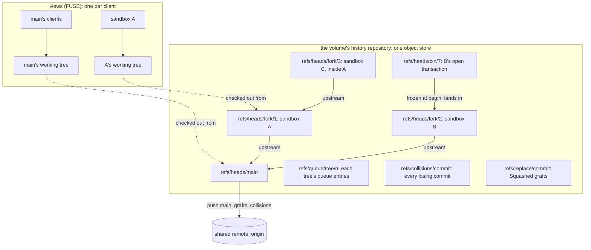
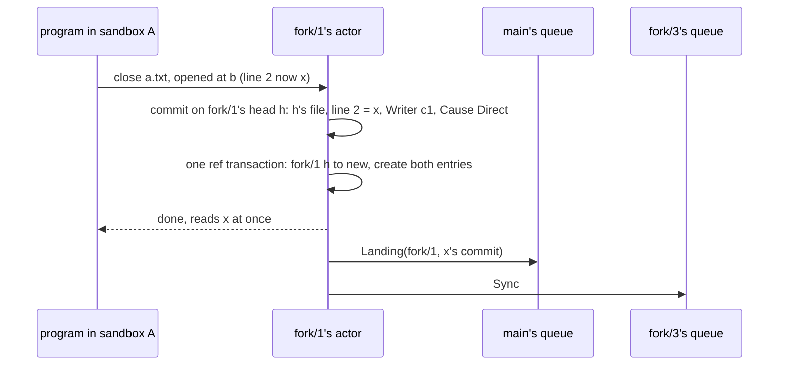
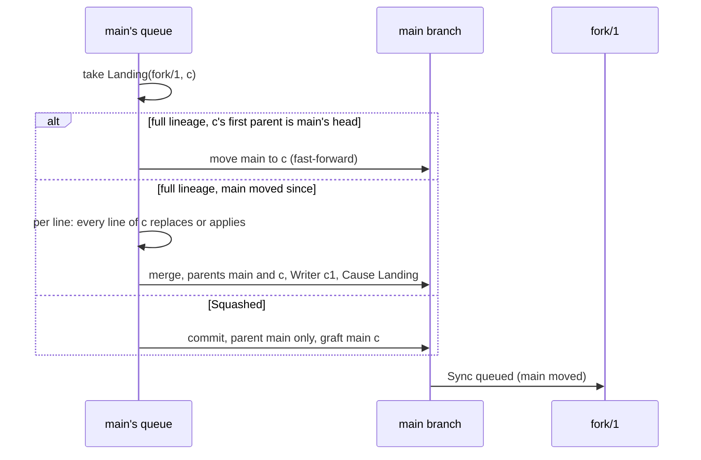
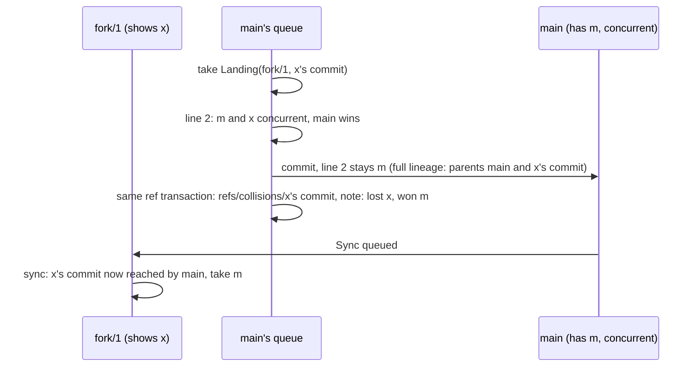
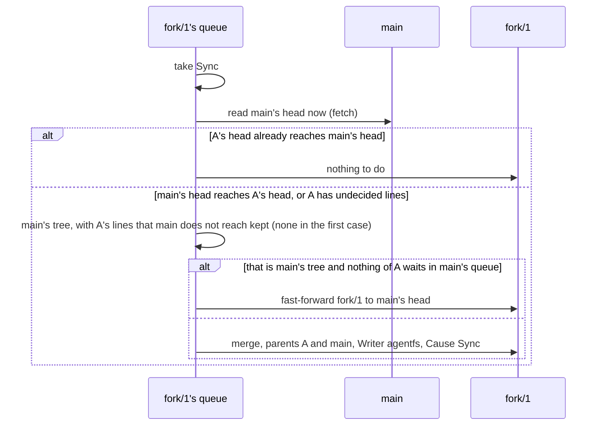
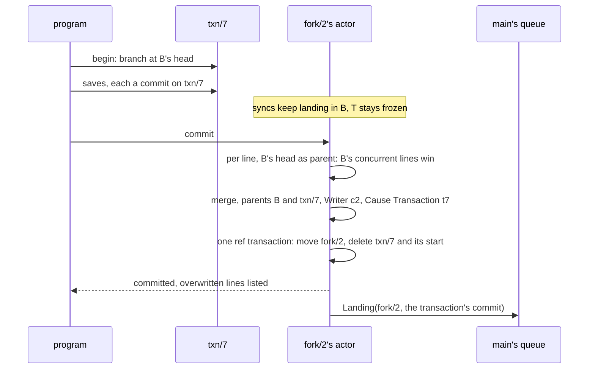
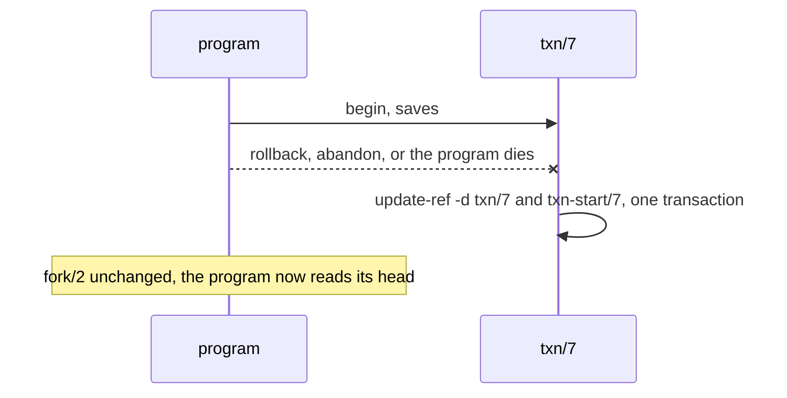
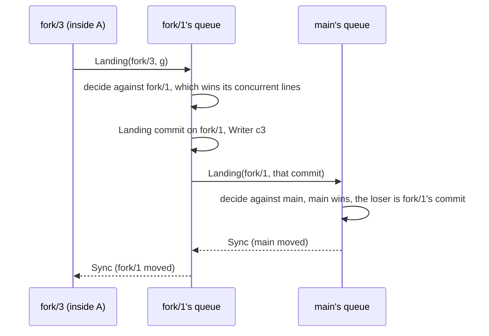
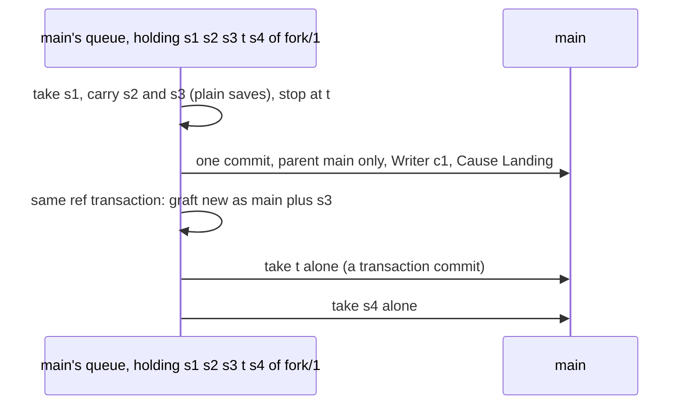

# agentfs in git terms

**Layer:** the foundation under the [system](system.md) and its domains: how every tree, save, landing and sync maps onto git.
**Status:** proposed: the target, not today's code, resting on the executable model in
[`crates/agentfs-model`](../../crates/agentfs-model/MODEL.md) (commit 509a0ab), which runs the rules on the real `git` program.
**Read it first:** code for the domains starts from this page. Where the older pages disagree, this page wins, and
[§17](#17-where-the-older-pages-are-superseded) says on which points.

## 0. What the owner asked for

| Date | The owner's words |
|---|---|
| 2026-11-03 | "if its coherent then i want a technical doc describing the system in git parlance, from the perspective of working trees, indexes, remotes, branches, etc. That will serve as the foundation of the code to follow" |
| 2026-11-02 | "Since the model is effectively “just git” with some overlaid lock/merging rules, I propose a set of functional tests (recorded, runnable in the repo test suite) that mimic the agentfs model via native git operations."; "I generally like the metaphor of a typical Linux filesystem. I want to try that out." |
| 2026-11-02 | Agreeing that every collision between a sandbox and its parent is decided in one place, the parent's landing queue: "ok, that tracks" |
| 2026-11-03 | "i think i would assume main wins. because if sandbox forked from main and then main moved forward, the sandbox is working from an out-of-date copy. so even though its history can be preserved for posterity, i think the updated main should win in a conflict." (replaces "the incoming change wins", 2026-11-02) |
| 2026-11-02 | On transactions: "Frozen snapshot was my intention, yes. That's why I said “new branch” earlier."; "If “landing” is essentially a continuous “checkout” into the working directory, then a transaction starting effectively creates a new index —maybe even an implicit branch in the local history — and adding files to the transactions only adds them to the staging index." |
| 2026-11-03 | "the sandbox commits could be squashed to one changeset (if they are the naive simple commits) and merged into upstream as one unit. if its a smarter integration that is creating transactions, it might be best to leave the transaction commits as they are"; "every sandbox commit stays stored ... that makes sense, because thats basically the design we want" |
| 2026-11-02 | Still binding (system §1): A13 "It’s a transaction, so a failure is an implicit rollback."; R17 "making the fork design so rock-solid that it is almost as effective, by syncing forks quickly and efficiently to minimize conflict drift"; A12 "The sandboxes are generally peers and parallelism is assumed."; A7, the history setting: "one setting per volume" |

Everything else here is a **design choice** and says so, or is what the model does (MODEL.md marks its choices).

## 1. The picture

One git repository per volume holds every tree. Main and each sandbox are branches; a sandbox's parent is its
upstream. Only main's line (and what it needs) goes to the shared remote.



## 2. Every agentfs term in git terms

| agentfs term | git term | In the model |
|---|---|---|
| volume | one repository (one object store, many branches) | `World` |
| tree (main, a sandbox's fork) | a branch, with its own working tree and index | `refs/heads/main`, `refs/heads/fork/<id>` |
| fork's parent | the branch's upstream, in the same repository (`branch.fork/3.remote = .`) | `Fork::parent` |
| nested fork | a branch whose upstream is another fork's branch | `create_fork(Tree::Fork(f))` |
| client, writer | the `Agentfs-Writer` trailer; git's author and committer are one fixed service identity | `Client`, `fork.writer` |
| save | one commit on the tree's branch at close, naming one writer | `World::save` |
| landing | a push of a fork's commit into its parent's queue | `Entry::Landing` |
| the parent's queue | the one referee for that tree: a first-in, first-out list of incoming commits and syncs | `World::queue` |
| queue take | the referee builds one commit on the parent's branch and moves the ref | `World::step`, `land` |
| sync | fetch of the upstream's head as it is now, then a fast-forward, or a `Sync` merge keeping the fork's undecided lines | `World::sync`, `adopt` |
| collision | two same-line edits, each written without seeing the other | `Collision` |
| decided | the parent's lineage reaches the commit that wrote the line | `is_ancestor` |
| "saw" a line | the line on the writer's first parent, and every line that one was written over (`git blame`) | `written_over` |
| losing version | a commit kept under its own ref | `refs/collisions/<n>` |
| transaction | a short-lived branch frozen at begin, with its own index | `refs/heads/txn/<n>` |
| transaction commit | a landing of that branch into its fork | `World::commit_txn` |
| rollback | branch delete | `World::rollback` |
| history setting | the shape of landing commits: merges (full lineage) or single-parent commits with grafts (squashed) | `HistoryPolicy` |
| lineage; stored history | history read with `refs/replace/` grafts applied; without them (`--no-replace-objects`), what is pushed | `is_ancestor`; `in_history` |
| view | a FUSE mount serving one tree's working tree, filtered by the rules | not modelled |

## 3. A tree: branch, index, working tree

The model builds commits with plumbing (`mktree`, `commit-tree`, `update-ref`) and keeps no index or working
tree. This section is a design choice.

| Piece | What it is | Rule |
|---|---|---|
| branch | the tree's head: the only source of truth for the tree | moved by a save, a queue take (a landing into it or a sync), a transaction commit; created when the fork is made, deleted when it drops |
| upstream | the parent's branch | fixed when the fork is made |
| index | one per tree: a cache of the branch's tree, never a source | reset to the new head in the same step that moves the branch |
| working tree | the saved files the view serves: a full checkout of the branch (`git worktree add`) | follows every move in the same step: `git read-tree -m -u <old> <new>` rewrites only files that differ (the owner's "continuous checkout") |
| open file | a program's unsaved bytes, held by the view beside the working tree, with the head it was read at (its **open-time base**) | becomes a save at close |
| transaction | branch `txn/<n>`, its own index (`GIT_INDEX_FILE`) and its own directory checked out from it | no `git worktree`, so no HEAD and no HEAD reflog points at it |

The working tree holds only saved content, so moving it never loses a program's unsaved bytes. The older "fork's
layer over its parent" (trees.md) becomes a storage optimisation that must serve the same files.

**One writer per branch.** The model's steps never overlap; real saves and queue takes would. So every move of a
tree's branch (its saves, transaction commits and queue takes) runs on that tree's one actor, one at a time. Each
move is one ref transaction whose updates name the old value (`update <ref> <new> <old>`), so a move from anywhere
else fails loudly instead of being overwritten. The index and working tree catch up before the actor's next step.

Every commit carries three trailers. The model's exact format (the `#` comments are not part of it):

```text
Direct by c3

Agentfs-Writer: c3            # exactly one writer: a client, or `agentfs` for a sync and the Root commit
Agentfs-Cause: Direct         # Direct (a save) | Landing | Sync | Transaction t7 | Root
Agentfs-Tree: fork/3          # main | fork/<id> | txn/<id>: the branch it was made on
```

A merge originates nothing: each line it adds comes from a non-first parent, and it names its second parent's
writer, or `agentfs` for a sync. So every line traces to the one plain commit that wrote it (`one_writer`).

## 4. Refs: what lives where

Ref names are a design choice; the model uses the first five (with `refs/collisions/<n>`, from a counter).

| Ref | Holds | Kept locally | Pushed to the shared remote (design choice) |
|---|---|---|---|
| `refs/heads/main` | main's decided line | always | yes, as today's `refs/heads/agentfs/<volume>` |
| `refs/heads/fork/<id>` | a fork's line, syncs included | until the fork drops | only where Replication pushes fork lines (A4: a fork may be lost) |
| `refs/heads/txn/<id>` | an open transaction | until commit or rollback | never |
| `refs/collisions/<loser>` | one per landing with a collision, named by its losing commit (the model makes one per landing and file, numbered) | past the fork's drop | yes, under `refs/agentfs/<volume>/collisions/` ("its history can be preserved for posterity") |
| `refs/replace/<commit>` | a `Squashed` landing's graft | always | yes, under `refs/agentfs/<volume>/replace/`, fetched back by `refs/agentfs/<volume>/replace/*:refs/replace/*` |
| `refs/notes/agentfs/collisions` | each collision's record on the landing commit: tree, files, lines, lost and won lines (the model holds it in memory) | always | with the collision refs |
| `refs/queue/<tree>/<n>` | one queue entry (§5) | until taken | never |
| `refs/txn-start/<id>` | the commit a transaction began at (the model holds it in memory, `Txn::start`) | until commit or rollback | never |

Replication adds the release major to pushed names (replication.md). A clone without the grafts reads `Squashed`
history as stored, but cannot sync a fork (finding 2's cost).

## 5. The queue: one referee per tree

Each tree has one queue (rule 2). Two kinds of entry go in, in the order they happen:

| Entry | Queued when | Taken as |
|---|---|---|
| `Landing{fork, commit}` | a child fork's branch moves by a save, a landing or a transaction commit | the per-line merge of §7 |
| `Sync` | the tree's upstream moves | §8's sync; it reads the upstream's head when taken, not when queued |

The queue fixes the order; git fixes which line is newer. No clock is read (`r2_no_clock_commit_dates_decide_nothing`).
git's range walks (`rev-list A --not B`) stop early by commit date, so the referee reads ancestry only: `merge-base
--is-ancestor`, `blame`, whole-history `rev-list` (finding 5). A step always completes: nothing is held, refused
or blocked (rules 1 and 4).

**Where the order lives** (design choice). No git fact orders two sibling forks' landings, so each entry is a
create-only ref `refs/queue/<tree>/<n>`, pointing at the landing's commit or, for a sync, at a fixed blob reading
`sync`. The move that causes it creates it (expected old value: none); a clash on `<n>` retries with `n+1`; the
take deletes it in its own ref transaction. The Journal cannot join a git ref transaction (§12), so it does not
hold the order.

## 6. Save

The tree's actor makes a save at close and returns at once. The program read the file at its open-time base `b`;
the branch may have moved to `h` since (a sync, a child's landing, a transaction commit). A design choice, not
modelled (it needs §16 question 1 to find "the lines the program changed"):

- **Usual case.** One commit, first parent `h`: `h`'s file with only the lines the program changed against `b`
  set. Lines it did not change keep `h`'s, so a move between open and close is never reverted.
- **A line the program changed also moved since `b`.** `S` on `b` with the program's file, so "saw" reads what it
  read; then a `Direct` merge on `h`, parents `h` and `S`, the program's lines applied. The program reads its own
  write (rule 1); the parent's queue decides its line against the moved one (owner question 3).

Its ref transaction moves the branch and creates a landing entry at the parent and a sync entry at each child.



## 7. Landing: the per-line referee

When the parent's queue takes a landing, each incoming line meets the parent's line on the same slot (a slot is a
line position, which only the model has: §16 question 1). Four cases, each read from git:

| Case | Read from git | Result |
|---|---|---|
| same line | equal content | nothing |
| written over the parent's | the parent's line is on the incoming line's first parent, or one that line was written over | incoming replaces it |
| stale | the parent's line was written over the incoming one | dropped, no collision |
| concurrent | neither | **the parent's line stays**, the incoming line loses, a collision is recorded |

"Written over" follows one line back: the line on the writing commit's first parent, then `git blame` of that
parent for who wrote it, and so on (`written_over`). Only colliding lines lose; the change's other lines apply,
neighbours included (rule 3e, a choice). The referee asks git three questions and nothing else:

```rust
/// What the referee needs from git (finding 7): storage plus three questions.
pub trait Lineage {
    fn wrote(&self, at: CommitId, file: &Path, line: Line) -> CommitId;    // git blame --porcelain
    fn first_parent(&self, c: CommitId) -> CommitId;                        // rev-parse c^1
    fn reaches(&self, head: CommitId, c: CommitId) -> bool;                 // merge-base --is-ancestor, grafts applied
}
```

**Clean landing.** Under full lineage, a fork commit made on the parent's current head is a fast-forward. Otherwise
it is a merge: first parent the parent's head, second the fork commit, named for its writer. Under `Squashed` it is
always one single-parent commit plus a graft (§11).



**Collision.** Main's line wins (owner, 2026-11-03). The landing makes a commit even if every line lost, so main's
lineage records the decision, and the losing commit gets its own ref. The fork learns it at its next sync: x, then
main's m, never x again (`no_flicker`).



## 8. Sync: fetch, then fast-forward to the decided state

A sync decides nothing (rule 3a). It reads the upstream's head as it is when taken, never the one current when
it was queued (rule 3d), and keeps exactly the fork's lines whose writing commit the upstream's lineage does not
reach yet: lines still on their way to the parent's queue.



A sync never records a collision (`step_checked`). Once main's queue has taken a fork's line, win or lose, the
next sync replaces it with main's line (`syncs_deliver`).

## 9. Transactions: a frozen branch

Begin creates `txn/<n>` and `refs/txn-start/<n>` at the fork's head: snapshot isolation. The program's saves
commit there and it reads its own edits; the fork keeps syncing. One per fork; main's clients have none. Errors:
begin with one open (`InTransaction`), commit or rollback with none (`NoTransaction`), after the client ended (`Ended`).

**Commit** (a choice) lands the branch in the fork as a child lands in its parent: the fork's concurrent line (one
a sync brought in since begin) wins, the rest apply, and it is never refused. The answer names each overwritten
line; no saves commits nothing (`Empty`). One ref transaction moves the fork and deletes both refs (the model
deletes the branch first: a crash between would lose the commit). The result lands upstream like any fork commit.



**Rollback**, abandon or the client dying deletes the branch and its start ref. No HEAD ever points at `txn/<n>`
and deleting a branch deletes its reflog, so no ref reaches its commits and nothing of it shows in any tree or
history (`discarded_leave_no_trace`); git's garbage collection removes them.



## 10. Nested forks

A sandbox is the parent of the sandboxes inside it. Each collision is decided once, at the queue of the tree the
change lands in, and every tree below learns it by sync.



A nested landing names the writer it carries (`r4_nested_forks_follow_the_same_rules`). Under `Squashed` it lands
on its own, since it carries another writer's lines (a choice).

## 11. History settings

One setting per volume (A7). Every sandbox commit stays stored either way (owner, 2026-11-03).

| | Full lineage | Squashed |
|---|---|---|
| A landing commit | a fast-forward, or a merge with the fork commit as second parent | one single-parent commit on the parent |
| Plain saves waiting in the queue | each lands on its own | all of one fork's, up to its next other entry, land as one changeset |
| Transaction commits; nested landings | on their own | on their own ("leave the transaction commits as they are"; nested: a choice) |
| Main's stored history | reaches every landed fork commit | holds only main's own commits |
| Lineage | the stored history | stored history plus a graft: `<new>` read as having parents `<parent head>` and `<last carried fork commit>` |
| Empty landing (every line lost) | a merge | an empty commit, so the decision shows |

The graft (a choice, rule 7) lets a later sync see that main took the fork's line (finding 2); without it a sync
keeps that line forever, or reverts the fork's newer one (`r7_squashed_sync_never_undoes_the_forks_newer_line`).
Squashing only the saves waiting at the take, pulling them ahead of other forks' entries, is a choice too.



## 12. Crash recovery and convergence

**Convergence is proven:** when writes stop and every queue drains, every fork equals main (`check_converged`,
`convergence_when_writes_stop`). **Restarts are not modelled;** the rest is a design choice.

**One step, one ref transaction.** Each step writes its objects, then makes every ref change in one `update-ref
--stdin` transaction, each update naming its old value. That survives a crash only on the **reftable** backend
(`git init --ref-format=reftable`, git 2.45+), which commits by one atomic swap; the files backend renames refs one
by one, so a crash can leave half a step.

| Step | Its one ref transaction | On restart |
|---|---|---|
| save | the branch, the landing entry at the parent, a sync entry at each child | nothing to do: the move and its entries exist together, or neither |
| queue take | the branch, the entry deleted, the entries the move causes, the collision ref, the note, the graft | the entry is still there only if the take never happened: take it again; collision refs are named by the losing commit, so a rerun makes the same names |
| transaction begin, commit, rollback | `txn/<n>` with `refs/txn-start/<n>`; commit adds the fork's move and its entries | a `txn/*` branch with no live client is deleted: an implicit rollback (A13) |
| fork create, drop | the branch (its upstream config written first); drop deletes it | a dropped fork's leftover entries are deleted |
| objects | none: written before any ref names them | unreferenced objects: git's garbage collection |

`git replace --graft` and `git notes add` each write their own ref, so the take builds both by hand and stages
them into its transaction: the graft is `<new>`'s commit text with its parent lines replaced (what `replace
--graft` writes), stored by `hash-object -t commit -w`; the note is a notes tree (`mktree`) and commit
(`commit-tree`). So no reader sees the branch without its graft.

## 13. Where the virtual filesystem sits

The FUSE views sit on top of the working trees (§1's picture) and never run git. A view serves one client's file
calls from its tree's working tree (or its open transaction's directory), holds the open files (§3), and hands a
close to the tree's actor as a save. The rules decide what each view shows (rules.md, views.md). Health,
telemetry, replication to remotes and deployment keep their pages; only the pushed refs change (§4).

## 14. Why git's own merge cannot be the referee

| Shape | Gains | Costs |
|---|---|---|
| **Per-line referee (chosen)**: blame plus `merge-base --is-ancestor`, our own code | every invariant below holds in every scenario and random run | the merge is ours to write and test, not a git strategy (finding 7) |
| git's three-way merge, keeping the sandbox's side of a conflict (`merge-tree -X ours`) | no merge code | once a fork and main have merged each other, git finds two merge bases and keeps a fork line main already decided against (finding 1: 36 of 64 seeds); a hunk spans neighbouring lines, so keeping a side withholds main's decided neighbour (finding 6) |
| Per file: main's whole file wins | simple to state | reverts the fork's newer, non-colliding line in that file (finding 3) |
| "Saw" read per commit (merge ancestry) | one ancestry query | a sync merge makes main's commit an ancestor, so an edit over the fork's undecided line looks "made on" main's line and silently replaces it (finding 8, resolved: read per line) |

Prior art: a merge queue (GitHub's, Bors) is a single referee taking changes in order; Gerrit's `refs/for/<branch>`
pushes into a queue, not a branch; `git replace` and `git notes` record facts beside history; `remote = .` is plain
git configuration; one actor per tree is the actor model's single owner of mutable state.

## 15. What must always hold

Every check runs after every step, in every scenario and random run (seeds 1 to 64 in CI). Most tests run both
history settings. Full lineage only: both `r2_*`, `r3_an_edit_over_the_decided_line_replaces_it`,
`r3_collision_scope_per_line_sync_keeps_the_clean_line`, `r3_neighbouring_lines_merge_per_line`, `r4_nothing_waits_behind_a_collision`,
`random_interleavings_full_lineage`, `random_interleavings_adjacent_lines`. `Squashed` only: `r6_*`, `r7_squashed_sync_*`, `random_interleavings_squashed`.

| Invariant | Check | Tests |
|---|---|---|
| No tree silently loses a change; no stale line reverts a newer one | `no_silent_loss` | `r3_a_sync_carries_the_parents_current_version`, `r7_squashed_sync_never_undoes_the_forks_newer_line`, `random_interleavings_full_lineage` |
| No flip-flop: a line once replaced in a tree never shows there again | `no_flicker` | `r3_a_fork_never_flips_back_to_its_own_edit` |
| The parent wins every collision, decided only at its queue, losing commit reachable | `parent_wins` | `r3_landing_collision_the_parent_wins`, `r3_a_collision_is_recorded_once_at_the_parents_queue` |
| An edit over the parent's current line replaces it; over an undecided line it still collides | `parent_wins` | `r3_fast_forward_when_the_base_is_current`, `r3_an_edit_over_the_decided_line_replaces_it`, `r3_an_edit_over_an_undecided_line_still_collides` |
| Only colliding lines lose, neighbours included | `parent_wins` | `r3_collision_scope_per_line_keeps_clean_lines`, `r3_neighbouring_lines_merge_per_line`, `random_interleavings_adjacent_lines` |
| A sync records no collision and carries the upstream's head as it was then | `step_checked` | `r3_a_sync_carries_the_parents_current_version`, `r3_a_fork_never_flips_back_to_its_own_edit` |
| Every sync delivers the decided version, keeping only undecided own lines | `syncs_deliver` | `r3_collision_scope_per_line_sync_keeps_the_clean_line` |
| Nothing is held; each take is its queue's head, the rest stay in order | `take` (interleavings.rs) | `random_interleavings_full_lineage`, `random_interleavings_squashed`, `random_interleavings_adjacent_lines` (the scenarios' own `take` checks no order) |
| A transaction ends as the program was told; a rollback leaves nothing | `transactions_end_as_told`, `discarded_leave_no_trace` | `r5_transaction_commits_clean`, `r5_transaction_commit_reports_the_overwritten_line`, `r5_sync_before_or_after_the_commit_ends_the_same`, `r5_a_committed_transaction_then_lands_like_any_change`, `r5_transaction_rollback_and_client_death_leave_nothing` |
| Every change traces to one writer | `one_writer` | `r6_a_sync_is_a_merge_with_the_parent_second` |
| Nested forks follow the same rules | all checks | `r4_nested_forks_follow_the_same_rules` |
| The history setting holds, read by ancestry alone; squashed saves land as one changeset | `history_setting` | `r7_squashed_saves_land_as_one_changeset`, `r7_history_setting_and_losers_stay_reachable`, `random_interleavings_squashed` |
| Trees converge when writes stop | `check_converged` | `convergence_when_writes_stop` |
| No clock decides anything | fingerprint compare | `r2_no_clock_commit_dates_decide_nothing`, `random_interleavings_commit_dates_decide_nothing` |

Ignored (open findings): `finding_1_git_merge_base_on_crossing_merges`, `random_interleavings_git_merge_base`,
`finding_3_per_file_keeps_clean_lines`, `random_interleavings_per_file_full_lineage`, `finding_6_git_hunks_on_neighbouring_lines`.
The model checks nothing in §3, §6 or §12: it has no actor, no open files and no restarts.

## 16. Open questions, costs, and what is not modelled

**Open design questions.**
1. **What a "slot" is in a real file.** First, because §7 cannot be built for real text without it. A model file
   is a fixed set of lines, each write a new, unique line: the referee compares contents (`resolve`) and `wrote`
   assumes line numbers never shift. Real files insert, remove and move lines and repeat them (blank lines,
   braces), so a content match finds "written over" by accident. A line needs an identity that survives edits
   around it, for example the origin (commit, line) `git blame --porcelain` reports. Not designed or tested.
2. **Deletes and renames** have no rule against an edit.
3. **A save racing its own queue** (§6): the owner's question 3 below. Its choice breaks `no_flicker` for that line.

**Costs.**
- A sandbox line concurrent with main's, and every edit stacked on it before main decides, will lose. They stay
  in history and a collision names them (the owner's "out-of-date copy" case).
- A transaction's answer names only lines its own fork overwrote, not a later loss at main.
- **Grafts cost every reader.** Any `refs/replace/` entry turns off git's commit-graph file and its generation
  numbers for the whole repository, so every `merge-base --is-ancestor` and `blame` walks commits one by one.
  Every git run also loads every replace ref. `Squashed` adds one per landing, forever, with no trim rule. Full
  lineage has none of this, which counts in choosing the history setting.
- `Squashed` writes an empty commit for a landing whose lines all lost, and a clone needs the grafts to sync.
- The referee and the actor are our own code; no git merge strategy carries them.
- Atomic steps need the reftable backend (§12). Losing commits and their refs grow without a trim rule yet.

**Not modelled.** Questions 1 to 3; binary files; two writers in one tree; approvals and landing timing;
integrator patches; restarts and the actor (§3, §12); space limits; history truncation; views, rules, commit window.

## 17. Where the older pages are superseded

The system page and the domain pages predate this model. On these points this page wins:

| Older pages say | The model says |
|---|---|
| A conflict holds a landing (`Held`, `resolve`, `withdraw`); a run stops at the first commit that cannot merge (A8; system §3.5, §3.6, landing.md) | Nothing is held. Every commit lands in order; concurrent lines lose to the parent's, the losers kept (rules 1, 3b, 4). A12's "peers" still holds: no fork waits on another |
| A resolver chain of exact, three-way line, structure and agent merges (system §3.7) | The per-line referee of §7; git's three-way merge cannot carry it (findings 1, 6, 7) |
| Forks keep per-path merge bases, moved by landings (system I4, I11; forks.md) | No stored bases: what a line's writer saw is read from git (first parent and blame) |
| A sync lands only into files the fork copied, one per file, deferred on conflict, named for the parent's writer; untouched files read main live (system §3.5; trees.md) | A sync carries the whole decided tree, decides nothing, keeps undecided own lines, fast-forwards when it can, and is a `Sync` merge named `agentfs` (rule 6, a choice). Reading untouched files live is not modelled |
| A sync waits for the fork's write-opens of that file (system §3.5) | Nothing waits: a save applies only the lines its program changed since its open-time base (§6, a choice) |
| A transaction declares its files, reads the fork live outside them, may lock files (A14, `Lock`), and a conflicting seal is held (system §3.6 question) | A transaction is a branch frozen at begin (owner, 2026-11-02); its commit is never refused, the fork's lines win, the answer lists overwritten lines (a choice). The `Lock` setting and the seal question no longer arise |
| `Squashed`: a merge whose second parent is a per-fork squash chain, one squashed commit per landing (system §4; history.md) | Plain saves squash and transaction commits land on their own (owner, 2026-11-03). A single-parent commit with a graft to the last carried commit, squashing only saves waiting at the take (choices, rule 7) |
| Full lineage: one merge per run of commits (history.md H3) | Each fork commit lands on its own, as a fast-forward or a merge |

The older pages still hold for domain names, rules and visibility, views, health, telemetry, replication to
remotes and deployment.

## New terms

| Term | Meaning | Why needed | Existing term it could be |
|---|---|---|---|
| referee | the parent's queue as the one place a collision is decided | names rule 3a's one judge | the landing process (system §3.5) |
| collision | two same-line edits, each written without seeing the other | replaces "conflict", which held | conflict |
| decided | the parent's lineage reaches the line's writing commit | what a sync tests | landed |
| graft | a `refs/replace/` entry giving a squashed commit its lineage | finding 2 | squash chain |
| actor | the one place a tree's branch is moved, one step at a time | closes the save-against-queue race | the Trees domain's writer |
| open-time base | the head a program's open file was read at | what a save's changed lines are measured against | a fork's merge base (system I4) |

## Questions for the owner

1. **Who a sync is named for.** Current choice: `agentfs`, with main's commit as second parent, so each line still
   traces to its writer. Alternative: the writer of the parent's newest change (the older pages). Cost: a sync
   carrying several writers' lines would name only one.
2. **Pushing losers.** Current choice: collision refs go to the shared remote, so a lost line outlives its fork.
   Alternative: keep them local (your answer of 2026-11-01: "A fork whose branches are rejected and never land in the main branch will inevitably be lost, and that’s acceptable"). Cost:
   more refs on the remote, and a trim rule to design.
3. **A save against a sync on the same line** (§16 question 3). Current choice: the program's line shows and the
   parent's queue decides, so a sandbox may see its parent's line, then its own, then its parent's again.
   Alternative: the sandbox keeps the line the sync brought, and the program's write to that line is lost there.

*History: 2026-11-03, from the model at 509a0ab; revised after review (save ordering, trees, recovery, grafts, slots).*
