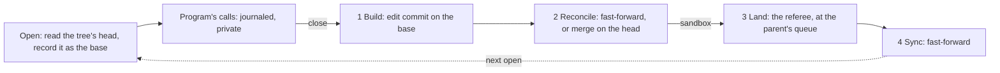

# Snapshot opens (parked)

**Parked, not built.** This page proposes snapshot opens as the replacement for the landing model's locks
([rules ledger](rules-ledger.md) R9, R9.10). They would be built only if mounted use shows that overlapping opens
starve landings. The owner asked to keep it on file ([OWNER-GUIDANCE.md](../../OWNER-GUIDANCE.md)). The commit that
builds it deletes this page and moves the behaviour into the library and operator docs. If the idea is dropped, the
page is deleted.

**The idea.** A sync or landing never waits for an open file. Each open is tracked against the commit it opened. At
close, agentfs first builds the program's edit on that commit, then reconciles it with what has landed since. No wait
on a program remains, so nothing can deadlock or starve.

**Why it is parked.** The proposal has three known failures, found by running a throwaway model against it. Each
passed every check of that model.

1. Open at b; main appends "arrived"; sync; `O_TRUNC`, write "only-mine\n", close. The file ends as both lines,
   which neither wrote. A rewrite must replace the file (R9.15).
2. File "foo" with no newline; two opens; append "bar\n", close; append "baz\n", close. The result is "foobaz\n"
   and "bar" is gone. Linux gives "foobar\nbaz\n". An edit has to keep the shape of its calls.
3. Main opens a; a sandbox's delete lands; main writes and closes. The writes vanish with no collision and no
   record. R9.14 says "the parent deleted", and main has no parent. This needs an owner decision.

What held up: the commit shape (an edit commit whose first parent is the opened version, then a merge), the "seen"
check, and no wait loop in any traced sequence.

**To reopen it, settle first:**

- main against an arriving delete (failure 3);
- which lines count as a tree's own, against lines a sync brought, read from git;
- whether a transaction binds to one program;
- the replay order after a crash, which decides a winner;
- whether `no_silent_loss` may change: a sandbox's close over a synced line shows a line that later goes back;
- whether serving each open its own version works in the kernel (`st_ino`, shared memory maps), which only a
  real-filesystem prototype can show;
- the complexity moved, not only removed: the outcome rules can lose saves quietly, where locks fail loudly.

## The proposal

### Stages

| Stage | Input | Output | May not know |
|---|---|---|---|
| Open | the tree's head, after the actor has run every close it has received | the base, journaled (R9.17) | anything that lands later |
| 1 Build (R9.12) | the base's file, the calls in order | an edit commit and its claim | the head, any arrival, the parent |
| 2 Reconcile | the edit commit, the tree's head | a new head, and a landing entry | the parent's head, decisions not yet delivered |
| 3 Land | the tree's commit, the parent's head | the parent's commit, the decision | open files, views |
| 4 Sync | the parent's head | the tree's head | decides nothing (R3a) |

Terms: the **base** is the commit an open opened. The **edit commit** is the real git commit a close builds: the base
plus the program's calls, with the base as first parent. The **reconcile commit** is a merge on the tree's head, with
the edit commit second, made only when something arrived since the base. The **claim** is which lines the calls took:
an append takes the new tail, an offset write the lines it changed, a truncate and rewrite every line.

**Stage 2's one rule.** For each claimed line, if the tree's line is the base's, the edit replaces it. If not, then
for the tree's own line (another close, a child's landing, a transaction) the later close is final, recorded as a new
version written over it. A line a sync brought is left for the parent, which decides (R9.16, R3a). A close never fails
(R1). Calls run in order, so "append x, ftruncate 0, append y" is "y".

The commit shape works on real git: the edit's first parent holds the base, so the chain reads the program's line over
the base's line, and that line collides with an arrival instead of silently replacing it.

### The implicit fork

An edit commit is a branch one commit long. A sandbox's line is a stack of undecided commits on its parent's commit. A
transaction is the named case.

| Boundary | Base | Edit | The one rule |
|---|---|---|---|
| open to its tree (or transaction) | the commit it opened | edit commit | later close final; a synced line left for the parent (R9.15, R9.16) |
| transaction to sandbox | begin | `txn/<n>` | the sandbox's line wins, whole, and the program is told (R5, R3e) |
| sandbox to parent | last sync | its branch | the parent wins, whole (R3a, R3b, R3e) |
| parent to sandbox | none | none | decides nothing |

This collapses one take shape (fast-forward, else a merge with the edit second) for a close, a commit and a landing.
It removes locks and their waiting, `OpenFiles`, and, under Q3 (a), sync merges. It does not make the rule the same at
every boundary, and a sandbox still needs a name, a queue and children that an edit commit does not.

A transaction commit waits for no open file. Only closed saves are in it (R1.1). A file still open then is built on
the transaction's commit and reconciled into the sandbox as a later close. After a rollback it reaches nothing and is
reported as `OrphanDropped` (R5, R11.3).

### The sticky view

- **Per open.** Each open records its base (R9.17). A file already open stays on its commit, and a new open reads the
  head. A sandbox's sticky view is its own branch not taking a sync. Main has no parent, so its clients are sticky for
  one actor step.
- **About to occur.** The actor receives a write-open's close. That step's one atomic git update moves the head and
  creates the landing entry.
- **Fully resolved.** No entry of this sandbox is left in its parent's queue. This is read from git, so it survives a
  crash. It looks one level up only: a nested sandbox waits for its parent, not main.
- **No wait, no timer.** A sync taken while an entry remains does nothing. The take of the last entry moves the
  parent's head, even if everything lost, and that queues the next sync, which is then a fast-forward.
- **Another program in the tree** sees a close at its next open of that file. Files it already holds stay (R1, R9.16,
  R9.17).
- **A reader can see p, c, p in one window.** File open at b; sync brings p; another program opens and reads p;
  close c; reads c; the parent decides; reads p. Stickiness starts at close, so a sync can get in first (Q2).
- **Sticky for long.** While a sandbox's saves outrun its parent's queue, every open reads its own line and nothing of
  main. It ends when the saves stop outrunning. A backlog that never drains is a problem with or without this (Q3).
- **Deadlock and starvation.** A program's call waits at most for one actor step. The actor waits on no program, and a
  sync never waits. No loop can form, and no open can postpone a step.

### Crash

| Stage | The journal holds | On restart |
|---|---|---|
| Open | the open's number, file identity, object, base (as today) | |
| Calls | each call, before it returns | |
| Close received | new: a "closed n" record, in order | keeps close order |
| 1 Build | nothing new; the commit is written, nothing names it | built again |
| 2 Reconcile | records dropped once the one atomic update is durable | the update happened or it did not; `Agentfs-Open` prevents a second save |
| 3 Land, 4 Sync | nothing: queue entries are git refs | an entry still there is taken again |

**Replay order,** before any tree is served: opens with a "closed" record, in close order; then opens never closed, in
the order of each one's last journaled call. That is R9.10's "last writer wins" read with R2 (a position in the log,
no clock). Each runs build and reconcile against the head at restart.

Arrivals need no journal. Build reads the base by commit and the file by identity, never by path. Reconcile reads
arrivals from git and follows the identity. Arrivals never make orphans (R9.14); only same-tree path calls do, and
those are journaled. The base is the edit's first parent, so it stays in git.

### What the ledger would change

R9, R9.1, R9.3, R9.4, R9.5, R9.7 and R9.9 (the locks, the prefix sync and their waiting) would be superseded, together
with the model's `Hold`, `grant`, `wake` and `Prefix` machinery and the tests that name them. R9.2 keeps "no
program's open ever waits on a landing" and loses "may wait forever". R9.11 points to R9.12. The ledger's R6.1 and
R3d would change under Q3 (a). The replay order joins R12. R3b, R9.15 and R9.16 change by Q1.

Checks that change: the lock and alarm checks go with their rules. A new `close_reconciled` check reads the edit
commit as the base plus the calls and every claimed line in the merge by stage 2's rule. `one_writer` lets the merge
add versions only for its own named writer. `no_silent_loss` is weaker per step in Q2's window only and must hold
once the parent has decided.

Two commit shapes were weighed. One commit on the head with lines naming the base loses the base from git. An edit
commit plus a merge keeps it, at the cost of a second commit when something arrived. Two sticky shapes were weighed.
A branch that takes no sync until resolved has no new state and removes sync merges, but nested sandboxes and
read-only clients lag with it. A branch that syncs at once with a pinned line per client spares them, but keeps every
sync merge, adds a pointer per client, and can need two merges per close.

### Costs, and what only a prototype can settle

1. A program holding a.txt open from before a multi-file landing, and opening b.txt after it, sees that landing in b
   but not in a (R9.17). Each commit is whole; a program's set of opens is not.
2. A close that met an arrival makes two commits, not one.
3. A busy sandbox sees nothing of main, and neither do sandboxes inside it, until it is resolved.
4. An arriving delete makes a save vanish from view. It is in history and named.
5. Offsets are the base's: a `pwrite` after an arrival grew the file lands where the base had it, unlike Linux.
6. A save deferred behind a transaction (R5.3) is unseen until the transaction ends. A program polling for it while
   the transaction's owner waits on that program hangs until the owner gives up.

Only a prototype on a real filesystem can settle: the kernel caches pages per file, not per open, so serving two
opens at two commits has a cost to measure; shared memory maps across two bases; `RELEASE` arriving after a reopen;
whether `stat` and listings move with the tree or wait for an open; how often real programs hold a file across an
arrival; take time against close rate; both-create at one path; large files.

### Open questions

**Q1. Does a sandbox's close beat a parent's line it never saw?** (i) Open at b; sync brings m; `O_TRUNC`, write c,
close. (ii) A opens at b; sync brings m; B opens at m, writes q, closes; A writes c, closes. Inside the tree, c shows
either way.

- **(a) Yes, as R9.15 and R9.16 read literally.** Main ends with c in both. Cost: in (i), a sync arriving one step
  later gives main's line instead, so an editor's outcome depends on timing; in (ii), A's stale save beats m through B.
- **(b) No (recommended).** Upstream, a close counts as written over the tree's own lines only; any parent line its
  open never saw is the parent's to decide. Main keeps its line in both, whichever arrived first. Cost: R9.15 then
  means "final inside that tree" until the parent decides, and a rewrite loses whole for one such line.

**Q2. May a reader see p, c, p in one window?**

- **(a) Yes (recommended).** It needs a reader opening in the gap, and R9.17 says that reader sees p. Cost:
  `no_silent_loss` accepts a line left for the parent until the parent's next decision.
- **(b) No: stickiness starts at the write-open.** Cost: one log held open stops all syncs into that sandbox, for
  hours if it stays open, and a program in it waiting on a file from main hangs.

**Q3. What must be resolved before a sync shows?** A sandbox's x is in main's queue; main changes another file g; the
program opens g.

- **(a) All its landings (recommended).** It reads the old g, then the new one after main decides x. This removes sync
  merges and two pieces of library machinery (`adopt`, `keep_own_names`). Cost: the busy sandbox above.
- **(b) Nothing: a sync shows at the next open, with its own undecided lines kept on top.** It reads the new g at once.
  Cost: all that machinery stays, and a view moves before its landing is resolved.
