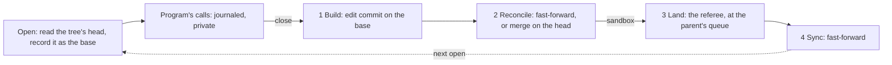

# Snapshot opens (parked)

**Parked, not built.** This page proposes snapshot opens as the replacement for the landing model's locks
([rules ledger](rules-ledger.md) R9, R9.10), to be built only if mounted use shows that overlapping opens starve
landings. The owner asked to keep it on file. The commit that builds it deletes this page and moves the behaviour
into the library and operator docs. If the idea is dropped, the page is deleted.

**The idea:** a sync or landing never waits for an open file. Each open is tracked against the commit it opened. At
close, agentfs first builds the program's edit on that commit, then reconciles it with what has landed since. It
removes every wait on a program, so it can neither deadlock nor starve.

**Why it is parked:** two designs failed adversarial review. The staged close below is the second.

What held up: the commit shape (an edit commit whose first parent is the opened version, then a merge), the "seen"
check (finding 8), and no wait loop in any traced sequence.

What failed, all three passing every check of the throwaway test model:

1. Open at b; main appends "arrived"; sync; `O_TRUNC`, write "only-mine\n", close. The file ends as both lines,
   which neither wrote. The owner's rule is that a rewrite replaces the file (R9.15).
2. File "foo" with no newline; two opens; append "bar\n", close; append "baz\n", close. The result is "foobaz\n", and
   "bar" is gone. Linux gives "foobar\nbaz\n". A stage 1 edit has to keep the shape of its calls.
3. Main opens a; a sandbox's delete lands; main writes and closes. The writes vanish with no collision and no record.
   R9.14 says "the parent deleted", and main has no parent. This needs an owner decision.

**To reopen it, first settle:**

- main against an arriving delete (case 3);
- which lines count as a tree's own, against lines a sync brought, as a git reading;
- whether a transaction binds to one program;
- replay order after a crash, which decides a winner;
- whether `no_silent_loss` may change: a sandbox's close over a synced line shows a line that later goes back;
- whether serving each open its own version works in the kernel (`st_ino`, shared memory maps), which only a
  real-filesystem prototype can show;
- the complexity moved, not only removed: stage 2's outcome rules can lose saves quietly, where locks fail loudly.

The rest of this page is the design as reviewed, unchanged.

---

## Design as reviewed: The staged close: a save is built first, reconciled after

**Scope:** the landing model (saves, syncs, landings). Three questions are open (§7). Holes are marked **HOLE**.

### 0. The owner's guidance

His words on lock-free snapshot merging, with their date, are in `OWNER-GUIDANCE.md` at the repository root. In short: collision detection happens after the client's edit is computed; a client's view stays at the commit that predates a landing until the landing resolves; each open is tracked against the commit it opened; deadlock must be avoided and starvation minimised.

| New term | Means | Why needed | Existing term it could be |
|---|---|---|---|
| base | the commit an open opened (R9.17); recorded by the open, never changed | what a save is built on, and what it "saw" (R3c.2) | "the SHA that it opened" |
| edit commit | the real git commit a close builds: the base plus the program's calls, first parent the base | stage 1's output | a save, when nothing arrived |
| reconcile commit | a merge on the tree's head, second parent the edit commit, made only when something arrived since the base | stage 2's output when it is not a fast-forward | a landing's merge |
| claim | which lines the calls took: an append the new tail, an offset write the lines it changed, a truncate and rewrite every line (R8) | what stage 2 compares | none |
| left for the parent | the tree shows the program's line over a line a sync brought, undecided (R9.16, R3a) | names stage 2's one non-final result | "undecided" |
| resolved | the sandbox has no entry left in its parent's queue | the owner's "fully resolved", as an event | none |

Existing terms: *referee*, *actor* (the one worker per tree), *queue*, *version*, *written over*, *journal*, *orphan* (git-model §3, §5, §7).

### Prior art
| Part | Established pattern | Bespoke part, and why |
|---|---|---|
| Open; crash | AFS close-to-open (fetch at open, store at close); write-ahead log | none |
| Build; sync | git: commit on what you checked out; `git pull --ff-only` | none: the model's replay and alignment, pointed at the base |
| Reconcile | git: fast-forward, else merge, one strategy per boundary | the rule itself is R8, R9.15, R9.16; line identity is R10 |
| Land | merge queue (bors, GitHub's); Bayou's tentative writes, decided at one primary | the referee, already justified by findings 1, 6, 7, 13 |

Not database snapshot isolation, which is first-writer-wins per transaction (review P2-16).

### 1. The stages

| Stage | Input | Output | May NOT know |
|---|---|---|---|
| Open | the tree's head, after the actor has run every close it has received | the base, journaled (R9.17) | anything that lands later |
| 1 Build (R9.12) | base's file, the calls in order | edit commit, its claim | the head, any arrival, the parent |
| 2 Reconcile | edit commit, the tree's head | new head; a landing entry | the parent's head; decisions not yet delivered |
| 3 Land | the tree's commit, the parent's head | parent's commit, the decision | open files, views |
| 4 Sync | the parent's head | the tree's head | decides nothing (R3a) |

**Stage 2's one rule.** For each claimed line, if the tree's line is the base's, the edit replaces it. If not, then: the tree's own line (another close, a child's landing, a transaction): **the later close is final**, recorded as a new version written over it; a line a sync brought: **left for the parent** (R9.16, R3a). A close never fails (R1). Calls run in order, so "append x, ftruncate 0, append y" is "y".

**Does the real commit work? Yes.** I ran it (`staged-spike/`, `spike.log`, seven sequences on real git, unchanged `written_over`). P0-2: the edit's first parent holds b, so the chain reads c over b, and c collides with p instead of silently replacing it. Finding 8: y's first parent is x's commit; main's commit is not in y's ancestry at all, so both readings of "saw" agree; x and y both lose; every check passes at every step. Two changes needed: `land` treats "first parent is the parent's head" as "saw everything" (it panicked: a merge's first parent can be that head and still lose), and `one_writer`'s "a merge originates nothing" (§5).

| The owner's item (1 and 2 read as his neighbouring answers) | Sequence | Result | Special case? |
|---|---|---|---|
| 1. Arriving delete (R9.14) | open a at B; sync unlinks a; write; close | Build: edit as ever. Reconcile: the edit goes in the line map under the deleted name, so the file stays gone. Land: an edit of a file the parent deleted loses, in history (R11) | No. Not an orphan (P0-1): only a delete in the same tree orphans (R11.3) |
| 2. Rewrite (R9.15) | open a with `O_TRUNC` at B; sync brings p; write; close | Claim is every line, so the tree holds exactly the program's bytes, never a file neither wrote (P0-4) | No inside the tree. **Upstream, see item 3** |
| 3. Offset write | open at B (b); sync brings p; `pwrite` c; close | Tree shows c, left for the parent. Land: c vs p, parent wins, whole (R3b, R3e). Next open reads p. **Yes, main's line shows at the end; c stays in history** | No. Close-then-sync and sync-then-close ended the same when run: both main's line, one collision |
| 3 with a rewrite | same, with `O_TRUNC` | R9.15 read literally: written over p, so **the program's file ends in main**. But close-then-sync: main's line | **HOLE: yes.** Same calls, opposite end, decided by which arrived first. Editors do this. Q1 |

### 2. The implicit fork
Yes, one concept: base, edit, reconcile. An edit commit is a branch one commit long; the sandbox's line is a stack of undecided commits on its parent's commit; a transaction is the named case.

| Boundary | Base | Edit | The one rule | From |
|---|---|---|---|---|
| open → its tree (or transaction) | the commit it opened | edit commit | later close final; a synced line left for the parent | R9.15, R9.16 |
| transaction → sandbox | begin | `txn/<n>` | sandbox's line wins, whole, told | R5, R3e |
| sandbox → parent | last sync | its branch | parent wins, whole | R3a, R3b, R3e |
| parent → sandbox | none | none | decides nothing | R3a |

**Collapses:** one take shape (fast-forward, else merge with the edit second) for a close, a commit and a landing; locks and their waiting; `OpenFiles`; sync merges (Q3). **Does not:** the rule differs per boundary, by your words; a close never loses, so it has no "whole"; an edit commit has no name, queue or children. A sandbox needs all three.

R5.2's question, does a transaction declare its program: this design does not need it. A commit waits for no open file: only closed saves are in it (R1.1). A file still open then is built on its transaction commit and reconciled into the sandbox as a later close; after a rollback it reaches nothing, with `OrphanDropped` (R5, R11.3). A file open from before begin, closing during the transaction on a file it has saved: built at once, reconciled in order after it ends (R5.3), then final (R9.16). After begin every call of that sandbox's mount is in the transaction (git-model §9), so nothing else can touch its files.

### 3. The sticky view
- **Per open.** Each open records its base (R9.17); a file already open stays on its commit. So "opens a file again" fires nothing: an open just reads the head. No per-client pointer: a sandbox's sticky view is its own branch not taking a sync, and a sandbox has one read-write client (clients.md C4). Main has no parent, so its clients are sticky for one actor step.
- **"About to occur":** the actor receives a write-open's close. That step's one atomic git update moves the head and creates the landing entry.
- **"Fully resolved":** no entry of this sandbox left in its parent's queue. Read from git, so it survives a crash. One level up only: a nested sandbox waits for its parent, not main.
- **No wait, no timer.** A sync taken while an entry remains does nothing. The take of the last entry moves the parent's head, even if everything lost, and that queues the next sync. It is then a fast-forward (run: heads equal).
- **Another program in the tree** sees a close at its next open of that file; files it already holds stay (R1, R9.16, R9.17).
- **The p, c, p flip:** gone in item 3's normal run, which reads b, c, p. **HOLE: it survives one window.** File open at b; sync brings p; another program opens and reads p (R9.17 says it must); close c; reads c; parent decides; reads p. Stickiness starts at close, so a sync can get in first. Q2.
- **Forever sticky? Yes, in principle:** while a sandbox's saves outrun its parent's queue, every open reads its own line and nothing of main, which is the drift R17 warns of. It ends when its saves stop outrunning; a backlog that never drains is a problem with or without this. Q3.
- **Deadlock:** a program's call waits at most for one actor step; the actor waits on no program; a sync never waits. No loop can form, and finding 24's cannot. **Starvation:** no open can postpone a step, so R9.2's "may wait forever" is gone; only the case above is left.

### 4. Crash
| Stage | The journal holds | On restart |
|---|---|---|
| Open | the open's number, file identity, object, base (exists today; §3) | |
| Calls | each call, before it returns | |
| Close received | **new:** a "closed n" record, in order | keeps close order |
| 1 Build | nothing new; the commit is written, nothing names it | built again |
| 2 Reconcile | records dropped once the one atomic update is durable; held for R5.3 until then | the update happened or it did not; `Agentfs-Open` prevents a second save |
| 3 Land, 4 Sync | nothing: queue entries are git refs | an entry still there is taken again |

**Replay order,** before any tree is served: opens with a "closed" record, in close order; then opens never closed, in the order of each one's last journaled call. That is R9.10's "last writer wins" read with R2 (a position in the log, no clock), answering P1-11. Each runs Build and Reconcile against the head at restart.

**P0-3:** arrivals need no journal. Build reads the base by commit and the file by identity, never by path. Reconcile reads arrivals from git and follows the identity. Arrivals never make orphans (R9.14); only same-tree path calls do, and those are journaled. So a sync's rename a to b plus a new a: the replayed writes go to the file now at b; the new a is untouched. The base is the edit's first parent, so it stays in git for good (P0-2). Not run.

### 5. Ledger and checks
| Rule | Becomes | `Gone when` (all found in the model; a rejected rule must drop its `Tests:`, which the check also reads) |
|---|---|---|
| R9 | rejected | `struct Hold`, `fn grant`, `fn wake`, `waiting_for`, `pub waiting`, `r9_a_sync_waits_for_an_open_writer_then_applies`, `r9_a_write_open_waits_while_a_sync_holds_the_file` |
| R9.1 | rejected | `r9_a_landing_waits_for_the_upstreams_open_writer`, `r9_a_landing_holds_the_files_of_its_losing_changes` |
| R9.3 | rejected | `struct Prefix`, `fn prefix`, `held_back`, `r9_a_sync_delivers_up_to_the_first_change_to_an_open_file`, `r9_a_prefix_sync_holds_back_a_transaction_whole` |
| R9.4 | rejected | `fn acquire` |
| R9.5 | rejected | `struct Waiting`, `p1_scan`, `fn eligible`, `fn hint`, `r9_a_long_lived_main_writer_holds_back_only_its_own_file`, `r9_under_either_setting_a_held_file_holds_back_only_its_saves`, `r9_a_writer_holding_a_waited_file_is_not_made_to_wait`, `r9_new_writers_postpone_a_waiting_take_and_raise_an_alarm` |
| R9.7 | rejected | `r11_an_unlink_or_rename_of_a_held_file_waits` |
| R9.9 | rejected | `r9_a_prefix_sync_delivers_no_upstream_decision_before_its_commit`, `r9_a_prefix_sync_holds_back_the_notes_of_the_commits_it_holds_back` |
| R6.1, if Q3 (a) | rejected | `fn adopt`, `fn keep_own_names`, `r6_a_sync_is_a_merge_with_the_upstream_second`, `r3_a_sync_keeps_the_undecided_saves` (R6 then names another test) |

"Rejected" here means superseded: R9.11 says these parts go, and the ledger has no other status (P2-17; I add none).
**Change wording:** R9.2 keeps "no program's open ever waits on a landing", loses "may wait forever" (P2-14). R9.11 "merged line by line" points to R9.12; under Q3 (a) "applies at once" reads "never waits for a file; a sync waits for the sandbox's own landings". R3d's "keeps ... undecided lines" goes under Q3 (a). R8, R10 "the file's old lines" mean the base's. R12 gains the replay order. R1 "at once" notes R5.3. R3b, R9.15 and R9.16 by Q1. MODEL rule 1's "whatever the tree held" (R1.2's leftover) goes.
**Stay as written:** R1.1, R1.3, R3a, R3c, R3c.2 (seen = in the base), R3e, R5, R5.3, R9.6, R9.10, R9.12, R9.13, R9.14, R9.17, R10.3, R10.4, R11, R11.1 (holds with no machinery under Q3 (a)), R11.3.

| Check | Change |
|---|---|
| `locks`, `alarmed`, `p1_scan`, `prefix_cut`, `step_checked`'s "no sync writes an open file" | go with the rules they check. `no_wait_on_waiting` restated: a call waits only on an actor step |
| Byte oracle, `save_aligned`, `appends_exact`; new `close_reconciled` | stronger: edit commit = base plus calls, read from its first parent; and (P1-5's gap) every claimed line is in the merge by stage 2's rule, read from git |
| `one_writer` | the merge may add versions only for its own named writer, with the edit's bytes. R6 unchanged; this drops a design clause, so please see it. All other checks passed in the run |
| `no_flicker`, `upstream_wins`, `changes_whole`; `syncs_deliver` | unchanged, passed in the run; stronger under Q3 (a): after a sync the heads are equal |
| `no_silent_loss` | **weaker, per step, in Q2's window only.** Run: "m1.1 entered Fork(1):a[a0] and is gone"; passes once the parent decides. Not changed without the owner's answer |

| Review finding | Answer | | Review finding | Answer |
|---|---|---|---|---|
| P0-1 | §1 item 1, R9.14 | | P1-8 | Q1 |
| P0-2 | §1, run | | P1-9 | §2: reach is handles open before begin; old Q2 gone |
| P0-3 | §4 | | P1-10 | §2 |
| P0-4 | §1 item 2, R9.15 | | P1-11 | §4, a reading of R9.10; correct it if wrong |
| P1-5 | named boundary; `close_reconciled` | | P1-12 | Open follows received closes; **kernel's late `RELEASE` open**, §6 |
| P1-6 | own tree: R8.1, bytes "bazbar\n" as on Linux, written over baz. Parent boundary: R10.4. Not run | | P1-13 | Q2 |
| P1-7 | §1, call order. Not run | | Suspicions | §6 |

**Design it twice.** Commit shape: *one commit on the head, lines naming the base* (the failed draft) loses the base from git and panics `written_over`; *edit plus merge* (chosen) costs a second commit when something arrived. Sticky: *the branch takes no sync until resolved* (chosen) has no new state and removes sync merges, but nested sandboxes and read-only clients lag with it; *the branch syncs at once and each client keeps its own pinned line* spares them, but keeps every sync merge, adds a pointer per client, and can need two merges per close.

### 6. Costs, and what only the prototype can settle
1. **A program holding a.txt open from before a multi-file landing and opening b.txt after it sees that landing in b but not in a** (R9.17). Each commit is whole; a program's set of opens is not.
2. A close that met an arrival makes two commits, not one. Sync merges go (Q3 (a)); net effect not measured.
3. A busy sandbox sees nothing of main, and neither do sandboxes inside it, until it is resolved (§3).
4. An arriving delete makes a save vanish from view; it is in history and named. In main too.
5. Offsets are the base's: a `pwrite` after an arrival grew the file lands where the base had it, unlike Linux.
6. A save deferred behind a transaction (R5.3) is unseen until it ends. A program polling for it while the transaction's owner waits on that program hangs until the owner gives up. No agentfs wait; the owner's "deferred, obviously" stands, with this cost. Unrelated programs in a sandbox also join its transaction (git-model §9).

**Prototype only:** the kernel caches pages per file, not per open, so serving two opens at two commits needs a cost measured; shared memory maps across two bases; `RELEASE` arriving after a reopen, and whether its order is the true "later close"; whether `stat` and listings move with the tree or wait for an open (R9.13 speaks only of opens); how often real programs hold a file across an arrival; take time against close rate (Q3); both-create at one path; large files.
**Not run:** random seeds, appends, partial lines, renames, nesting, transactions, crash replay, Q1 (b) on the chain. The spike writes whole images, with the old locks left in place, and is a test of the commit shape, not the design's code.

### 7. Questions
**Q1. Does a sandbox's close beat a parent's line it never saw?** Sequences: (i) open at b; sync brings m; `O_TRUNC`, write c, close. (ii) A opens at b; sync brings m; B opens at m, writes q, closes; A writes c, closes (review P1-8). Inside the tree, c shows either way.
- **(a) Yes, as R9.15 and R9.16 read literally.** Main ends with c in both (run). Cost: in (i), a sync arriving one step later gives main's line instead, so editors' outcomes depend on timing; in (ii), A's stale save beats m through B.
- **(b) Recommended: no.** Upstream, a close counts as written over the tree's own lines only; any parent line its open never saw is the parent's to decide. Main keeps its line in both, whichever arrived first, so item 3 has one answer for every call. Cost: changes R9.15 inside sandboxes ("final inside that tree" until the parent decides); a rewrite loses whole for one such line. A rewrite after the file was closed at the sync still wins (R3c.2, `r8_a_stale_rewrite_*`). Main is unaffected.

**Q2. May a reader see p, c, p in one window?** Sequence: §3's flip.
- **(a) Recommended: yes.** It needs a reader opening in the gap, and R9.17 says that reader sees p. Cost: `no_silent_loss` accepts a line left for the parent until the parent's next decision; weaker per step, and it must hold once decided.
- **(b) No: stickiness starts at the write-open.** No flip, check unchanged. Cost: one log held open stops all syncs into that sandbox, for hours if it stays open, and a program in it waiting on a file from main hangs: the wait option 4 removed.

**Q3. What must be resolved before a sync shows?** Sequence: a sandbox's x is in main's queue; main changes another file g; the program opens g.
- **(a) Recommended: all its landings.** It reads the old g, then the new one after main decides x. His words, as read here: "the client landing" is its own save going up. Removes sync merges, `adopt`, `keep_own_names`, finding 17's half-shown rename. Cost: §3's busy sandbox; try until it becomes a problem.
- **(b) Nothing: a sync shows at the next open, own undecided lines kept on top.** It reads the new g at once. This is how the words read if "landing" meant the sync coming in; atomic moves already meet that. Never stale. Cost: all that machinery stays, and a view moves before its landing is resolved.

