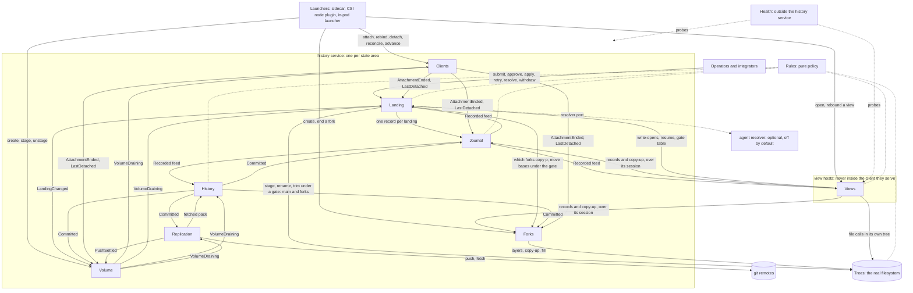
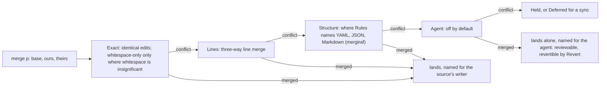
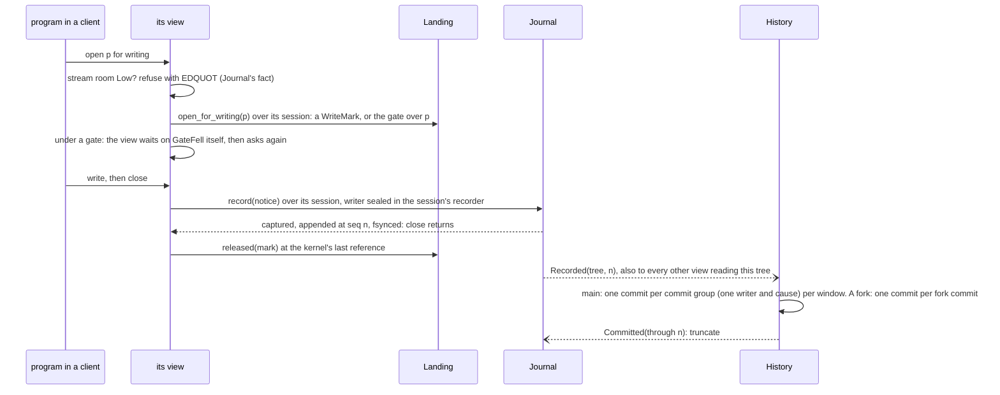
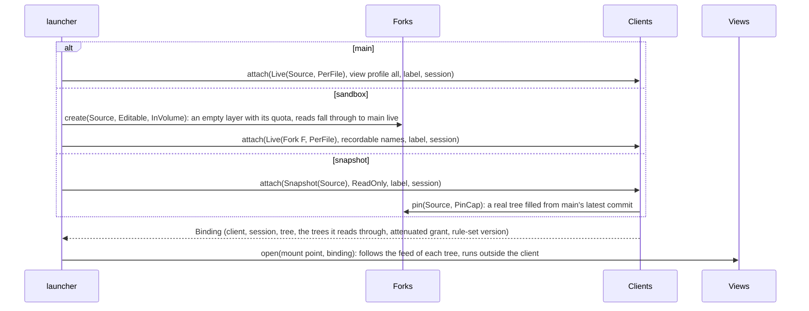

# agentfs target architecture: the system

**Layer:** **System (domains, contracts, flows)** › Domain (one document per domain, next) › Feature.
**Status:** revision 7: revision 3 (approved 2026-11-02) plus the domain documents' fixes and your later answers (change log at the end). It describes the target, not today's code; sketches are Rust surfaces. **What you are asked:** nothing. **Since your answers (2026-11-02):** a held commit **never holds back another fork** (A12); an **abandoned transaction** makes no commit (A13). Both in §3.6.

## 1. Purpose, your requirements, and what is a design choice

agentfs gives each client, main and every sandbox, its own view of a real directory, records every change in git with exactly one writer, and lands content from elsewhere (a sandbox's saves, main's changes into a sandbox, a patch, a restore) into a tree while clients run.

**Your requirements (verbatim, dated).** Nothing else on this page is yours. Domain pages may quote more of your words that bind only that domain.

| # | Your words | Date |
|---|---|---|
| R1 | "I want the DDD to target the *ideal* design, and not just the easy one. It should be unbiased on the current shape of the code, and instead design the shape that makes the most functional sense — treating each domain as a hard boundary with strict contracts." | 2026-11-01 |
| R2 | "a new set of architecture docs which lay out the overarching system architecture first, and then a per-domain doc of the domain architecture"; "Give the high level architecture first. I will review that before we waste time writing each domain doc" | 2026-11-01 |
| R3 | "a virtual filesystem overlay for each client (including main) that is backed by a _real_ filesystem source-of-truth" | 2026-11-01 |
| R4 | "the sandbox fs edits need to land back in the main container, and then future sandboxes should start from the edited files" | 2026-11-01 |
| R5 | "Agentfs history shouod distinguish between the various containers so we can track direct edits on main vs the forks that sandboxes edit" | 2026-11-01 |
| R6 | "THE EDITS CAN LAND IN ONE COMMIT?!?" (our reading, a design choice: no commit holds two writers) | 2026-11-01 |
| R7 | "Security boundary. Agentfs is the gatekeeper that exposes only what we want sandboxes to see" | 2026-10-30 |
| R8 | Your rule that a consumer's personal information never enters the agentfs repo (your exact words name the consumer, so they stay in the session notes). These docs name no consumer | 2026-10-30 |
| R9 | "Whole seems best, right? A partial application has unknown side effects" | 2026-10-16 |
| R10 | "agentfs should support merging live" (2026-10-28); "No live landing yet", then "Build incrementally" (2026-10-29; A3 amends it for sandbox saves) | 2026-10-28/29 |
| R11 | "Nothing is locked in. Everything is on the table" | 2026-11-01 |
| R12 | "The general history should be preserved, yes. But I think it could be configurable if it needs to be every single commit, or whether a fork can be squashed so that mainline is just a merge tree of squashed fork lineage." | 2026-11-02 |
| R13 | "A cooperating integration can define batches/transactions across files, and they must all land together. But a default usage, like the CNI provides, can operate per-file." (we read "CNI" as agentfs's CSI driver) | 2026-11-02 |
| R14 | "Not A, because that assumes that a clean merge is an acceptable merge" (quoted in agentfs `docs/design.md` §12) | 2026-10-16 |
| R15 | "Configurable with a sensible default" (of accepting a clean merge; quoted in agentfs `docs/design.md` §12) | 2026-10-29 |
| R16 | "i would like for the git history to remain compatible across minor versions, and only break on a major version change. The various agentfs components should be within the same version family (major for sure, maybe minor too, patch doesnt need to match)" | 2026-11-02 |
| R17 | "no no no, dont go back on the fork design. thats a cleaner model. Im not arguing for one shared backend fs -- im arguing for making the fork design so rock-solid that it is almost as effective, by syncing forks quickly and efficiently to minimize conflict drift" | 2026-11-02 |
| R18 | "If the changes are passing bi-directionally, then keeping the two trees relatively in-sync should minimize conflicts, right? Ideally, the two conflicting changes would be interleaved in commits, and both clients would see the others changes -- this would be the ideal parallel of a real, local filsystem, and those clients dont need to know that its all virtualized and backed by git." | 2026-11-02 |

**Your answers to earlier questions:** current choices, not rules; later evidence can reopen them.

| # | Your answer | What it sets here |
|---|---|---|
| A1 | Main is a view like any sandbox | one `Views` model; a grant decides what each shows |
| A2 | A sandbox's client is its own view mount, made by whoever starts the container | a launcher attaches one client per view |
| A3 | Sandbox saves land live ("continuous"); integrator patches stay "whenDetached" until you open them | landing timing per source (§4) |
| A4 | Every sandbox save reaches its fork's line. "Note that “git history” is an opaque term when we are talking about decentralized forks. A fork whose branches are rejected and never land in the main branch will inevitably be lost, and that’s acceptable" | fork lines and their retention (§4); not an abandoned transaction's saves (A13) |
| A5 | "It depends on the config!" | the consistency setting, per-file by default (R13) |
| A6 | A pinned fork is an acceptable snapshot (2026-11-02) | `Sees::Snapshot` (§3.3) |
| A7 | History setting: "one setting per volume" (2026-11-02) | one `HistoryPolicy` per volume (§4) |
| A8 | Your question, accepted (2026-11-02): "Should the per-fork landing stop at whatever commit cant merge? and so every commit in the fork downstream of a conflict is just left for future resolution? This does assume that a *commit* is landed altogether, not just a file." | runs of whole commits, in order (§3.6) |
| A9 | "freezing only the files that a landing touches sounds reasonable. and hopefully our new per-client + view system makes locking/freezing files easier" (2026-11-02) | a gate covers only its landing's files; each view enforces it (I6) |
| A10 | "i wish conflict resolution was magically solved and perfect" (2026-11-02) | the resolver chain (§3.7) |
| A11 | File watchers: "we can take the "no guarantee" path for now" (2026-11-02) | cost 3 (§9) |
| A12 | Q1, a held commit against other forks: "Yes, I think so. The sandboxes are generally peers and parallelism is assumed." (2026-11-02; we read it as accepting the recommendation) | others land; the held one is re-judged at its next commit (§3.6) |
| A13 | Q2, an abandoned transaction: "Agreed. It’s a transaction, so a failure is an implicit rollback." (2026-11-02) | no commit anywhere; the files keep the bytes (§3.6) |

**Design rules (design choices, not your words).**
1. **Each client writes only its own tree.** Content from elsewhere enters a tree only as a landing, either way, and only once durable.
2. **One landing is one record and one writer.** It is never split across commits.
3. **Each fact has one judge, and every wait ends on a named event.** No domain keeps a copy of another's state; it asks, or it reacts to the other's event.

## 2. The system in one picture

The domains are bounded contexts; each owns its state and talks to others only through §3's contracts.



Telemetry receives every event and is left off; each domain's name links its document. All share `model` (§3.1) and §3.4's events; CSI, the git server and the control socket translate at the edge.

| Domain | Owns exclusively | Is not | Relationships |
|---|---|---|---|
| **[Rules](domains/rules.md)** | what is recorded, its class and database group, what each view profile shows | storage, mounts | pure; asked by Views, Journal, Landing, Trees, History |
| **[Clients](domains/clients.md)** | clients, writers, grants, attachments and their sessions, **every capability** (§3.2) | landing timing, liveness | asks Forks for lineage, fork facts and pinned forks; publishes attachment events |
| **[Views](domains/views.md)** | serving each client's file calls through its grant; kernel caches; following the feeds of the trees it reads; **enforcing gates locally**; forwarding file locks; the transaction edge (R13) | identity, ordering, landing | reads Landing's gate table; publishes `ViewCaughtUp` |
| **[Trees](domains/trees.md)** | the real filesystem: source tree, fork layers and their quotas, staging, copy, confinement, per-directory names ordering, rename into place | history, who wrote what | the content truth; commanded by Forks and Landing |
| **[Forks](domains/forks.md)** | lineage, kinds and placement, **path bases** (moved by landings both ways), which forks hold their own copy of a path, each fork's space limit, ending and dropping | merging, when to land, quota mechanics | publishes `ForkEnded`, `ForkDropped` |
| **[Journal](domains/journal.md)** | one stream per tree: `Seq`, durable records with their writer, **fork commits**, transactions, its size limit and room, holds, the feed | commits, landing state | appends client records and one record per landing |
| **[Landing](domains/landing.md)** | sources (fork runs, syncs, commits, restores, reverts, reconciles), timing and acceptance, admission, write-opens, the gate, the **resolver chain**, renames, trims, verdicts, its own recovery | durability of records, attachment | **the one home of the landing process** (§3.5) |
| **[History](domains/history.md)** | lines, the history setting, one-writer commits, trailers, **every git object write**, LFS, the one-log read side, the history format within a major | ordering (it trails the Journal) | publishes `Committed` |
| **[Replication](domains/replication.md)** | remotes, credentials bound to their origin, push state, limits, settlement, fetching | recording, trees, writing objects | publishes `PushSettled` |
| **[Volume](domains/volume.md)** | lifecycle (Staged, Draining, Released), the start point and its acceptances, the release verdict, an upgrade's drain | fork rules, config loading, the kernel lock | publishes `Volume*` events, `StartLineChanged` |
| **[Health](domains/health.md)** | whether the history service and each view host are alive, by probing | any landing or serving decision | runs outside what it judges |
| **[Telemetry](domains/telemetry.md)** | metrics, traces, alarms (their one home) | any decision | never blocks; nothing depends on it |

**Design it twice.** Shape A stays (R17), giving up B's zero-cost save. Syncing main's changes into forks' copies as they happen attacks its main cost, conflict drift (R18). Also rejected: forks updated only by main's commits (git's model); CRDTs (files are opaque; R9 asks for whole changes).

| | **A (chosen): each sandbox edits a fork with per-path bases; one Landing domain lands both ways** | **B: a shared tree that sandboxes write directly (today's overlay)** |
|---|---|---|
| Gains | one model for live landing, sync, approval, snapshots, fork to fork, restore and several nodes; R5 holds literally; each side's changes interleave in history (R18) | no extra step per save; no copy-up; no conflicts (last writer wins) |
| Gives up | one landing of delay per save, each way; a conflict holds its fork's later commits; landed files get new inodes | approval only reviews edits main already has; each later capability needs a second sandbox design; main can see half-written files |

## 3. Cross-domain contracts

These bind the domain documents: a domain may add internals, never a new crossing.

### 3.1 Shared kernel (`model`: values only, no I/O)

```rust
pub struct RelPath(/* private */);         // beneath the root and git-fsck clean; only RelPath::parse builds one
pub struct TreeName(/* private */);        // a confined name that may fail fsck (a nested `.git`): visibility only
pub struct Seq(u64);                       // order inside one tree's stream
pub enum TreeRef { Source, Fork(ForkId) }  // main's real tree | a fork's layer over its parent
pub struct Position { tree: TreeRef, seq: Seq }    // "this tree, as of this record"
pub struct Scope { paths: PathSet, dirs: PathSet } // a database group is wholly in or out
pub enum Writer {                          // exactly one per record and per commit; built only through Clients' Minter
    Client(ClientId),
    Actor(ActorId),                        // an operator, an integrator, or the agent resolver
    Agentfs,                               // agentfs's own records: reconcile, and abandoning an ended client's transaction
}
pub struct ClientId { launcher: LauncherId, tree: TreeRef, label: ClientLabel, n: Ordinal } // names its writer alone
pub enum SourceId {                        // what a landing is of; its idempotency key
    ForkRun  { fork: ForkId, through: Seq },                   // the fork's commits, oldest unlanded first, through this one
    Sync     { fork: ForkId, path: RelPath, from: Position },  // the parent's newest record of p, into the fork's copy; final at Writing
    Commit   { tip: CommitId },
    Restore  { tree: TreeRef, scope: ScopeDigest, from: CommitId },
    Revert   { tree: TreeRef, of: CommitId },
    Reconcile { tree: TreeRef, client: ClientId },
}
pub enum Cause {                           // (writer, cause) is the commit grouping key
    Direct,                                // the writer's own file call, or a transaction mark
    Landing { id: LandingId, source: SourceId }, // every landing record, syncs and reconcile included
}
pub enum Principal { Client(ClientId), Actor(ActorId), Launcher(LauncherId), Agentfs } // Agentfs: event-driven changes
pub struct Stamp { at: Time, by: Principal }
pub struct Audited<T> { value: T, created: Stamp, changed: Stamp } // stamped by the repository layer
pub enum Component {                       // what Health judges; a restart is a new incarnation
    HistoryService { area: StateAreaId, run: Incarnation },
    ViewHost { host: HostId, run: Incarnation },
}
pub struct Version { major: u32, minor: u32, patch: u32 } // set by the release flow; every component reports its own
pub struct Family { major: u32, minor: u32 }              // components that talk, and internal formats, share it (§8)
```

### 3.2 Authority: who mints what, who is given what

Every capability and `Writer` has private fields and is built only through a `Minter` the composition root hands to the one domain that mints it; clippy bans the minter's constructor anywhere else. So the guarantee is **construction plus build time**. Capabilities never cross a process edge: a view host holds a **session**, and the history service keeps the capabilities bound to it.

| Capability | Minted by | Held by | It can never |
|---|---|---|---|
| `LaunchCap { launcher, may: Main \| ForksItCreates, view_profiles }` | the composition root, from deployment config | a launcher | (sandbox launcher) attach to main or a fork it did not create, widen a view profile, create, stage or unstage the volume |
| `ClientCap` | `Clients::attach`, `rebind` (read-write grants only) | the client's session, in the history service; the Journal seals it into a `Recorder` | record into another tree or as another writer |
| `ForkWriteCap { fork }` | Clients, with the `ClientCap` of a read-write grant on an editable fork | the same session | copy up into another fork |
| `PinCap` | the composition root | Clients | (anyone else) pin a fork |
| `StartCap` | the composition root | Volume | (anyone else) set where main's line starts |
| `ActorCap { actor, roles }` | `Clients::actor`, from an identity the edge authenticated | operators, integrators, approvers, the agent resolver; roles are data | act as another actor |
| `Gated<'g>` | Landing, only inside a risen gate | `Trees::replace`, `trim`; `Forks::move_bases`; `Journal::append_landing` | act outside its gate's files (in its tree; for `move_bases`, the source fork's bases of them), or outlive the gate |
| commit builder | History, privately | nobody | commit two writers together |

**The view host's calls name no client and no tree.** `record`, `begin`, `seal`, `abandon`, `copy_up`, `open_for_writing`, `released` and `resume` arrive over a session, whose edge supplies the client, its own tree, its `Recorder` and `ForkWriteCap`, and refuses write-opens without a recorder: a sandbox never marks main (I6). A session or launcher connection opens only within one `Family`; the rpc edge refuses another (`OtherFamily(Version)`) before any domain is called (§8).

### 3.3 Commands and queries

```rust
// ── Clients
pub struct Grant {                         // data, asked for by the launcher
    access: Access,                        // ReadWrite | ReadOnly (read-only: no recorder, no ForkWriteCap)
    view_profile: ViewProfileId,           // what the view shows: minted by Rules, so it exists
    sees: Sees,                            // the one home of the consistency setting (§4)
    acts_as: FileOwner,                    // the owner the view presents to the program
}
pub enum Sees {
    Live { tree: TreeRef, consistency: Consistency },
    Snapshot { of: TreeRef },              // a pinned fork at `of`'s latest commit, read-only, moved only by advance
}
pub enum Consistency { PerFile, WholeLanding }
pub struct Binding {                       // what the launcher hands to Views: no capability inside
    client: ClientId,
    session: SessionId,                    // the authority: its caps stay in the history service
    tree: TreeRef,
    reads_through: Vec<TreeRef>,           // the tree, then its ancestors
    grant: Attenuated,                     // the Grant after both checks: never wider than the LaunchCap
    rules: RuleSetVersion,                 // the view host judges with this rule set
}
pub trait Clients {
    fn attach(&mut self, g: Grant, label: ClientLabel, s: SessionId, by: &LaunchCap) -> Result<Binding, ClientError>;
    fn rebind(&mut self, c: ClientId, s: SessionId, by: &LaunchCap) -> Result<Binding, ClientError>; // after ServiceReady
    fn detach(&mut self, c: ClientId, by: &LaunchCap) -> Result<(), ClientError>;
    fn reconcile(&mut self, live: ClientSet, by: &LaunchCap) -> Vec<ClientId>; // after a launcher restart
    fn advance(&mut self, c: ClientId, by: &LaunchCap) -> Result<Binding, ClientError>;  // Snapshot only: a fresh pin
    fn advanced(&mut self, c: ClientId, by: &LaunchCap) -> Result<(), ClientError>;      // the view rebound: the old pin is released
    fn end(&mut self, c: ClientId, by: &ActorCap) -> Result<(), ClientError>;            // Operator
    fn actor(&self, id: AuthenticatedId) -> Result<ActorCap, ClientError>;
    fn attached(&self, t: TreeRef) -> ClientSet;  // every client that sees t: its own, and those of forks over it
    fn attached_any(&self) -> ClientSet;          // every client of the state area, pinned forks included
}
pub enum ClientError {
    NotPermitted, UnknownClient, NotItsLauncher, TreeUnknown,
    ForkTaken,                 // one writer per fork, for life
    Draining, NotDurable(IoKind),
}                              // a launcher of another family is refused at connect, by the rpc edge (§3.2)
// ── Views
pub trait Views {
    fn open(&mut self, at: MountPoint, b: Binding) -> Result<ViewId, ViewError>;  // follows the feed of every tree in b
    fn rebound(&mut self, v: ViewId, b: Binding) -> Result<(), ViewError>;         // the launcher's, after advance or ServiceReady
    fn close(&mut self, v: ViewId);
}
pub enum ViewError { MountFailed(IoKind), ServiceUnavailable, OtherFamily(Version) }
// ── Trees
pub trait Trees {
    fn facts(&self) -> TreeFacts;                                                 // reflink, per-layer quotas
    fn create_layer(&self, f: ForkId, over: TreeRef, limit: Bytes) -> Result<(), TreeError>; // the quota is set here
    fn drop_layer(&self, f: ForkId) -> Result<(), TreeError>;
    fn fill(&self, f: ForkId, from: CommitContent) -> Result<(), TreeError>;      // a pinned fork: a checkout
    fn resolve(&self, t: TreeRef, p: &RelPath) -> Result<Resolved, TreeError>;   // which layer holds p
    fn handle(&self, b: &Binding) -> TreeHandle;                                  // own tree to write, ancestors to read
    fn copy_up(&self, f: ForkId, p: &RelPath) -> Result<Captured, TreeError>;    // the copied bytes, captured
    fn capture(&self, t: TreeRef, p: &RelPath) -> Result<Captured, TreeError>;   // an immutable copy: reflink, else copy
    fn stage(&self, t: TreeRef, bytes: MergedBytes) -> Result<Staged, TreeError>; // a merge result, durable before Writing
    fn replace(&self, g: &Gated, targets: Targets) -> Result<(), TreeError>;     // rename into place, main or a fork; idempotent
    fn trim(&self, g: &Gated, f: ForkId, p: &RelPath, expect: NodeId) -> Result<(), TreeError>; // a fork copy equal to its parent's
    fn discard(&self, s: Captured);                                              // by its one holder
}
pub enum TreeError { EscapesRoot, Symlink, NoSpace, Moved { path: RelPath }, Io(IoKind) }
// ── Forks
pub enum ForkKind { Editable, Pinned { at: CommitId } }
pub enum Placement { InVolume, OwnVolume }  // a layer in this state area | its own state area, landing by commits
pub enum BaseMove {                         // a moved base never names a record that commit grouping or truncation removes (I11)
    Kept { path: RelPath, at: Position },   // a run landed: the fork's content at its `through`, a commit on the fork's line
    Synced { path: RelPath, content: Captured }, // a sync landed: the parent's content it merged, captured at prepare; Forks holds it
    Trimmed { path: RelPath },
    Tip { path: RelPath, at: CommitId },
}
pub trait Forks {
    fn create(&mut self, parent: TreeRef, k: ForkKind, p: Placement, by: &LaunchCap) -> Result<ForkId, ForkError>;
    fn pin(&mut self, of: TreeRef, by: &PinCap) -> Result<ForkId, ForkError>;    // a Snapshot grant; ends at its LastDetached
    fn copy_up(&mut self, p: &RelPath, by: &ForkWriteCap) -> Result<(), ForkError>; // records the base
    fn move_bases(&mut self, g: &Gated, id: LandingId, from: Seq, moves: Vec<BaseMove>) -> Result<(), ForkError>; // idempotent on id
    fn base(&self, f: ForkId, p: &RelPath, at: Seq) -> Option<BaseContent>;      // at: the fork's record of p, not its commit's end; the only merge base
    fn copies(&self, over: TreeRef, p: &RelPath) -> Vec<ForkId>;                // editable forks over that tree holding their own p: sync targets
    fn lineage(&self, f: ForkId) -> Vec<TreeRef>;
    fn facts(&self, f: ForkId) -> Option<ForkFacts>;                             // created by, kind, ended
    fn end(&mut self, f: ForkId, by: &LaunchCap) -> Result<(), ForkError>;
    fn live(&self) -> Vec<ForkId>;                                               // not yet dropped: an upgrade's drain
}
pub enum ForkError { ParentUnknown, NotPermitted, SpaceLimit, QuotaUnavailable, NotEditable, Ended }
// ── Journal
pub trait Journal {
    fn recorder(&self, cap: ClientCap) -> Result<Recorder, RecordError>;  // consumes the cap: writer and tree sealed
    fn feed(&self, t: TreeRef, after: Option<Seq>) -> Feed;               // FeedItem: Recorded, Lagged, StreamRoom
    fn append_landing(&self, g: &Gated, r: LandingRecord) -> Result<Seq, RecordError>; // idempotent on LandingId in the stream
    fn tail(&self, t: TreeRef, after: Seq) -> Result<Vec<Record>, RecordError>;        // History's and Landing's read side
    fn fork_commits(&self, f: ForkId, after: Seq) -> Result<Vec<ForkCommit>, RecordError>; // Landing's and History's one unit (§3.6)
    fn hold(&self, t: TreeRef, holder: HoldName, at: Seq) -> Result<(), RecordError>;  // durable; truncation stops below it
    fn release(&self, t: TreeRef, holder: HoldName);
    fn uncommitted(&self) -> TreeSet;
    fn unsaved(&self, f: ForkId) -> PathSet; // open transactions' files; abandoned ones' not saved since (A13)
}
pub trait Recorder { // writer and tree sealed; held by the session; a notice has no writer field
    fn record(&self, n: ChangeNotice) -> Result<Durable, RecordError>;
    fn begin(&self, files: Scope) -> Result<TxnId, RecordError>; // a mark: these files land together (§3.6)
    fn seal(&self, t: TxnId) -> Result<Durable, RecordError>;    // complete: it may land
    fn abandon(&self, t: TxnId) -> Result<Durable, RecordError>; // an implicit rollback: no commit anywhere (A13)
}
pub struct Record { at: Position, writer: Writer, cause: Cause, state: AbsoluteState, txn: Option<TxnId>, time: Time }
pub enum AbsoluteState { Change(Vec<PathState>), Mark(Mark) } // Mark: Begin{txn, scope} | Seal{txn} | Abandon{txn}
pub enum RecordError {
    Refused(Refusal),
    NotDurable(IoKind),
    Backpressure,      // this tree's own limit
    Truncated,
    NotAFork,          // a transaction on main, whose own writes land nowhere
    InOpenTransaction, // a file already in another open transaction of this client
}
// ── Landing
pub enum Source {
    Fork { fork: ForkId },                         // its unlanded commits, in order (§3.6); made from its stream, never submitted
    Sync { fork: ForkId, path: RelPath, from: Position }, // made from the parent's stream for each fork in `copies`, never submitted
    Commit { tip: CommitId, from: CommitOrigin },  // integrator, own-volume fork, another node: tip becomes second parent
    Restore { tree: TreeRef, scope: Scope, from: CommitId },
    Revert { tree: TreeRef, of: CommitId },
    Reconcile { tree: TreeRef, client: ClientId, scope: Scope }, // made on AttachmentEnded, never submitted
}
pub enum Timing { Continuous, WhenDetached, OnApply }   // when a landing may write, per source kind (§4)
pub enum Acceptance { CleanMerge, Approval }            // whether a clean merge is accepted, per source kind (R14, R15)
pub trait Landing {
    fn set_policy(&mut self, k: SourceKind, t: Timing, a: Acceptance, by: &ActorCap) -> Result<(), LandingError>;
    fn submit(&mut self, s: Source, by: &ActorCap) -> Result<LandingId, LandingError>; // idempotent on SourceId
    fn approve(&mut self, id: LandingId, by: &ActorCap) -> Result<(), LandingError>;
    fn apply(&mut self, id: LandingId, by: &ActorCap) -> Result<LandingState, LandingError>; // OnApply's trigger
    fn retry(&mut self, id: LandingId, by: &ActorCap) -> Result<LandingState, LandingError>; // Held{NoSpace} or a stalled Writing
    fn resolve(&mut self, id: LandingId, with: CommitId, by: &ActorCap) -> Result<LandingState, LandingError>; // a Held run: the actor's merge, named for it
    fn withdraw(&mut self, id: LandingId, by: &ActorCap) -> Result<(), LandingError>;
    fn state(&self, id: LandingId) -> LandingState;
    fn in_motion(&self) -> Vec<LandingId>;                       // landings that finish with nobody acting
    // the view host's side, over its session: the session supplies the client and its own tree
    fn open_for_writing(&self, p: &RelPath) -> Result<WriteOpen, LandingError>; // never blocks: Marked(WriteMark) | Frozen(GateView)
    fn released(&self, m: WriteMark);                             // the kernel's last reference, mappings included
    fn resume(&self, open: Vec<RelPath>);                         // after a service restart
    fn gates(&self) -> GateReader;                                // node-local, read without a call
}
impl GateReader {
    pub fn covers(&self, t: TreeRef, p: &RelPath) -> Option<GateView>;
    pub fn fell(&self, g: &GateView) -> GateFell;                 // completes when that gate falls: the view's own wait
}
pub trait Resolver {                       // a port of Landing; the ordered chain is a policy (§4)
    fn merge(&self, p: &RelPath, base: &Bytes, ours: &Bytes, theirs: &Bytes) -> Resolution; // ours: the target tree's
}
pub enum Resolution {
    Merged(MergedBytes),                   // Exact, Lines, Structure keep the source's writer
    MergedBy(MergedBytes, Writer),         // the agent resolver: its Writer, from the ActorCap Clients minted for it
    Conflict(ConflictReport),              // the next resolver tries
}
pub enum LandingError { NotPermitted, Unknown, ContentUnknown, NotHeld, Draining }
// ── History
pub enum HistoryPolicy {   // one per volume (A7); a fork's line has one commit per fork commit, sync and reconcile
    FullLineage, // second parent: the fork's line at the run's `through`, all of it landed
    Squashed,    // second parent: one squashed commit per fork landing, chained per fork
}
pub trait History {
    fn set_policy(&mut self, p: HistoryPolicy, by: &ActorCap) -> Result<(), HistoryError>; // Operator role
    fn tracked(&self, t: TreeRef, p: &RelPath) -> Tracked;        // t's own line plus its Journal tail, at one position
    fn content(&self, c: CommitId, p: &RelPath) -> Result<ContentRef, HistoryError>;
    fn content_at(&self, at: Position, p: &RelPath) -> Result<ContentRef, HistoryError>; // a fork commit's end: a run's moved base
    fn checkout(&self, c: CommitId) -> Result<CommitContent, HistoryError>;
    fn applied(&self, s: &SourceId) -> Option<Position>;          // from trailers; any index is a cache
    fn head(&self, t: TreeRef) -> Option<CommitId>;               // the one tip query
    fn reaches(&self, t: TreeRef, c: CommitId) -> bool;
    fn receive(&mut self, pack: Pack, by: &ActorCap) -> Result<CommitId, HistoryError>; // the git server and Replication's fetch
    fn start_at(&mut self, c: CommitId, by: &StartCap) -> Result<(), HistoryError>;     // Volume only; main's line still empty
}
pub trait HistoryObjects {               // read-only, for Replication
    fn is_ancestor(&self, a: CommitId, of: CommitId) -> bool;
    fn pack(&self, from: Option<CommitId>, to: CommitId) -> PackPlan;
}
pub enum HistoryError { NotPermitted, NotInHistory, NotLocal(LfsOid), LineNotEmpty, OtherMajor(Version), Unreadable(IoKind) }
// ── Replication
pub trait Replication {
    fn push(&mut self, r: &RemoteName, by: &ActorCap) -> Result<PushOutcome, PushError>; // "push now"
    fn replace_diverged(&mut self, r: &RemoteName, line: TreeRef, lease: Lease, by: &ActorCap) -> Result<PushOutcome, PushError>; // Operator
    fn fetch(&mut self, r: &RemoteName, at: &RemoteRefName, by: &ActorCap) -> Result<CommitId, FetchError>; // hands a pack to History::receive
    fn fetch_lfs(&mut self, oids: &[LfsOid]) -> Result<(), FetchError>;     // into History's LFS cache
    fn settlement(&self, line: TreeRef, through: CommitId) -> Settlement;  // NoRemotes | Held | Pending | Failing
    fn line_tip(&self, r: &RemoteName, line: &LineName) -> Result<Option<CommitId>, PushError>; // Volume's start line
    fn limits(&self) -> HistoryLimits;                                     // the smallest of each remote limit
    fn status(&self) -> Vec<RemoteStatus>;
}
pub enum PushError { Unreachable(IoKind), Rejected(String), CredentialRefused, Diverged { line: TreeRef, saved_as: OwnedRef },
                     UntrustedHost, TooLarge { commit: CommitId }, UnknownRemote, NotPermitted, LocalIo(IoKind) }
pub enum FetchError { Unreachable(IoKind), CredentialRefused, UntrustedHost, UnknownRemote, NoSuchRef, NotPermitted,
                      Received(HistoryError) } // e.g. OtherMajor (R16)
// ── Volume
pub trait Volume {
    fn create(&mut self, spec: VolumeSpec, by: &LaunchCap) -> Result<(), VolumeError>;      // may: Main
    fn stage(&mut self, by: &LaunchCap) -> Result<VolumeState, VolumeError>;                // may: Main
    fn unstage(&mut self, by: &LaunchCap) -> Result<VolumeState, VolumeError>;              // Staged → Draining(Stop); may: Main
    fn drain_for_upgrade(&mut self, by: &ActorCap) -> Result<VolumeState, VolumeError>;     // Operator; → Draining(Upgrade)
    fn accept_start(&mut self, tip: CommitId, by: &ActorCap) -> Result<(), VolumeError>;    // Operator; writes nothing in History
    fn start_line(&self) -> StartLine;
    fn release_verdict(&self) -> ReleaseVerdict;   // asks every judge now (§3.4); never stored; an upgrade's also needs no fork left
}
pub enum VolumeError { NotPermitted, NotStaged, StartDiverged, NoStartPoint, StartUnreachable, FormatsOf(Family), NotDurable(IoKind) }
// ── Health, Rules, Telemetry
pub trait Health {
    fn liveness(&self, c: Component) -> Option<Liveness>;         // Live | Unresponsive | Gone; None: not watched
    fn watch(&mut self, c: Component, at: ProbeTarget, by: &LaunchCap) -> Result<(), HealthError>;
    fn forget(&mut self, c: Component, by: &LaunchCap) -> Result<(), HealthError>; // before an asked-for stop
}
pub trait Probed { fn report(&self) -> ProbeReport; } // served by the history service and each view host: finished, in hand, parked
pub trait Rules {
    fn record(&self, p: &RelPath, k: EntryKind) -> RecordVerdict;                // record time: Record(rule) | BuiltIn | Refuse
    fn skip(&self, p: &RelPath, k: EntryKind, f: PathFacts) -> Option<SkipReason>; // commit time, History only: needs tracked
    fn group(&self, p: &RelPath) -> Option<Group>;                               // a database group, whole
    fn merge(&self, p: &RelPath) -> MergeRule; // Text{whitespace: Significant | Insignificant} | Structured(Yaml | Json | Markdown) | Binary | Driver
    fn visibility(&self, n: &TreeName, k: EntryKind, v: ViewProfileId) -> Visibility; // Show | Scratch | Hide | Refuse
    fn view_profile(&self, name: &ProfileName) -> Option<ViewProfileId>;
    fn version(&self) -> RuleSetVersion;
}
pub trait Telemetry { fn emit(&self, e: &Event); } // closed Event: every §3.4 event, plus each domain's Diagnostic
```

### 3.4 Events (the published language)

Delivery hands every event to its consumers and to `Telemetry::emit` in one step. A producer stages an event in the unit of work of the change it reports (a transactional outbox). Consumers receive it in the order listed (design choice): Landing judges `LastDetached` before Volume.

| Event | Producer | Consumers | Ends which wait |
|---|---|---|---|
| `Attached` / `AttachmentEnded{client, why}` / `LastDetached{tree}` (in that order, one unit) | Clients | Landing, Journal, Forks, Volume | a dead client's write-opens, reconcile and open transaction; a fork's or pin's end; `WhenDetached`; `Waiting{Resume}`; release |
| `Recorded{at, names}`, `Lagged{resume_after}`, `StreamRoom{tree, room}`, `StreamDeleted{tree}` (the feed) | Journal | Views of that tree and of every fork over it; Landing (runs and syncs); History | a view's cache; a run, a sync, a held run's re-judging; a commit; a backpressure wait |
| `LandingChanged{id, source, state}` | Landing | Volume, Telemetry, the integrator notice edge | release |
| `ForkLandingsClosed{fork}` | Landing | Forks | an ended fork's drop: no landing of it still open |
| `GateFell{landing, tree}` (node-local, through `GateReader`) | Landing | Views | a write-open, a `WholeLanding` read or a group read under a gate |
| `ViewCaughtUp{view, tree, through}` | Views | anyone who must see a landing in that view | "visible in view V" |
| `Committed{tree, through, commit}` | History | Journal, Replication, Forks, Volume | truncation; a push; a fork drop; release |
| `ForkEnded{fork}` / `ForkDropped{fork}` | Forks | Landing / History, Journal, Clients, Replication, Volume | the intake's drain (§3.5) / deleting the line, the stream, the writer claim, a carried remote line; an upgrade's release |
| `VolumeDraining` / `VolumeStaged` / `VolumeReleased{disposition}` | Volume | Clients, Landing, History, Replication / Clients, Landing / the composition root, CSI | refuses attachments and submissions; commits and pushes are due now / reopens them / the service exits |
| `StartLineChanged{state}` | Volume | Telemetry | the start-line alarm |
| `PushSettled{remote, outcome}` (outcome includes `Removed`) | Replication | Volume | release |
| `ServiceReady{state_area}` | the history service, once every domain has restored and **every judge re-published its state** | view hosts, launchers | blocked file calls; a launcher's rebind and re-sent exits |
| `LivenessChanged{component, liveness}` | Health | launchers, Telemetry | a launcher's restart in place (a sandbox: a new fork) |

### 3.5 The landing process: one model, one owner

Every source (a fork's commits, a sync, a commit, a restore, a revert, a reconcile) runs this one state machine inside Landing; other domains see it only through `LandingChanged`.

```mermaid
stateDiagram-v2
  [*] --> Waiting: made or submitted, prepared outside any gate
  Waiting --> Waiting: a run takes the fork's newer commits; a sync, the parent's newer record of its file
  Waiting --> Writing: policy met, no write-opens on its files, no overlapping landing ahead: gate rises in the same step
  Waiting --> Held: the resolver chain leaves a conflict (never a sync's), or staging found no space
  Waiting --> Deferred: a sync's conflict, or its file unsaved in the fork
  Deferred --> Waiting: the parent's newer record of the file, or the fork's commit of it lands
  Held --> Waiting: a run at the fork's next commit or resolve, any at retry after no space
  Waiting --> Withdrawn
  Held --> Withdrawn
  Deferred --> Withdrawn: the fork ends
  Writing --> Landed: renamed, bases moved, one record appended
  Writing --> Held: tracked moved and the one re-merge conflicts (nothing renamed yet)
  Writing --> Deferred: the same, for a sync
  Waiting --> Refused: not permitted, content not in history, too large
  Landed --> [*]
```



- **`Waiting{on}`** names its event: `Policy` (`LastDetached`, `apply`, `approve`), `Writers` (the last release), `Landing{id}` (a landing ahead: overlapping, the fork's earlier run, or one on the same path base), or `Resume` (each client's `resume` or end).
- **`Writing`** starts only once the merged target is staged durably; recovery rolls only `Writing` forward. In order: **verify** (tracked unchanged, else one re-merge under the gate), **rename** (`Trees::replace`), **move bases** (`Forks::move_bases`), then **the one record** (`Journal::append_landing`), its `Seq` after the renames, inside the gate. A rename failing for space stalls, gate up, until `retry`.
- **The gate is the freeze** (A9): exactly the files its landing writes, in the one tree it lands in.
- **A fork run is whole commits, in order** (A8, §3.6). It lands the longest prefix of the fork's unlanded commits that merges and is admitted; the rest becomes the fork's next run. A commit only the agent resolver could merge lands alone, named for the agent; its cause still names the fork run, so the sandbox's writer stays in the commit's trailer (R5).
- **A sync is a landing into a fork** (R17, R18), made when a parent tree records a file the fork holds its own copy of (`Forks::copies`). There is **one open sync per fork and file**: the parent's newer record joins it in any state before `Writing`, so a stale sync never lands. Its fork side is `tracked(F, p)`; its intake captures the parent's content from the record, and the base move hands that copy to Forks (I11). It waits only for the fork's write-opens of that file, gates only it, and appends one record in the fork's stream named for the parent record's writer. Main never waits for it; it never flows back.
- **One path base, one order.** A run carrying p and a sync of p into the same fork both move that fork's base of p, so they never overlap: the later one waits behind the earlier (`Waiting{Landing}`) and prepares on the base it left.
- **A sync defers, never holds, a conflict** (design choice). It is `Deferred` on a conflict, or while its file is **unsaved** in the fork (`Journal::unsaved`: in an open or abandoned transaction, §3.6). It leaves at the parent's newer record (re-judged) or when the fork's next commit of the file lands, meeting main's change itself; it is never ahead of that commit. It is `Held` only for no space, until `retry`. `ForkEnded` withdraws every open sync into the fork, so none holds a drop back. `LandingChanged` tells the integrator notice edge and the alarm; the sandbox's program is not told, and its copy stays behind main meanwhile (cost 9).
- **Trim:** once a fork's copy equals its parent's and is closed, Landing removes copy and base under one gate, so the fork reads its parent live again. No record.
- **An ended fork's intake drains:** after `ForkEnded`, Landing turns every commit up to the stream's end into runs; a held one stays held until `resolve` or `withdraw` (I5); once none is open, it publishes `ForkLandingsClosed`.
- **Reconcile is a landing source.** On `AttachmentEnded`, Landing captures the ended client's write-opens that differ from tracked, **skipping unsaved files** (the Journal abandons its transaction on that event; their files never overlap, so order is free), and appends one record, writer `Agentfs`. In a fork it stays on the fork's line, never reaching main.
- **Admission comes from the source kind, never a caller** (§5, §7).

### 3.6 What lands: a fork's commits, whole and in order

A **fork commit** is one save outside a transaction (a file or its database group: R13's per-file default) or one sealed transaction (R13). The Journal judges its bounds (`fork_commits`); History writes each as one commit on the fork's line; Landing lands them **whole and in order, stopping at the first that cannot merge** (A8).

| Step | A save (default) | A transaction |
|---|---|---|
| Declared by | nothing: any save outside an open transaction | the client's `Recorder`: `begin(files)`, saves, `seal`, as marks in the fork's stream; the Journal owns its state |
| Becomes a fork commit | at the save | at `seal` only; its saves never land alone |
| Admitted | `ClientsFirst`: waits for write-opens on its file | `ClientsFirst` over every file in scope |
| Conflict | that commit is `Held`, and **every later commit of the fork waits behind it**, whatever its files | the same, for the whole transaction |
| Ends unlanded | `withdraw`, then the fork may drop (I5) | **abandoned** (A13): its program's `abandon`, its transaction edge closing unsealed (the program died), or its client ending (writer `Agentfs`); or `withdraw` |

A held run leaves `Held` at the fork's next commit (re-judged with it against main as it is then), by `resolve` (an actor's merge, named for that actor) or by `retry` after no space. **`withdraw` rejects the held commit and every later one** (design choice: A8 leaves them "for future resolution"; a withdrawal is that resolution). They stay on the fork's line (A4); the fork lands nothing more, though syncs into it go on. Under `FullLineage` a later landing would put it in main's ancestry; `Squashed` follows, so both land the same content.

**A held commit holds back only its own fork** (A12): G's landing of p goes ahead while F's is held, and syncs into F's copy. Cost: F's conflict changes shape, so its resolver sees a moving target.

**An abandoned transaction is an implicit rollback** (A13): no commit on the fork's line or in main. `tracked` counts a transaction's saves only from its `Seal`, so merges read the content before it, truncated or not. The fork's files keep its bytes (as recommended) and stay unsaved until a later save carries them: syncs of them defer, reconcile skips them (§3.5). Telemetry counts it. Cost: no trace in history.

### 3.7 The resolver chain (A10)

Every merge, in either direction, runs one ordered chain; only what no resolver merges is held. Each sits behind Landing's `Resolver` port.



Each resolver runs only where `Rules::merge(p)` suits it. Whitespace counts as insignificant only where an operator's rule says so (no path by default), because in YAML or Python an indentation change is a structural edit that must reach `Structure` or be held (R14). Under `Approval` a resolved merge still waits for approval. The agent resolver is an actor seeing only the one file's three versions.

## 4. System-wide invariants and policies

| # | Invariant | Guaranteed by | How strongly |
|---|---|---|---|
| I1 | A client writes only its own tree. Content from elsewhere enters only through Landing | Journal (sealed recorder); Trees, Forks, Journal (`Gated`); Views (`TreeHandle` writes only the own tree) | construction + build time (§3.2); compile time (tree handle) |
| I2 | Every record and every commit names exactly one writer. On main a commit groups only consecutive records of one writer and one cause; on a fork's line each fork commit, sync and reconcile is its own commit (R5, R6) | Clients (`Writer` minter), History (sole commit builder) | construction + build time |
| I3 | One landing, of any source, is one durable target, one record and one `Seq`, never split across commits. A fork's commits land whole and in order; nothing lands past one that cannot merge (A8). A transaction lands all its files or none. Recovery rolls forward only what reached `Writing` (R9, R13) | Landing, Journal | construction time + test |
| I4 | A tree sees another tree's content only after it lands there. A fork path's merge base is the content Forks holds for it at that fork position, moved only by a landing (either way) under its gate; never git's merge base. Under `FullLineage`, main's ancestry reaches only landed fork commits | Forks, Landing, History | construction time |
| I5 | A fork is dropped only once it has ended, has no child, has no landing open (`ForkLandingsClosed`) and nothing uncommitted (A4) | Forks | event order + test |
| I6 | Nothing a sandbox does makes main wait for it. A sandbox's session marks write-opens only in its own fork (§3.2). A gate freezes only the files its landing writes, in the tree it lands in (A9); each view enforces it itself, waiting on `GateFell`. Main waits only while a gate is up over a file it opens for writing (verify, one re-merge, renames, a rename stalled for space); reads, only where its consistency or a database group asks. Each tree has its own journal limit; each fork a per-layer quota (our reading of R7) | Landing, Views, Journal, Forks, Trees | construction time (admission); boot time (quota present, else editable in-volume forks are refused) |
| I7 | Names are replaced by rename. A reader sees each file, or each database group, whole old or whole new; open handles keep the old content | Trees, Views | test |
| I8 | A view shows only what its grant's view profile shows. A rules error hides or refuses, never shows. No history, journal or credential is reachable through a view (R7) | Rules, Views | test |
| I9 | Each fact has one judge: Landing a landing; the Journal a stream's room, a transaction, a fork commit's bounds; each view what it shows (`ViewCaughtUp`); Clients attachment; Health liveness. Nothing waits for another view's acknowledgement | all | review + test |
| I10 | Every wait ends on a named event. The only timers are operator schedules (commit window, push spacing and retry, repack, telemetry export), Health's probes, a launcher's restart window and the kernel's cache backstop | all | review |
| I11 | "What was p at X" and "applied?" are read from one log (the lines plus the Journal tail) at one position. Truncation stops below every hold (an open transaction, Landing's intakes, an open read); a sync intake's hold passes a record once its syncs are made, never waiting for them to land. A moved base never names a record grouping or truncation removes: a run's is a fork commit's end (a commit on the fork's line); a sync's, the parent's captured content. Every index is a rebuildable cache | History, Journal, Forks (`BaseMove` has no other shape) | construction time + test |
| I12 | After a service restart, no new gate on a tree rises until each client whose own tree it is has resumed or ended; a `Writing` landing's gate is restored | Landing | construction time + test |
| I13 | Every persisted record carries audit stamps written by the repository layer; Journal rows and commits are events with their writer and time | `store` adapter | construction time |
| I14 | Nothing grows without an owner: the Journal truncates at `Committed` and deletes a dropped fork's stream; Forks caps fork space and prunes older bases no waiting commit needs; Clients deletes a client row at its end; Landing prunes a terminal landing once committed | Journal, Forks, Clients, Landing | test |
| I15 | One node per volume and one history service per state area, held by a kernel lock | `store` (the lock), checked before the Volume service is built | boot time |
| I16 | Components that talk share one `Family`; a state area's internal formats are read only by their own family; history is read and continued by every release of its major (R16) | the rpc edge (session open), `store` and History at boot | boot time + connect time |

**Policies.** Each has one home; a caller cannot tell which value is set: the home domain applies it.

| Policy | Values | Current setting | Home |
|---|---|---|---|
| **Landing timing, per source kind** | `Continuous` · `WhenDetached` · `OnApply` | fork runs and syncs `Continuous`; integrator `WhenDetached` (A3), meaning no client sees the tree, **sandboxes included** (our reading of "No live landing yet"); restore and revert `Continuous` (design choice) | Landing |
| **Landing acceptance, per source kind** | `CleanMerge` · `Approval` (R14, R15) | `CleanMerge` for every kind (design choice) | Landing |
| **Resolver chain** | `Exact` · `Lines` · `Structure` · `Agent`, in that order, each where `Rules::merge(p)` suits it | the first three on; `Agent` off; whitespace significant everywhere (design choices; A10 is a wish, not a setting) | Landing; the format: Rules |
| **Consistency, per client** | `PerFile`: each file whole, reads never wait · `WholeLanding`: opens in the scope wait from gate to landed · `Snapshot`: a pinned fork (A6) | `PerFile` (A5) | the grant (Clients); Views enforce it |
| **History setting** | `FullLineage`: main's second parent is the fork's line at each run's `through`, all of it landed · `Squashed`: each fork landing is one squashed commit, chained per fork (per landing, not per fork: a design choice). Either way the fork's line keeps every fork commit until the fork drops (an abandoned transaction makes none: A13) | `FullLineage` (R12's "yes"); one per volume (A7), set by an operator; a change reaches only later landings | History |

## 5. Key flows

**A client's write becomes a commit naming its writer.** Main and sandbox clients take the same path, each in its own tree.


**A sandbox's commits land live in main, whole and in order, or stop at a conflict.**
```mermaid
sequenceDiagram
  participant S as sandbox view (fork F)
  participant J as Journal
  participant L as Landing
  participant R as resolver chain
  participant M as main's view
  S->>J: close p, then q: fork commits F7 (p), F8 (q), writer sandbox-1. Close returns
  J--)L: Recorded(F, 8): Continuous: the run of F's unlanded commits, F7..F8
  loop each commit, oldest first
    L->>R: each file: F's base at that commit, main's tracked, F's content there
    R-->>L: merged, or conflict
  end
  alt F7 conflicts
    Note over L: F7 Held; F8 and every later commit wait (A8). F's next commit re-judges the run
  else both merge (else only the clean prefix lands)
    L->>L: Waiting(Writers: p by main). Readers are not blocked
    M->>L: released(p): gate over p and q in main, nothing else
    L->>L: verify, rename p and q into place, move F's bases
    L->>J: append ONE record at main seq 42, writer sandbox-1, cause Landing(F through 8)
    J--)M: Recorded(main 42): views drop p and q; main's view publishes ViewCaughtUp(42)
    Note over L,S: where a merge changed F's file, main's record syncs it back into F (next flow); else F's copy is trimmed
  end
```
History commits F7 and F8 on F's line first, then main's commit naming sandbox-1 and F. Its second parent is F8 (`FullLineage`) or one squashed commit chained on F's last (`Squashed`).

**Main's change syncs into a fork's own copy** (R17, R18).
```mermaid
sequenceDiagram
  participant M as main's view
  participant J as Journal
  participant L as Landing
  participant F as Forks
  participant S as sandbox view (fork F)
  M->>J: close s: main seq 50, writer main-1
  J--)L: Recorded(main, 50)
  L->>F: copies(main, s): F holds its own s; forks reading s live need nothing
  L->>L: Sync(F, s, main 50): main's s captured from the record; a newer record of s joins it. Waits only for F's write-opens of s
  L->>L: resolver chain: F's base, F's s, the captured main s
  alt merged
    L->>L: gate over F's s only; rename the merge into F
    L->>F: move_bases: s's base becomes the captured main s (Synced)
    L->>J: ONE record in F's stream, writer main-1, cause Landing(Sync)
    J--)S: Recorded(F): the sandbox's view drops s and shows main's change
  else conflict
    Note over L: Deferred: F keeps its s and base; F's next commit of s meets main's change when it lands
  end
```
On F's line the sync is a commit named for main-1, second parent the newest main commit at or below 50: each side's changes interleave in the other's history (R18).

**Other sources** run the same state machine; only entry and admission differ.

| Source | Enters | Admitted | Writer, cause |
|---|---|---|---|
| Integrator patch | a fetch or git-server push hands the pack to `History::receive`, then `submit(Commit(tip))` | `WhenDetached` (sandboxes included), or `apply()` | the integrator; tip as second parent |
| Restore, revert | `submit(Restore(tree, scope, from c))`; content not in history is `Refused`. Revert merges three ways (base c, theirs c's parent) | `LandingFirst`: new write-opens wait | the operator |
| Reconcile | made on `AttachmentEnded` from the ended client's write-opens | `ClientsFirst`; nothing to merge | `Agentfs`; `Landing{Reconcile}` |

**A new view opens: main, a sandbox, or a snapshot.**

A new sandbox reads main's live tree, so it sees everything landed (R4).

**Crash recovery.**
```mermaid
sequenceDiagram
  participant La as launchers
  participant V as view hosts
  participant S as history service (restarted)
  participant L as Landing
  participant C as Clients
  Note over V: sessions lost: each view Suspended; file calls block, without error
  S->>S: Journal replays each stream after its last commit and drops a torn tail
  L->>L: Writing landings roll forward (idempotent renames, base moves, append); Waiting ones wait on Resume(the tree's own clients); each intake re-reads its stream from its hold
  S->>S: every judge re-publishes its state
  S--)La: ServiceReady
  La->>C: rebind(client, new session) with its LaunchCap
  La->>V: rebound(view, binding)
  V->>L: resume(its handles open for writing), over the new session
  Note over C,L: a dead host never rebinds: its launcher re-sends the exit, or reconciles: AttachmentEnded
  L->>L: every own client of a tree resumed or ended: its gates may rise
```
A session closing while the service runs ends the attachment. A view stays `Suspended` only across a service restart; on `UnknownClient` from `rebind` its launcher closes it.

**A fork ends and is dropped** on events alone: `LastDetached` or its launcher's `end`; `ForkEnded` (Landing drains its intake, withdraws its syncs); a held run resolved or withdrawn; `ForkLandingsClosed`; `Committed` through F's last record; `ForkDropped` (History deletes F's line, the Journal its stream, Clients its writer claim, Forks its layer and bases). Main still reaches F's landed commits. A sandbox host restarted in place is a new client on a new fork (`ForkTaken`).

## 6. Deployment compositions and crate layout

Each mode composes the same domains; none reads a mode flag.

| Composition | History service | View hosts | Health | Who launches clients |
|---|---|---|---|---|
| **Sidecar** (`mount`, `run`) | a child process of the sidecar's supervisor | main and each sandbox view, as child processes | the sidecar's supervisor; the platform's probe judges the supervisor | the sidecar |
| **History service with view hosts** | `serve-history` | one process per host, many views each | the supervising launcher | each host's launcher |
| **CSI** | started at stage, runs through Draining | one per publish, plus in-pod launchers' views | the node plugin, told by the in-pod launcher's `watch` (design choice) | publish and unpublish; the in-pod launcher (`ForksItCreates` only) |
| **CLI** (`restore`, `patch`, `fork`, `checkpoint`, `serve-git`; `status` opens read-only, lock-free) | lock held: a short-lived service; busy: a control-socket client | none | none | none |

```text
model          shared kernel: values only (RelPath, Seq, Position, Writer, ClientId, SourceId, Cause, Scope, Audited, Component, Version)
contracts      the published language: every §3 trait, capability, minter, event, and the store port shapes
               (one UnitOfWork, one Outbox<E>). Depends on model only
<domain> × 12  one crate per domain (§2), on model + contracts only; no I/O: ports (repository, fs, git, net, resolver) as traits
adapters       store (state area, lock, repositories, audit stamps, outbox) · fs · gitx · merge (mergiraf, agent) · net · fuse · rpc · csi · githttp · otel
apps           agentfs, agentfs-csi: composition roots; they make the minters, wire domains to adapters, compute nothing
```

Boundaries, strongest first. **Compile time:** no domain crate sees another's internals; a view's ancestor trees have no write methods. **Construction time:** capabilities, `Gated`, `Writer` and `Cleared` come only from minters (§3.2). **Build time:** `cargo deny` bans domain-to-domain and domain-to-adapter dependencies; clippy, stray minters and I/O crates in domains. **Boot and connect time:** an unbound port, or a state area or peer of another family, is refused (I16); zero remotes is normal ("Remotes can come and go", 2026-10-17).

## 7. The verdict's open design items: current choices and their costs

| Item | Current choice | Cost |
|---|---|---|
| **Gate fairness, constant writers** | `ClientsFirst` for runs, syncs, commits and reconciles: a landing never makes a client wait to write; `LandingFirst` for restore and revert | a file, or database group, that always has a writer starves its landings (`Waiting{Writers}`), and under A8 that fork's later commits |
| **Retention of held and rejected fork work** | Landing owns the held state, Forks the space; a withdrawal is the rejection; only an upgrade's drain waits for it (§8) | an ended sandbox's held work takes space until acted on |
| **File locks between several main views, and across pods** | Views forward each file lock to the backing file's kernel lock: views of one tree share locks; a fork's copy is another file (libfuse's passthrough example) | a lock does not survive its file's landing (new inode) nor hold a landing back. FUSE forwarding NOT VERIFIED |
| **Database file groups** | Rules names the groups; a group is one unit for scope, copy-up, recording, landing and consistency (reads of a member wait for its renames) | main holding its database open keeps a sandbox's edit to it `Waiting` |
| **The freeze check at open** (A9) | Opening for writing is one never-blocking call to Landing: a `WriteMark`, or the gate the view then waits on. Group members' and `WholeLanding` reads check the node-local gate table | the gate table is one node's, as I15 already requires |
| **CSI pods and trees** | Each publish is a client whose StorageClass decides its grant: a main view or a new in-volume fork. Several main pods are main views sharing locks and one gate table | several nodes stay out (I15) |

## 8. Scaling, versions and evolution

| Growth vector | Absorbed by | How |
|---|---|---|
| 1,000 sandboxes on one volume | Clients, Forks | a client record and an empty layer each |
| Feed fan-out and save rate | Views, Journal | a host that falls behind gets `Lagged` and drops its cache; nobody waits on it |
| Sync fan-out | Landing, Forks | one open sync per fork holding its own p; forks reading p live cost nothing |
| Commit count | History | main: one per commit group per window; fork lines: one per fork commit and sync; `Squashed` one per landing |
| Hot directories; history length; remotes | Trees; History; Replication | one names order; a rebuildable applied index; a verdict per remote |
| **Future capability** | | **It becomes** |
| Sandbox edits land at sandbox end, or on approval | Landing | a timing value (`AtEnd`, parked until you ask) or `Approval` acceptance |
| Policies per client; read-only clients | Clients, Rules | `Grant` data; a read-only client gets the feed, no recorder |
| Merges between sibling forks | Landing | a fork source whose target is the sibling |
| Several nodes | Forks, Landing | an own-volume fork per node, landing and synced by commits |
| A git server for producers | Landing, History | `serve-git` pushes go to `History::receive`, then become commit sources |

**Versions and upgrades** (R16). R16 asks for one compatibility: git history, within a major. Operators' settings are kept too (design choice); everything else is drained, never migrated.

| What | Kept across | May break at | Checked by |
|---|---|---|---|
| Git history: lines, trailers, refs | every minor and patch of a major (R16) | a major | History at boot: a line last written by another major is `OtherMajor` |
| Components that talk: history service, view hosts, launchers, CSI plugin, CLI | one family: same major **and minor** (our pick from your "maybe minor too"; revisable); patch free | any minor | the rpc edge, when a session or launcher connection opens: `OtherFamily` |
| Settings: history setting (A7), landing policies and resolver chain, fork limits, start point and acceptances, `on_release`, the upgrade-drained mark | every minor and major, each by its owner | never: a release that cannot read one refuses to stage, naming it | each owner at boot |
| Internal formats: journal, other `store` rows, layer layout, rpc | one family; a change to one is a minor or major release | any minor | `store` at boot: `FormatsOf(family)` until that family's own release drains it |

| Upgrade | Path |
|---|---|
| Patch | replace any component in place; a view host's restart disturbs its clients (no live hand-over: design choice) |
| Minor or major | **drain, then upgrade:** an operator's `drain_for_upgrade` (a launcher's `unstage` is an ordinary stop); every client detaches, every stream commits and empties, pushes settle, every fork lands or is withdrawn and drops; `Released`; the new release stages on main's tree and history alone. Held work survives as a pushed fork line, submitted later as a commit |

Releases come from semantic-release on merge (your rule, 2026-11-01): a format or rpc change is at least a minor, a history break a major. Cost: every `feat` is a minor, so every feature release is a full drain.

## 9. Costs, tracer bullet and prior art

Costs, stated, not sold:
1. **Each sandbox save costs more:** another durable write, a rename into main and a fork-line commit (up to three copies of a large file without reflink). **Each main change to a file a fork holds** costs that fork a sync: a merge, rename and fork-line commit.
2. **Rename semantics.** Landed and synced files get a new inode: hard links across a landing break; an open descriptor keeps old content.
3. **Per-file by default (R13).** Without a transaction, main can hold one file of a multi-file change before the rest. File watchers have no guarantee (A11): one may miss another view's change, a landing or a sync; the landing notice and `ViewCaughtUp` are reliable.
4. **"Landed" is the tree's fact, not every view's:** a hung view host may serve cache until the kernel's backstop.
5. **One conflict stops its fork, and only it (A8, A12).** Every later commit, of any file, waits behind a held one; withdrawing it ends the fork's landings. A file held open does the same.
6. **`WhenDetached` counts sandbox clients:** with sandboxes always up, patches wait for `OnApply`.
7. **The rework grows** past revision 2's plan: fork layers with bases, syncs, resolvers, per-tree streams, fork lines, pins, lock forwarding, transactions, the history setting and version checks are new; this may reopen your scope choice.
8. **One writer per fork, for life.** A sandbox whose view host restarts gets a new fork; unclosed writes stay on the old line.
9. **A true conflict is seen by neither client** (against R18's ideal): each keeps its version, and the fork's copy stops following main until the fork's next commit of it lands or a later main change merges; only the integrator notice edge and the alarm learn of it. Syncthing-style conflicted copies were parked: they put a name in the sandbox its program never wrote.
10. **Syncs cost fork space:** an open sync's staged merge and captured parent copy count against the fork's quota; one open sync per file caps it at twice the fork's copies.

**Tracer bullet.** A sidecar runs main's view and one sandbox view on an in-volume fork under `Continuous`, with the `Exact` and `Lines` resolvers. It shows: (1) main holds p open while the sandbox saves p, then q: the run waits, then lands both as one landing named for the sandbox, readers never blocked; (2) main saves s, which the sandbox holds: the sync merges it into the sandbox's view, and each line shows the other's commit; (3) killing the history service with one landing `Waiting`, one `Writing` keeps the first waiting and rolls the second forward; (4) killing the sandbox's view host leaves main alone. Everything else is a non-goal.

**Prior art.** overlayfs copy-up · git `--no-ff`, `merge --squash` · merge queues · trunk-based development (syncs) · git merge drivers, mergiraf · Syncthing's conflicted copies · SQL transactions · ARIES redo-only recovery · NFSv4 delegation recall · git's quarantined receive · object capabilities · Kafka's high-water mark · the transactional outbox · Semantic Versioning · DDD context maps.

## New terms

| Term | Definition | Why needed | Could be |
|---|---|---|---|
| view host; session | the process serving views, never inside a client; its connection for one client (capabilities stay in the service) | A2, §3.2 | the `mount` process |
| tree; in-volume fork; pinned fork | a real directory a view serves; a sandbox's layer over main's live tree; a read-only tree filled from one commit | R3, R5, A6 | backing tree; the tmp layer |
| path base | what a fork's path merges against, moved by each landing either way, kept per position | the merge base | fork base |
| fork commit, run; sync | one save, or one sealed transaction; a fork's unlanded commits, landed in order; a parent's change to a file landed in a fork's copy | A8, R13, R18 | a fork-line commit; `git pull` |
| resolver chain | the ordered ways to merge a file, tried before holding | A10 | git merge drivers |
| version, family | a component's semantic version; its major and minor | R16 | release |
| line; commit group | one tree's git history (main's branch, a fork's ref); main's consecutive records of one writer and cause | A4, R6 | branch |
| stream, position, feed, hold | a tree's ordered records; one `(tree, Seq)`; new-record notices; a mark truncation stops below | I11 | journal, `Agentfs-Seq`, `Changed` |
| writer, cause | who a record is attributed to, and why it exists | R5, R6 | origin, trigger |
| landing, timing, acceptance | content from elsewhere written into a tree; when it may land; whether a clean merge suffices | A3, R14 | patch queue; the accept hook |
| gate, admission; reconcile; capture; unsaved | the freeze on a landing's files; who waits, writers or it; recording what a dead client left; an immutable copy of a file's bytes; a fork file whose bytes `tracked` omits (an open or abandoned transaction's) | A9, A13 | settle; today's reconcile; the `pending/` copy; dirty |
| consistency; transaction | what a client sees during a multi-file landing; files a program declares to land together | A5, R13 | your "batches/transactions" |
| history setting; grant, view profile | `FullLineage` or `Squashed`; what a client may do and see, as data | R12, R7 | role ("profile" alone is CSI's bundle) |
| launcher, actor, minter | who attaches clients; an authenticated operator, integrator, approver or agent resolver; the one builder of a capability | A2, §3.2 | CSI node plugin |

## For the code architects (parked)
- **Forks:** how a sandbox resolves a held path; a copy-up of a file main is writing; directory moves across layers (`EXDEV`, as today); quota mechanics per filesystem; how bases are kept per position and pruned (I14).
- **Landing:** how a run finds its clean prefix; how a sync's intake takes the captured parent copy from the record's payload; the agent resolver's identity, inputs and limits (R7); a write-open's mark racing a rising gate.
- **Views, History:** which names a kernel holds; the gate table's layout; ids out of metric labels; the lock order (L5); commit, ref, trailer and hold names; closing main's commit group at a sync's `from`. **Parked surface:** `AtEnd`; what triggers `advance`; how a program declares a transaction.
- **Release:** the CI check that a format or rpc change bumps the minor.

## Reconcile with existing code (agentfs origin/main b5c0dc8, from `docs/design.md`)
- **The sandbox overlay** (§2.4): its tmp layer becomes the fork layer, with bases and syncs; it stops writing into the shared tree.
- **Restore** (§15) and the patch queue become Landing; the mergiraf driver, the `Structure` resolver; **`Changed`**, each tree's feed.
- **The attached mark** (§19.1, INV-19) becomes `WhenDetached`, judged from sessions. **Straight history** (INV-8) becomes "first parent straight". **Locks** (§19.2 item 13) become forwarded kernel locks.
- **Formats and versions:** per-tree streams, one-record landings, transaction marks and writer trailers are the largest rework; semantic-release and the family check are new (today's release flow NOT VERIFIED).

**NOT RUN:** the agentfs source was not read. FUSE lock forwarding, watchers across views, RELEASE after unmap, per-directory quotas and mergiraf per format were not tested; the Rust is reasoned, not compiled.

## Change log

**Revision 7, 2026-11-02, against revision 6:** your answers to Q1 and Q2; the last escalations; the review's fixes.

| Where | Change | Why |
|---|---|---|
| §1, §3.5, §3.6 | A12, A13 (also when the program dies); no drop while a commit is held | your answers; Telemetry E6, per I5 |
| §3.3, §3.4, §8 | `freeze` → `capture` ("freeze" is the gate's, A9); `FetchError`; `drain_for_upgrade`; Volume consumes `ForkDropped`; `on_release` kept | Trees E5, Replication E6, Volume E1 |
| domain pages | `Landed` names its resolvers; no Clients diagnostic for a launcher the rpc edge refuses | adopted: Telemetry E5; I9 |
| §3.2–§3.6, I10, I12, §8 | syncs defer, never hold; `tracked` from `Seal`; `unsaved`; resume waits on own clients; drain speeds commits | design review |

*History (logs in git): revisions 1–2 domain cut; 3–4 forks, one operation path; page revs 1–3: fork lines, consistency, one Landing domain (rev 2 approved 2026-11-02), sessions, history setting, transactions; 4 escalations; 5 your answers (syncs both ways, whole commits, resolvers, freezes, versions); 6 review fixes.*
