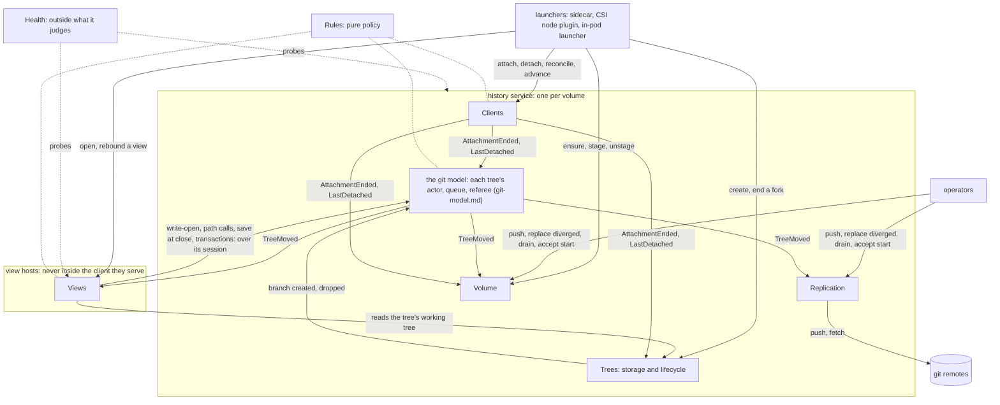

# The system around the git model

**Proposed, not built.** This page proposes how the parts around [the git model](git-model.md) fit together: clients,
views, tree storage and lifecycle, replication, the volume, health, telemetry, versions and deployment. It sketches
their contracts and events in Rust surfaces. Nothing here is implemented. The commit that lands a slice of it deletes
the part it builds and moves the behaviour into the library or operator docs.

[git-model.md](git-model.md) is the one source of truth for trees as branches, saves, locks, the queue and its
referee, collisions, syncs, transactions, nested forks and crash recovery. Where a page here seems to disagree with
it, git-model.md wins and the page has a bug. There is one history mode, full lineage: squashing is not offered.
The owner's guidance behind this design is in `OWNER-GUIDANCE.md` at the repository root; everything else on these
pages is a design choice and says so.

The domains, each on its own page: [rules](domains/rules.md), [clients](domains/clients.md),
[views](domains/views.md), [trees](domains/trees.md), [replication](domains/replication.md),
[volume](domains/volume.md), [health](domains/health.md), [telemetry](domains/telemetry.md).

## 1. The system in one picture

The git model sits in the middle: one repository per volume, one branch and one actor per tree, one queue per tree.
The domains on this page surround it and reach it only through the contracts in §2.



Telemetry receives every event and is left off the picture.

| Domain | Owns exclusively | Is not | Page |
|---|---|---|---|
| **the git model** | each tree's branch, index and working tree; saves, locks, the queue, the referee, syncs, transactions, collision refs | anything a client sees or who a client is | [git-model.md](git-model.md) |
| **Rules** | what is recorded, what each view profile shows, database groups | storage, mounts | [rules](domains/rules.md) |
| **Clients** | clients, writers, grants, sessions, attachments, every capability | liveness, what lands | [clients](domains/clients.md) |
| **Views** | serving each client's file calls, open files until close, kernel caches, what each consistency setting shows, forwarded file locks | ordering, merging, history | [views](domains/views.md) |
| **Trees** | where a tree's files live (working trees, pinned snapshots), confinement, space limits, when a fork is created, ends and drops | branches and commits (the git model) | [trees](domains/trees.md) |
| **Replication** | remotes, credentials, pushes (the one pusher), fetches, settlement, divergence | moving any local branch or ref | [replication](domains/replication.md) |
| **Volume** | lifecycle, start point, release verdict, an upgrade's drain | which forks exist (Trees) | [volume](domains/volume.md) |
| **Health** | whether the history service and each view host are alive | any serving or landing decision | [health](domains/health.md) |
| **Telemetry** | metrics, traces, alarms | any decision; never blocks | [telemetry](domains/telemetry.md) |

## 2. Cross-domain contracts

### 2.1 Shared kernel (`model`: values only, no I/O)

```rust
pub struct RelPath(/* private */);   // beneath the root and git-fsck clean; only RelPath::parse builds one
pub struct TreeName(/* private */);  // a confined name that may fail fsck (a nested `.git`): only views show it

pub enum TreeRef {
    Root,                            // refs/heads/<root>
    Fork(ForkId),                    // refs/heads/fork/<id>; its branch tracks its upstream tree's branch (git-model §2)
}
pub enum Served {                    // what a view serves
    Tree(TreeRef),
    Snapshot(SnapshotId),            // a pinned, read-only checkout of one commit (trees §3)
}

pub enum Writer {                    // the Agentfs-Writer trailer (git-model §3): exactly one per commit
    Client(ClientId),                // built only through Clients' minter
    Agentfs,                         // a sync commit and the root commit
}
pub struct ClientId {                // names its writer alone, so a commit needs no lookup
    launcher: LauncherId,
    tree: TreeRef,
    label: ClientLabel,
    n: Ordinal,                      // unique per volume, never reused
}

pub enum Principal { Client(ClientId), Actor(ActorId), Launcher(LauncherId), Agentfs }
pub struct Stamp { at: Time, by: Principal }
pub struct Audited<T> { value: T, created: Stamp, changed: Stamp } // stamped by the repository layer

pub enum Component {                 // what Health judges; a restart is a new incarnation
    HistoryService { volume: VolumeId, run: Incarnation },
    ViewHost { host: HostId, run: Incarnation },
}
pub struct Version { major: u32, minor: u32, patch: u32 } // set by the release flow
pub struct Family { major: u32, minor: u32 }              // components that talk, and internal formats, share it (§4)
```

### 2.2 Authority: who mints what

Every capability and `Writer` has private fields and is built only through a `Minter` the composition root hands to
the one domain that mints it; clippy bans the minter's constructor anywhere else (construction plus build time).
Capabilities never cross a process edge: a view host holds a **session**, and the history service keeps the
capabilities bound to it.

| Capability | Minted by | Held by | It can never |
|---|---|---|---|
| `LaunchCap { launcher, may: Root \| ForksItCreates, view_profiles }` | the composition root, from deployment config | a launcher | (fork launcher) attach to the root or a fork it did not create, widen a view profile, create, stage or unstage the volume |
| `ClientCap` | `Clients::attach`, `rebind` (read-write grants only) | the client's session, in the history service | save into another tree or as another writer |
| `PinCap` | the composition root | Clients | (anyone else) pin a snapshot |
| `StartCap` | the composition root | Volume (lent to Replication's `fetch_start`) | (anyone else) set where the root's line starts |
| `ActorCap { actor, roles }` | `Clients::actor`, from an identity the edge authenticated | operators; roles are data | act as another actor |

**The view host's calls name no client and no tree.** A write-open, a path call, a save at close and a transaction
call arrive over a session, whose edge supplies the client, its tree and its `ClientCap`, and refuses writes from a
session with none: a fork never writes the root. A session opens only within one `Family`; the rpc edge refuses
another (`OtherFamily(Version)`) before any domain is called.

### 2.3 Events

Delivery hands every event to its consumers and to `Telemetry::emit` in one step. A producer stages an event in the
unit of work of the change it reports (a transactional outbox).

| Event | Producer | Consumers | Ends which wait |
|---|---|---|---|
| `Attached` / `AttachmentEnded{client, why}` / `LastDetached{tree}` (in that order, one unit) | Clients | the tree's actor, Trees, Volume | an ended client's open files close as saves and its waiting opens drop (git-model §6); its open transaction rolls back (§9); a fork's or pin's end; release |
| `TreeMoved{tree, from, to, paths, collisions}` (design choice: the git model's actor publishes it once the branch, index and working tree have moved) | the tree's actor | Views of that tree; Replication; Volume | a view's cache; a push; release |
| `TakeWaiting{tree, files}` / `TakeReleased{tree}` (design choice: a take waiting for open files, git-model §6) | the tree's actor | Telemetry only | none: the operator sees which file holds which changes back |
| `OrphanDropped{tree, path, writer, bytes}` (design choice: calls on an object no path names at close, git-model §7) | the tree's actor | Telemetry only | none |
| `ViewCaughtUp{view, tree, to}` | Views | anyone who must see a move in that view | "visible in view V" |
| `ForkEnded{fork}` / `ForkDropped{fork}` | Trees | Clients, Replication, Volume | the writer claim, a carried remote line, an upgrade's release |
| `VolumeDraining` / `VolumeStaged` / `VolumeReleased{disposition}` | Volume | Clients, Replication / the same / the composition root, CSI | attachments refused; pushes skip spacing / reopen / the service exits |
| `StartLineChanged{state}` | Volume | Telemetry | the start-line alarm |
| `PushSettled{remote, outcome}` | Replication | Volume | release |
| `ServiceReady{volume}` | the history service, once every domain restored and every judge re-published its state | view hosts, launchers | blocked file calls; a launcher's rebind |
| `LivenessChanged{component, liveness}` | Health | launchers, Telemetry | a launcher's restart in place |

## 3. System-wide invariants

The git model's invariants are git-model §15. These are the rest; all are design choices.

| # | Invariant | Guaranteed by | How strongly |
|---|---|---|---|
| S1 | A client changes only its own tree (or its open transaction's directory); content from elsewhere enters a tree only through its queue (git-model §5) | the session edge; Views' write handle exists only for the own tree | construction + build time |
| S2 | A view shows only what its grant's view profile shows; a rules error hides, never shows; no history, credential or state area is reachable through a view | Rules, Views | test |
| S3 | A reader sees each file whole old or whole new; an open handle keeps the content it opened | the working-tree update (git-model §3), Views | test |
| S4 | Each fact has one judge: the tree's actor a tree's head; Clients attachment; each view what it shows (`ViewCaughtUp`); Health liveness; Volume release. Nothing waits for another view | all | review + test |
| S5 | Every wait ends on a named event. The only timers are operator schedules (push spacing and retry, repack, telemetry export), Health's probes, a launcher's restart window and the kernel's cache backstop | all | review |
| S6 | Every persisted row carries audit stamps written by the repository layer; commits carry their writer and time (git-model §3) | the `store` adapter | construction time |
| S7 | One node per volume and one history service per volume, held by a kernel lock | `store`, before any domain is built | boot time |
| S8 | Components that talk share one `Family`; internal formats are read only by their own family; history is read and continued by every release of its major | the rpc edge, `store`, the git model at boot | boot + connect time |

## 4. Versions and upgrades

| What | Kept across | May break at | Checked by |
|---|---|---|---|
| Git history: branches, trailers, refs (git-model §3, §4) | every minor and patch of a major | a major | at boot: a branch last written by another major is refused (`OtherMajor`) |
| Components that talk: history service, view hosts, launchers, CSI plugin, CLI | one family: same major **and minor** (a design choice from his "maybe minor too"; revisable); patch free | any minor | the rpc edge: `OtherFamily` |
| Settings: Rules' files, space limits, start point and acceptances, `on_release`, remotes | every release, each by its owner | never: a release that cannot read one refuses to stage, naming it | each owner at boot |
| Internal formats: `store` rows, tree storage layout, rpc | one family | any minor | `store` at boot: `FormatsOf(family)` until that family drains the volume |

| Upgrade | Path |
|---|---|
| Patch | replace a component in place; a view host's restart ends its clients' open files (no live hand-over: design choice) |
| Minor or major | **drain, then upgrade:** an operator's `drain_for_upgrade`; every client detaches (its open files saved at its end), every queue drains, pushes settle, every fork drops; `Released`; the new release stages on the root's branch alone ([volume](domains/volume.md)) |

Releases come from semantic-release on merge: a format or rpc change is at least a minor, a
history break a major. Cost: every `feat` is a minor, so every feature release is a full drain.

## 5. What the git model does not design yet

Each row is a slice with its own page under [future/](future/). None is designed on the system pages. Until a slice
is built, the behaviour in the right column stands.

| Slice | What stands until it is built |
|---|---|
| [Landing approvals and timing on trees](future/landing-approvals.md) | every landing is accepted when its queue takes it |
| [Integrator patches, restore and revert on trees](future/integrator-patches.md) | no source other than a fork's commits and syncs enters a queue |
| [Files changed while open, database groups](future/files-open-groups.md) | a file held open saves nothing until its close and holds back the incoming changes to it |
| [Large and binary files on trees](future/large-and-binary-files.md) | binary files beyond NUL bytes are not modelled |
| [Space limits and history truncation](future/space-limits.md) | not modelled; [trees](domains/trees.md) §4 proposes a per-tree quota |

## 6. Deployment compositions and crate layout

Each mode composes the same domains; none reads a mode flag.

| Composition | History service | View hosts | Health | Who launches clients |
|---|---|---|---|---|
| **Sidecar** (`mount`, `run`) | a child process of the sidecar's supervisor | the root and each fork view, as child processes | the supervisor; the platform's probe judges it | the sidecar |
| **History service with view hosts** | `serve-history` | one process per host, many views each | the supervising launcher | each host's launcher |
| **CSI** | started at stage, runs through Draining | one per publish, plus in-pod launchers' views | the node plugin, told by the in-pod launcher's `watch` | publish and unpublish; the in-pod launcher (`ForksItCreates` only) |
| **CLI** (`fork`, `status`; `status` opens read-only, lock-free) | lock held: a short-lived service; busy: a control-socket client | none | none | none |

```text
model        shared kernel (§2.1): values only
contracts    every trait, capability, minter and event; the store port shapes (one UnitOfWork, one Outbox<E>). Depends on model only
domains      rules, clients, views, trees, replication, volume, health, telemetry, and the git model's crates
             (the referee over its Lineage port, git-model §7; the tree actor and queue, §3, §5; names parked):
             one crate each, on model + contracts only; no I/O, ports as traits
adapters     store (lock, repositories, audit stamps, outbox) · fs · gitx · fuse · rpc · csi · net · otel
apps         agentfs, agentfs-csi: composition roots; they make the minters, wire domains to adapters, compute nothing
```

Boundaries, strongest first. **Compile time:** no domain crate sees another's internals. **Construction time:**
capabilities and `Writer` come only from minters. **Build time:** `cargo deny` bans domain-to-domain and
domain-to-adapter dependencies; clippy bans stray minters and I/O crates in domains. **Boot and connect time:** an
unbound port, or a volume or peer of another family, is refused (S8); zero remotes is normal.

## 7. Costs and tracer bullet

1. **A fork sees a change only once it is closed** (close-to-open), and landed changes
   rewrite working-tree files, so hard links across a landing break.
2. **Every write call is a journal append** before it returns (git-model §3), so a view host's death or restart
   loses no answered call; it still ends its clients' mounts, and a fork's restarted host gets a new fork, since
   a fork has one writer for life ([clients](domains/clients.md)).
3. **File watchers have no guarantee**: `TreeMoved` and `ViewCaughtUp` are the reliable notices.
4. **A full checkout per fork** until Trees' storage optimisation serves the same files from less space.
5. **Five gaps wait for their own slice** (§5).
6. **Only flat files are built on trees.** The tree views run flat regular files with git-safe UTF-8 names. The
   rest of this page rests on the git model's rules, which the executable model checks, and on no mounted test
   (see [the index](README.md)).

**Tracer bullet** (design choice). A sidecar runs the root's view and one fork view: (1) the fork closes p; the root's
queue takes it and the root's view shows it once caught up; (2) the root closes s; the fork's queue syncs it and the
fork's view shows it; (3) a root client holds p open while the fork's p lands: the take waits, then writes;
(4) killing the fork's view host mid-write leaves the root untouched, and the fork's answered write calls are
saved from the journal; (5) while the root holds p open, the fork's change to q lands without waiting. The git side of each step is git-model's; this bullet
proves the views, sessions and events around it.

**Prior art.** AFS close-to-open consistency · NFS `COMMIT` and write-ahead logging (the journal) · fair
readers-writer locks and per-key ordering (progress) · FUSE `RELEASE` and notify-invalidate · overlayfs and reflink clones ·
object capabilities · the transactional outbox · Kubernetes liveness probes · Semantic Versioning · DDD context maps.

## New terms

| Term | Definition | Why needed | Could be |
|---|---|---|---|
| view host; session | the process serving views, never inside a client; its connection for one client (capabilities stay in the service) | who hosts a view, and what it may hold; §2.2 | the `mount` process |
| tree | the root (the tree with no upstream) or one fork: a branch with its working tree (git-model §2) | one name for the root and every fork | backing tree |
| `TreeMoved` | the actor's notice that a tree's branch and working tree moved | views drop caches; pushes start | the existing feed's `Recorded` |
| version, family | a component's semantic version; its major and minor | versions that may talk (§4) | release |
| grant, view profile | what a client may do and see, as data | what a client may reach | role |
| launcher, actor (operator) | who attaches clients; an authenticated operator. Not the git model's tree actor | who may attach which client; §2.2 | CSI node plugin |

## Where it meets the existing code

- **The sandbox overlay** becomes a fork with its own branch and working tree; it stops writing the shared tree.
- **The attached mark** goes with the patch queue's "land only when nothing is attached" rule once the landing-timing slice is built. **Locks** become forwarded kernel locks plus the git model's take locks.
- **The journal, the patch queue and restore** have no home on trees until the slices in §5 are built; the commit loop becomes the actor's save at close.
- **Formats and versions:** the family check is new, and so is the upgrade drain.

**Not verified:** none of the Rust here is compiled.
