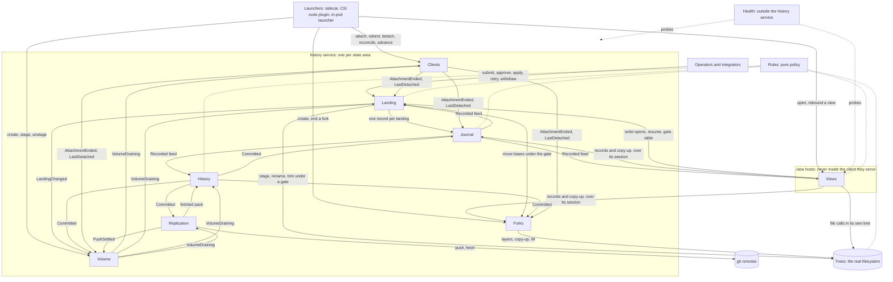
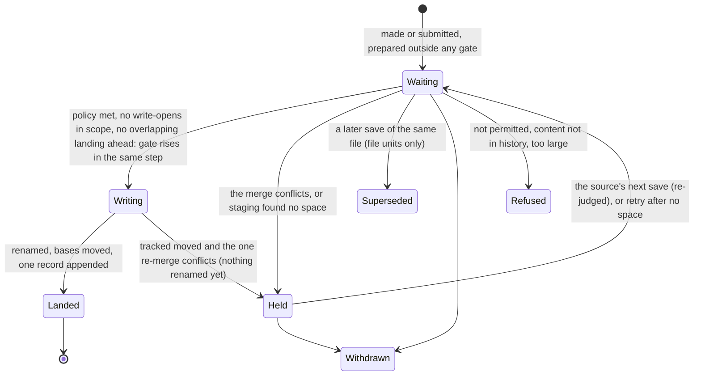
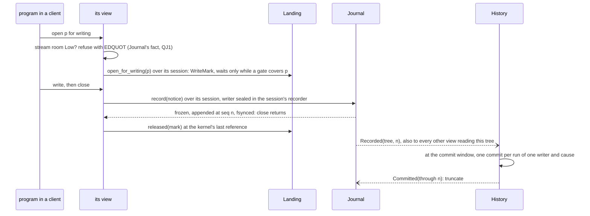
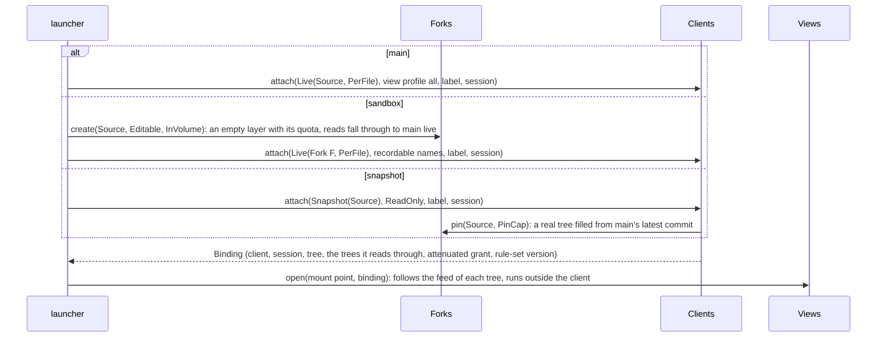

# agentfs target architecture: the system

**Layer:** **System (domains, contracts, flows)** › Domain (one document per domain, next) › Feature.
**Status:** revision 4. You approved revision 2 on 2026-11-02, and revision 3 folded in your three answers from that review; revision 3 is the approved baseline. Revision 4 resolves the gaps the twelve domain documents and their review found; every change to what you approved is listed in the change log at the end. It describes the target, not today's code. Sketches are Rust (agentfs's language) and show surfaces only.
**What you are asked:** three questions: Q1 in §4 (who sets the history setting), Q2 in §3.6 (an unfinished transaction), Q3 in §8 (reading the previous release's formats).

**Since your answers (2026-11-02):** a **history setting**, full lineage or squashed (§4); **per-file landing by default**, plus declared **transactions** that land whole or not at all (§3.6); the **pinned fork as the snapshot**. Domains unchanged.

## 1. Purpose, your requirements, and what is a design choice

agentfs gives each client, main and every sandbox, its own view of a real directory. It records every change in git with exactly one writer. It lands content from elsewhere (a sandbox's saves, an integrator's patch, a restore) into a tree while clients run.

**Your requirements (verbatim, dated).** Nothing else on this page is yours. Domain pages may quote more of your words that bind only that domain.

| # | Your words | Date |
|---|---|---|
| R1 | "I want the DDD to target the *ideal* design, and not just the easy one. It should be unbiased on the current shape of the code, and instead design the shape that makes the most functional sense — treating each domain as a hard boundary with strict contracts." | 2026-11-01 |
| R2 | "a new set of architecture docs which lay out the overarching system architecture first, and then a per-domain doc of the domain architecture"; "Give the high level architecture first. I will review that before we waste time writing each domain doc" | 2026-11-01 |
| R3 | "a virtual filesystem overlay for each client (including main) that is backed by a _real_ filesystem source-of-truth" | 2026-11-01 |
| R4 | "the sandbox fs edits need to land back in the main container, and then future sandboxes should start from the edited files" | 2026-11-01 |
| R5 | "Agentfs history shouod distinguish between the various containers so we can track direct edits on main vs the forks that sandboxes edit" | 2026-11-01 |
| R6 | "THE EDITS CAN LAND IN ONE COMMIT?!?" (read here as: no commit holds two writers; that reading is ours, please confirm) | 2026-11-01 |
| R7 | "Security boundary. Agentfs is the gatekeeper that exposes only what we want sandboxes to see" | 2026-10-30 |
| R8 | Your rule that a consumer's personal information never enters the agentfs repo (your exact words name the consumer, so they stay in the session notes). These docs name no consumer | 2026-10-30 |
| R9 | "Whole seems best, right? A partial application has unknown side effects" | 2026-10-16 |
| R10 | "agentfs should support merging live" (2026-10-28); "No live landing yet", then "Build incrementally" (2026-10-29; A3 amends it for sandbox saves) | 2026-10-28/29 |
| R11 | "Nothing is locked in. Everything is on the table" | 2026-11-01 |
| R12 | "The general history should be preserved, yes. But I think it could be configurable if it needs to be every single commit, or whether a fork can be squashed so that mainline is just a merge tree of squashed fork lineage." | 2026-11-02 |
| R13 | "A cooperating integration can define batches/transactions across files, and they must all land together. But a default usage, like the CNI provides, can operate per-file." (we read "CNI" as agentfs's CSI driver) | 2026-11-02 |
| R14 | "Not A, because that assumes that a clean merge is an acceptable merge" (quoted in agentfs `docs/design.md` §12) | 2026-10-16 |
| R15 | "Configurable with a sensible default" (of accepting a clean merge; quoted in agentfs `docs/design.md` §12) | 2026-10-29 |

**Your answers to earlier questions.** These are current choices, not rules; later evidence can reopen them.

| # | Your answer | What it sets here |
|---|---|---|
| A1 | Main is a view like any sandbox | one `Views` model; a grant decides what each shows |
| A2 | A sandbox's client is its own view mount, made by whoever starts the container | a launcher attaches one client per view |
| A3 | Sandbox saves land live ("continuous"); integrator patches stay "whenDetached" until you open them | landing timing per source (§4) |
| A4 | Every sandbox save reaches its fork's line. "Note that “git history” is an opaque term when we are talking about decentralized forks. A fork whose branches are rejected and never land in the main branch will inevitably be lost, and that’s acceptable" | fork lines and their retention (§4) |
| A5 | "It depends on the config!" | the consistency setting, per-file by default (R13) |
| A6 | A pinned fork is an acceptable snapshot (2026-11-02) | `Sees::Snapshot` (§3.3) |

**Design rules (design choices, not your words).**
1. **Each client writes only its own tree.** Content from anywhere else enters a tree only as a landing, and only content that is already durable.
2. **One landing is one record and one writer.** It is never split across commits.
3. **Each fact has one judge, and every wait ends on a named event.** No domain keeps a copy of another's state; it asks, or it reacts to the other's event.

## 2. The system in one picture

The domains are bounded contexts. Each owns its state and talks to the others only through §3's contracts.



Telemetry receives every event and is left off the picture. Every domain shares the value kernel `model` (§3.1); §3.4's events are their published language. CSI, the git server and the control socket are translation layers at the edge.

| Domain | Owns exclusively | Is not | Relationships |
|---|---|---|---|
| **Rules** | what is recorded, its class and database group, what each view profile shows | storage, mounts | pure; asked by Views, Journal, Landing, Trees, History |
| **Clients** | clients, writers, grants, attachments and their sessions, **every capability** (§3.2) | landing timing, liveness | asks Forks for lineage, fork facts and pinned forks; publishes attachment events |
| **Views** | serving each client's file calls through its grant; kernel caches; following the feeds of every tree it reads; forwarding file locks; the program's transaction edge (R13) | identity, ordering, landing | follows Journal feeds; reads Landing's gate table; publishes `ViewCaughtUp` |
| **Trees** | the real filesystem: source tree, fork layers and their quotas, staging, copy, confinement, per-directory names ordering, rename into place | history, who wrote what | the content truth; commanded by Forks and Landing |
| **Forks** | lineage, fork kinds and placement, **path bases**, each fork's space limit (the value), ending and dropping | merging, deciding when to land, quota mechanics | publishes `ForkEnded`, `ForkDropped` |
| **Journal** | one stream per tree: `Seq`, durable records with their writer, **transaction state and marks**, its per-tree size limit and room, holds, the change feed | commits, landing state | appends client records and Landing's one record per landing |
| **Landing** | sources, landing timing and acceptance, what lands together (a file, a group, a transaction), admission, write-opens, the gate, merging, renames, trims, reconcile, verdicts, its own recovery | durability of records, attachment | **the one home of the landing process** (§3.5) |
| **History** | lines (main's branch, each fork's line), the history setting, one-writer commits, trailers, **every git object write**, LFS, the one-log read side | ordering (it trails the Journal) | publishes `Committed` |
| **Replication** | remotes, credentials bound to their origin, push state, limits, settlement, fetching | recording, trees, writing objects | publishes `PushSettled` |
| **Volume** | lifecycle (Staged, Draining, Released), the start point and its acceptances, the release verdict | fork rules, config loading, the kernel lock | publishes `VolumeDraining`, `VolumeStaged`, `VolumeReleased`, `StartLineChanged` |
| **Health** | whether the history service and each view host are alive, judged by probing | any landing or serving decision | runs outside what it judges |
| **Telemetry** | metrics, traces, alarms (the one home of alarms) | any decision | never blocks; nothing depends on it |

**Design it twice.** Shape A is chosen; it gives up B's zero-cost sandbox save. Also rejected: forks cloned at a fixed point and updated by landing main's changes into each (git's model), because sandboxes would stop seeing main live; CRDTs and operational transforms, because files are opaque here and R9 asks for whole changes.

| | **A (chosen): each sandbox edits a fork with per-path bases, and one Landing domain lands everything** | **B: a shared tree that sandboxes write directly (today's overlay)** |
|---|---|---|
| Gains | one model for live landing, approval, land-at-end, snapshots, fork to fork, restore and several nodes; R5 holds literally | no extra step per save; no copy-up; no conflicts (last writer wins) |
| Gives up | one landing of delay per save; conflicts become held verdicts; landed files get new inodes | approval only reviews edits main already has; each later capability needs a second sandbox design; main can see half-written files |

## 3. Cross-domain contracts

This section binds the domain documents to each other. A domain document may add internals, never a crossing missing here.

### 3.1 Shared kernel (`model`: values only, no I/O)

```rust
pub struct RelPath(/* private */);         // beneath the root and git-fsck clean; only RelPath::parse builds one
pub struct TreeName(/* private */);        // a confined name that may fail fsck (a nested `.git`): visibility only
pub struct Seq(u64);                       // order inside one tree's stream
pub enum TreeRef { Source, Fork(ForkId) }  // main's real tree | a fork's layer over its parent
pub struct Position { tree: TreeRef, seq: Seq }    // "this tree, as of this record"
pub struct Scope { paths: PathSet, dirs: PathSet } // a database group is wholly in or out
pub enum Writer {                          // exactly one per record and per commit; built only through Clients' Minter
    Client(ClientId),
    Actor(ActorId),
    Agentfs,                               // agentfs's own records: reconcile, and abandoning an ended client's transaction
}
pub struct ClientId { launcher: LauncherId, tree: TreeRef, label: ClientLabel, n: Ordinal } // names its writer alone
pub enum SourceId {                        // what a landing is of; its idempotency key
    ForkFile { fork: ForkId, path: RelPath, through: Seq },
    ForkTxn  { fork: ForkId, txn: TxnId, sealed: Seq },
    Commit   { tip: CommitId },
    Restore  { tree: TreeRef, scope: ScopeDigest, from: CommitId },
    Revert   { tree: TreeRef, of: CommitId },
    Reconcile { tree: TreeRef, client: ClientId },
}
pub enum Cause {                           // (writer, cause) is the commit grouping key
    Direct,                                // the writer's own file call, or a transaction mark
    Landing { id: LandingId, source: SourceId }, // every landing record, reconcile included
}
pub enum Principal { Client(ClientId), Actor(ActorId), Launcher(LauncherId), Agentfs } // Agentfs: event-driven changes
pub struct Stamp { at: Time, by: Principal }
pub struct Audited<T> { value: T, created: Stamp, changed: Stamp } // stamped by the repository layer
pub enum Component {                       // what Health judges; a restart is a new incarnation
    HistoryService { area: StateAreaId, run: Incarnation },
    ViewHost { host: HostId, run: Incarnation },
}
```

### 3.2 Authority: who mints what, who is given what

Every capability and `Writer` has private fields. Each is built only through a `Minter` value the composition root makes once and hands to the one domain that mints it; clippy's `disallowed_methods` bans the minter's constructor anywhere else. So the guarantee is **construction time plus build time**, not compile time: a Rust private constructor in `contracts` could not be called by the minting domain's crate. Capabilities never cross a process edge: a view host holds a **session**, and the history service keeps the capabilities that session is bound to.

| Capability | Minted by | Held by | It can never |
|---|---|---|---|
| `LaunchCap { launcher, may: Main \| ForksItCreates, view_profiles }` | the composition root, from deployment config | a launcher | (sandbox launcher) attach to the source tree or a fork it did not create, grant a view profile outside its bound, create, stage or unstage the volume |
| `ClientCap` | `Clients::attach`, `rebind` (read-write grants only) | the client's session, in the history service; the Journal consumes it into that session's sealed `Recorder` | record into another tree or as another writer |
| `ForkWriteCap { fork }` | Clients, with the `ClientCap` of a read-write grant on an editable fork | the same session | copy up into another fork |
| `PinCap` | the composition root | Clients | (anyone else) pin a fork |
| `StartCap` | the composition root | Volume | (anyone else) set where main's line starts |
| `ActorCap { actor, roles }` | `Clients::actor`, from an identity the edge authenticated (control-socket peer, git server) | operators, integrators, approvers; roles are data | act as another actor |
| `Gated<'g>` | Landing, only inside a risen gate | `Trees::replace`, `trim`; `Forks::move_bases`; `Journal::append_landing` | replace, trim, move a base or append a landing record outside its gate's tree and scope, or outlive the gate |
| commit builder | History, privately | nobody | commit two writers together |

**The view host's calls name no client.** `record`, `begin`, `seal`, `abandon`, `copy_up`, `open_for_writing`, `released` and `resume` arrive over a session; the session edge in the history service supplies the client, its `Recorder` and its `ForkWriteCap`. A request cannot name another client.

### 3.3 Commands and queries

```rust
// ── Clients ────────────────────────────────────────────
pub struct Grant {                         // data, asked for by the launcher
    access: Access,                        // ReadWrite | ReadOnly (read-only: no recorder, no ForkWriteCap)
    view_profile: ViewProfileId,           // what the view shows: minted by Rules, so it exists
    sees: Sees,                            // the one home of the consistency setting (§4)
    acts_as: FileOwner,                    // the owner the view presents to the program
}
pub enum Sees {
    Live { tree: TreeRef, consistency: Consistency },
    Snapshot { of: TreeRef },              // a pinned fork at `of`'s latest commit, read-only, moved only by advance
}
pub enum Consistency { PerFile, WholeLanding }
pub struct Binding {                       // what the launcher hands to Views: no capability inside
    client: ClientId,
    session: SessionId,                    // the authority: its caps stay in the history service
    tree: TreeRef,
    reads_through: Vec<TreeRef>,           // the tree, then its ancestors
    grant: Attenuated,                     // the Grant after both checks: never wider than the LaunchCap
    rules: RuleSetVersion,                 // the view host judges with this rule set
}
pub trait Clients {
    fn attach(&mut self, g: Grant, label: ClientLabel, s: SessionId, by: &LaunchCap) -> Result<Binding, ClientError>;
    fn rebind(&mut self, c: ClientId, s: SessionId, by: &LaunchCap) -> Result<Binding, ClientError>; // after ServiceReady
    fn detach(&mut self, c: ClientId, by: &LaunchCap) -> Result<(), ClientError>;
    fn reconcile(&mut self, live: ClientSet, by: &LaunchCap) -> Vec<ClientId>; // after a launcher restart: ends the rest
    fn advance(&mut self, c: ClientId, by: &LaunchCap) -> Result<Binding, ClientError>;  // Snapshot only: a fresh pin
    fn advanced(&mut self, c: ClientId, by: &LaunchCap) -> Result<(), ClientError>;      // the view rebound: the old pin is released
    fn end(&mut self, c: ClientId, by: &ActorCap) -> Result<(), ClientError>;            // Operator: a launcher that never returns
    fn actor(&self, id: AuthenticatedId) -> Result<ActorCap, ClientError>;
    fn attached(&self, t: TreeRef) -> ClientSet;  // every client that sees t: its own, and those of forks over it
    fn attached_any(&self) -> ClientSet;          // every client of the state area, pinned forks included
}
pub enum ClientError { NotPermitted, UnknownClient, NotItsLauncher, TreeUnknown, ForkTaken, Draining, NotDurable(IoKind) }
// ForkTaken: one writer per fork, for life
// ── Views ──────────────────────────────────────────────
pub trait Views {
    fn open(&mut self, at: MountPoint, b: Binding) -> Result<ViewId, ViewError>;  // follows the feed of every tree in b
    fn rebound(&mut self, v: ViewId, b: Binding) -> Result<(), ViewError>;         // the launcher's, after advance or ServiceReady
    fn close(&mut self, v: ViewId);
}
pub enum ViewError { MountFailed(IoKind), ServiceUnavailable }
// ── Trees ──────────────────────────────────────────────
pub trait Trees {
    fn facts(&self) -> TreeFacts;                                                 // detected at open: reflink, per-layer quotas
    fn create_layer(&self, f: ForkId, over: TreeRef, limit: Bytes) -> Result<(), TreeError>; // the quota is set here
    fn drop_layer(&self, f: ForkId) -> Result<(), TreeError>;
    fn fill(&self, f: ForkId, from: CommitContent) -> Result<(), TreeError>;      // a pinned fork: a checkout
    fn resolve(&self, t: TreeRef, p: &RelPath) -> Result<Resolved, TreeError>;   // which layer holds p
    fn handle(&self, b: &Binding) -> TreeHandle;                                  // a view's own tree to write, its ancestors to read
    fn copy_up(&self, f: ForkId, p: &RelPath) -> Result<Frozen, TreeError>;      // returns the copied bytes, frozen
    fn freeze(&self, t: TreeRef, p: &RelPath) -> Result<Frozen, TreeError>;      // reflink, else copy
    fn stage(&self, t: TreeRef, bytes: MergedBytes) -> Result<Staged, TreeError>; // a merge result, durable before Writing
    fn replace(&self, g: &Gated, targets: Targets) -> Result<(), TreeError>;     // rename into place, idempotent
    fn trim(&self, g: &Gated, f: ForkId, p: &RelPath, expect: NodeId) -> Result<(), TreeError>; // remove a landed fork copy
    fn discard(&self, s: Frozen);                                                // the one holder releases what it owns
}
pub enum TreeError { EscapesRoot, Symlink, NoSpace, Moved { path: RelPath }, Io(IoKind) }
// ── Forks ──────────────────────────────────────────────
pub enum ForkKind { Editable, Pinned { at: CommitId } }
pub enum Placement { InVolume, OwnVolume }  // a layer in this state area | its own state area, landing by commits
pub enum BaseMove { Kept { path: RelPath, at: Position }, Trimmed { path: RelPath }, Tip { path: RelPath, at: CommitId } }
pub trait Forks {
    fn create(&mut self, parent: TreeRef, k: ForkKind, p: Placement, by: &LaunchCap) -> Result<ForkId, ForkError>;
    fn pin(&mut self, of: TreeRef, by: &PinCap) -> Result<ForkId, ForkError>;    // a Snapshot grant; ends at its LastDetached
    fn copy_up(&mut self, p: &RelPath, by: &ForkWriteCap) -> Result<(), ForkError>; // records the base
    fn move_bases(&mut self, g: &Gated, id: LandingId, moves: Vec<BaseMove>) -> Result<(), ForkError>; // idempotent on id
    fn base(&self, f: ForkId, p: &RelPath) -> Option<BaseContent>;               // the only merge base agentfs uses
    fn lineage(&self, f: ForkId) -> Vec<TreeRef>;                                // answers until the fork drops
    fn facts(&self, f: ForkId) -> Option<ForkFacts>;                             // created by, kind, ended
    fn end(&mut self, f: ForkId, by: &LaunchCap) -> Result<(), ForkError>;
}
pub enum ForkError { ParentUnknown, NotPermitted, SpaceLimit, QuotaUnavailable, NotEditable, Ended }
// ── Journal ────────────────────────────────────────────
pub trait Journal {
    fn recorder(&self, cap: ClientCap) -> Result<Recorder, RecordError>;  // consumes the cap: writer and tree sealed
    fn feed(&self, t: TreeRef, after: Option<Seq>) -> Feed;               // FeedItem: Recorded, Lagged, StreamRoom
    fn append_landing(&self, g: &Gated, r: LandingRecord) -> Result<Seq, RecordError>; // idempotent on LandingId in the stream
    fn tail(&self, t: TreeRef, after: Seq) -> Result<Vec<Record>, RecordError>;        // History's and Landing's read side
    fn hold(&self, t: TreeRef, holder: HoldName, at: Seq) -> Result<(), RecordError>;  // durable; truncation stops below it
    fn release(&self, t: TreeRef, holder: HoldName);
    fn uncommitted(&self) -> TreeSet;                                     // trees holding records History lacks
}
pub trait Recorder { // writer and tree sealed; held by the session; a notice has no writer field
    fn record(&self, n: ChangeNotice) -> Result<Durable, RecordError>;
    fn begin(&self, files: Scope) -> Result<TxnId, RecordError>; // a mark: these files land together (§3.6)
    fn seal(&self, t: TxnId) -> Result<Durable, RecordError>;    // complete: it may land
    fn abandon(&self, t: TxnId) -> Result<Durable, RecordError>; // none of it lands
}
pub struct Record { at: Position, writer: Writer, cause: Cause, state: AbsoluteState, txn: Option<TxnId>, time: Time }
pub enum AbsoluteState { Change(Vec<PathState>), Mark(Mark) } // Mark: Begin{txn, scope} | Seal{txn} | Abandon{txn}
pub enum RecordError {
    Refused(Refusal),
    NotDurable(IoKind),
    Backpressure,      // this tree's own limit
    Truncated,
    NotAFork,          // a transaction on main, whose own writes land nowhere
    InOpenTransaction, // a file already in another open transaction of this client
}
// ── Landing ────────────────────────────────────────────
pub enum Source {
    Fork { fork: ForkId, unit: ForkUnit },         // made from the fork's stream, never submitted
    Commit { tip: CommitId, from: CommitOrigin },  // integrator, own-volume fork, another node: tip becomes second parent
    Restore { tree: TreeRef, scope: Scope, from: CommitId },
    Revert { tree: TreeRef, of: CommitId },
    Reconcile { tree: TreeRef, client: ClientId, scope: Scope }, // made on AttachmentEnded, never submitted
}
pub enum ForkUnit {                       // what lands together (R13)
    File { path: RelPath, through: Seq }, // default: one file, or its database group, at its latest save
    Transaction { txn: TxnId, sealed: Seq }, // every file in its scope, whole or not at all
}
pub enum Timing { Continuous, WhenDetached, OnApply }   // when a landing may write, per source kind (§4)
pub enum Acceptance { CleanMerge, Approval }            // whether a clean merge is accepted, per source kind (R14, R15)
pub trait Landing {
    fn set_policy(&mut self, k: SourceKind, t: Timing, a: Acceptance, by: &ActorCap) -> Result<(), LandingError>;
    fn submit(&mut self, s: Source, by: &ActorCap) -> Result<LandingId, LandingError>; // idempotent on SourceId
    fn approve(&mut self, id: LandingId, by: &ActorCap) -> Result<(), LandingError>;
    fn apply(&mut self, id: LandingId, by: &ActorCap) -> Result<LandingState, LandingError>; // OnApply's trigger
    fn retry(&mut self, id: LandingId, by: &ActorCap) -> Result<LandingState, LandingError>; // Held{NoSpace} or a stalled Writing
    fn withdraw(&mut self, id: LandingId, by: &ActorCap) -> Result<(), LandingError>;
    fn state(&self, id: LandingId) -> LandingState;
    fn in_motion(&self) -> Vec<LandingId>;                       // landings that finish with nobody acting
    // the view host's side, over its session
    fn open_for_writing(&self, t: TreeRef, p: &RelPath) -> Result<WriteMark, LandingError>; // waits only under a gate
    fn released(&self, m: WriteMark);                             // the kernel's last reference, mappings included
    fn resume(&self, open: Vec<(TreeRef, RelPath)>);              // after a service restart
    fn gates(&self) -> GateReader;                                // node-local, read without a call
}
impl GateReader {
    pub fn covers(&self, t: TreeRef, p: &RelPath) -> Option<GateView>;
    pub fn fell(&self, g: &GateView) -> GateFell;                 // completes when that gate falls: the wait's event
}
pub enum LandingError { NotPermitted, Unknown, ContentUnknown, Draining }
// ── History ────────────────────────────────────────────
pub enum HistoryPolicy {
    FullLineage, // second parent: the fork's line commit at the landing's `through`
    Squashed,    // second parent: one squashed commit per fork landing, chained per fork
}
pub trait History {
    fn set_policy(&mut self, p: HistoryPolicy, by: &ActorCap) -> Result<(), HistoryError>; // Operator role
    fn tracked(&self, t: TreeRef, p: &RelPath) -> Tracked;        // t's own line plus its Journal tail, at one position
    fn content(&self, c: CommitId, p: &RelPath) -> Result<ContentRef, HistoryError>;
    fn content_at(&self, at: Position, p: &RelPath) -> Result<ContentRef, HistoryError>; // a recorded position: a moved base
    fn checkout(&self, c: CommitId) -> Result<CommitContent, HistoryError>;
    fn applied(&self, s: &SourceId) -> Option<Position>;          // from trailers; any index is a cache
    fn head(&self, t: TreeRef) -> Option<CommitId>;               // the one tip query
    fn reaches(&self, t: TreeRef, c: CommitId) -> bool;
    fn receive(&mut self, pack: Pack, by: &ActorCap) -> Result<CommitId, HistoryError>; // the git server and Replication's fetch
    fn start_at(&mut self, c: CommitId, by: &StartCap) -> Result<(), HistoryError>;     // Volume only; main's line still empty
}
pub trait HistoryObjects {               // read-only, for Replication: is_ancestor, first-parent chain, pack size, LFS objects
    fn is_ancestor(&self, a: CommitId, of: CommitId) -> bool;
    fn pack(&self, from: Option<CommitId>, to: CommitId) -> PackPlan;
}
pub enum HistoryError { NotPermitted, NotInHistory, NotLocal(LfsOid), LineNotEmpty, Unreadable(IoKind) }
// ── Replication ────────────────────────────────────────
pub trait Replication {
    fn push(&mut self, r: &RemoteName, by: &ActorCap) -> Result<PushOutcome, PushError>; // "push now"
    fn replace_diverged(&mut self, r: &RemoteName, line: TreeRef, lease: Lease, by: &ActorCap) -> Result<PushOutcome, PushError>; // Operator
    fn fetch(&mut self, r: &RemoteName, at: &RemoteRefName, by: &ActorCap) -> Result<CommitId, FetchError>; // hands a pack to History::receive
    fn fetch_lfs(&mut self, oids: &[LfsOid]) -> Result<(), FetchError>;     // into History's LFS cache
    fn settlement(&self, line: TreeRef, through: CommitId) -> Settlement;  // NoRemotes | Held | Pending | Failing
    fn line_tip(&self, r: &RemoteName, line: &LineName) -> Result<Option<CommitId>, PushError>; // Volume's start line
    fn limits(&self) -> HistoryLimits;                                     // the smallest of each remote limit
    fn status(&self) -> Vec<RemoteStatus>;
}
pub enum PushError { Unreachable(IoKind), Rejected(String), CredentialRefused, Diverged { line: TreeRef, saved_as: OwnedRef },
                     UntrustedHost, TooLarge { commit: CommitId }, UnknownRemote, NotPermitted, LocalIo(IoKind) }
// ── Volume ─────────────────────────────────────────────
pub trait Volume {
    fn create(&mut self, spec: VolumeSpec, by: &LaunchCap) -> Result<(), VolumeError>;      // may: Main
    fn stage(&mut self, by: &LaunchCap) -> Result<VolumeState, VolumeError>;                // may: Main
    fn unstage(&mut self, by: &LaunchCap) -> Result<VolumeState, VolumeError>;              // Staged → Draining; may: Main
    fn accept_start(&mut self, tip: CommitId, by: &ActorCap) -> Result<(), VolumeError>;    // Operator; writes nothing in History
    fn start_line(&self) -> StartLine;
    fn release_verdict(&self) -> ReleaseVerdict;   // asks every judge now (§3.4); never stored
}
pub enum VolumeError { NotPermitted, NotStaged, StartDiverged, NoStartPoint, StartUnreachable, NotDurable(IoKind) }
// ── Health, Rules, Telemetry ───────────────────────────
pub trait Health {
    fn liveness(&self, c: Component) -> Option<Liveness>;         // Live | Unresponsive | Gone; None: not watched
    fn watch(&mut self, c: Component, at: ProbeTarget, by: &LaunchCap) -> Result<(), HealthError>;
    fn forget(&mut self, c: Component, by: &LaunchCap) -> Result<(), HealthError>; // before an asked-for stop
}
pub trait Probed { fn report(&self) -> ProbeReport; } // served by the history service and each view host: finished, in hand, parked
pub trait Rules {
    fn record(&self, p: &RelPath, k: EntryKind) -> RecordVerdict;                // record time: Record(rule) | BuiltIn | Refuse
    fn skip(&self, p: &RelPath, k: EntryKind, f: PathFacts) -> Option<SkipReason>; // commit time, History only: needs tracked
    fn group(&self, p: &RelPath) -> Option<Group>;                               // a database group, whole
    fn visibility(&self, n: &TreeName, k: EntryKind, v: ViewProfileId) -> Visibility; // Show | Scratch | Hide | Refuse
    fn view_profile(&self, name: &ProfileName) -> Option<ViewProfileId>;
    fn version(&self) -> RuleSetVersion;
}
pub trait Telemetry { fn emit(&self, e: &Event); } // closed Event: every §3.4 event, plus each domain's Diagnostic
```

### 3.4 Events (the published language)

Each process's event delivery hands every event to its consumers and to `Telemetry::emit` in the same step, so no producer can forget Telemetry. A producer stages an event in the same unit of work as the state change it reports (a transactional outbox), so no event exists without its change.

| Event | Producer | Consumers | Ends which wait |
|---|---|---|---|
| `Attached` / `AttachmentEnded{client, why}` / `LastDetached{tree}` (in that order, one unit) | Clients | Landing, Journal, Forks, Volume | a dead client's write-opens and reconcile (Landing); its open transaction's abandon (Journal); a fork's or a pin's end (Forks); `WhenDetached`; `Waiting{Resume}`; release |
| `Recorded{at, names}`, `Lagged{resume_after}`, `StreamRoom{tree, room}`, `StreamDeleted{tree}` (the feed) | Journal | Views of that tree and of every fork over it; Landing (fork streams); History | a view's cache; a `Continuous` source; a commit; a backpressure wait |
| `LandingChanged{id, source, state}` | Landing | Volume, Telemetry, the integrator notice edge | release |
| `ForkLandingsClosed{fork}` | Landing | Forks | an ended fork's drop: no landing of it still open |
| `GateFell{landing, tree}` (node-local, through `GateReader`) | Landing | Views | a `WholeLanding` or group read under a gate |
| `ViewCaughtUp{view, tree, through}` | Views | anyone who must see a landing in that view | "visible in view V" |
| `Committed{tree, through, commit}` | History | Journal, Replication, Forks, Volume | truncation; a push; a fork drop; release |
| `ForkEnded{fork}` / `ForkDropped{fork}` | Forks | Landing / History, Journal, Clients, Replication | the intake's drain (§3.5) / deleting the line, the stream, the writer claim, a carried remote line |
| `VolumeDraining` / `VolumeStaged` / `VolumeReleased{disposition}` | Volume | Clients, Landing, History, Replication / Clients, Landing / the composition root, the CSI edge | refuses attachments and submissions, commits and pushes at once / reopens them / the service exits |
| `StartLineChanged{state}` | Volume | Telemetry | the start-line alarm |
| `PushSettled{remote, outcome}` (outcome includes `Removed`) | Replication | Volume | release |
| `ServiceReady{state_area}` | the history service, once every domain has restored and **every judge has re-published its current state** | view hosts, launchers | blocked file calls; a launcher's rebind and re-sent exits |
| `LivenessChanged{component, liveness}` | Health | launchers, Telemetry | a launcher's restart in place (a new client; for a sandbox, a new fork). A launcher `forget`s a component before an asked-for stop |

### 3.5 The landing process: one model, one owner

Every source (a fork's saves, a commit, a restore, a revert, a reconcile) runs this one state machine inside Landing. Other domains see it only through `LandingChanged`.



- **`Waiting{on}`** names its event: `Policy` (`LastDetached`, `apply`, `approve`), `Writers{paths, clients}` (the last release), `Landing{id}` (an overlapping landing ahead), or `Resume{clients}` (each client's `resume` or `AttachmentEnded`).
- **`Writing`** starts only once the merged target is staged durably; recovery rolls only `Writing` forward. Inside it, in order: **verify** (tracked unchanged, else one re-merge under the gate), **rename** (`Trees::replace`), **move bases** (fork sources: `Forks::move_bases`, each landed path's base becomes the fork's own content at the landed position), then **the one record** (`Journal::append_landing`), which takes its `Seq` after the renames, inside the gate, so stream order matches tree order. A rename that fails for space stalls `Writing` with its gate up until an operator's `retry`.
- **A transaction is never `Superseded`.** A later save of one of its files joins it while it is `Held` (it is re-prepared); while it is `Waiting` or `Writing`, that save is a file unit that waits behind it.
- **Admission comes from the source kind, never a caller** (§5, §7).
- **A fork landing ends with a trim:** once a landed path's fork copy still equals the save and is closed in the fork, Landing raises a gate on the fork over that path, trims the copy (`Trees::trim`) and removes its base (`Forks::move_bases`, `Trimmed`) in one step, so the fork shows main again. A base is removed only in the step that removes its copy. A trim writes no record; a fork's line holds only its own saves.
- **An ended fork's intake drains.** Once `ForkEnded` has arrived and the fork has no attachment, nothing but Landing can append to its stream, so Landing turns every record up to the stream's end into sources, then stops. Held ones stay held. Once none is open, Landing publishes `ForkLandingsClosed`.
- **Reconcile is a landing source.** On `AttachmentEnded`, Landing makes `Reconcile{tree, client, scope}` from the ended client's write-opens (the only paths it could have left unrecorded). It freezes each, keeps those whose content differs from tracked, and under one gate appends one record, writer `Agentfs`. In main that record commits like any other; in a fork it goes on the fork's line and is never a landing source, so content a dead sandbox never closed does not reach main.

### 3.6 What lands together: a file, or a declared transaction

Per-file is the default (R13): each saved file, or database group, lands on its own, so a conflict holds only that file. A cooperating program declares a transaction through its own view (Views owns that edge); a database group is the same idea, declared by Rules.

| Step | A file (default) | A transaction (R13: "they must all land together") |
|---|---|---|
| Declared by | nothing: any save outside an open transaction | the client's `Recorder`: `begin(files)`, saves, `seal`; the marks are records in the fork's stream, ordered exactly with its saves. The Journal owns the transaction's state |
| Becomes a source | at each save; a later save of the file supersedes a waiting one | at `seal` only. Saves of its files while it is open never land alone |
| Admitted | `ClientsFirst`: waits for write-opens on that file | `ClientsFirst` over every file in scope, and behind any overlapping landing ahead |
| Gate | that file, or its group | one gate over the whole scope, risen in one step |
| Conflict | that file is `Held`; the fork's other files still land | one file conflicts: the whole transaction is `Held`. A later save of one of its files joins it and it is re-judged; other sources touching its files wait behind it |
| Lands as | one rename, ONE record | every rename, then ONE record (I3), so one landing commit |
| Recovery | `Writing` rolls forward | the same; an open transaction survives a restart as its marks |
| Ends unlanded | withdrawn | `abandon`, or withdrawn. If its client's attachment ends with it open, the Journal appends its `Abandon` mark itself, writer `Agentfs` (Q2) |

An integrator's commit is a transaction by construction. Transactions exist only in forks: main's own writes are not landings.

**Q2. What should happen to a transaction whose sandbox ends before sealing it?**
- **Recommended: abandon it.** None of it lands; its files stay in the fork until it drops (A4). Cost: an unsealed batch is lost, and a later per-file save of one of its files lands that file, abandoned edits included.
- **Alternative: land it whole when the attachment ends** (the Journal appends `Seal` instead). Cost: main can receive a batch the program never finished.

## 4. System-wide invariants and policies

| # | Invariant | Guaranteed by | How strongly |
|---|---|---|---|
| I1 | A client writes only its own tree. Content from elsewhere enters only through Landing | Journal (sealed recorder), Trees, Forks and Journal (`Gated`), Views (`TreeHandle` has write methods only on the own tree) | construction time + build time (minters, §3.2); compile time for the tree handle |
| I2 | Every record and every commit names exactly one writer. A commit groups only consecutive records of one tree with one writer and one cause (R5, R6) | Clients (`Writer` built only through its minter), History (sole commit builder) | construction time + build time |
| I3 | One landing (a file, a database group, a transaction or a reconcile) is one durable target, one record and one `Seq`, never split across commits. A transaction lands all its files or none. Recovery rolls forward only what reached `Writing` (R9, R13) | Landing, Journal | construction time + test |
| I4 | Main sees a fork's content only after it lands. A fork path's merge base is the content Forks pinned for it, never git's merge base or a position looked up later | Forks, Landing | construction time |
| I5 | A fork is dropped only once it has ended, has no child, has no landing open (`ForkLandingsClosed`) and nothing uncommitted (A4) | Forks | event order + test |
| I6 | Nothing a sandbox does makes main wait for it. Main waits only while a landing's gate is up over a path it opens for writing: verify, at most one re-merge, the renames, and a rename stalled for space until an operator retries; reads wait only where its consistency setting or a database group asks. Each tree has its own journal limit; each fork's space is capped by a per-layer quota that also covers its staged and journaled bytes (our reading of R7) | Landing, Journal, Forks, Trees | construction time (admission); boot time (quota present, else editable in-volume forks are refused) |
| I7 | Names are replaced by rename. A reader sees each file, or each database group, whole old or whole new; open handles keep the old content | Trees, Views | test |
| I8 | A view shows only what its grant's view profile shows. A rules error hides or refuses, never shows. No history, journal or credential is reachable through a view (R7) | Rules, Views | test |
| I9 | Each fact has one judge: Landing judges a landing, the Journal a stream's room and a transaction, each view whether it shows a landing (`ViewCaughtUp`), Clients attachment, Health liveness. Nothing waits for another view's acknowledgement | all | review + test |
| I10 | Every wait ends on a named event. The only timers are operator schedules (commit window, push spacing and retry, repack, telemetry export and its send timeout), Health's probes, and the kernel's cache backstop (it bounds a frozen view host's stale names; nothing waits on it). I/O deadlines bound one call and coordinate nothing | all | review |
| I11 | "What was p at X" and "applied?" are read from one log (the lines plus the Journal tail) at one position. Truncation never removes a record a hold still needs (an open transaction, Landing's intake, an open read); every index is a rebuildable cache | History, Journal | test |
| I12 | After a service restart, no new gate on a tree rises until every attachment of that tree has resumed or ended. A `Writing` landing's gate is restored, not risen: it was admitted with no write-opens, and none could start under it | Landing | construction time + test |
| I13 | Every persisted record carries audit stamps written by the repository layer. Journal rows and History's commits meet this as events with their writer and time | `store` adapter | construction time |
| I14 | Nothing grows without an owner: the Journal truncates at `Committed` and deletes a dropped fork's stream; Forks caps and drops fork space; Clients deletes a client row at its end and its fork writer claim at `ForkDropped`; Landing prunes a terminal landing once committed | Journal, Forks, Clients, Landing | test |
| I15 | One node per volume, and one history service per state area, held by a kernel lock | `store` (the lock), checked before the Volume service is built | boot time |

**Policies.** Each has one home. No caller can tell which value is set: it talks to the home domain, which applies it.

| Policy | Values | Current setting | Home |
|---|---|---|---|
| **Landing timing, per source kind** | `Continuous` · `WhenDetached` · `OnApply` | fork saves `Continuous`; integrator `WhenDetached` (A3), meaning no client sees the tree, **sandboxes included** (our reading of "No live landing yet"); restore and revert `Continuous` (Landing's QL2) | Landing |
| **Landing acceptance, per source kind** | `CleanMerge` · `Approval` (R14: a clean merge is not always acceptable; R15: "Configurable with a sensible default") | `CleanMerge` for every kind (design choice) | Landing |
| **What one fork landing covers** | a file (or database group) at its latest save · a sealed transaction (§3.6) | per-file unless a transaction is declared (R13) | Landing |
| **Consistency, per client** | `PerFile`: each file whole, reads never wait · `WholeLanding`: opens in the scope wait from gate to landed · `Snapshot`: a pinned fork (A6) | `PerFile` (A5) | the grant (Clients); Views enforce it |
| **History setting** | `FullLineage`: main's second parent is the fork's line at each landing's `through`, so main reaches every fork save up to it, landed or not (History's QH1) · `Squashed`: each fork landing is one squashed commit, chained per fork, so main is a merge tree of squashed fork lineage (our reading: one squashed commit per landing, not per fork; please confirm). Either way the fork's own line keeps every save until the fork drops | `FullLineage` (R12's "yes"); one per state area (Q1) | History |

**Q1. Who sets the history setting?** R12 makes it configurable, and "whether a fork can be squashed" could mean per fork.
- **Recommended: one setting per state area, set by an operator; History applies it at each landing commit.** Cost: every sandbox on a volume shares it, and a change reaches only later landings, so main's history can hold both shapes.
- **Alternative: per fork, chosen by its launcher at `create`.** Cost: the setting gains a second home in Forks, and a sandbox's launcher decides how much of its history main keeps.

## 5. Key flows

**A client's write becomes a commit naming its writer.** Main and sandbox clients take the same path, each in its own tree.


**A sandbox save lands live in main, or is held on conflict.**
```mermaid
sequenceDiagram
  participant S as sandbox view (fork F)
  participant F as Forks
  participant J as Journal
  participant L as Landing
  participant M as main's view
  S->>F: first write of p in F: copy_up over its session. The copied bytes become p's base
  S->>J: close p: record at F seq 7, writer sandbox-1. Close returns
  J--)L: Recorded(F, 7): Continuous, so source Fork(F, File p through 7) supersedes a waiting source for p
  L->>L: merge p: F's base, main's tracked p, F's p; stage the result
  alt the merge conflicts
    Note over L: p Held. F's later saves of p join it and are re-judged; F's other files still land
  else clean
    L->>L: Waiting(Writers: p by main). Readers of p are not blocked
    M->>L: released(p): no write-opens, so the gate rises in the same step: Writing
    L->>L: verify, rename into place
    L->>F: move_bases(gated): p's base becomes F's content at 7
    L->>J: append ONE record at source seq 42, writer sandbox-1, cause Landing(F through 7)
    J--)M: Recorded(source 42): main's view, and every sandbox view reading p through, drops p
    Note over L,M: main's view publishes ViewCaughtUp(42). Landing trims F's copy of p, and its base, if unchanged and closed in F
  end
```
History commits F's line through 7 first, then main's commit naming sandbox-1 and F. Its second parent is F's line commit (`FullLineage`) or one squashed commit chained on F's last (`Squashed`). A transaction takes the same path with one gate over all its files (§3.6).

**Other sources** run the same state machine; only how they enter and are admitted differs.

| Source | Enters | Admitted | Writer, cause |
|---|---|---|---|
| Integrator patch | `fetch` from a remote, or a push to the git server, hands the pack to `History::receive`; then `submit(Commit(tip))`, idempotent on the tip; judged outside any gate | `WhenDetached`: on `LastDetached`, sandboxes included. Under `OnApply`, `apply()` runs the same steps live | the integrator; tip as second parent |
| Restore, revert | `submit(Restore(tree, scope, from c))`; content not in history is `Refused`. Revert adds a three-way merge (base c, theirs c's parent) | `LandingFirst`: new write-opens wait, existing writers close; one that never closes shows as `Waiting(Writers)`, withdrawable | the operator; `Landing{Restore}` or `Landing{Revert}` |
| Reconcile | made on `AttachmentEnded` from the ended client's write-opens | `ClientsFirst`; nothing to merge | `Agentfs`; `Landing{Reconcile}` |

**A new view opens: main, a sandbox, or a snapshot.**

A new sandbox reads main's live tree, so it sees everything landed so far (R4). An own-volume fork's `create` waits for `Committed` instead.

**Crash recovery.**
```mermaid
sequenceDiagram
  participant La as launchers
  participant V as view hosts
  participant S as history service (restarted)
  participant L as Landing
  participant C as Clients
  Note over V: sessions lost: each view Suspended; file calls block, without error
  S->>S: Journal replays each stream after its last commit and drops a torn tail
  L->>L: Writing landings roll forward (absolute renames, idempotent base moves and append). Waiting ones stay waiting, every other gate down: Resume(attached clients)
  S->>S: every judge re-publishes its current state
  S--)La: ServiceReady
  La->>C: rebind(client, new session) with its LaunchCap
  La->>V: rebound(view, binding)
  V->>L: resume(its handles open for writing), over the new session
  Note over C,L: A host that died never rebinds. Its launcher re-sends the exit, or reconciles on restart: AttachmentEnded
  L->>L: every attachment of a tree resumed or ended: its gates may rise
```
A session that closes while the service runs means the view host died (or Clients ended the attachment): Clients ends the attachment (`SessionClosed`). A view stays `Suspended` only across a service restart; if `rebind` answers `UnknownClient`, its launcher closes it.

**A fork ends and is dropped** on events alone. A fork has one writer for life (`ForkTaken`): when its last client leaves (`LastDetached`), or its launcher calls `end` before any client attached, it ends. Then `ForkEnded` (Landing drains its intake; held landings stay held), an integrator withdraws a held landing, `ForkLandingsClosed`, `Committed` through F's last record, then `ForkDropped`: History deletes F's line, the Journal its stream, Clients its writer claim, and Forks drops its layer and bases. Main still reaches F's landed saves, or their squashed commits. A sandbox host restarted in place is a new client on a new fork over main, which already holds what landed.

## 6. Deployment compositions and crate layout

Each mode composes the same domains. No domain reads a mode flag.

| Composition | History service | View hosts | Health | Who launches clients |
|---|---|---|---|---|
| **Sidecar** (`mount`, `run`) | a child process of the sidecar's supervisor | main and each sandbox view, as child processes | the sidecar's supervisor; the platform's probe judges the supervisor | the sidecar |
| **History service with view hosts** | `serve-history` | one process per host, many views each | the supervising launcher | each host's launcher |
| **CSI** | started at stage, runs through Draining | one per publish, plus in-pod launchers' views | the node plugin (who watches in-pod launchers' hosts: Health's Q2) | publish and unpublish; the in-pod launcher (`ForksItCreates` only) |
| **CLI** (`restore`, `patch`, `fork`, `checkpoint`, `serve-git`; `status` opens read-only, lock-free) | lock held: a short-lived service; busy: a control-socket client | none | none | none |

```text
model          shared kernel: values only (RelPath, Seq, Position, Writer, ClientId, SourceId, Cause, Scope, Audited, Component)
contracts      the published language: every §3 trait, capability, minter, event, and the store port shapes
               (one UnitOfWork, one Outbox<E>). Depends on model only
<domain> × 12  one crate per domain (§10), on model + contracts only; no I/O: ports (repository, fs, git, net) as traits
adapters       store (state area, lock, repositories, audit stamps, outbox) · fs · gitx · net · fuse · rpc · csi · githttp · otel
apps           agentfs, agentfs-csi: composition roots. They make the minters, wire domains to adapters and compute nothing
```

How boundaries are enforced, strongest first:
- **Compile time.** A domain crate cannot name another's internals: it does not depend on it. A view's ancestor trees have no write methods.
- **Construction time.** Capabilities, `Gated`, `Writer` and the release verdict's `Cleared` have private fields and are built only through minters (§3.2).
- **Build time.** `cargo deny` bans domain-to-domain and domain-to-adapter dependencies. clippy's `disallowed_methods` and `disallowed_types` ban each minter's constructor outside the composition root, and `std::fs`, `std::net`, tokio, git and FUSE in domain crates.
- **Boot time.** The composition root refuses to start with a required port unbound. Zero remotes is a normal state of Replication, not a missing dependency ("Remotes can come and go", 2026-10-17).

## 7. The verdict's open design items: current choices and their costs

| Item | Current choice | Cost |
|---|---|---|
| **Gate fairness under constant writers** | `ClientsFirst` for fork, commit and reconcile sources, so a landing never makes a client wait to write; `LandingFirst` for restore and revert, from the source kind | a scope that always has a writer starves its landing, shown as `Waiting{Writers}` naming them. A database group's member held open by main starves every landing of that group |
| **Retention of held and rejected fork work** | Landing owns the held state, Forks the space. Held work lives in the fork's layer and line, never the Journal. A withdrawal is the rejection; the fork then drops after its last `Committed` (§5). Release does not wait for it | an ended sandbox's held work takes space until someone acts; it survives release and upgrades |
| **File locks between several main views, and across pods** | Views forward each file lock to the backing file's kernel lock: views of one tree share locks, the kernel drops a dead holder's, and a fork's copy is another file, so a sandbox's lock never blocks main (libfuse's passthrough example) | a lock does not survive its file's landing (new inode). A handle open for writing holds that landing back; a lock held through a read-only handle does not. FUSE forwarding NOT VERIFIED |
| **Database file groups** | Rules names the groups. A group is one unit for scope, copy-up, recording, landing and consistency: reads of a member wait for its renames, even under `PerFile` | main holding its database open keeps a sandbox's edit to it `Waiting` until main closes it |
| **The scope check at open** | Opening for writing is one call to Landing, after the view host checks its tree's room. Reads check nothing under `PerFile` except database group members; those, and every read under `WholeLanding`, read the node-local gate table without a call and wait on `GateFell` | the gate table is one node's, as I15 already requires |
| **CSI pods and trees** | Each publish is a client whose grant its StorageClass decides: main-class, a main view over the source tree; sandbox-class, a new in-volume fork. Several main pods are several main views, each its own writer, sharing locks and one gate table | several nodes stay out (I15); a second node would be an own-volume fork (§8) |

## 8. Scaling and evolution

| Growth vector | Absorbed by | How |
|---|---|---|
| 1,000 sandboxes on one volume | Clients, Forks | each attach costs a client record and an empty layer |
| Feed fan-out and save rate | Views, Journal, Landing | each main record reaches every host reading main, directly or through a fork (1,000 sandbox hosts: 1,000 notices). A host applies only names its kernel holds; one that falls behind gets `Lagged`, drops its whole cache, and nobody waits on it |
| Commit count | History | one commit per run of one writer and cause per window. Interleaved writers raise it (a cost); fork lines add their own commits, and `Squashed` one more per landing |
| Hot directories; many volumes per node | Trees; Views, Volume | a landing takes a direct write's per-directory names ordering, in one fixed order; one host serves many views |
| History length; remotes | History; Replication | applied checks read a rebuildable index; each remote has its own verdict, off the landing path |
| Upgrades with clients attached | Journal, `store`, rpc | pending Q3 |
| **Future capability** | | **It becomes** |
| Sandbox edits land at sandbox end, or on approval | Landing | a timing value (`AtEnd`, parked until you ask) or `Approval` acceptance |
| Policies per client; read-only clients | Clients, Rules | `Grant` data; a read-only client gets the feed, no recorder |
| Merges between sibling forks | Landing | a fork source whose target is the sibling |
| Several nodes | Forks, Landing | an own-volume fork per node, landing by commits under `Continuous`; each node's writers stay on its line, reachable as second parent |
| A git server for producers | Landing, History | `serve-git` pushes go to `History::receive`, then become commit sources |

**Q3. After an upgrade, may the new release read the previous release's formats?** The journal, `store` rows, the layer layout and the rpc between view hosts and the service all change shape over time, and a volume that is never detached never empties its journal. Your rule is no backwards compatibility unless you ask, so this needs your word. One answer covers every domain.
- **Recommended: each release migrates every persisted format forward once, at boot, from the previous release only; the rpc accepts the previous release's view hosts until they restart.** Cost: one previous-format reader per release, which is a compatibility path.
- **Alternative: no previous-format reader. An upgrade detaches every client, lets every stream commit and empty, and starts the new release on empty streams.** Cost: upgrades disturb every client; a stream that cannot commit (a refused path) blocks the upgrade; an open transaction is lost.

## 9. Costs, tracer bullet and prior art

Costs, stated rather than sold:
1. **Each sandbox save costs more:** one more durable write, a rename into main and a fork-line commit (up to three copies of a large file without reflink).
2. **Rename semantics.** Landed files get a new inode, so hard links across a landing break and a held descriptor keeps old content.
3. **Per-file by default (R13).** Without a transaction, main can hold one file of a multi-file change before the rest. File watchers probably miss changes made through another view (NOT VERIFIED); the landing notice and `ViewCaughtUp` are the reliable signals.
4. **"Landed" is the tree's fact, not every view's.** A hung view host may serve cached content until its kernel's backstop.
5. **Files held open block their landings,** and a file in a transaction holds back the whole transaction. A held transaction also holds back later saves of its files.
6. **`WhenDetached` counts sandbox clients,** so with sandboxes always running, integrator patches wait until you switch to `OnApply`.
7. **The rework grows** against the migration plan that sized revision 2: fork layers with bases, the Landing domain, per-tree streams and feeds, fork lines, pinned forks, lock forwarding, transactions and the history setting are new. This may reopen your scope choice.
8. **One writer per fork, for life.** A sandbox whose view host restarts gets a new fork; its open, unclosed writes are reconciled onto the old fork's line and never land.
9. **Skips are judged at commit.** A main write the rules would skip is journaled first and dropped at commit, because only History knows whether the path is tracked.

**Tracer bullet.** A sidecar runs main's view and one sandbox view on an in-volume fork under `Continuous`. It shows three things. First: main holds p open for writing while the sandbox saves p twice: `Waiting`, `Superseded`, then one `Landed` when main closes p, named for the sandbox writer and fork, both saves on the fork's line, main's readers never blocked, `ViewCaughtUp` from both views. Second: killing the history service with one landing `Waiting` and one `Writing` keeps the first waiting until main's view resumes, and rolls the second forward. Third: killing the sandbox's view host ends its attachment; main is unaffected. Non-goals: Replication, own-volume forks, CSI, `OnApply`, snapshots, `WholeLanding`, transactions, `Squashed`.

**Prior art.** overlayfs copy-up · git merge-base, `--no-ff` and `merge --squash` for fork lines · SQL begin/commit and Perforce changelists for transactions · ARIES redo-only recovery · NFSv4 delegation recall · inotify's queue-overflow event · git's `receive.denyCurrentBranch=updateInstead` and quarantined receive · object-capability attenuation for grants · a log with a committed prefix (Kafka's high-water mark) · `git worktree`, btrfs and ZFS clones for pinned forks · Unix-socket peer close as a session end · the transactional outbox · DDD context maps with a shared kernel and a published language.

## 10. Domain documents

| Domain | Slug | Document | One line |
|---|---|---|---|
| Rules | `rules` | [domains/rules.md](domains/rules.md) | pure path policy: recorded or not, class and group, what each view profile shows |
| Clients | `clients` | [domains/clients.md](domains/clients.md) | clients, writers, grants, sessions and attachment; every capability |
| Views | `views` | [domains/views.md](domains/views.md) | each client's filesystem view: serving, caches, following feeds, consistency, locks, the transaction edge |
| Trees | `trees` | [domains/trees.md](domains/trees.md) | the real filesystem: source tree, fork layers and quotas, staging, copy-up, confinement, rename into place |
| Forks | `forks` | [domains/forks.md](domains/forks.md) | lineage, path bases, pinned forks, fork space limits, ending and dropping |
| Journal | `journal` | [domains/journal.md](domains/journal.md) | one durable stream per tree, records with their writer, transactions, holds, the change feed, backpressure |
| Landing | `landing` | [domains/landing.md](domains/landing.md) | the one landing process: sources, per-file or transaction units, timing and acceptance, admission, gate, merge, trim, reconcile, verdicts, recovery |
| History | `history` | [domains/history.md](domains/history.md) | lines, the history setting (full or squashed), one-writer commits, trailers, objects, LFS, the one log's read side |
| Replication | `replication` | [domains/replication.md](domains/replication.md) | remotes, credentials, pushing, fetching, limits, settlement, divergence |
| Volume | `volume` | [domains/volume.md](domains/volume.md) | lifecycle, start point, release verdict |
| Health | `health` | [domains/health.md](domains/health.md) | liveness of the history service and view hosts, judged from outside them |
| Telemetry | `telemetry` | [domains/telemetry.md](domains/telemetry.md) | metrics, traces and alarms that never block |

## New terms

| Term | Definition | Why needed | Could be the existing term |
|---|---|---|---|
| view host | the process serving one or more views, never inside a client | A2, Health | the `mount` process, front |
| tree | a real directory a view serves: the source tree, or a fork's layer over its parent | R3 | backing tree |
| in-volume fork | a sandbox's layer over main's live tree, in the same state area | R5 | fork, the tmp layer |
| pinned fork | a read-only real tree filled from one commit | A6 | none |
| path base | the content a fork's path started from: the copied bytes, then the fork's own content at its last landing | the merge base | fork base |
| line | the git history of one tree: main's branch, or a fork's own ref | A4 | branch; today's change line holds checkpoints only |
| stream, position, feed | a tree's ordered records; one `(tree, Seq)`; the notices of each new record | one meaning of "where"; cache coherence | journal, `Agentfs-Seq`, `Changed` |
| hold | a durable mark below which a stream may not truncate: an open transaction, Landing's intake, an open read | I11 | none |
| writer, cause | who a record is attributed to, and why it exists | R5, R6 | origin, trigger |
| landing, landing timing, acceptance | content from elsewhere written into a tree, and the domain that does it; when a source may land; whether a clean merge is accepted | design rule 1, A3, R14 | patch queue, restore's apply step; `DetachedGuard`; the accept hook |
| gate, admission | a scope admits no new write-opens while a landing writes it; whether a landing waits for writers or they wait for it | the landing race | settle |
| reconcile | recording what a dead client left unrecorded in its own tree, as one landing record by agentfs | a crashed view host | today's reconcile |
| session | a view host's connection for one client; it holds the client's capabilities in the history service; its close ends the attachment | A2, §3.2 | none |
| consistency | what a client sees while a multi-file landing runs | A5 | "whole" (today only for history) |
| transaction | files a cooperating program in a sandbox declares to land together, whole or not at all | R13 | your "batches/transactions"; a database group |
| history setting | `FullLineage` or `Squashed`: what of a fork's saves main's history reaches | R12 | fork history |
| grant, view profile | what a client may do and see, as data | R7, A1 | role, sandbox overlay. "Profile" alone means the CSI settings bundle |
| launcher, actor | whoever attaches clients and opens their views; an authenticated operator, integrator or approver | A2 | CSI node plugin; pusher |
| minter | the one value that can build a capability, held by the domain that mints it | §3.2 | none |

## For the code architects (parked)
- **Forks:** how a sandbox resolves a held path; a copy-up of a file main is writing (the base is whatever bytes were copied); directory moves across layers (`EXDEV`, as today); quota mechanics per filesystem.
- **Views, Landing, History:** which names a kernel holds (lookup counts, negative entries, listings); the gate table's layout; FUSE descriptor handover on upgrade; client and fork ids kept out of metric labels; the lock order across directories (L5); a fork-line commit's tree, ref and trailer names; hold names. **Parked surface:** `AtEnd`; what triggers `advance` beyond the launcher's call; the edge a program uses to declare a transaction (a control path in its view, or a small library: Views owns it either way); a squashed commit's ref name.

## Reconcile with existing code (agentfs origin/main b5c0dc8, from `docs/design.md`)
- **The sandbox overlay** (§2.4) stops writing into the shared tree; its tmp layer becomes the fork layer, with pinned bases.
- **Restore** (§15) and the patch queue become one Landing domain: one record per landing, renamed into place, never split across commits.
- **`Changed`** becomes each tree's feed, sent to the hosts that read that tree instead of to every view.
- **The attached mark** (§19.1, INV-19) becomes the `WhenDetached` value, judged from sessions; `--workload-attached`, front slots and freeze stamps go. **Straight history** (INV-8) becomes "first parent straight" under either history setting. **Locks** (§2.4, §19.2 item 13) become forwarded kernel locks, shared within a tree.
- **Formats.** The journal gains per-tree streams, one-record landings and transaction marks; trailers gain the writer and cause. Cost: the largest piece of the rework, touching the journal, the overlay and the patch flow together.

**NOT RUN:** the agentfs source and `feat/edit-provenance` were not read. FUSE lock forwarding, file watchers across views, RELEASE after unmap, negative-entry invalidation and per-directory quotas on each filesystem were not tested. The Rust visibility, minter and crate-layout claims are reasoned from the language rules, not compiled.

## Change log: revision 4 against revision 3

Revision 3 is the page you approved on 2026-11-02 with your three answers folded in. Each change resolves a contradiction between domain documents, or a gap the review found. Nothing here adds a requirement of yours.

| Where | Change | Why |
|---|---|---|
| §1 | R14 and R15 added (your 2026-10-16 and 2026-10-29 words on accepting a clean merge) | Landing rests on them; the table claimed nothing else was yours |
| §3.1 | `SourceId`, `ClientId`, `Component` move into `model`; `Cause` is `Direct` or `Landing{id, source}` (restore, revert and reconcile are sources); `Principal::Agentfs` | one enum for one idea; `model` cannot name a Landing type |
| §3.2 | strength restated as construction plus build time (minters); capabilities stay in the history service, held by the session; `ForkWriteCap`, `PinCap`, `StartCap` added; `LaunchCap` gains the launcher and a view-profile bound | three docs disagreed where the cap lives; a private constructor in `contracts` cannot be called by the minting crate |
| §3.3 Clients | one `Binding` (client, session, tree, ancestors, attenuated grant, rule-set version); `attach` takes a label; `advanced`, `end`, `attached_any`; `NotDurable`. The launcher, not the view host, calls `rebind` | five escalations reshaped `Binding` separately; a view host holds no `LaunchCap` |
| §3.3 Trees | `facts`, `create_layer(…, limit)`, `handle`, `stage`, `trim`, `discard`; `TreeError::Moved` | Forks owns the quota value, Trees its mechanism; staging, trims and the view's file calls had no contract |
| §3.3 Forks | `copy_up` takes `ForkWriteCap`; `pin` takes `PinCap`; `move_bases` under a gate inside `Writing`; `facts`; `lineage` answers until drop; `QuotaUnavailable` | bases moved on an event after the record, so a later save could merge on a stale base; a trimmed path lost its base before its trim |
| §3.3 Journal | `Record` gains `txn` and marks; `hold`, `release`, `uncommitted`; `Lagged`, `StreamRoom`, `StreamDeleted` feed items | Landing's intake had no truncation hold; backpressure and lag had no event |
| §3.3 Landing | `Timing` and `Acceptance` split (was one `LandingPolicy`); `retry`; `in_motion`; `Reconcile` source; `GateReader::fell`; view-side calls name no client | your acceptance words had no home; a full disk left a landing with no exit; reconcile had no owner |
| §3.3 History | `content_at`, `head`, `reaches`, `receive`, `start_at`; read-only `HistoryObjects`; `NotLocal`, `LineNotEmpty` | History stays the only object writer; Volume owns the start point, History only sets main's first commit |
| §3.3 Replication, Volume, Health, Rules | the methods their pages needed (settlement, fetch into `receive`, line tip, limits; create, stage, guarded unstage; watch, forget, `Probed`; `record` and `skip` split, `group`, view profiles) | duplicated queries collapsed to one name each |
| §3.4 | consumers added (Journal and Forks consume attachment events; `ForkDropped` to Journal, Clients, Replication; `VolumeDraining` to Landing, History, Replication); `ForkLandingsClosed`, `GateFell`, `StreamDeleted`, `VolumeStaged`, `VolumeReleased`, `StartLineChanged`; judges re-publish before `ServiceReady` | waits with no event; Telemetry's board empty after a restart |
| §3.5 | `Writing` gains its four steps (verify, rename, move bases, record); `Held` on no space; `retry`; a transaction is never `Superseded`; trim removes copy and base together; an ended fork's intake drains; reconcile is a source | base move and trim disagreed between Forks and Landing; Landing had silently changed `Superseded` |
| §3.6 | the Journal abandons an ended client's open transaction itself | Landing cannot write a mark, and the recorder is gone |
| §4 | I1, I2 strength; I5, I6 (the gate's real waits), I9, I10 (complete timer list), I11 (holds), I12 (restored gate), I14, I15 reworded; acceptance policy row; `FullLineage` reaches saves up to each `through`, landed or not; `Squashed` reading flagged for your confirmation | the domain pages found these wrong or incomplete |
| §5, §6 | flows follow the above; one writer per fork for life, so a restarted sandbox host gets a new fork; the sidecar's history service is a child of its supervisor | in-place restart contradicted "one writer for life"; Health must run outside what it judges |
| §8 | Q3 asks you once about reading previous formats; the upgrade row is pending it | the domains split on N and N-1 support, which your no-compatibility rule decides |

*History: revisions 1–2 domain cut; 3–4 forks and one operation path; page rev 1: fork lines, consistency, the verdict's six items; page rev 2 (2026-11-01, approved 2026-11-02): one Landing domain, feeds per tree, pinned bases, session-bound attachment; page rev 3: history setting, per-file landing and transactions, pinned-fork snapshot; page rev 4: the domain documents' escalations resolved (change log above).*
